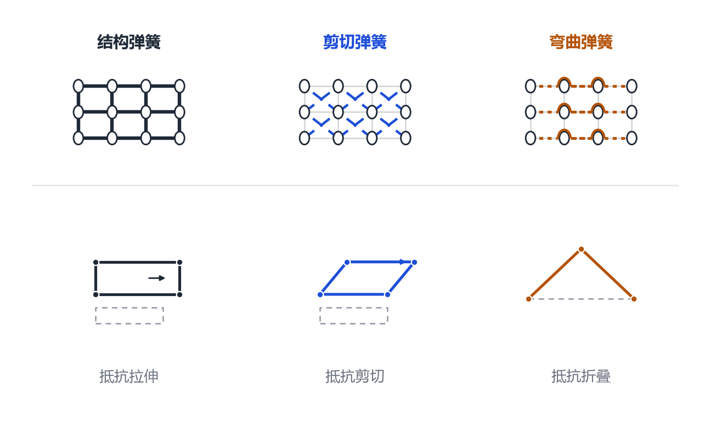
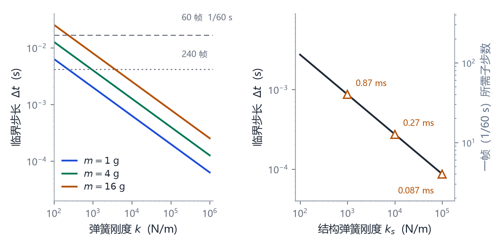

# 第 1 章 从一根弹簧开始

> 本章导读：一件垂下来的衬衫为什么自带褶皱；一根弹簧的力和能量怎么写；三角网上的三类弹簧各抵抗什么；显式积分的临界步长从哪里来；刚度、质量、步长三者为什么只能挑两个；阻尼什么时候是物理的、什么时候是数值的；弹簧网这套写法在哪些地方一定是错的。

## 1.1 一件衬衫挂起来之后

衣架钩在门后，一件棉衬衫挂上去，下摆垂下来不是平的，而是一圈一圈的波纹。把同一件衬衫平铺在桌面上，那些波纹就不见了，只剩熨斗留下的折痕。

同一块布，为什么挂着有褶、铺着没褶？

因为布在两个方向上抵抗变形的能力差了四五个数量级。沿经纬方向拉，要把一块一米宽的布拉开百分之一，需要挂上几十公斤；而沿厚度方向折，一根手指的力就足以把它弯成圆弧，松手又弹回来。面内的拉伸几乎是刚性的，面外的弯曲几乎是无阻力的，这两种性质同时存在于几毫米厚的一层材料上。褶皱就是这两个极端打架的结果：布料被重力拉长一点点，多出来的那点长度无处可去，只能在面外鼓起来。

绝大多数柔体模拟的麻烦都出在这句话上。如果一块布只有拉伸没有弯曲，它就是一张网兜，形状完全由外力和边界决定；如果只有弯曲没有拉伸，它就是一张纸，可以任意折叠而面积不变。真实的布两者都有，而且量级差得很远。求解器要么被最硬的那个方向限制住步长，要么被最软的那个方向拖住收敛。

最早的布料模拟就是一张弹簧网。把布切成三角网格或四边形网格，每条边放一根弹簧，转折的地方再加一根跨过顶点的弹簧，然后对每个顶点积分牛顿第二定律。这套写法在九十年代中期的图形学里就成型了，做法一直用到现在 [@provot1995]。它流行的理由很实在：力是局部的，每个顶点只跟自己几个邻居打交道，没有全局矩阵要组装、要分解；代码短，加一根弹簧就多一种刚度；而且它天然就是并行的，顶点之间互不依赖。

那时候另一条路也已经在跑：从连续体的应变能出发，把能量在单元上积分，对位置求导得到力 [@terzopoulos1987]。这条路更"物理"，代价是要处理形函数、单元刚度矩阵、能量密度这些概念。弹簧网把这块绕开了，代价是它给出的刚度跟网格绑在一起，跟材料的关系变得含糊。这一章先把弹簧网这条路走到头，看清楚它在什么地方一定出错。错在哪，决定了后面为什么必须换成约束和能量。

## 1.2 一根弹簧的力与能量

两个质点 $\mathbf{x}_a$ 与 $\mathbf{x}_b$，一根自然长度 $L_0$ 的弹簧把它们连起来。弹簧的力总是沿着两点连线，大小正比于伸长量：

$$\mathbf{f}_a=-k\left(|\mathbf{x}_b-\mathbf{x}_a|-L_0\right)\frac{\mathbf{x}_b-\mathbf{x}_a}{|\mathbf{x}_b-\mathbf{x}_a|},\qquad \mathbf{f}_b=-\mathbf{f}_a$$

$k$ 是刚度，单位是牛每米。式子里那个单位向量负责把力摆到连线上，括号里的长度差负责决定拉还是推。两根弹簧的力大小相等方向相反，这一条保证了动量守恒，也是弹簧网能被信任的最低要求。

把力写成能量的负梯度更省事。定义一个标量

$$E=\frac{1}{2}k\left(|\mathbf{x}_b-\mathbf{x}_a|-L_0\right)^2$$

对 $\mathbf{x}_a$ 求偏导就得到上面的 $\mathbf{f}_a$。能量写法有三个好处：多个弹簧的能量直接相加，不必管各自的力方向；能量是标量，检查数值稳定性时可以直接画它；后面换成有限元时，能量密度的积分和这里的写法是同一件事，只是把求和换成积分。

一根弹簧的刚度不是材料常数。把一段截面面积 $A$、长度 $L_0$、弹性模量 $E$ 的杆当成一根弹簧，两端各拉 $\delta$，应变是 $\delta/L_0$，应力是 $E\delta/L_0$，力是 $EA\delta/L_0$，于是

$$k=\frac{EA}{L_0}$$

分母上那个长度是关键。同一个材料，切成两段，每段的刚度是原来的两倍；网格加密一倍，每根弹簧就硬一倍。这句话在后面会反复出现，它是弹簧网所有网格依赖问题的源头。

弹簧还有一个性质值得单独说：它的力只跟两点之间的距离有关，不关心这两个点在哪、整体转了多少度。这叫旋转不变性，是弹簧网比"直接用线性弹性"更可靠的地方，也是它在大变形下不会像小应变模型那样"转一下就多出一份能量"的原因。但弹簧对拉伸和压缩一视同仁：拉长 10% 需要 $0.1kL_0$ 的力，压短 10% 也需要同样大的力。真实的布被压短时会起皱，几乎不产生面内力，这个差别弹簧网表达不出来。

## 1.3 三类弹簧

光有沿边长的弹簧，一张网只能抵抗拉伸。要让它像布，得加另外两类。三角网上的三种连法各有名字：

**结构弹簧**连接网格的相邻顶点，沿网格的两条参数方向排布。它抵抗的是面内拉伸和压缩，决定了布"拉不长"这件事。**剪切弹簧**连接同一个三角形里不相邻的两个顶点，也就是方格的对角线。它抵抗的是面内剪切，也就是一个正方形变成菱形的那种变形。**弯曲弹簧**跳过中间一个顶点，连接相隔两格的顶点。它抵抗的是沿一条网格线的折叠。

<figure class="fig">

<figcaption><b>图 1-1</b>　三角网上的三类弹簧（示意图）。上排是同一张 $4	imes3$ 顶点网格，每格只画出一类：结构弹簧连相邻顶点，剪切弹簧连每个方格的两条对角线，弯曲弹簧跨过一个顶点、跨过处画成一个小半圆以免与网格线混淆。下排是这三类弹簧各自抵抗的变形，灰色虚线是变形前，彩色实线是变形后，从左到右为沿边拉伸、面内剪切、沿网格线折叠。</figcaption>
</figure>

一个 $5\times5$ 的顶点网格，按上面三种连法数一遍，结构弹簧 $5\times4\times2=40$ 根，剪切弹簧 $4\times4\times2=32$ 根，弯曲弹簧 $5\times3\times2=30$ 根，一共 102 根。顶点 25 个、自由度 50 个，平均每个自由度摊到两根弹簧。这个比例在布料网格里很典型：约束比自由度多，系统是超定的，任何一次投影都不可能同时满足全部约束，只能迭代。

三类弹簧里，弯曲弹簧最值得单独说。它的刚度比拉伸小几个数量级，而且还有一个更隐蔽的毛病：它跨过一个顶点，能量是 $\frac{1}{2}k_b\left(|\mathbf{x}_{i+2}-\mathbf{x}_i|-2h\right)^2$，其中 $h$ 是格距。设这段弧的曲率是 $\kappa$，弧长 $2h$ 对应的弦长比弧长短 $\frac{1}{3}h^3\kappa^2$，代进去

$$E_b=\frac{1}{2}k_b\left(\frac{1}{3}h^3\kappa^2\right)^2=\frac{1}{18}k_b h^6\kappa^4$$

能量正比于曲率的四次方。真实的弯曲能正比于曲率的平方，因为弯矩正比于曲率、弯曲能是弯矩乘转角再积分。四次的后果是：小曲率时弹簧几乎不出力，布软得像纸；曲率一大突然变硬，褶子的尖端被拉直。于是弹簧网做出来的布，平坦处太软、折痕处太硬，中间没有过渡。褶皱的波长和形状都跟真实布料对不上，原因就在这里。

修法是用角度而不是弦长来写弯曲能，比如二面角形式，或者直接对离散曲率积分 [@grinspun2003]。这类写法在布料章节里会展开，这里只需要记住一件事：弹簧网里"弯曲"这个词，指的是跨顶点的那根弹簧，跟材料力学里的抗弯刚度不是同一个量。

## 1.4 显式积分能撑多久

把 102 根弹簧的力加起来，除以质量，积分，更新位置。最常见的积分格式是半隐式欧拉：

$$\mathbf{v}_{n+1}=\mathbf{v}_n+\frac{\Delta t}{m}\mathbf{f}(\mathbf{x}_n),\qquad \mathbf{x}_{n+1}=\mathbf{x}_n+\Delta t\,\mathbf{v}_{n+1}$$

先更新速度、再用新速度更新位置。这个顺序不是随便排的，写成先位置后速度的显式欧拉，一个静止的振子会自己越振越大，跑几秒就飞出去。

先看最简单的情况：一个质量 $m$ 挂在刚度为 $k$ 的弹簧上，沿一个方向振动。把位移记作 $x$，方程是 $m\ddot{x}=-kx$，角频率 $\omega=\sqrt{k/m}$。用上面的格式离散，令 $a=\omega^2\Delta t^2$，一步之后状态变换写成矩阵

$$\begin{pmatrix}x_{n+1}\\ \Delta t\,v_{n+1}\end{pmatrix}=\begin{pmatrix}1-a & 1\\ -a & 1\end{pmatrix}\begin{pmatrix}x_n\\ \Delta t\,v_n\end{pmatrix}$$

这个矩阵的行列式恒等于 1，所以两个特征值之积是 1。判别式是 $a(a-4)$：当 $0\lt a\lt 4$ 时特征值是共轭复数，模长都为 1；当 $a\gt 4$ 时特征值变成两个实数，一个的模长大于 1。于是稳定条件就是

$$\Delta t\lt \frac{2}{\omega}=2\sqrt{\frac{m}{k}}$$

这就是常被引用的那条公式。注意它给出的不是"精度够用"的步长，而是"不发散"的步长。两者差得很远。

临界步长以内，振幅一步不差地保持，但振动频率被算高了。离散解的频率是 $\omega_h=\arccos\left(1-\frac{1}{2}\omega^2\Delta t^2\right)/\Delta t$，用它除以真实的 $\omega$：

$$\frac{\omega_h}{\omega}=\frac{1}{\omega\Delta t}\arccos\left(1-\frac{\omega^2\Delta t^2}{2}\right)$$

$\omega\Delta t=0.5$ 时高 1.1%，等于 1 时高 4.7%，到 1.8 时高了 24%。也就是说，一个刚放到临界步长一半以内的系统，周期误差还是个位数百分比；一旦逼近临界，周期已经错了两成，画面上看起来就是"抖得比实际快"。

越过临界之后不是慢慢变坏，而是指数式爆炸。$\omega\Delta t=2.05$ 时单步放大因子是 1.5625，按 60 帧跑一秒是 60 步，放大 $1.5625^{60}\approx4\times10^{11}$。一个毫米的初始误差会在半秒内变成几十米。实战里看到的"布料突然炸成一片乱线"，多半是这一步越界了，而且越界得不多——只超了 2%。

单体弹簧的临界步长好算，一张网就没那么直接了。网里每个顶点连着六根左右弹簧，运动方向有两个，最硬的那个模态比任何单根弹簧都快。正确的判据是把全部弹簧的刚度组装成刚度矩阵 $\mathbf{K}$，把质量写成对角矩阵 $\mathbf{M}$，求广义特征值问题的最大特征值：

$$\omega_{\max}=\sqrt{\lambda_{\max}\left(\mathbf{M}^{-1}\mathbf{K}\right)},\qquad \Delta t\lt \frac{2}{\omega_{\max}}$$

对一个 $5\times5$ 的顶点网格，格距 5 厘米，顶点质量 1 克，结构弹簧刚度 1000 N/m，剪切弹簧 500 N/m，弯曲弹簧 100 N/m，算出来的最大角频率是 2307 rad/s，临界步长 0.87 毫秒。这个数跟"一根弹簧两个质点"的估计差了一倍多：单体公式 $2\sqrt{m/k}=2$ 毫秒，网格只有 0.87 毫秒，因为一个顶点同时被六根弹簧拉，两个方向都在动。

<figure class="fig">

<figcaption><b>图 1-2</b>　显式积分的临界步长（真实计算）。左：单体弹簧的 $\Delta t=2\sqrt{m/k}$，三条线分别对应质点质量 1 g、4 g、16 g，横轴刚度从 $10^2$ 到 $10^6$ N/m，双对数坐标；两条水平虚线是 60 帧与 240 帧的帧长，曲线落在虚线之下表示该组合在这个帧率下必然发散。右：$5\times5$ 顶点三角网的临界步长随结构弹簧刚度的变化，点由 $\mathbf{M}^{-1}\mathbf{K}$ 的最大特征值算出（格距 5 cm、顶点质量 1 g、剪切刚度取结构的二分之一、弯曲刚度取十分之一），三角形标出 1000、$10^4$、$10^5$ N/m 三个取值，对应 0.87、0.27、0.087 毫秒，纵向是"每帧要切多少个子步"。</figcaption>
</figure>

右图的三个点值得多看一会儿。刚度从 1000 提到 $10^5$，只提了两个数量级，临界步长掉了十倍，而 60 帧的帧长是 16.7 毫秒。要把这三个刚度都算稳，每秒分别需要 19、61、192 个子步。这就是"硬布料算不动"的全部内容，跟代码写得好不好没关系。

## 1.5 刚度、质量、步长的三角

临界步长的公式里只有三个量：$k$、$m$、$\Delta t$。想把步长做大，只能减小分子上的刚度或者加大分母上的质量。这两条路都通向同一个地方：算出来的东西不再是原来那块布。

先看刚度。布料的拉伸刚度不是随便给的数，它来自材料。一根代表宽度 $w$、厚度 $t$、长度 $h$ 的布条的弹簧，刚度是

$$k=\frac{E\,t\,w}{h}$$

其中 $E$ 是等效拉伸模量。网格加密时 $h$ 变小，$w$ 也变小，但 $w$ 跟 $h$ 同步缩，所以 $k$ 正比于 $1/h$：格距减半，每根弹簧硬一倍。顶点质量跟面积走，正比于 $h^2$，格距减半只剩四分之一。两者一起代进临界步长

$$\Delta t\lt 2\sqrt{\frac{m}{zk}}=2h\sqrt{\frac{\rho_A}{zEt}}$$

$\rho_A$ 是面密度，$z$ 是每个顶点连的弹簧数。步长正比于格距，与材料无关。这条关系比它看起来更狠：格距减半，步长减半，顶点数变四倍，弹簧数变四倍，每模拟一秒的计算量涨八倍。加密一倍要付八倍的账。

拿一组具体数字试试。面密度 150 g/m² 的棉布，厚度 0.3 毫米，等效拉伸模量按"25 毫米宽的布条在 1% 伸长下受 5 N"折算，约 67 MPa。格距 5 毫米，顶点质量 3.75 毫克，每根结构弹簧的刚度约 $2\times10^4$ N/m。取 $z=6$，临界步长是 $1.1\times10^{-5}$ 秒。60 帧的帧长是 16.7 毫秒，两者差 1490 倍。想在 60 帧的预算里把这块布算稳，一帧要切一千多个子步。

换一块布、换一种织法，这个数会差两三倍，但量级说明了一件事：真实布料的拉伸刚度，配上真实的网格分辨率，用显式弹簧网是算不动的，不是"慢一点"，是差三个数量级。九十年代那些布料演示之所以能跑，是因为把 $k$ 调软了——把布当成有弹性的橡胶膜来算，形变对了，手感不对。

再看质量。把顶点质量放大 100 倍，临界步长涨 10 倍，看起来是个划算的买卖。代价有三个。第一，布变重了，同样的重力下下垂量按比例增加，一件衬衫会垂成一条口袋。第二，所有的动力学都变慢了，振动周期按 $\sqrt{m}$ 拉长，布在空中飘的时间变长，看起来像慢动作。第三，弯曲和重力的平衡点移动了，褶皱的波长跟着变，因为褶皱的尺度由 $\sqrt{B/\rho_A g}$ 这类比值决定，$B$ 是抗弯刚度，$\rho_A$ 是面密度，改质量就改了波长。

工程上确实有人这么干，叫质量缩放。它的适用场景很窄：只需要静态形状、不关心动力学时间尺度的时候。动画里飘动的旗子、被风吹起的窗帘，质量缩放会把风的效果一起改掉，不能这么用。

三条腿的凳子只能坐两条。要真实刚度，就得小步长；要大步长，就得软材料或者重材料。想三条都占，只能换算法：要么隐式积分，让刚度进矩阵而不是进步长限制；要么把力换成约束，让"不可伸长"变成一个几何条件而不是一个大刚度。后者就是下一章的内容。

## 1.6 阻尼的两种来源

真实的布有阻尼。一块布从桌上被拎起来，抖两下就停，不会一直荡。这个衰减来自纤维之间的摩擦、空气阻力、纱线内部的粘弹性。写进弹簧网，最常见的形式是沿弹簧方向的粘性阻尼：

$$\mathbf{f}^{\text{damp}}_a=c\left[(\mathbf{v}_b-\mathbf{v}_a)\cdot\hat{\mathbf{n}}\right]\hat{\mathbf{n}},\qquad \mathbf{f}^{\text{damp}}_b=-\mathbf{f}^{\text{damp}}_a$$

$c$ 是阻尼系数，单位是牛秒每米，$\hat{\mathbf{n}}$ 是弹簧方向的单位向量。只取连线方向的分量，因为它模拟的是沿纤维的摩擦，不阻止整根弹簧横向摆动。

对一个单自由度的振子，加了阻尼之后方程是 $m\ddot{x}+c\dot{x}+kx=0$，定义阻尼比

$$\zeta=\frac{c}{2\sqrt{km}}$$

$\zeta\lt 1$ 时振幅按 $e^{-\zeta\omega t}$ 衰减，$\zeta=1$ 时最快回到平衡且不振荡。按前面那组网格参数，$k=1000$ N/m、$m=1$ g 给出临界阻尼系数 $c=2\sqrt{km}=2$ N·s/m。$\zeta=0.1$ 时时间常数 $1/(\zeta\omega)=10$ 毫秒，也就是抖几下就停——这个量级跟真实布料的手感大致对得上，但真实布料的阻尼不是线性的，振幅大时衰减快、小时衰减慢，一个常数 $c$ 表达不了。

另一类阻尼跟材料无关，是积分格式带进来的，叫数值阻尼。它不是物理的，但它在结果里的表现跟物理阻尼一模一样：能量在掉。区分两者的办法很直接：把 $c$ 设成零，能量还在掉，那就是数值的。

三种积分格式给出三张完全不同的答卷。显式欧拉的单步放大因子是 $\sqrt{1+\omega^2\Delta t^2}$，永远大于 1，能量单调增长。半隐式欧拉在临界步长以内放大因子恰好是 1，能量不增不减，但频率偏高，前面算过 $\omega\Delta t=1$ 时高 4.7%。后向欧拉无条件稳定，代价是每一步都在吃能量，放大因子是 $1/\sqrt{1+\omega^2\Delta t^2}$：$\omega\Delta t=0.1$ 时每步掉 0.5%，等于 1 时每步只剩 0.707。

后向欧拉那张表值得盯住。$\omega\Delta t=1$ 意味着一秒钟里振子要振 1000 弧度，也就是 160 赫兹，而步长取到 1 毫秒。对一个 160 Hz 的振动，1 毫秒的步长根本分辨不出它的波形，算出来的"衰减"其实是采样不足的结果。这就是数值阻尼的真面目：它吃掉的是那些步长分辨不了的快振动，慢振动基本不受影响。这个性质有时候是好事——高频抖动正是布料模拟里最难看的东西，隐式积分顺便把它滤掉了。

半隐式欧拉的行为更微妙。线性分析说它一步不差地保持振幅，但它对非线性系统不保能量。布料网是大变形、强非线性的，弹簧的长度变化和力的方向变化耦合在一起，能量会在各个模态之间来回倒。倒的结果通常是往低频堆：高频模态被反复激励又反复抑制，最后变成一片细碎的抖动，看起来像布在"发毛"。加大刚度、加大步长都会让这个现象变重。

实战里的判据只有一条：把物理阻尼关掉，让一块布自由落下、挂住、再放开，看它的能量曲线。如果能量单调下降，说明数值阻尼在起作用；如果能量下降的速率随步长变化，那几乎肯定是数值阻尼。这条检查比任何理论分析都快，也比任何理论分析都可靠。

## 1.7 弹簧网错在哪

弹簧网能跑，跑起来也像布，但它有四个地方一定是错的，而且错得没法用调参绕过去。

第一个是方向依赖。方格网上只有横竖两个方向有结构弹簧，斜方向没有。对角线方向上的等效刚度由剪切弹簧提供，而剪切弹簧的刚度是另一个独立的参数。也就是说，同一块布沿经纬方向拉和沿 45 度拉，刚度比由参数决定，不由材料决定。真实的机织物确实有方向性，经纬和斜向的模量差得还不小，但那个差别来自纱线的织法，有确定的数值；弹簧网给出的差别来自网格拓扑，改网格就改材料。想让刚度与方向无关，只能靠调参去凑，而凑出来的比例只对规则的无限大网格成立，到了边界和不规则的三角剖分上立刻失效。

第二个是泊松效应。一块布被拉长，宽度方向会缩一点。弹簧网没有这个机制：顶点的横向位置只受横向弹簧的约束，纵向拉伸不会引起横向收缩。要硬塞进去，得让横向弹簧的刚度依赖于纵向应变，那就是另一种模型了。后果在拉伸大的时候看得出来：真实的布被拉成一条窄带，弹簧网拉出来还是一条等宽的带子。

第三个是体积。三维柔体用四面体弹簧网，六条边各一根弹簧，看起来什么都有了，实际上缺一个东西：体积。四面体被压扁时，六条边可以同时变短而不违反任何一条弹簧约束，但这个四面体已经翻面了，体积从正变负。翻面之后弹簧还在正常工作，力还在往回拉，物体卡在一个物理上不可能的状态里。要做体积保持，必须显式加一个体积约束或压力项，光靠边长弹簧不够。布料是二维的，这个问题不直接显现，但一做厚布料、一做充气物就撞上。

还有第四个，前面提过：弯曲能正比于曲率四次方，折痕的形状不对。

这几个毛病有一个共同的根源：弹簧网只知道"边长"，不知道"形变"。一根弹簧只知道自己的长度，不知道它所代表的那一小块材料变成了什么形状：面积变了没有、二面角开了没有、体积还是不是正的，它都看不出来。把所有边长都固定住，一个三角形仍然可以翻转；把所有边长都固定住，一块布仍然可以整体弯成筒。要想表达"材料抵抗什么"，得写到形变梯度、面积、体积、二面角这些量上去。

这些量有一个统一的来源：能量。把材质的应变能写成形变梯度的函数，离散到单元上，力就是能量的梯度——刚度、各向异性、体积响应都从同一个函数里出来，不会互相打架。这条路的代价是要处理形变梯度的极分解、要保证能量在刚体旋转下不变、要在压缩时选一个不炸的模型。

介于两者之间的写法是把能量写成约束：不写"力正比于伸长"，而写"伸长量应该为零"，让求解器去满足它。约束写法的好处是刚度可以任意大而不影响稳定性，因为约束不进入步长限制。代价是它只能表达"硬"的那一面，软的那一面要另外加柔度 [@macklin2021]。这两种写法就是接下来两章的内容。
