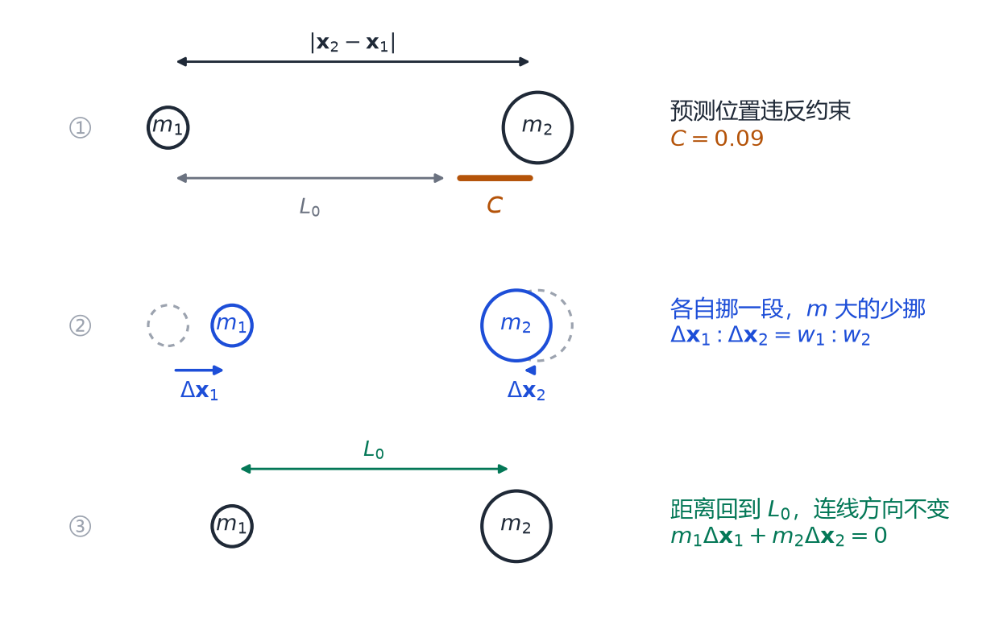
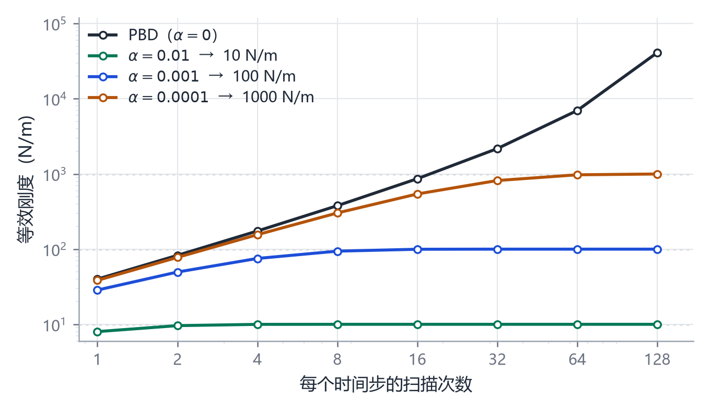

# 第 2 章 位置动力学

> 本章导读：一根几乎拉不长的绳子该怎么算；把"不可伸长"写成几何条件以后，力去哪了；距离约束的投影公式为什么带 $1/m$ 的权重；逐条投影为什么跟扫描顺序有关；XPBD 用一个柔度参数把刚度和迭代次数拆开；同样的预算该花在子步上还是迭代上；这套写法在哪几件事上永远给不出对的答案。

## 2.1 一条晾在院子里的绳子

两棵树之间拉一根尼龙绳，绳上晾着几件湿衣服。绳子几乎不伸长，但中间垂得很低，两头的绑点被拉得紧紧的。

想用弹簧算这根绳，马上撞上第 1 章的那个三角。绳子的拉伸刚度很大，一米的绳子拉长一厘米要几十牛的力，$k$ 在 $10^3$ 量级；每件湿衣服几公斤，分到每个顶点上的质量大概几十克。临界步长 $2\sqrt{m/k}$ 算出来是几毫秒。想把整根绳算稳，一帧要切十几个子步，还得接受一个更难受的事实：绳子在接近绷直的时候，弹簧的长度变化极小、力极大，位置对参数极度敏感，稍微过一点就抖成一片。

把数代进去看得更清楚。一米长的绳子拉 1 厘米要 30 牛，这一段的刚度就是 3000 N/m；一件湿衣服两公斤，分到 20 个顶点上，每个顶点 0.1 公斤。临界步长 $2\sqrt{0.1/3000}=11.5$ 毫秒，一帧 16.7 毫秒，切两个子步就能跑。可这根绳看起来还是有弹性：挂 60 牛会伸 2 厘米，真实的尼龙绳只伸 2 毫米。把刚度提到 $3\times10^4$，伸长对了，临界步长掉到 3.7 毫秒，每帧要 5 个子步；再提到 $3\times10^5$，每帧 15 个。刚度每加一个数量级，步长掉 3.2 倍，第 1 章那个三角在这根绳子上又出现了一次。

换个提法。不问"绳子这一小段受多大的力"，问"哪些形状是绳子允许的"。绳子上任意两个相邻质点的距离不能超过自然长度——这是一条几何约束，跟力的大小无关。算出下一时刻每个质点的位置之后，如果发现某两点离得太远，就把它们拉回允许的范围，别的不动。

这就是位置动力学（position based dynamics）的出发点 [@muller2007]。一个时间步分三段：

1. 用外力更新速度：$\mathbf{v}\leftarrow\mathbf{v}+\Delta t\,\mathbf{M}^{-1}\mathbf{f}_{\text{ext}}$
2. 用速度预测位置：$\mathbf{x}^{\ast}\leftarrow\mathbf{x}+\Delta t\,\mathbf{v}$
3. 对预测位置逐条投影约束，得到修正后的 $\mathbf{x}$，再用 $\mathbf{v}\leftarrow(\mathbf{x}-\mathbf{x}^{\text{旧}})/\Delta t$ 反推速度

这套写法天生适合布。第 1 章的三类弹簧在约束语言里都有直接对应：结构弹簧和剪切弹簧都是距离约束，只是 $L_0$ 取不同的值；弯曲弹簧也是距离约束，跨过一个顶点连相隔两格的两个顶点，$L_0$ 取两倍格距。碰撞同样是一条约束，内容是两点的距离不小于两倍的厚度。一套投影公式配上不同的 $C$，就把需要三种弹簧的东西全包住了。区别在于约束没有刚度这个参数，只有满足和不满足。

第二段和第三段的区别是整个方法的核心。第二段是牛顿力学，第三段是几何。投影只改位置，不改速度；速度在最后一步被位置差重新定义。这个"用位置差反推速度"的动作看起来是个实现细节，实际上决定了这个方法的能量行为，后面要专门算这笔账。

把力换成约束，换来的东西很实在：刚度不再受步长限制。绳子要"几乎不可伸长"，在弹簧模型里意味着 $k$ 很大，在约束模型里意味着约束会被解到残差为零，两者的稳定性完全不是一回事。代价是这种"解到零"是逐条进行的，约束之间互相打架，只能迭代到近似，而近似的程度决定了布到底有多软。也就是说，刚度没有消失，它从参数变成了求解过程的一个副产品。

## 2.2 把一个距离约束拉回去

看最基础的一条：两个质点 $\mathbf{x}_1$、$\mathbf{x}_2$，约束是它们的距离等于 $L_0$，

$$C(\mathbf{x}_1,\mathbf{x}_2)=|\mathbf{x}_2-\mathbf{x}_1|-L_0=0$$

$C$ 是约束函数，量纲是长度，$C=0$ 表示满足，$C\gt 0$ 表示拉长了，$C\lt 0$ 表示压短了。投影要做的是：在"$\mathbf{x}$ 改动尽量小"的前提下把 $C$ 拉回零。"改动尽量小"需要一个度量，位置动力学选的是质量加权的平方和

$$\min_{\Delta\mathbf{x}_1,\Delta\mathbf{x}_2}\ \frac{1}{2}m_1|\Delta\mathbf{x}_1|^2+\frac{1}{2}m_2|\Delta\mathbf{x}_2|^2\quad\text{满足}\quad C(\mathbf{x}+\Delta\mathbf{x})=0$$

用 $m$ 加权而不是直接数长度，是因为质量代表惯性：同样的位移，质量大的那个需要的冲量大，改它不划算。写成拉格朗日函数，对 $\Delta\mathbf{x}_i$ 求导，得到位移必须沿着约束的梯度方向

$$\Delta\mathbf{x}_i=-\lambda\,w_i\,\nabla_{\mathbf{x}_i}C,\qquad w_i=\frac{1}{m_i}$$

$w_i$ 叫逆质量，也可以理解成"这个质点有多好推"。把 $C$ 线性化后代回约束方程，解出乘子

$$\lambda=\frac{C}{\sum_i w_i\left|\nabla_{\mathbf{x}_i}C\right|^2}$$

对距离约束，梯度是单位向量，平方是 1，分母就是 $w_1+w_2$。设 $\hat{\mathbf{n}}$ 是从 $\mathbf{x}_1$ 指向 $\mathbf{x}_2$ 的单位向量，两个质点的修正是

$$\Delta\mathbf{x}_1=\frac{w_1}{w_1+w_2}\,C\,\hat{\mathbf{n}},\qquad \Delta\mathbf{x}_2=-\frac{w_2}{w_1+w_2}\,C\,\hat{\mathbf{n}}$$

拉长时 $C\gt 0$，$\mathbf{x}_1$ 沿 $\hat{\mathbf{n}}$ 前进、$\mathbf{x}_2$ 沿 $-\hat{\mathbf{n}}$ 后退，两点相向而行，直到距离回到 $L_0$。两个修正的长度比是 $w_1:w_2$，也就是质量的倒数比：质量 1 公斤的点跟质量 3 公斤的点连在一起，前者挪 3/4，后者只挪 1/4。

手算一遍跟图 2-1 对一下。$m_1=1$、$m_2=3$，逆质量是 1 和 $1/3$，分母 $4/3$。$L_0=0.30$ 米，预测位置相距 0.39 米，违反量 0.09 米。$\mathbf{x}_1$ 挪 $0.09\times\dfrac{1}{4/3}=0.0675$，$\mathbf{x}_2$ 挪 $0.09\times\dfrac{1/3}{4/3}=0.0225$，两段合起来正好 0.09，距离回到 0.30。动量也对得上：$1\times0.0675$ 与 $3\times0.0225$ 相等，质心没动。

<figure class="fig">

<figcaption><b>图 2-1</b>　距离约束的投影（示意图）。按 $m_1:m_2=1:3$、$L_0=0.30$、违反量 $C=0.09$ 的比例画出，圆的面积正比于质量。上：预测位置，两点相距大于 $L_0$；中：两点各沿连线方向挪一段，$m_1$ 挪 0.068、$m_2$ 挪 0.022，长度比是逆质量之比 3:1，重的那一头几乎不动；下：投影之后距离回到 $L_0$，连线方向不变，因为修正只沿梯度方向。右侧三行文字给出每一步对应的量与守恒关系。</figcaption>
</figure>

这个公式有几个性质值得记住。第一个是它保持动量：$m_1\Delta\mathbf{x}_1+m_2\Delta\mathbf{x}_2=0$，因为 $m_i w_i=1$。一对质点的质心不会因为投影而移动，这是它跟"直接把两点拉到中点"最本质的差别，后者会让整块布慢慢往一边漂。

质量在这里还起一个不那么显然的作用。网格上顶点的质量正比于它摊到的面积，四个角上的顶点只有内部顶点的四分之一，于是同一个约束在角落处会把角落的顶点拉得更多。这不是错误：真实的布边上少了一半材料，确实更容易被拽动。反过来说，如果图省事给所有顶点配同一个质量，布的四边就会表现出一圈不该有的硬边。

第二个是它只处理一阶。$C$ 是两点距离的线性化，当两点几乎重合时方向 $\hat{\mathbf{n}}$ 没有定义，公式退化，代码里得加保护：距离小于一个阈值时随便挑一个方向，或者直接跳过。这个退化点不是理论洁癖，湿衣服堆在一起、布料自碰撞的接触点上，顶点之间的距离经常小于一毫米。

第三个性质要到后面才显现：如果 $\mathbf{x}_1$ 是被固定的（比如绳子绑在树上），就把 $w_1$ 设为零，公式自动变成"只挪 $\mathbf{x}_2$"。固定点不需要特判，它是逆质量为 0 的一个特例。整条绳子只改一个顶点的质量，绑点就固定住了。

把 $w$ 跟第 1 章的弹簧对比一下，它跟柔度是同一个量纲。弹簧的伸长是 $\delta=C$，力是 $kC$，位移是 $C/(k)$；投影的位移是 $C/(w_1+w_2)$。两边的 $1/k$ 与 $1/(w_1+w_2)$ 对应，只不过弹簧的刚度是材料的，投影的分母是质量的。这个类比在 XPBD 里会被补全：那时候分母里会同时出现质量和柔度。

还有一个实现细节。约束函数不一定要写成 $C=|\mathbf{d}|-L_0$，写成 $C=|\mathbf{d}|^2-L_0^2$ 也能投影，每条约束每遍省一次开方。在几百万条约束的网格上，这一次开方真的能换成时间。代价是 $C$ 的量纲从长度变成了面积，同一个柔度数值在两种写法下表示的刚度完全不同，抄参数时得连带换一次单位。库函数通常两种都提供，并在内部把柔度换算好；自己实现的时候，两种写法混用是最常见的坑。

## 2.3 一条链要扫几遍

真实的布有几百条约束，它们不独立。一条链上，把第 3 段的长度改对了，第 4 段的长度就变了；改第 4 段，第 5 段又变。所以约束只能一条一条地扫，扫完一遍再扫一遍，这就是高斯-赛德尔迭代：每次处理一条约束时，用的是它前面那些约束刚刚改过的位置。

扫描的顺序会改变结果。从固定端往自由端扫，第一遍就能把"这头不能动"的信息一路传到另一头；从自由端往固定端扫，第一遍只能传一段，剩下的靠后面的遍数补。两边扫完的结果不会完全相同，因为迭代没有收敛到精确解，停在哪儿取决于路径。

这个差别能具体到遍数。从固定端开始扫，第 1 条约束先把第 2 个顶点往固定端拉，第 2 条约束接着用这个刚改过的位置，又把第 3 个顶点拉一截，消息一遍到底。反着扫，第 1 遍里最后一条约束把第 10 个顶点拉向第 9 个，但第 9 个顶点还没动，所以整条链只动了最后一段；消息要十遍才能爬到头。同样是 10 段，一个是一遍到位，一个是十遍到位，表 2-1 里"扫一遍 40 N/m"偏软得那么厉害，一半原因就在这里。

一条 10 段的链，一端固定、另一端挂 1 N 的恒力，链的其余部分自由，质量每个 0.1 公斤，分段长度 0.1 米，步长取 1/60 秒。用纯投影（柔度为零）跑，量出来的等效刚度是：

**表 2-1**　10 段链的等效刚度随扫描次数的变化

| 每步扫描次数 | 1 | 2 | 4 | 8 | 16 | 32 | 64 |
|---|---|---|---|---|---|---|---|
| 等效刚度 (N/m) | 40 | 83 | 174 | 379 | 865 | 2176 | 6989 |

这张表是这套方法最要命的地方。同一条链、同一组参数，扫一遍算出来是 40 N/m，扫 64 遍就变成 6989 N/m，差了一百七十倍。在 16 次的时候已经比扫一遍硬了二十倍，而 64 次的时候已经接近刚体了。

物理上这条链应该多硬？如果每段代表一根刚度 1000 N/m 的弹簧，10 段串联，总刚度是 100 N/m。扫一遍是 40，偏软，扫 4 遍是 174，已经偏硬了。真实的材料刚度在这张表里找不到一个稳定的位置——它依赖于你扫了几遍。这意味着两件事：换一帧率，布的手感会变；同一个场景里，求解器迭代次数的自我调整会让材料变得不可预测。

收敛的方向也是单向的：次数越多越硬，趋于完全刚性。纯投影没有"刚好 100 N/m"这一档，它只能在"太软"和"太硬"之间滑过去。想让刚度停在一个具体值上，必须给约束加一个有限大小的柔度，这就是下一节。

顺带说一个实现上的事：扫描顺序影响收敛速度，实践中常用的做法是正反交替扫，也就是一遍从前往后、一遍从后往前。这能消掉方向偏置，代价很小。另一种做法是把所有约束的修正先算出来再一起施加，这就是雅可比迭代——它天然适合并行，但收敛比高斯-赛德尔慢，通常要配一个松弛因子。

## 2.4 柔度：让刚度不再取决于迭代次数

XPBD 改了一行。约束不再被要求严格满足，而是被允许像一个刚度有限的弹簧那样被拉开，拉开的量由一个叫柔度的参数 $\alpha$ 控制 [@macklin2016]。柔度的定义是刚度的倒数

$$\alpha=\frac{1}{k}$$

单位是米每牛，意思是"每施加一牛的力，这个约束允许拉长多少米"。一根 1000 N/m 的弹簧，柔度是 0.001 米每牛。

投影时乘子上多一项：

$$\Delta\lambda=\frac{-C-\tilde{\alpha}\lambda}{w_1+w_2+\tilde{\alpha}},\qquad \tilde{\alpha}=\frac{\alpha}{\Delta t^2}$$

$\lambda$ 是这个子步里这条约束已经累积的乘子，$\tilde{\alpha}$ 是缩放过后的柔度。收敛之后，每条约束满足

$$C+\tilde{\alpha}\lambda=0$$

把 $\tilde{\alpha}$ 代回去，两边乘以 $k$，注意到力等于 $\lambda/\Delta t^2$，就得到

$$k\,C+\frac{\lambda}{\Delta t^2}=0\quad\Longrightarrow\quad f=-kC$$

这正是胡克定律。迭代收敛的时候，XPBD 给出的约束力跟一根刚度为 $1/\alpha$ 的弹簧一模一样，跟步长无关，跟迭代次数无关。刚度从一个"求解过程的副产品"变回了一个参数。

那个 $\Delta t^2$ 是从哪来的？因为 $\lambda$ 不是力，是冲量类的量：位置修正等于 $w\lambda$，量纲是长度，所以 $\lambda$ 的量纲是长度除以逆质量，也就是质量乘长度。力等于 $\lambda/\Delta t^2$。柔度是"每牛的伸长"，要跟 $\lambda$ 相加，就得先乘上 $\Delta t^2$ 换成同样的量纲。这一步在代码里就是一行除法，但它是 XPBD 和 PBD 的分水岭：除以 $\Delta t^2$ 之后，同一个 $\alpha$ 在任何步长下都对应同一个物理刚度。

一次子步摊开是四段，顺序不能乱：

1. 每条约束的乘子 $\lambda$ 清零，一个子步一套乘子
2. 用外力更新速度，再用速度预测位置，并记下旧位置 $\mathbf{x}^{\text{旧}}$
3. 逐条扫描约束，每条算 $C$、算梯度、算 $\Delta\lambda$、挪两个质点，然后把 $\Delta\lambda$ 累加进 $\lambda$
4. 扫完所有遍，用 $\mathbf{v}=(\mathbf{x}-\mathbf{x}^{\text{旧}})/\Delta t$ 反推速度

写成代码，跟 PBD 的差别只有三处，其余一字不差：

```text
substep(x, v, dt):
    for c in constraints: c.lambda = 0        # 每个子步都要清
    x_prev = x
    v += dt * f_ext / m
    x += dt * v
    at = alpha / (dt * dt)                    # 缩放后的柔度
    for it in range(iterations):
        for c in constraints:                 # 逐条扫描，高斯-赛德尔
            d  = x[c.b] - x[c.a]
            L  = |d|
            n  = d / L
            C  = L - c.L0
            w  = 1/m[c.a] + 1/m[c.b]
            dl = (-C - at * c.lambda) / (w + at)
            x[c.a] -= dl * (1/m[c.a]) * n
            x[c.b] += dl * (1/m[c.b]) * n
            c.lambda += dl
    v = (x - x_prev) / dt
```

三处差别数一遍：乘子要累积、分母多一个 $\tilde\alpha$、每个子步开头要清零。清零这一步最容易被写错：放在帧开头清，子步之间乘子就会一直累加，约束会越算越硬，布在几帧之内僵成一块板。

把两种写法并排看，差别就只有一行半：

```text
# PBD：一行算乘子，不存状态
dl = -C / w

# XPBD：多一项 lambda，分母多一项 at
dl = (-C - at * c.lambda) / (w + at)
c.lambda += dl
```

也就是一句：XPBD = PBD + 一个乘子状态 + 一个柔度缩放。这不是两个算法，而是同一个循环里多存了一个数。项目里从 PBD 切到 XPBD，改动量比想象中小得多，代价是多一倍内存：每条约束多存一个双精度数。

拿两个质点手算一遍，所有符号就都落地了。$m_1=1$ 公斤、$m_2=3$ 公斤，逆质量 $w_1=1$、$w_2=1/3$，两者相加 $4/3$。自然长度 0.30 米，预测之后距离 0.36 米，违反量 $C=0.06$ 米。目标刚度 $10^4$ N/m 对应柔度 $\alpha=10^{-4}$，步长取 $1/60$ 秒，缩放后 $\tilde\alpha=10^{-4}\times3600=0.36$。乘子从零开始。

第一遍：$\Delta\lambda=(-0.06-0)/(1.333+0.36)=-0.0354$。两个质点的位移按 $\Delta\mathbf{x}_i=\Delta\lambda\,w_i\,\nabla_i C$ 算，$\mathbf{x}_1$ 沿连线前进 $0.0354$ 米，$\mathbf{x}_2$ 后退 $0.0118$ 米，距离变成 0.3128 米，残余违反量 0.0128 米。乘子累积到 $-0.0354$。

第二遍：分子变成 $-0.0128-0.36\times(-0.0354)=-0.0128+0.0128\approx0$，$\Delta\lambda$ 几乎是零，位置不动了。两个质点、一条约束，两遍就收敛。

把数对一下账。收敛后的力等于 $|\lambda|/\Delta t^2=0.0354\times3600=127.6$ 牛，而用弹簧公式算 $k\,C=10^4\times0.0128=128$ 牛。两边一致，这就是"收敛后回到胡克定律"的具体样子。顺带一个观察：约束最终并没有被拉回零，而是停在被拉开 1.28 厘米的位置上，那 1.28 厘米就是 128 牛拉出来的。

柔度换成别的值，同一步的残余量跟着变，但"力的账"始终对得上。四个取值试一遍（参数同上）：

- 目标 100 N/m，$\alpha=10^{-2}$，$\tilde\alpha=36$：残余 5.79 厘米，一次迭代给出 5.8 牛，收敛值 6 牛
- 目标 1 000 N/m，$\alpha=10^{-3}$，$\tilde\alpha=3.6$：残余 4.38 厘米，给出 43.8 牛，收敛值 60 牛
- 目标 10 000 N/m，$\alpha=10^{-4}$，$\tilde\alpha=0.36$：残余 1.28 厘米，给出 127.6 牛，收敛值 600 牛
- 目标 100 000 N/m，$\alpha=10^{-5}$，$\tilde\alpha=0.036$：残余 0.16 厘米，给出 157.7 牛，收敛值 6 000 牛

每组里两个力值得对比。柔度大（软）的目标，一遍就基本到位：目标 6 牛，算出来 5.8 牛。越硬的约束欠得越多：目标 600 牛，一遍只给出 128 牛，因为硬约束的满足量几乎全靠迭代去磨。也就是说，柔度决定了"允许拉多长"，迭代次数决定了"这份力能不能算出来"。两件事分开管，这正是 XPBD 比纯投影好用的地方。

实际项目里的柔度取值可以有个参照。布料的一条结构约束大约 $10^{-4}$ 到 $5\times10^{-5}$（对应每条边 $10^4$ 到 $2\times10^4$ N/m），尼龙绳和头发这类"几乎不可伸长"的东西取 $10^{-6}$ 以下，橡皮筋、弹性织物取 $10^{-3}$ 到 $10^{-2}$。这几个数都能用一句话验：伸 1 厘米要多少牛。$\alpha=10^{-4}$ 就是 100 牛，一只手拉不动；$\alpha=10^{-2}$ 就是 1 牛，指尖一拉就长。

换个角度看，柔度跟第 1 章的 $1/k$ 是同一个量，只不过它属于"一条约束"，而不属于材料。网格加密一倍，一条边代表的材料减半，刚度翻倍，柔度就得减半。忘了这一步，加密后的布会变硬，而且硬得没有道理。

柔度全写错的时候反而更好认。把 $\tilde\alpha$ 当成 $\alpha$ 用（忘了除 $\Delta t^2$），$1.333$ 的分母上只多了 $10^{-4}$，一遍就几乎把约束拉回零，看起来"效果很好"。但它的等效刚度不再由 $\alpha$ 决定，而是由 $1/(\sum w\,\Delta t^2)$ 决定：还是那两个质点，$\Delta t=1/60$ 时约 2700 N/m，换成 $1/120$ 的步长就变成 10800 N/m。同一块布，帧率一翻，刚度四倍。这个 bug 在单帧截图里看不出来，在动作回放里一清二楚。

代价在迭代不足的时候显现。同一条 10 段链，每段 1000 N/m（总刚度 100 N/m），柔度取 0.001，扫描次数从 1 加到 128，量出来的等效刚度是：

**表 2-2**　XPBD 的等效刚度随扫描次数收敛到目标值

| 每步扫描次数 | 1 | 2 | 4 | 8 | 16 | 32 | 128 |
|---|---|---|---|---|---|---|---|
| XPBD，$\alpha=0.001$ (N/m) | 28.6 | 49.6 | 75.2 | 94.1 | 99.7 | 100.0 | 100.0 |
| XPBD，$\alpha=0.01$ (N/m) | 8.0 | 9.6 | 10.0 | 10.0 | 10.0 | 10.0 | 10.0 |
| XPBD，$\alpha=0.0001$ (N/m) | 38.5 | 77.7 | 155.8 | 303.1 | 542.2 | 818.4 | 999.6 |

<figure class="fig">

<figcaption><b>图 2-2</b>　等效刚度随扫描次数的变化（真实计算）。10 段链，分段长 0.1 m、每段质量 0.1 kg、一端固定、另一端施加 1 N 恒力，步长 $1/60$ s，跑到静态平衡后按"力除以总伸长"折算。四条曲线：纯投影（$\alpha=0$）随扫描次数单调上升，128 次时到 $4.1\times10^4$ N/m，没有上限；三条 XPBD 曲线分别收敛到 10、100、1000 N/m，对应柔度 0.01、0.001、0.0001。目标值用灰色虚线标出。横轴对数，纵轴对数。</figcaption>
</figure>

三条 XPBD 曲线的形状很说明问题。柔度大的（目标 10 N/m）三次扫描就到顶，因为约束几乎不抵抗，每次都只挪一点点，线性化误差极小；柔度小的（目标 1000 N/m）要一百多次才接近，因为每次扫描都在逼近一个几乎刚性的条件，而刚性的条件正是高斯-赛德尔收敛最慢的那一类。

表 2-2 里还能读出一件更上手的事：误差是几何衰减的，衰减率能从数字里反推。

拿中间那行（目标 100 N/m）看。误差是 100 减实测：71.4、50.4、24.8、5.9、0.3。相邻两列相除，$50.4/71.4=0.71$；跨两遍的 $24.8/50.4=0.49$，开平方得 0.70；跨四遍的 $5.9/24.8=0.24$，开四次方得 0.70；跨八遍的 $0.3/5.9=0.05$，开八次方得 0.69。四段区间给出同一个数，每多扫一遍，误差乘 0.70。

另外两行同样处理，得到 0.20（目标 10 N/m）和 0.955（目标 1000 N/m）。三个数跟一个量对上：缩放后的柔度与逆质量之和的比值。10 段链每段质量 0.1 公斤，两端各贡献 10 的逆质量，所以 $\sum w=20$；$\alpha=0.01$ 时 $\tilde\alpha=36$，比值 1.8，对应 0.20；$\alpha=0.001$ 时 $\tilde\alpha=3.6$，比值 0.18，对应 0.70；$\alpha=0.0001$ 时 $\tilde\alpha=0.36$，比值 0.018，对应 0.955。三条都落在同一个式子上：

$$\rho\approx\frac{\sum w}{\sum w+2.4\,\tilde\alpha}$$

分子分母同除 $\sum w$，就是 $\rho=1/(1+2.4\tilde\alpha/\sum w)$：柔度相对逆质量越大，一遍能磨掉的越少，收敛越慢。系数 2.4 是 10 段链的实测值，一条孤立的约束算出来是 1，链越长这个系数越大，因为一条约束的修正要靠相邻约束接着往下传。

有了 $\rho$，需要多少遍就能算了：误差降到 5% 要 $I=\ln0.05/\ln\rho$。三个柔度分别对应 2 遍、8 遍、65 遍。回头对表 2-2：目标 10 N/m 那行两遍就到 9.6，目标 100 N/m 在 8 遍时是 94，硬的那条要 64 遍才到 818。前两条对得上，第三条估得偏乐观，实际 64 遍还差一成八。误差的方向一致，拿来排预算够用。

这条式子还有一个不那么直观的推论。$\tilde\alpha$ 里带着 $1/\Delta t^2$，步长缩小十倍，$\tilde\alpha$ 涨一百倍，比值涨一百倍，$\rho$ 掉下去。同一条约束、同一个刚度，换成更小的步长，它反而更容易一遍解到位。这是下一节那张表的另一半原因：子步不只是让线性化更准，还让每条约束在每一步里都变"软"，高斯-赛德尔自然收敛得快。

反面的话就好说了：想让一块布变硬，先别想着把扫描次数从 8 加到 80，因为硬约束的 $\rho$ 接近 1，加到 80 也只能磨掉一点点；把子步加倍，$\rho$ 直接换一个量级。

$\tilde{\alpha}$ 与 $w_1+w_2$ 的比值决定一条约束有多硬。比值远小于 1 时，柔度那一项可以忽略，约束表现得接近刚性；比值远大于 1 时，约束几乎不动，位置基本由外力和惯性决定。一个顶点质量 1 克、目标刚度 $10^4$ N/m 的布料，柔度是 $10^{-4}$，步长取 1/1000 秒时 $\tilde{\alpha}=100$，而 $w_1+w_2=2000$，比值 0.05，约束很硬；同一个 $\alpha$ 换到 1/60 秒的步长，$\tilde{\alpha}$ 掉到 0.36，比值 0.0002，一步之内这一条约束就更容易被解到接近满足。

更重要的是误差的方向。XPBD 的所有取值都是从下方逼近目标，扫得越多越硬，但不会超过目标；纯投影的曲线没有上限，扫到哪里算哪里。这两种失败方式在实践里的后果完全不同：XPBD 迭代不足时布偏软、垂得比该有的低，看起来只是"材质软了一点"；纯投影迭代过头时布变成一块钢板，褶皱全没了，还会因为过度约束而抖动。前者可以接受，后者只能返工。

## 2.5 同样的预算，花在子步上还是迭代上

一个时间步里能做的约束求解次数是有限的。设一帧切成 $S$ 个子步、每个子步扫 $I$ 遍，总次数是 $S\times I$。同样是 16 次，$1\times16$ 和 $16\times1$ 的差别能有多大？

还是那条 11 个质点的链，这次从水平位置静止释放，在重力下摆下来。分段长 0.1 米，每段质量 20 克，每段刚度 2000 N/m，跑 1 秒，与 192 个子步、8 次扫描的参考解比较位置：

**表 2-3**　相同预算下子步数与扫描次数的误差对比

| 子步数 $S$ | 1 | 2 | 4 | 8 | 16 | 64 |
|---|---|---|---|---|---|---|
| 每步扫描 $I$ | 16 | 8 | 4 | 2 | 1 | 1 |
| 总次数 | 16 | 16 | 16 | 16 | 16 | 64 |
| 位置 RMS 误差 (m) | 0.125 | 0.079 | 0.049 | 0.030 | 0.017 | 0.0035 |

同样是 16 次求解，全花在迭代上是 0.125 米，全花在子步上是 0.017 米，差了七倍。把迭代加到 64 次（$1\times64$），误差几乎不动，还是 0.125 米；而 64 个子步各扫一遍，误差降到 3.5 毫米。

原因不复杂。迭代磨的是同一个线性化点上的残差：约束函数被线性化在预测位置附近，扫一百遍也只能解那个线性化之后的问题，线性化本身的误差一分不少。子步则是换了一个线性化点：每个子步的位移小，$C$ 的线性化更准，下一个子步从更接近解的地方出发，误差不会累积。

子步还有另外两个好处。一是每个子步的位移小，碰撞检测的候选对少，穿透也浅；二是外力在新位置上重新算，重力和风的变化跟得上。代价是每个子步都要重算外力和积分，子步多了这部分开销上去了，而约束求解的开销不变。所以子步不是免费的，只是比迭代划算得多。

把账算到毫秒上，这个选择就更清楚了。一块 5000 顶点、30000 条约束（结构加剪切）的布，每帧给 16 次求解机会。约束那一头：$30000\times16=48$ 万次投影，每次约 40 次浮点运算，算上每个约束要读写两个顶点位置，单核粗估 15 到 30 毫秒；GPU 上一条约束一个线程，能压到 1 毫秒以内。积分那一头：$5000\times16=8$ 万次速度与位置更新，不到总量的十分之一。

于是 $1\times16$ 和 $16\times1$ 的墙钟时间几乎一样，差的就是那十分之一的积分。花一成开销换七分之一的误差（表 2-3 里 0.125 对 0.017），这笔买卖没有理由不做。影视里的配置更极端：每秒 1000 到 3000 个子步、每条约束每个子步扫一遍，就是每秒一亿多次投影。单核做不到，这类镜头在渲染农场里按小时计。

实际配置因此分成两个簇。实时那一簇：60 帧、每帧 4 到 8 个子步、每子步 1 到 2 遍，总求解 8 到 16 次，布料偏软一点也看不出来；影视那一簇：每帧 40 到 125 个子步、每子步 1 遍，误差压到毫米级，代价是实时倍数的算力。中间那种"1 个子步、16 遍"的配置几乎没人用，因为它把预算全花在了线性化错误上。

子步也不能无限加。每个子步的位移是 $\Delta t\,v$，子步数加到 1000、速度 1 米每秒时，每个子步只走 1 毫米；而单精度浮点在这量级上的分辨率约 $10^{-7}$ 米，只剩四个有效数字。子步上去、位置差变小，用位置差除 $\Delta t$ 反推速度就会把舍入误差放大。影视级布料求解器常用双精度，不是为了精度好看，是因为子步真的很小。

这个结论被单独写成过一篇论文，标题就叫"小步长" [@macklin2019]。它的建议很直白：把步长切到足够小，每个子步扫一两遍就够，别指望用迭代去补步长。影视里布料的典型配置是每秒 1000 到 3000 个子步，每个子步一遍。按 24 帧算，一帧 40 到 125 个子步，每帧只扫一遍。

## 2.6 这套写法到底换掉了什么

位置动力学把牛顿第二定律换成了"预测加投影"，换来了稳定性和简单的实现，也换掉了几样东西。

第一样是能量。投影只保证几何条件，不保证能量。一段被拉长的布料在投影时被压回去，压回去做的功没有从任何地方扣掉，位置变化又直接改写了速度，于是能量可能凭空出现，也可能凭空消失。实测的表现是：布料在风里飘，越飘越弱，或者抖着抖着突然弹一下。想让它表现得像有阻尼的材料，得显式加阻尼项；想让它守恒，位置动力学给不了。

拿一块 0.2 公斤的布从 0.5 米高处自由落下来算。落地速度 $\sqrt{2\times9.8\times0.5}=3.1$ 米每秒，动能 0.98 焦。位置动力学处理这次落地的方式是：穿透约束把顶点压回地面，速度按 $(\mathbf{x}-\mathbf{x}^{\text{旧}})/\Delta t$ 重算，垂直分量被换成接近零，那 0.98 焦几乎全部蒸发，布像一块湿毛巾贴在桌上，看不出一点回弹。反过来，如果接触约束给的位置修正偏大，顶点被弹出去，速度翻倍，下一帧动能就是四倍，几帧之内布自己往上蹦。两种坏情况是同一个原因：速度从位置差反推，反推不保证能量。

第二样是"刚度与步长解耦"的彻底性。XPBD 只在收敛时解耦。迭代不足时，等效刚度同时取决于步长和扫描次数：换了帧率，等于换了一种材料。同为一遍扫描，步长 1/60 秒算出来的链是 28.6 N/m，1/240 秒是 86.5 N/m，目标值 100——两个数都不到目标，但差了三倍。表 2-3 里 $16\times1$ 比 $1\times16$ 更接近参考解，一半的原因也在这里：子步让每个子步的误差小，约束更容易在少数几次扫描里被解到位。

为什么步长小了反而更接近目标？那行 $1/\Delta t^2$ 给的。$\alpha=0.001$ 时，$\tilde\alpha$ 从 $1/60$ 秒的 3.6 涨到 $1/240$ 秒的 57.6，与 $\sum w$ 的比值从 0.18 涨到 2.9，衰减率 $\rho$ 从 0.70 掉到 0.13，两三遍就基本收敛。同一份代码、同一遍数，只是把步长切细，约束自己就变"软"了。这也解释了影视那边为什么直接放弃迭代：把子步堆够，一遍就够。

第三样是摩擦。冲量法里，摩擦是一个跟法向冲量耦合的圆锥约束，切向力不能超过 $\mu$ 倍法向力。位置动力学里，摩擦通常写成"把切向位移截断到 $\mu$ 倍法向位移"，这不是库仑摩擦，是一个几何近似。后果在斜面上看得出来：物体在斜面上会以极慢的速度往下爬，速率取决于迭代次数；各向异性的摩擦（比如布纹方向和垂直布纹方向的摩擦系数不同）根本表达不出来，只能给一个各向同性的系数。

爬行的速度可以估。每个子步的法向穿透被修掉一个 $\delta$，典型值 0.5 毫米；切向位移被截到 $\mu\delta$ 以内，$\mu=0.4$ 时就是每个子步 0.2 毫米；一秒 60 帧、每帧一个子步，就是每秒 1.2 厘米。桌面上放一叠布，半分钟它就自己滑出桌沿。静态物体不该移动，却一直在动，这是位置动力学最常被投诉的一条。

第四样是大变形下的精度。所有投影公式都是把约束函数线性化之后解的，一个子步内的位移越大、转角越大，线性化误差越大。布料的一个三角形在一个子步里转 30 度，投影算出来的修正方向就偏了。子步能压住这个问题，但压不到零。

把误差估个量级。线性化把一段弧当成它的切线，转角 $\theta$ 时修正量的偏差约 $\theta^2/2$：一个子步里转 15 度（0.26 弧度）偏 3.4%，对一条 5 厘米的边就是 1.7 毫米；转 30 度偏 13%。单个子步里 $\theta$ 减半，这项误差降到四分之一，但一帧里的子步数同时翻了倍，所以整帧看下来误差大约按一阶下降。表 2-3 里实测的就是这个一阶：子步加倍，误差降四成。

第五样是材料。约束的刚度还是跟网格绑在一起：一条边代表一小段材料，它的刚度是 $EA/h$，网格加密一倍，这条边就硬一倍。这一点跟弹簧网一模一样，位置动力学没有解决它，只是让它不容易被发现——因为布看起来"拉不动"，很少人去测它的实际刚度。

想验证这件事不用写代码，裁一条布吊砝码就行。1 厘米宽、0.3 毫米厚、1 米长的棉布条，$EA=67\times10^6\times3\times10^{-6}=200$ 牛，挂 1 公斤（约 10 牛）伸 $10/200=5$ 厘米。这个数接近棉布断裂前的伸长率，说明那组材料参数不离谱。然后去问求解器：同样挂 1 公斤，五厘米格距的网格伸多少？如果它伸的是 2 厘米或 10 厘米，就说明柔度和 $h$ 没跟上，布只是"看起来像布"。

所以正确的用法只有一条：保持 $k\,h=Et\,w$ 在整张网上一致。改网格就重算柔度，别把柔度当手感旋钮拖。网格给了每根约束一个 $k$，而材料只认 $Et\,w$ 这个乘积。

这五样东西里，能量和材料是根本的。想同时要正确的材料响应、正确的能量行为、正确的体积变化，就得回到能量的写法：把材质的应变能写成形变梯度的函数，离散到单元上，让刚度、各向异性、体积响应从同一个函数里出来。这条路要处理形变梯度的极分解，要保证能量在刚体旋转下不变，要在压缩时选一个不炸的模型，代价比弹簧网和位置动力学都大。但它给出的东西是前面两种写法给不了的：一个可以说清楚"这是什么材料"的模型。

XPBD 后来往这个方向走了一步：把稳定 Neo-Hookean 材料的应变能写成一组约束，用同一套投影去解 [@macklin2021]。这样体积保持、各向异性、大变形下的稳定性都能从约束里出来，而求解器还是那个逐条投影的循环。这条线的意思不是"约束能替代有限元"，而是"约束和能量是同一件事的两种写法"——一个写在力上，一个写在几何上。
