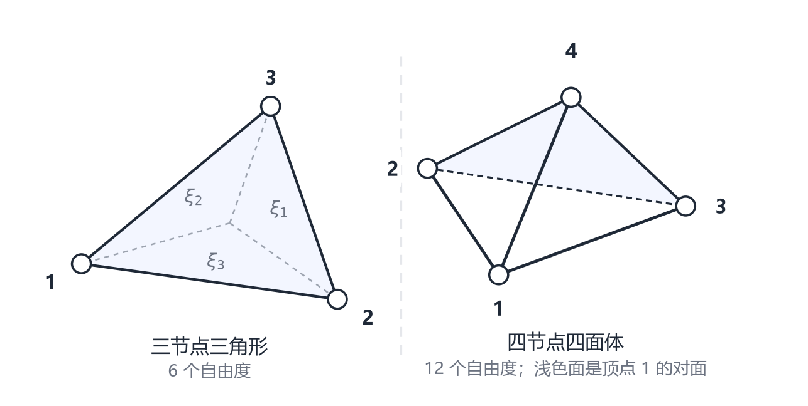
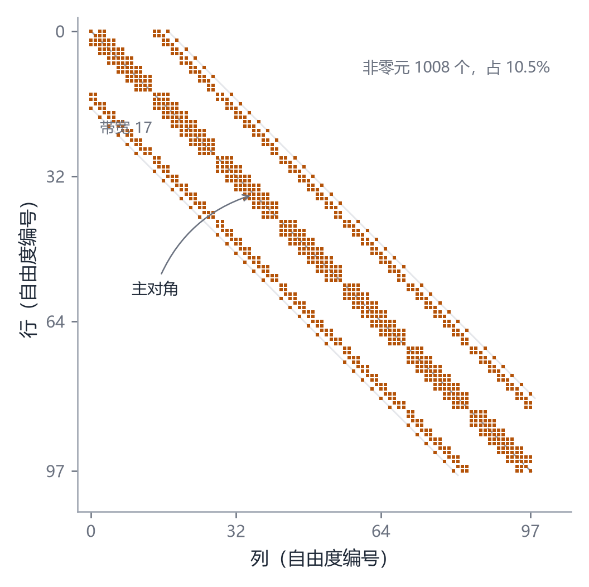

# 第 3 章 从三角形到四面体

一块 10 cm 见方、5 mm 厚的硅胶片，四角用夹子压在桌面上，中间用手指顶到 3 cm 高。指下的地方鼓起来，四个角反而更贴桌面，整片料被拉成一张绷紧的鼓面，靠近边缘处还能看到细密的放射状皱纹。

要在程序里做这个动作，得先把它切成八百个左右的小三角形，让每个三角形只负责自己那一小块的变形。接下来要决定的不是"每个三角形受多大的力"，而是"每个三角形存了多少能量"。这两种写法看着只差一步，实际决定了代码能不能撑过大变形。写力的人得为每种单元、每种材料各推一遍公式；写能量的人只写一个标量函数，力交给求导去取。硅胶片被顶到 3 cm 时，手推的力公式十有八九已经错了，而从能量导出来的力不会错，它只会忠实地跟着一个写错的能量一起错。

这一章从"能量怎么变成力"讲到"八百个单元怎么拼成一个矩阵"，中间会撞上一件麻烦事：把一块材料整体转过去，线性应变会说它被压缩了。

## 3.1 能量怎么变成力

连续体的变形用一个映射描述：参考构型里每个材料点 $\mathbf{X}$ 走到当前构型里的 $\boldsymbol{\varphi}(\mathbf{X})$。它的梯度

$$\mathbf{F}=\frac{\partial\boldsymbol{\varphi}}{\partial\mathbf{X}}$$

是个 $3\times 3$ 矩阵，叫变形梯度。它把参考构型里的一小段 $d\mathbf{X}$ 变成当前构型里的 $d\mathbf{x}=\mathbf{F}\,d\mathbf{X}$：原来沿 $x$ 轴、长 1 mm 的线段，变形后有多长、朝哪个方向，全写在 $\mathbf{F}$ 里。行列式 $J=\det\mathbf{F}$ 是局部体积比，$J=2$ 表示这一小块胀成了两倍，$J\le 0$ 表示它翻转过来了——在网格上就是单元被压穿。

材料的全部力学信息可以压缩成一个标量函数 $\Psi(\mathbf{F})$，单位 J/m³，叫应变能密度。整块料的能量是它体积分减去外力做的功：

$$E[\boldsymbol{\varphi}]=\int_{\Omega}\Psi(\mathbf{F})\,dV-\int_{\Omega}\rho\,\mathbf{b}\cdot\boldsymbol{\varphi}\,dV-\int_{\Gamma}\mathbf{t}\cdot\boldsymbol{\varphi}\,dA ,$$

其中 $\rho$ 是密度，$\mathbf{b}$ 是单位质量体力（重力），$\mathbf{t}$ 是表面上的面力。

离散之后，$\boldsymbol{\varphi}$ 由节点坐标线性插值决定，$E$ 就退化成一个普通多元函数 $E(\mathbf{x})$，力是它的负梯度

$$\mathbf{f}=-\frac{\partial E}{\partial \mathbf{x}} .$$

这个式子在最小的问题上就能验证，不必等整套有限元写完。一根刚度为 $k=200$ N/m 的弹簧，能量 $E=\tfrac12kx^2$，对 $x$ 求导得 $kx$，取负就是 $-kx$，正是胡克定律里那个往回拽的力。$k=200$、拉长 5 mm 时有 $x=0.005$ m，$E=2.5\times10^{-3}$ J，力是 $-1$ N：弹簧存了 2.5 毫焦的功，换回 1 牛的回复力。也就是说，"每个单元存了多少能量"这句话之所以够用，是因为力不是独立信息，它是能量面上那一点的坡度，坡度陡的地方力就大。

所有柔体有限元的代码都是围绕这一个式子写的，差别只在 $\Psi$ 怎么定义、$\mathbf{F}$ 怎么由 $\mathbf{x}$ 算出来。把这套写法整理成可直接实现的流程（形函数、能量、内力、切线、顿量积分）的，是图形学里那份流传很广的软组织仿真讲义 [@sifakis2012]。

为什么要绕到能量上再求导，而不是直接写力？三个理由。材料模型可以单独换：换一种橡胶只改 $\Psi$，装配力和矩阵的代码一行不动，这在有七八种材料要调的项目里是救命的。能量是标量，它的梯度场自动保守，弹性体不会凭空生出机械能，长时间仿真里的表现是"抖而不炸"，而直接拼凑的力很容易在一些变形下做正功。刚度矩阵自动对称，因为 $\partial^2E/\partial x_i\partial x_j$ 的混合偏导可以交换顺序，这条性质决定了能用哪种线性求解器。

第三点是工程上的硬边界。对称正定的矩阵可以用 Cholesky 分解，分解一次、每帧只做前代回代；也可以用共轭梯度，只存一半非零元——三十万自由度的柔体，它占的内存大约是稠密矩阵的三百分之一。矩阵非对称，CG 的前提就没了，只能上 GMRES 这类通用解法，内存翻倍、迭代次数涨几倍。

代价是要连着对矩阵求导，链式法则一层套一层，写错一个转置就会得到"能跑但永远偏软或偏硬"的结果，而且这种错误很难从动画里看出来。

从 $\Psi$ 到应力只需要一次求导：$\mathbf{P}=\partial\Psi/\partial\mathbf{F}$，叫第一类 Piola-Kirchhoff 应力。它的量纲是力除以参考构型上的面积，含义是"作用在参考构型某面上、单位面积的力，但方向按当前构型算"。这个定义别扭，用起来却很省事：节点 $i$ 上的内力直接写成

$$\mathbf{f}_i=-V_0\,\mathbf{P}\,\nabla N_i ,$$

$V_0$ 是单元在参考构型里的体积，$N_i$ 是形函数，$\nabla N_i$ 是它对参考坐标的梯度。换成第二类 Piola-Kirchhoff 应力 $\mathbf{S}=\mathbf{F}^{-1}\mathbf{P}$ 或 Cauchy 应力 $\boldsymbol{\sigma}=J^{-1}\mathbf{P}\mathbf{F}^{\top}$ 只是习惯问题；$\mathbf{P}$ 与 $\mathbf{F}$ 共轭，从 $\Psi$ 取出来不用额外乘 $J$，所以实现里最省事。实验测到的"名义应力"就是 $P$，"真应力"才是 $\sigma$，两者差一个 $J$，标定参数时混用会错得很稳定。

"力除以参考面积"这件事给感觉定个量。截面积 $1\ \mathrm{cm}^2$ 的硅胶条，$P=50$ kPa 意味着 5 N 的力，大约半公斤重的东西压着它。这 5 N 是拿初始面积算的：料被拉长后截面变细，真实断面应力更大，拉长一倍时大一倍。所以拿 $P$ 和拿 $\sigma$ 说"材料有多强"，同一根料会给出相差两倍的答案。

这个式子里最容易写错的是转置：把 $\mathbf{f}_i=-V_0\mathbf{P}\nabla N_i$ 写成 $-V_0(\nabla N_i)^{\top}\mathbf{P}$，在纯拉伸下两种写法给出同样的数，错的地方根本暴露不出来；一旦加上剪切，方向就偏了，仿真的表现是物体在剪切下缓慢扭转、怎么调参数都调不平。

$\mathbf{P}$ 是 $3\times3$，$\nabla N_i$ 是 $3\times1$，缩并出来正好是节点 $i$ 的力向量：$\mathbf{P}$ 的左指标是"力在哪个方向"，右指标是"法向在哪个方向"，乘法把法向指标吃掉，剩下的就是力。写代码时落成一行 `f[i] -= V0 * P @ gradN[i]`，比记公式可靠。

## 3.2 形函数与常应变

三角形单元有三个节点。面积坐标 $\xi_i$ 在节点 $i$ 处取 1、其他两点取 0，单元内部按线性插值，所以形函数就是 $N_i=\xi_i$。它的梯度有显式写法：

$$\nabla N_1=\frac{1}{2A}\begin{pmatrix} y_2-y_3\\[2pt] x_3-x_2\end{pmatrix},$$

$A$ 是三角形面积，另外两个由下标轮换得到。三个梯度之和为零，因为 $N_1+N_2+N_3\equiv 1$，常数函数的梯度必须消失——这条恒等式在代码里是判断形函数写没写错的最快办法。

"形函数就是面积坐标"这句话跳过了一步，而这一步恰恰是新手最容易糊过去的地方。完整的推法是待定系数：先假设单元里的位移是坐标的线性函数

$$\mathbf{u}(\mathbf{x})=\mathbf{a}+\mathbf{B}\mathbf{x},$$

二维里 $\mathbf{a}$ 有两个分量、$\mathbf{B}$ 是 $2\times2$，一共 6 个待定系数。三角形有 3 个节点、每点 2 个自由度，正好 6 个。系数个数与节点自由度个数相等，这不是巧合，而是"线性单元"这个选择能成立的前提：方程数与未知数一样多，才可能唯一解出来。把它写成矩阵就是把三个节点坐标代进去：

$$\begin{pmatrix}\mathbf{u}_1\\ \mathbf{u}_2\\ \mathbf{u}_3\end{pmatrix}=\begin{pmatrix}1&\mathbf{x}_1^{\top}\\ 1&\mathbf{x}_2^{\top}\\ 1&\mathbf{x}_3^{\top}\end{pmatrix}\begin{pmatrix}\mathbf{a}^{\top}\\ \mathbf{B}\end{pmatrix},$$

左边是 3 个节点位移，中间那个 $3\times3$ 矩阵只由几何决定。它的行列式是两倍面积，只要三点不共线就不为零，于是可以整体求逆。实际代码里没人真去求这个逆，因为求逆的结果有一个漂亮的形式：$\mathbf{u}(\mathbf{x})=\sum_iN_i(\mathbf{x})\,\mathbf{u}_i$，而 $N_i$ 必须是"在节点 $i$ 取 1、在其他两点取 0"的那个线性函数。二维里线性函数由三个系数确定，三个条件一给，它就唯一了。几何上，那个函数就是面积比

$$N_1(\mathbf{x})=\frac{A_1(\mathbf{x})}{A},$$

$A_1$ 是点 $\mathbf{x}$ 与节点 2、3 围成的小三角形面积。$\mathbf{x}$ 落在节点 1 上时小三角形就是整个单元，比值为 1；落在边 2-3 上时小三角形退化成线，比值为 0。这就是面积坐标这个名字的来路：三个 $N_i$ 是三个子面积占全面积的比例，三者恒和为 1，因为它们把单元剖成了三块。

面积是坐标的二次式（叉积里有两个坐标相乘），可两个坐标相乘的项在"点 $\mathbf{x}$ 与固定的两点围成的三角形"里会互相抵消，剩下的偏偏是一次式。这件事值得动手验一遍。取三角形 $(0,0)$、$(2,0)$、$(0,1)$，单位用 cm，面积 $A=1\ \mathrm{cm^2}$。线性函数 $N_1=1-x/2-y$ 在 $(0,0)$ 取 1，在 $(2,0)$ 与 $(0,1)$ 都取 0，正是要找的那个；同理 $N_2=x/2$、$N_3=y$，三者相加恒为 1。换成标准单位（乘 100），梯度是

$$\nabla N_1=\begin{pmatrix}-50\\-100\end{pmatrix},\quad \nabla N_2=\begin{pmatrix}50\\0\end{pmatrix},\quad \nabla N_3=\begin{pmatrix}0\\100\end{pmatrix}\ \mathrm{m^{-1}},$$

加起来恰好是零向量。$|\nabla N_1|=\sqrt{50^2+100^2}=112\ \mathrm{m^{-1}}$，而单元尺寸是 0.02 m，两者相乘约 2.2——形函数梯度的量级永远是 $1/h$，这一点在估计刚度矩阵量级时反复用到。

四面体对应四个形函数，体积 $V=\det[\mathbf{x}_2-\mathbf{x}_1,\ \mathbf{x}_3-\mathbf{x}_1,\ \mathbf{x}_4-\mathbf{x}_1]/6$，梯度是

$$\nabla N_1=-\frac{(\mathbf{x}_3-\mathbf{x}_2)\times(\mathbf{x}_4-\mathbf{x}_2)}{6V},$$

分子是"对面三角形的两条边叉乘"，方向朝外、长度是两倍面积，除以 $6V$ 之后正好是形函数的梯度。推导走同一条路：三维线性函数有 4 个系数，四面体有 4 个节点，系数个数又刚好对上，于是形函数唯一，它是"点与对面三点围成的子四面体体积占总体积的比例"，梯度自然是常数。这两个公式都是常数，与单元内部的位置无关，正是这一点决定了下面所有性质。

顺带说一个常被忽略的事实：形函数定义在参考构型上，跟材料怎么变形没关系。变形改变的是 $\mathbf{F}$，不改变 $N_i$，也不改变 $\nabla N_i$。所以线性单元的梯度可以初始化时算一次、存成一张 $3\times4$ 的小表，整个仿真反复读取。这是它比二次单元快得多的直接原因之一：二次单元的形函数含坐标二次项，梯度随位置变化，每个积分点都得重新求值。

位移场 $\mathbf{u}=\sum_i N_i\mathbf{u}_i$ 的梯度是 $\nabla\mathbf{u}=\sum_i \mathbf{u}_i\otimes\nabla N_i$，一个常数矩阵。应变 $\boldsymbol{\varepsilon}=\tfrac12(\nabla\mathbf{u}+\nabla\mathbf{u}^{\top})$ 于是也在单元内处处相同。这类单元叫常应变单元：它能精确表示均匀拉伸、均匀剪切和刚体运动，不能表示弯曲，因为弯曲要求应变沿单元变化。图 3-1 把两种单元的节点、形函数与自由度数目画在一起。

<figure class="fig">

<figcaption><b>图 3-1</b>　线性三角形与线性四面体单元。左：三节点三角形，面积坐标 $\xi_i$ 在对应顶点取 1，三个子三角形的面积占比就是三个形函数，6 个自由度。右：四节点四面体，浅色面是顶点 1 的对面，$\nabla N_1$ 垂直于该面、指向顶点 1 的反侧，12 个自由度。两图均为示意图，节点编号与自由度计数是确定的。</figcaption>
</figure>

"不能表示弯曲"可以换一种更硬的说法：常应变单元能精确表示的位移场只有仿射场，也就是直线变形后还是直线、平面变形后还是平面、平行的线变形后仍然平行。一块被弯成弧的料，上下表面的长度不一样，单元内部每条线的长度变化都不一样，仿射场装不下这种变化。程序于是只能取一个平均应变，把它摊到整个单元上。也就是说，弯曲在常应变单元里被翻译成了"均匀拉伸加均匀剪切"，翻译是有损的。

常应变的后果很实在。一块布的弯曲刚度在物理上很小，用粗三角形网格去算，弯曲必须靠相邻单元之间的应变跳变来"拼"，网格越粗，拼得越粗糙，单元表现得越刚，褶子出不来。给一个数：边长 2 cm 的三角形被弯成曲率半径 10 cm 的圆弧，真实应变沿单元的跨度约是 $0.02/0.1=0.2$，也就是 20% 的应变变化被一个常数抹成了平均值，误差是百分之百。第 7 章讲布料的分辨率时会再次撞上这个 20%。

有一种比"弯曲不准"严重得多的失效，叫锁定（locking）：单元在某个方向上被虚假地做得极硬，整个网格表现得像一块刚体，位移几乎为零。它在不可压材料上最典型，机制留到 3.7 节算清楚；这里先记住它的味道——仿真不抖不炸，就是不动，把外力加大十倍才动一点。这种"沉默的错误"比发散难查得多，因为没有任何一个数字报警。

## 3.3 单元内力与刚度矩阵

小应变假设下，应变与位移是线性关系，可以写成矩阵形式 $\boldsymbol{\varepsilon}=\mathbf{B}\mathbf{u}$。二维三角形用 Voigt 记法，$\mathbf{B}$ 是 $3\times 6$，三维四面体是 $6\times 12$，两种情况下 $\mathbf{B}$ 都由形函数梯度直接拼出来，且是常数。能量变成

$$E_e=\tfrac12 V_0\,\boldsymbol{\varepsilon}^{\top}\mathbf{C}\boldsymbol{\varepsilon}=\tfrac12\mathbf{u}^{\top}\big(V_0\mathbf{B}^{\top}\mathbf{C}\mathbf{B}\big)\mathbf{u},$$

于是单元刚度矩阵 $\mathbf{K}_e=V_0\mathbf{B}^{\top}\mathbf{C}\mathbf{B}$，单元内力 $\mathbf{f}_e=-\mathbf{K}_e\mathbf{u}$。$\mathbf{C}$ 是材料矩阵，平面应力下

$$\mathbf{C}=\frac{E}{1-\nu^2}\begin{pmatrix}1&\nu&0\\ \nu&1&0\\ 0&0&\frac{1-\nu}{2}\end{pmatrix}.$$

它的每一个元素都有明确的物理来源：对角线上的 $E/(1-\nu^2)$ 是"沿 $x$ 拉，同时被 $y$ 方向的泊松约束顶住"之后的等效模量；右上角的 $\nu$ 是拉 $x$ 会在 $y$ 上产生应力；右下角的 $(1-\nu)/2$ 是剪切模量。$\mathbf{B}$ 的作用也要看清楚：它把 6 个节点位移变成 3 个应变分量，每一列对应一个节点的一个方向，列的内容是该方向的位移会在哪几个应变分量上留下痕迹。第 $i$ 个节点的 $x$ 位移那一列是 $(\partial N_i/\partial x,\ 0,\ \partial N_i/\partial y)^{\top}$——沿 $x$ 推一下，只产生 $x$ 向正应变和 $xy$ 剪应变，不产生 $y$ 向正应变。这一列的形状解释了为什么纯 $x$ 方向推一个节点也会激起剪切。

拿一组具体数字走一遍。边长 2 cm 的等边三角形，厚 5 mm，$E=10^5$ Pa，$\nu=0.3$：面积 $1.73\times10^{-4}$ m²，体积 $8.66\times10^{-7}$ m³，$\mathbf{K}_e$ 左上角那个元素是 265.7 N/m。它的意思是"节点 1 沿 $x$ 移动 1 m 需要 265.7 N"，换成常见量级：移动 1 mm 只要 0.27 N。这差不多就是一根软硅胶条的手感，也解释了为什么这类材料的仿真看起来"黏糊糊"——力太小，任何一点数值噪声都能推动它。

顺着这组数字还能读到另一件事：剪切比拉伸软。$E=10^5$ Pa、$\nu=0.3$ 对应剪切模量 $G=E/(2(1+\nu))=3.85\times10^4$ Pa，不到拉伸模量的四成。所以一块软材料被斜着推、被拧、被折的时候，它给出的抵抗力比正着拉要小得多，而程序里最容易被忽略的恰好是这些剪切变形。一张用三角形网格做的布，如果把剪切刚度往拉伸刚度上靠，它就不再起褶皱，而是像一张硬纸板。

回到那个 6×6 的矩阵，它值得按块来读，而不是当成一堆数字。把 $\mathbf{B}$ 按节点切成几块 $\mathbf{B}_i$（二维里是 $3\times2$，三维里是 $6\times3$），矩阵就自然分成 $3\times3$ 或 $4\times4$ 个块：

$$\mathbf{K}_{ij}=V_0\,\mathbf{B}_i^{\top}\mathbf{C}\,\mathbf{B}_j .$$

对角块 $\mathbf{K}_{ii}$ 说的是"只让节点 $i$ 动，它自己感到多大的抵抗"。它对称、半正定，因为它是 $\mathbf{C}$ 在这个节点梯度方向上的投影——能量不可能因为自己动一下而减少。非对角块 $\mathbf{K}_{ij}$ 说的是"节点 $j$ 动，会把多大的力传到节点 $i$ 上"，它满足 $\mathbf{K}_{ij}=\mathbf{K}_{ji}^{\top}$，这是整块矩阵对称的来源。

把上面那组数字代进这个式子，节点 1 的对角块是

$$\mathbf{K}_{11}=\begin{pmatrix}265.7&89.3\\ 89.3&162.6\end{pmatrix}\ \mathrm{N/m},$$

它的两个特征值是 317 与 111，相差近三倍。这个各向异性不是材料带来的（材料是各向同性的），而是单元形状带来的：单个三角形只在它自己的梯度方向上"有刚度"，换个方向推它，抵抗就弱。所以拿单个单元的刚度矩阵去判断材料有多硬，结论一定是错的：它对不同方向给出的抵抗能差三倍，而你恰好从哪个方向推它，取决于网格。也就是说，一个单元不代表材料，一堆朝向各异的单元才代表材料——这也是为什么网格里单元朝向要尽量杂乱均匀，不要让一整片三角形朝同一个方向排。

非对角块更说明问题。节点 1 与节点 2 之间那一块是

$$\mathbf{K}_{12}=\begin{pmatrix}-210.2&-6.9\\ 6.9&-4.0\end{pmatrix}\ \mathrm{N/m},$$

两个特征值约是 $-210$ 与 $-4$。$-210$ 的方向沿两个节点的连线，$-4$ 的方向垂直于连线。含义很干脆：节点 1 动一下，能通过这个单元把力传给节点 2 的，只有沿着它们连线的那一部分；垂直方向几乎传不过去。这也解释了为什么三角形网格在受弯时会"折纸"——弯曲恰恰需要垂直于连线的力传递，而单元在这条通道上几乎是断的。

符号约定要记住。对角块为正、非对角块为负，是"推一个点、邻居跟着往同方向走"的矩阵表达：取 $\mathbf{u}$ 只有节点 1 的 $x$ 分量非零，则 $\mathbf{f}_2=-\mathbf{K}_{21}\mathbf{u}$ 的第一分量是 $+210.2u$。更快的检查是整行之和：同一行所有块沿同一坐标方向加起来必须是零矩阵，因为整体平移不产生应变。上面那组数里 $265.7-210.2-55.5=0$，一分不差。

$\mathbf{K}_e$ 的秩比它的阶数小得多。二维的 $6\times 6$ 矩阵只有秩 3，上面那组数字算出的六个特征值是 $0,0,0,333,333,619$。三个零对应三个刚体模态：沿 $x$ 平移、沿 $y$ 平移、绕面内点旋转，都不产生应变，乘上去自然是零。三维的 $12\times 12$ 矩阵秩为 6，零空间是三个平移加三个旋转。这条性质在代码里非常有用：装配好的全局矩阵如果不加约束就是奇异的，求解器会报"矩阵接近奇异"，而原因不是 bug，是这块料还没被固定住。反过来，如果二维单元算出四个零特征值，说明三点共线，面积为零，单元退化了。

那三个零特征值也给出一个诊断手段。把 $\mathbf{K}_e$ 的特征值从小到大排，前三个必须严格为零（浮点里是 $10^{-14}$ 量级），第四到第六个必须为正。第四个也接近零就说明单元退化：细长的三角形、四点几乎共面的四面体都会把它压下去，比值 $\lambda_4/\lambda_6$ 是长宽比的另一种度量。

一旦离开小应变，$\mathbf{K}$ 就不再是常数。真正的切线刚度是 $\partial^2E/\partial\mathbf{x}^2$，它由两项相加：材料项，来自 $\partial\mathbf{P}/\partial\mathbf{F}$ 投影到形函数上；几何项，来自当前应力乘以位移的二阶导。后者在绷紧的膜上不可忽略，它就是"鼓面为什么能抵抗横向按压"的全部来源——鼓面被张紧之后，即使材料本身很软，横向压下去也要克服张力做的功。显式积分只用 $\mathbf{f}$，碰不到 $\mathbf{K}$；牛顿法必须用 $\mathbf{K}$，而且两项都得算，漏掉几何项的后果是牛顿在最需要它的强拉伸区域反而收敛不了。

## 3.4 组装与稀疏

单元的自由度要映射到全局编号：节点 $i$ 的第 $a$ 个分量记为 $3i+a$。装配就是一个循环，把每个单元的 $6\times 6$ 或 $12\times 12$ 加到全局矩阵对应的位置上。同一个位置被多个单元重复累加，这个累加正是"共享节点把相邻单元连起来"的机制，没有别的机制。

写成伪代码只有十几行，骨架如下：

```text
# 1. 初始化：每个单元算一次几何
for e in elements:
    V[e], gradN[e][0..3] = 参考构型几何(节点坐标)     # 常数，只算一次

# 2. 第一轮：只确定哪些位置非零
for e in elements:
  for i in 0..3:  for j in 0..3:
    for a in 0..2: for b in 0..2:
      mark_row(3*node[e][i]+a).add_col(3*node[e][j]+b)
rowptr, colidx = build_csr(marks)                    # 按行排序去重

# 3. 第二轮：累加数值
K.values[:] = 0
for e in elements:
    Ke = V[e] * B(gradN[e]).T @ C @ B(gradN[e])       # 12x12
    for i in 0..3:  for j in 0..3:
      base_i = 3*node[e][i]; base_j = 3*node[e][j]
      idx = slot(base_i, base_j)                      # 查表，不二分
      for a in 0..2: for b in 0..2:
        K.values[idx + a*nnz_stride + b] += Ke[3*i+a][3*j+b]
```

这段骨架里真正花时间的不是乘法，是第三段那个 `slot`：拿二分查找去定位 $(3i+a,3j+b)$，内存随机访问的代价会盖过浮点运算，换成按行偏移的查表能快五到十倍。单元内的四个小块还可以展开成 144 个标量赋值，编译器就能把它们全塞进寄存器。

全局矩阵几乎全是零。一个节点只与共享单元的节点耦合，四面体网格里内部节点平均连 12 到 15 个邻居，加上自己，每行大约 40 到 50 个非零元，与总自由度无关。十万节点、三十万自由度，稀疏存储约一千五百万个数；当成稠密矩阵存是 $9\times10^{10}$ 个数，七百 GB。稀疏不是优化技巧，是可行与不可行的分界线，这也是为什么柔体有限元的实现里，一半的工程量在稀疏数据结构上。

<figure class="fig">

<figcaption><b>图 3-2</b>　组装得到的全局刚度矩阵的非零结构。$6\times6$ 方格切成 72 个三角形，49 个节点、98 个自由度，$\mathbf{B}^{\top}\mathbf{C}\mathbf{B}$ 按单元累加后统计非零元：1008 个，占 $98^2=9604$ 的 10.5%，带外全为零。横纵坐标都是自由度编号，按行优先排列，所以非零元集中成两条斜带加几条平行细线。这张图是真实生成的，不是手绘。</figcaption>
</figure>

图 3-2 里的斜带值得解释。按行优先给节点编号，相邻两行的节点编号相差 7，于是每个节点与上下两个邻居的耦合落在偏移 $\pm 14$ 的位置上，形成两条与对角线平行的带；左右邻居的偏移是 $\pm 2$，紧贴主对角。最远的耦合出现在同一个三角形里跨行又跨列的两个节点之间，偏移 17，所以全部非零元都落在带宽 17 以内。如果把节点编号随机打乱，同样的矩阵会散成一片均匀的噪点，带宽涨到 98，任何按带宽设计的存储和求解都失去意义。网格编号顺序不是审美问题，它直接决定求解时间。

这条结论有一个可以自己验的推论：把节点顺序换成"按 $z$ 层、$y$ 行、$x$ 列"的字典序，四面体网格的带宽会从半个网格宽降到一层的厚度。十万节点时带宽从三万降到三百，一个 300 MB 的带状矩阵缩成 3 MB，而 Cholesky 的时间按带宽平方下降。Cuthill-McKee 这类重排算法做的就是这件事：从边界上一个度数最小的节点出发做广度优先遍历，让相连的节点尽量挨着。它在初始化时只跑一次，收益是整场仿真。

边界条件是同一套语言里的另一件事。固定的节点，做法是删掉对应的行与列，或者把那行那列清零、对角线置 1、右端项置零。不要用"在对角加一个大数"的罚方法：加了 $10^{10}$ 之后，矩阵条件数跟着涨 $10^{10}$，迭代求解器的收敛速度会慢到不可用，而解的精度也不会更好。重力不需要特殊处理，它就是外力向量里每个节点的 $m_i\mathbf{g}$ 那一项，质量从单元体积按 $\rho V_0/4$ 摊到四个节点上。

罚方法的问题看一个数字就够。一块 $E=10^5$ Pa 的软料，对角元素本来在 $10^2$ 量级；加一个 $10^{10}$ 的罚数后，最大与最小对角元素差了八个数量级，双精度的十六位有效数字立刻只剩八位。位移解里的小尺度分量被舍入掉，仿真看起来"能跑"，但布的细褶、肌肉的凹陷全部消失。

真实代码里的组装分两轮。第一轮只算非零模式：遍历单元，把每个 $(3i+a,3j+b)$ 的位置标记一次，得到行指针和列索引；第二轮才真正把数值累加进去，用一张"位置到下标"的映射避免每次二分查找。两轮合起来比第一轮就分配动态数组快一个数量级，因为内存分配和随机写入是这里的时间大头。三角形网格的耦合模式很规律，甚至可以跳过第一轮，直接按节点编号算出带宽，但四面体网格的邻居关系不规则，老老实实做两轮更省事。

还有一件和组装强相关的事：这个矩阵在仿真过程中要不要重新组装。小应变线性弹性里它一次装配、永久使用；超弹里它每一帧、每一次牛顿迭代都变，装配本身成了最贵的一步。所以大变形代码通常不存全局矩阵，只存模式（行指针与列索引），每次迭代把数值重新算一遍、盖到同一块内存上。数值重新算并不慢，慢的是内存分配，而模式不变的时候分配只需要做一次。


## 3.5 整块转过去为什么失重

现在回到开场那块硅胶片。它弯到 90° 时，中面上的材料长度没变，外侧被拉长、内侧被压缩。线性应变给出的答案完全不是这个：取一个纯旋转的位移场 $\mathbf{u}=(\mathbf{R}-\mathbf{I})\mathbf{X}$，代入 $\boldsymbol{\varepsilon}=\tfrac12(\nabla\mathbf{u}+\nabla\mathbf{u}^{\top})$ 得到

$$\boldsymbol{\varepsilon}=\tfrac12(\mathbf{R}+\mathbf{R}^{\top})-\mathbf{I}=(\cos\theta-1)\,\mathbf{I} .$$

转角 10° 时这是 $-1.5\%$，30° 时是 $-13.4\%$，45° 时是 $-29.3\%$，90° 时是 $-100\%$。整块材料只是转了个身，线性模型却认为它被均匀压缩了。这个虚假的压缩会做功，把单元往回拽：弯得越厉害，料越像在收缩，于是整片东西要么虚假地硬住，要么虚假地缩水。

这个式子的推导只有两步。纯旋转的位移是 $\mathbf{u}=\mathbf{R}\mathbf{X}-\mathbf{X}$，梯度直接就是 $\mathbf{R}-\mathbf{I}$；对称化后得 $\tfrac12(\mathbf{R}+\mathbf{R}^{\top})-\mathbf{I}$。二维旋转矩阵的转置只把 $\sin$ 的符号翻过来，两者相加非对角项抵消，于是 $\tfrac12(\mathbf{R}+\mathbf{R}^{\top})=\cos\theta\,\mathbf{I}$。虚假应变只和 $\cos\theta$ 有关、跟转轴无关，三维里绕任意轴转 $\theta$ 也是这个结果——问题不在二维简化，而在线性应变度量本身。

这就是小应变有限元只能处理"转动小于几度"的原因，而布料、果冻、肌肉、头发没有一个是这么老实的。转动超过 10°，线性模型就开始给错答案，超过 30°，量级就完全不对了。工程上的经验阈值更严：一个单元内的相对转角超过 5°，误差就进入百分之几，而这种转角在布料自由飘动时一秒里要发生几十次。

把 30° 那个数换成能量会更直观。虚假的压缩是各向同性的，能量密度约 $\tfrac12 E(\cos\theta-1)^2$，$E=10^5$ Pa、$\theta=30^{\circ}$ 时是 898 J/m³。一个体积 1 cm³ 的单元因此携带 0.9 mJ 的假能量，而同样体积的材料在重力下只对应 0.1 mJ 的势能变化——假能量比要模拟的真实现象大了一个数量级。这就是为什么线性单元做的布在弯曲时不是"稍微硬一点"，而是根本不动。假能量还按 $\theta^4$ 增长（$\cos\theta-1\approx-\theta^2/2$，再平方），10° 时只有 30° 时的 $1/81$：小转角下错误几乎看不见，越过某个角度突然变成主导项。这种"阈值型"失效最难排查，前一百帧都对，第一百零一帧开始整块料僵硬，而且回不去。

修法是换应变度量，不看位移梯度，看长度变化：

$$\mathbf{E}=\tfrac12(\mathbf{F}^{\top}\mathbf{F}-\mathbf{I}) .$$

这个量叫 Green-Lagrange 应变。$\mathbf{F}=\mathbf{R}$ 时 $\mathbf{F}^{\top}\mathbf{F}=\mathbf{I}$，$\mathbf{E}$ 严格为零，纯旋转不再产生任何应变。用它写能量就得到 StVK 模型，第 4 章细讲它的脾气。三维里 $\mathbf{E}$ 有六个独立分量，$x$ 方向的单向拉伸 $\lambda$ 给出 $E_{xx}=(\lambda^2-1)/2$，这是"以长度平方计"的应变，小变形时退化成熟悉的那一个。

代价是 $\mathbf{E}$ 对 $\mathbf{x}$ 是二次的，$\mathbf{f}$ 变成二次、$\mathbf{K}$ 变成一次。装配一次反复使用的小算盘失效，每一步都要重算形函数梯度、重算 $\mathbf{F}$、重算 $\mathbf{P}$ 和 Hessian。这是所有大变形有限元的共同成本，也是它比弹簧慢一到两个数量级的根本原因。

一个常用的折中叫共旋。把 $\mathbf{F}$ 做极分解 $\mathbf{F}=\mathbf{R}\mathbf{S}$，用 $\mathbf{R}^{\top}\mathbf{F}-\mathbf{I}$ 代替 $\mathbf{E}$：先把单元转正，再在小应变框架里算。每个单元一次 $3\times3$ 极分解，几百个单元就是几百次 $3\times3$ 的特征分解，代价可以接受，代码结构也几乎不用改。它在"大旋转、小应变"下与完整非线性一样准，在"大拉伸"下失真，原因下一章会画在图上。

## 3.6 材料非线性：接口只有两个函数

几何部分决定 $\mathbf{F}$ 怎么由 $\mathbf{x}$ 算出来，本构部分决定 $\mathbf{P}$ 怎么由 $\mathbf{F}$ 算出来。这两件事分开，是柔体代码里最重要的结构决定：网格、形函数、组装只关心前者，材料模型只碰后者，两边可以分别换、分别测。

接口写成函数签名就是两个：`P = stress(F, state)` 与 `dPdF = tangent(F, state)`。前者显式积分每一步都要调，后者只在隐式牛顿里调。把 `state` 做成显式结构体（塑性应变、硬化参数、各粘弹支路的应变），比让材料对象偷偷记住上一帧好得多：后者在并行和 GPU 上会以最难查的方式出错。

本构的接口只有两个函数：给定 $\mathbf{F}$ 返回 $\mathbf{P}$，给定 $\mathbf{F}$ 返回切线 $\partial\mathbf{P}/\partial\mathbf{F}$。第二个是可选的，显式积分用不到，隐式牛顿必须有。切线是四阶张量，三维里 81 个分量，存成 $9\times9$ 的块；它的对称性由材料决定，超弹材料的切线满足主对称，塑性和摩擦不满足。这直接影响求解器的选择，非对称系统要用非对称的预条件，性能差一大截。

81 个分量听起来吓人，实现里没人写 81 行。超弹的切线可以拆成两项：一项是"材料四阶张量" $\mathbb{A}=\partial^{2}\Psi/\partial\mathbf{F}^{2}$，只含材料参数与 $\mathbf{F}$；另一项是应力自己乘 $\mathbf{F}$ 的逆，与材料无关，全项目共用。新加一种材料只需要实现 $\mathbb{A}$。

按"$\mathbf{P}$ 依赖什么"分类，只有三种。线性弹性：$\mathbf{P}$ 依赖位移梯度，而且线性，一次装配能用到底。超弹：$\mathbf{P}$ 只依赖当前 $\mathbf{F}$，但关系是非线性的，每次迭代重算。塑性：$\mathbf{P}$ 依赖整个变形历史，需要额外的内变量，每个单元每一步都要更新状态。三类在 GPU 上的成本差得很远：第一类只读矩阵，第二类每步几十次浮点运算，第三类还要额外存几十字节的状态并对每个单元做分支，规模上去之后显存带宽先撑不住。

切线对称性在实际项目里有个具体的表现。超弹材料装配出来的 $\mathbf{K}$ 严格对称，可以只存一半，共轭梯度直接跑；塑性一旦采用非关联流动法则，对称性就没了，此时的共轭梯度会停在错误的位置上，必须换成 GMRES 或 BiCGSTAB，迭代次数也涨到三四倍。很多人把这种变慢归咎于"塑性难算"，其实难的是求解器换了，而不是材料本身多花了几行代码。

## 3.7 单元类型与网格质量

三角形和四面体最大的好处是自动剖分成熟：任意形状都能填满，Delaunay 加几次平滑就够用。坏处是刚。线性四面体在弯曲主导的问题上尤其糟，它和三角形一样是常应变，弯曲得靠一串单元去拼；在不可压材料上还会体积锁定——每个单元必须自己保住体积，单元内部又不允许体积变化有梯度，结果是整个网格表现得像刚体，剪切响应虚假地强。

锁定值得算一遍，因为它是柔体里最容易被误诊的失效。看橡胶类材料：$\nu=0.49$，体积模量 $K$ 是剪切模量 $\mu$ 的五十倍，意味着"改变形状"比"改变体积"容易五十倍。线性四面体的位移场是仿射的，$\mathbf{F}$ 在单元内是常数，于是 $\det\mathbf{F}$ 也是常数——"体积不变"这条约束在每个单元上只贡献一个标量方程，看起来不多。麻烦在数量对比：一个 1000 节点的四面体网格大约有 5500 个单元，每个单元要一个 $\det\mathbf{F}=1$ 的约束，同时整个网格只有 3000 个位移自由度。5500 个约束压在 3000 个未知量上，方程组严重超定，唯一能满足的就是"什么都不动"。位移被压到接近零，材料于是表现得像一块钢，而它的剪切模量其实只有几十万帕。

也就是说，锁定的本质是自由度不够：约束比未知量还多，多余的那部分只能靠"不动"来满足。修法都指向同一个方向——减少约束或增加可用的变形模式。混合公式把压力 $p$ 单独插值，体积约束不再逐单元施加；选择性减缩积分只在单元中心算体积项，让单元内部有体积变化的余地；F-bar 方法把 $\mathbf{F}$ 拆成"单元平均"与"偏斜"两部分，只用前者管体积。三者的共同点是让每个单元不再被迫独立承担不可压条件。

二次四面体（10 个节点，棱中点各加一个）解决了弯曲精度，但在不可压材料上体积锁定更严重，因为约束更多了。软组织仿真里常见的是二次四面体配混合公式，位移和压力用不同的插值阶次，代价是自由度翻几倍、实现复杂度上一个台阶。六面体一个单元就能表示线性应变场，几个单元就能拟合一整条弯曲，效率明显更高，问题是要把任意形状切成六面体，自动算法远不如四面体成熟。角色肌肉的做法通常是四面体打底、表面贴一层六面体。

单元类型的选择有个简单判据：看应变状态有多不均匀。均匀拉扯的料，常应变单元给出精确解，用二次单元是浪费；弯成 S 形的细条，单元内应变差几十倍，线性单元要多切十倍才追得上。所以讲肌肉的那一章会推荐高次单元，讲布料的那一章坚持用三角形——布料的弯曲靠网格的细密，不是单元的多项式阶次。

网格质量比单元类型更容易出事。两个指标：长宽比和体积。一个"薄片"四面体，四个点几乎共面，体积趋近零，形函数梯度趋于无穷，刚度矩阵条件数炸掉，求解出来的位移里混着大量噪声。程序里应该盯住 $\det\mathbf{F}$：参考构型下它应该是正的且不能太小，变形后一旦 $\le 0$ 就是翻转，此时能量公式给出的值没有物理意义，最常见的后果是整个模拟在几帧内发散。

还有一个与网格直接相关的量：单元尺寸决定显式积分能走多快。弹性波在材料里的速度约是 $c=\sqrt{E/\rho}$，$E=10^5$ Pa、$\rho=10^3$ kg/m³ 时 $c\approx10$ m/s；显式稳定的条件是弹性波在一帧里不能跨过整个单元，粗略地写成 $\Delta t\lt 2h/c$，$h=2$ mm 给上 $4\times10^{-4}$ s。一帧 16.7 ms 要拆成 40 个子步。把这个式子反过来看：网格加密一倍，子步数翻倍，计算量是八倍。项目里反复碰到的"加密网格反而算不动"，贵就贵在这里。


实践清单很短：剖分完先看最小 $J$ 和最大长宽比，把长宽比超过 10 的单元局部重剖；运行中每步检查 $\min J$，一旦为负就退回上一步、把步长减半。这两条检查比换单元类型便宜得多，收益也大得多。翻转过后的单元不会自己转回来，它会把错误一路传进相邻单元，最后整块料炸成一个球。

到这里，"一块连续材料"被换成了"一堆常应变小块加一个稀疏矩阵"。剩下的麻烦只有两件：小块太刚，矩阵太大。前一件要靠更好的单元和更好的材料模型，第五、六章讲怎么解那个越来越大的非线性系统。而把 $\mathbf{P}$ 从 $\mathbf{F}$ 算出来这件事，值不值得为它挑一个"稳"的函数，下一章会用一个能算出具体数字的例子回答。

