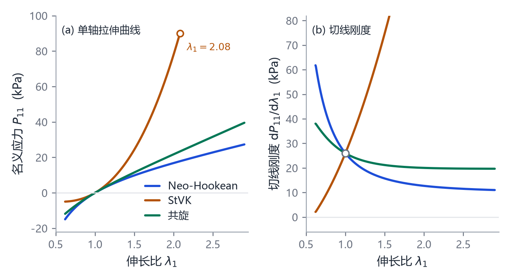
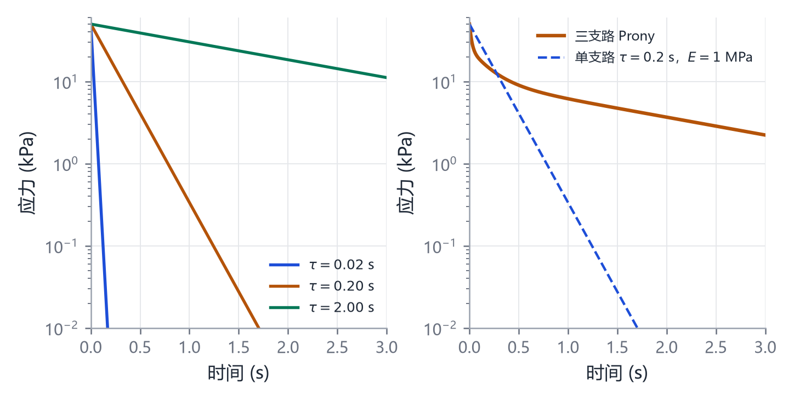

# 第 4 章 超弹、粘弹与塑性

桌上放三样东西：一根橡皮筋、一只记忆枕、一块面团。

橡皮筋拉到原长的两倍，前 20% 很费力，再往后反而轻松，松手立刻回到原长，看不出拉过。记忆枕被手掌压扁，抬手的瞬间它还是扁的，然后用几十秒慢慢鼓回来，鼓到一半还有余量。面团被拉长之后停在那里，不回弹，把手松开它也不动，再拉一次还能拉得更长。

三种行为的差别不在软硬，而在应力记住了多少历史。橡皮筋只看当前长度；记忆枕记得自己刚才被压了多久；面团记得自己被拉过，而且这个记忆不会消失。程序里对应三种写法：应变能函数、内部状态变量、塑性应变。本章讲这三样怎么写出来，以及每一种在什么变形范围内会给出错误的数字。

## 4.1 三样东西，三种记忆

本构模型只回答一个问题，给定变形历史之后，当前的应力是多少。写法上通常拆成两步，先算应变（几何的事），再算应力（材料的事）。

材料这一半可以按"记忆长度"分档。

弹性材料没有记忆。应力只依赖当前变形，$\boldsymbol{\sigma}=\mathbf{f}(\mathbf{F})$。这类材料在加载和卸载时走同一条曲线，一个循环做多少功就还回多少功，能量守恒。橡皮筋在中等拉伸范围内属于这一类。

超弹材料是弹性材料里最规矩的一种，它的应力可以写成某个标量势的导数。所有超弹模型共享同一个后果，卸载路径与加载路径重合，绝热循环不产生热。图形学里绝大多数柔体用的都是超弹，理由很朴素：只要不引入历史，就不会因为上一帧的误差在这一帧变成永久形变。

粘弹材料有短期记忆，应力依赖最近一段时间内的变形速率，记忆按指数衰减。它每加载一次都要耗散一部分能量，这正是枕头"回弹慢"的来源。

塑性材料有永久记忆。应力超过某个阈值后，材料发生不可恢复的变形，卸载时沿着一条与原加载路径平行的线回去，回到零应力时留下残余应变。

这四种"记忆"在时间尺度上的差别大到需要提醒。记忆枕的松弛时间在几十秒，布料在一秒以内，而仿真一帧是十六毫秒。也就是说，仿真看到的不是材料完整的松弛谱，而是谱上落在 $\Delta t$ 两侧的那一段：比 $\Delta t$ 慢得多的机制看起来就像一个弹簧，快得多的看起来就是阻尼，只有跨在 $\Delta t$ 附近的那些才真正随步长变化。这也解释了为什么把布料放在慢动作里（每帧只推进零点几毫秒）与正常播放在手感上不一样——把某些支路从"弹簧"挪到了"正在松弛"。

记忆长度这个分法有一个直接的操作含义：它决定了每个单元要存多少字节、每步要更新什么。弹性与超弹什么都不存；粘弹存 $n$ 个支路应变；塑性存一个 $3\times3$ 的塑性变形梯度加一个硬化标量。这些数就是"历史"。也就是说，所谓"材料有记忆"，在代码里只是一块随单元一起走的内存，它上一帧写了什么，这一帧就接着读什么。

容易误解的地方：把"记忆"实现成"记住上一帧算出来的应力"。这样做在一维上看着没问题，三维里立刻出毛病——上一帧的应力是在上一帧的构型下量的，而这一帧的构型已经转过了，直接拿它做增量等于把旋转当成了变形。正确做法是存应变型的量（$\mathbf{F}_p$、支路应变），让应力每次都由它们重新算。

这三种都能用同一套代码框架承载，条件是接口写成"给定 $\mathbf{F}$ 和历史状态，返回 $\mathbf{P}$ 与新的历史状态"。弹性与超弹的状态是空的，粘弹的状态是若干个内变量，塑性的状态是塑性应变与硬化参数。把状态做成显式的结构体、按单元存一份，比隐式地偷偷记住上一帧好得多——后者在并行和 GPU 上会以最难查的方式出错。

## 4.2 能量只能看见不变量

$\mathbf{F}$ 有 9 个分量，随便写一个函数，绝大多数都不对应任何真实材料，这是 $\Psi(\mathbf{F})$ 写法的明显问题。约束来自两条物理要求。

第一条是客观性。把整块材料转个身，应力不应该变化，因为旋转不产生变形。用公式说，对任意旋转 $\mathbf{Q}$ 有 $\Psi(\mathbf{Q}\mathbf{F})=\Psi(\mathbf{F})$。这条要求把 $\Psi$ 对 $\mathbf{F}$ 的依赖压缩到只能通过 $\mathbf{F}^{\top}\mathbf{F}$ 发生：设 $\mathbf{C}=\mathbf{F}^{\top}\mathbf{F}$，叫右 Cauchy-Green 张量，$(\mathbf{Q}\mathbf{F})^{\top}(\mathbf{Q}\mathbf{F})=\mathbf{F}^{\top}\mathbf{Q}^{\top}\mathbf{Q}\mathbf{F}=\mathbf{C}$，旋转被抵消掉了。所以 $\Psi$ 只能是 $\mathbf{C}$ 的函数。

第二条是各向同性。材料内部没有特殊方向，从不同方向拉同一块料，响应一样。用公式说，$\Psi(\mathbf{F}\mathbf{R})=\Psi(\mathbf{F})$ 对任意旋转 $\mathbf{R}$ 成立。这条要求进一步把 $\Psi$ 压到只能通过 $\mathbf{C}$ 的三个不变量发生：

$$I_1=\operatorname{tr}\mathbf{C},\qquad I_2=\tfrac12\big[(\operatorname{tr}\mathbf{C})^2-\operatorname{tr}(\mathbf{C}^2)\big],\qquad I_3=\det\mathbf{C}=J^2 .$$

三个不变量各有分工。$I_1$ 是三个主伸长平方之和，度量"总拉伸量"；$I_3$ 是体积比的平方，只度量"胀了多少"；$I_2$ 是前两个的组合，在三维里几乎总是被省略。把 $\mathbf{F}$ 的主伸长记作 $\lambda_1,\lambda_2,\lambda_3$，则 $I_1=\lambda_1^2+\lambda_2^2+\lambda_3^2$，$I_3=(\lambda_1\lambda_2\lambda_3)^2$。这两个数就够了，一个说"拉得多长"，一个说"胀得多大"。

把 $I_1$ 展开成小应变形式会看得更清楚。由 $\mathbf{C}=(\mathbf{I}+\nabla\mathbf{u})^{\top}(\mathbf{I}+\nabla\mathbf{u})$ 得 $I_1=3+2\operatorname{tr}\boldsymbol{\varepsilon}+\dots$，一次项只认体积应变，二阶项才认剪切。单轴拉伸 $\lambda$ 时 $I_1=\lambda^2+2/\lambda$（不可压），$\lambda=1.1$ 给出 3.03，$\lambda=2$ 给 5.0。而纯剪切 $\gamma$ 给出 $I_1=3+\gamma^2$，$\gamma=0.1$ 只涨 0.01。同一个 $I_1$ 变化量，既可能是 10% 的拉伸，也可能是 17% 的剪切，模型分不出来——这是"只用 $I_1$ 的模型在剪切上不准"的根源。

各向同性这一条不是所有材料都满足，反例就在身边。木头顺纹和横纹的模量差十几倍，肌肉沿着纤维收缩、垂直方向几乎不动，布料的经纬两个方向刚度也不同。它们的能量确实不只看 $I_1,I_2,I_3$，还得知道一个"材料方向" $\mathbf{a}_0$，于是多出不变量 $I_4=\mathbf{a}_0\cdot\mathbf{C}\mathbf{a}_0$、$I_5=\mathbf{a}_0\cdot\mathbf{C}^2\mathbf{a}_0$。代码结构不变，只是参数里多一个单位向量，而那个向量会随着单元一起变形——这就要额外跟踪一个"方向场"，代价不小。

检验一个 $\Psi$ 满不满足客观性，有一个五分钟的数值办法：随机取一个 $\mathbf{F}$，再随机取一个旋转 $\mathbf{Q}$（比如用一个随机轴加一个随机角度构造），比较 $\Psi(\mathbf{Q}\mathbf{F})$ 与 $\Psi(\mathbf{F})$。两者应该只差浮点误差。差得多，就说明 $\Psi$ 里混进了与朝向有关的信息。最常见的写法错误是拿 $\operatorname{tr}\mathbf{F}$ 当体积应变，写成 $\Psi=\tfrac12\lambda(\operatorname{tr}\mathbf{F}-3)^2$：把材料转 90°，三维里 $\operatorname{tr}\mathbf{R}$ 从 3 变成 1，模型会认为它被压缩了三分之二。这和小应变模型把旋转看成压缩是同一件事，只是换了个地方发生。

实际写法都做体积-偏斜分解：

$$\Psi=\Psi_{\mathrm{vol}}(J)+\Psi_{\mathrm{iso}}(I_1,J),$$

$\Psi_{\mathrm{vol}}$ 管胀缩，$\Psi_{\mathrm{iso}}$ 管形状变化。这么分是因为两者量级差得远。橡胶类材料的体积模量是剪切模量的几百到上千倍，两者混在一个表达式里，数值上等于给一个良态问题人为加了坏条件数。

体积项本身也有两种常见形式：$(\ln J)^2$ 和 $(J-1)^2$。前者在 $J\to0$ 时发散得温和，并且把 $J$ 的整个正半轴都映射到有限的能量上，数值上更稳；后者在小变形下与线弹性完全一致，但 $J$ 翻到负值时能量并不阻止，需要额外检查。选哪一个，实际上是在"小应变精确"和"大压缩不炸"之间选一个。把两种形式在 $J=0.9$ 处比一下：$(\ln J)^2=0.0111$，$(J-1)^2=0.01$，几乎一样；$J=0.5$ 时前者 0.48、后者 0.25，差一倍；$J=0.1$ 时前者 5.3、后者 0.81，差六倍半。压缩越狠，对数形式的惩罚越重，这就是它在数值上更稳的来源——它不必额外的检查，自己就把 $J$ 挡在正半轴上。

## 4.3 Neo-Hookean：越拉越软

最常用的偏斜项是

$$\Psi_{\mathrm{iso}}=\frac{\mu}{2}(I_1-3),$$

配上体积项就成了可压缩 Neo-Hookean：

$$\Psi=\frac{\mu}{2}(I_1-3)-\mu\ln J+\frac{\lambda}{2}(\ln J)^2 .$$

那个 $-\mu\ln J$ 是为了让 $\mathbf{F}=\mathbf{I}$ 时应力为零：单用 $\mu(I_1-3)/2$ 在 $J=1$ 处的导数不为零，材料在未变形时就自带一个内应力。

求导得到

$$\mathbf{P}=\mu(\mathbf{F}-\mathbf{F}^{-\top})+\lambda\ln J\,\mathbf{F}^{-\top} .$$

$\mu$ 是剪切模量，$\lambda$ 是 Lamé 第一参数，两者由 $E,\nu$ 换算：$\mu=E/[2(1+\nu)]$，$\lambda=E\nu/[(1+\nu)(1-2\nu)]$。

这个式子看着短，实际上是合并过的，拆开看才能知道每一项在做什么。

第一项 $\mu\mathbf{F}$ 是"链网络被拉直"。$\mathbf{F}$ 取纯拉伸 $\operatorname{diag}(\lambda_1,\lambda_2,\lambda_3)$ 时，它给出 $(\mu\lambda_1,\mu\lambda_2,\mu\lambda_3)$：拉得越长，抵抗力越大，而且成正比。$\mu$ 的量纲是压力，微观上等于单位体积里的链段数乘 $k_BT$。

第二项 $-\mu\mathbf{F}^{-\top}$ 是"横截面变细带来的几何软化"。$\mathbf{F}^{-\top}$ 的每一列是变形后对应面的法向除以面积（面积微元的变换公式叫 Nanson 公式），所以这一项的方向永远垂直于当前的面，也就是压力的方向。$\mathbf{F}=\mathbf{I}$ 时它与第一项恰好抵消，材料在未变形时应力为零——它存在的全部理由就是这个。删掉它，材料一加载就自带一个各向同性内应力，静置时会自己鼓起来。

第三项 $\lambda\ln J\,\mathbf{F}^{-\top}$ 是体积能对 $J$ 的导数，只在体积变化时出现，方向同样是面法向。$\ln J$ 让它在 $J\to1$ 时为零、在 $J\to0$ 时温和地发散。

第二、三项可以合并成 $-p\mathbf{F}^{-\top}$，其中 $p=\mu-\lambda\ln J$。这个 $p$ 就是平时说的"压力"，它由两部分组成：$\mu$ 来自偏斜项在体积变化下的副产品，$-\lambda\ln J$ 来自真正的体积能。代码按这个形式写，比按三项写少一次矩阵运算，也更容易看出压力在哪里。

带数字走一遍。$\mu=10^4$ Pa、$\lambda=1.5\times10^4$ Pa，取纯体积膨胀 $\mathbf{F}=1.1\,\mathbf{I}$。$J=1.331$，$\ln J=0.286$，$\mathbf{F}^{-\top}=0.909\,\mathbf{I}$。第一项是 $1.1\times10^4\mathbf{I}$；压力 $p=10^4-1.5\times10^4\times0.286=5710$ Pa，乘以 $\mathbf{F}^{-\top}$ 得 $-5190\,\mathbf{I}$。合起来 $\mathbf{P}=5810\,\mathbf{I}$ Pa，三个方向都是正应力，因为材料只是胀了。用线弹性估一下：$K=\lambda+2\mu/3=2.17\times10^4$ Pa，各向同性应变 0.1，$3K\times0.1=6500$ Pa。两者差一成、方向一致，这一成就是"$\ln J$ 比 $J-1$ 软一点"的具体体现。

不可压单轴拉伸下，横向应力为零，解出 $P_{11}=\mu(\lambda-\lambda^{-2})$。这条曲线值得逐点看。$\lambda=1$ 处切线是 $3\mu$，$\lambda=2$ 处 $P_{11}=1.75\mu$，切线已经降到 $1.25\mu$，$\lambda$ 很大时切线趋于 $\mu$。也就是说，拉得越长，每多拉一点需要的力越少——橡皮筋的手感。$\mu$ 的物理来源是橡胶的分子链网络，$\mu=\rho R T/M_c$，$M_c$ 是两条交联点之间的分子量；室温下典型值在 0.3 到 1 MPa 之间，这个数可以直接从化学配方估出来，不需要拟合。

压缩那一侧更有意思。$\lambda\to0$ 时 $\mathbf{F}^{-\top}$ 的元素发散，$P_{11}\to-\infty$：材料无限抵抗被压扁。这个性质在数值上极其宝贵，它保证单元不会在压缩下翻转，因为把 $J$ 压到零需要无穷大的能量。代价是刚度随 $J$ 剧烈变化，显式积分在这种局部被压扁的区域必须缩步长，隐式牛顿则要在 $J$ 接近零时给线搜索加限制，否则一步就跨到 $J\lt 0$ 的荒谬区域。

Neo-Hookean 也不是万能的。真橡胶在拉伸超过 400% 之后会硬化，因为分子链被拉直、不能再伸展，这个"极限伸长"效应 Neo-Hookean 完全没有。它只有一项 $I_1$，所以在双轴拉伸和剪切的组合下误差明显。它是默认选项，不是最优选项。

容易误解的地方是把 $\mu$ 当成"软硬"的全部。$\mu$ 只定住了剪切，还有一个 $\lambda$ 在管体积，而体积在强压缩下会主导响应。另一件常被误读的事是"越拉越软"并不意味着可以无限拉：$P_{11}=\mu(\lambda-\lambda^{-2})$ 的斜率趋于 $\mu$ 而不是零，所以真拉伸到后面需要的力仍然随长度线性增长，只是每单位伸长的增量不再增加。橡皮筋拉到快断时会突然变硬（分子链被拉直、极限伸长），这个反转 Neo-Hookean 完全没有，它只会一路软下去。

## 4.4 StVK 与共旋：同一条公式的两种用法

把小应变能量直接搬到有限应变上，得到 StVK：

$$\Psi=\mu\,\|\mathbf{E}\|^2+\frac{\lambda}{2}(\operatorname{tr}\mathbf{E})^2,\qquad \mathbf{P}=\mathbf{F}\big(2\mu\mathbf{E}+\lambda\operatorname{tr}(\mathbf{E})\,\mathbf{I}\big),$$

$\|\mathbf{E}\|^2$ 指 $\mathbf{E}$ 所有分量的平方和。这个模型的好处一眼可见，小应变时 $\mathbf{E}\to\boldsymbol{\varepsilon}$，能量退化成线弹性的二次型，与教科书完全一致；能量对 $\mathbf{E}$ 是二次的、对 $\mathbf{F}$ 是四次的，所以装配出来的切线矩阵在小变形下是常数，可以预先算好。早年实时柔体基本上都是它。布料仿真里它曾经是标配：能量对 $\mathbf{E}$ 是二次的，$\mathbf{E}$ 又是 $\mathbf{F}$ 的二次函数，展开后每一项都是形函数梯度的双线性组合，能在 GPU 上写成几张固定的核函数，一次遍历就完成。

问题也在"对 $\mathbf{E}$ 二次"这件事上。$\mathbf{E}$ 本身随伸长按平方增长，能量就按四次增长，应力按三次——同样拉到两倍长，StVK 给出的名义应力是 Neo-Hookean 的四倍多。数字上：$\mu=10^4$ Pa、$\nu=0.3$ 时，$\lambda=2$ 处的名义应力，Neo-Hookean 是 16.8 kPa，共旋是 21.8 kPa，StVK 是 78 kPa。

更麻烦的是压缩。单轴压缩时横向伸长由 $P_{22}=0$ 定出，代入 StVK 得到 $\lambda_2^2=1-\lambda_{\mathrm{L}}(\lambda_1^2-1)/[2(\mu+\lambda_{\mathrm{L}})]$，$\lambda_{\mathrm{L}}$ 是 Lamé 第一参数。$\nu=0.3$ 对应 $\lambda_{\mathrm{L}}=1.5\mu$，$\lambda_1$ 涨到 2.08 时 $\lambda_2$ 恰好变成零，单元被压成一个面；$\lambda_1$ 再大一点，$\lambda_2^2$ 为负，没有实数解，物理上就是单元已经被压穿。在 $\lambda_1$ 到达这个值之前，$P_{11}$ 一直在涨，涨到 90 kPa，切线刚度也涨到每单位伸长 150 kPa。看上去它越来越硬，实际上是被横向收缩逼到了墙角：横向伸长已经没有余量，再拉下去单元只能翻转。

翻转是 StVK 最致命的毛病，因为它一旦发生就无法回头：$\det\mathbf{F}$ 穿过零之后能量会重新变小，单元“喜欢”待在翻转状态里。Irving 等人的做法是给能量加一项只依赖 $\det\mathbf{F}$ 的障碍，让 $J\to0$ 时能量趋于无穷，于是单元在数值上永远不会翻过去 [@irving2004]。代价是那一项在接近阈值时极其刚，步长必须跟着变小。

<figure class="fig">

<figcaption><b>图 4-1</b>　三种超弹模型的单轴拉伸响应，$\mu=10^4$ Pa、$\lambda=1.5\times10^4$ Pa（$\nu=0.3$），横向伸长由 $P_{22}=P_{33}=0$ 逐个用求根解出。左：名义应力 $P_{11}$ 随伸长比 $\lambda_1$；StVK 在 $\lambda_1=2.08$ 处横向伸长归零后无法继续，Neo-Hookean 与共旋能一直算下去。右：切线刚度 $\mathrm{d}P_{11}/\mathrm{d}\lambda_1$，三条曲线在 $\lambda_1=1$ 处都等于 26 kPa（同一个杨氏模量），往两侧立刻分道扬镳：StVK 陡涨，Neo-Hookean 降到 11 kPa，共旋只降到 20 kPa。</figcaption>
</figure>

图 4-1 右图里三条曲线在 $\lambda_1=1$ 处重合，这点不是巧合。任何合格的超弹模型在小应变极限下都必须退化成同一个线弹性，否则参数标定就没有意义——同一种硅胶、同样的 $E$ 和 $\nu$，换模型不该换手感。差别全在大变形。StVK 的切线刚度在拉伸侧一路涨上去，在压缩侧穿过零点；Neo-Hookean 单调下降但永不为负；共旋从 26 kPa 缓慢降到 20 kPa。

共旋的思路是承认"$\mathbf{E}$ 把旋转也算进应变里"这个毛病，然后在算之前先把旋转拿掉。把 $\mathbf{F}$ 极分解成 $\mathbf{F}=\mathbf{R}\mathbf{S}$，$\mathbf{R}$ 是旋转、$\mathbf{S}$ 是对称的拉伸，用 $\|\mathbf{F}-\mathbf{R}\|^2$ 代替 $\|\mathbf{E}\|^2$：

$$\Psi=\mu\|\mathbf{F}-\mathbf{R}\|^2+\frac{\lambda}{2}(J-1)^2,\qquad \mathbf{P}=2\mu(\mathbf{F}-\mathbf{R})+\lambda(J-1)J\,\mathbf{F}^{-\top} .$$

$\mathbf{F}=\mathbf{R}$ 时能量严格为零，纯旋转不花能量。拉伸时 $\mathbf{R}=\mathbf{I}$，能量退化成 $2\mu\|\mathbf{S}-\mathbf{I}\|^2$，对伸长是二次的，应力对伸长是线性的，所以曲线接近直线。这就是"小应变加大旋转"的折中：旋转怎么大都不怕，拉伸大了会偏硬。

实现上每个单元要做一次 $3\times3$ 的极分解，可以用 SVD，也可以用"迭代求 $\mathbf{R}$"的不动点法：$\mathbf{R}_{k+1}=\tfrac12(\mathbf{R}_k+\mathbf{R}_k^{-\top})$，收敛不慢，但要注意 $\mathbf{R}$ 接近奇异时的数值。当 $\det\mathbf{F}\le0$ 时极分解没有意义，得先把单元退回上一步。

容易误解的地方：把共旋理解成"用 $\mathbf{R}^{\top}\mathbf{F}$ 当变形梯度去算"。这两件事确实等价，但顺序不能反：$\mathbf{R}^{\top}\mathbf{F}=\mathbf{S}$ 是对称的，用它当 $\mathbf{F}$ 意味着认定当前构型已经"转正"了；写成 $\mathbf{F}\mathbf{R}^{\top}$ 就不是。落到代码上就是 `S = R.T @ F`，写成 `R @ F.T` 得到的是转置的应变，切线跟着错。这种错误在对称拉伸的测试里完全看不出来，在单向弯曲里表现为某个朝向软得像布、另一个朝向硬得像木头。

共旋在实现上还有一个效率上的优势：单元刚度矩阵在旋转后的局部坐标系里就是线弹性那一套，可以预先算好，每步只做两次 $3\times3$ 乘法——把刚度转到全局、把内力转回局部，$\mathbf{K}=\mathbf{R}\mathbf{K}_0\mathbf{R}^{\top}$。所以每个单元的 $12\times12$ 矩阵不用重新推导，只需两次小矩阵乘，这也是它当年能上显卡的原因。

共旋也不是万能的。$(J-1)^2$ 这一项在 $J\to0$ 时只给出有限的抵抗，不像 Neo-Hookean 的 $-\ln J$ 那样发散，所以它在强压缩下仍会翻转。McAdams 等人处理这个问题的办法是把单元 Hessian 的特征值截断到非负，再投影回正定：牛顿方向因此永远是下降方向，即使某个单元已经被压得几乎没有体积 [@mcadams2011]。代价是收敛变慢，但总比发散好。共旋这个名字在图形学里还有另一个来路，叫 warped stiffness，本质相同，都是"每步重新求旋转再按线弹性算" [@muller2002]。

## 4.5 粘弹：松弛时间与内部状态

橡皮筋快速拉伸时表现得很硬，慢慢拉时很软，松手后应力不立刻消失，而是衰减。这件事没法用任何一个 $\Psi(\mathbf{F})$ 描述，因为同一个 $\mathbf{F}$ 会给出不同的应力，取决于它多快到达。

最小的模型是 Maxwell：一个弹簧与一个阻尼器串联。弹簧的应力正比于应变，阻尼器的应力正比于应变率，串联则两者应力相等、应变相加，消去中间量得到

$$\sigma+\tau\,\dot{\sigma}=\eta\,\dot{\varepsilon},\qquad \tau=\frac{\eta}{E} .$$

$\eta$ 是粘度（单位 Pa·s），$E$ 是弹簧的模量，$\tau$ 是松弛时间，量纲是秒。

给一个阶跃应变 $\varepsilon_0$（瞬间拉到位然后保持），解出来

$$\sigma(t)=E\varepsilon_0\,e^{-t/\tau} .$$

应力从 $E\varepsilon_0$ 指数衰减到零，衰减到 $1/e$ 用掉的时间就是 $\tau$。这个数把材料分成两种面貌：$t\ll\tau$ 时它像固体，$t\gg\tau$ 时它像流体。橡皮筋的 $\tau$ 在秒的量级，所以拉一下是弹的；沥青的 $\tau$ 以年计，所以敲一下是脆的、放久了会流。

与之对称的另一个模型是 Kelvin-Voigt：弹簧与阻尼器并联，$\sigma=E\varepsilon+\eta\dot{\varepsilon}$。它对阶跃应变给出瞬时应力无限大，对阶跃应力给出蠕变 $\varepsilon(t)=(\sigma_0/E)(1-e^{-t/\tau})$，永远不会松弛到零。两个模型各管一半现象，Maxwell 会松弛不会蠕变，Kelvin-Voigt 会蠕变不会松弛。真实材料两样都有，所以要并联好几个 Maxwell 支路。

<figure class="fig">

<figcaption><b>图 4-2</b>　Maxwell 模型的应力松弛，$\varepsilon_0=5\%$，总模量 1 MPa。左：单支路 $\sigma=E\varepsilon_0e^{-t/\tau}$，三条曲线分别取 $\tau=0.02$、$0.2$、$2$ s，初始应力都是 50 kPa，衰减快慢差两个数量级。右：三支路 Prony 级数 $(E_i,\tau_i)=(0.5,\,0.02)$、$(0.3,\,0.2)$、$(0.2,\,2.0)$ MPa，与 $\tau=0.2$ s 的单支路对比，横轴取对数；空心圆点标出 $t=1$ s 的位置。多支路给出的是"先快后慢"的连续衰减，单支路在 1 s 之后已经衰减到 0.34 kPa，多支路还剩 6.2 kPa。</figcaption>
</figure>

图 4-2 右图把三支路与单支路放在同一根对数时间轴上，两者的差别在那里最清楚。三个支路并联叫广义 Maxwell 或 Prony 级数。$n$ 个支路共享同一个应变，总应力是各支路之和：

$$\sigma(t)=\varepsilon_0\sum_{i=1}^{n}E_i e^{-t/\tau_i} .$$

物理上，每一个支路对应一类分子运动。$\tau$ 很短（毫秒以下）的支路对应侧基的转动、局部键角的调整；中间的（毫秒到秒）对应几十个链节的协同运动；长的（秒到分钟）对应整条链的扩散与缠结的滑移。真实材料的松弛不是一个 $\tau$，而是一个连续谱 $H(\tau)$，Prony 级数就是在这个谱上撒几个采样点，用离散的和去近似积分 $\int H(\tau)e^{-t/\tau}\,d\ln\tau$。所以 $\tau_i$ 通常按十倍频程挑（0.01、0.1、1、10 s），而不是随手取三个数；两个 $\tau_i$ 挤在一起，等于把一个支路拆成两份，不会更准。

几个量可以直接从支路参数读出来。所有 $E_i$ 相加是玻璃态模量，也就是"来不及松弛"时的瞬时刚度，它比平衡模量大好几倍。零剪切粘度是 $\eta_0=\sum_iE_i\tau_i$。算一下图 4-2 那三个支路：$0.5\times0.02+0.3\times0.2+0.2\times2.0=0.47$ MPa·s，其中最长的一支占 85%——材料"放久了会流"这件事几乎全由最慢的那个机制决定。

频域里两个量更常用：储能模量 $G'(\omega)=\sum_iE_i(\omega\tau_i)^2/[1+(\omega\tau_i)^2]$ 与损耗模量 $G''(\omega)=\sum_iE_i\omega\tau_i/[1+(\omega\tau_i)^2]$。$G'$ 是"像弹簧的那部分"，$G''$ 是"像阻尼的那部分"。每个支路在 $\omega\tau_i=1$ 处给 $G''$ 一个峰，所以 $G''$ 随频率的曲线有几个鼓包，就有几个松弛机制。橡胶的动态力学分析、肉制品的质构检测，测的都是这条曲线。

容易误解的地方：以为支路越多越准。超过五支以后，单轴松弛曲线的改善已经落在实验误差里，而每个支路在隐式求解里都要贡献一项切线、在显式求解里都要多一次更新，代价是线性增长的。另一个误解是把更新式换成 $\varepsilon_i\leftarrow\varepsilon_i+\Delta t(\varepsilon-\varepsilon_i)/\tau_i$（一阶欧拉）。步长接近 $\tau_i$ 时它会振荡甚至发散，而 $a_i=e^{-\Delta t/\tau_i}$ 是精确解，步长再大也不会出问题。这两行代码只差一个指数，稳定性差一个数量级。

实现上不去存应力，而是每个支路存一个"支路应变" $\varepsilon_i$，把 $\sigma_i=E_i\varepsilon_i$ 当成弹簧，每个时间步更新

$$\varepsilon_i^{n+1}=a_i\varepsilon_i^{n}+(1-a_i)\varepsilon^{n+1},\qquad a_i=e^{-\Delta t/\tau_i} .$$

这一行是 Maxwell 方程的精确解在常应变率下的离散，不是近似，所以步长再大也不会失稳。整个支路的计算量是每单元每步 $3n$ 次乘加，$n$ 取 3 到 5 就够，代价可以忽略。

指数 $a_i$ 的值说明了很多事。$\tau=0.05$ s、$\Delta t=1/60$ s 时 $a=e^{-1/3}=0.717$，一帧就衰减掉三成；$\tau=5$ s 时 $a=0.997$，一帧几乎不动。所以慢支路在 60 帧下近似于一个纯弹簧，快支路近似于一个纯阻尼器，中间那几支才真正在起作用。选 $\tau_i$ 的时候要按帧率对齐：全部支路的 $\tau$ 都比 $\Delta t$ 大一个数量级，等于只加了一个弹簧；全都比 $\Delta t$ 小，等于只加了阻尼。

粘弹还有一个容易被忽略的副作用：它把显式积分的步长上限压得更低。Maxwell 材料在极快加载下表现出的瞬时模量是各支路弹簧之和，也就是玻璃态模量，这个值比松弛后的平衡模量大好几倍；弹性波速跟着涨，稳定步长跟着降。所以给布料加"一点阻尼"之后突然算不动了，往往不是阻尼把系统变刚了，而是阻尼器在数值上引入了新的高频模态。

工程上的对策是只给弯曲加粘弹，不给拉伸加。布料的拉伸几乎不可伸长，它的高频模态本来就集中在拉伸方向，往那里加阻尼等于把稳定步长再压一截；而褶皱和飘动主要是弯曲变形，在弯曲上耗散能量不会拖慢全图。落到代码上，就是只对"相邻两个三角形的二面角"算一支 Maxwell，而不是对整个 $\mathbf{F}$ 算。这也是为什么很多布料求解器里看不到应力形式的粘弹，只看到一个叫弯曲阻尼的标量参数。

## 4.6 塑性：屈服、流动、硬化

面团拉长后不回弹，铜丝反复弯折会在弯处变硬、再反向弯又更容易。这两个现象指向同一件事，应力超过某个界限后，材料发生了不可恢复的变形。

一维情形可以把整套逻辑写得很干净。总应变拆成弹性和塑性两部分，$\varepsilon=\varepsilon_e+\varepsilon_p$，应力只由弹性部分决定，$\sigma=E(\varepsilon-\varepsilon_p)$。塑性部分不能减小，只能增加：$\dot{\varepsilon}_p\neq0$ 只在应力达到屈服应力时发生。

屈服条件写成 $|\sigma|\le\sigma_y$ 加上一个互补条件。$|\sigma|\lt\sigma_y$ 时 $\dot{\varepsilon}_p=0$（弹性），$|\sigma|=\sigma_y$ 且正在塑性流动时 $\dot{\varepsilon}_p\neq0$。把这两句合成一句：$(|\sigma|-\sigma_y)\,\dot{\varepsilon}_p=0$，两者不能同时为正。

给定一个应变增量，先用纯弹性预测：$\sigma^{\mathrm{tr}}=E(\varepsilon^{n+1}-\varepsilon_p^{n})$。如果 $|\sigma^{\mathrm{tr}}|\le\sigma_y$，预测就是答案，塑性应变不动。如果超出，说明这一步里发生了屈服，需要把应力拉回屈服面上，同时把多出来的应变记成塑性应变：

$$\Delta\varepsilon_p=\frac{|\sigma^{\mathrm{tr}}|-\sigma_y}{E+H},\qquad \sigma^{n+1}=\operatorname{sign}(\sigma^{\mathrm{tr}})\,(\sigma_y+H\Delta\varepsilon_p) .$$

$H$ 是硬化模量，描述"屈服面随塑性应变长大"的快慢，$\sigma_y$ 变成 $\sigma_y+H\alpha$，$\alpha$ 是累积的塑性应变。$H=0$ 是理想塑性，屈服后应力不再涨；$H$ 很大则接近弹性，几乎不屈服。分母里的 $E+H$ 说明，给定超出的应力，$H$ 越大，分配出去的塑性应变越少。

带数字验一下这个分母。取 $E=10^5$ Pa、$\sigma_y=500$ Pa、$H=2000$ Pa，某一步的弹性试探给出 $\sigma^{\mathrm{tr}}=700$ Pa。超出量是 200 Pa，分母 $E+H=1.02\times10^5$，于是 $\Delta\varepsilon_p=0.00196$，也就是千分之二的塑性应变；新应力是 $500+2000\times0.00196=504$ Pa——只比屈服应力高 4 Pa。如果把 $H$ 改成 $2\times10^4$（硬化很强），分母变成 $1.2\times10^5$，塑性应变只有 0.00167，而新应力是 $500+33=533$ Pa。同一份变形，硬化模量大十倍，塑性应变只少了一成半（从 0.00196 降到 0.00167），而应力多扁了 29 Pa。多出来的那部分应力就是硬化吃掉的：变形没变、塑性流动少了，载荷却上去了。这就是"硬材料屈服后还能继续加载，软材料一屈就流"在数字上的样子。

三维里把"应力大小"换成偏斜部分的范数，屈服面是 von Mises 圆柱：

$$f(\boldsymbol{\sigma})=\|\operatorname{dev}\boldsymbol{\sigma}\|-\sqrt{\tfrac23}\,\sigma_y .$$

$\operatorname{dev}\boldsymbol{\sigma}=\boldsymbol{\sigma}-\tfrac13\operatorname{tr}(\boldsymbol{\sigma})\mathbf{I}$ 是去掉静水压之后的部分。用偏斜部分而不是全应力，是因为金属的屈服与静水压基本无关：把一块钢放进深海，它不会因为压力大而屈服。返回映射的做法是在偏斜平面上沿径向把试探应力拉回圆柱面，所以叫径向返回。整个计算不需要迭代，闭式解，每个单元几十次浮点运算，这是塑性在实时模拟里能用的原因。

把径向返回写成能照抄的六步，每一步对应一行代码。

1. 由当前节点坐标算 $\mathbf{F}^{n+1}$，再算弹性试探 $\mathbf{F}_e^{\mathrm{tr}}=\mathbf{F}^{n+1}(\mathbf{F}_p^{n})^{-1}$。
2. 从 $\mathbf{F}_e^{\mathrm{tr}}$ 算试探应力 $\boldsymbol{\tau}^{\mathrm{tr}}$（大变形下用 Hencky 应变 $\ln\sqrt{\mathbf{C}_e}$ 代入线弹性，小变形下直接用 $\boldsymbol{\varepsilon}_e$）。
3. 算屈服函数 $f=\|\operatorname{dev}\boldsymbol{\tau}^{\mathrm{tr}}\|-\sqrt{2/3}\,\sigma_y(\alpha)$。
4. $f\le0$：这一步是弹性的，$\mathbf{F}_p^{n+1}=\mathbf{F}_p^{n}$，$\alpha$ 不动，应力就是试探值。
5. $f\gt0$：$\Delta\gamma=f/(2\mu+\tfrac23H)$，方向 $\mathbf{n}=\operatorname{dev}\boldsymbol{\tau}^{\mathrm{tr}}/\|\operatorname{dev}\boldsymbol{\tau}^{\mathrm{tr}}\|$，然后 $\boldsymbol{\tau}=\boldsymbol{\tau}^{\mathrm{tr}}-2\mu\Delta\gamma\,\mathbf{n}$，$\mathbf{F}_p^{n+1}=\exp(\Delta\gamma\mathbf{n})\mathbf{F}_p^{n}$，$\alpha\leftarrow\alpha+\sqrt{2/3}\,\Delta\gamma$。
6. 切线：隐式求解要用"一致切线"，也就是把这五步整体对 $\mathbf{F}$ 求导的结果，而不是弹性切线。拿弹性切线顶替，牛顿的收敛从二次退成线性，迭代次数涨三到五倍。

带数字走一遍。$\mu=10^4$ Pa、$\sigma_y=500$ Pa、$H=2000$ Pa，某一步的试探偏斜应力范数是 700 Pa。第 3 步：$f=700-0.816\times500=292$ Pa，正的，进塑性。第 5 步：$\Delta\gamma=292/(2\times10^4+1333)=0.0137$。应力降到 $700-2\times10^4\times0.0137=426$ Pa；硬化后的屈服面是 $0.816\times(500+2000\times0.816\times0.0137)=426$ Pa。两边对齐，这就是"把应力拉回屈服面"这句话的全部算术。

容易误解的地方有三处。一是以为径向返回要迭代：屈服面是圆柱、流动方向径向时，它确实是闭式的；换成 Tresca 的多边形或 Drucker-Prager 的锥面，就得先判断落在哪个面上，再迭代。二是把 $\mathbf{F}_p$ 的更新写成加法 $\mathbf{F}_p+\Delta\gamma\mathbf{n}$：$\mathbf{F}_p$ 是矩阵，只有指数映射才保证它始终可逆、行列式始终为正，加法几步之后就会让它退化。三是把 $\alpha$ 当成"总塑性应变的某个分量"：它是累积量，单调增加，卸载时不动。

塑性里最需要区分的是体积行为。金属塑性认为体积不变，$\det\mathbf{F}_p=1$，所有塑性变形都是形状改变。雪、泡沫、土壤不是这样：它们被压时会压实，孔隙被挤掉，体积明显减小。雪的模型通常把屈服面写成"压力相关的"，压缩时允许体积塑性流动，于是踩下去会留下一个密实的坑，而不是一块等体积的雪被推开。两者的代码结构一样，差别全在屈服函数与流动方向的定义上。

乘法分解 $\mathbf{F}=\mathbf{F}_e\mathbf{F}_p$ 在大变形下必须用，不能简单相加。原因还是旋转。如果我先把材料拉长再转 90°，和先转 90° 再拉长，最终的构型不同，应力也不同，"弹性应变 + 塑性应变"的加法没有地方放这个顺序信息。$\mathbf{F}_p$ 记录的是材料点内部的结构重排，$\mathbf{F}_e$ 记录的是重排之后的弹性回复，两者相乘才把顺序表达清楚。

还有一个现实差别：真实的金属在卸载后重新加载时，屈服点比初次加载时高（包申格效应、循环硬化），一维模型里那一个 $H$ 描述不了。影视里的金属撕裂、铜丝弯折对这类细节不敏感，用各向同性硬化已经够；但工业仿真里反复加载的零件必须用随动硬化，否则疲劳寿命会被算得偏乐观几倍。

## 4.7 参数标定：从一条拉伸曲线反推

模型选好之后，剩下的问题是从哪里拿那几个数。标准做法是做一次单轴拉伸试验：一端固定，另一端以恒定速度拉开，记录力和伸长，画出名义应力-伸长比曲线。

曲线开头那一段近乎直线，斜率就是杨氏模量 $E$。同时量横向收缩：$\nu=-\varepsilon_{\text{lat}}/\varepsilon_{\text{ax}}$。这两个数一拿到，$\mu$ 和 $\lambda$ 就定了。硅胶的典型值是 $E=1$ MPa、$\nu=0.49$，对应 $\mu=0.336$ MPa、$\lambda=16.4$ MPa、体积模量 $K=16.7$ MPa。$K/\mu\approx50$，这个比值说明它几乎不可压，也预告了数值上的麻烦：这么大的模量差会让刚度矩阵条件数很差，必须用混合公式或者选择性减缩积分。

换算的时候有三个坑。

第一个是把 $\mu$ 当成 $E$。$\mu=E/[2(1+\nu)]$，$\nu=0.49$ 时分母接近 3，$\mu$ 只有 $E$ 的三分之一。用错这一个数，材料会软掉三倍，而这种错误在动画里只表现为"看起来有点飘"，很难被发现。

第二个是名义应力与真应力混用。试验机记录的力除以初始截面积是名义应力 $P$，除以当前截面积是真应力 $\sigma$，两者差一个 $J$ 的因子。超弹模型给出的 $\mathbf{P}$ 对应前者，如果拿真应力曲线去拟合 $P$ 的公式，得到的模量会偏大，拉伸越长偏得越多。

第三个是单位。$E$ 用 Pa，密度用 kg/m³，长度用 m，三者必须一致。从 CAD 导出的模型常常以毫米为单位，密度按 g/cm³ 填，这两处一混，重力会差一千倍，物体要么飘起来要么瞬间压扁。

拟合这一步值得展开，因为它是唯一能把"模型"和"实物"对上的地方。Neo-Hookean 的能量对 $\mu$ 和 $\lambda$ 是线性的，所以在固定 $\mathbf{F}$ 下应力对这两个参数线性。但单轴试验里横向收缩由 $P_{22}=0$ 解出，两个参数会通过 $\lambda_2$ 再影响 $P_{11}$，整条曲线对参数并不线性。实践里的做法是拟合成一个两参数的加权最小二乘：给定一组 $(\mu,\lambda)$，先用求根解出每个实验点的横向伸长，算出 $P_{11}$，再算残差平方和对两个参数的雅可比，走 Gauss-Newton。初值取小应变段的 $E$、$\nu$，一般三到五次迭代就收敛：两个参数、曲线又单调，几乎没有局部极小的风险。

举个具体的。$\mu=10^4$ Pa、$\lambda=1.5\times10^4$ Pa 的模型在 $\lambda_1=1.2$、$1.5$、$2.0$ 三点给出 4.5、9.8、16.8 kPa（就是图 4-1 那条线）；给这三点各加 1% 的随机噪声当作"实验数据"，反解回来得到 $\mu$ 偏 1% 上下、$\lambda$ 偏 3% 上下。三点数据、两个参数，只剩一个自由度，$\lambda$ 偏得多一点是正常的——想同时定准两个数，得让实验覆盖更大的拉伸范围，或者补一组压缩数据。拟合 Ogden 这类参数以非线性方式进入应力的模型，方法一样，只是雅可比更麻烦，而且对初值敏感得多。

单轴曲线有一个绕不过去的局限：它只能定出一个方向的响应。双参数模型里，能让同一条单轴曲线拟合得一样好的 $(\mu,\lambda)$ 有很多对，差别要到双轴拉伸或纯剪切里才显出来。所以标准的材料表征至少做三个实验：单轴拉伸、平面拉伸（一个方向不收缩）、等双轴拉伸。三条曲线一起拟合，简并才被打破。体积模量 $K$ 更是测不出来——$\nu=0.49$ 时横向收缩已经饱和，单轴实验对 $K$ 几乎不敏感，它得从水压实验或超声波声速另外拿。

拿到参数之后要做两项检查。一是单调性：$\mathrm{d}P_{11}/\mathrm{d}\lambda_1$ 在整个使用范围内必须为正，一旦出现负值，材料在数值上就是不稳定的，隐式求解会失败、显式求解会自激。StVK 在压缩侧就有这个问题，所以用它的时候要把压缩限制在 $J$ 大于某个阈值。二是切线验证：用有限差分算 $(\mathbf{P}(\mathbf{F}+h\mathbf{E})-\mathbf{P}(\mathbf{F}))/h$，与解析的 $\partial\mathbf{P}/\partial\mathbf{F}$ 比对，相对误差应该在 $10^{-6}$ 量级。这一步能在半小时内抓出绝大多数本构实现里的转置、符号和索引错误，比看动画有效得多。

还有一件常被跳过的事：标定出来的数要放回仿真里验证，而不只是对曲线。同一条曲线可以被好几组参数拟合得一样好，但它们在剪切、双轴拉伸、压缩下的行为差别很大。最省事的验证是做一个"方块落到地面"的场景，看它压扁后回弹的高度与时间，和真实材料拍一段高速摄影对比。曲线能对上而落地行为对不上的情况非常常见，通常意味着模型缺少某个物理机制，比如缺少体积粘弹，或者硬化项符号反了。

参数标定做完，一个材料就算"能用了"。但能用不等于好算：软材料的密度是水的量级，剪切模量只有几十万帕，看起来应该很好算，实际上它的波速 $\sqrt{K/\rho}$ 有一百多米每秒，1 mm 的单元对应的稳定步长是微秒量级。刚度小和省步长是两件不相干的事，这也是为什么柔体在实时应用里总要面对"要么增刚度、要么减步长"的选择。下一章讲隐式积分，就是把这个选择换一种付法。
