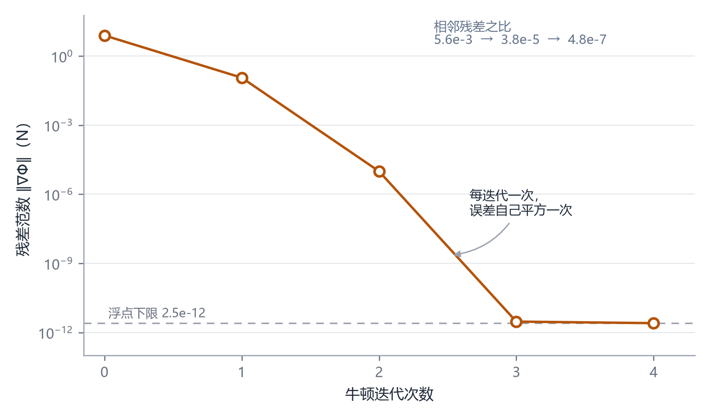
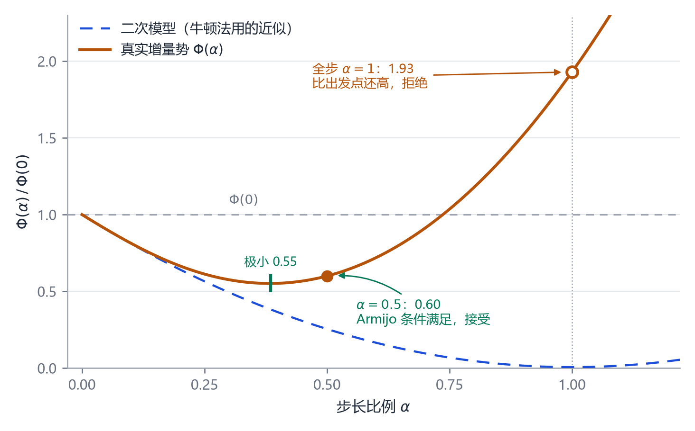

# 第 5 章 隐式积分与牛顿迭代

> 本章导读：一块布两个角钉住，松手之后第一帧就要往下塌一大截。显式积分在这块布上撑不过一毫秒，于是只能去解一个非线性方程组。这一章讲这个方程组是从哪来的、牛顿法怎么走、什么时候会一步迈过头、迈过头之后怎么救，以及把步子迈大为什么从来不免费。

## 5.1 半个毫秒的死刑

一块 1 米见方的布，13×13 个顶点，总重 50 克，两个对角顶点钉死，其余全放开。重力一加，布往下塌。这个镜头在任何一部有衣服的片子里都有，差别只在后面几百帧。

用显式积分跑它，第一帧就完了。算一下就明白：每个顶点 2.96e-4 kg，结构弹簧取 2000 N/m，顶点沿弹簧方向振荡的角频率

$$
\omega = \sqrt{k/m} = \sqrt{2000/2.96\times10^{-4}} \approx 2.6\times10^{3}\ \mathrm{rad/s}
$$

对应周期 2.4 毫秒。显式 Euler 的稳定条件是 $\Delta t \lt 2/\omega$，也就是 0.77 毫秒。60 fps 的步长是 16.7 毫秒，比这条线大 22 倍。位移每帧放大二十倍以上，三帧之后屏幕上只剩一团噪点。

有人会说那就把步长调到 0.7 毫秒。可以，一秒 1400 帧。这块布 886 根弹簧、501 个未知数，每帧算 886 次力的计算，1400 帧就是 124 万次，还只是这块 169 个顶点的布。换成一件衣服的 3 万顶点，帧数乘上去，实时就不要想了。

还有一条更省事的路：把系统的参数改到显式方法能承受。稳定条件 $\Delta t \lt 2/\omega$ 要求 $\omega \lt 120$ rad/s，而现在是 2600。想把 $\omega$ 压低二十多倍，只能动 $k/m$，也就是把它除以差不多 470。于是有两条分支：质量乘 470，这块布变成 23 公斤，下坠时像一块铅皮；或者刚度除以 470，弹簧从 2000 N/m 掉到 4 N/m，布在自重下就能被拉到静止长度的十几倍，看起来像一团面。两条路都改掉了物理，屏幕上看到的既不是这块布，也不是那块布。

也就是说，稳定性不能靠调参买，只能靠换方法。这条算术还顺带说明了一件事：刚度、质量、步长三者的比例决定一切。后面要讲的"条件数差""收敛慢""步子迈过头"，根子都在这个比例上。

问题的根源不在弹簧太硬，而在显式方法只用"当前"的力去推"未来"的位置。弹簧越硬，同样的位移产生的力越大，步子稍大就推过了头，推过头再下一次就反推得更远。隐式方法换了个思路：用**目标时刻**的状态去算力。目标时刻的位置还不知道，力也就不知道，于是每一帧不再是一次乘法，而是一个方程——位置和力必须同时满足。方程是非线性的，因为弹簧力对位置的依赖不是线性的（弹簧转了个角度，力的方向就变了）。

这条路换来的是稳定性：线性弹簧振子在隐式 Euler 下无论步长多大都不会发散。布料上的隐式积分很早就走通了：后向 Euler 配牛顿迭代，线性系统交给共轭梯度，一帧只算一步，弹簧的刚度就不必再被步长绑住[@baraff1998]。代价是每一帧都要解方程。这一章的其余部分都在讲这个方程怎么解、什么时候解不动。

## 5.2 把力换成势

先把离散方程写出来。速度更新与位置更新都用后向 Euler：

$$
\mathbf{M}\,\frac{\mathbf{v}_{n+1}-\mathbf{v}_{n}}{\Delta t} = \mathbf{f}(\mathbf{x}_{n+1}),
\qquad
\mathbf{x}_{n+1} = \mathbf{x}_{n} + \Delta t\,\mathbf{v}_{n+1}
$$

$\mathbf{M}$ 是质量矩阵，对角，$\mathbf{f}$ 是弹力和重力的合力。注意 $\mathbf{f}$ 的自变量是 $\mathbf{x}_{n+1}$，不是 $\mathbf{x}_n$。把第二式代进第一式，消掉速度：

$$
\frac{\mathbf{M}}{\Delta t^{2}}\left(\mathbf{x}_{n+1}-\hat{\mathbf{y}}\right) = \mathbf{f}(\mathbf{x}_{n+1}),
\qquad
\hat{\mathbf{y}} = \mathbf{x}_{n} + \Delta t\,\mathbf{v}_{n}
$$

$\hat{\mathbf{y}}$ 是"如果没有任何力，这一步会到哪里"，通常叫预测位置。这个式子的左边是线性的，右边不是，所以它是一个非线性方程组，不能用一次矩阵求解搞定。

接下来是最关键的一步改写。假设弹力来自势能，$\mathbf{f} = -\nabla E$，定义

$$
\Phi(\mathbf{x}) = \frac{1}{2\Delta t^{2}}\left\|\mathbf{x}-\hat{\mathbf{y}}\right\|_{\mathbf{M}}^{2} + E(\mathbf{x})
$$

右边第一项是"离预测位置的加权距离平方"，第二项是弹性能。这两项合起来叫增量势。对它求梯度：

$$
\nabla \Phi(\mathbf{x}) = \frac{\mathbf{M}}{\Delta t^{2}}\left(\mathbf{x}-\hat{\mathbf{y}}\right) + \nabla E(\mathbf{x})
$$

令梯度为零，得到的正是上面的离散方程。于是"解隐式一步"这件事被整个换成了"最小化一个标量函数"：力被换成了势的梯度，平衡被换成了极值。

这里有一个常被忽略的细节：$\Phi$ 把两种完全不同的东西加在了一起——一项说"别离预测位置太远"，一项说"别变形太狠"。$1/\Delta t^2$ 就是两者的汇率。步长越小，汇率越高，解越靠近预测位置，越像显式；步长越大，汇率越低，解越靠近静态平衡。同一段代码在 1 毫秒和 16 毫秒下算出来的不是同一个物理过程，中间只隔着一个系数，这一点在 5.7 节会具体算。

把汇率算成数字，两种代价就能直接比。顶点质量 $2.96\times10^{-4}$ kg，$\Delta t = 1/60$ s，质量项系数是 $m/\Delta t^{2} = 1.07$ N/m。一个顶点偏离预测位置 1 厘米，增量势里记 $0.5\times1.07\times0.01^{2} = 5.4\times10^{-5}$ 焦。同一块布上把一根弹簧拉长 1%（静止长度 8.33 厘米，拉长 0.83 毫米），弹性能记 $0.5\times2000\times(8.33\times10^{-4})^{2} = 6.9\times10^{-4}$ 焦。

两者差十三倍。反过来说，让一个顶点偏离预测位置 3.6 厘米，代价才和把一根弹簧拉长 1% 相当。这就是 60 fps 下隐式布料的实际权重分配：位置可以大幅移动，弹簧长度几乎不许变。5.3 节末尾那个"残差只有 7.9 N 而位移接近一米"的现象，根子就在这个比例上。

逐项对一下单位，$\Phi$ 的构造就更实在。$\|\mathbf{x}-\hat{\mathbf{y}}\|_{\mathbf{M}}^{2}$ 是 $\sum_v m_v\|\mathbf{x}_v-\hat{\mathbf{y}}_v\|^{2}$，单位 kg·m²；乘上 $1/(2\Delta t^{2})$（单位 1/s²）之后是 kg·m²/s²，也就是焦耳。$E$ 本身就是焦耳。两项同量纲才能相加——这件事听着理所当然，但它决定了 $\Delta t$ 在这套方法里的身份：$\Delta t$ 不是精度旋钮，而是两张账单之间的汇率。

还有一件关于 $\mathbf{K}$ 的结构的事，值得在这里说清，因为后面反复要用。装配 $\mathbf{K}$ 时，每根弹簧贡献四个 3×3 块：$\mathbf{K}_{aa}$、$\mathbf{K}_{ab}$、$\mathbf{K}_{ba}$、$\mathbf{K}_{bb}$。弹簧沿 $x$ 轴、恰好处于静止长度时，$\mathbf{K}_{aa} = -\mathbf{K}_{ab} = k\,\mathbf{u}\mathbf{u}^{\top}$，把这个外积写开，是只有左上角元素非零的矩阵，对角值 2000，其余为零。

那两个零不是笔误。一根理想弹簧在静止长度上对横向位移没有抵抗力：把它横着推一点，长度的一阶变化是零，力也就没有一阶变化。所以弹簧网在静止状态附近的切线刚度里，横向模式的刚度只剩质量项那 1.07 N/m，比轴向小三个数量级。布料的抗弯能力必须由别的东西提供——弯曲弹簧、二面角项，或者干脆靠网格的离散化误差。这一点在 5.6 节讨论条件数时会再出现。

这个改写不是文字游戏，它带来三样实际的东西。

第一，可以监控。能量是标量，每次迭代之后算一下，涨了还是落了，一眼就能看见。求解器出问题时最怕没有指标，有了增量势就有了。

第二，矩阵有结构。对 $\Phi$ 求二阶导：

$$
\mathbf{K}(\mathbf{x}) = \frac{\mathbf{M}}{\Delta t^{2}} + \nabla^{2}E(\mathbf{x})
$$

第一项是正定的对角阵。第二项是弹性能的 Hessian，弹簧网在拉伸状态下它也是正定的，只有严重压缩或者单元翻转时才可能出现负特征值。只要 Hessian 不坏，$\mathbf{K}$ 就对称正定，可以用 Cholesky 分解——这是后面所有效率讨论的前提。

第三，"失败"有了定义。求解失败意味着势没有降下来，或者梯度停在某个不为零的地方。这两种情况都能被检测，也都有对应的补救办法，不像显式方法那样只能看着数字变成 NaN。

代价同样是明确的。后向 Euler 的数值阻尼很大：高频振荡在一个步长内被压掉相当一部分，布料的抖动、细褶皱的颤动都会变钝。想要抖动就得减小步长，而减小步长又回到成本问题。这个矛盾在 5.7 节展开。

## 5.3 牛顿法：一次线性求解换一步

最小化 $\Phi$ 最直接的办法是在当前点做二次近似。

设第 $k$ 次迭代的位置是 $\mathbf{x}_k$，残差（也就是梯度）$\mathbf{r}_k = \nabla\Phi(\mathbf{x}_k)$，切线刚度 $\mathbf{K}_k = \mathbf{K}(\mathbf{x}_k)$。把 $\Phi$ 在 $\mathbf{x}_k$ 处展开到二阶，求它的极小点，得到更新量 $\Delta\mathbf{x}$ 满足

$$
\mathbf{K}_k\,\Delta\mathbf{x} = -\mathbf{r}_k
$$

然后 $\mathbf{x}_{k+1} = \mathbf{x}_k + \Delta\mathbf{x}$。这就是牛顿法，$\mathbf{K}$ 里的 $\nabla^2 E$ 叫切线刚度，因为它把"位置的微小变化"映射成"力的变化"。

具体到那块布：501 个未知数，$\mathbf{K}$ 是 501×501 的对称正定矩阵，装配它要遍历 886 根弹簧，每根弹簧往四个 3×3 块里加一个矩阵。力的残差同样遍历一遍。一次迭代的成本就是"装配 $\mathbf{K}$ + 一次分解 + 一次回代"。

把这一轮迭代从头到尾拆开，每一行代码在干什么就清楚了。

第 1 步，算残差。遍历所有弹簧算出每根的当前力，加上重力，再减去质量项 $\mathbf{M}(\mathbf{x}-\hat{\mathbf{y}})/\Delta t^{2}$。产物是一个长度 501 的向量，单位牛顿。它同时就是 $\nabla\Phi$，也就是"往哪个方向推能把势降下来"的反方向。

第 2 步，装配切线刚度。再遍历一遍弹簧，把每根的四个 3×3 块加到 $\mathbf{K}$ 的对应位置。这一步和第 1 步共享大半中间量（差向量、长度、单位方向），所以实践里总是一趟循环把残差和矩阵一起算出来。

第 3 步，处理固定顶点。布上两个角钉死，位移必须为零。做法是把 $\mathbf{K}$ 里对应的行和列划掉，残差里对应的分量也划掉，剩下 495 个未知数。这一步不能省：不划掉的话，牛顿方向会给钉死的顶点一个非零位移，下一轮又被强行拉回，残差永远降不到零。

第 4 步，分解。$\mathbf{K}$ 对称正定，写成 Cholesky 形式 $\mathbf{L}\mathbf{L}^{\top}$。501 个未知数，稠密分解约 $2.1\times10^{7}$ 次浮点运算，比前两步加起来贵两个数量级。

第 5 步，回代。解 $\mathbf{L}\mathbf{L}^{\top}\Delta\mathbf{x} = -\mathbf{r}$，两次三角回代，$2\times501^{2} \approx 5\times10^{5}$ 次运算，比分便宜四十倍。

第 6 步，决定走多远。先试 $\alpha = 1$，不行就减半，这是 5.4 节的内容。

第 7 步，更新位置、检查残差、决定要不要再来一轮。

写成伪代码大致是这样：

```text
x = y_hat                                    # 预测位置当初值
for k in 1..max_iter:
    r, K = assemble(x)                       # 残差与切线刚度，共用一趟循环
    if norm(r) < tol: break                  # 收敛，收工
    r_f, K_f = apply_dirichlet(r, K)         # 划掉固定顶点的行列
    L = cholesky(K_f)                        # 最贵的一步
    dx = -solve_triangular(L, r_f)
    alpha = 1.0
    while Phi(x + alpha*dx) > Phi(x) + c*alpha*dot(r, dx):
        alpha *= 0.5                         # 回溯，每次重算一遍弹性能
        if alpha < 1e-4: break               # 走不动了，交给失败处理
    x += alpha*dx
```

这段代码里有两个容易被忽略的细节。

一是符号约定。$\mathbf{r} = \nabla\Phi$，所以更新式是 $\mathbf{x} \leftarrow \mathbf{x} - \alpha\mathbf{K}^{-1}\mathbf{r}$。符号写反了不会立刻报错，只会让残差单调上升，最后停在一个蓬松的位形上——布看起来"太软"，而你看不出哪里错了。

二是第 3 步的划行列怎么实现，有三种常见做法：真的把行列从稀疏结构里删掉（最干净，但排序要重做）；保留结构、把对角元设成 1、把同行同列的非对角元清零（结构不变，排序可复用，推荐）；或者给对角元加一个大数 $10^{8}$（最省事，但条件数被拉坏，后面用 CG 时会哭）。第三种在演示代码里到处都是，在正经求解器里应该避免。

把成本摊开算一遍。501 个未知数、886 根弹簧，一轮迭代大致是：装配 $2\times886$ 次 3×3 块运算（约 $10^{5}$ 次浮点），分解 $2.1\times10^{7}$，回代 $5\times10^{5}$，一次线搜索试探 886 次开方加乘加（约 $10^{4}$）。分解占了七成以上。这个比例决定了后面所有优化的方向：想快，就得少分解，或者让分解能被复用。

实测的残差序列是这样的（$\Delta t = 1/60$ s，每个顶点 2.96e-4 kg，结构、剪切、弯曲弹簧各取 2000、600、60 N/m）：

| 迭代 | 残差范数（N） |
| --- | --- |
| 0 | 7.89 |
| 1 | 1.15e-1 |
| 2 | 9.91e-6 |
| 3 | 2.94e-12 |

三次迭代，残差从 7.9 掉到 3e-12，降了十二个数量级。相邻两次的比值是 1.5e-2、8.6e-5、3.0e-7——每迭代一次，误差自己平方一次，这就是二次收敛的样子。图 5-1 把这条曲线画在半对数坐标上，能看出最后一段不是直线，而是越来越陡。

<figure class="fig">

<figcaption><b>图 5-1</b>　牛顿迭代的残差。1 米见方的布，13×13 顶点，总质量 50 克，两个对角顶点固定，结构、剪切、弯曲弹簧刚度分别为 2000、600、60 N/m，步长 1/60 s，重力 9.81。横轴是牛顿迭代次数，纵轴是残差范数 $\|\nabla\Phi\|$（单位牛顿，对数刻度）。残差从 7.89 N 依次降到 0.115 N、9.9e-6 N、2.9e-12 N，每次迭代误差约被平方。第四次之后停在 2.5e-12 N 附近不再下降，那是双精度浮点在 500 个自由度的残差上能分辨的下限。</figcaption>
</figure>

图 5-1 右边那段平台值得解释。到 1e-12 这个量级，残差已经比机器精度乘上力的量级还小了：力本身在 10 牛顿量级，双精度有 16 位有效数字，能分辨的最小差别就是 1e-15 左右的相对变化。再迭代下去只是在噪声里打转，多算的每一次都是一次白白的矩阵分解。所以收敛判据不能只看"还能不能降"，得有一个绝对下限。

还有一件事值得留意：起始残差只有 7.89 N，看上去很小，但这一帧里布料要移动将近一米。原因在增量势的两项比例——质量项系数是 $m/\Delta t^2 \approx 1.07$ N/m，而弹簧刚度是 2000 N/m，相差三个数量级。也就是说，权重几乎全在弹性能上，增量势近似于静弹性能，解出来的位形基本就是布挂在钉子上的静态平衡。残差小并不意味着位移小，只意味着从预测位置出发时"力已经接近平衡"。

## 5.4 一步迈过头

牛顿法的二次收敛只在"当前点已经进入二次近似有效的范围"时成立。范围之外，它可能一步跳到比出发点更糟的地方。

把同一块布往平面外甩一下，初速度 20 m/s，步长取 1/30 s。预测位置在平面外 0.67 米处，两个钉住的角上各有几根弹簧被拉到静止长度的 8 倍。从那里出发，牛顿方向算出来的最大位移是 0.58 米，沿着这个方向走满一步，增量势从 1602 焦升到 3090 焦——高了 93%。

图 5-2 画的是这一条方向上的切片：横轴是步长比例 $\alpha$，纵轴是 $\Phi(\mathbf{x}_k + \alpha\Delta\mathbf{x})$ 除以出发点处的值。

<figure class="fig">

<figcaption><b>图 5-2</b>　增量势沿牛顿方向的切片。同一块布，初速度沿平面外 20 m/s，步长 1/30 s，首步残差 2.4e3 N。实线是真实的 $\Phi(\alpha)/\Phi(0)$：$\alpha=1$ 升到 1.93，极小点在 $\alpha=0.39$（0.55）。虚线是牛顿法用的二次模型，它预测 $\alpha=1$ 时势会降到 0.006（几乎为零），与实际相差两个数量级。水平虚线是出发点。箭头标出回溯线搜索取到的 $\alpha=0.5$，此时势回到 0.60。全步走到 1.0 时，一部分角弹簧被压到静止长度的 0.64 倍，另一部分又被拉到 6.7 倍：线性模型既没算出压缩，也没算出新的拉伸。</figcaption>
</figure>

曲线最右端到 $\alpha=1$ 时还在升。原因可以逐条数：走到 $\alpha=1$，那些原本 8 倍拉伸的角弹簧被"拉回"到接近静止长度，但半路上它们先被压过——最小拉伸比降到 0.64，而压缩侧的横向刚度是 $k(1-L/l)$，$l \lt L$ 时它是负的，于是能量在压缩那一侧翘起来。同时另外一些弹簧被拉到 6.7 倍。全步同时做了两件错事：对一部分弹簧纠正过头，对另一部分制造了新的变形。

对比一下虚线。牛顿法用的二次模型在 $\alpha=1$ 处给出的是 0.006，几乎把势清零——这正是牛顿方向的定义：它是二次模型的极小点。模型和现实差了两个数量级，说明二次近似在这个位形上完全不可信。

补救办法是回溯线搜索：不直接接受 $\alpha=1$，而是从 1 开始试，不满意就减半，直到满足

$$
\Phi(\mathbf{x}_k + \alpha\Delta\mathbf{x}) \le \Phi(\mathbf{x}_k) + c\,\alpha\,\nabla\Phi(\mathbf{x}_k)^{\top}\Delta\mathbf{x}
$$

右端第二项是"按方向导数应得的下降量"的一个折扣，$c$ 通常取 1e-4。这条判据（Armijo 条件）要求实际下降至少达到线性预测的一小部分，$c$ 取小值是为了宽容——真实的非线性函数不可能像线性模型那样降得那么准。

图 5-2 里，$\alpha=1$ 被拒，$\alpha=0.5$ 接受，势从 1602 掉到 961。再往下试 $\alpha=0.25$ 是 981，反而比 0.5 差，说明极小点在 0.39 附近，减半一次就够。实践中一般允许回溯十到二十次，超过就说明方向本身有问题。

线搜索为什么必要，值得单独讲一遍，因为很多人把它当成"数值上的保险丝"，觉得调好参数就能拆掉。

第一层理由：牛顿方向是二次模型的极小点，不是真函数的极小点。二次模型只用到了当前点的梯度和 Hessian，它对"走远之后函数长什么样"一无所知。

弹簧能量对位移是四次多项式（长度是平方根，平方之后是二次，再对位移展开就是四次），二次模型只匹配到二阶，剩下的三阶、四阶项随 $\alpha^{3}$ 增长。刚度越大，三阶项咬得越凶，可信的步长范围越小。也就是说，该走多远由"三阶项什么时候追上二阶项"决定，而这个量在求解之前根本不知道。

第二层理由：有些位形上二次模型连定性都错了。图 5-2 里 $\alpha=1$ 处有弹簧被压到静止长度的 0.64 倍，横向刚度 $k(1-L/l)$ 在那里已经是负的，真实能量翘起来；二次模型里这个因子被冻结在出发点，看不见压缩。模型说"往这走能量降到接近零"，现实说"往这走能量涨 93%"。这不是精度问题，是符号问题。

第三层理由：$\mathbf{K}$ 正定时牛顿方向一定是下降方向，因为 $\mathbf{r}^{\top}\Delta\mathbf{x} = -\mathbf{r}^{\top}\mathbf{K}^{-1}\mathbf{r} \lt 0$。但"存在某个足够小的 $\alpha$ 让势下降"和"$\alpha=1$ 让势下降"是两件完全不同的事。前者是微积分定理，后者是运气。线搜索把定理变成算法：它保证每步至少拿到线性预测的一小部分。

顺便说清一个容易误解的地方。线搜索不加快收敛，它只扩大收敛域。收敛后期 $\alpha$ 稳定在 1，一次试探就通过，成本几乎为零；收敛前期 $\alpha$ 小，收敛变慢，但至少不发散。指望线搜索"让牛顿法更聪明"是错的方向，它的作用是把"能收敛的初值范围"从一条细缝扩成一整片。

减半策略很笨，但便宜。更好的做法是用已经算出来的三个数做二次插值：$\Phi(0)$、$\Phi'(0) = \mathbf{r}^{\top}\Delta\mathbf{x}$、$\Phi(\alpha_1)$。过这三点的抛物线，极小点在

$$
\alpha^{*} = \frac{-\Phi'(0)}{2\left[\Phi(\alpha_1) - \Phi(0) - \Phi'(0)\right]}
$$

分母里三个量都是焦耳，比值无量纲，所以 $\alpha^{*}$ 是纯数。代进图 5-2 的数：$\Phi(0) = 1602$ 焦，二次模型预测 $\Phi(1) = 9.6$ 焦；而二次模型满足 $\Phi_{\text{model}}(1) = \Phi(0) + \tfrac{1}{2}\Phi'(0)$（因为它的极小点就在 $\alpha=1$），反解出 $\Phi'(0) = -3185$ 焦。真实的 $\Phi(1) = 3090$ 焦，代入上式得 $\alpha^{*} = 3185/[2(3090-1602+3185)] = 0.34$。真实极小点在 0.39，插值给出的 0.34 已经很接近，比"减半到 0.5"准得多。

插值也有代价：分母可能接近零（三点几乎共线时），所以实现里总加一层保护——结果落在 $[0.1\alpha_1, 0.5\alpha_1]$ 之外就退回减半。这条保护看着琐碎，少了它，某些退化位形上插值会给出负的 $\alpha$，或者 $10^{-8}$ 这种让整步白走的数。

回溯的代价也要算。每次试探都要重新算一遍弹性能，遍历 886 根弹簧，比一次分解便宜但比一次回代贵。常见做法是把回溯次数上限压到十次左右，并且用"上次迭代接受的 $\alpha$"作为下次的起点——收敛后期 $\alpha$ 会稳定在 1 附近，前期在 0.5 上下，记住它比每次从 1 重新试更省。另一条路是完全不回溯，固定用 $\alpha = 0.5$（阻尼牛顿），代价是迭代次数大约翻倍，好处是实现简单、行为可预测、便于并行。两条路的取舍取决于你要的是最快收敛还是最稳的帧时间。

方向本身有问题这件事必须说清楚。线搜索只能保证"沿着这个方向能降"，不能保证方向是对的。如果 $\mathbf{K}$ 出现了负特征值，牛顿方向可能指向鞍点，沿着它走任何距离都不降，回溯会一路退到 $\alpha$ 极小，最后什么也没做。这不是线搜索的缺陷，而是切线刚度不可信的信号，得靠下一节的手段处理。

## 5.5 收敛判据与失败恢复

判据看上去是小事，实际上决定了求解器在工程里能不能用。

最直觉的做法是看残差范数是否小于某个绝对阈值，比如 1e-5 N。问题是力的量级随场景变化：一块 50 克的布和一台几吨的机器，同样的绝对阈值含义完全不同。工程上常用相对判据

$$
\left\|\mathbf{r}_k\right\| \le \varepsilon_r \left\|\mathbf{r}_0\right\|,
\qquad \varepsilon_r = 10^{-4}\sim10^{-6}
$$

或者把残差和位移放在一起看：本步的位移增量小于 $10^{-3}$ 米，且残差相对值小于 $10^{-4}$。只看位移会在"卡住不动"时误判为收敛，只看残差会在残差本来就很小的场景里一开始就"收敛"。

真正麻烦的是不收敛的三种典型情况。

第一种是**退化弹簧**。两个顶点靠得太近，$l \to 0$，弹簧的横向刚度 $k(1-L/l)$ 趋向负无穷，$\mathbf{K}$ 出现极大的负特征值。纽扣、缝线、两个相邻顶点被挤到一起，都会触发它。补救办法是给 $l$ 设下限：$l \leftarrow \max(l, \epsilon L)$，$\epsilon$ 取 1e-3 左右；或者对 Hessian 做特征值截断，把负特征值抬到一个小正数。这两种都改变了物理，但改变的量级远小于让它崩掉的代价。

第二种是**单元翻转**。体积变成负的，应变能对变形梯度的导数在那里没有意义。有限元的经典解法是换一个在压缩侧仍然有定义的能量，可逆单元走的就是这条路[@irving2004]：把能量在压缩区间的定义改成"随压缩增大而上升"，让翻转成为高能态而不是无定义态。牛顿法于是能被"推回来"，而不是在那里被负刚度甩出去。

第三种是**接触与障碍**。一旦约束里有"不许穿透"，可行域就是带洞的，最小化问题可能无解，牛顿方向可能指向墙里。这类问题的标准做法是在线搜索里加过滤：任何让穿透量增加、或者让单元体积变成负的试探步，直接拒绝，不问能量降了多少[@gast2015]。这种过滤式线搜索的代价是可能把可行步也一起拒掉，最后退到很小的 $\alpha$，表现出来的现象是"这一步几乎没动"。

上面三种情况说的是病因。工程上更需要的是症状和处置，因为运行时没时间分析原因。

先在每次迭代里记五个数：$\|\mathbf{r}\|$、$\Phi$、接受的 $\alpha$、最小拉伸比 $\min_i(l_i/L_i)$、位移的最大分量。五个数加起来不到十个浮点，却能把几乎所有故障模式区分开。$\Phi$ 上升说明方向或步长有问题；$\alpha$ 连续几次触底说明方向不可信；最小拉伸比掉到 0.1 以下说明有弹簧正在退化；位移最大分量超过网格尺度说明这一步在"跳"。

处置按代价从低到高排，某一层解决了就停。

第一层，正则化。给对角加一个小量 $\mathbf{K} \leftarrow \mathbf{K} + \epsilon\mathbf{I}$，$\epsilon$ 取对角平均值的 $10^{-6}$。这把负特征值抬成正数，代价是解出的位移略小。但对 $\lambda_{\min} = -3.2\times10^{5}$ 这种量级的负特征值，$\epsilon$ 得取到 $10^{4}$ 才够，那时已经是改物理而不是微调了。所以这一层只对"轻微不定"有效。

第二层，限制步长。不接受完整的 $\Delta\mathbf{x}$，把它按最大分量截断：$|\Delta x_v| \le 0.5\,h$，$h$ 是平均边长。这块布上 $h = 8.33$ 厘米，也就是每步每顶点最多动 4 厘米。这相当于一个自适应的 $\alpha$，但它按分量管而不是按整步管，能防止个别顶点飞出去。代价在大位移场景：20 m/s 的初速度在 1/30 秒内要走 0.67 米，截断后要十七次迭代才走完。

第三层，换方向。这一轮的牛顿方向不可信，就退回最速下降：$\Delta\mathbf{x} = -\mathbf{r}$，配一次线搜索。最速下降慢得可笑（条件数差时能慢上百倍），但它只需要 $\mathbf{r}$，不需要分解，而且配足够小的 $\alpha$ 一定能降。它的作用不是求解，是把位形挪到一个 Hessian 重新正定的地方，下一轮再切回牛顿。

第四层，减半步长重来。把这一帧的 $\Delta t$ 减半，从上一帧的收敛状态重走。离线渲染里这很常见，因为一帧的成本可以接受翻倍，而且离线渲染器本来就有自适应子步的框架。实时里要小心：帧率不能因为一次失败就崩，所以这一层往往只允许触发一次，再失败就往下走。

第五层，接受残次品。把这一帧的位移按可行域投影一次（拉伸比夹到 $[0.5, 2]$，负体积的单元翻回来），把误差记在账上，继续下一帧。在游戏引擎里这是常态而不是例外：16 毫秒的预算里没有余量做"重来"，宁可让布在这一帧微微不对，也不能掉帧。

关键是这个决定要被记录。失败计数、最大残差、被投影的单元数，都该出现在性能统计里。一个从不上报失败的求解器，等于一个从不上报错误的编译器。

这五层不是流水线，是按需调用。绝大多数帧一层都用不上；一段糟糕的布料资产（弹簧刚度和分辨率不匹配、初始位形里有重叠顶点）可能每一帧都在第二层上打转，这时该修的是资产，不是求解器。

## 5.6 稀疏求解：直接法与迭代法

到 5.3 节为止，501 个未知数一直是稠密矩阵直接解。这在演示里没问题，$501^3/6 \approx 2\times10^7$ 次浮点运算，毫秒级。

真实的布料不是这个量级。一件长袖上衣三角化之后 5 万顶点，15 万个未知数。稠密矩阵要存 $1.5\times10^5$ 的平方，即 $2.25\times10^{10}$ 个元素，按双精度算 180 GB，光是分配内存就失败了。所以大规模一定要用稀疏。

稀疏矩阵只存非零元。$\mathbf{K}$ 的非零元来自"共享弹簧的顶点对"：每个顶点连着八到十根弹簧，所以每行只有十四个左右的非零元。501 个自由度时一共约 7000 个，密度不到 3%；换成 5 万顶点（15 万自由度）的网格，行宽不变，非零元涨到两百万左右，密度降到 0.01%。这个结构是网格给的，很规整。

但稀疏 Cholesky 分解会产生**填充**：原本是零的位置，在消元过程中变成非零。填充量极度依赖消元顺序——同一个矩阵，换个排序，填充可能差十倍。三维网格上的最优排序（嵌套剖分、AMD 近似最小度）能把复杂度压到接近 $O(n^{1.5})$，内存是同样的量级。这一步在工程上比迭代格式的选择更重要：先装一个好的排序，再谈别的。

直接法的好处是解一次就到位，不依赖条件数，接触、摩擦这种让矩阵变得不定的情形也能处理（换 LDL 分解）。坏处是每次迭代都要重新分解，而牛顿每步的位置都变，矩阵都在变。

迭代法（共轭梯度，CG）的好处是每次只需矩阵-向量乘，内存只要几个向量，天然适合 GPU。它的收敛速度由条件数决定，而 $\mathbf{K}$ 的条件数 $\kappa = \lambda_{\max}/\lambda_{\min}$ 很差：刚度 2000、质量项 1.07，光这两项就差三个数量级；网格越细，细长单元越多，条件数还要再涨。所以 CG 必须配预条件——对角预条件（Jacobi）几乎免费但效果有限，不完全 Cholesky（IC）效果好但要构造，多重网格在布料这种薄壳上不太适用。

装配本身也有讲究。逐根弹簧往全局矩阵里累加，是典型的写冲突：多线程同时写同一个顶点对应的行，结果就错了。标准解法是图着色——把弹簧按"不共享顶点"分组，同色的弹簧可以并行累加，颜色数在规则网格上通常不超过 12。装配在布料模拟里经常比求解还耗时，因为它无法像矩阵乘那样用高度优化的内核，只能靠这种结构化的并行。

选型之前先把账算清，因为不同方法的成本差在规模上会放大成数量级。

内存。5 万顶点、15 万自由度的一块布，每行平均 14 个非零元，一共约 $2.1\times10^{6}$ 个。CSC 格式存下来是 16.8 MB 的值加 8.4 MB 的行号，约 25 MB。分解后的填充通常是非零元数的 5 到 10 倍，因子矩阵就在 100 到 250 MB。这个数字不吓人，但它是不可压缩的；迭代法的内存只有几个向量，15 万自由度的向量是 1.2 MB。

浮点运算。稀疏 Cholesky 的总量取决于填充。二维流形上的网格用嵌套剖分排序，大约在 $O(n\log n)$ 到 $O(n^{1.5})$ 之间，15 万自由度落在 $10^{10}$ 量级。桌面 CPU 单核算有效吞吐 $10^{9}$，一次分解是秒级；八核并行加超节点 BLAS 能压到几百毫秒。

块结构得单独说。每个顶点有 3 个自由度，在矩阵里是紧挨着的 3×3 块。若按标量做排序和分解，同一个顶点的三个分量会被填充拆得到处都是，填充量翻两三倍。所以正经的布料求解器都用块稀疏分解：排序以顶点为单位，分解以 3×3 块为最小单元，块内的小矩阵求逆用显式公式。这一条几乎不花额外代价，却是两三倍的收益，属于必做项。

迭代法这边，决定成败的是预条件。CG 的迭代次数大致随 $\sqrt{\kappa}$ 增长，条件数 $10^{6}$ 时动辄上千次，每次一次稀疏矩阵向量乘，总量和一两次稀疏分解相当，还拿不到精确解。Jacobi 预条件把对角拉平，能压掉一两个数量级；不完全 Cholesky（IC(0)）能压到 $10^{2}$ 量级，但它的三角回代本质串行，在 GPU 上很别扭。GPU 上的常见替代是多项式预条件（把 $\mathbf{K}^{-1}$ 按 Chebyshev 多项式展开，只有矩阵向量乘）和块雅可比，效果不如 IC，但能并行到底。

一个实用判断：3000 个未知数以下，稠密 Cholesky 足够快，代码最短；1 万到 10 万，稀疏 Cholesky 加好的排序是稳妥选择；再往上，或者要上 GPU，就得走迭代法加预条件，并且接受"每步只解到 1e-3 的相对精度、让牛顿多迭代一次"这种折中。

还有一件事：牛顿法要求 $\mathbf{K}$ 精确到能给出下降方向，但正演模拟并不要求线性系统解到机器精度。外层非线性内层线性的组合里，内层解得太准是浪费——把内层容差取成 $\min(0.1, \|\mathbf{r}_k\|)$ 这类随外层残差收缩的量（非精确牛顿），总成本能降一大截，而收敛速度几乎不变。

最后补三条容易踩的坑。有接触和摩擦时 $\mathbf{K}$ 可能不定，Cholesky 会直接失败，这时换 $\mathbf{L}\mathbf{D}\mathbf{L}^{\top}$ 分解，或者把接触写成罚函数让它保持正定。网格各向异性极端时（一根细长条、一段绳子），对角预条件几乎无效，条件数能到 $10^{8}$，这时该换直接法而不是换预条件。还有，别在每帧重新分析稀疏结构：符号分解（排序、算填充图案）只依赖拓扑，数值分解才依赖数值，两者分开做，能省掉一大半时间。

## 5.7 时间步、子步与精度

隐式积分最容易传播的一句错话是"无条件稳定，所以步子可以随便大"。稳定和准确是两回事。

稳定性说的是误差不会指数增长；准确性说的是解离真实轨迹有多近。后向 Euler 是一阶方法，局部截断误差 $O(\Delta t^2)$，而且它的误差方向是固定的那一侧——数值阻尼。对线性振子，一步之后的振幅乘上 $1/\sqrt{1+\omega^2\Delta t^2}$ 这个因子，频率越高被压得越狠。

把这个因子代进数字。$\omega\Delta t = 44$（60 fps 那块布），振幅保留 $1/\sqrt{1+44^{2}} = 0.023$，一步之内振荡消失 97.7%。切成 8 个子步，$\omega\Delta t = 5.5$，保留 0.179。切成 30 个子步，$\omega\Delta t = 1.5$，保留 0.555。也就是说，8 子步下高频模态活不过两步，30 子步下能活过四五步——"活过几步"这个说法比"阻尼有多大"更好判断画面，褶皱的传播速度由它决定。布料的高频模态是相邻顶点的相对抖动，正是褶皱起皱和颤动所在；步长一大，这些模态被抹平，布看起来像湿了水的厚毯子。

拿那块布的数值比一比。顶点 2.96e-4 kg，结构弹簧 2000 N/m，弹性振荡周期 2.4 毫秒。60 fps 的步长 16.7 毫秒，是周期的七倍。$\omega\Delta t \approx 44$，数值阻尼已经强到"一步之内振荡完全消失"的程度。这解释了 5.3 节末尾那个观察：一帧解出来的位形几乎就是静态平衡。布料的隐式模拟在 60 fps 下常常不是"动态"的，而是"按帧推进的准静态"，褶皱是靠后续帧的小扰动慢慢长出来的，不是靠真实的振动传出来的。

这也是为什么布料求解器普遍用子步。把一帧切成 8 个子步，$\omega\Delta t$ 从 44 降到 5.5，阻尼仍然有，但振荡至少能活过两三步；切到 30 个子步，$\omega\Delta t \approx 1.5$，才开始像真实的布。代价是每帧 30 次求解。

小步长还有另一个好处：非线性变弱。每步位移小，弹簧转过的角度小，二次近似就更可信，牛顿迭代次数下降——大步长要 5 次迭代加回溯，小步长常常 1 到 2 次就收敛。所以"少次大步"和"多次小步"的实际成本差距比帧数比小得多。

近几年实时物理引擎的主流做法正是后者：把一帧切成很多小步，每步只做很少的迭代，甚至只用一次 XPBD 式的投影[@macklin2019]。它牺牲的是大尺度上的一致性（长波长的响应会被小步的局部修正切碎），换来的是稳定、可控、能在 GPU 上并行。

把两种策略的成本摊开对一下就明白了。同一帧 16.7 毫秒：大步长方案分解一次矩阵、做 5 次迭代，其中两次触发线搜索（每次试探重算一遍能量），总共约 1 次分解加 8 次能量计算。8 子步方案每步 2.1 毫秒，每步 1 到 2 次迭代、几乎不回溯，一共 8 次分解加 12 次能量计算。差别全在分解次数：1 次对 8 次。

子步策略能不能真的靠近"便宜"，取决于矩阵能不能跨子步复用。能复用，8 次分解就缩成 1 次，子步几乎白送；不能复用，子步的成本就按子步数线性叠上去。而能不能复用，取决于矩阵里有没有随位置和步长变化的项——这条限制很强，第 6 章讲的就是怎么绕开它。

最后一个经验：判据和步长要一起调。步长减半，残差阈值不变，迭代次数会下降，但总求解次数翻倍；反过来，步长加大、阈值放宽，看起来"快了"，实际上是让每帧的解带着 1e-2 量级的力不平衡进入下一帧，误差在帧之间累积成可见的滑移——布料会缓慢下沉、包裹会慢慢松脱。这类问题很难从单帧的图上看出来，要用长序列的能量漂移和约束违反量来查。
