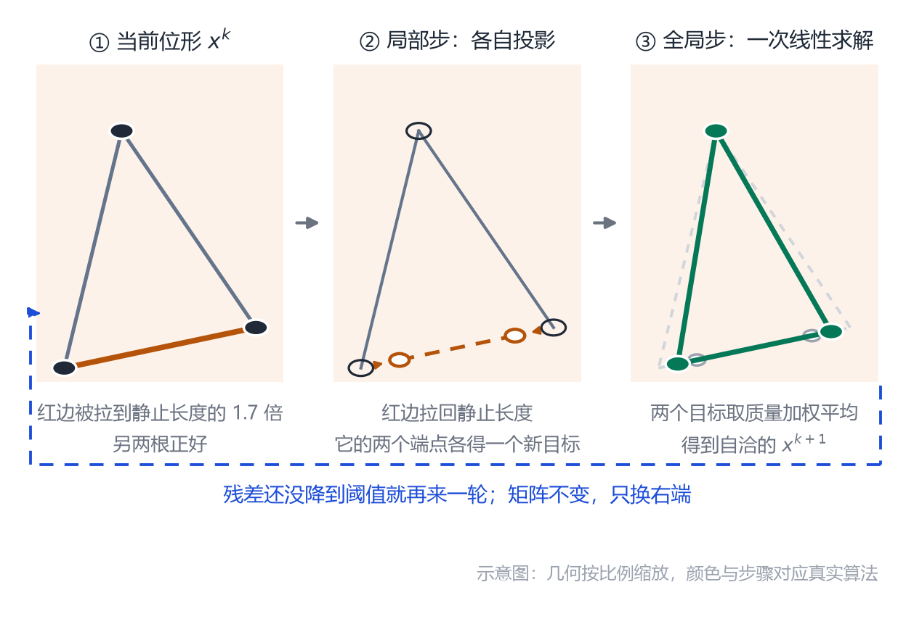
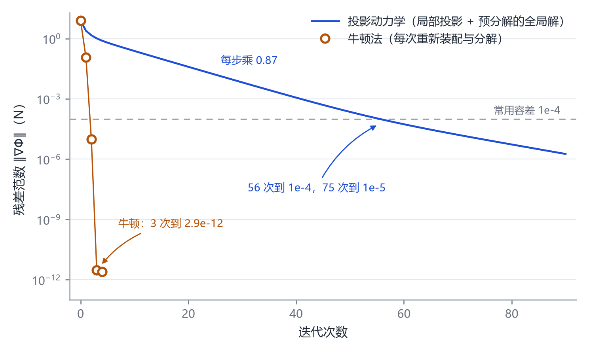

# 第 6 章 投影动力学与局部-全局

> 本章导读：上一章那块布，牛顿法三次迭代就收敛，可是每次迭代都要重新装配切线刚度、重新做一次分解。布料一帧要解一次、一秒六十帧、网格动辄几万顶点，光是分解就把预算吃完了。这一章讲另一种组织方式：把能量拆成一堆"到目标的距离"，把变的部分和不变的部分分开，让矩阵只分解一次。它慢得多，但每步都便宜，而且能便宜到底。

## 6.1 同一块布，问法不同

先回到那块 1 米见方、13×13 顶点、50 克的布。两个对角钉死，重力一加，第一帧的位形要从平面塌下去。

牛顿法在这块布上表现很好：残差 7.89 N 出发，三次迭代到 3e-12 N。问题是这三次迭代里，每一次都要重新算 $\nabla^2E$——遍历 886 根弹簧，往一个 501×501 的矩阵里累加——然后重新做一次 Cholesky 分解。三次迭代就是三次分解。

如果只算一帧，这个开销可以忍。算 600 帧就是 1800 次分解。而且网格一换，501 变成 15 万，分解的成本按三次方涨，很快就没有然后了。

投影动力学（projective dynamics）的思路是：能不能让矩阵**不依赖当前位置**？如果 $\mathbf{K}$ 是常数，那么一次分解就能用到底——同一帧里的所有迭代共用，整段动画的所有帧共用，甚至换一个模型、只改一点参数时也还能用。

要做到这一点，必须把能量里所有随位置变化的东西挪到一个"局部"的角落里，让剩下的部分是一个固定的二次型。这不是近似技巧的堆砌，而是一种对能量的重新书写。

## 6.2 把能量写成到目标的距离

一根距离弹簧的能量是

$$
E(\mathbf{x}) = \frac{k}{2}\left(\left\|\mathbf{d}\right\| - L\right)^{2},
\qquad \mathbf{d} = \mathbf{x}_a - \mathbf{x}_b
$$

$k$ 是刚度，$L$ 是静止长度，$\mathbf{d}$ 是两个端点的差向量，$\|\mathbf{d}\|$ 是当前长度。这个式子的形状是"长度减静止长度，再平方"，看上去没法拆。

换一个写法。定义投影算子

$$
p(\mathbf{d}) = L\,\frac{\mathbf{d}}{\left\|\mathbf{d}\right\|}
$$

它把差向量拉到长度为 $L$、方向不变的最近点。于是

$$
\left\|\mathbf{d} - p(\mathbf{d})\right\| = \left\|\mathbf{d}\right\| - L
$$

能量就变成

$$
E(\mathbf{x}) = \frac{k}{2}\left\|\mathbf{A}\mathbf{x} - p(\mathbf{A}\mathbf{x})\right\|^{2}
$$

$\mathbf{A}$ 是差分算子，把顶点位置映成差向量 $\mathbf{d}$。这个式子的意思是：能量等于"当前差向量到它在该约束上的投影点"的距离平方。对距离约束，投影点就是长度为 $L$ 的那个点；对别的约束——面积、体积、二面角——投影点是相应流形上的最近点，通常也有闭式解。

关键的一步来了：如果假装 $p$ 是**常数**，这个能量就是一个标准的二次型，它的 Hessian 是 $k\,\mathbf{A}^{\top}\mathbf{A}$——不含位置，只含拓扑和刚度。把所有约束加起来，定义一个常数矩阵

$$
\mathbf{G} = \sum_i k_i\,\mathbf{A}_i^{\top}\mathbf{A}_i
$$

这就是投影动力学里的全局矩阵。它是弹簧图的加权拉普拉斯，稀疏、对称、半正定，只有"所有顶点同步平移"这种整体模式落在它的零空间里。

真实能量和这个常数二次型差在哪里？真实 Hessian 是

$$
\nabla^{2}E_i = k_i\,\mathbf{A}_i^{\top}\left[\mathbf{P} + \left(1-\frac{L}{l}\right)\left(\mathbf{I}-\mathbf{P}\right)\right]\mathbf{A}_i
$$

$l$ 是当前长度，$\mathbf{P}$ 是沿差向量方向的投影矩阵。这个式子的读法是：沿弹簧轴向，刚度是 $k$，一点不打折；垂直于轴向，刚度是 $k(1-L/l)$，被拉伸时变小，被压缩时变成负的（这就是弹簧网的屈曲）。和 $\mathbf{G}$ 里的 $k\,\mathbf{A}^{\top}\mathbf{A}$ 比，轴向完全一样，横向差一个因子。

逐根弹簧比较特征值就知道：只要弹簧没有被压到长度为零，它的 Hessian 在二次型意义下不超过 $k\,\mathbf{A}^{\top}\mathbf{A}$（轴向两个端点各出现一次，正好抵平）；把所有弹簧加起来就是 $\nabla^2E \preceq \mathbf{G}$。也就是说，把 $p$ 冻结之后得到的二次函数，是真实能量的一个**上界**。

这一点决定了整个方法的性质。每一步都在最小化一个上界，而上界在当前点取到真实值（因为 $p$ 就是当前点的投影），这是经典的优化上界-最小化（majorize-minimize）结构：目标函数单调不增，不会像牛顿那样一步把势推高 93%。代价是每步只下降一点——上界在横向过紧，那些"转动、弯曲"的模式被保守地对待，收敛就慢。

这种把能量拆成"常数二次型加局部投影"的做法，最早是为大规模弹簧网准备的[@liu2013]：弹簧网的能量逐根可拆，局部投影有闭式解，剩下的就是一个常数拉普拉斯矩阵，预分解之后每帧只做回代。后来它被推广成一整套框架，把面积、体积、二面角、甚至刚体的形状匹配都写成"到某个流形的投影"，并正式命名为投影动力学[@bouaziz2014]。推广之后，方法的能力边界就不再由"能量是不是距离弹簧"决定，而由"这个约束有没有便宜又靠谱的投影"决定——有投影的进局部步，没有的只能退回牛顿。

## 6.3 局部步与全局步

把上界写全。第 $k$ 次迭代，已知位置 $\mathbf{x}^k$，先把每根弹簧的投影算出来，$p_i^k = p_i(\mathbf{A}_i\mathbf{x}^k)$，然后最小化

$$
\tilde\Phi(\mathbf{x};\mathbf{x}^k) = \frac{1}{2\Delta t^{2}}\left\|\mathbf{x}-\hat{\mathbf{y}}\right\|_{\mathbf{M}}^{2}
+ \sum_i \frac{k_i}{2}\left\|\mathbf{A}_i\mathbf{x} - p_i^k\right\|^{2}
$$

对 $\mathbf{x}$ 求导，令其为零：

$$
\left(\frac{\mathbf{M}}{\Delta t^{2}} + \mathbf{G}\right)\mathbf{x}^{k+1}
= \frac{\mathbf{M}}{\Delta t^{2}}\hat{\mathbf{y}} + \sum_i k_i\,\mathbf{A}_i^{\top}p_i^k
$$

左边那个矩阵不含 $\mathbf{x}^k$，右端是"质量项的目标"加上"所有投影拉力的合力"。于是每次迭代分成两件事。

**局部步**：遍历所有约束，各自算投影 $p_i^k$。这一步没有耦合——每根弹簧只用到自己两个端点的位置，天然可以并行，也不需要任何线性代数。

**全局步**：解一个线性系统，矩阵固定。分解一次，之后每次只做回代。这就是全部的加速来源，除此之外没有别的魔法。

图 6-1 把这个循环画了出来。三个面板从左到右。左边是当前位形，底边那根弹簧被拉得比静止长度长了七成；中间是局部步，每根弹簧各自回到自己的静止长度，被拉长的那根把两个端点往内拉出两个新目标，另两根则坚持“端点别动”，于是底边两个顶点各自收到两个矛盾的要求；右边是全局步，把矛盾按质量加权抹平，得到一个两边都让步一点的新位形；然后回到局部步，再算一轮。

<figure class="fig">

<figcaption><b>图 6-1</b>　局部步与全局步的交替（示意图）。三个面板从左到右是同一个循环的三步。左：当前位形 $x^k$，底边那根弹簧被拉到静止长度的 1.7 倍，另两根正好。中：局部步把每根弹簧单独拉回自己的静止长度（虚线），被拉长的那根把两个端点各拉向内一个新目标（空心圆），另两根则要求端点不动，于是底边两个顶点各有两个互相矛盾的目标。右：全局步按质量加权平均这些目标，得到自洽的 $x^{k+1}$（绿），灰虚线是旧位形。底部的回箭头表示这一轮之后残差还没到阈值就再来一次；局部步之间没有耦合，可以并行，全局步的矩阵 $M/\Delta t^2+G$ 只依赖拓扑与刚度，不依赖当前位置，一次分解可以复用。</figcaption>
</figure>

用那块布的实测数据看看这个循环跑起来什么样。结构、剪切、弯曲刚度取 2000、600、60 N/m，步长 1/60 s，起始位置和牛顿法完全一样（残差 7.88 N）。投影动力学的残差按下面的节奏下降：

| 迭代次数 | 残差（N） |
| --- | --- |
| 0 | 7.88 |
| 5 | 6.3e-1 |
| 20 | 3.9e-2 |
| 41 | 小于 1e-3 |
| 56 | 小于 1e-4 |
| 75 | 小于 1e-5 |

每步大约乘 0.87，是一条漂亮的对数直线——线性收敛的教科书样子。要降到 1e-4 需要 56 次迭代，牛顿法只需要 2 次。这个差距是真实的，但它不等于"慢 28 倍"。

## 6.4 它其实是哪一种牛顿法

把牛顿法的更新式和投影动力学的更新式摆在一起看。

牛顿法每一步解 $\mathbf{K}(\mathbf{x}^k)\Delta\mathbf{x} = -\mathbf{r}^k$，其中 $\mathbf{K}$ 随迭代变化。投影动力学每一步解的是

$$
\left(\frac{\mathbf{M}}{\Delta t^{2}} + \mathbf{G}\right)\left(\mathbf{x}^{k+1} - \mathbf{x}^{k}\right)
= -\mathbf{r}^k
$$

右端是真实的梯度（可以验证：把上界的最小点代回，梯度为零的表达式和真实梯度相同），左端却用了一个固定的矩阵。这正是数值分析里的"弦方法"——用一个固定的近似 Hessian 走牛顿的步子。它是拟牛顿法的一种，收敛是线性的，速率取决于近似 Hessian 与真实 Hessian 的谱差距。

我们的实测收缩率是 0.87。它和什么有关？直觉上会认为刚度越大越难收敛，实测不是这样：刚度取 200、2000、20000 N/m 时，后期的收缩率分别是 0.88、0.87、0.84，刚度大的反而更快。原因是刚度大时弹簧网接近刚性，而 $\mathbf{G}$ 恰好是刚性约束的一个好模型——上界和真实 Hessian 的横向差距虽然还在，但那些横向模式对应的能量占比小了。真正让收敛变慢的是"上界不准、且不准的那部分占主导"的局面：中等刚度加上大变形，横向转动和轴向拉伸同量级。

图 6-2 把两种方法的残差画在一张图上，用的是同一个初始位置、同一个残差定义。

<figure class="fig">

<figcaption><b>图 6-2</b>　投影动力学与牛顿法的收敛对比（真实计算）。同一块布，501 个未知数，886 根弹簧，刚度 2000、600、60 N/m，步长 1/60 s，从同一个预测位置出发，纵轴是真实增量势的梯度范数。牛顿法（空心点）三次迭代到 2.9e-12；投影动力学（实线）每步乘约 0.87，到 1e-4 需要 56 次、到 1e-5 需要 75 次。两者斜率完全不同：牛顿是二次收敛（对数坐标上越来越陡），投影动力学是线性收敛（直线）。</figcaption>
</figure>

曲线形态之外，成本要单独算，因为它们每次迭代的价格不一样。

投影动力学的全局矩阵是常数，所以整段动画只分解一次。一次迭代的成本是：装配右端（遍历弹簧，$O(\text{弹簧数})$）加回代（稀疏时 $O(n)$）。牛顿每次迭代要重新装配 Hessian 加一次新分解（稀疏时 $O(n^{1.5})$ 左右，稠密时 $O(n^3)$）。

在这个 501 未知数的小例子上按稠密算：一次 Cholesky 约 $501^3/6 \approx 2.1\times10^7$ 次浮点运算，一次回代 $501^2 \approx 2.5\times10^5$。75 次投影动力学迭代的回代总量约 $1.9\times10^7$，大致等于一次分解。600 帧的序列里，牛顿要 1800 次分解（$3.8\times10^{10}$），投影动力学只要 1 次分解加 45000 次回代（$1.2\times10^{10}$）。规模越大、帧数越多，这个差距越大，因为分解按 $n^{1.5}$ 涨、回代按 $n$ 涨。

所以"56 次迭代对比 2 次"这个比值会误导人。正确的比法是"总浮点运算"，而运算量里占比最大的那一项，投影动力学只付一次。

不过复用的前提要说清楚。那个矩阵是 $\mathbf{M}/\Delta t^2 + \mathbf{G}$，$\mathbf{G}$ 只依赖拓扑和刚度，$\mathbf{M}$ 只依赖质量分布，看上去什么都不变——但 $\Delta t$ 也是矩阵的一部分，而 $\Delta t$ 会因为子步、自适应步长、时间重映射（慢动作、变速剪辑）而变。步长一改，$1/\Delta t^2$ 变，矩阵就变了，分解得重做。这一点在工程上很致命：布料管线里最常见的需求恰恰是"这一镜要放慢到 0.3 倍"或者"碰撞帧要加密子步"。绕过它的办法是把 $\Delta t$ 固定住，变速靠外部重映射时间轴实现，而不是改模拟步长；或者接受重分解，把它归到"换镜头"的一次性成本里。

## 6.5 ADMM 视角

把上面的过程写成约束优化，可以看出它属于哪一族方法。原问题是

$$
\min_{\mathbf{x}}\ \frac{1}{2\Delta t^{2}}\left\|\mathbf{x}-\hat{\mathbf{y}}\right\|_{\mathbf{M}}^{2} + \sum_i E_i(\mathbf{A}_i\mathbf{x})
$$

每个约束项只通过差向量 $\mathbf{A}_i\mathbf{x}$ 依赖 $\mathbf{x}$。引入副本 $\mathbf{z}_i$，把 $\mathbf{z}_i = \mathbf{A}_i\mathbf{x}$ 写成硬约束：

$$
\min_{\mathbf{x},\{\mathbf{z}_i\}}\ \frac{1}{2\Delta t^{2}}\left\|\mathbf{x}-\hat{\mathbf{y}}\right\|_{\mathbf{M}}^{2}
+ \sum_i E_i(\mathbf{z}_i)
\quad \text{s.t.}\quad \mathbf{z}_i = \mathbf{A}_i\mathbf{x}
$$

分裂变量的好处是：$E_i$ 各自只依赖自己的 $\mathbf{z}_i$，可以独立处理；耦合全部落在等式约束上。用增广拉格朗日法，给每个约束配一个对偶变量 $\boldsymbol{\lambda}_i$ 和一个惩罚参数 $\rho$：

$$
\mathcal{L}_\rho = \frac{1}{2\Delta t^{2}}\left\|\mathbf{x}-\hat{\mathbf{y}}\right\|_{\mathbf{M}}^{2}
+ \sum_i\left[E_i(\mathbf{z}_i) + \boldsymbol{\lambda}_i^{\top}\left(\mathbf{z}_i - \mathbf{A}_i\mathbf{x}\right)
+ \frac{\rho}{2}\left\|\mathbf{z}_i - \mathbf{A}_i\mathbf{x}\right\|^{2}\right]
$$

交替方向乘子法（ADMM）按三个半步轮转。

$\mathbf{x}$ 步：固定 $\mathbf{z}$ 和 $\boldsymbol{\lambda}$，对 $\mathbf{x}$ 最小化。这是一个二次问题，矩阵是 $\mathbf{M}/\Delta t^2 + \rho\sum_i\mathbf{A}_i^{\top}\mathbf{A}_i$——还是常数，还是可以预分解。

$\mathbf{z}$ 步：固定 $\mathbf{x}$，对每个 $\mathbf{z}_i$ 单独最小化 $E_i(\mathbf{z}_i) + \frac{\rho}{2}\|\mathbf{z}_i - (\mathbf{A}_i\mathbf{x} - \boldsymbol{\lambda}_i/\rho)\|^2$。这是"能量加二次罚"的近端问题，规模只有约束本身的维度：距离约束是三维的径向问题，可以用几步一维牛顿解掉；StVK、Neo-Hookean、塑性这些一般本构，$\mathbf{z}$ 是变形梯度，9 维，同样用局部牛顿[@narain2016]。

$\boldsymbol{\lambda}$ 步：$\boldsymbol{\lambda}_i \leftarrow \boldsymbol{\lambda}_i + \rho\left(\mathbf{z}_i - \mathbf{A}_i\mathbf{x}\right)$，把违反约束的量记在账上，下次加回去。

对照一下就很清楚了：投影动力学是"$\mathbf{z}$ 步只做一次投影、$\rho$ 取成约束权重、对偶变量从不更新"的特例。硬距离约束的近端问题在 $\rho = k$ 时解就是投影；把 $\boldsymbol{\lambda}$ 一直置零，$\mathbf{z}$ 步永远只看当前点。这解释了上一节看到的两个性质：单调下降来自上界-最小化——每一步都在最小化一个在当前点等于真实能量的上界；线性收敛来自 $\mathbf{z}$ 步做得不彻底——一次投影换一次全局求解，偏差从不累积到对偶变量里，只能靠迭代次数慢慢磨。

ADMM 的写法带来的实际收益有三条。第一，本构可以随便换：局部步是一个独立的、小规模的、可以用牛顿法精确求解的子问题，超弹、塑性、粘弹都装得进去，而投影动力学原本只能处理"投影有闭式解"的约束。第二，$\rho$ 是一个可以调的旋钮：$\rho$ 大，$\mathbf{x}$ 步被压得贴近"各约束自洽"，收敛靠 $\mathbf{z}$ 步；$\rho$ 小，反过来。工程上常从约束刚度的量级起调，按残差的历史调整。第三，收敛性有理论保证——凸问题下 ADMM 收敛，非凸问题在实践中稳定但只有局部结论。

## 6.6 什么时候不灵

投影动力学不是万能钥匙，它的失效模式很具体。

**约束之间强耦合**。局部步的前提是"每个约束独立投影"。自碰撞打破了这个前提：两个顶点之间的距离约束要看第三个顶点在哪，接触的可行域依赖别的约束的解，逐个投影会给出互相矛盾的修正，交替下去可能来回振荡。实践中的处理是把碰撞单独放在外层（先解弹性、再投影碰撞、再解弹性），或者改用带障碍势的方法，把不可穿透写成能量而不是投影，交给全局步统一处理[@gast2015]。

**塑性**。塑性没有"投影到可行域"这种说法，有的是返回映射：给定试探应变，回到屈服面上，同时更新硬化变量。这件事可以在局部步里做，但局部步不再是无状态的——它要读写每个单元的内变量，并行时要小心数据归属。这不难，但代码复杂度会比纯弹性高一截。

**强各向异性与近不可压**。横向模式被上界保守对待，而近不可压材料的变形几乎全部是横向的（体积不变、形状大变），于是上界与真实 Hessian 的差距一直很大，收缩率逼近 1，迭代次数爆炸。这类材料（橡胶、生物软组织）用 ADMM 加局部牛顿更合适。

**大步长**。步长一大，预测位置离解很远，局部投影给出的目标方向偏差很大，迭代次数随步长增长。这是所有基于投影的方法的共同弱点，也是子步在布料里如此流行的原因。

**内存**。预分解省的是时间，不是空间。稀疏 Cholesky 的填充让因子矩阵比原矩阵大一个数量级很常见，十几万未知数的布料，因子就要几百 MB。对策是分块：把大网格切成若干区域，块内各自预分解、块间用迭代或 Schur 补耦合，代价是块边界上的收敛变差，需要多迭代几次。

还有一个隐蔽的失效：残差停在某个平台不再下降，但也没有发散。原因通常是两股力量互相抵消——$\mathbf{x}$ 步把顶点拉向一个方向，局部投影又把它拉回来，形成一个两点循环。检测办法是看残差的历史，连续几次迭代的下降不到 1%；处理办法是加一个小量的阻尼（把新位形和旧位形做线性混合），或者干脆切换成牛顿法把这一步收干净。

## 6.7 与 XPBD 的关系

把投影动力学和第 2 章讲过的位置动力学（XPBD）放在一起，会发现它们是同一种思想的两套组织方式。两者都把"力"换成了"投影"：约束不产生力，而是直接给出"应该在哪"。区别在于投影之后怎么把修正分摊到顶点上。

XPBD 是逐约束的高斯-赛德尔：取一根弹簧，算它的修正量，立刻写回两个端点，然后取下一根。修正按顺序传播，一根弹簧的改变会影响下一根弹簧的输入。好处是不需要全局线性求解，实现几十行，天然适合 GPU 上"一次处理一大批约束"的并行（只要约束之间不共享顶点）；坏处是结果依赖处理顺序，同一帧跑两遍、顺序不同，位形会差一点，这对可复现性是个隐患。

投影动力学是"全部投影 + 一次全局平均"：所有约束同时投影，然后用一个线性求解把矛盾按质量加权抹平。这相当于雅可比式的更新加一次全局耦合，没有顺序依赖，但需要那个常数矩阵。

两者的刚度处理也不同。XPBD 用柔度 $\tilde\alpha = 1/(k\Delta t^{2})$ 把刚度、步长、迭代次数解耦，迭代次数只影响收敛程度，不影响目标刚度[@macklin2016]；投影动力学用权重 $k_i$ 直接进矩阵，刚度就写在 $\mathbf{G}$ 里，物理意义更直白，但对刚度的极端取值更敏感。

两者在极限上还有一条定量对应。取一根刚度很大的弹簧：XPBD 里的柔度 $\tilde\alpha = 1/(k\Delta t^2)$ 很小，修正几乎把长度拉到 $L$；投影动力学里 $k$ 很大，$\mathbf{G}$ 里的权重很大，全局步几乎强制差向量与投影目标一致。两边都在逼近"硬约束"这个极限，差别只在逼近的路径：XPBD 沿约束逐个逼近，投影动力学沿全局最小二乘逼近。反过来，刚度很小时 $\tilde\alpha$ 很大，XPBD 的修正被柔度削弱；而 $\mathbf{G}$ 权重很小，解更多地被质量项拉回预测位置，两边同样都在向"这一步几乎不约束"退化。两种极限下行为一致，是因为它们解的是同一个隐式方程，只是用不同的分裂方式去迭代。

实践中怎么选，取决于三件事。要实时、要 GPU、要处理大量接触，选 XPBD 加上很多子步——子步多、迭代少，比子步少、迭代多更有效，这一点在小步长实验里被反复验证[@macklin2019]。要离线、要高刚度、要一般本构（塑性、粘弹、各向异性），选 ADMM 或牛顿，把局部问题做扎实。介于两者之间，投影动力学是最省事的选择：代码量小，矩阵一次分解，行为可预测，慢一点但慢得可控。

还有一条常被忽略的：这两种方法在"子步足够多、每步只做很少迭代"的极限下会互相靠近。子步多的时候，每步的位移小、非线性弱，任何一致的投影方案都能收敛到同一个隐式解，差别只剩下每次迭代的具体路径。所以争论"XPBD 和投影动力学哪个对"往往是错的问题；该问的是"在这个预算下，哪条路径更快到达一个足够好的解"。
