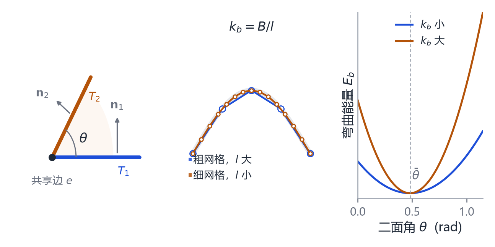
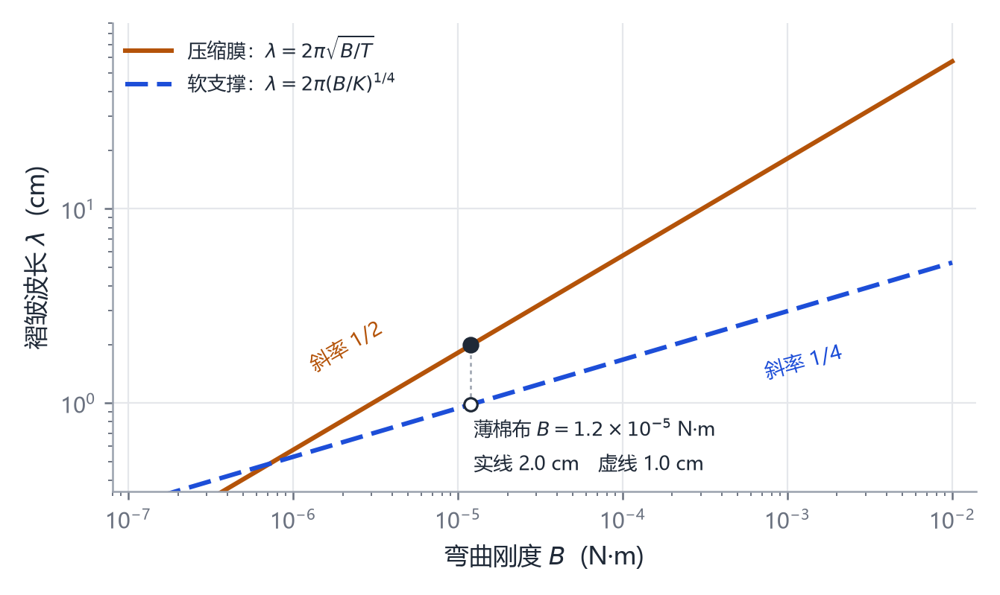

# 第 7 章 布料：弯曲、褶皱与尺度

> 本章导读：一块桌布被风掀起来，褶皱从桌沿一路铺到布角；换一块同样大小的厚帆布，褶就变少、变宽。褶的疏密不由花色决定，由弯曲刚度和布里的张力决定。这一章把布的三种抵抗拆开算账，看弯曲怎么写进能量，褶皱为什么一定从压缩里长出来，波长由什么定下来，以及网格分辨率为什么决定一块布看起来是硬纸板还是毛毯。

## 7.1 三种抵抗

找一块棉质桌布，把它从桌沿往下拉开一半。垂下来的那部分不会像钢板一样悬在空中，也不会像水一样流走，它自己折成几道竖直的褶，褶距两三厘米，风一吹就换位置。用手扯住两个对边往两边拉，几乎拉不动。把布转四十五度再拉，能拉出两三厘米。捏住一角提起来，垂下的部分软得没有形状。

同一块布，三个方向上手感完全不同，这就是布的三种抵抗。

第一种是拉伸。织物的经纱和纬纱在织造时是弯的，一根纱在一个交织点上一上一下，走的是波浪线。顺着纱的方向拉，最先被拉直的是这些波浪，纱本身几乎不伸长。所以布在百分之一二的应变以内显得很硬：一厘米宽的棉布条拉到 1% 应变大约要一牛，换算成一米宽是一百牛每米，等效模量几十兆帕，比棉纤维本身的五到十吉帕低两个数量级，差的那一截全被纱线的卷曲吃掉了。等波浪拉直、纱真正受拉，曲线会突然变陡，那已经接近织物的断裂点。

第二种是剪切。把方形布沿对角线方向拉，经纱和纬纱之间的夹角从九十度变成八十度、七十度，纱线在交织点互相挤压、转动。机织物的剪切刚度比拉伸低得多，这也是为什么斜着裁的裙子会把重力"导"成流动的褶皱，而直裁的裙子显得挺。针织物的纱是套环相连的，剪切几乎不费力，所以 T 恤怎么放都塌。

第三种是弯曲。把布绕着一根轴卷起来，几乎不用力。这不是错觉：厚度为 $t$ 的板弯成半径 $R$ 的圆柱，外表面的应变是 $t/(2R)$。棉布厚 $0.4$ 毫米，弯到 $R=5$ 厘米，表面应变只有 $0.4\%$，正好落在"波浪还没拉直"的区间里，弯曲带来的应变完全可以由纱线在交织点间的滑移吸收，纤维本身没有被拉伸。所以布的弯曲刚度远低于同厚度的均匀板：把纤维模量代进板公式得到 $10^{-2}$ 牛·米量级，实测的织物弯曲刚度在 $10^{-5}$ 牛·米量级，差三个数量级。

纺织业用"弯曲长度"量这件事：一条布从桌沿水平伸出，靠自重垂下的长度是 $c=(B/w)^{1/3}$，$B$ 是单位宽度的弯曲刚度，$w$ 是单位面积重量。棉布面密度约 $150\ \mathrm{g/m^2}$，即 $w\approx1.5\ \mathrm{N/m^2}$，实测 $c$ 在 2 厘米上下，反推 $B\approx1.2\times10^{-5}$ 牛·米，大约相当于一根直径 4 毫米的尼龙绳——布比它软得多，因为绳子是一整块材料，布是一层能内部滑移的结构。

三种抵抗的数量级差得这么远，写进程序就是麻烦事。拉伸几乎是刚性约束，弯曲几乎没有力，中间夹着剪切。显式积分会被最硬的那一项卡住步长，隐式求解会得到一个条件数极差的系统。而人眼判断一块布像不像，看的偏偏是最软的那一项：褶的疏密、褶峰的圆钝、褶子往哪儿倒，全是弯曲和压缩在说话。

拉伸错了会立刻看出来：布被拉长、被撕开，是硬伤。弯曲错了不会立刻看出来，布还是那块布，只是看起来像卡纸、像湿布、像塑料薄膜。这类错误最难改，因为它不违反任何一条显式约束。

## 7.2 弯曲怎么写进能量

一块薄板的弯曲能量有标准形式。设板的中面挠度为 $w(x,y)$，弯曲刚度

$$
D=\frac{E t^{3}}{12\left(1-\nu^{2}\right)} ,
\tag{7.1}
$$

其中 $E$ 是杨氏模量，$t$ 是厚度，$\nu$ 是泊松比；$1/(1-\nu^2)$ 是板比梁多出来的因子，板弯曲时横向也要收缩，被邻域挡住，于是显得更硬。窄条可以把泊松效应忽略，$D$ 退化成 $B=Et^{3}/12$，单位牛·米。

对一条曲率为 $\kappa$ 的细条，弯曲能量是

$$
E_{b}=\frac{B}{2}\int \kappa^{2}\,\mathrm{d}s ,
\tag{7.2}
$$

$s$ 是沿条的弧长。这条式子的意思是：弯得越急越贵，而且是按曲率的平方贵。把它离散到一条由长度 $l$ 的小段拼成的折线上，第 $i$ 个关节的曲率用相邻两段的方向差除以段长来近似，$\kappa_i\approx\Delta\theta_i/l$，$\Delta\theta_i$ 是转角。于是

$$
E_{b}\approx\frac{B}{2}\sum_i \frac{\left(\Delta\theta_i\right)^{2}}{l} .
\tag{7.3}
$$

这一步给出一个容易被忽略的事实：单个关节的刚度是 $B/l$，不是 $B$。网格加密一倍、$l$ 减半，每个关节的刚度就得跟着减半，整条布的总弯曲刚度才不变。代码里把铰链刚度写成常数，同一块布就会在粗网格上是帆布、在细网格上成了纸巾，改分辨率等于换材料。

三角网格上的弯曲用二面角写。两个三角形共享一条边，它们所在平面的法向之间有一个夹角，或者等价地，这条边上有一个二面角 $\theta$。平铺时 $\theta$ 取某个静止值 $\bar\theta$，弯起来就偏离它。最直接的能量是

$$
E_{b}=\frac{1}{2}\sum_{e} k_{b}\left(\theta_{e}-\bar\theta_{e}\right)^{2} ,
\tag{7.4}
$$

$e$ 遍历所有内部边，$k_b$ 是这个铰链的刚度。要让能量在加密时不漂移，$k_b$ 得按静止形状的边长和相邻三角形面积加权。Grinspun 等人的离散壳就是把角度差乘上以静止网格构造的权重，使离散能量在细网格极限下收敛到式 (7.2)，而不是随分辨率乱变 [@grinspun2003]。这在工程上比形式上的优雅重要：衣服常从小分辨率做起，中途加密做特写，权重不对就会在加密前后判若两布。

图 7-1 左边画的是这个铰链的几何，右边是能量随二面角的变化。

<figure class="fig">

<figcaption><b>图 7-1</b>　二面角形式的弯曲能量。左：两个面片 $T_1$、$T_2$ 沿共享边 $e$ 折起，垂直于 $e$ 的剖面里两片的夹角就是二面角 $\theta$，两个法向的夹角与它相等，平铺时 $\theta=0$。中：同一条弧用两种段长离散，单铰链刚度按 $k_b=B/l$ 标定，段长减半刚度也要减半。右：单个铰链的能量关于二面角是二次势，极小在静止角 $\bar\theta$ 处，$k_b$ 越大曲线越陡。图为示意，未按真实比例绘制。</figcaption>
</figure>

二次势与 $1-\cos(\theta-\bar\theta)$ 之间的选择是实践问题。二次势在角度偏离很大时给出很大的力，褶折到接近一百八十度会顶住求解器；余弦形式在大角度饱和，力有上界，代价是小角度之外不再对应真实刚度。折痕明显的布用余弦形式更稳，要精确的弯曲长度则用二次势。

三种写法各有适用面。二面角形式最通用，几乎每个布料解算器都有它，缺点是只约束相邻面片，跨越多条边的整体卷曲要靠一串铰链叠加，粗网格上叠加不足，布显得比实际硬。弯曲弹簧是另一路：Provot 把每个顶点与它对面的顶点用一根普通弹簧连起来代替弯曲铰链 [@provot1995]，几行代码，代价是这根弹簧同时抵抗弯曲和部分拉伸，刚度没法干净地对应到 $B$。曲率形式最贴近连续板，适合规则网格和壳单元，在不规则三角网上要先估主曲率，反而更贵。

## 7.3 褶皱从压缩里长出来

拿一块手帕平铺在桌上，两只手按住一对对边往中间推。推到布开始起拱，再推，拱变成一道褶。继续推，一道褶变成两道、四道，褶距一次次减半。整个过程里布的总长度没有变，多出来的长度全部变成了褶的弧长。

这件事的根源是布不能承受压缩。一块有厚度的板受压，只要压应力没到临界值，板就保持平直；布几乎没有厚度，临界应力低到可以忽略。换个说法：布在平面内可以承受任意大的拉力，但一丁点压力都受不住，因为它有一个零成本的逃逸方向——往平面外弯。只要面内求解器要求某个方向上出现负应变，布就会立刻鼓出去，把这段"多余长度"藏进褶皱。

设褶皱近似为正弦，波长 $\lambda$、振幅 $A$。一个周期内正弦曲线的弧长比直线多出约 $\pi^{2}A^{2}/\lambda$，除以波长得到多余长度的比例。让它等于局部的压缩应变 $\varepsilon$（取正值表示压缩），得到

$$
A\approx\frac{\lambda}{\pi}\sqrt{\varepsilon} .
\tag{7.5}
$$

这条式子说明振幅按压缩量的平方根长。棉布上 $\lambda=2$ 厘米、压缩 $1\%$，振幅只有 $0.6$ 毫米，难怪小幅推一下只看得到浅浅的波纹。压缩到 $20\%$，振幅接近 3 毫米，褶已经很明显。

振幅不会一直长下去。当 $A$ 接近 $\lambda/2$，褶峰变尖，继续增大振幅要付的弯曲能量涨得比压缩换来的能量下降更快，更省事的做法是把波长减半——同样多的多余长度由两道浅褶分担，比一道深褶便宜。这就是开头那串"一道变两道、两道变四道"的来历。每次减半都需要更大的压缩量，所以一块布上同时存在厘米级的缓波和毫米级的细褶，它们不是同一机制的两个参数，而是同一套分岔在不同尺度上重复。

对模拟来说，这条机制有一个直接后果：想看到褶皱，必须允许布往平面外走，而且要允许它走得不平滑。如果求解器把布约束在初始平面附近，或者弯曲刚度过大，压缩会以面内的方式被"吃掉"，表现为布在拉伸方向缩短、在另一方向鼓起——看起来像橡皮，不像布。

## 7.4 波长的标度关系

波长不是任意的，它由两个能量的竞争定下来：弯曲想让布尽量平（波长越长，同样振幅下曲率越小），压缩想让布尽量皱（波长越短，藏同样多的多余长度需要的振幅越小）。写成波动方程更清楚。

设布受到面内的线力 $T$（单位牛每米，压缩取正），平面外挠度 $w$ 的小扰动满足

$$
B\nabla^{4}w+T\nabla^{2}w=0 .
\tag{7.6}
$$

第一项是弯曲恢复力，第二项是膜力。代入平面波 $w\propto\mathrm{e}^{\mathrm{i}kx}$，得到 $Bk^{4}-Tk^{2}=0$，非零解要求

$$
k^{2}=\frac{T}{B},\qquad \lambda=\frac{2\pi}{k}=2\pi\sqrt{\frac{B}{T}} .
\tag{7.7}
$$

量纲上检查：牛·米除以牛每米是平方米，开方正好是米。这条式子说波长随弯曲刚度的平方根增长，随压缩线力的平方根减小。

代入棉布的数字：$B=1.2\times10^{-5}$ 牛·米，$T=1.2$ 牛每米（对应 $3$ 千帕的膜应力），得 $\lambda\approx2$ 厘米。手帕、衬衫、窗帘上的褶距大多落在一到三厘米之间，和这个估算对得上。帐篷和帆布更厚，$B$ 大一个数量级，波长跟着变成五六厘米，这也和实际观感一致。$T$ 越大波长越短：一块被绷紧的布，褶子细而密；松下来的布，褶子宽而软。

实际系统很少是纯压缩的膜。布往往贴在一个软的东西上——人的身体、内衣、另一层布。这时支撑面相当于给了一个弹性地基，每单位面积提供 $K$ 牛每立方米的恢复力，平衡方程多一项 $Kw$：

$$
B\nabla^{4}w+Kw=0,\qquad \lambda=2\pi\left(\frac{B}{K}\right)^{1/4} .
\tag{7.8}
$$

指数从 $1/2$ 变成 $1/4$，$B$ 的影响被压平了。两个标度画在一起，就是图 7-2。

<figure class="fig">

<figcaption><b>图 7-2</b>　褶皱波长随弯曲刚度的标度关系，双对数坐标。实线按式 (7.7) 计算，取压缩线力 $T=1.2$ N/m，斜率 $1/2$；虚线按式 (7.8) 计算，取支撑刚度 $K=2\times10^{6}$ N/m³，斜率 $1/4$。两条线在 $B\approx7\times10^{-7}$ N·m 处相交，那里两种机制给出的波长都不到 1 厘米。薄棉布的 $B=1.2\times10^{-5}$ N·m 落在实线上是 2.0 厘米、落在虚线上是 1.0 厘米，量级与常见褶距相符。这是量纲分析给出的标度，不是某组实验的拟合；真实布料的褶距还会被重力、边界和版型拉扯，散布一两个厘米很正常。</figcaption>
</figure>

从式 (7.7) 还能推出一件对建模有用的事。若把弯曲刚度写成 $B=Et^{3}/12$，把膜力写成 $T=\sigma t$，$\sigma$ 是面内应力，则

$$
\lambda=2\pi\sqrt{\frac{Et^{2}}{12\sigma}}\;\propto\;t\sqrt{\frac{E}{\sigma}} ,
\tag{7.9}
$$

波长与厚度成正比。这解释了一个日常观察：同样材质、同样应力，厚布（帆布、呢子）的褶又宽又少，薄布（雪纺、真丝）的褶又细又密。褶皱的尺度首先是被厚度定下的，材料模量和应力只调一个平方根。

这条标度对数值模拟的意义比对物理更大。它说明褶皱波长有一个下限：给定厚度和应力，比 $\lambda$ 更短的褶要付很高的弯曲能量，不会自发出现。反过来，模拟里出现远短于 $\lambda$ 的褶，那不是物理，是数值噪声——离散的锯齿被弯曲能量冻住了。判断画面里的褶皱可不可信，最省事的办法是拿式 (7.7) 估一个波长，再看褶距是不是这个量级。

## 7.5 分辨率与褶皱

褶皱给了布料模拟一个别的题目没有的难题：它的主要视觉信息落在网格尺度附近。

网格间距 $h$ 决定能表示的最短波长。用正弦描述一道褶，两个顶点刚够奈奎斯特极限，形状却完全走样，峰成三角尖；四个顶点才开始像正弦。折算成数字：能表示的最短褶距约 $4h$。$h=1$ 厘米的布，最短褶距 4 厘米，而棉布真实褶距 2 厘米——模拟只能告诉你这一片往哪边倒。粗网格的布显得硬，不是刚度算大了，是褶皱找不到栖身之处，只能整片弯曲。

分辨率要多少钱？一米见方的布，$h=1$ 厘米时约 2.3 万个三角形，$h=2$ 毫米时约 58 万个，$h=0.5$ 毫米时接近 900 万个。三角剖分上每个顶点平均占 $\sqrt{3}h^{2}/2$ 的面积，顶点数与 $h^{2}$ 成反比，这条账躲不过去。影视里一件外套动辄百万面，主要就花在这里。

往细里走也有代价。褶距接近网格尺度时，离散误差在每一道褶上体现为锯齿，画面出现"毛"——一层不该有的高频。这不是数值不稳定，是连续板模型在毫米以下本来就不成立：那个尺度上起作用的是纱线之间的摩擦和滑移，不是均质薄板。此外显式步长受最硬的单元限制，$h$ 减半，质量减到四分之一，刚度按 $1/h$ 涨，临界步长跟着变小。

工程上有两条路。一条是分辨率定在"能表示主要褶皱"的档位，接受它是低通版本，再把弯曲刚度调大一点，让宏观弯曲长度对上真实布料；实时布料用的就是这个表观刚度。另一条是自适应细分，只加密弯曲剧烈的区域，坑在接缝：两侧网格的铰链刚度必须各自按 $B/l$ 标定，否则接缝会出现一条硬边，像裙子里缝了根钢丝。

还有一个反过来的现象。褶皱要真正形成，面片必须能贴到一起。如果自碰撞处理得太保守，两块布始终保持一个厚度的间隙，布就只能在大尺度上鼓包，永远折不出尖锐的褶。Bridson 等人在做带褶的衣服时，把大量精力放在稳健的接触处理上，而不是把弯曲力调小，原因就在这里 [@bridson2003]。弯曲决定褶的波长，碰撞决定褶能不能合上。

## 7.6 各向异性与裁剪

到目前为止都把布当成各向同性的薄板，这在实际衣服上会立刻露馅。

机织物有两组纱：经纱沿布卷方向，纬纱横着。经密通常高于纬密，经向的拉伸和弯曲都更硬，两边弯曲刚度差一倍是常见的。第三个数是剪切刚度，由交织点处纱线转动的难易决定，通常比两个弯曲刚度还低。所以一块机织布要五个数描述平面内行为：两个拉伸、一个剪切、两个弯曲。针织物由套环相连，方向性弱得多，接近各向同性，但更软、更易卷边、拉伸曲线极非线性。

把这套东西放进模拟，就是给每个三角形带一组材料轴 $\mathbf{u}$、$\mathbf{v}$，沿轴的拉伸和弯曲用各自的刚度，轴间的夹角用剪切刚度。二面角形式的弯曲能量要按共享边的材料方向选 $B_u$ 或 $B_v$，不能只用一个数。斜向（四十五度）的行为由这三个数组合出来，不需要单独的参数，这一点常被误解为"斜向要另加刚度"。

裁剪是另一半。做衣服先有二维纸样，每一片上都印着一条经向线，缝纫时按这条线对齐。斜裁的裙子把经向放在四十五度，重力拉下来时纱线只需要转角度、不需要伸长，整片布就顺着身体流动成细密的斜褶；同样的面料直裁，褶会硬得多。这些差异全部由纸样上的那条线决定，模拟只是把它算出来。

缝合在数值上是把两片边界顶点成对绑成距离约束，静止长度取缝份宽度。初缝时把两片略微拉开再绑，缝线里就有预张力，衣服才抱住身体而不是挂成口袋。刚度不足会开线，过高会在缝线旁拉出一条硬脊。

版型还决定褶皱的多少。袖山弧线比袖窿长，多出来的长度必须被"吃"掉，做法是抽褶，落到模拟里就是局部压缩，压缩又按 7.3 的机制变成褶。所以衣服上大部分的褶不是物理算出来的细节，是版型里预先埋好的多余长度，模拟负责把它摊开到合适的位置。想让一件数字服装有设计感，改纸样比调布料参数有效得多。

有一处容易做错的细节：静止二面角 $\bar\theta$ 取什么。布料是平的，取零看似自然；但很多管线直接从建模姿态取当前二面角当静止值，于是衣服记住了建模时的每一道褶，穿上身后弹不回去。有时这正是想要的——预褶的西装、压过线的百褶裙——但如果不是故意的，它会让一件新衣服看起来像被穿过很久。

## 7.7 层间摩擦

一件纯棉 T 恤穿在身上，抬手时下摆跟着上来，放下去又落回原处；一件真丝衬衫做同样的动作，下摆直接从肩膀滑下去。差别不在刚度，在摩擦。

布料与身体、布料与布料之间的切向力服从库仑条件：

$$
\left\lVert\mathbf{f}_{t}\right\rVert\le\mu f_{n} ,
\tag{7.10}
$$

$\mathbf{f}_t$ 是切向摩擦力，$f_n$ 是法向接触力，$\mu$ 是摩擦系数。这条式子的含义是：切向力有一个上限，上限正比于法向压力；没到上限时两个面粘在一起不动，到了上限才开始滑，滑动过程中力保持不变。

求解器里的实现通常分两步。先处理法向：把穿透的顶点推回表面。再处理切向：算出这一步的切向相对位移，如果它乘上质量除以步长超过 $\mu f_n$，就把它截断到刚好等于 $\mu f_n\Delta t/m$。这叫位移截断，实现简单，代价是它只实现了动摩擦：每帧都允许一点点滑移，即使外力远小于静摩擦上限。

这个差别在褶皱上非常明显。真实的布褶能"锁住"，是因为褶峰两侧的面片互相压着，静摩擦把它们钉在原地；用位移截断的求解器每帧都让面片滑一点点，几十帧后褶就自己散开，衣服看起来很"活"，像在水里。要保住褶，摩擦得当成互补条件解：切向位移在阈值内严格为零，超过才滑。Bridson 等人的布料接触处理里，法向与摩擦是放在一起迭代的 [@bridson2002]。

层数与分辨率是另外两个麻烦。冬天三四层衣服，每层单独求解，层与层之间还要互撞；内层网格细、外层网格粗，碰撞检测要在不同分辨率之间建对应。层间摩擦决定衣服是叠着还是滑开，叠着的褶连续，滑开的褶各自独立。

数值上，织物与织物之间的 $\mu$ 大致在 $0.2$ 到 $0.4$，织物与干燥皮肤在 $0.4$ 到 $0.6$，出汗后更高。$\mu$ 太大，布会粘在身体上像湿的；太小，衣领塌下去、裤子往下滑。

摩擦与法向力的耦合还有个隐蔽后果：这一步的摩擦用上一步的法向力算，而法向力在迭代中还在变，两个量互相追赶，产生缓慢的爬行——布在静止表面上一点点蠕动，每帧幅度很小，几百帧后位置全错。头发里这个问题严重得多，得把法向与摩擦放进同一个迭代里解 [@daviet2011]。

拍一件被风吹起的衬衫，风停之后褶在半秒内塌掉，看着就假。真实的衣服不会，褶峰互相压着，静摩擦撑着它们。弯曲定下波长，摩擦定下这个波长留不留得住：只调弯曲不管摩擦，得到一动就散的波纹；只调摩擦不管弯曲，得到一张被浆过的布。
