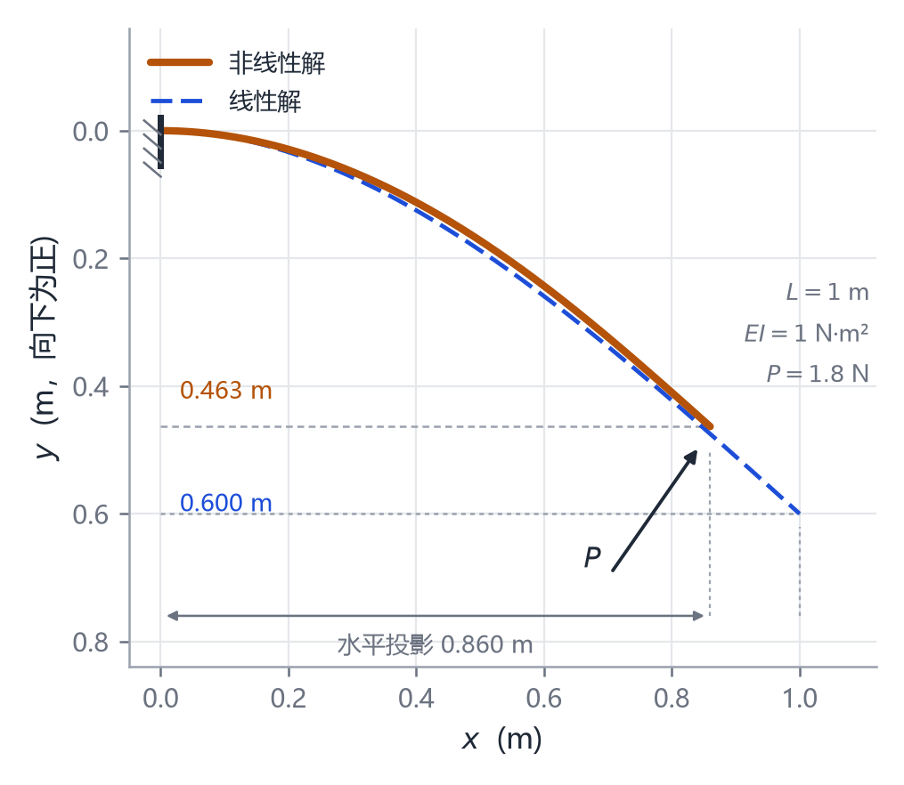

# 第 8 章 壳、杆与毛发

> 本章导读：一张纸捏住一角提起来，会垂成一道弧；同一张纸卷成筒，能立住并压上一摞书。一根头发吊得起一百克，却立不起来，连自己的重量都撑不住。这两件事说的是同一件事：薄结构的抗拉和抗弯差了五六个数量级，于是它所有的形状都由"能不能不拉伸地弯"决定。这一章从薄壳的能量讲起，落到杆的离散表示，再讲头发为什么要分层求解、为什么成缕、为什么十万根就顶到了算力的墙。

## 8.1 一张纸和一根头发

取一张 A4 纸，捏住一个角提起来。纸垂下去，弯成一道平滑的弧，弧的形状由纸自己的重量和弯曲刚度定。现在两只手抓住短边的两端，往两边拉。用尽全力，纸几乎不动——要把这张纸沿长边拉长百分之一，需要八百多牛的力，相当于挂上八十公斤。

同一张纸，横过来弯一下，两根手指轻轻一捏就能把它卷成筒。卷成的筒立在桌上，上面压一摞书也不塌。

拉不动、弯得动、卷起来还能承压，三件事不矛盾。拉伸靠的是材料的面内刚度，正比于厚度 $t$；弯曲靠的是截面惯性矩，正比于 $t^{3}$。A4 纸厚 $0.1$ 毫米，宽 $0.21$ 米，面内刚度 $Et\approx4\times10^{5}$ 牛每米，弯曲刚度 $B=Et^{3}/12\approx3.3\times10^{-4}$ 牛·米。把这张纸卷到 5 厘米半径，每米宽度上需要的弯矩只有 $B/R\approx7$ 毫牛·米，乘上宽度是一点五毫牛·米——手指拈一下的事。同样这张纸拉伸百分之一，需要四千牛每米的线力，乘上宽度是八百四十牛。要把这两个数放在一起比，得先折成同一个量纲：面内刚度 $Et\approx4\times10^{5}$ 牛每米，弯曲刚度除以纸宽的平方是 $B/a^{2}\approx7.5\times10^{-3}$ 牛每米（$a=0.21$ 米是纸宽），两者差七个数量级。

卷成筒之后能承压，靠的不是材料变强了，是几何变了。筒壁把竖向压力转成环向和轴向的膜力，承压靠的不再是那零点一毫米的厚度，而是管壁围出来的整个截面。一根几厘米直径、同样厚度的纸管，惯性矩比一张平纸条大几个数量级，于是能立住、能压书。

一根头发是同一个故事的极端版本。人发直径约 70 微米，杨氏模量 5 吉帕上下，截面惯性矩 $I=\pi d^{4}/64\approx1.2\times10^{-18}$ 米的四次方，弯曲刚度 $EI\approx6\times10^{-9}$ 牛·米平方。它的抗拉强度能吊起一百克，可它的欧拉屈曲载荷只有 $\pi^{2}EI/L^{2}$，20 厘米长的头发算出来是 $1.5\times10^{-6}$ 牛，大约 0.15 毫克力。所以头发吊得住钥匙，立不住自己。

这两个例子指向同一件事：薄结构的形状几乎完全由"能不能不拉伸地弯"决定。能，就弯；不能，就得拉伸，而拉伸太贵，于是它宁可换个形状。所谓薄壳、杆、毛发，都是这条规则的不同的边界条件。

## 8.2 薄壳：两种刚度的分工

薄壳的总能量拆成两块：

$$
E=\underbrace{\frac{1}{2}\int_{\Omega}\boldsymbol{\varepsilon}:\mathbf{C}:\boldsymbol{\varepsilon}\,\mathrm{d}A}_{\text{膜}}\;+\;\underbrace{\frac{1}{2}\int_{\Omega}D\,\kappa^{2}\,\mathrm{d}A}_{\text{弯}} ,
\tag{8.1}
$$

$\boldsymbol{\varepsilon}$ 是中面应变，$\mathbf{C}$ 是面内弹性张量，$D=Et^{3}/[12(1-\nu^{2})]$ 是弯曲刚度，$\kappa$ 是曲率。第一块管"面内被拉长或压短"，正比于 $t$；第二块管"弯得急不急"，正比于 $t^{3}$。

两块能量的比例决定了壳的性格。把一块壳弯成一个不可展的形状（球面、马鞍、揉皱的纸团），弯曲应变是 $t/(2R)$，膜应变却大约是 $(d/R)^{2}$，$d$ 是被弯区域的横向尺寸。代入式 (8.1)，两者之比是

$$
\frac{E_{\text{膜}}}{E_{\text{弯}}}\sim12\left(\frac{d^{2}}{Rt}\right)^{2} .
\tag{8.2}
$$

一张纸 $d=0.1$ 米、$R=0.1$ 米、$t=10^{-4}$ 米，这个比值是一千二百万。也就是说，只要有一点拉伸的余地，壳宁可改变弯曲方式也不肯拉伸。它的形状被限制在"可展曲面"附近：平面、柱面、锥面，以及它们的拼接。揉皱的纸团为什么是一道道尖棱而不是一团光滑的波，原因就在这里——尖棱两侧是两块近似平面的可展片，棱上集中了全部弯曲能，中间没有膜能。

弯曲的影响并不是均匀铺开的。薄壳理论里有一个边界层尺度 $\sqrt{Rt}$：从边缘往里，弯曲效应按指数衰减，超过这个长度就基本只剩膜力。半径半米、厚一毫米的圆柱壳，弯曲只在离边界两厘米的范围内起作用。这解释了两件事：为什么薄壳的弯曲能总是挤在边缘和折痕附近，以及为什么加密网格时真正需要细化的只是那几条窄带，而不是整片壳。

这条比例也解释了壳的数值困难。低阶的平板单元在纯弯曲时没法把中面保持在中性面上，弯曲会带出寄生的膜应变，而膜刚度比弯曲刚度大六个数量级，于是单元显得极硬，薄板弯不动，这叫薄膜锁定。工程上的解法要么用能正确处理剪切的特殊单元，要么干脆放弃连续单元，直接把壳写成一堆三角形加铰链：边长弹簧管膜，二面角铰链管弯。

后者就是离散壳的做法。边长弹簧用静止长度 $\bar l_{ij}$，二面角铰链用静止二面角 $\bar\theta_e$，

$$
E=\frac{1}{2}\sum_{(i,j)}k_{s}\left(\left\lVert\mathbf{x}_{i}-\mathbf{x}_{j}\right\rVert-\bar l_{ij}\right)^{2}+\frac{1}{2}\sum_{e}k_{b}\left(\theta_{e}-\bar\theta_{e}\right)^{2} ,
\tag{8.3}
$$

两个求和分别遍历所有边和所有内部边。这套写法在纯弯曲下不产生寄生膜能，因为边长可以完全不变；Grinspun 等人给出的权重让它在加密时收敛到式 (8.1) 而不是随分辨率漂移 [@grinspun2003]。代价是它把壳当成"铰链拼起来的多面体"，曲率只能以离散二面角的形式存在，网格粗的时候弯曲能的分布会有偏差，薄壳里那种跨越多条边的长波弯曲算得偏硬。

无论如何离散，壳的难点始终是那两个刚度之间的鸿沟。求解器看到一个方向几乎刚性、另一个方向几乎无力，条件数坏到十的六次方以上，隐式求解的线性系统难解，显式积分的步长被膜刚度卡死。后面几节讲的杆、毛发，都是在更极端的细长比下和同一个鸿沟打交道。

## 8.3 弯曲主导：一根杆的平衡形状

把壳的一条边压成一条线，问题就退化成一维。这时候膜应变只能沿轴向，而细长杆的轴向刚度大到可以视为不可伸长，剩下的自由度只有弯曲。

设杆长 $L$、弯曲刚度 $EI$、一端固定另一端受竖向力 $P$。截面上的弯矩等于端部载荷对该截面的矩，$M(s)=P\left[x(L)-x(s)\right]$，其中 $s$ 是弧长，$x$ 是水平坐标。对 $s$ 求导，$M'(s)=-P\cos\theta(s)$，$\theta$ 是切线方向与水平方向的夹角。另一方面，曲率与弯矩的关系是 $M=EI\,\theta'(s)$。两式合起来

$$
EI\,\theta''(s)=-P\cos\theta(s),\qquad \theta(0)=0,\quad \theta'(L)=0 ,
\tag{8.4}
$$

边界条件分别是固定端不许转动、自由端不许有弯矩。这是一个两点边值问题，解析解要用椭圆积分，工程上直接打靶：猜一个初始斜率 $\theta'(0)$，把方程从 0 积到 $L$，看末端弯矩是不是零，不对就改。

小挠度时 $\theta$ 很小，$\cos\theta\approx1$，方程退化成 $EI\,\theta''=-P$，积分两次得

$$
y(x)=\frac{Px^{2}(3L-x)}{6EI},\qquad y(L)=\frac{PL^{3}}{3EI} ,
\tag{8.5}
$$

这是材料力学课本上的悬臂梁挠度公式。它成立的前提是挠度远小于长度，也就是 $\theta$ 一直很小。

图 8-1 把两种解画在一起。取 $L=1$ 米、$EI=1$ 牛·米平方、$P=1.8$ 牛，无量纲参数 $PL^{2}/EI=1.8$。

<figure class="fig">

<figcaption><b>图 8-1</b>　悬臂梁在端部竖向载荷下的平衡形状，由数值求解式 (8.4) 得到（打靶法，末端弯矩残差 $2.6\times10^{-16}$）。参数：$L=1$ m，$EI=1$ N·m²，$P=1.8$ N。实线为非线性解，端点下垂 0.463 m，端部转角 42°，水平投影缩短到 0.860 m；虚线为式 (8.5) 的线性解，按弧长坐标画出，端点下垂 0.600 m，水平投影仍是 1.000 m。线性理论把挠度高估了近三成，也完全没有缩短。</figcaption>
</figure>

差别的来源是几何，不是材料。线性的式 (8.5) 把曲率近似成 $y''$，这只在斜率很小时成立；挠度一大，$y''$ 与真实曲率 $\theta'$ 的差就显出来了，而且杆在弯的同时水平投影在缩短——$x(L)=0.860$ 米，短了 14%。真实世界里这件事看得见：弯曲的尺子两端距离比伸直时短，弯起手肘时小臂够到的距离比伸直时近。动画里如果忽略缩短，弯曲的肢体看起来会"变长"。

式 (8.4) 的结构值得多看一眼。它和单摆方程同形，把小角度近似拿掉之后是非线性的，有大变形、可能有多解（杆可以被压成好几道弯）。这也是一维弯曲问题在这个厚度下唯一需要处理的非线性：材料还是线性的，非线性全在几何里。

同一套道理用在布料上，得到的是 7.2 里的弯曲能量；用在钢丝上，得到的是弹簧的形状；用在头发上，得到的是发丝的卷曲。变的只是 $EI$ 的数值和边界条件。一根杆的弯曲只需要一个标量场 $\theta(s)$ 描述，自由度比三维壳少两个数量级，这是毛发能做到十万根量级的前提。

## 8.4 离散弹性杆：节点、转角、扭率

把式 (8.4) 离散成一段折线，是杆模拟的起点。节点 $\mathbf{x}_{0},\dots,\mathbf{x}_{n}$，边 $\mathbf{e}_{i}=\mathbf{x}_{i+1}-\mathbf{x}_{i}$，段长 $l_{i}$。每个内部节点有两个相邻边，它们之间的夹角就是离散的转角 $\theta_{i}$。

直接用转角有个问题：转角是标量，但它所在的方向（弯曲发生在哪个平面里）需要另外记录，否则杆可以绕自己的轴自由旋转而转角不变。解决办法是给每个节点配一个材料坐标系。Bergou 等人的离散弹性杆把这套几何整理得很干净 [@bergou2008]：用边的叉积定义离散曲率，

$$
\boldsymbol{\kappa}\mathbf{b}_{i}=\frac{2\,\mathbf{e}_{i-1}\times\mathbf{e}_{i}}{\left\lVert\mathbf{e}_{i-1}\right\rVert\left\lVert\mathbf{e}_{i}\right\rVert+\mathbf{e}_{i-1}\cdot\mathbf{e}_{i}} ,
\tag{8.6}
$$

它的模等于 $2\tan(\theta_{i}/2)$，方向是弯曲平面的法向。有了它，弯曲能可以写成

$$
E_{\text{bend}}=\frac{1}{2}\sum_{i}\frac{\alpha_{i}}{l_{i}}\left(\theta_{i}-\bar\theta_{i}\right)^{2} ,
\tag{8.7}
$$

$\alpha_{i}=EI$ 是弯曲刚度，$\bar\theta_{i}$ 是静止转角（直杆取零，卷发取非零）。注意分母里的 $l_i$：和布料一样，单节点刚度必须按段长标定，否则加密网格等于换材料。

扭转是另一回事。杆可以绕自己的轴拧，扭转角沿轴向的导数叫扭率 $\tau$。要在离散的边上定义它，得先给每个节点一个参考方向，让"拧了多少"有一个基准。标准的做法是平行传输：把节点 $i$ 的参考系沿边搬到节点 $i+1$，搬的过程中不让它绕边旋转，这样搬过来的参考系相对于原来的只差一个转角，这个差就是扭转角 $\varphi_{i}$，扭率是 $\tau_{i}=(\varphi_{i+1}-\varphi_{i})/l_{i}$。

平行传输这一步是整个表示的关键。如果不用它，而是每段各自定一个任意参考系，"零扭转"就没有公认的定义，一根直的、没被拧过的杆也会被算成有扭转能。Bergou 等人的贡献一半在这里：材料坐标系、离散曲率、扭率三样东西拼起来，使离散能量对节点位置可微、零扭转状态干净、并且细分时收敛到连续的 Kirchhoff 杆理论。

扭转能写成

$$
E_{\text{twist}}=\frac{1}{2}\sum_{i}\frac{\beta_{i}}{l_{i}}\left(\tau_{i}-\bar\tau_{i}\right)^{2} ,
\tag{8.8}
$$

$\beta_{i}=GJ$ 是扭转刚度，$G$ 是剪切模量，$J$ 是极惯性矩，$\bar\tau$ 是自然扭率。圆截面的 $J=\pi d^{4}/32$，是 $I$ 的两倍，$G$ 大约是 $E$ 的 $1/2.6$，所以 $GJ$ 和 $EI$ 同量级，扭转并不比弯曲软多少。

<figure class="fig">

<figcaption><b>图 8-2</b>　离散弹性杆的节点、转角与材料坐标系。折线由节点 $\mathbf{x}_i$ 与边 $\mathbf{e}_i$ 构成，$\theta_i$ 是入射边的延长线与出射边之间的夹角，即这段折线的转角；每个节点带一组材料轴 $\mathbf{m}_1$（在纸面内，垂直于轴）与 $\mathbf{m}_2$（垂直纸面，用圆圈叉表示）。沿边平行传输到下一个节点后，两组材料轴之间差的角 $\varphi_i$ 就是扭转角，除以段长得到扭率。右下角示意沿边看截面时的转动：同样一个弯曲形状，截面转了多少不会被转角记录下来，这正是需要材料坐标系的原因。图为示意。</figcaption>
</figure>

这套表示在实际代码里有几个好处。转角是标量，能量对位置的梯度里没有三角函数矩阵，算得快；每个节点只和相邻两条边有关，Hessian 是三对角的块结构，隐式求解可以沿杆做带状消元，代价线性；扭转和弯曲在能量里分开，可以给两者不同的阻尼和时间积分格式。最后一条很实用：扭转刚度大、波速快，往往用隐式，弯曲软，可以显式，混着来。头发的生产级解算器基本都建立在这个结构上。

## 8.5 超螺旋与头发

拿一根橡皮管或旧电话线，两头捏住往相反方向拧。拧得少，管子只是转；拧到某个程度，它突然自己盘成一个螺旋，继续拧，螺旋越盘越紧。

这件事的原因是两个能量的交换。扭转能正比于 $\beta\tau^{2}$，弯曲能正比于 $\alpha\kappa^{2}$。给定两端的总扭转角，直的状态把所有扭转都摊在 $\tau$ 上；盘成半径 $R$ 的螺旋之后，一部分扭转被几何上的盘绕"吸收"，局部的 $\tau$ 下降，代价是杆弯了起来，付出 $\alpha/R^{2}$ 量级的弯曲能。当扭转能下降的幅度超过弯曲能的增加，直的状态就不稳定，杆自己盘起来。临界条件的量纲形式是

$$
\tau^{2}\gtrsim\frac{\alpha}{\beta R^{2}} ,
\tag{8.9}
$$

$\tau$ 是单位长度的扭转角，$R$ 是盘绕半径。$\alpha/\beta$ 是弯曲与扭转刚度之比，圆截面大约 0.8。这个判据说明为什么细而长的东西容易打卷：$R$ 可以很小，右边很大，扭转很容易超过临界值。

头发是这套理论最日常的实例。直发的自然曲率为零，卷发的自然曲率非零且沿长度变化，一根卷发就是一条带自然曲率 $\bar\theta_{i}$ 的杆，它的形状是弹性势、重力和摩擦的折中。头发被水打湿会变直，因为水破坏了角蛋白之间的氢键，湿发的等效弯曲刚度下降一个量级，自然曲率撑不住自重；吹干后氢键重新形成，卷回来。造型的过程本质上是在改 $\bar\theta_{i}$，这也是为什么烫过的头发在模拟里必须显式给出自然曲率，光靠重力算不出卷。

尺度是这里的核心困难。一根 20 厘米的头发，直径 70 微米，细长比接近三千。这样细的杆，弯曲波在整根长度上的传播时间远大于摩擦和碰撞的时间尺度，显式积分要么用小步长，要么被扭转项卡住。生产上的做法是分层：抽出一千根左右的引导线做完整的杆模拟，用半隐式积分和小步长保证稳定；剩下的十万根作为从属发丝，每一根绑定到附近三到四根引导线，用它们局部的变形场插值出自己的形状。

插值必须是位移场而不是位置的直接平均。直接平均位置会把发丝拉短——两根引导线分开时，插值出来的中间位置落在弦上，长度丢失；正确的做法是把每根引导线的局部旋转（或局部仿射变换）加权平均，作用到从属发丝的静止形状上，长度才保得住。这一步的误差在长直发上最明显，两侧的发丝会随引导线的分叉而收缩。

## 8.6 摩擦与簇

干头发披在肩上，抬起手臂，头发被带起来一缕，然后停在那儿，不会立刻滑回原位。湿头发不会这样，它成缕地贴在皮肤上，一缕一缕分得很清楚。这两种行为背后是摩擦，以及摩擦与碰撞的耦合。

头发之间的摩擦系数不大，干的在 0.1 到 0.2 之间，湿的更高。但头发的接触点极多：一根发丝沿长度方向上可能和几十根别的发丝接触，每个接触点都有一个法向约束和一对切向摩擦约束。摩擦约束的形式还是库仑锥

$$
\left\lVert\mathbf{f}_{t}\right\rVert\le\mu f_{n} ,
\tag{8.10}
$$

麻烦在于它和法向力耦合：$f_n$ 本身是未知量，由所有接触一起决定。如果先解法向、再用上一步的法向力算摩擦，两个量会互相追赶，头发出现缓慢的爬行——整束头发在静止的头皮上一点点蠕动，幅度每帧不到一毫米，几百帧后位置全错。

Daviet 等人给出的做法是把法向与摩擦放进同一个迭代：外层用高斯-赛德尔逐个接触求解，内层对每个接触解一个小的互补问题，同时更新法向力和摩擦力 [@daviet2011]。这样静摩擦才抓得住——发丝在阈值内完全不滑，超过阈值才滑，而不是每帧让一点。这是头发成缕的必要条件：一缕头发能保持形状，靠的就是几十个接触点同时处在静摩擦区内。

即使求解器正确，物理上也不会自动出现好看的发缕。真实的头发成缕靠的是油脂、表面张力和长期的梳理历史，这三样东西在模拟里都没有。所以生产上把"簇"当成一个可调参数：每根从属发丝在静止形状里就向它的引导线靠拢一点，靠拢的比例由艺术家控制。物理负责让这缕头发在运动时保持连贯，艺术负责决定它该往哪儿聚。

打结是另一类问题。两根发丝一旦互相穿过，就再也解不开，因为解开的路径需要拓扑上的变化，而碰撞约束只保证不穿透，不保证能退回去。所以头发必须用连续碰撞检测，而且检测的步长要比发丝的相对位移小，否则快速甩头时会出现一根发丝从另一根中间穿过去、然后缠住的画面。

湿发是另一套参数。水膜把相邻发丝拉到一起，表面张力相当于一个额外的法向吸引力，摩擦系数也升高，于是湿发成缕、贴在皮肤上，一缕的发丝数量比干发多十倍。模拟里要表现这个，得在接触里加一个短程吸引势，或者干脆把摩擦系数和簇权重一起调高——后者不物理，但镜头里够用。

## 8.7 十万根头发的账

一个成年人的头上大约十万根头发，金发多一些，红发少一些。每根取 20 个节点，就是两百万个节点、两百万段胶囊。每一帧，任意两段都可能接触，两两组合是两万亿对。

这个数不能硬算。空间哈希把每段发丝塞进它覆盖的格子，只在同一格和邻居格里找候选，候选数降到每段几十个，总量降到六千万次距离测试。六千万次对 CPU 太多，对 GPU 勉强，对每帧还要加上积分、约束投影、摩擦求解的完整管线，仍然不够。所以实际系统从两头削减：根数分层（全物理几千根，其余插值），段数按距离分级（近处的发丝 20 段，远处的 6 段），碰撞检测按包围盒层次剔除。

渲染与模拟的根数也不一样。十万根发丝一根根画出来既慢又没必要，画面上的头发是几万张半透明的带状卡片，每张卡片贴着几缕发丝的纹理。模拟给出的几千根引导线的运动，经插值和卡片蒙皮转成这些卡片的顶点动画。游戏里更省：卡片直接绑在骨骼上，或者干脆做成顶点动画序列，一帧一帧播。代价是头发不能和角色真正互动，手穿过去不会带动头发。

回到开头那张纸。纸是壳，头发是杆，两者的差别只在于"哪一维可以忽略"：纸的厚度可以忽略，但两个面内方向都要；头发只有长度方向要，另外两个方向被压成一个截面。选壳还是选杆，看的是细长比和问题的对称性，不是材料的软硬。真正决定它们算得动算不动的，是同一件事——薄结构的两个刚度差着五六个数量级，任何试图同时精确满足两者的做法都会付出代价，工程上的办法永远是把弱的那一项单独拿出来，用专门的表示去承担。
