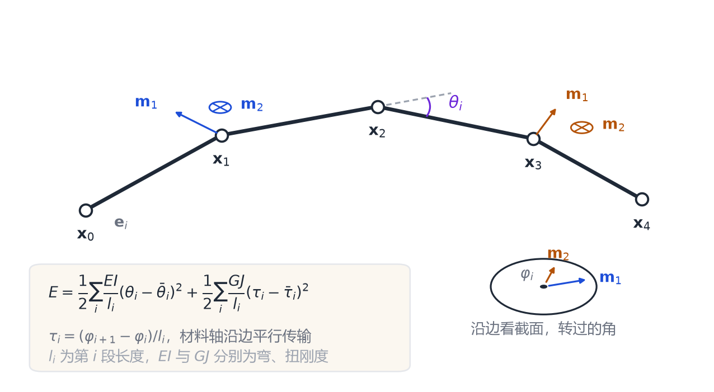

# 第 8 章 壳、杆与毛发

> 本章导读：一张纸捏住一角提起来，会垂成一道弧；同一张纸卷成筒，能立住并压上一摞书。一根头发吊得起一百克，却立不起来，连自己的重量都撑不住。这两件事说的是同一件事：薄结构的抗拉和抗弯差了五六个数量级，于是它所有的形状都由"能不能不拉伸地弯"决定。这一章从薄壳的能量讲起，落到杆的离散表示，再讲头发为什么要分层求解、为什么成缕、为什么十万根就顶到了算力的墙。

## 8.1 一张纸和一根头发

取一张 A4 纸，捏住一个角提起来。纸垂下去，弯成一道平滑的弧，弧的形状由纸自己的重量和弯曲刚度定。现在两只手抓住短边的两端，往两边拉。用尽全力，纸几乎不动——要把这张纸沿长边拉长百分之一，需要八百多牛的力，相当于挂上八十公斤。

同一张纸，横过来弯一下，两根手指轻轻一捏就能把它卷成筒。卷成的筒立在桌上，上面压一摞书也不塌。

拉不动、弯得动、卷起来还能承压，三件事不矛盾。拉伸靠的是材料的面内刚度，正比于厚度 $t$；弯曲靠的是截面惯性矩，正比于 $t^{3}$。A4 纸厚 $0.1$ 毫米，宽 $0.21$ 米，面内刚度 $Et\approx4\times10^{5}$ 牛每米，弯曲刚度 $B=Et^{3}/12\approx3.3\times10^{-4}$ 牛·米。把这张纸卷到 5 厘米半径，每米宽度上需要的弯矩只有 $B/R\approx7$ 毫牛·米，乘上宽度是一点五毫牛·米——手指拈一下的事。同样这张纸拉伸百分之一，需要四千牛每米的线力，乘上宽度是八百四十牛。要把这两个数放在一起比，得先折成同一个量纲：面内刚度 $Et\approx4\times10^{5}$ 牛每米，弯曲刚度除以纸宽的平方是 $B/a^{2}\approx7.5\times10^{-3}$ 牛每米（$a=0.21$ 米是纸宽），两者差七个数量级。

卷成筒之后能承压，靠的不是材料变强了，是几何变了。筒壁把竖向压力转成环向和轴向的膜力，承压靠的不再是那零点一毫米的厚度，而是管壁围出来的整个截面。一根几厘米直径、同样厚度的纸管，惯性矩比一张平纸条大几个数量级，于是能立住、能压书。

直径 5 厘米、壁厚 0.1 毫米的纸筒，绕直径的惯性矩是 $\pi d^{3}t/8\approx4.9\times10^{-9}$ 米四次方；同样这一页纸摊成 15.7 厘米宽的平条，绕同一个方向只有 $bt^{3}/12\approx1.3\times10^{-14}$ 米四次方。差了三十八万倍。也就是说，纸筒能压书不是因为纸变硬了，是因为材料被挪到了离中性面最远的地方，每一点都在出力。

一根头发是同一个故事的极端版本。人发直径约 70 微米，杨氏模量 5 吉帕上下，截面惯性矩 $I=\pi d^{4}/64\approx1.2\times10^{-18}$ 米的四次方，弯曲刚度 $EI\approx6\times10^{-9}$ 牛·米平方。它的抗拉强度能吊起一百克，可它的欧拉屈曲载荷只有 $\pi^{2}EI/L^{2}$，20 厘米长的头发算出来是 $1.5\times10^{-6}$ 牛，大约 0.15 毫克力。所以头发吊得住钥匙，立不住自己。一根 20 厘米的头发只有一毫克左右，自重约 $10^{-5}$ 牛，已经比屈曲载荷大七倍——它不是"差点没撑住"，是根本撑不住。

把纸和头发放进同一把尺子里，那把尺子叫细长比，就是长度除以截面尺寸：铅笔是几十，头发是三千，缆绳能到十万以上。细长比越大，抗弯越不值钱，抗拉越像唯一的支柱。一张 A4 纸的长厚比接近三千，和头发同档，所以两者脾气出奇地像：都拉得动、压不住，都得靠形状撑住自己。

这两个例子指向同一件事：薄结构的形状几乎完全由"能不能不拉伸地弯"决定。能，就弯；不能，就得拉伸，而拉伸太贵，于是它宁可换个形状。所谓薄壳、杆、毛发，都是这条规则的不同的边界条件。也就是说，一张纸、一个蛋壳、一根头发做决定的时候都不看自己有多硬，只看能不能在不拉长任何一段的前提下把形状换掉：能，就白拿；不能，就得付六个数量级的代价。

## 8.2 薄壳：两种刚度的分工

薄壳的总能量拆成两块：

$$
E=\underbrace{\frac{1}{2}\int_{\Omega}\boldsymbol{\varepsilon}:\mathbf{C}:\boldsymbol{\varepsilon}\,\mathrm{d}A}_{\text{膜}}\;+\;\underbrace{\frac{1}{2}\int_{\Omega}D\,\kappa^{2}\,\mathrm{d}A}_{\text{弯}} ,
\tag{8.1}
$$

$\boldsymbol{\varepsilon}$ 是中面应变，$\mathbf{C}$ 是面内弹性张量，$D=Et^{3}/[12(1-\nu^{2})]$ 是弯曲刚度，$\kappa$ 是曲率。第一块管"面内被拉长或压短"，正比于 $t$；第二块管"弯得急不急"，正比于 $t^{3}$。

逐项看式 (8.1)。$\Omega$ 是中面，也就是壳被压扁成一张没有厚度的皮之后的那张皮，积分在它上面做；$\mathrm{d}A$ 是一小块面积，单位平方米。两个冒号是双点积，把两个二阶张量缩成一个标量，算的其实就是"应力乘应变"。$D$ 的分母里那个 $1-\nu^{2}$ 值得单独说一句：板比梁多这个因子，因为板弯曲时横向也要收缩，被邻域挡住，显得更硬。$\kappa$ 的单位是 1/米，弯得越急越大，能量按它的平方涨，弯两倍急就要付四倍的钱。

代 A4 纸的数：$E=4$ 吉帕、$t=0.1$ 毫米、$\nu=0.3$，得 $D\approx3.6\times10^{-4}$ 牛·米，和 8.1 里只算 $Et^{3}/12$ 的数差百分之十。把这张纸卷成半径 5 厘米的筒，$\kappa=20$ 每米，每平方米的弯曲能是 $\frac{1}{2}D\kappa^{2}\approx0.07$ 焦；整张 A4 是 0.062 平方米，总共 4.5 毫焦，只够把一枚一克重的硬币抬高半米。也就是说，纸能弯不是因为它软，是因为弯曲只要这么点能量，拉伸要的能量大了七个数量级。

两块能量的比例决定了壳的性格。把一块壳弯成一个不可展的形状（球面、马鞍、揉皱的纸团），弯曲应变是 $t/(2R)$，膜应变却大约是 $(d/R)^{2}$，$d$ 是被弯区域的横向尺寸。代入式 (8.1)，两者之比是

$$
\frac{E_{\text{膜}}}{E_{\text{弯}}}\sim12\left(\frac{d^{2}}{Rt}\right)^{2} .
\tag{8.2}
$$

这张纸 $d=0.1$ 米、$R=0.1$ 米、$t=10^{-4}$ 米，这个比值是一千二百万。也就是说，只要有一点拉伸的余地，壳宁可改变弯曲方式也不肯拉伸。它的形状被限制在"可展曲面"附近：平面、柱面、锥面，以及它们的拼接。揉皱的纸团为什么是一道道尖棱而不是一团光滑的波，原因就在这里——尖棱两侧是两块近似平面的可展片，棱上集中了全部弯曲能，中间没有膜能。

弯曲的影响并不均匀。薄壳理论里有一个边界层尺度 $\sqrt{Rt}$：从边缘往里，弯曲效应按指数衰减，超过这个长度就基本只剩膜力。半径半米、厚一毫米的圆柱壳，弯曲只在离边界两厘米的范围内起作用。这就解释了为什么薄壳的弯曲能总挤在边缘和折痕附近，也解释了加密网格时真正需要细化的只是那几条窄带。

这条比例也解释了壳的数值困难。低阶平板单元在纯弯曲时没法把中面保持在中性面上，弯曲会带出寄生的膜应变，而膜刚度比弯曲刚度大六个数量级，单元显得极硬，薄板弯不动，这叫薄膜锁定。工程上的解法要么用能正确处理剪切的特殊单元，要么干脆放弃连续单元，直接把壳写成一堆三角形加铰链：边长弹簧管膜，二面角铰链管弯。

后者就是离散壳的做法。边长弹簧用静止长度 $\bar l_{ij}$，二面角铰链用静止二面角 $\bar\theta_e$，

$$
E=\frac{1}{2}\sum_{(i,j)}k_{s}\left(\left\lVert\mathbf{x}_{i}-\mathbf{x}_{j}\right\rVert-\bar l_{ij}\right)^{2}+\frac{1}{2}\sum_{e}k_{b}\left(\theta_{e}-\bar\theta_{e}\right)^{2} ,
\tag{8.3}
$$

两个求和分别遍历所有边和所有内部边。逐项看：$k_{s}$ 是边长弹簧的刚度，单位牛每米，可以读成"把这条边拉长一米要多少牛"；$\bar l_{ij}$ 是静止长度；括号里是当前长度减静止长度，单位米，平方再乘刚度就是能量。第二项里 $e$ 遍历内部边，两侧三角形的夹角就是二面角 $\theta_{e}$（弧度），$\bar\theta_{e}$ 是不弯时的值，平铺取零，$k_{b}$ 是铰链刚度，单位牛·米每弧度。两块量级差得远：1 厘米网格的纸上，$k_{s}$ 在 $10^{4}$ 牛每米，$k_{b}$ 在 $10^{-4}$ 牛·米每弧度，单位不同，只能比数量级。

$k_{b}$ 不是材料常数，是由 $B$ 和网格换出来的。把壳弯成半径 $R$ 的圆柱，曲率 $\kappa=1/R$；相邻两排三角形的形心相距 $h_{e}$，铰链转过的角就是 $\theta_{e}=\kappa h_{e}$。这条铰链代表的一块壳长 $l_{e}$、宽 $h_{e}$，弯曲能是 $\frac{1}{2}B\kappa^{2}l_{e}h_{e}$。令它等于 $\frac{1}{2}k_{b}\theta_{e}^{2}$，得 $k_{b}=B\,l_{e}/h_{e}$。也就是说，铰链刚度跟边长成正比、跟两排三角形之间的距离成反比；$h_{e}$ 减半，单条刚度翻倍，条数也翻倍，总弯曲能不变。这条账搞错，加密一次就等于换一种材料。

代数字：$B=3.6\times10^{-4}$ 牛·米，$l_{e}=h_{e}=1$ 厘米，$k_{b}=3.6\times10^{-4}$ 牛·米每弧度。把这条边折 0.2 弧度（约 11°），回正力矩是 $7.2\times10^{-5}$ 牛·米，作用在 1 厘米力臂上相当于挂 0.7 克。这就是一张纸的力度：有形状，一碰就动。

$h_{e}$ 要用静止网格算：取两侧三角形的高，$h=2A/l$，$A$ 是三角形面积、$l$ 是共享边长，两片取平均。用当前构型算的后果很具体：弯得越厉害 $h$ 越小、刚度越大，壳越弯越硬，能量对不上连续理论。这套写法在纯弯曲下不产生寄生膜能，因为边长可以完全不变；Grinspun 等人的权重正是以静止网格构造的，让离散能量在加密时收敛到式 (8.1) [@grinspun2003]。

代价是它把壳当成"铰链拼起来的多面体"，曲率只能以离散二面角的形式存在。网格粗的时候，二十厘米的缓弧被摊到三五条边上，每条边的转角都不小，铰链以为壳在急弯，这种跨越多条边的长波弯曲就算得偏硬。要让长波弯得对，网格得比曲率半径小一个量级。也就是说，离散壳的精度并不均匀：急弯处很准，缓弯处偏硬。

无论如何离散，壳的难点始终是那两个刚度之间的鸿沟。求解器看到一个方向几乎刚性、另一个方向几乎无力，条件数——最硬的模态比最软的模态大多少倍——坏到十的六次方以上，迭代解要多花几十步才压得下残差。显式积分更直接：步长上限 $\Delta t\lesssim\sqrt{m/k}$ 由最硬的弹簧定；1 厘米网格的纸，$k_{s}$ 在 $10^{4}$ 牛每米量级，顶点质量 $4\times10^{-6}$ 千克，步长只有二十来微秒，一帧要切八百步。后面几节讲的杆、毛发，都是在更极端的细长比下和同一个鸿沟打交道。

## 8.3 弯曲主导：一根杆的平衡形状

把壳的一条边压成一条线，问题就退化成一维。这时候膜应变只能沿轴向，而细长杆的轴向刚度大到可以视为不可伸长，剩下的自由度只有弯曲。

设杆长 $L$、弯曲刚度 $EI$、一端固定另一端受竖向力 $P$。截面上的弯矩等于端部载荷对该截面的矩，$M(s)=P\left[x(L)-x(s)\right]$，其中 $s$ 是弧长，$x$ 是水平坐标。这里的弯矩可以理解成"把这一段掰弯的力矩"，单位牛·米；$x(L)-x(s)$ 是这一截面到载荷作用点的水平距离，也就是力臂。对 $s$ 求导，$M'(s)=-P\cos\theta(s)$，$\theta$ 是切线方向与水平方向的夹角。另一方面，曲率与弯矩的关系是 $M=EI\,\theta'(s)$。两式合起来

$$
EI\,\theta''(s)=-P\cos\theta(s),\qquad \theta(0)=0,\quad \theta'(L)=0 ,
\tag{8.4}
$$

逐项看：$E$ 是杨氏模量（帕），$I$ 是截面惯性矩（米四次方），$EI$ 单位牛·米平方；$\theta''$ 是转角对弧长的二阶导数，单位 1/米平方，所以左边是"弯矩随弧长的变化率"，单位牛，正好和右边的力对上。$P$ 是端部竖向力，$\cos\theta$ 是它在法向的分量比例。边界条件分别是固定端不许转动、自由端不许有弯矩。这是一个两点边值问题，解析解要用椭圆积分。

工程上直接打靶。把二阶方程拆成两个一阶方程 $\theta'=q$、$q'=-P\cos\theta/EI$，从 $s=0$ 出发，取 $\theta=0$，给 $q$ 猜一个值，用四阶龙格库塔走到 $s=L$，看末端的 $q$ 是不是零。猜大了减、猜小了加，牛顿法三五步收敛。也就是说，打靶把两点边值问题换成了求根，代价是每猜一次都要把整根杆积一遍。

小挠度时 $\theta$ 很小，$\cos\theta\approx1$，方程退化成 $EI\,\theta''=-P$，积分两次得

$$
y(x)=\frac{Px^{2}(3L-x)}{6EI},\qquad y(L)=\frac{PL^{3}}{3EI} ,
\tag{8.5}
$$

这是材料力学课本上的悬臂梁挠度公式。$y$ 是竖向位移（米），$x$ 是离固定端的距离（米），$P$ 是端部力（牛），$L$ 是杆长（米）。它成立的前提是挠度远小于长度，也就是 $\theta$ 一直很小。

图 8-1 把两种解画在一起。取 $L=1$ 米、$EI=1$ 牛·米平方、$P=1.8$ 牛，无量纲参数 $PL^{2}/EI=1.8$。

<figure class="fig">

<figcaption><b>图 8-1</b>　悬臂梁在端部竖向载荷下的平衡形状，由数值求解式 (8.4) 得到（打靶法，末端弯矩残差 $2.6\times10^{-16}$）。参数：$L=1$ m，$EI=1$ N·m²，$P=1.8$ N。实线为非线性解，端点下垂 0.463 m，端部转角 42°，水平投影缩短到 0.860 m；虚线为式 (8.5) 的线性解，按弧长坐标画出，端点下垂 0.600 m，水平投影仍是 1.000 m。线性理论把挠度高估了近三成，也完全没有缩短。</figcaption>
</figure>

差别的来源是几何，不是材料。线性的式 (8.5) 把曲率近似成 $y''$，这只在斜率很小时成立；挠度一大，$y''$ 与真实曲率 $\theta'$ 的差就显出来了，而且杆在弯的同时水平投影在缩短——$x(L)=0.860$ 米，短了 14%。真实世界里这件事看得见：弯曲的尺子两端距离比伸直时短，弯起手肘时小臂够到的距离比伸直时近。动画里如果忽略缩短，弯曲的肢体看起来会"变长"。

式 (8.5) 的适用范围可以用一个数卡住。30 厘米的钢尺伸出桌沿 25 厘米，$EI\approx0.5$ 牛·米平方，末端压 200 克，线性公式给出下垂 2 厘米、端部转角 7°，很准；换成 2 公斤，公式说下垂 20 厘米，相当于伸出长度的八成，这时它已经不能信了，真实下垂更大，水平投影也短了。也就是说，能不能用小挠度公式看的是转角，不是载荷；钢尺软、载荷重只是让它更快撞上这条线。

式 (8.4) 的结构值得多看一眼。它和单摆方程同形，把小角度近似拿掉之后是非线性的，有大变形、可能有多解。把一根细杆两端对压，压力超过 $4\pi^{2}EI/L^{2}$ 之后它会突然弓起来——同一组边界条件下有两个解，直的那个不再稳定。也就是说，杆的方程不只描述"给定载荷求形状"，还描述"形状会不会突然跳到另一支"。

同一套道理用在布料上，得到的是 7.2 里的弯曲能量；用在钢丝上，得到的是弹簧的形状；用在头发上，得到的是发丝的卷曲。变的只是 $EI$ 的数值和边界条件。一根杆的弯曲只需要一个标量场 $\theta(s)$ 描述，自由度比三维壳少两个数量级，这是毛发能做到十万根量级的前提。

## 8.4 离散弹性杆：节点、转角、扭率

把式 (8.4) 离散成一段折线，是杆模拟的起点。节点 $\mathbf{x}_{0},\dots,\mathbf{x}_{n}$，边 $\mathbf{e}_{i}=\mathbf{x}_{i+1}-\mathbf{x}_{i}$，段长 $l_{i}$。每个内部节点有两个相邻边，它们之间的夹角就是离散的转角 $\theta_{i}$。

直接用转角有个问题：转角是标量，但它所在的方向（弯曲发生在哪个平面里）需要另外记录，否则杆可以绕自己的轴自由旋转而转角不变。解决办法是给每个节点配一个材料坐标系。Bergou 等人的离散弹性杆把这套几何整理得很干净 [@bergou2008]：用边的叉积定义离散曲率，

$$
\boldsymbol{\kappa}\mathbf{b}_{i}=\frac{2\,\mathbf{e}_{i-1}\times\mathbf{e}_{i}}{\left\lVert\mathbf{e}_{i-1}\right\rVert\left\lVert\mathbf{e}_{i}\right\rVert+\mathbf{e}_{i-1}\cdot\mathbf{e}_{i}} ,
\tag{8.6}
$$

它的模等于 $2\tan(\theta_{i}/2)$，方向是弯曲平面的法向。

这个模值得推一遍。叉积的模是 $\left\lVert\mathbf{e}_{i-1}\right\rVert\left\lVert\mathbf{e}_{i}\right\rVert\sin\theta_{i}$，方向垂直于两条边张成的平面，也就是弯曲平面的法向，所以才写成 $\boldsymbol{\kappa}\mathbf{b}_{i}$；分母是两个长度之积乘上 $1+\cos\theta_{i}$。分子分母一除，长度全消掉，只剩 $2\sin\theta_{i}/(1+\cos\theta_{i})$，正好等于 $2\tan(\theta_{i}/2)$。也就是说，它的模是纯角度量，小角度时几乎就是转角自己：转 0.5 弧度，模是 $2\tan0.25=0.511$，只比 0.5 大 2%。

要拿它当曲率，还得除以这段折线的等效长度 $\bar l_{i}=(l_{i-1}+l_{i})/2$，量纲才回到 1/米。这个除法就是式 (8.7) 里那个 $1/l_{i}$ 的来历，也是离散曲率与转角之间唯一的换算：转角除以它代表的长度，才是曲率。举例：三段各 1 厘米的折线，中间转了 0.5 弧度，曲率 $0.511/0.01=51$ 每米，弯曲半径 2 厘米。头发 $EI=6\times10^{-9}$，这样一处弯的弯矩 $3\times10^{-7}$ 牛·米，在一厘米力臂上相当于 3 毫克。

有了它，弯曲能可以写成

$$
E_{\text{bend}}=\frac{1}{2}\sum_{i}\frac{\alpha_{i}}{l_{i}}\left(\theta_{i}-\bar\theta_{i}\right)^{2} ,
\tag{8.7}
$$

逐项看：$1/2$ 让力矩正好等于能量对角度的导数，少了它每处刚度都要多换算一个二。$\alpha_{i}=EI$ 是弯曲刚度，单位牛·米平方。分母 $l_{i}$ 是这个节点代表的长度，所以 $\alpha_{i}/l_{i}$ 的单位是牛·米每弧度，正是"每弧度要多少力矩"。$\theta_{i}-\bar\theta_{i}$ 是当前转角与静止转角之差，单位弧度，平方之后整项就是焦耳。$\bar\theta_{i}$ 是静止转角（直杆取零，卷发取非零）。注意分母里的 $l_i$：和布料一样，单节点刚度必须按段长标定，否则加密网格等于换材料。

代数字：直发取 $\bar\theta=0$，$l=1$ 厘米、$\theta=0.1$ 弧度，一处节点的弯曲能是 $\frac{1}{2}\times6\times10^{-9}/0.01\times0.01=3\times10^{-9}$ 焦；一根 20 节点、20 厘米的头发若每节都弯 0.1 弧度，总共 $6\times10^{-8}$ 焦。跟谁比？整根头发的重力势能约 $10^{-6}$ 焦，比弯曲能大十几倍。也就是说，头发的形状是重力说了算，弯曲只负责把折角磨圆。

扭转是另一回事。杆可以绕自己的轴拧，扭转角沿轴向的导数叫扭率 $\tau$。要在离散的边上定义它，得先给每个节点一个参考方向，给"拧了多少"一个基准。标准做法是平行传输：把节点 $i$ 的参考系沿边搬到节点 $i+1$，搬时不绕边转，于是搬过来的参考系相对于原来的只差一个转角，这个差就是扭转角 $\varphi_{i}$，扭率是 $\tau_{i}=(\varphi_{i+1}-\varphi_{i})/l_{i}$。

平行传输（parallel transport）这个词听着抽象，做的事很具体：把一根标尺从一个节点搬到下一个节点，搬的时候只许平移和跟着杆转向，不许额外绕杆轴转。也就是说，杆怎么弯，标尺就跟着怎么弯；杆没被拧，标尺搬过去也不许自己转。这样搬完，标尺多转的那个角，只能是杆被拧出来的。

拿一条纸带演示一遍。正面画一道竖线，把纸带弯成弧，竖线仍朝同一方向；再把两端反向拧，竖线就斜了。前者是平行传输，后者是扭转。也就是说，跟着杆弯不算拧，材料自己绕轴转才算拧，两件事在几何上是分开的。

这一步是整个表示的关键。不用它、每段各自定一个任意参考系，"零扭转"就没有公认定义，一根直的、没被拧过的杆也会被算成有扭转能。Bergou 等人的贡献一半在这里：材料坐标系、离散曲率、扭率拼起来，使能量对节点位置可微、零扭转状态干净、细分时收敛到 Kirchhoff 杆理论。

扭转能写成

$$
E_{\text{twist}}=\frac{1}{2}\sum_{i}\frac{\beta_{i}}{l_{i}}\left(\tau_{i}-\bar\tau_{i}\right)^{2} ,
\tag{8.8}
$$

$\beta_{i}=GJ$ 是扭转刚度，$G$ 是剪切模量，$J$ 是极惯性矩，$\bar\tau$ 是自然扭率。圆截面的 $J=\pi d^{4}/32$，是 $I$ 的两倍，$G$ 大约是 $E$ 的 $1/2.6$，所以 $GJ$ 和 $EI$ 同量级，扭转并不比弯曲软多少。

结构上和式 (8.7) 一一对应：$1/2$ 还是那个来由，$\beta_{i}/l_{i}$ 是"每弧度每米要多少力矩"，$\tau_{i}-\bar\tau_{i}$ 是扭率偏离自然值的量，单位弧度每米。麻花绳、拧过的电话线 $\bar\tau$ 不为零；天然直的头发取零，烫成螺旋的取一个沿长度变化的值。

代数字：头发 $E=5$ 吉帕、$\nu=0.3$，$G=E/[2(1+\nu)]\approx1.9$ 吉帕；$J=\pi(70\,\mu\mathrm{m})^{4}/32\approx2.4\times10^{-18}$ 米四次方，$\beta=GJ\approx4.5\times10^{-9}$ 牛·米平方，和 $EI\approx6\times10^{-9}$ 几乎相等。也就是说，对圆截面的细杆，拧和弯一样费劲，不存在"拧着便宜"这回事。这条预算后面要用：超螺旋之所以会发生，正是因为拧贵到一定程度时，弯反而成了省钱的路。

<figure class="fig">

<figcaption><b>图 8-2</b>　离散弹性杆的节点、转角与材料坐标系。折线由节点 $\mathbf{x}_i$ 与边 $\mathbf{e}_i$ 构成，$\theta_i$ 是入射边的延长线与出射边之间的夹角，即这段折线的转角；每个节点带一组材料轴 $\mathbf{m}_1$（在纸面内，垂直于轴）与 $\mathbf{m}_2$（垂直纸面，用圆圈叉表示）。沿边平行传输到下一个节点后，两组材料轴之间差的角 $\varphi_i$ 就是扭转角，除以段长得到扭率。右下角示意沿边看截面时的转动：同样一个弯曲形状，截面转了多少不会被转角记录下来，这正是需要材料坐标系的原因。图为示意。</figcaption>
</figure>

这套表示在代码里有几个好处。转角是标量，梯度里没有三角函数矩阵；每个节点只和相邻两条边有关，Hessian 是三对角的块结构，隐式求解可沿杆带状消元，代价线性；扭转和弯曲在能量里分开，可以给两者不同的阻尼和积分格式——扭转刚度大、波速快，走隐式，弯曲软，走显式。头发的生产级解算器基本都建立在这个结构上。

## 8.5 超螺旋与头发

拿一根橡皮管或旧电话线，两头捏住往相反方向拧。拧得少，管子只是转；拧到某个程度，它突然自己盘成一个螺旋，继续拧，螺旋越盘越紧。

这件事的原因是两个能量的交换。扭转能正比于 $\beta\tau^{2}$，弯曲能正比于 $\alpha\kappa^{2}$。给定两端的总扭转角，直的状态把所有扭转都摊在 $\tau$ 上；盘成半径 $R$ 的螺旋之后，一部分扭转被几何上的盘绕"吸收"，局部的 $\tau$ 下降，代价是杆弯了起来，付出 $\alpha/R^{2}$ 量级的弯曲能。当扭转能下降的幅度超过弯曲能的增加，直的状态就不稳定，杆自己盘起来。临界条件的量纲形式是

$$
\tau^{2}\gtrsim\frac{\alpha}{\beta R^{2}} ,
\tag{8.9}
$$

$\tau$ 是单位长度的扭转角，单位弧度每米；$R$ 是盘绕半径，单位米；$\alpha$、$\beta$ 分别是弯曲刚度和扭转刚度，都是牛·米平方，所以 $\alpha/\beta$ 是个纯数，圆截面约 1.3（上一节算过：$EI\approx6\times10^{-9}$，$GJ\approx4.5\times10^{-9}$）。整条式子左右都是"每米的转角的平方"，量纲对得上。

把式 (8.9) 反过来读，含义更清楚：$R\lesssim\sqrt{\alpha/\beta}\,/\tau$。也就是说，扭率越高能盘出的半径越小，所以拧得越狠、盘得越紧，和拧电话线的手感一致。

细的东西容易打卷，不是因为判据变松，是因为门槛的绝对值变低。打卷需要的扭矩量级是 $\beta/R$：头发 $\beta=4.5\times10^{-9}$、$R=2$ 厘米，扭矩 $2\times10^{-7}$ 牛·米，两指一搓就够；同样长度的钢丝要几牛·米，手拧不动。扭矩正比于直径的四次方，直径差十倍门槛就差一万倍。

几何上还有一笔更干净的账。一条有厚度的带子，两端相对拧了多少圈是个定数，叫连接数（linking number）$Lk$；它等于材料自己绕轴拧的量 $Tw$ 与中心线在空间里盘绕的量 $Wr$ 之和：$Lk=Tw+Wr$。$Lk$ 由两端怎么捏住定死，中途不能变，所以中心线一旦盘出螺旋、$Wr$ 变正，$Tw$ 就必须减少同样的量。也就是说，杆可以把"拧"换成"绕"，而能量账上绕比拧便宜。

拿一根 20 厘米的头发试一遍。两头相对拧三圈，$Lk=3$；直着时 $Wr=0$，扭率 $2\pi\times3/0.2\approx94$ 弧度每米。按式 (8.9)，$R=2$ 厘米时临界扭率 $\sqrt{1.3/0.02^{2}}\approx57$ 弧度每米；94 已经超过，直的状态不稳，头发会自己盘成半径 2 厘米左右的螺旋。能量账：每米扭转能 $\frac{1}{2}\beta\tau^{2}=2\times10^{-5}$ 焦，盘绕付出的弯曲能 $\frac{1}{2}\alpha/R^{2}=7.5\times10^{-6}$ 焦，比省下的少一半。也就是说，拧过头的头发"愿意"打卷。

DNA 是同一件事的分子版本。双螺旋的两条链互相缠绕，$Tw$ 很大；在细胞里它常盘成一团叫超螺旋（plectoneme）的麻花状，正是把 $Tw$ 换成 $Wr$。生物学家量的"超螺旋密度"就是每十圈碱基差多少圈，量级在百分之一到十分之一。日常里也一样：电话线、跳绳、耳机线，凡是两端被捏住的长东西最后都盘成麻花。它们不是软，是几何逼的。

头发是这套理论最日常的实例。直发的自然曲率为零，卷发的自然曲率非零且沿长度变化，一根卷发就是一条带自然曲率 $\bar\theta_{i}$ 的杆，形状是弹性势、重力和摩擦的折中。头发打湿会变直，因为水破坏了角蛋白之间的氢键，湿发的等效弯曲刚度降一个量级，自然曲率撑不住自重；吹干后氢键重新形成，卷回来。也就是说，造型是在改 $\bar\theta_{i}$，所以烫过的头发在模拟里必须显式给出自然曲率，光靠重力算不出卷。

尺度是这里的核心困难。一根 20 厘米的头发直径 70 微米，细长比接近三千。这样细的杆，弯曲波在整根长度上的传播时间远大于摩擦和碰撞的时间尺度，显式积分要么用小步长，要么被扭转项卡住。生产上分层：抽一千根左右的引导线做完整的杆模拟，用半隐式积分和小步长保证稳定；剩下十万根作为从属发丝，每根绑到附近三到四根引导线，用它们局部的变形场插值出自己的形状。

分层里有几件事绕不开。第一是引导线怎么选：不能均匀抽，要在发量密、弯得厉害的地方多放，通常按静止形状的面积和曲率加权抽一千根上下。第二是从属发丝怎么绑：在静止姿态下找最近的 3 到 4 根引导线，权重按距离的反比归一，$w_{k}\propto1/d_{k}^{2}$，离得近的管得多。第三是插值什么——这一步最容易做错。

直接插值位置会出错。两根引导线静止时相距 2 厘米，一根从属发丝在中间，到两边各 1 厘米；运动后引导线分开到 4 厘米，位置插值给出的点仍在中间，到两边各 2 厘米——那段长度翻了一倍。也就是说，位置平均会把发丝"抽长"。

正确插值的是变换。常见写法是线性混合 $\mathbf{x}=\sum_{k}w_{k}\left(\mathbf{R}_{k}\bar{\mathbf{x}}_{k}+\mathbf{t}_{k}\right)$：$\mathbf{R}_{k}$ 是引导线在发丝附近的局部旋转，$\bar{\mathbf{x}}_{k}$ 是静止坐标，$\mathbf{t}_{k}$ 是平移，$w_{k}$ 是那个权重。代价是 $\sum_{k}w_{k}\mathbf{R}_{k}$ 一般不再是旋转矩阵。极端情形能算出来：两根引导线各转 $\pm90^{\circ}$、权重各半，混合矩阵是 $\frac{1}{2}\left(\mathbf{R}(90^{\circ})+\mathbf{R}(-90^{\circ})\right)=\cos90^{\circ}\,\mathbf{I}=\mathbf{0}$，整根发丝被压成一个点。肩膀一转、头发在肩窝塌成一条线，就是这个原因。

补救有三条路。用对偶四元数插值刚体变换本身，效果最好，代价是多算几个四元数。把旋转搬到矩阵对数里混合、再指数回来，接近前者，稍贵。或者限制引导线的相对旋转，超过阈值就重新算权重，便宜但只是缓解。

## 8.6 摩擦与簇

干头发披在肩上，抬起手臂，头发被带起来一缕，然后停在那儿，不会立刻滑回原位。湿头发不会这样，它成缕地贴在皮肤上，一缕一缕分得很清楚。这两种行为背后是摩擦，以及摩擦与碰撞的耦合。

头发之间的摩擦系数不大，干的 0.1 到 0.2，湿的更高。但接触点极多：一根发丝沿长度方向可能和几十根别的发丝接触，每个接触点都有一个法向约束和一对切向摩擦约束。摩擦约束的形式还是库仑锥

$$
\left\lVert\mathbf{f}_{t}\right\rVert\le\mu f_{n} ,
\tag{8.10}
$$

逐项看：$\mathbf{f}_{t}$ 是切向（沿接触面）的摩擦力，单位牛；$\left\lVert\cdot\right\rVert$ 是它的模；$f_{n}$ 是法向压力，由两个面互相压多紧决定；$\mu$ 是摩擦系数，无量纲。整条式子说的是：切向力有上限，上限正比于法向压力；没到上限时两点粘住不动，到了上限才开始滑。这和布料那一节（7.7）是同一条式子，差别只在数量。

代数字感受一下尺度的悬殊。一根 20 厘米的头发自重约 $10^{-5}$ 牛；发丝弯着、回弹力把邻居顶住，一个接触点的法向力在 $10^{-5}$ 牛量级，取 $\mu=0.15$，每个点的静摩擦上限约 $1.5\times10^{-6}$ 牛。单看一个点微不足道，可一缕两百根的头发有两千个左右的接触点，上限加起来是 $3\times10^{-3}$ 牛，抵得住这缕头发 $2\times10^{-3}$ 牛的自重。也就是说，静摩擦在这里是集体现象：单点可以忽略，上万点叠起来才把一缕头发钉住。

麻烦在于它和法向力耦合：$f_n$ 本身是未知量，由所有接触一起决定。先解法向、再用上一步的法向力算摩擦，两个量会互相追赶，头发出现缓慢的爬行——整束在头皮上一点点蠕动，每帧不到一毫米，几百帧后位置全错。

Daviet 等人给出的做法是把法向与摩擦放进同一个迭代：外层用高斯-赛德尔逐个接触求解，内层对每个接触解一个小的互补问题，同时更新法向力和摩擦力 [@daviet2011]。这样静摩擦才抓得住——发丝在阈值内完全不滑，超过阈值才滑，而不是每帧让一点。这是头发成缕的必要条件：一缕头发能保持形状，靠的就是几十个接触点同时处在静摩擦区内。

即使求解器正确，物理上也不会自动出现好看的发缕。真实的成缕靠油脂、表面张力和长期的梳理历史，这三样在模拟里都没有。所以生产上把"簇"当成可调参数：每根从属发丝在静止形状里就向引导线靠拢一点，比例由艺术家控制。物理负责让这缕头发在运动时保持连贯，艺术负责决定它往哪儿聚。也就是说，簇（cluster）是造型概念，不是物理量；指望解算器自己长出分明的发缕，只会得到一个均匀的毛球。

打结是另一类问题。两根发丝一旦互相穿过就再也解不开，因为解开需要拓扑上的变化，而碰撞约束只保证不穿透，不保证能退回去。所以头发必须用连续碰撞检测，而且步长要比发丝的相对位移小，否则快速甩头时会出现一根发丝从另一根中间穿过去、然后缠住的画面。

湿发是另一套参数。水膜把相邻发丝拉到一起，表面张力相当于一个额外的法向吸引力，摩擦系数也升高，于是湿发成缕、贴在皮肤上，一缕的发丝数量比干发多十倍。要表现这个，得在接触里加一个短程吸引势，或者干脆把摩擦系数和簇权重一起调高——后者不物理，但镜头里够用。

## 8.7 十万根头发的账

一个成年人的头上大约十万根头发，金发多一些，红发少一些。每根取 20 个节点，就是两百万个节点、两百万段胶囊。每一帧，任意两段都可能接触，两两组合是两万亿对。

这个数不能硬算。空间哈希把每段塞进它覆盖的格子，只在同格和邻格里找候选，候选数降到每段几十个，总量降到六千万次距离测试。六千万次对 CPU 太多，对 GPU 勉强，加上积分、约束投影、摩擦求解的完整管线仍然不够。所以实际系统从两头削减：根数分层（全物理几千根，其余插值），段数按距离分级（近处的发丝 20 段，远处的 6 段），碰撞检测按包围盒层次剔除。

几何上还要挑对形状。一段 1 厘米长、直径 70 微米，细长比 140 比 1，用圆柱做碰撞贵，用胶囊（两端带半球的线段）便宜：判据只是两条中心线的最近距离小于两者半径之和，也就是 70 微米，开方一次、比较一次就否掉一个候选。

哈希格子不能随便开。边长取段长的量级（1 厘米）合适：再小，一段跨十几格；再大，整根发丝挤进一格，等于没剔除。可头发分布极不均匀：枕部几毫米内挤着几万段，发梢散在几十厘米外。均匀网格在密的地方退化成"一格两千段"，白算。所以生产系统多做一级筛选：先用每根发丝的包围盒做发丝对发丝的剔除，十万根筛到每根平均几十根；再在筛出的发丝对内部逐段测距。两级筛完，真正要算的段对才落在六千万这个量级。

六千万次胶囊测距，每次约三十个浮点运算，是 $2\times10^{9}$ 次运算。按 GPU 每秒 $2\times10^{13}$ 次单精度浮点的峰值，理论时间不到一毫秒；实际卡在内存带宽上，取到一两毫秒。麻烦在下一步：真正接触的段对约两千万个，每个都要建约束、进迭代。约束要写显存、被反复读取、用原子操作累加力，两千万个约束乘十次迭代就是两亿次访存，这一段往往比测距贵二十倍。也就是说，头发的时间不是花在"算形状"上，是花在"算谁碰谁、再把结论搬来搬去"上。

渲染与模拟的根数也不一样。十万根发丝一根根画出来既慢又没必要，画面上的头发是几万张半透明带状卡片，每张贴着几缕发丝的纹理。模拟给出的几千根引导线运动，经插值和卡片蒙皮转成这些卡片的顶点动画。游戏里更省：卡片直接绑在骨骼上，或干脆做成顶点动画序列逐帧播。代价是头发不能和角色真正互动，手穿过去不会带动头发。

回到开头那张纸。纸是壳，头发是杆，两者的差别只在于"哪一维可以忽略"：纸的厚度可以忽略，但两个面内方向都要；头发只有长度方向要，另外两个方向被压成一个截面。选壳还是选杆，看的是细长比和问题的对称性。真正决定它们算得动算不动的，是同一件事——薄结构的两个刚度差着五六个数量级，想同时精确满足两者都要付出代价，工程上的办法永远是把弱的那一项单独拿出来，用专门的表示去承担。
