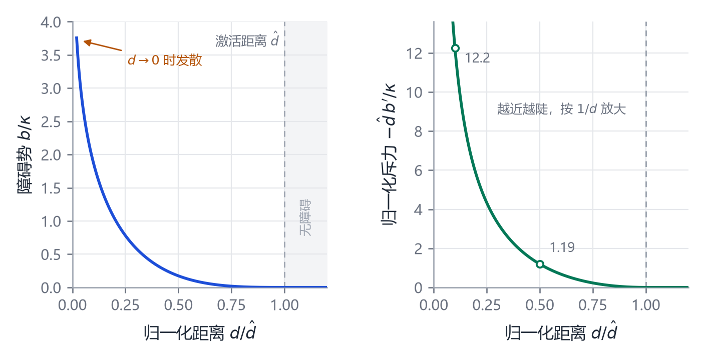

# 第 9 章 自碰撞与连续碰撞

> 本章导读：一件衬衫从衣架上滑下来，落在自己身上，然后穿过去了。这一章讲为什么"布不能穿过布"这句听起来最简单的话，是布料模拟里最贵的一句。

## 9.1 布穿过自己

先看一个具体的失败。

一件长袖衬衫，袖子垂着。动画师让角色抬手臂，袖子被压向躯干。第 120 帧还正常，第 121 帧袖口内侧的一小片三角形出现在胸口前面；再过两帧，整条袖子从身体里"长"了出来，渲染画面上一片布片与皮肤互相闪烁。

求解器没有报错。速度正常，能量没有爆，牛顿迭代收敛得很好。它只是漏了。

漏的原因通常平凡得让人不想承认。那一帧里袖子的两层布之间的相对速度是每秒三米，按每秒六十帧算，一步走五厘米。布的厚度是零点二毫米。这一步的长度是厚度的二百五十倍——如果只在步首和步末各看一眼，中间有两百四十九次机会让两层布擦肩而过，而没有人看。假定两层布原本相距一厘米，一步之后它们互换了位置。检测器看到的是"相距一厘米"，于是报告一切正常。

也就是说，离散碰撞检测的分辨率不是由时间步单独决定的，而是由"这一步的相对位移除以最薄的特征尺寸"决定的。这个比值超过一，穿透就已经可能在两步之间发生，无论步首步末多干净。袖子那个例子里它等于 250，等于说漏是必然的，没漏才是运气。

这就是自碰撞和刚体碰撞的第一个差别：检测的采样点不够密。刚体可以靠"东西够大、一步走不远"这条经验混过去；布薄、软、动得快，而它要撞的对象就是它自己。

第二个差别是数量。一件衬衫三角化之后一万个面，两两比较是一亿次；一件外套五万面，是十二亿五千万次。每帧都做，实时预算里根本放不下。作为对照，一千个刚体两两比较只有五十万对。原因很直接：刚体的"面"是物体，布的面是三角形，数量比物体多四个数量级。

第三个差别是判据本身。刚体碰撞问"有没有重叠"，是个布尔值。布的自碰撞问"两张布面之间的距离有没有小于某个阈值"——因为布在物理上有厚度，在渲染上却是零厚度。你必须在物理模型里塞进一个虚构的厚度，否则两层完全贴合的布连法向都定义不出来。而这个虚构厚度直接决定布"有多硬""折不折得起来"，它不是从材质表里查出来的数。

容易误解的地方：这个厚度不是渲染上给布料加的那层"壳"。渲染用的厚度只影响像素边缘和阴影，求解器看不见它；求解器里的厚度（后文记作 $\hat{d}$）是一个纯数值的量，它同时钉住了三件事：接触发生在多远开始生效、法向在哪一侧、以及摩擦阻力的上限。改它等于改材料手感，而美术往往以为自己只是改了一个"视觉参数"。

第四个差别是结果依赖摩擦。两块布贴上之后是滑开还是停住，由摩擦决定；褶皱最后停在哪，也由摩擦决定。摩擦依赖历史、不连续、不好求导，偏偏是视觉上最要紧的那一环。

还有一个差别决定了工程做法：候选对数量会随形变自己长出来。布摊平时一片三角形周围只有几片邻居；一旦揉成一团，同一区域里塞进原本隔得很远的一大片布，局部密度能涨几十倍。碰撞开销不是静态属性，是姿势的函数。

这些叠起来，自碰撞成了柔体管线里最耗时的部分。影视里一帧布料的求解时间，经常一半以上花在碰撞上，而不是花在弹性上。做惯刚体的人第一次看布料的性能剖析，往往会以为自己的宽相写错了——刚体管线里碰撞检测通常只占两三成。

## 9.2 候选对：从平方到近线性

一亿个三角形对里，绝大多数是"隔着半米的两片布"，看一眼就该排除。剔除分两层，和刚体一样：宽相回答"这两块区域有没有可能挨上"，粗糙、便宜，可以错杀但不能漏；窄相回答"这两片三角形离多远、有没有交、交在哪"。

宽相有两条主流路线。

空间哈希把空间切成边长 $h$ 的格子，物体按它覆盖的格子登记，落进同一格子的互为候选。查询时只算它所在格子以及相邻格子里的登记表，开销与"格子里的物体数"成正比，与总数无关。全部学问在 $h$ 的选择上：$h$ 太小，一个物体会横跨很多格子，登记和查询都变贵；$h$ 太大，一个格子塞几百个物体，退化成平方级。

把这两头的代价写下来，选择就不再靠猜。设布的面积是 $A$，三角形数是 $N$，平均边长 $e$。一片三角形覆盖的格子数按 $(e/h)^{2}$ 增长（它的三条边都是 $e$ 的量级，摊在二维网格上），格子总数按 $(A/h^{2})$ 增长，于是

$$
C(h) \;\approx\; \alpha\,N\Big(\frac{e}{h}\Big)^{2} \;+\; \beta\,N\Big(\frac{h}{e}\Big)^{2}
\tag{9.1}
$$

第一项是登记成本：每片三角形要被写进它覆盖的每个格子的链表。第二项是查询成本：一次查询要扫过 $3\times 3$ 个格子，平均每格里的三角形数按 $(h/e)^{2}$ 涨。$\alpha$ 与 $\beta$ 是两个与实现有关的常数，$\alpha$ 略大于 $\beta$，因为写链表比读链表贵。

式 (9.1) 是一个"一头正比于 $1/h^{2}$、另一头正比于 $h^{2}$"的和式。逐项看：$N$ 是三角形总数，量纲是"个"；$(e/h)$ 没有量纲，是"一片三角形有几个格子宽"；$\alpha$、$\beta$ 折算成"每次操作的秒数"。两项都是时间，可以直接相加。它在 $\alpha(e/h)^{2}=\beta(h/e)^{2}$ 处取极小，也就是 $h = e\,(\alpha/\beta)^{1/4}$。常数比的四次方根接近一，所以最优点就落在平均边长附近。这就是"经验值取平均边长"的来处，它不是玄学，是把两头的代价摊平。

代一组数进去。一件 1.2 m × 0.8 m 的衬衫，两万个三角形，平均边长 1 cm。

$h=1$ cm 时，格子数约 $120\times 80 = 9600$ 个，平均每格两个三角形；查一次扫 9 个格子、约 18 个候选，两万次查询给出三十几万对，去重后十几万。这一步在单核上是一两毫秒的事。

$h=0.4$ mm（也就是厚度的两倍）时，事情就崩了：格子数涨到 $3000\times 2000=6\times 10^{6}$，每片三角形覆盖 $(10/0.4)^{2}=625$ 个格子，登记项总数一千二百五十万。光是把这些项写进哈希表就要几十毫秒，还没开始算距离。

$h=4$ cm 时，格子只剩 $30\times 20=600$ 个，每格三十多个三角形，一次查询要扫近千个候选，总对数逼近两千万。比 $h=1$ cm 多一个数量级。

三组数摆在一起，$h$ 的可用区间窄得让人意外：从 1 cm 附近往任何一边走半个数量级，代价就翻好几倍。所以工程实现里 $h$ 常常不是按公式算的，而是按"平均边长"取整到 2 的幂，让格子编号的除法变成移位。

<figure class="fig">

<figcaption><b>图 9-1</b>　空间哈希与邻域查询。布的每一片三角形按它覆盖的格子登记，查询一片三角形的邻居时只并起它所在格子与周围八个格子的登记表。格子边长 $h$ 决定了两端的代价：$h$ 太小则一片布摊在多个格子里，$h$ 太大则单格内的候选数暴涨。此图为结构示意，格内数量不代表实际比例。</figcaption>
</figure>

还有两个坑不在公式里。

一个是包围盒的浪费。布是曲面，包裹它的轴对齐盒子在竖直方向可能有一米高，而布本身只有一张纸厚。如果按"盒子体积除以 $h^{3}$"去开一个稠密三维数组，六百万个格子里绝大多数永远是空的。所以实际实现用稀疏哈希：只给真正被占用的格子分配槽位，格子坐标先量化成整数三元组，再哈希成一个 32 位整数当键。内存正比于占用格子数，而不是包围盒体积。

另一个坑是布在动：哈希每帧重建，成本正是式 (9.1) 的第一项，这也是 $\alpha$ 比 $\beta$ 大的原因。

这一步在代码里长什么样：每帧清空哈希表，遍历所有三角形，对它覆盖的格子做三重循环，把"格子坐标 $\to$ 三角形编号"插进去（同一格子用链式前向表，一个 `int` 存下一条的索引）；第二遍遍历时对每片三角形查自己那格和邻域，用"只保留 $i \lt j$"去重。两个数组、两遍扫描，没有树，没有指针追逐。

BVH 是一棵按空间二分组织的树，每个节点包住一片区域。查询一对区域时从根往下同时走两棵树，两个节点的包围盒不相交就整枝剪掉。它的优点是自适应：几何密的地方树深，稀的地方树浅。缺点在动态上：布每帧都在动，包围盒每帧都要重算，十万节点的树重建一次就要几毫秒，这笔开销经常比宽相省下的还多。

两者真正的分立点是时间相干性。布在时间上是连贯的：上一帧互为候选的两片，这一帧大概率还是。所以常见组合是"哈希做粗筛、BVH 做细筛"，或者干脆用上一帧的候选集做增量更新，只处理新进入邻域的那一小批。可惜这条经验在布料剧烈翻卷的时候会失效——一大片布在一帧内换了位置，上一帧的候选集几乎全错，增量更新反而变成了负担。判断该不该用增量，看这一步内位移超过 $h$ 的顶点占多大比例：超过一成，就该关掉。

窄相要给每个候选对算出一个具体距离。三角形网格上的距离只有两类：点到三角形，边到边。前者算一个点在三角形所在平面上的投影落在内部还是外部，落在内部就是一个平面点到点的距离，落在外部就退化成点到三条边；后者算两条线段的最短距离，要解一个四元二次型，或者用一堆叉积分支出来。两件事都不难，难在它们要被调用几十万次，而且要足够快、足够稳（退化情况多：平行、共线、一个点恰好在顶点上）。工程上这类函数通常会被反复重写成无分支的 SIMD 版本，因为它在采样里出现的频率太高。

还有一个几何上的选择：只做点与面、边与边，还是也做点与点。点与点这一项在数学上是多余的（点到面的距离已经覆盖），但在数值上不完全多余——两层布完全重合时，点到面的法向是零向量，靠它算不出方向，点与点那一项反而给出一个明确的排斥方向。所以有些实现会额外加一项基于顶点距离的短程排斥，专门用来处理"完全贴合"这种退化。

连续碰撞是第二层。

前面那个"一步走五厘米"的例子说明，靠加密采样治不了本：采样再密也可能正好跨过，而且代价线性上升。要让 5 厘米的位移不漏掉 0.2 毫米的厚度，采样间隔得压到七万分之一秒，也就是每帧二百五十个子步。这个数字本身就把路堵死了，因为每加一个子步，弹性求解也要跟着重算一遍。

正确的做法是把一步内的运动当成一段轨迹，检测两条轨迹有没有相遇。这里求出来的那个时刻有个专门的名字：碰撞时刻，英文 time of impact，缩写 TOI。

TOI 的意义不只是"知道什么时候撞上"，它给整条管线提供了三样东西。

第一样是"不漏"的证明依据。只要每个候选对的 TOI 都被算出来，而求解器只在 TOI 之前推进，穿透在原理上就不可能发生。这条保证不需要采样足够密，只需要 TOI 算得对。也就是说，把"精度"从时间步上剥离出来，交给一个独立的几何计算。这是连续检测相对于"多切几刀"的根本差别，不是程度上的差别。

第二样是安全步长。牛顿迭代要试步长，试多大才安全？答案由所有 TOI 的最小值给出：这半步之内不会撞，可以放心大胆地走；一旦跨过最小的那个 TOI，就必须缩小。IPC 的过滤线搜索用的就是这个——先问"这一步走完会不会有哪个间隙穿过零"，会就减半步长再问。

第三样是事件的顺序。一块布同时在三处接触，该先解哪一个？按 TOI 从小到大排，先处理最早的那次碰撞，因为它改变了后续的速度，后面的 TOI 都会跟着变。忽略顺序的结果是"用未来的信息解过去的问题"，表现出来是接触点的速度来回翻。

实现上，把每个三角形的包围盒沿运动方向拉长——取步首与步末两个时刻包围盒的并集，或者扫出一个扫掠体——宽相就在这些加长的盒子上做。窄相则要解一个方程：两条三角形在匀速直线假设下，什么时候距离为零。这归结为一个三次方程，解出来的根 $t^{*}\in[0,1]$ 就是步内的归一化碰撞时刻。有了 $t^{*}$，求解器知道该在哪一刻停下来处理，而不是等到步末才追悔。

三次方程从哪来，值得看一眼。顶点与三角形的情形：顶点位置是 $\mathbf{p}(t)=\mathbf{p}_0+t\mathbf{v}$，三角形三个顶点各是 $\mathbf{q}_i(t)=\mathbf{q}_{i0}+t\mathbf{v}_i$，四点共面等价于混合积为零，

$$
\det\big[\mathbf{q}_1(t)-\mathbf{q}_0(t),\ \mathbf{q}_2(t)-\mathbf{q}_0(t),\ \mathbf{p}(t)-\mathbf{q}_0(t)\big]=0
\tag{9.2}
$$

三个向量里每一个都是 $t$ 的一次函数（系数是相对速度），混合积是它们的行列式，展开后关于 $t$ 最高三次。边与边的情形完全同构：两条线段的四个端点给出两个方向向量，共面条件同样是混合积为零，同样是三次。所以两个几何查询共用同一个求根器，这是实现上很省事的一点。

逐项看式 (9.2)：方括号里三个向量分别是三角形的一条边、另一条边、以及从三角形顶点指向运动顶点的向量，单位都是米；行列式量的是这三个向量张成的平行六面体体积，单位是立方米；它等于零意味着第四个点落在三角形所在平面上。三个向量都关于 $t$ 线性，所以行列式展开后是 $t$ 的三次多项式，最高次项来自三个线性项的乘积。举个数：两层布相距 1 cm，相对速度 3 m/s，一步 1/60 s，若假设三角形静止不动，方程退化成线性的，根 $t^{*}=0.01/(3\times 1/60)=0.2$——也就是说这一步走到五分之一时就该停。

代价是每个候选对要多解一次三次方程，而候选对的数量正是上一节拼了命压下来的东西。所以连续检测在布料里通常只用在"真的可能撞上"的那一小批对上，这一批由步首的离散检测先筛一遍。

解三次方程本身也有讲究。解析求根（卡尔达诺公式）要处理三个实根、一个实根、重根三种情形，浮点误差会让"刚好相切"退化成一正一负两个根，符号判错就等于漏检。稳妥的做法是牛顿迭代加二分，先定出含根区间再单调收敛；或者干脆不算根，改用保守推进。

还有一处容易忽略：连续检测只能处理"相对运动是直线"，而布在一步内的运动不是直线——它有加速度，有约束投影带来的折线。把一步切成 $n$ 个子步、每个子步内假设直线，是标准的折中；子步多了准，也贵，收益会被自己的开销吃掉。经验区间是三到八个子步。

## 9.3 位置、速度，还是能量

检测出碰撞之后怎么"处理"，有三条路，区别比名字听起来大得多。

第一条是位置投影。把穿进另一片布的顶点沿法向推出来，推到留一个阈值的位置。PBD 里这就是一个约束，修正量按逆质量分配。它简单、稳、可并行，缺点是事后诸葛：穿过去了才发现，而且推出来的方向未必对——两个互相穿插的三角形，该往哪一边推是没有唯一答案的。推错方向的结果是一层布像气泡一样从另一层里鼓出来。

第二条是速度层面。用冲量把法向相对速度顶回去，恢复系数单独设。它保住动量，看着更有"撞击感"，适合刚性较大的物体。可布是软的，布与布的接触几乎总是持续的而不是瞬时的，用冲量处理持续接触会抖。抖的机制不难理解：冲量把速度顶回去，下一步布又靠过来，再顶一次，速度在零附近来回跳。刚体之间真的会弹开，布不会，它只会贴住。

第三条是把非穿透写进能量，让求解器自己去满足。这条最贵，也最干净。

它的形式是这样：定义一个间隙函数 $d(\mathbf{x})$，量的是两个几何元素之间的距离（点与三角形，或边与边）。要求是 $d\gt 0$，而一旦 $d$ 趋向零，能量趋向无穷。于是优化问题的最优解自动落在可行域内，你不需要检测、不需要判据、不需要响应，只需要在总能量里加一项

$$
b(d) = -\kappa\,(d-\hat{d})^{2}\ln\frac{d}{\hat{d}}, \qquad 0 \lt d \lt \hat{d}
\tag{9.3}
$$

而在 $d \ge \hat{d}$ 时 $b=0$。$\hat{d}$ 是激活距离，一般取布的厚度；$\kappa$ 是障碍刚度，量纲是能量每长度平方。图 9-2 画的就是这条曲线和它的导数。

这个式子看着怪，其实每一项都有它的活干。逐个拆开。

外面那个负号把结果翻成正的：$(d-\hat{d})^{2}$ 为正，$\ln(d/\hat{d})$ 为负，两者相乘是负的，再加负号才是正的势能。

$(d-\hat{d})^{2}$ 是一个抛物线，在 $d=\hat{d}$ 处等于零、导数为零。它单独存在时是个软弹簧，越靠近激活距离越没劲——正好和想要的反过来。所以必须有下一项。

$\ln(d/\hat{d})$ 负责"越近越硬"。它在 $d=\hat{d}$ 处为零，随 $d$ 减小而趋于负无穷，把抛物线压成一个在原点发散的坑。两个因子各有一个零点在 $d=\hat{d}$，相乘之后 $b$ 和 $b'$ 同时为零，这就是"光滑接上"的来源。

$\hat{d}$ 是激活距离，单位米。它在式 (9.3) 里出现两次：一次在抛物线因子里，一次在对数因子的真数里。这两处让它既是"从多远开始管"，又是"能量的尺度"——把 $d$ 和 $\hat{d}$ 同时放大十倍，$b$ 正好放大一百倍，形状不变。所以 $b$ 真正依赖的是比值 $d/\hat{d}$，这也是图 9-2 的横轴取 $d/\hat{d}$ 的原因。

$\kappa$ 是唯一带量纲的系数，单位是焦每平方米，也就是牛每米。它不是材料常数，是离散化常数：同一块布，网格密一倍、厚度取一半，$\kappa$ 就得跟着变，不然接触的软硬会跟着变。

两个性质值得点出来。其一，$d\to 0^{+}$ 时 $b\to+\infty$，穿过去需要无穷大的能量。其二，中间那一段是"先软后硬"的：距离还远时几乎不出力，逼到近处力迅速上升。

要把它用起来，需要的是导数，因为求解器只认力。

$$
\frac{\partial b}{\partial d} = -\kappa\left[2(d-\hat{d})\ln\frac{d}{\hat{d}} + \frac{(d-\hat{d})^{2}}{d}\right]
\tag{9.4}
$$

把括号里的两项分开看，第一项在 $d\to 0$ 时按对数增长，第二项按 $1/d$ 增长——后者才是让力真正发散的来源。所以有效的障碍刚度不是 $\kappa$，而是 $\kappa\hat{d}^{2}/d$ 在 $d$ 接近零时的量级。这解释了一件事：障碍刚度的合适取值随 $\hat{d}$ 变化，$\hat{d}$ 取得小，$\kappa$ 必须跟着调。

<figure class="fig">

<figcaption><b>图 9-2</b>　IPC 障碍势及其导数（真实函数计算）。取 $\hat{d}=1$，横轴为 $d/\hat{d}$。左图为 $b/\kappa$：在 $d=\hat{d}$ 处与横轴相切、斜率为零，越过 $\hat{d}$ 之后恒为零；$d\to 0$ 时发散。右图为无量纲斥力 $-\hat{d}\,b'/\kappa$，随距离减小单调上升：$d=\hat{d}/2$ 处约 1.19，$d=0.1\hat{d}$ 处约 12.2，再往里按 $1/d$ 放大。两条曲线都由正文的公式直接算出，没有拟合。</figcaption>
</figure>

具体数值能看清这条曲线的脾气。取 $d/\hat{d}$ 依次为 1、0.5、0.2、0.1、0.01，把式 (9.3) 和式 (9.4) 除上一个 $\kappa\hat{d}^{2}$ 和 $\kappa\hat{d}$：

| $d/\hat{d}$ | 1 | 0.5 | 0.2 | 0.1 | 0.01 |
|---|---|---|---|---|---|
| 势能 $b/(\kappa\hat{d}^{2})$ | 0 | 0.17 | 1.03 | 1.87 | 4.51 |
| 斥力 $-b'/(\kappa\hat{d})$ | 0 | 1.19 | 5.78 | 12.2 | 107 |

第一行说明势能涨得很慢：距离缩到百分之一，能量才涨了四倍多。第二行说明力涨得很快：同样区间，力涨了九十倍。也就是说，障碍的"硬"几乎全部体现在力上，而不是能量上——这就是为什么它明明是个光滑函数，用起来却像个硬墙。

带单位的例子。布厚 $\hat{d}=0.2$ mm，希望两层布贴到一半厚度时互相顶出大约 1 N 的力。查表，$d=\hat{d}/2$ 处 $-b'=1.19\kappa\hat{d}$，令它等于 1 N：

$$
\kappa = \frac{1}{1.19\times 2\times 10^{-4}} \approx 4.2\times 10^{3}\ \mathrm{J/m^{2}}
$$

有了这个 $\kappa$，再查 $d=0.1\hat{d}$ 那一列，力是 $12.2\times 4.2\times 10^{3}\times 2\times 10^{-4}\approx 10$ N。距离从半厚压到十分之一厚，力涨十倍——这正是"最后一层膜最难压穿"的定量版本。若把 $\kappa$ 调小十倍，同样的贴近程度下只有 1 N，布就会软软地陷进去，视觉上像两张纸粘在一起。

这一项之所以要求解器配合，是因为它在 $d\to 0$ 处的曲率趋向无穷，牛顿法的 Hessian 会病态。对策是严格的线搜索：每次迭代都保证总能量下降，同时不允许任何间隙走到零以下。

容易误解的地方：障碍不是"接触力模型"。它不产生冲量，不读碰撞法向，也不需要知道"这一帧撞了几次"。它只是往总能量里加了一项，剩下的全部由最小化过程自己完成。这也是它和第一条路（位置投影）最根本的差别——投影是"先犯错再改"，障碍是"让犯错的状态能量无穷高，于是最优点不会走到那里"。

## 9.4 IPC 的保证从哪来

把上面那件事做成一套完整方法，就是 IPC [@li2020]。

它的三个字母各对应一件事：每一步对一个能量做增量最小化，非穿透靠势垒而不是靠投影，处理的仍是接触。它的主张很短：给定一个离散的、初始无穿透的状态，在一组明确的条件下，之后所有时刻都无穿透，单元也不会翻转。注意这句话的限定词——离散的、初始无穿透、满足条件。这不是物理定理，是关于算法的一条保证，而保证需要被证明。

证明的骨架分三段。

第一段，连续检测必须真的覆盖整步。IPC 要求每个候选对的间隙在整个时间步内都被检查，而不是只看两端。做法是把间隙看成时间的函数 $d(t)$，检查它在步内有没有取到零。如果步首步末的间隙加上一个由速度给出的上界仍然够大，就可以跳过细检，这一步叫过滤。过滤的正确性依赖对 $d(t)$ 变化率的一个保守上界，这是纯几何的，不需要解方程。

这个上界不难写。间隙是两点（或点与三角形）之间距离的复合函数，它的变化率不会超过两端的相对速度：

$$
\big|d(t)-d(0)\big| \le v_{\max}\,t, \qquad t\in[0,\Delta t]
\tag{9.5}
$$

$v_{\max}$ 是这两个几何元素在这一步内相对速度的上界，单位米每秒，取两端顶点速度的最大值再加一点余量就够；$t$ 是步内的时刻，单位秒；左边是间隙的变化量，单位米。逐项看，这条不等式说的是"间隙跑不掉太远"：即使两个元素以最快速度互相靠近，一步之内能靠近的距离也不会超过 $v_{\max}\Delta t$。所以只要 $d(0) \gt v_{\max}\Delta t$，这一步就不可能撞上，可以整对跳过。

举例：一个候选对在步首的间隙是 5 cm，最大相对速度 1 m/s，步长 1/60 s，$v_{\max}\Delta t = 1.7$ cm。5 cm 远大于 1.7 cm，这一对这一步就不用细查。十几万候选对里通常九成以上都能被这一条筛掉，而且筛得绝对安全。

第二段，障碍必须让"无穷"出现得足够早。如果障碍在 $d=0$ 才开始起作用，穿越就仍有可能；障碍在 $\hat{d}$ 就起作用并且随 $d$ 减小趋向无穷，则任何让某个间隙到零的步都会被能量挡住。这一段是上节那条曲线的直接推论。

第三段，求解器必须单调下降，并且不会越界。这要求线搜索严格、牛顿方向经过正则化、Hessian 保持正定。工程上的标准做法是投影牛顿加过滤线搜索：每尝试一个步长，先用连续检测检查这个步长下会不会穿越，再看总能量是否下降，两者都过才接受。

三段合起来才构成"无穿透"这句话。没有第一段，你可能跨过碰撞；没有第二段，跨过了也没人挡；没有第三段，能量可能不降反升，迭代自己就跳进穿透里。所以把 IPC 的代码抄一半，往往得到一个"看起来能用、偶尔炸"的求解器。

代价在哪里？大头在 $\kappa$ 上。$\kappa$ 小了，布会软软地陷进去，两层挨得极近，看着像粘住；$\kappa$ 大了，Hessian 条件数炸，迭代次数飙升。IPC 的建议是让 $\kappa$ 随步长和步内位移缩放，让障碍力的量级与弹性力相当。这条经验可以压缩成一句：障碍刚度不是材料的属性，是离散化的属性。

第二块代价是规模。每个候选对都要加一项障碍，几万面的布上候选对可能几十万。每一项都是局部的，可以装配成稀疏的 Hessian，但装配本身要时间，而且这个时间不随子步数下降。

第三块是拓扑。布撕裂之后同一块布的两片会分开，间隙从零开始变大，而 $d=0$ 恰是障碍的奇点。撕裂的处理必须保证新产生的边界之间不会立刻出现非正的间隙，否则第一步就解不动。这是 IPC 用在可撕裂布料上最麻烦的一处，也是它最初只能处理封闭网格的原因之一。

值得把它和"投影式"的做法对照一次。投影式的保证是局部的：每一次投影之后那一对几何元素确实不穿，但下一次投影可能把它推回去，或者推到别的地方去穿。也就是说，穿透是逐次被压制而没有被证明不会复发。能量式的保证是全局的：只要总能量在下降，且无穷障碍让任何穿越状态的能量都是无穷，就不可能收敛到一个穿越状态。差别不在于谁更准，而在于谁有话说。这也是为什么 IPC 的论文标题里敢于写"无穿透"——它卖的是这条性质，不是速度。

拿 XPBD 做对照最清楚。它的碰撞处理是"检测到就投影"，子步切得细时表现很好，因为细子步本身把穿透压到了看不见的量级。但它没有证明，只有经验：切到多少才够，答案是"切到看着不漏为止"。IPC 反过来，先建保证，再由保证决定步长。

## 9.5 摩擦与贴附

没有摩擦的布摸起来像丝绸泡在水里。

摩擦要管两件事：静摩擦（贴住的时候要多大的力才推得动）和动摩擦（滑起来之后阻力多大）。刚体里用库仑模型就够：切向力上限是 $\mu f_n$，$f_n$ 是法向力，$\mu$ 是摩擦系数。布的难处在于接触是持续的、面积性的，而且法向力本身就是求解出来的未知量。

一个数字能说明摩擦在布料里有多要紧。一块棉布平铺在倾角三十度的斜面上，切向重力是 $mg\sin30°$，法向压力是 $mg\cos30°$，不滑的条件是 $\mu \ge \tan30° = 0.577$。棉对棉的实测 $\mu$ 在 0.4 到 0.6 之间——正好卡在临界线上。也就是说，同一块布在三十度的斜面上可以滑也可以不滑，取决于它被压得多紧、织得多平。

位置层面的近似是这样：记住每个接触点相对它所依附三角形在上一帧的切向偏移，本帧先把它投影回"滑动量不超过 $\mu$ 倍法向位移"的范围。这是 PBD 风格的摩擦，便宜，效果尚可，但结果随迭代次数变化，也没有真正的静摩擦——静摩擦的特征是"推不动"，而投影只能做到"推得少"。

能量层面的做法把摩擦也写成势，思路是把位移分解成法向和切向，让切向阻力与法向障碍力耦合：

$$
\mathbf{f}_t = \mu\, f_n\,\frac{\mathbf{u}}{\|\mathbf{u}\|}
\tag{9.6}
$$

$\mathbf{u}$ 是切向的相对位移，$f_n$ 是法向障碍产生的力。关键在于 $f_n$ 本身也是某个势的导数，于是库仑摩擦的"上限"就换成了"势垒"，摩擦与非穿透共用同一套求解流程，也不需要分支判断。IPC 用的正是这个思路：摩擦势取成 $\mu$ 乘用法向障碍势再乘一个随切向位移衰减的因子。

式 (9.6) 有两个地方会出事，处理方式也都写在实现里。一个是 $\mathbf{u}=\mathbf{0}$ 处的方向不定，除零之后力是 $0/0$。对策是把 $\|\mathbf{u}\|$ 换成 $\sqrt{\|\mathbf{u}\|^{2}+\epsilon^{2}}$，$\epsilon$ 取零点几毫米，于是位移很小时摩擦力随位移线性增长——这正好也是静摩擦想要的行为：贴住的时候像一根很硬的弹簧，不滑。另一个是 $f_n$ 未知。严格求解要把摩擦和法向耦合进同一个牛顿系统，代价是 Jacobian 变稠密；工程上常用"滞后"处理：用上一步算出的 $f_n$ 当作这一步摩擦势的强度，一次求解里摩擦项就变成常数系数。代价是滞后一步，快速变化的接触上会略微欠阻尼。

贴附值得单独说一句。一块湿布贴在球面上不会滑下来，物理上是表面张力、毛细作用与摩擦共同作用的结果；模拟里通常只用摩擦来近似。于是参数必须调得比真实摩擦大，才能贴得住。

要贴得住，还得允许"拉"。纯障碍势只在 $d\lt\hat{d}$ 时出力，而且力永远指向外侧，两层布一旦分开就彻底断了联系，湿布会立刻从玻璃上掉下来。做法是加一段吸引：在 $0\lt d\lt d_a$ 的区间里让势能随距离上升，产生一个把两层布往一起拉的力，$d_a$ 取零点几毫米到一毫米。这就是粘附（adhesion）。它让"贴"这件事在模型里有了一席之地，代价是势能不再单调——Hessian 可能不定，牛顿法的收敛从"有保证"退回"通常可以"。

摩擦调大的副作用也在这里：褶皱会锁死在某个形状里，怎么动都不变，看上去像硬塑料。真实布料的褶皱是流动的——坐下时重新分布，起身时换一批位置。所以合理的摩擦区间往往比想象中窄，而且与厚度、刚度耦合：厚度大了接触面积大，同样的 $\mu$ 给出的阻力更大。这三个数不能独立调，这是布料调参里最容易栽的地方。

布料的摩擦还是各向异性的：平纹布沿经纬方向的组织不同，褶皱更愿意排成一条条。多数实现不去建各向异性摩擦，而是把弹性项的经纬拉伸刚度分开，让褶皱方向先对——观众看的是方向感，不是摩擦系数的精确值。

## 9.6 剔除与并行

自碰撞的开销分三块：宽相、窄相、求解。比例随规模变化，但都是毫秒到几十毫秒的量级，实时里放不下，必须做减法。

第一层减法最粗：不做。衣服的内层、被外套包住的部分、贴身那一片、摄像机上永远看不到的背面，全都不做自碰撞。影视里常见的做法是由美术手动划一块"需要自碰撞的区域"，或者按镜头决定哪块布要精算。这一层省得最多，代价也最不可控——它靠人的判断，而人会错。

第二层是层次。先在一块粗略的代理几何上做检测，比如把袖子简化成十几根胶囊，只在粗代理挨上时才去精算局部。这是刚体宽相的思想搬到布上，一层代理往往能把候选对压下一个数量级。

第三层是时间上的剔除，也就是上文的过滤：如果两个区域在这一步的相对位移远小于它们的间隙，这一步就不用细检。它的效果在布料上特别好，因为布料大部分时间在慢速摆动。

第四层是并行。候选对生成可以按格子或按树的节点切开，接近线性加速；连续检测的每对独立，同样好并行。难并行的是求解：Hessian 稀疏但耦合。

还有一个角度：让求解本身变稀疏。布的大部分区域这一帧远离接触，只有几小片在算。做法是按"接触岛"把布切开：岛内耦合求解，岛间用上一帧的解做边界条件。代价是岛间的信息慢一拍，剧烈运动时会在岛的边界上看到接缝。

最后给一个刻度。上面这些手段全加上，实时布料能承受的自碰撞规模大约在几千到一两万个三角形，而且通常只在关键区域开。影视里几十万面的布料自碰撞之所以能算，是因为它不需要在十六毫秒里算完。实时与离线在这里分道扬镳。
