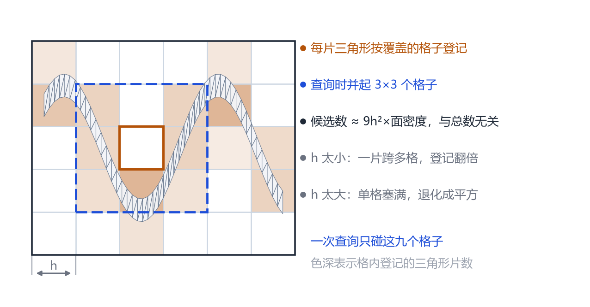

# 第 9 章 自碰撞与连续碰撞

> 本章导读：一件衬衫从衣架上滑下来，落在自己身上，然后穿过去了。这一章讲为什么"布不能穿过布"这句听起来最简单的话，是布料模拟里最贵的一句。

## 9.1 布穿过自己

先看一个具体的失败。

一件长袖衬衫，袖子垂着。动画师让角色抬手臂，袖子被压向躯干。第 120 帧还正常，第 121 帧袖口内侧的一小片三角形出现在胸口前面；再过两帧，整条袖子从身体里"长"了出来，渲染画面上一片布片与皮肤互相闪烁。

求解器没有报错。速度正常，能量没有爆，牛顿迭代收敛得很好。它只是漏了。

漏的原因通常平凡得让人不想承认。那一帧里袖子的两层布之间的相对速度是每秒三米，按每秒六十帧算，一步走五厘米。布的厚度是零点二毫米。假定两层布原本相距一厘米，一步之后它们互换了位置。检测器只在步末看一眼，看到的是"相距一厘米"，于是报告一切正常。

这就是自碰撞和刚体碰撞的第一个差别：检测的采样点不够密。刚体可以靠"东西够大、一步走不远"这条经验混过去；布薄、软、动得快，而它要撞的对象就是它自己。

第二个差别是数量。一件衬衫三角化之后一万多个面，两两比较是一亿次；一件外套五万面，是十二亿五千万次。每帧都做，实时预算里根本放不下。

第三个差别是判据本身。刚体碰撞问"有没有重叠"，是个布尔值。布的自碰撞问"两张布面之间的距离有没有小于某个阈值"——因为布在物理上有厚度，在渲染上却是零厚度。你必须在物理模型里塞进一个虚构的厚度，否则两层完全贴合的布连法向都定义不出来。而这个虚构厚度直接决定布"有多硬""折不折得起来"，它不是从材质表里查出来的数。

第四个差别是结果依赖摩擦。两块布贴上之后是滑开还是停住，由摩擦决定；褶皱最后停在哪，也由摩擦决定。摩擦依赖历史、不连续、不好求导，偏偏是视觉上最要紧的那一环。

四件事叠起来，自碰撞成了柔体管线里最耗时的部分。影视里一帧布料的求解时间，经常一半以上花在碰撞上，而不是花在弹性上。

## 9.2 候选对：从平方到近线性

一亿个三角形对里，绝大多数是"隔着半米的两片布"，看一眼就该排除。剔除分两层，和刚体一样：宽相回答"这两块区域有没有可能挨上"，粗糙、便宜，可以错杀但不能漏；窄相回答"这两片三角形离多远、有没有交、交在哪"。

宽相有两条主流路线。

空间哈希把空间切成边长 $h$ 的格子，物体按它覆盖的格子登记，落进同一格子的互为候选。查询时只算它所在格子以及相邻格子里的登记表，开销与"格子里的物体数"成正比，与总数无关。全部学问在 $h$ 的选择上：$h$ 太小，一个物体会横跨很多格子，登记和查询都变贵；$h$ 太大，一个格子塞几百个物体，退化成平方级。经验值是取"接触距离的若干倍"到"平均物体尺寸"之间，不少实现干脆取包围盒的平均边长。

BVH 是一棵按空间二分组织的树，每个节点包住一片区域。查询一对区域时从根往下同时走两棵树，两个节点的包围盒不相交就整枝剪掉。它的优点是自适应：几何密的地方树深，稀的地方树浅。缺点在动态上：布每帧都在动，包围盒每帧都要重算，十万节点的树重建一次就要几毫秒，这笔开销经常比宽相省下的还多。

两者真正的分立点是时间相干性。布在时间上是连贯的：上一帧互为候选的两片，这一帧大概率还是。所以常见组合是"哈希做粗筛、BVH 做细筛"，或者干脆用上一帧的候选集做增量更新，只处理新进入邻域的那一小批。可惜这条经验在布料剧烈翻卷的时候会失效——一大片布在一帧内换了位置，上一帧的候选集几乎全错，增量更新反而变成了负担。

窄相要给每个候选对算出一个具体距离。三角形网格上的距离只有两类：点到三角形，边到边。前者算一个点在三角形所在平面上的投影落在内部还是外部，落在内部就是一个平面点到点的距离，落在外部就退化成点到三条边；后者算两条线段的最短距离，要解一个四元二次型，或者用一堆叉积分支出来。两件事都不难，难在它们要被调用几十万次，而且要足够快、足够稳（退化情况多：平行、共线、一个点恰好在顶点上）。工程上这类函数通常会被反复重写成无分支的 SIMD 版本，因为它在采样里出现的频率太高。

还有一个几何上的选择：只做点与面、边与边，还是也做点与点。点与点这一项在数学上是多余的（点到面的距离已经覆盖），但在数值上不完全多余——两层布完全重合时，点到面的法向是零向量，靠它算不出方向，点与点那一项反而给出一个明确的排斥方向。所以有些实现会额外加一项基于顶点距离的短程排斥，专门用来处理"完全贴合"这种退化。

<figure class="fig">

<figcaption><b>图 9-1</b>　空间哈希与邻域查询。布的每一片三角形按它覆盖的格子登记，查询一片三角形的邻居时只并起它所在格子与周围八个格子的登记表。格子边长 $h$ 决定了两端的代价：$h$ 太小则一片布摊在多个格子里，$h$ 太大则单格内的候选数暴涨。此图为结构示意，格内数量不代表实际比例。</figcaption>
</figure>

连续碰撞是第二层。

前面那个"一步走五厘米"的例子说明，靠加密采样治不了本：采样再密也可能正好跨过，而且代价线性上升。正确的做法是把一步内的运动当成一段轨迹，检测两条轨迹有没有相遇。

实现上，把每个三角形的包围盒沿运动方向拉长——取步首与步末两个时刻包围盒的并集，或者扫出一个扫掠体——宽相就在这些加长的盒子上做。窄相则要解一个方程：两条三角形在匀速直线假设下，什么时候距离为零。这归结为一个三次方程，解出来的根 $t^{*}\in[0,1]$ 就是步内的归一化碰撞时刻。有了 $t^{*}$，求解器知道该在哪一刻停下来处理，而不是等到步末才追悔。

代价是每个候选对要多解一次三次方程，而候选对的数量正是上一节拼了命压下来的东西。所以连续检测在布料里通常只用在"真的可能撞上"的那一小批对上，这一批由步首的离散检测先筛一遍。

还有一处容易忽略：连续检测只能处理"相对运动是直线"。布在一步内的运动不是直线，它有加速度，有约束投影带来的折线。把一步切成 $n$ 个子步、每个子步内假设直线，是标准的折中。子步多了准，但也贵，而且子步数一多，连续检测带来的收益就开始被它自己的开销吃掉。

## 9.3 位置、速度，还是能量

检测出碰撞之后怎么"处理"，有三条路，区别比名字听起来大得多。

第一条是位置投影。把穿进另一片布的顶点沿法向推出来，推到留一个阈值的位置。PBD 里这就是一个约束，修正量按逆质量分配。它简单、稳、可并行，缺点是事后诸葛：穿过去了才发现，而且推出来的方向未必对——两个互相穿插的三角形，该往哪一边推是没有唯一答案的。推错方向的结果是一层布像气泡一样从另一层里鼓出来。

第二条是速度层面。用冲量把法向相对速度顶回去，恢复系数单独设。它保住动量，看着更有"撞击感"，适合刚性较大的物体。可布是软的，布与布的接触几乎总是持续的而不是瞬时的，用冲量处理持续接触会抖。

第三条是把非穿透写进能量，让求解器自己去满足。这条最贵，也最干净。

它的形式是这样：定义一个间隙函数 $d(\mathbf{x})$，量的是两个几何元素之间的距离（点与三角形，或边与边）。要求是 $d\gt 0$，而一旦 $d$ 趋向零，能量趋向无穷。于是优化问题的最优解自动落在可行域内，你不需要检测、不需要判据、不需要响应，只需要在总能量里加一项

$$
b(d) = -\kappa\,(d-\hat{d})^{2}\ln\frac{d}{\hat{d}}, \qquad 0 \lt d \lt \hat{d}
$$

而在 $d \ge \hat{d}$ 时 $b=0$。$\hat{d}$ 是激活距离，一般取布的厚度；$\kappa$ 是障碍刚度，量纲是能量每长度平方。图 9-2 画的就是这条曲线和它的导数。

三个性质值得点出来。其一，$d=\hat{d}$ 处 $b$ 与 $b'$ 同时为零，障碍是光滑接上的，不会在激活距离上制造力的跳变——这一点很要紧，因为力的跳变会让积分器在阈值附近来回抖。其二，$d\to 0^{+}$ 时 $b\to+\infty$，穿过去需要无穷大的能量。其三，中间那一段是"先软后硬"的：距离还远时几乎不出力，逼到近处力迅速上升。定量地看，力在 $d=\hat{d}/2$ 附近还有一个量级为 $\kappa\hat{d}$ 的平缓段，再往里才迅速放大。

这一项之所以要求解器配合，是因为它在 $d\to 0$ 处的曲率趋向无穷，牛顿法的 Hessian 会病态。对策是严格的线搜索：每次迭代都保证总能量下降，同时不允许任何间隙走到零以下。

$$
\frac{\partial b}{\partial d} = -\kappa\left[2(d-\hat{d})\ln\frac{d}{\hat{d}} + \frac{(d-\hat{d})^{2}}{d}\right]
$$

把括号里的两项分开看，第一项在 $d\to 0$ 时按对数增长，第二项按 $1/d$ 增长——后者才是让力真正发散的来源。所以有效的障碍刚度不是 $\kappa$，而是 $\kappa\hat{d}^{2}/d$ 在 $d$ 接近零时的量级。这解释了一件事：障碍刚度的合适取值随 $\hat{d}$ 变化，$\hat{d}$ 取得小，$\kappa$ 必须跟着调。

<figure class="fig">

<figcaption><b>图 9-2</b>　IPC 障碍势及其导数（真实函数计算）。取 $\hat{d}=1$，横轴为 $d/\hat{d}$。左图为 $b/\kappa$：在 $d=\hat{d}$ 处与横轴相切、斜率为零，越过 $\hat{d}$ 之后恒为零；$d\to 0$ 时发散。右图为无量纲斥力 $-\hat{d}\,b'/\kappa$，随距离减小单调上升：$d=\hat{d}/2$ 处约 1.19，$d=0.1\hat{d}$ 处约 12.2，再往里按 $1/d$ 放大。两条曲线都由正文的公式直接算出，没有拟合。</figcaption>
</figure>

## 9.4 IPC 的保证从哪来

把上面那件事做成一套完整方法，就是 IPC [@li2020]。

它的主张很短：给定一个离散的、初始无穿透的状态，在一组明确的条件下，之后所有时刻都无穿透，单元也不会翻转。注意这句话的限定词——离散的、初始无穿透、满足条件。这不是物理定理，是关于算法的一条保证，而保证需要被证明。

证明的骨架分三段。

第一段，连续检测必须真的覆盖整步。IPC 要求每个候选对的间隙在整个时间步内都被检查，而不是只看两端。做法是把间隙看成时间的函数 $d(t)$，检查它在步内有没有取到零。如果步首步末的间隙加上一个由速度给出的上界仍然够大，就可以跳过细检，这一步叫过滤。过滤的正确性依赖对 $d(t)$ 变化率的一个保守上界，这是纯几何的，不需要解方程。

第二段，障碍必须让"无穷"出现得足够早。如果障碍在 $d=0$ 才开始起作用，穿越就仍有可能；障碍在 $\hat{d}$ 就起作用并且随 $d$ 减小趋向无穷，则任何让某个间隙到零的步都会被能量挡住。这一段是上节那条曲线的直接推论。

第三段，求解器必须单调下降，并且不会越界。这要求线搜索严格、牛顿方向经过正则化、Hessian 保持正定。工程上的标准做法是投影牛顿加过滤线搜索：每尝试一个步长，先用连续检测检查这个步长下会不会穿越，再看总能量是否下降，两者都过才接受。

代价在哪里？大头在 $\kappa$ 上。$\kappa$ 小了，布会软软地陷进去，两层挨得极近，看着像粘住；$\kappa$ 大了，Hessian 条件数炸，迭代次数飙升。IPC 的建议是让 $\kappa$ 随步长和步内位移缩放，让障碍力的量级与弹性力相当。这条经验可以压缩成一句：障碍刚度不是材料的属性，是离散化的属性。

第二块代价是规模。每个候选对都要加一项障碍，几万面的布上候选对可能几十万。每一项都是局部的，可以装配成稀疏的 Hessian，但装配本身要时间，而且这个时间不随子步数下降。

第三块是拓扑。布撕裂之后同一块布的两片会分开，间隙从零开始变大，而 $d=0$ 恰是障碍的奇点。撕裂的处理必须保证新产生的边界之间不会立刻出现非正的间隙，否则第一步就解不动。这是 IPC 用在可撕裂布料上最麻烦的一处，也是它最初只能处理封闭网格的原因之一。

值得把它和"投影式"的做法对照一次。投影式的保证是局部的：每一次投影之后那一对几何元素确实不穿，但下一次投影可能把它推回去，或者推到别的地方去穿。也就是说，穿透是逐次被压制而没有被证明不会复发。能量式的保证是全局的：只要总能量在下降，且无穷障碍让任何穿越状态的能量都是无穷，就不可能收敛到一个穿越状态。差别不在于谁更准，而在于谁有话说。这也是为什么 IPC 的论文标题里敢于写"无穿透"——它卖的是这条性质，不是速度。

## 9.5 摩擦与贴附

没有摩擦的布摸起来像丝绸泡在水里。

摩擦要管两件事：静摩擦（贴住的时候要多大的力才推得动）和动摩擦（滑起来之后阻力多大）。刚体里用库仑模型就够：切向力上限是 $\mu f_n$，$f_n$ 是法向力，$\mu$ 是摩擦系数。布的难处在于接触是持续的、面积性的，而且法向力本身就是求解出来的未知量。

位置层面的近似是这样：记住每个接触点相对它所依附三角形在上一帧的切向偏移，本帧先把它投影回"滑动量不超过 $\mu$ 倍法向位移"的范围。这是 PBD 风格的摩擦，便宜，效果尚可，但结果随迭代次数变化，也没有真正的静摩擦——静摩擦的特征是"推不动"，而投影只能做到"推得少"。

能量层面的做法把摩擦也写成势，思路是把位移分解成法向和切向，让切向阻力与法向障碍力耦合：

$$
\mathbf{f}_t = \mu\, f_n\,\frac{\mathbf{u}}{\|\mathbf{u}\|}
$$

$\mathbf{u}$ 是切向的相对位移，$f_n$ 是法向障碍产生的力。关键在于 $f_n$ 本身也是某个势的导数，于是库仑摩擦的"上限"就换成了"势垒"，摩擦与非穿透共用同一套求解流程，也不需要分支判断。IPC 用的正是这个思路：摩擦势取成 $\mu$ 乘用法向障碍势再乘一个随切向位移衰减的因子。

布料的"贴附"值得单独说一句。一块湿布贴在球面上不会滑下来，物理上是表面张力、毛细作用与摩擦共同作用的结果；模拟里通常只用摩擦来近似。于是参数必须调得比真实摩擦大，才能贴得住。这不算错，前提是你知道自己在近似什么。

副作用也在这里：摩擦调大之后，褶皱会锁死在某个形状里，怎么动都不变，看上去像硬塑料。真实布料的褶皱是流动的——坐下时重新分布，起身时换一批位置。所以合理的摩擦区间往往比想象中窄，而且与厚度、刚度耦合：厚度大了接触面积大，同样的 $\mu$ 给出的阻力更大。这三个数不能独立调，这是布料调参里最容易栽的地方。

## 9.6 剔除与并行

自碰撞的开销分三块：宽相、窄相、求解。比例随规模变化，但都是毫秒到几十毫秒的量级，实时里放不下，必须做减法。

第一层减法最粗：不做。衣服的内层、被外套包住的部分、贴身那一片、摄像机上永远看不到的背面，全都不做自碰撞。影视里常见的做法是由美术手动划一块"需要自碰撞的区域"，或者按镜头决定哪块布要精算。这一层省得最多，代价也最不可控——它靠人的判断，而人会错。

第二层是层次。先在一块粗略的代理几何上做检测，比如把袖子简化成十几根胶囊，只在粗代理挨上时才去精算局部。这是刚体宽相的思想搬到布上，一层代理往往能把候选对压下一个数量级。

第三层是时间上的剔除，也就是上文的过滤：如果两个区域在这一步的相对位移远小于它们的间隙，这一步就不用细检。它的效果在布料上特别好，因为布料大部分时间在慢速摆动。

第四层是并行。候选对的生成可以按格子或按树的节点切开，几乎线性加速；连续检测的每个候选对独立，同样好并行。真正难并行的是求解：障碍势带来的 Hessian 稀疏但耦合，稀疏 Cholesky 的并行度受矩阵结构限制，共轭梯度好一些，但要有像样的预条件子。

还有一个不常被提的角度：让求解本身变稀疏。布的大部分区域这一帧远离接触，只有几小片在算接触。如果能只在那几片上花力气，总成本就下来了。做法是按"接触岛"把布切开：岛内耦合求解，岛间用上一帧的解做边界条件。代价是岛与岛之间的信息慢一拍，剧烈运动时会在岛的边界上看到接缝。

最后给一个刻度。上面这些手段全加上，实时布料能承受的自碰撞规模大约在几千到一两万个三角形，而且通常只在关键区域开。影视里几十万面的布料自碰撞之所以能算，是因为它不需要在十六毫秒里算完。实时与离线在这里分道扬镳。
