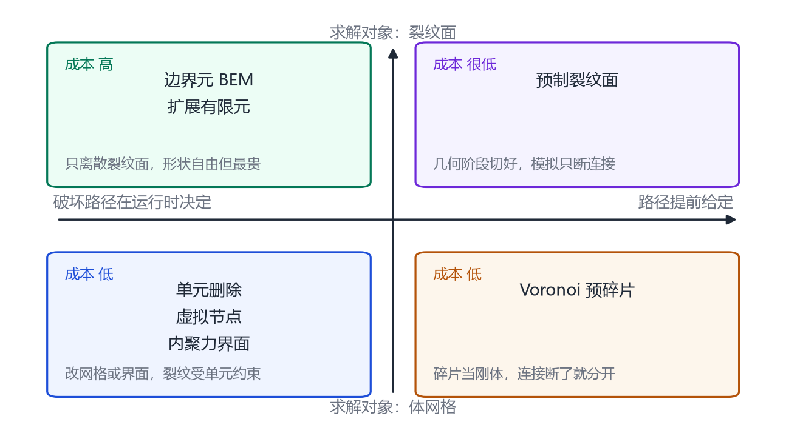
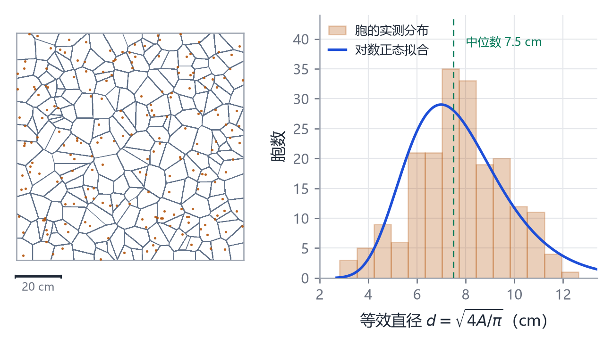

# 第 10 章 断裂、撕裂与破碎

> 本章导读：一块玻璃落地，碎成几百片。这几百片的形状不是随便的，它们记录了裂纹从哪里起、往哪里跑、跑多快。这一章讲怎么把这条记录算出来，以及什么时候根本不用算。

## 10.1 一块玻璃落地

慢镜头看下去。一块三毫米厚的窗玻璃从一米高落到水泥地上，最先着地的是左下角。接触点附近立刻出现一小片白雾——那是被压碎的玻璃粉末，颗粒比像素还细。接着几条放射状的裂纹从那里射出去，跑到一半分叉，分出来的支裂纹继续跑，再分叉，最后在玻璃边缘处密集交汇。整块玻璃分成几百片，碎的散出去，大的留在原地，中间还挂着几块没掉下来的。

慢镜头是必要的，因为这件事快到肉眼看不清。落地一米，撞地速度是 $v=\sqrt{2gh}\approx 4.4$ m/s，接触在几十微秒内完成；玻璃里的纵波速度约 5000 m/s，而裂纹一旦起来能跑到每秒一千五百米以上，超过瑞利波速的一半。要看清它，得用每秒十万帧以上的高速摄影。也就是说，物理上"一瞬间"的事，在时间轴上要放大上千倍才看得见结构。

捡起两片对一下，断面能严丝合缝拼回去。断面上有纹路：波纹状的、羽毛状的、贝壳状的。这些纹路是裂纹前沿留下的痕迹，记录了它往哪个方向跑、跑得多快、中间有没有停过。贝壳纹（conchoidal fracture）的弧线凸向裂纹传播方向，法医靠它判断撞击点，模拟器靠它判断"这条裂纹算得对不对"。

模拟的目标就是把这个过程算出来。

这件事的难处不在"让一块东西分成两块"——那太容易了，把网格里的一条边剪断就行。难在三个问题：裂纹什么时候起、往哪走、走多快；以及碎片为什么是那个尺寸。第一个问题来自你看不见的微观结构，第二个来自应力场的奇异性，第三个来自断裂的级联统计。三个问题对应三套完全不同的方法，也对应三档不同的成本。

容易误解的地方：裂纹不是"一条线在材料里延伸"这么简单。它是一个有厚度的过程区，前面有应力集中，两侧有新表面在生成，尖端附近材料已经不再是线弹性的。宏观上把它画成一条线，是因为过程区的尺寸（玻璃里约几十纳米到几微米）远小于构件尺寸。一旦这个前提不成立——比如薄膜、纳米结构——画成线的做法就不再成立。

## 10.2 三个阶段

断裂在时间上分三段，三段的物理和数值难点完全不同。

起裂。材料里本来就有缺陷：微观空洞、夹杂物、表面划痕、晶界。这些地方应力集中，局部先到临界值，裂纹就从那里起。起裂位置因此几乎是随机的，取决于微观结构而不是你能建模的那部分几何。模拟里通常不模拟缺陷，而是给每个单元或每个高斯点一个随机的强度扰动，让起裂位置随机化。这个随机数不是糊弄：真实起裂点确实由不可建模的细节决定，假装它确定反而不对。

随机扰动的分布也不是随便挑的。工程上描述脆性强度的标准工具是 Weibull 分布：强度不超过 $\sigma$ 的概率是 $1-\exp[-(\sigma/\sigma_0)^{m}]$，$m$ 是形状参数（Weibull 模数）。$m$ 越大强度越集中，玻璃的 $m$ 常在 5 到 15，意味着一批玻璃的强度能差三五倍。模拟里给单元强度加扰动时用它比用高斯分布合适：高斯会给出负强度，Weibull 不会，而且天然右偏，正好对应"个别地方特别弱"。

扩展。裂纹一旦起来，就往能量释放最快的方向跑。裂纹尖端是一个奇异点，尖端附近的应力按 $1/\sqrt{r}$ 发散，$r$ 是到尖端的距离。这是线弹性解的直接结果，不是数值误差。任何基于体网格的方法都很难表示这个奇异：网格越密，尖端附近单元越小，但奇异是无穷的，永远表示不准；而一旦网格细到能"看见"尖端，远处那些还没裂的地方又白白多花了网格。

扩展阶段有两个可观察的特征，模拟出来才对得上。一个是速度上限：裂纹速度不会超过瑞利波速的六成左右，玻璃里大约是 1500 到 1800 m/s。这个上限不是"材料不允许更快"，而是能量供给跟不上——裂纹跑得越快，尖端附近的动能占比越大，留给创造新表面的越少。另一个是分叉：速度接近上限时尖端变得不稳定，一条裂成两条，速度越高分叉越密。真实玻璃上那些放射状裂纹分成三四级，就是反复分叉的结果。

碎片。多条裂纹交汇，把物体切碎。这一步在物理上没有新东西，在几何上是灾难：拓扑变了，碎片要变成独立的刚体，各自有质量和惯性张量，要和地面、和别的碎片碰撞，还要处理薄片互穿、碎片卡住、碎片堆成一堆这些刚体求解器最讨厌的情况。实际项目里花在第三步的时间往往比前两步加起来还多。

三个阶段里，第二个吃掉绝大部分计算，第三个吃掉绝大部分工程麻烦，第一个只需要一句随机数。记住这个分工，后面几节的方法选择就好理解了。

## 10.3 应力判据与能量判据

判断一块材料会不会裂，有两种写法。简单情况下它们等价，复杂情况下不一定。

应力判据：某个量超过阈值就裂。一维时就是 $\sigma \gt \sigma_c$，$\sigma$ 是拉应力，$\sigma_c$ 是材料强度。二维三维要选一个等效应力：冯·米塞斯适合延性材料，最大主应力适合脆性材料。用起来方便，但有它解释不了的事——它说不清为什么长裂纹比短裂纹更容易扩展，也说不清为什么厚玻璃比薄玻璃脆。

能量判据来自 Griffith。他 1920 年代琢磨的是另一件事：玻璃的实际强度为什么只有理论强度的千分之一。他的答案是有裂纹。裂纹扩展要创造两个新表面，单位面积需要 $2\gamma$，$\gamma$ 是表面能；这份能量从物体释放的弹性能里出。

设裂纹面积 $A$，物体释放的弹性能 $U(A)$，那么扩展一点 $\mathrm{d}A$ 释放的能量是 $-\mathrm{d}U/\mathrm{d}A$。定义能量释放率

$$
G = -\frac{\mathrm{d}U}{\mathrm{d}A}
\tag{10.1}
$$

单位是能量每面积，也就是牛每米，和表面能同量纲。判据是

$$
G \ge G_c
\tag{10.2}
$$

脆性材料里 $G_c = 2\gamma$。这一条比应力判据深：它把"裂不裂"换成了"能量够不够"。一块厚玻璃和一块薄玻璃，同样应力下厚的存了更多弹性能，所以更容易裂；同一种材料做成细丝反而很结实，因为存不下能量。这些现象应力判据都说不出来。

推导的梗概值得走一遍，因为后面所有数值方法都建立在这三步上。

第一步，算"裂纹周围存了多少能量"。没有裂纹时，一块受拉板处处是均匀应变，单位体积的弹性能是 $\sigma^{2}/(2E')$。有裂纹之后，裂纹两侧一片区域的应力被"卸载"了，那片区域大致是个以裂纹为中心的椭圆，尺寸与裂纹长度同量级。

第二步，把卸载区的能量减掉。设板厚 $B$，裂纹长度 $2a$，卸载区的面积约 $\pi a^{2}$ 的量级（精确解由 Inglis 在 1913 年给出，椭圆长短轴之比趋于零时就是这个系数），于是释放的总能量是

$$
U_{\text{el}} = -\frac{\pi\sigma^{2}a^{2}B}{E'}
\tag{10.3}
$$

$\sigma$ 是远处的均匀拉应力，单位帕；$a$ 是半裂纹长，单位米，所以裂纹总长是 $2a$；$B$ 是厚度，单位米；$E'$ 是有效模量，单位帕。逐项看，$\sigma^{2}/E'$ 是能量密度（焦每立方米），$a^{2}B$ 是体积（立方米），乘起来是焦耳。负号表示这份能量从系统里出去了——卸载就是损失承载能力。

第三步，加上表面能，求极值。新生成的两个断面面积是 $2\times 2aB = 4aB$，表面能是 $4aB\gamma$。所以总势能

$$
\Pi(a) = -\frac{\pi\sigma^{2}a^{2}B}{E'} + 4aB\gamma
\tag{10.4}
$$

这一条曲线的形状决定一切：第一项是 $a^{2}$（负的，开口向下），第二项是 $a$（正的，直线）。两项相减是一个开口向下的抛物线加一条上升直线，必有一个极大值。令 $\mathrm{d}\Pi/\mathrm{d}a = 0$，得 $-2\pi\sigma^{2}aB/E' + 4B\gamma = 0$，也就是 $\sigma^{2} = 2\gamma E'/(\pi a)$。

这个极值的意义是稳定性的分水岭。裂纹比临界长度短时，$\mathrm{d}\Pi/\mathrm{d}a \gt 0$，长一点点要额外付出能量，裂纹停下来；比临界长度长时，长一点点会释放能量，裂纹自己加速跑到底。也就是说，短裂纹不会自己长，长裂纹不会自己停。这是"缺陷尺寸决定强度"的原始版本。

对一块无限大板里长度为 $2a$ 的穿透裂纹，受远处均匀拉伸 $\sigma$，线弹性解给出

$$
G = \frac{\pi\sigma^{2}a}{E'}
\tag{10.5}
$$

$E'$ 是有效模量：平面应力取 $E$，平面应变取 $E/(1-\nu^{2})$，$\nu$ 是泊松比。代进判据就得到临界应力

$$
\sigma_c = \sqrt{\frac{E' G_c}{\pi a}}
\tag{10.6}
$$

这就是"裂纹越长越容易断"的定量版本，$\sigma_c$ 按 $1/\sqrt{a}$ 下降。裂纹长度翻四倍，强度掉一半。

代一组真实数字。窗玻璃 $E = 70$ GPa，取平面应力 $E'=E$；表面能 $\gamma \approx 2$ J/m²，于是 $G_c = 2\gamma = 4$ J/m²。若表面上有一条 10 μm 深的划痕（$a = 10^{-5}$ m），

$$
\sigma_c = \sqrt{\frac{7\times 10^{10}\times 4}{\pi\times 10^{-5}}} \approx 9.4\times 10^{7}\ \mathrm{Pa}
$$

也就是 94 MPa，正好是玻璃实测强度的量级。同一块玻璃上要是有一条 1 mm 的裂纹，代入得 9.4 MPa——强度掉了一个数量级。这解释了为什么玻璃工切玻璃时先在表面划一道痕：那不是"切"，是给裂纹提供一个 $a$ 足够大的起点，让它在很小的弯曲应力下就跑起来。

工程上还有一个等价量，应力强度因子

$$
K = \sigma\sqrt{\pi a}
\tag{10.7}
$$

它的临界值 $K_c$ 叫断裂韧性，材料手册里直接查得到，单位是帕乘以根号米。$K$ 与 $G$ 的关系是 $G = K^{2}/E'$。用 $K$ 的好处是它不带模量，只跟几何和载荷有关，所以查表方便；用 $G$ 的好处是它能直接和非线性、和耗散对接。做模拟的人更常从 $G$ 出发，因为能量是可加的，而 $K$ 只在纯线弹性下有定义。

$K$ 这个名字里的"强度因子"，说的是它把"应力有多大"和"裂纹有多尖"合成了一个数。逐项看式 (10.7)：$\sigma$ 是远场应力（帕），$\sqrt{\pi a}$ 是长度的平方根（$\mathrm{m}^{1/2}$），乘起来单位是 $\mathrm{Pa}\sqrt{\mathrm{m}}$。为什么是平方根而不是长度本身？因为尖端应力场是 $1/\sqrt{r}$ 型的，把它乘上 $\sqrt{2\pi r}$ 之后剩下的那个系数才是有限的，那个系数就是 $K$。所以 $K$ 量的是"尖端附近应力场有多强"，而不是任何一点的应力值：

$$
\sigma_{ij}(r,\theta) = \frac{K}{\sqrt{2\pi r}}\,f_{ij}(\theta)
\tag{10.8}
$$

$r$ 是到尖端的距离，$\theta$ 是相对裂纹面的角度，$f_{ij}$ 是只与角度有关的无量纲函数。$r\to 0$ 时 $\sigma\to\infty$，但只要 $K$ 是有限的，这个发散就是"可控"的——所有 $r$ 处的应力都由同一个 $K$ 缩放。这就是为什么断裂判据可以只看 $K$：它一个数概括了整个尖端场。

$K$ 有三种，对应三种撕裂方式。I 型是张开型，裂纹面垂直分开，$K_{\mathrm{I}} = \sigma\sqrt{\pi a}$；II 型是面内剪切，两侧沿裂纹面反向滑动；III 型是面外剪切，也就是"撕"。玻璃落地是 I 型为主，剪切裂纹（比如剪刀剪纸）是 II 型为主，撕胶带是 III 型。混在一起时，判据不再是单看某一个 $K$，而是看它们的组合——常用的做法是换成等效应力强度或者最大周向应力准则，判断裂纹往哪个角度拐。

手册数字能给个感觉：玻璃 $K_{\mathrm{Ic}} \approx 0.75\ \mathrm{MPa}\sqrt{\mathrm{m}}$，有机玻璃约 1，铝合金 20 到 40，结构钢 50 到 100。换算成 $G_c=\dfrac{0.75^{2}\times 10^{12}}{7\times 10^{10}}\approx 8$ J/m²。比 $2\gamma=4$ 大一倍——多出来的那部分是尖端微区的塑性耗散，虽然玻璃很脆，尖端还是有一小片非弹性区。这提示了一件事：$G_c$ 从来不是纯表面能，它总是"表面能 + 一点点别的"。

前提要说清楚：这套推导假设线弹性、小变形、裂纹尖端之外没有别的非线性。玻璃、陶瓷、冷铸铁基本符合。金属、塑料、橡胶不符合——它们的裂纹尖端有一个大范围的塑性区，能量在裂之前先被塑性变形吃掉一大块。这时候判据还写成 $G \ge G_c$，但 $G_c$ 里包含塑性耗散，可以比 $2\gamma$ 大三个数量级。这就是延性断裂，后面单独说。

还有一条容易误解的地方：$K$ 和 $G$ 都不是材料属性，只有临界值才是。同一块玻璃，裂纹长一米时 $K$ 很大，长十微米时很小，但 $K_{\mathrm{Ic}}$ 始终是 0.75。把当前值与材料常数混为一谈，就会问出"材料一样，为什么这块碎了那块没碎"。

## 10.4 有限元里的三种做法

手里已经有一套有限元柔体求解器，要加断裂，最省事的做法是单元删除。在展开之前先看一眼图 10-1：它按两个问题把这一类方法摆开——破坏路径是模拟时决定还是提前定好，求解对象是体还是面。下面三种都在左下那一格。

规则一句话：每个单元算一个破坏指标，超阈值就把它从网格里删掉。删掉之后它承担的力没有了，载荷重新分配到邻居身上，邻居更容易超阈值，裂纹于是自己往外走。

这个"自己往外走"就是最省事方法的全部物理。删掉一个单元等于开了一个洞，洞两侧原来连着，现在只能绕行传力；绕行的路径更细、应力更高，于是下一个被删的单元就在洞边上。裂纹沿"最弱的邻居链"生长，而不是沿能量释放率最大的方向——两者在均匀应力场里差不多，在复杂应力场里经常不一样。

这个方法极其便宜，实现只要几十行，视觉上"能看"。毛病也明确：裂纹只能沿单元边界走，形状被网格锁死了——三角形网格给出折线裂纹，四面体网格给出带锯齿的面片。想做一条平滑的裂纹，只能加密网格，而加密的代价是立方级的。此外删单元等于丢质量，丢多了碎片的惯性不对；求解器还要处理"一堆孤立单元"和"只剩下一个面的单元"这类退化情况，不然会在裂口附近抖。

量级上感受一下：一个五万单元的四面体网格，边长加密一倍就是四十万单元，求解时间涨八倍以上。裂纹能被"看见"的宽度就是单元边长，所以想让裂纹看起来细一倍，代价是八倍。这是体网格断裂方法的固有税。

修裂纹形状的一种办法是虚拟节点 [@molino2004]。思路是不在单元边界上删，而是让裂纹从单元内部穿过。做法是给每个单元配一套藏在里面的虚拟节点，平时它们和真实节点同步运动（相当于没断），一旦某个内部子面判据超阈值，就把对应的那对虚拟节点分开，裂纹就在单元内部张开了。

它把"裂纹形状"从网格质量里解放出来一部分：裂纹可以沿任意方向穿过单元，只要方向在单元内部的候选集里。代价是自由度变多（每个单元多出几个节点，内存涨三到五倍），而且内部候选方向是有限的，太细的弯折表示不出来。

第三种是内聚力模型。它在单元的界面上放一条"牵引-分离"关系：界面没张开时提供一个刚度，张开之后牵引力先升后降，降到零时界面完全脱离。中间那段下降围出的面积就是断裂能

$$
G_c = \int_{0}^{\delta_c} T(\delta)\,\mathrm{d}\delta
\tag{10.9}
$$

$T$ 是界面牵引力，单位帕；$\delta$ 是界面张开位移，单位米；$\delta_c$ 是完全断开时的张开量。逐项看，这是"力乘位移等于能量"的一维版本：$T\,\mathrm{d}\delta$ 的量纲是 $\mathrm{Pa\cdot m}=\mathrm{J/m^{2}}$，正是能量释放率。也就是说，曲线下的面积就是判据里的 $G_c$，不需要另设一个阈值。

这条曲线让模型的参数有了物理含义：给定 $G_c$ 和峰值牵引力，曲线的形状就定下来了。最简单的是线性软化，$T(\delta)=T_{\max}(1-\delta/\delta_c)$，曲线下面积是 $T_{\max}\delta_c/2$，于是

$$
\delta_c = \frac{2G_c}{T_{\max}}
\tag{10.10}
$$

代一组数：玻璃 $G_c = 4$ J/m²，界面峰值牵引力取 10 MPa（受拉强度），则 $\delta_c = 8\times 10^{-7}$ m，也就是零点八微米。这个数字的含义很硬：界面张开不到一微米就已经完全断开。所以内聚单元的初始厚度必须远小于一微米，否则它自身的弹性柔度会先吃掉张开量，模型给出的"断裂"其实是单元被压扁，而不是界面脱开。这是内聚力模型落地时最常踩的坑——参数都对，量级不对，结果就是"太软，一碰就断"。

它比"删单元"讲道理得多，因为它把断裂能显式地放进去了，网格粗细对总耗散的影响小很多。代价是要在所有可能的裂纹路径上预置界面。预置在单元边界上，又回到网格锁死；预置成体单元内部的界面（所谓内聚单元），网格数量翻几倍。所以它常用在"裂纹路径已知"的场合，比如两层材料的粘接面、复合材料的层间。

<figure class="fig">

<figcaption><b>图 10-1</b>　断裂方法的谱系，按两个问题分格：破坏路径是在模拟时决定还是提前定好，求解对象是体还是面。左下这格最便宜也最假，右上这格最贵也最准。此图为分类示意，格子大小与各方法的使用比例无关。</figcaption>
</figure>

这三条路的共同点是都还在体网格上干活。体网格的问题在于：要表示一条细裂纹，网格必须细到裂纹宽度的量级，而三维物体的单元数按体积增长。所以高分辨率脆性断裂基本不走这条路线，它走向下面两节。

## 10.5 预碎片与 Voronoi

影视里最常见的做法不是算裂纹，是提前把物体切开。

思路：在物体内部撒一批种子点，每个点占据"离它比离别人都近"的那块区域，这些区域就是 Voronoi 胞。物体被切成一块块凸多面体，每块就是一片预制碎片。模拟时不模拟断裂，只模拟碎片之间的连接：相邻碎片之间挂一根"胶水"约束，胶水断了碎片就分开。

好处巨大。碎片是凸的，凸多面体的碰撞检测便宜且稳定，两个凸体求交比两个任意多面体简单一个量级；拓扑从头到尾不变，不需要动态改网格、不需要处理顶点分裂；碎片之间的接触可以直接交给刚体求解器，那是十几年打磨过的成熟东西。

代价只有一个，但很硬：碎片形状在模拟开始前就定了，裂纹不会顺着应力跑。于是"什么时候断"是物理的，"断成什么样"是提前定好的，两者脱钩。这在近景特写里看得出来——裂纹在应力不该高的地方穿过，或者相邻碎片之间的裂缝完全平行。

所以真正要设计的是种子点怎么撒，因为它直接决定碎片尺寸分布。均匀撒得到尺寸相近的碎片，看起来假。真实玻璃是中间大、四周小，因为撞击点附近能量密度最高、碎裂最细。常用的修正按到撞击点的距离控制密度：用非均匀的泊松过程，接受一个候选点的概率随距离衰减，于是近处种子密、碎片小。

完整流程值得按顺序过一遍，因为每一步都有个具体的坑。

第一步，定预算。美术要的是"碎成 120 片"，不是"种子密度每平方米 200 个"。碎片数近似等于种子数，所以直接把种子数定成目标片数。反过来由密度反推的做法在实践中很少用，因为边界碎片会让实际片数比种子数多出两三成。

第二步，撒种子。在物体的包围盒里生成候选点，按密度函数做拒绝采样：候选点在撞击点附近时就接受，远处的按概率接受。密度函数常取 $p(\mathbf{x}) \propto \|\mathbf{x}-\mathbf{x}_0\|^{-\alpha}$，$\alpha$ 在 1 到 2 之间，$\mathbf{x}_0$ 是撞击点。$\alpha$ 越大，"近处更密"的效果越极端。撒完之后把落在物体外面的点剔掉。

第三步，打标签。把物体占的空间切成细网格，每个格点找最近的种子，把编号写进去。朴素做法是每格点遍历所有种子，一百一十万个格点乘两百个种子是两亿次比较，几十毫秒，能接受但没必要；快一点是从种子出发做多源广度优先，一次扫描摊开整张标签图。

第四步，取胞的边界，与物体求交。每个胞是若干半空间的交集，是凸的；物体本身可能是凹的，那就把物体也切成凸块或者体素化。求交之后每片碎片是一个闭合的凸多面体，有顶点表、面表。

第五步，算物理量。体积用四面体分解求和，质心是体积加权平均，惯性张量是每块四面体对质心的贡献之和。惯性张量最容易漏，错了之后碎片飞起来会像没有转动惯量的纸片，翻得过于轻快。

第六步，建邻接。任意两片共享一个面，就在那一对之间挂一个约束，约束的强度按共享面积算。共享面积大的碎片对"粘"得牢，这正是物理上想要的：断口越大，需要的能量越多。胶水的阈值按"面积乘界面能"定，于是它和 $G_c$ 有了对应关系。

第七步，运行时。胶水约束在每次求解时被检查，力或冲量超阈值就删除。胶水断光的碎片自然变成自由刚体，交给刚体求解器。这里有个细节：断开要按"从弱到强"处理，先断弱的，让应力重新分配，否则同时断一大片会看到碎块瞬间整体散开，像被打散的积木。

第八步，后处理。补粉尘、合并过小的碎渣、给碎片加厚度（Voronoi 面可能是斜切的，渲染上要有厚度感）。

图 10-2 算的就是第三步到第五步的结果：在一米见方的范围内撒 200 个均匀随机种子，用最近邻规则在细网格上算出每个胞的面积，换成等效直径 $\sqrt{4A/\pi}$，画成直方图。分布单峰、右偏，用对数正态拟合得相当好。

这件事有理论背景。随机 Voronoi 的胞面积分布不是高斯也不是幂律，而是接近 Gamma 分布，二维时形状参数在 3.5 到 4 之间。也就是说"碎片尺寸"这个量本身没有特征尺度，分布形状是固定的，只由一个参数（种子密度）控制。想让碎片变大，唯一的办法是减少种子，改不了分布的形。这个性质很实用：想调尺寸只调一个旋钮，不必担心分布被调坏。

真实的脆性碎片分布更瘦长：小碎片极多，接近幂律。原因是碎裂是级联的——大碎片裂成中碎片，中碎片裂成小碎片，每一级遵循相似的统计，累积起来就是幂律。Voronoi 只做了一级，所以它给的小碎片偏少。这个差别在近景里很明显：真实碎玻璃里有一大堆粉尘状的渣，Voronoi 给不出来。实践中的补法是额外撒一批半径极小的种子，或者在后处理里把一部分碎片再随机切两刀。

薄板上还有一个专门的破绽。三维 Voronoi 在薄板里长出来的胞是柱状的：胞的侧壁垂直于板面，因为沿厚度方向种子之间的竞争没有变化。于是每片碎片的侧面都是直的，断面看起来像切出来的方块，不像砸出来的贝壳纹。修法有两种：沿厚度方向分层撒种子（比如两层），让侧壁出现折点；或者对每个胞的侧壁顶点加一点点随机扰动。两种都是"骗眼睛"，但在中景和远景里足够。

<figure class="fig">

<figcaption><b>图 10-2</b>　Voronoi 预碎片的尺寸分布（真实计算）。1 m×1 m 的范围内撒 200 个均匀随机种子（红点），在 1100×1100 的网格上用最近邻判定归属，得到每个胞的面积 $A$，换算成等效直径 $d=\sqrt{4A/\pi}$。左图是切分结果；右图是等效直径的直方图与对数正态拟合，200 个样本的中位数 7.5 cm、对数标准差 1.30。种子数翻倍，整条曲线向左平移而形状几乎不变。</figcaption>
</figure>

## 10.6 边界元：只离散裂纹面

要真的算裂纹怎么跑，还有一条路：不把体积离散，只离散裂纹面。

这就是边界元法 [@hahn2015]。出发点是线弹性力学的边界积分方程：体内任意一点的位移，可以由边界上的位移与面力通过一个核函数积分出来。于是未知量只存在于边界上，三维问题降成面网格，二维降成线网格。

对断裂来说这个降维特别对味。裂纹本身就是两个面，用边界元表示裂纹几乎不增加自由度：新长出来一段裂纹，只是在裂纹前沿外面多插几片单元。裂纹扩展时不用重新剖分整个物体，这也是体网格方法最贵的一步。更关键的是核函数里天然带着 $1/\sqrt{r}$ 的奇异，裂纹尖端的应力场是解析表示的——不需要靠网格加密去逼近一个无穷。

Hahn 和 Wojtan 把这件事做到了能出镜头的程度。他们做的是准静态脆性断裂，配合裂纹面的自适应加密和一套加速的积分求解，能算出高分辨率、形状复杂的裂纹网络，碎片上千。那些裂纹分叉的形状，体网格方法很难给出来，因为分叉处需要裂纹面在空间上任意切割体单元。

分工也因此很清楚。有限元擅长的是"材料复杂、几何简单"：超弹、塑性、粘弹、大变形、接触、多物理耦合，这些都能塞进体单元的本构里，代价是体积离散。边界元擅长的是"材料简单、几何复杂"：线弹性、无限域、大量裂纹面、裂纹要任意扩展，代价是稠密矩阵。

把两边的成本摆在一起，界线就出来了。设未知量数是 $N$。有限元的矩阵稀疏，非零元量级是 $O(N)$，一次求解 $O(N^{1.2})$ 到 $O(N^{2})$（取决于稀疏求解器和填充），但 $N$ 本身按体积增长，三维加密一倍就是八倍。边界元的矩阵稠密，存储 $N^{2}$，直接求解 $N^{3}$，但 $N$ 只按面积增长，加密一倍只有四倍。

代个数：两万个边界单元，稠密矩阵有 $4\times 10^{8}$ 个元素，双精度就是 3.2 GB；直接求解是 $8\times 10^{12}$ 次浮点运算，单核要几小时。所以边界元在实际使用中必须配快速多极子（FMM）或层次矩阵（$\mathcal{H}$-matrix），把存储压到接近 $O(N)$、求解压到 $O(N\log N)$。这不是优化，是能不能用的分界：不做加速只能算几千个单元，连一块手掌大的玻璃都不够。

还有一条中间路线是扩展有限元，在标准有限元的形函数里加上表示位移跳跃的项，让裂纹可以穿过单元而不重新剖分。思想上和虚拟节点是一路的，都是"让裂纹不被网格锁死"，实现细节不同。撕裂薄片 [@pfaff2014] 用的是另一套：在壳网格上做自适应加密，只在新裂口附近细分，配合虚拟节点，在效率和裂纹形状之间取了个不错的平衡。

还有两条限制没法靠工程手段绕开。它本质上是线弹性、准静态的：动态裂纹扩展（裂纹速度接近瑞利波速那种）要额外的时空积分，很难做，而高速裂纹恰恰是玻璃破碎最有冲击力的部分。它也只会算弹性体，塑性、粘弹、大变形都不在框里。

所以定位很清楚：材料行为简单、裂纹形状重要、时间不紧，选边界元；材料行为复杂、要交互、要几百帧，回体网格或干脆预碎片。两者几乎不重合，中间没有交集。图形学里边界元的论文不多，但每一篇都在"裂纹形状"上遥遥领先；工业界用的几乎全是预碎片，因为交货时间和可调性比形状精度重要。

## 10.7 延性断裂与视觉控制

金属的断裂和玻璃完全是两回事。

一根铝棒拉到断，过程是这样的：先是弹性段，然后屈服，应力上升变缓，出现颈缩，颈缩处截面越来越小，最后在那里断开。断面是杯锥状，中间是平的纤维区，边缘有一圈四十五度的剪切唇。整个过程里材料在断之前先发生了大量塑性变形，吸收的能量比表面能大几个数量级。

拿脆性的那套判据套上去会立刻出问题：金属的应变可以到百分之几十还不裂，而"应变超阈值就删单元"会在屈服点附近就开始删，得到的是"一拉就碎成粉"的效果。

O'Brien 和 Hodgins 1999 年做的脆性断裂 [@obrien1999] 用的正是"应变超阈值就分裂单元"，在玻璃上成立。他们 2002 年补上了延性版本 [@obrien2002]：把塑性应变作为判据的一部分——材料先按塑性流动，塑性应变累积到临界值再断开。改动看起来小，但它让"先弯后断"这个金属特征第一次出现在图形学的模拟里，也第一次让"碎片是扁的、断口有剪切唇"这种事有了模型依据。

更完整的写法是把损伤当成一个累积量：

$$
D = \int_{0}^{t} \frac{\dot{\varepsilon}_{p}}{\varepsilon_{f}}\,\mathrm{d}t
\tag{10.11}
$$

$\dot{\varepsilon}_{p}$ 是等效塑性应变率，单位 1/s；$\varepsilon_{f}$ 是断裂应变（材料常数，无量纲）；$D$ 从零涨到一，涨满就断。逐项看，被积函数是一个无量纲的比值：这一步积累了多大比例的"允许应变"，对时间积分就是"已经用掉多少条命"。它不是应变的直接函数，而是应变的路径积分——同样大小的塑性应变，慢慢累积和一次冲过去造成的损伤可以不一样（后者更危险，因为来不及回复）。

这条式子比瞬时判据接近工程实践，代价是要多一个状态量、多一套演化方程，而且 $\varepsilon_{f}$ 本身依赖应力三轴度。三轴度是静水压与等效应力之比，$\sigma^{*}=\sigma_{m}/\bar{\sigma}$：单向拉伸时约 $1/3$，纯剪切时为零，压缩时为负。同一个材料，拉伸下的断裂应变可能只有压缩下的十分之一——这解释了为什么金属能压扁成薄片却不裂，同样的变形量换成拉伸早就断了。

工程上把这个依赖写成经验式的断裂应变模型，最常用的是 Johnson-Cook 形式：

$$
\varepsilon_{f} = \big(D_1 + D_2 e^{D_3\sigma^{*}}\big)\Big(1 + D_4\ln\frac{\dot{\bar\varepsilon}}{\dot{\varepsilon}_0}\Big)
\tag{10.12}
$$

$D_1$ 到 $D_4$ 是材料常数（铝合金的 $D_1$ 常在 0.1 到 0.5 之间，$D_3$ 是负的、典型在 $-1.5$ 附近），$\sigma^{*}$ 是三轴度，$\dot{\bar\varepsilon}$ 是等效应变率，$\dot{\varepsilon}_0$ 是参考应变率。三项各管一件事：括号一是"应力状态允许多大的应变"，$D_2 e^{D_3\sigma^{*}}$ 让拉伸（$\sigma^{*}\gt 0$）时断裂应变迅速变小；括号二是"快慢的影响"，冲击下应变率越高越脆。图形学里通常只留第一项：它已经解释了最主要的视觉特征，后一项要真实的率相关参数，动画师既没有也调不动。

薄板的撕裂又是一类。裂纹不是"面片脱落"，而是一条缝在薄片上延伸，两侧材料卷起来。做法是在壳网格上"剪切"：沿一条曲线把边剪断，顶点分裂成两份，各自跟着一侧继续变形。难点不在剪，在剪完之后两侧的自碰撞——缝紧挨着、又细，稍不留神就穿模。所以撕裂的工程成本主要在缝两侧的接触上，不在断裂判据上。

最后是控制。影视里的破碎，导演要的不是"物理上正确"，是"看着对并且能反复调"。所以成熟的做法把物理和美术分开：

碎片数量做成参数，不靠种子密度间接控制。直接指定"这块玻璃碎成 120 片"，反推种子数，美术不用管泊松过程。起裂位置做成可指定的，在模型上标一个点，种子围着那个点加密，于是裂纹从美术希望的地方开始。裂纹走向加偏置：在应力判据上加一个方向性权重，让裂纹倾向于往画好的路径跑。碎片的飞行轨迹常常是刚体模拟加手调，关键镜头甚至直接给关键帧。

这套做法的代价是"不真实"：物理上该碎的地方可能不碎，碎片分布可能不是幂律。但只要镜头里看着对，观众不会去数碎片。反过来，如果目标是工程分析或破坏预测，上面这些手段一条都不能用。

有一条界线值得记住：模拟断裂的价值主要不在"算出碎成什么形状"，而在"算出什么时候碎、往哪碎、碎片带着多大动量飞出去"。这三件事决定动作的节奏和力度，也是美术最难凭空想出来的。至于碎片的具体轮廓，交给 Voronoi 和随机数就够了——观众看的是碎片飞，不是碎片边。
