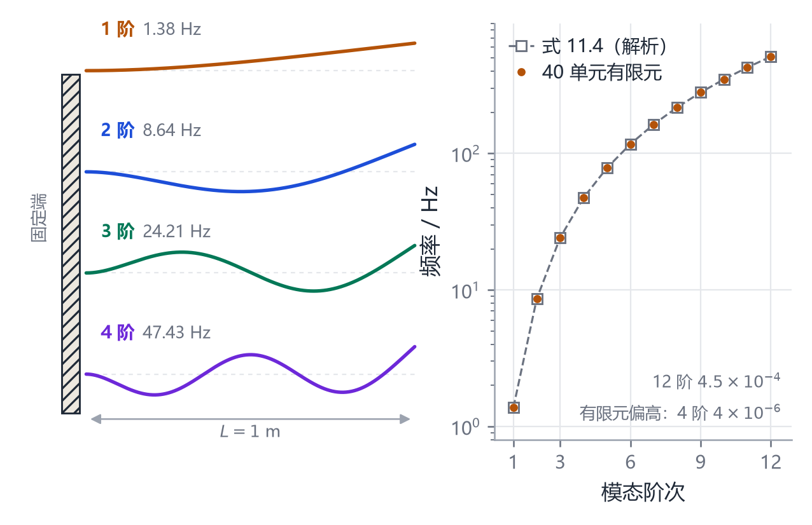
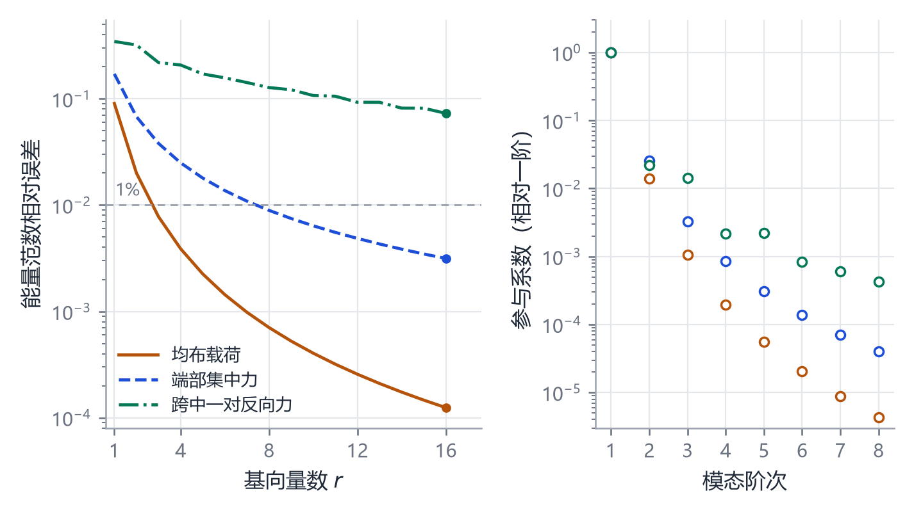

# 第 11 章 降维、子空间与实时柔体

> 本章导读：一个角色在近景里被拳头击中腹部，肉要陷下去、弹回来、抖两下才停。帧预算只有三毫秒，全自由度解不完，于是把形变压缩到几十个方向上。这一章讲模态从哪里来、投影那一步省下了什么又丢掉了什么、非线性与碰撞为什么最难搬进低维空间，以及什么情况下这条路根本不该走。

## 11.1 三毫秒的账

一个格斗游戏的角色特写：腹部被拳头顶进去，肉陷下去，拳收回，肉弹回来，过冲，抖两下，停住。离线做这件事不难，四万个四面体、隐式积分、每帧若干次牛顿迭代，几秒钟出一帧。实时只有三毫秒，连一次像样的隐式求解都做不完。

把三毫秒能买到的东西算清楚。四万个顶点意味着十二万个自由度，一次隐式积分的成本大致等于“若干次大规模稀疏线性求解”，在这种规模上每次几十毫秒。降到四千个顶点，还是要几毫秒。这条路走不通，不是因为代码写得慢，而是因为隐式求解的成本随自由度增长得太快。

再去看那段抖动本身。把离线结果逐帧拆开，每一帧的顶点位移减去上一帧，会看到位移场的形状只有少数几种：整个腹部向外鼓一下，左右轻摆，上下弹，外加一层几乎看不出的波纹。四种形状占了位移能量的九成以上。四万个自由度里真正在变的只有那么几个方向，剩下的都在用不同的幅度重复这几件事。

这就是降维的出发点。如果所有可能出现的形变都挤在一个低维集合附近，就没有必要在完整的十二万维空间里求解。把位移场写成参考形状加上若干基向量的线性组合

$$
\mathbf{u} \approx \bar{\mathbf{u}} + \sum_{i=1}^{r}\boldsymbol{\phi}_i\,q_i = \bar{\mathbf{u}} + \mathbf{\Phi}\mathbf{q} ,
\tag{11.1}
$$

$\mathbf{u}$ 是所有顶点位移拼起来的大向量，$\bar{\mathbf{u}}$ 是常数偏移（静息形状或某个平均形状），$\boldsymbol{\phi}_i$ 是第 $i$ 个基向量，和 $\mathbf{u}$ 一样长，$\mathbf{\Phi}$ 把它们排成列，$q_i$ 是待求的标量系数。要解的未知数从十二万个变成 $r$ 个，$r$ 取二十到六十。

代价在后面几节露出来。先记住一件事：降维不是“用更少的点近似更多的点”，它是“假设形变只落在一个低维子空间里”。假设成立时省下的是求解的全部成本，不成立时结果不是精度差一点，而是错的。

## 11.2 一根尺子上的四阶模态

一把塑料尺一端压在桌沿，另一端拨一下。眼睛看到的是：整根尺先整体弯下去，弹回，反方向弯；幅度小一些之后形状变成 S，中间多出一处不动的地方；再往后是两道弯、两个节点。每次形状更复杂，声音更尖，衰减更快。

这四段动作就是前四阶模态。它们不是随手挑的几个形状，是梁的方程在给定边界条件下的特征函数。把梁当细长体，横向位移记作 $w(x,t)$，忽略剪切变形与转动惯量，方程是

$$
EI\,\frac{\partial^4 w}{\partial x^4} + \rho A\,\frac{\partial^2 w}{\partial t^2} = 0 ,
\tag{11.2}
$$

$E$ 是杨氏模量，$I$ 是截面惯性矩（宽 $b$、厚 $h$ 的矩形截面为 $bh^3/12$），$\rho$ 是密度，$A$ 是截面积，$EI$ 合起来是抗弯刚度。设 $w(x,t)=\varphi(x)\cos\omega t$ 代入，得到 $\varphi''''-\beta^4\varphi=0$，其中 $\beta^4=\rho A\omega^2/(EI)$。通解是双曲函数与三角函数的组合，四个系数由四个边界条件定：固定端位移与转角为零，自由端弯矩与剪力为零。要求这个组合不全为零，就得到

$$
\cos\beta L\,\cosh\beta L = -1 ,
\tag{11.3}
$$

$L$ 是梁长。这个超越方程没有闭式解，前三个根是 $1.8751$、$4.6941$、$7.8548$，第四个是 $10.9955$，往后基本按 $(2n-1)\pi/2$ 等距排列。频率是

$$
\omega_n = (\beta_n L)^2\sqrt{\frac{EI}{\rho A L^{4}}} ,
\tag{11.4}
$$

注意 $(\beta_n L)^2$ 这一项：二阶的 $\beta L$ 只是一阶的 2.5 倍，平方之后频率就差 6.3 倍。频率对波数几乎是二次增长，这一点决定了后面所有结论。

取一把塑料尺：长 1 m、宽 20 mm、厚 5 mm，$E=3.5$ GPa，密度 1200 kg/m³。式 11.4 给出前四阶频率 1.38、8.64、24.2、47.4 Hz，比值 1 : 6.27 : 17.5 : 34.4。把同一根尺子切成 40 个梁单元、每节点两个自由度（挠度与转角），组装刚度矩阵与一致质量矩阵，解广义特征值问题，得到 1.3794、8.6446、24.2052、47.4327 Hz，与解析值的小数点后三位一致，前四阶的最大相对偏差是 $4\times10^{-6}$。图 11-1 左边是这四阶振型。

<figure class="fig">

<figcaption><b>图 11-1</b>　左：一端固定、一端自由的塑料梁（长 1 m、20 mm × 5 mm、$E=3.5$ GPa、$\rho=1200$ kg/m³）的前四阶振型，按模态位移归一化后竖直方向错开摆放，虚线为零位，标出有限元算出的频率。右：40 个 Hermite 梁单元的有限元频率与式 11.4 的解析频率对比，横轴线性、纵轴取对数。两者在十二阶内几乎重合，偏差从一阶的 $10^{-8}$ 单调涨到十二阶的 $4.5\times10^{-4}$，且始终是有限元偏高——这是一致质量矩阵带来的截断误差，而不是物理效应。图中所有频率都是解广义特征值问题或超越方程算出来的，没有拟合。</figcaption>
</figure>

三个可以直接拿来用的性质。

模态是质量正交的。按质量矩阵归一化之后 $\mathbf{\Phi}^{\mathsf{T}}\mathbf{M}\mathbf{\Phi}=\mathbf{I}$，任取两个不同阶次的振型，它们在质量加权下的内积为零。这条性质在 11.3 会把整个方程组拆成一堆互不干扰的标量方程，是降维能便宜的根本原因。

振型的空间频率随阶次单调上升。一阶没有节点，二阶一个，三阶两个，第 $n$ 阶有 $n-1$ 个节点。结构受到的激励如果集中在某一小块（一个拳头、一次接触），它在空间上“尖”，展开成振型需要很多项；激励如果铺满整个结构，前几项就够了。11.4 会用数字说明这个差别有多大。

能量按 $1/\omega_n^2$ 摊到各阶。同一个力作用下，第 $n$ 阶的位移幅值正比于 $1/\omega_n^2$，而 $\omega_n$ 按 $n^2$ 涨，所以位移按 $n^{-4}$ 掉，能量按 $n^{-8}$ 掉。这就是“几十个基向量能表示几万个自由度”的算术依据：不是基向量多能打，而是高阶模态本来就没多少能量。

## 11.3 投影：把方程搬到低维空间

全空间的运动方程写成 $\mathbf{M}\ddot{\mathbf{u}}+\mathbf{f}_{\mathrm{int}}(\mathbf{u})=\mathbf{f}_{\mathrm{ext}}$，$\mathbf{M}$ 是质量矩阵，$\mathbf{f}_{\mathrm{int}}$ 是内力（弹性力的负值），$\mathbf{f}_{\mathrm{ext}}$ 是外力。把式 11.1 代进去，两边左乘 $\mathbf{\Phi}^{\mathsf{T}}$，得到

$$
\ddot{\mathbf{q}} + \mathbf{\Phi}^{\mathsf{T}}\mathbf{f}_{\mathrm{int}}(\bar{\mathbf{u}}+\mathbf{\Phi}\mathbf{q}) = \mathbf{\Phi}^{\mathsf{T}}\mathbf{f}_{\mathrm{ext}} ,
\tag{11.5}
$$

这里已经用掉了 $\mathbf{\Phi}^{\mathsf{T}}\mathbf{M}\mathbf{\Phi}=\mathbf{I}$，所以质量项变成了单位矩阵。这一步叫 Galerkin 投影：方程在低维空间里不成立的部分被丢掉，剩下的要求残差与每个基向量正交。

线性的情形能一路算到底。若 $\mathbf{f}_{\mathrm{int}}=\mathbf{K}\mathbf{u}$，$\mathbf{K}$ 是刚度矩阵，则 $\mathbf{\Phi}^{\mathsf{T}}\mathbf{K}\mathbf{\Phi}=\mathrm{diag}(\omega_1^2,\dots,\omega_r^2)$，$r$ 个方程完全解耦：

$$
\ddot{q}_i + \omega_i^2 q_i = f_i ,\qquad f_i=\boldsymbol{\phi}_i^{\mathsf{T}}\mathbf{f}_{\mathrm{ext}} .
\tag{11.6}
$$

每个 $q_i$ 就是一个独立的谐振子，频率是 $\omega_i$，受力是外力在对应振型上的投影。这种方程怎么解都行：显式、隐式、甚至查解析解。加上模态阻尼

$$
\ddot{q}_i + 2\zeta_i\omega_i\dot{q}_i + \omega_i^2 q_i = f_i ,
\tag{11.7}
$$

$\zeta_i$ 是第 $i$ 阶的阻尼比，低阶给 0.03 到 0.1（慢速晃动要留得住），高阶给 0.3 以上（高频杂波要迅速压掉）。美术在界面上调的“弹性”和“回弹次数”，落到代码里基本就是 $\omega_i$ 与 $\zeta_i$ 这两个数，而不是材料的杨氏模量。

成本要分开算，因为省钱的地方和花钱的地方不在同一处。低维积分本身几乎免费：$r=30$ 时每步的浮点运算是几千次。真正的开销在投影上：每次要算一遍 $\mathbf{\Phi}^{\mathsf{T}}\mathbf{f}_{\mathrm{ext}}$，以及（非线性时）在每个牛顿迭代里算 $\mathbf{\Phi}^{\mathsf{T}}\mathbf{f}_{\mathrm{int}}(\bar{\mathbf{u}}+\mathbf{\Phi}\mathbf{q})$。十二万维乘三十列，三百六十万次乘加，单核约一毫秒，多核一百微秒量级。也就是说，降维省掉的是“解线性系统”，没有省掉“算一遍内力”。这一点第一次实现的人常常没意识到，把全空间的内力计算原封不动搬过来，然后发现并没有快多少。

真正快的做法是预计算。外力那一侧的 $\mathbf{\Phi}^{\mathsf{T}}$ 可以在离线阶段就乘好（对每个可能的加载点、每个方向的单位力）。内力那一侧更难，因为 $\mathbf{f}_{\mathrm{int}}$ 是非线性的，不能用一个矩阵表示——11.5 讲怎么用张量把它也压到低维。

## 11.4 基从哪来

基向量有三种来源，代价与适用范围完全不同。

模态基（上面那套）。需要刚度矩阵与质量矩阵，也就是需要一个线性化的材料模型和一个参考构形。好处是正交、物理含义清楚、阶次可以按需要截断；坏处是它只描述参考构形附近的线性响应，梁整体转九十度这种形变，线性模态里根本没有对应的方向。

本征正交分解（POD，工程上常叫 SVD 基）。用高精度求解器离线跑一遍或者若干遍目标场景，按时间采若干帧位移场，把它们排成矩阵 $\mathbf{U}=[\mathbf{u}_1,\dots,\mathbf{u}_s]$，做奇异值分解 $\mathbf{U}=\mathbf{V}\mathbf{\Sigma}\mathbf{W}^{\mathsf{T}}$，取前 $r$ 个左奇异向量作基。Eckart-Young 定理保证这是所有 $r$ 维基里 Frobenius 误差最小的一个，丢弃的能量等于被丢掉的奇异值平方和。它能把非线性、碰撞后的形状都抓进来，代价是只对采样过的激励有效：跑的是“拳头打肚子”，换成“被车撞”，基就不好用了。

蒙皮权重。动画师给的一套骨骼权重，本身就是一个基：每个骨骼的变换贡献一个方向，自由度是骨骼数（十几到上百）。它是三者里最便宜的，运行时只是一次线性混合，还能上 GPU；缺点是只能表示“跟着骨骼走”的形变，体积保持和抖动都得靠额外的层补 [@mcadams2011]。三者可以叠加，$\mathbf{u}=\sum_i w_i\mathbf{T}_i\mathbf{x}+\mathbf{\Phi}\mathbf{q}$，骨骼负责大形变，子空间补局部细节。

到底要多少个基向量，没有先验公式，取决于载荷的空间频率。图 11-2 用同一根梁算了三种情况：铺满全长的均布载荷、自由端的集中力、跨中一对反向力夹住（模拟两根手指捏住一小块材料，两点相距 2.5 cm）。误差取能量范数下的相对误差，$\|\mathbf{u}-\mathbf{\Phi}_r\mathbf{q}_r\|_{\mathbf{K}}/\|\mathbf{u}\|_{\mathbf{K}}$。

<figure class="fig">

<figcaption><b>图 11-2</b>　同一根悬臂梁（40 个 Hermite 单元，82 个自由度，参数同图 11-1），用前 $r$ 阶模态投影三种载荷下的静力解，纵轴是能量范数下的相对误差，取对数。均布载荷 $-0.1$ N/m 时 3 阶就到 1% 以内，因为它的位移形状几乎就是一阶振型；自由端集中力 0.1 N 需要 8 阶；跨中一对反向力（各 0.1 N、相距 2.5 cm）用到 16 阶仍有 7.3%，曲线近乎平着走。三种情况的最大位移分别是 23 mm、69 mm、1.8 mm：69 mm 已接近线性梁理论的上限，但载荷整体缩放不改变这些百分比（系统是线性的）。右图是同一批解的模态参与系数，跨中反力对二阶以后的各阶都有非零贡献，所以误差压不下去。所有点由 $\mathbf{K}$ 与 $\mathbf{M}$ 的广义特征值分解和静力求解算出。</figcaption>
</figure>

三条曲线的差别值得盯住。均布载荷的位移形状和一阶振型几乎一样，投影系数到二阶就掉到 1.4%，再往后是噪声。集中力在端部引入一个尖角，展开成振型需要更多项：六阶的系数还有一阶的 $10^{-4}$，误差要到八阶才降到 1% 以下。跨中的一对反向力更极端：它产生的位移是局部的下陷加两侧微鼓，空间频率很高，前十六阶振型没有一个长得像它，误差卡在 7% 附近不动。真实的接触力比这还尖，它作用在一两个顶点上，宽度远小于单元尺寸。

所以“多少个基向量够”这个问题应该换成“载荷有多局部”。同一套基，铺满全身的重力用 5 个够了，手掌压住肚皮那一下可能要 50 个还不够。经验值大致是：手臂、腿这类细长肢体 6 到 10 个，躯干 10 到 20 个，面部 30 到 60 个，需要表现局部凹陷的地方，模态基帮不上忙，得靠 11.5 的补丁。

## 11.5 非线性和碰撞怎么搬进来

线性不是问题，非线性才是日常。StVK 材料的内力对位移是三次的，超弹材料更复杂。子空间里的方程 11.5 右边那一项 $\mathbf{\Phi}^{\mathsf{T}}\mathbf{f}_{\mathrm{int}}(\bar{\mathbf{u}}+\mathbf{\Phi}\mathbf{q})$ 不能预先分解成矩阵，每次都要在全空间算一遍内力再投影，成本就是上一节算的那一毫秒。

Barbič 与 James 的办法是把内力本身也展开。StVK 的内力对 $\mathbf{q}$ 是三次多项式，于是可以离线把系数张量全部算好：$\mathbf{f}_{\mathrm{int}}(\mathbf{q})$ 写成 $\mathbf{A}\mathbf{q}+\mathbf{H}[\mathbf{q},\mathbf{q}]+\mathbf{G}[\mathbf{q},\mathbf{q},\mathbf{q}]$，$\mathbf{H}$ 是三阶张量，大小为 $r^2\times r$，$\mathbf{G}$ 是四阶，$r^3\times r$。在线阶段只做张量与向量的缩并，成本正比于 $r^4$，与原始的十二万维无关 [@barbic2005]。这就是“实时子空间积分”的核心：把最贵的那一步挪到离线。从离散到降维的整套推导，实践指南里写得更完整 [@sifakis2012]。

张量的大小决定了降维的规模上限。$r=30$ 时 $r^4=81$ 万个数，6.5 MB，可以接受；$r=100$ 时一亿个数，几百兆，缓存根本装不下；$r=200$ 时想都别想。所以子空间方法的实用上限大约在几十到一百来个基向量，这不是实现问题，是 $r^4$ 的算术。

大转动要单独处理。线性模态是在参考构形那里线性化出来的，物体整体转三十度，振型本身也得跟着转，否则弹回来的方向是错的。两种做法：把基随刚体变换一起旋转（stiffness warping，每步算一次极分解，把 $\mathbf{\Phi}$ 乘上旋转矩阵），或者在基里加入“模态导数”——振型对刚体位移的一阶变化率，它描述的正是“转起来之后形状怎么变”。后者把基的维数乘上几倍，换来的是大转动下仍然可信的结果 [@barbic2005]。

碰撞最难。接触力在空间上接近 delta 函数，几乎和所有低频模态正交，投影之后它被抹成一个分布力，物体的响应是“整体让开一点”，而不是“被顶出一个坑”。表现就是：明明检测到了接触，模型还是缓慢地陷进去，或者贴着表面滑而没有任何凹陷。三种补法。

其一，在全空间做检测与修正，再把修正投影回子空间。解出 $\mathbf{q}$ 之后用完整网格算穿透，得到一组位置修正 $\Delta\mathbf{u}$，令 $\mathbf{q}\leftarrow\mathbf{q}+\mathbf{\Phi}^{\mathsf{T}}\mathbf{M}\Delta\mathbf{u}$。问题在于 $\Delta\mathbf{u}$ 里那些高频成分被投影丢掉了，下一帧同样的穿透又出现，形成“浅浅地持续穿透”。加大迭代次数也没用，因为丢掉的不是幅度，是方向。

其二，局部增强基。接触发生时在接触点附近临时加几个“隆起”形状作为额外的基向量，基随接触点移动而重建。代价是每次接触都要重算一次投影矩阵，而重建基意味着重新分解，实时性就没了；折中的做法是把可能的接触区域预先切块，每块带一套自己的局部基。

其三，混合求解。被接触的部分跑全维（或者位置动力学），其余部分留在子空间，交界处用约束或者力耦合 [@sifakis2007]。这是工业上最常用的一种，因为它把“局部高频”和“整体低频”分开处理，各用各的方法。代价是交界面要维护一套映射，接触区域移动时要做切换，切换瞬间容易出现不连续。

还有一条更彻底的路：既然线性时不变系统的响应就是脉冲响应的叠加，那就把每个顶点的脉冲响应离线算好存起来，运行时按外力查表加权 [@james2002]。这个做法的优雅之处在于它连积分都省了，任何外力序列都是卷积；限制也同样彻底：只对固定拓扑、固定材质、线性材料有效，一旦撕裂或者塑性变形，整张表作废。它适合的场景是“一个不会坏的东西被反复敲”。

顺带一个数值上的提醒。接触刚度通常比材料刚度大几个数量级，子空间里的显式积分照样会炸，稳定条件 $\Delta t\lt 2/\omega_{\max}$ 里的 $\omega_{\max}$ 由接触决定，不由材料决定。好在 $r$ 维系统的隐式求解极其便宜（$r=30$ 时稠密求解也只要几十微秒），降维加隐式因此成了标准组合。

## 11.6 实时角色的分层

一台机器上跑一个角色，60 Hz，每帧 16 ms，物理能分到 2 ms。这 2 ms 通常不是给一个求解器的，是分给好几层的。

骨骼层最便宜（0.1 ms 量级），负责整体姿态和重心。它上面是蒙皮，通常在 GPU 上做，功能是把骨骼变换混合到顶点上，代价几乎为零，但它只能产生“线性混合”那一类形变，关节处的体积塌陷是它天生的毛病。再往上是肌肉与脂肪层，通常就是本章讲的子空间柔体，几十个基向量，负责关节处的鼓起、受击后的抖动、跑动时的晃动。再往上是布料，位置动力学加自碰撞，独立求解。最上面是头发和挂件，引导线加卡片。

分层的原则是频段分离。整体重心的移动、四肢的摆动在骨骼层；软组织在几十赫兹以下的形变在子空间层；褶皱和自碰撞在布料层；几百赫兹的细碎抖动一般不做，做了也看不见，反而会被时间走样变成噪点。每一层只表示自己能表示的频段，基的维数就能压到很小——这也是为什么商业角色的脂肪层往往只有二三十个基向量，而一个通用的离线柔体求解器动辄要几百个。

层与层之间只传两样东西：锚点位置，和力。骨骼给脂肪层的是刚体变换加上参考系加速度；脂肪层把惯性力当成体力加进方程

$$
\mathbf{f}_i = -\,\boldsymbol{\phi}_i^{\mathsf{T}}\mathbf{M}\,\mathbf{a}_{\mathrm{frame}} ,
\tag{11.8}
$$

$\mathbf{a}_{\mathrm{frame}}$ 是骨骼参考系在原处的加速度（含向心与科氏项），$\mathbf{M}$ 是质量矩阵。角色急停时脂肪“甩”出去、起跳时被“压”下去，靠的都是这一项。美术说的“重量感”，大半来自这里，而不是材料参数。把这一项写错（比如漏掉向心项），角色转圈时软组织会往错误的方向甩，看起来像在做假动作。

反向的信息流只有一条：布料需要碰撞形状。给布料一个完整的高精度网格太贵，实际用的是代理：胶囊体、几层球、或者每若干帧更新一次的降采样距离场。代理粗糙会带来一个典型问题：布料贴着身体滑动时，代理的形状跳变，布面跟着抖。这类抖动不能靠加阻尼解决，只能提高代理的时间与空间分辨率。

分层的新麻烦在时间上。骨骼 60 Hz，布料要子步到 240 Hz，子空间柔体可能 120 Hz。子步期间骨骼的变换在层间是插值的，插值方式（线性还是样条）会影响布料上的惯性力，快速动作时能看出差别。层间质量比悬殊也会带来稳定问题：布料的质量可能是脂肪层的千分之一，两者用显式耦合时，轻的一侧会被重的一侧“甩飞”。

## 11.7 什么时候不该降维

降维有五个前提，破一个就要重新考虑。

拓扑会变的时候不该用。撕裂、破碎、切割都会让基失效，因为基是在某个特定网格上定义的，网格一变，$\mathbf{\Phi}$ 就没有意义了。重新生成基意味着重跑一遍离线流程，那还不如直接上全维。

接触占主导的时候不该用。整个物体大部分时间贴在别的物体上（衣服贴身体、肉压在椅子上、包装里的填充物），接触力的空间频率和基的空间频率根本对不上，误差会稳定在 10% 以上，而且不会随基的数目改善。

需要整体大转动又要精确的时候要小心。可以靠 stiffness warping 或者模态导数补，但补丁的成本随转角增大，转到大角度时，补丁的复杂度已经不亚于全维求解。

需要“不穿透”这种硬保证的时候不该用。子空间方法给不出无穿透的承诺，除非把接触放到全维去解，而那就已经不是降维了。

近景特写、需要逐顶点细节的时候不该用。皱纹的走向、皮肤的滑动、被捏住时的细小凹陷，都落在高频段，低维基表示不了。

反过来，什么时候特别值：拓扑固定、形变幅度中等、激励比较平滑（重力、惯性、风）、镜头在中远景、同屏要跑几十上百个实例。游戏里的软组织、影视里的远景群众角色、VR 里的手部软组织，都属于这一类。

把这条边界说成一句话：降维拿“算得动”换“算得对一点”，收益全部来自“形变集合本来就低维”这个假设。假设成立，它能把三毫秒的预算从不够变成富余；假设不成立，省下的算力要拿去打补丁，补丁越打越多，最后比老老实实解全维还贵。判断该不该用，最省事的办法是先离线跑一遍全维，把位移场做一次奇异值分解，看前二十个奇异值占了多少能量。占到 99% 以上，放心降维；占到 90%，只能做远景；低于 80%，别用。
