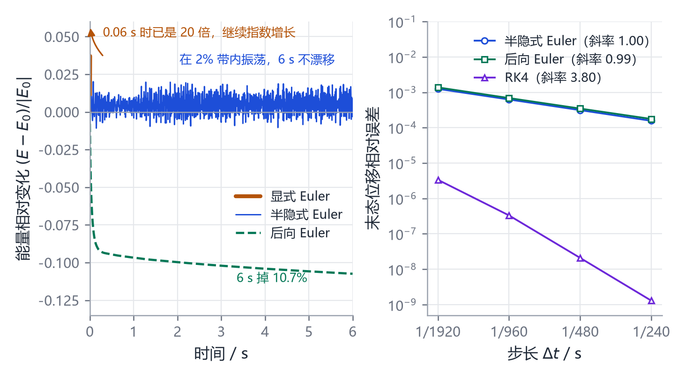

# 第 12 章 柔体模拟的验证与艺术控制

> 本章导读：一块果冻掉在桌上，弹了两下之后越抖越凶，五秒钟以后自己飞了出去。有人说是阻尼没加，有人说是接触写错了，改了两天没有进展。这一章讲怎么把“看着不对”变成一个可以测的数字：守恒量、收敛阶、标定实验各能抓住什么毛病；也讲另一半更难的事——怎么在物理正确的前提下，让美术能控制它，以及一条影视流水线怎么在改了参数之后只重算该重算的部分。

## 12.1 从“看着不对”到“哪里不对”

果冻那件事，最后查出来是步长的边界。材料的杨氏模量被调高了三倍，最高阶模态的频率跟着涨了 $\sqrt{3}$ 倍，显式积分的稳定上界 $\Delta t \lt 2/\omega_{\max}$ 掉到了当前步长以下，于是每步都被放大一点，能量指数增长，几秒之后喷出去。代码一行没错，参数一改就炸。

这种事在柔体里比在刚体里常见得多。刚体的刚度几乎只有接触的一档，柔体的刚度是一个连续谱：同一块材料，最高阶模态的频率可以是基频的上百倍，稳定条件由最高阶决定，而视觉上关心的全在最低的几阶。参数往哪个方向调、会不会越过边界，很难靠眼睛看出来。

眼睛能看出来的只有三类问题：形状不对（太硬、太软、塌了、鼓得过分）、运动不对（抖、飘、弹得太久、卡顿）、以及守恒量不对（越弹越高、整体漂移、贴着墙慢慢沉进去）。第一类要靠标定和艺术调整（12.4、12.5），第三类可以做成数值检查，是这一节和接下来两节的内容。

检查分成四级，从便宜到贵。守恒量检查最便宜：每帧算一次总能量与总动量，看曲线。收敛阶检查次之：同一场景算三遍，网格或者步长各差一倍，看误差怎么降。制造解（method of manufactured solutions）更贵，但它能测到“力的实现是否与离散格式一致”这一层。解析解只对极少数情形存在（一维杆的纵向振动、球壳的呼吸模态），有就用，没有别硬凑。

这四级的分工要清楚。收敛阶能发现“格式写错”和“边界条件处理错”，它对这类错误极敏感：阶数会从 2 掉到 1 甚至 0。守恒量能发现“能量凭空产生”，发现不了“能量在错误的模态之间分配”。制造解能发现“内力系数写错了一个因子”，因为误差不会随网格加密而收敛。而任何一级都发现不了“材料参数不对”，那只能靠 12.4 的实验。

## 12.2 能量与动量：两条最便宜的报警线

无阻尼的弹性体，总能量应当在初值附近振荡，不该单调漂移。这条判据的价值在于它把“积分器好不好”变成一个可以画出来的曲线。

取一条八节链条，每节质量 0.1 kg、弹簧刚度 1500 N/m、自然长度 0.1 m，顶端固定，初始给一个 3 cm 的横向弓形位移再放手。同一个步长 $1/240$ s 下，用三种积分器各跑 6 s，把能量的相对变化画出来（图 12-1 左）。

<figure class="fig">

<figcaption><b>图 12-1</b>　左：八节链条（$m=0.1$ kg、$k=1500$ N/m、自然长度 0.1 m、顶端固定、初始横向弓形 3 cm）在 $\Delta t = 1/240$ s 下的能量相对变化，纵轴为 $(E-E_0)/|E_0|$，线性刻度，横线为 0。显式 Euler 在 0.062 s 内涨到初值的 20 倍以上并继续指数增长；半隐式 Euler 在 $-1.1\%$ 到 $+2.0\%$ 之间长期振荡而不漂移；后向 Euler 单调下降，6 s 掉了 10.7%，这是数值阻尼吃掉的部分。右：同一链条加 1.5 N·s/m 的粘性阻尼、跑 1 s，末态位移相对误差随步长的变化，参考解用 RK4 在 $\Delta t=1/20000$ s 下算。三条直线的斜率分别是 1.00、0.99、3.80，对应半隐式、后向 Euler 与 RK4 的收敛阶。</figcaption>
</figure>

三条曲线的形状对应三种机制。显式 Euler 先走位置、再用旧位置的力更新速度，对振动系统没有稳定域，只要 $\omega\Delta t$ 不为零能量就单调涨，速率正比于 $\omega^2\Delta t$。半隐式 Euler 把顺序换过来，能量在真值附近按 $\pm(\omega\Delta t)$ 的幅度来回摆而不累积，这是辛结构。后向 Euler 走另一个方向：每步解一个隐式方程，等价于给每个模态加上 $\zeta\approx\omega\Delta t/2$ 的阻尼，能量必定下降，掉多少正比于步长。

三种都有用。需要长期稳定的抖动（布料、头发、软组织晃动）用半隐式或者 Verlet，它们不漂；需要“一定会停下来”的结果（碰撞后收敛、塑性流动）用后向 Euler，它的数值阻尼正好帮忙。显式 Euler 在柔体里几乎没有使用场景。

算能量的时候有个坑：要用积分器实际使用的离散能量，不要用连续体的能量公式去算离散状态。半隐式 Euler 的动能项与势能项不在同一时刻，差着半个步长的相位，用连续公式算出来会看到一个 $O(\Delta t)$ 的虚假振荡，很容易被误判成不稳定。照格式写：半隐式下 $E_n=\tfrac12\mathbf{v}_n^{\mathsf{T}}\mathbf{M}\mathbf{v}_n+U(\mathbf{x}_n)$ 才是守恒的那个量。

有阻尼的情况反过来用。粘性阻尼下能量必须单调下降，且下降速率要与阻尼参数对得上：单个模态每步损失约 $2\zeta\omega\Delta t$ 的比例。实测速率是理论值的三倍，多半是阻尼写进了多个地方（速度阻尼一次、约束里再一次），这种“重复阻尼”在 PBD 体系里非常常见。若阻尼系数设为零时能量仍在下降，那就是数值阻尼在起作用。

动量更简单也更严格。没有外力、没有锚点、没有接触的系统，总动量必须守恒到机器精度：一个悬空的软体被内部力拉扯，质心不该移动。这条检查能抓住一类隐蔽的错误——把内力算成了非成对的形式。有限元的单元内力天然成对（同一组节点、符号相反），但一旦用“逐顶点罚力”或者“形状匹配加局部修正”，很容易出现合力不为零的项，表现为模型慢慢往一个方向爬。

有接触时动量不守恒，但破坏量不该随时间累积。做法是记录每个接触的冲量，与系统动量变化比对。差出来的部分通常就是 Baumgarte 位置修正产生的假冲量——它只改位置不改速度，等价于凭空多了一次冲量。角色贴着墙被慢慢推开，罪魁祸首常常是这一项。

## 12.3 收敛阶：算三遍就知道对不对

守恒量能告诉你“有没有能量凭空产生”，但它对“格式实现错了但错得守恒”无能为力。这时要靠收敛阶。

做法很朴素：同一个场景，把步长依次减半（或者把网格依次加密一倍），记录末态解与参考解的差，画在双对数坐标上，斜率就是收敛阶。图 12-1 右边是上一节那条带阻尼的链条，$T=1$ s 时的位移相对误差：半隐式 Euler 斜率 1.00，后向 Euler 0.99，RK4 3.80（理论值 4，误差在拟合区间内）。

几条实操上的注意。

误差的度量方式决定你看到什么。位移的 L2 相对误差最稳。用最大值误差会被单个顶点的舍入噪声主导，曲线在细步长那一端会翘起来，看起来像“阶数下降”，其实是精度见底。用能量误差则会被 $O(\Delta t)$ 的离散能量偏差污染。选一种，全程别换。

参考解要足够准。它的误差必须比最细那一档小一个数量级以上，否则曲线在末端变平，你会误以为收敛停滞。没有解析解时用极小步长的 RK4，或者用 Richardson 外推：取 $\Delta t$、$\Delta t/2$、$\Delta t/4$，由三者误差的比值同时给出阶数与误差常数，$p=\log_2\frac{\|\mathbf{u}_h-\mathbf{u}_{h/2}\|}{\|\mathbf{u}_{h/2}-\mathbf{u}_{h/4}\|}$。

时间与空间要分开测。网格加密时步长固定测的是空间阶数，步长减半时网格固定测的是时间阶数，一起改只会得到混合物。线性四面体配后向 Euler 的常见结果是：位移 L2 空间 2 阶、时间 1 阶；能量范数空间 1 阶（应力是位移的一阶导数，精度掉一档）。

PBD 与 XPBD 不在这个框架里。它们不是一致的离散格式，误差不随步长按幂次下降，测出来的“阶数”没有意义。对它们只能固定步长、增加迭代次数，看约束残差与高精度参考解的偏差怎么随预算下降；这已经够用，因为调参对象本来就是预算。

制造解是最后一招，也是唯一能验证“内力实现”的一招。选一个光滑的位移场，比如 $\mathbf{u}(x,t)=A\sin(\pi x/L)\sin(\omega t)\,\mathbf{e}_y$，代进连续方程算出对应的体力 $\mathbf{b}(x,t)$ 与边界上的面力，把 $\mathbf{b}$ 加进求解器，让它去解这个“已知答案”的问题。真解已知，误差可以直接算，不需要参考解，也不需要在细网格上跑很多步。要点是体力必须与离散格式一致（离散制造解），否则测到的是“加载方式不一致”的误差，阶数会掉到 0 附近。写新材料模型时这一招特别值：单元内力的系数哪怕错了一个 $\tfrac12$，误差就不会随网格加密收敛，一测就露。

## 12.4 材料标定：从拉伸曲线反推参数

验证做完了，模型没问题，接下来要回答“这块硅胶的杨氏模量是多少”。这件事只能靠实验。

标准做法是单轴拉伸。切一条试样，宽 20 mm、厚 5 mm、标距 30 mm，夹进拉伸机，以每分钟几十毫米的速度拉到 1.5 倍长，记录力与伸长。工程应力是力除以初始截面积，伸长比 $\lambda$ 是当前长度除以初始长度。小应变段（$\lambda\lt1.05$）的斜率就是杨氏模量，因为所有超弹模型在这一段都退化成线弹性。斜率的读数精度取决于试样尺寸：厚度量错 5%，应力就错 5%，模量跟着错 5%。

泊松比从横向收缩测，需要一台侧向相机，用不起就用假设。软组织与橡胶的泊松比在 0.45 到 0.499 之间，取 0.47 与 0.49 对剪切模量的影响是百分之几。多数视觉场景关心的是剪切行为，泊松比取一个偏高的常数就够。

大应变段才有区分度。不可压 Neo-Hookean 的单轴名义应力是

$$
P = \mu\left(\lambda - \lambda^{-2}\right) ,
\tag{12.1}
$$

$\mu$ 是剪切模量，$\lambda$ 是伸长比。它对 $\mu$ 是线性的，用最小二乘一步就能拟合：把所有数据点的 $(\lambda-\lambda^{-2})$ 与对应的 $P$ 做线性回归，斜率就是 $\mu$。取 $E=1.5$ MPa、$\nu=0.47$ 的硅胶，$\mu=E/[2(1+\nu)]=510$ kPa，拉到 $\lambda=1.5$ 时名义应力是 539 kPa。StVK 在同样的 $\mu$ 下要软一些，而且压缩到 $\lambda\lt0.8$ 之后应力开始随压缩减小甚至反号，这是它不能用于大压缩的原因。选哪个模型，看你的场景里有没有大压缩，而不是看哪个拟合得更好——在 $\lambda\lt1.3$ 的范围内，两者几乎分不开。

粘弹性要另一组实验。把试样快速拉到固定伸长，保持不动，记录应力随时间衰减。单支 Maxwell 模型的松弛是 $\sigma(t)=\sigma_0 e^{-t/\tau}$，$\tau$ 是松弛时间。从曲线上读两个点：$t=0$ 时的 $\sigma_0$ 和降到 $0.6\sigma_0$ 的时刻 $t_{60}$，则 $\tau=t_{60}/\ln(1/0.6)=1.96\,t_{60}$。若 2 s 掉到六成，$\tau\approx3.9$ s。多支 Maxwell 并联能拟合更长的尾巴，代价是参数之间强相关，拟合结果不唯一。

参数的不确定性要如实对待。$\mu$ 与 $\nu$ 在拟合里强相关：增大 $\mu$ 同时降低 $\nu$，能让曲线在中应变段几乎不变，两参数各自的有效数字远少于拟合软件给出的位数，报两位就够。视觉上模量差 10% 看不出来，差 30% 能看出来；阻尼比差一倍，回弹次数明显不同。调试的力气花在对视觉敏感的参数上。

有视频参考时，标定可以变成反问题：把参数当优化变量，用可微模拟算出渲染结果与视频的差，对参数求梯度再下降 [@liang2019]。前提是相机参数、光照、遮挡都标定过，否则优化方向会被渲染误差带偏。

## 12.5 艺术控制：物理是约束，不是答案

导演说“这一块再软一点”，而整块材料的 $\mu$ 是同一个数。这种要求每天都会出现，处理方式决定了柔体模拟在流水线里是“能用”还是“难用”。

最直接的一类控制是局部刚度。给每个顶点或者每个单元一个乘子 $s_e$，把单元的 $\mu$ 换成 $s_e\mu$，用笔刷画出来。这在有限元里实现很自然（单元刚度矩阵乘一个系数），在 PBD 里就是把柔度 $\alpha$ 按约束缩放。要注意的是，局部刚度差异过大会让全局矩阵条件数变差，隐式求解的迭代次数上升，视觉上还会出现“硬块嵌在软材料里”的接缝。乘子的范围控制在 0.3 到 3 之间比较安全。

第二类是目标形状。把某个关键帧的姿态 $\mathbf{u}^{\ast}$ 作为额外的吸引项加进能量

$$
E_{\mathrm{art}} = \tfrac12\,w\,\|\mathbf{u}-\mathbf{u}^{\ast}\|^2 ,
\tag{12.2}
$$

$w$ 是权重。它等价于在每个顶点上加一根到目标位置的弹簧，实现简单、稳定（加的是正定项）。问题在于它会和物理打架：如果目标形状不可行（体积不守恒、拉伸超过材料极限、离得太远），求解器会在这两项之间来回扯，表现为抖动或者“吸不住”。判断的办法是把物理能量与控制能量分开记录，两条曲线如果一条涨一条落、总量守恒，就是在打架。

第三类是褶皱引导。布料或皮肤上的褶，本质是压缩失稳的方向选择：同一个压缩量，往哪个方向起褶在物理上是多解的，艺术控制就是在这个多解里挑一个。实现方式有三种：给弯曲刚度加各向异性（沿某方向更软，褶就垂直于那个方向起）、在参考形状里预置一条浅槽（起褶位置被钉住）、或者直接叠一层高频位移（贴图式褶皱，与模拟解耦，成本最低）。越靠后越不物理，也越可控。

第四类是时间控制。重定时（retime）只改变播放速度，不改变形状序列，需要缓存；慢动作里的抖动要么被拉长成可见的假动作，要么只能重新模拟。

所有这些控制都遵循同一条原则：在能量里加项，而不是在结果上打补丁。加项至少保证能量结构完整、稳定性可分析；直接改顶点会让下一步的力计算出错，误差在时间上累积成抖动。这也是为什么“柔体的艺术控制”在工程上表现为一堆权重和乘子，而不是一堆关键帧。

界面上的呈现要翻译。美术不该看到 $\mu$、$\lambda$、$\zeta$，该看到“硬度”“弹性”“阻尼”“重量”四个滑条，每个滑条背后是一组映射。这张映射表把物理参数的变化范围限制在稳定区间内，让美术怎么拖都不会把场景弄炸。

## 12.6 缓存与重算

一次影视级柔体模拟要跑几小时到几天，改一个参数就重跑全部谁都受不了，所以缓存比求解器本身更影响产能。

缓存按层组织，每层只依赖上一层。典型顺序是：骨骼动画（含肌肉变形）→ 软组织 → 布料 → 头发 → 破坏与碎片。每层的输出是一串顶点位置（Alembic 或自定义二进制），加上一个“参数指纹”。重算时先比对指纹：这一层的输入指纹没变就直接读缓存，变了就重算这一层以及它上面的所有层。指纹必须是完整的哈希，包含几何、材质、求解器版本、步长、随机种子。求解器版本也要进指纹，因为换一版积分器、改一个迭代顺序，结果就不一样。

浮点确定性要提前想清楚。同一份代码、同一台机器，多线程归约顺序不同，结果就会在末位不同，然后被混沌放大成可见的差异。要可重现就得固定归约顺序（比如按单元编号累加）。“同一帧渲两次结果不一样”的抱怨，八成来自这里。

部分重算（localized re-sim）是省时间的关键。只重跑一段时间窗口，需要在这个窗口的起点有一个完整的状态快照：位置、速度、以及所有带记忆的量——塑性应变、粘弹的历史变量、接触锚点、约束乘子、碰撞检测的缓存。少存一样，重算出来的轨迹就会在窗口接缝处跳一下。状态快照的完整性问题在加入塑性以后特别突出，因为塑性应变是不可逆的，漏存之后没法从位置反推。

同一段动画的 v003 与 v007，把每帧渲染出来做差分，找到第一帧开始不同的地方，那里就是参数真正起作用的位置；这比在几百条曲线里找异常快得多。

游戏里没有重算的机会，只有预烘焙加混合。常见做法是把模拟结果烘成若干段动画（按冲击方向分四到八段），运行时按当前状态在段之间插值，权重随冲击强度变化。代价是失去真正的交互性，收益是零运行时成本。中间路线是：常规动作走烘焙，被击中、被抓取这类关键交互走实时子空间求解，两者在几帧内交叉淡化。

## 12.7 常见失败与一张检查表

柔体出问题，症状集中在四类。

穿透最好认，顶点跑到碰撞体里面且越陷越深。原因是只在检测到时施加约束，漏检就一路穿过去，或者位置修正被投影掉了。统计每帧最大穿透深度与持续帧数，深度超过单元尺寸的 1% 或持续超过三帧就该报警。

单元翻转是第二类。四面体体积变负、雅可比为负，之后内力方向全部反掉，模型像爆炸一样散开。判据是每帧检查最小雅可比。修法：减小步长、加线搜索，或者换成不会翻转的模型（共旋、可逆有限元）。

过度拉伸是第三类，布料最典型：某一帧边缘长度变成自然长度的三倍，看起来像橡胶。根因通常是刚度不足（迭代次数不够、柔度太大）或者约束求解顺序不好。判据是统计边长比的最大值，超过 1.2 就该查。

抖动是第四类，也最难定位。可能是接触的离散化（顶点在三角形之间跳）、基截断（子空间把高频抹掉又反弹）、时间步与帧率不同步，或者多个求解器交替耦合的半步错位。定位办法是把这几项一个个关掉：关接触还抖，就不是接触；换全维还抖，就不是基截断。把这些判据写进流水线的检查脚本，比事后 debug 省事。图 12-2 是三段式检查表。

<figure class="fig" markdown="1">

| 阶段 | 检查项 | 判据 | 出问题时先看 |
|---|---|---|---|
| 跑之前 | 单位与量级 | 模量用 Pa、密度用 kg/m³，$E/\rho$ 与材料手册同量级 | 单位混用（MPa 当 Pa） |
| 跑之前 | 稳定上界 | $\Delta t \lt 2/\omega_{\max}$，$\omega_{\max}$ 由最硬的单元决定 | 刚度上调后没改步长 |
| 跑之前 | 约束与锚点 | 固定点数量与自由度匹配，没有欠约束的漂浮块 | 漏了边界条件 |
| 跑之前 | 缓存指纹 | 几何、材质、版本、步长、种子全进哈希 | 换了求解器版本没重算 |
| 每帧 | 能量 | 无阻尼时 $|E-E_0|/E_0$ 有界；有阻尼时单调下降 | 数值阻尼、重复阻尼 |
| 每帧 | 动量 | 无外力时质心轨迹为直线；有接触时冲量与动量变化一致 | 非成对内力、Baumgarte 修正 |
| 每帧 | 最小雅可比 | 大于 0，且不接近 0 | 单元翻转、步长过大 |
| 每帧 | 最大穿透 | 小于单元尺寸的 1%，持续不超过 3 帧 | 检测遗漏、子空间投影 |
| 每帧 | 最大边长比 | 小于 1.2（布料） | 刚度不足、迭代不够 |
| 出片前 | 收敛阶 | 加密一倍后误差按理论阶下降 | 内力或边界实现错误 |
| 出片前 | 网格无关性 | 加密后视觉差异不可见 | 分辨率依赖的刚度 |
| 出片前 | 与参考对比 | 与高精度离线解的关键帧偏差在容许范围内 | 参数标定、模型选择 |

<figcaption><b>图 12-2</b>　柔体模拟的三段式检查表。前四行在提交任务之前跑，成本是一次静态检查，能挡掉大部分“改完参数就炸”的事故；中间五行每帧记录，写成一份日志，出问题时从对应曲线找根因；最后三行在出片前跑，验证的是“这套参数在分辨率与步长变化下是否稳定”。每一行的判据都必须是可测量的数字，不能是“看起来正常”。</figcaption>
</figure>

表里最容易被跳过的是最后三行，因为它们不产生画面。但这三行决定了一件事：这段模拟是“碰巧好看”还是“在这个参数下好看”。前者换一块布、换一台机器、换一个步长就崩；后者可以放心地交给下游去改分辨率、改帧率、改缓存策略。

回到开头那块果冻。事后复盘时做的最有价值的一件事，不是修 bug，而是把这段模拟塞进上面那张表：能量曲线、最小雅可比、最大穿透逐一记录，然后调参、重跑、对比。第二次出问题时十分钟就定位到了。验证的成本几乎全在第一次建立流程，之后它是免费的。
