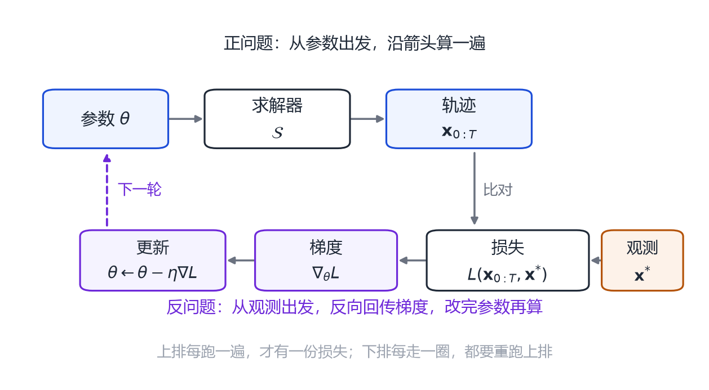
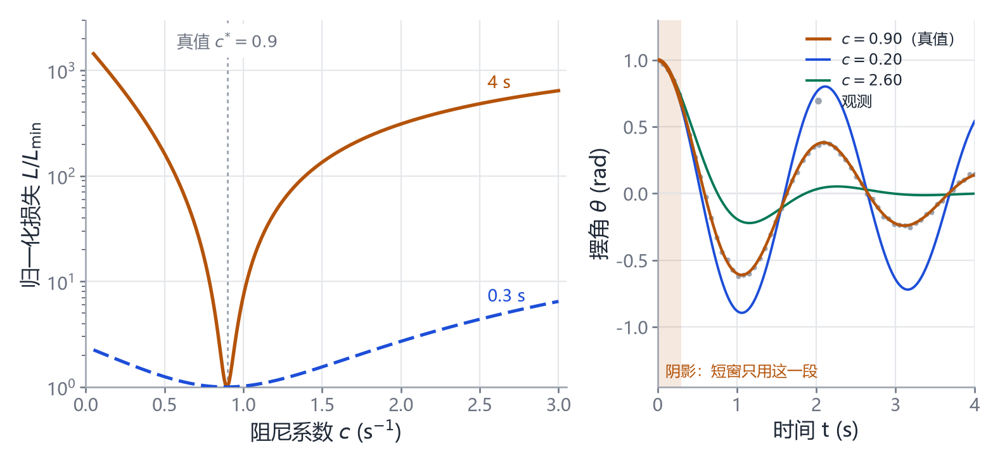

# 第 1 章 正问题与反问题

> 本章导读：模拟器向来被当成一台"给定参数、算出结果"的机器。可一旦你手上握着的是结果——一段高速摄影、一条力矩曲线、一个想要达到的形状——这台机器就要倒着开。本章说清倒着开难在哪，以及为什么几乎所有倒着开的办法最后都落在同一件东西上：梯度。

## 1.1 一台机器，两个方向

医院里做一次 CT，X 光管绕着人转一圈，对面的探测器记下每个角度上透过身体后的衰减总量。从密度到投影是一段确定的计算：给一张密度图，沿射线积分，就得到每个探测器该收到多少光子。这段计算有封闭形式，写成程序几十行，跑完几毫秒。

反过来就麻烦了。手上只有几百个角度的投影，要还原体内的密度分布。放射科医生会说，投影角度不够时重建图上会出现一道道条纹；有时候明明看见一条边界，其实是算法编出来的。这就是反问题，它难，而且难的方式很具体。

物理模拟里有一模一样的结构。给一块布的面密度、拉伸刚度、弯曲刚度、阻尼，让它从桌沿滑落，程序一步步积分，最后输出布的形状——这是正问题。正问题的定义可以很粗暴：程序跑得完，就有答案。参数填错了、模型选错了、结果跟现实差着十万八千里，程序也不会拒绝执行，它照样给你一条轨迹。

这句话本身是有反例的。显式积分在刚度大、步长不合适的时候会炸开，浮点溢出成 NaN，程序不是"给出错误答案"，而是连答案都给不出；共轭梯度在矩阵失去正定性时不收敛，跑到迭代上限就停下；碰撞求解器在两个物体叠得太深时会来回弹，永远出不了循环。也就是说，"跑得完"其实是一条隐含的稳定性要求，它在背后规定了你怎么离散、用什么步长、加多少阻尼。正问题所谓"有答案"，前提是这套离散在这个参数下站得住。

反问题问的不是这个。它问：我看到布落下来是这个形状，那这四个参数该是多少。

把符号定下来。设待定的量为 $\theta$，模拟器记作 $\mathcal{S}$，它把 $\theta$ 映射成一条轨迹：

$$
\mathbf{x}_{0:T}=\mathcal{S}(\theta),
$$

$\mathbf{x}_t$ 是第 $t$ 步的状态——位置、速度，也可能是温度或塑性应变；$\mathbf{x}_{0:T}$ 是从初始时刻到第 $T$ 步的整条轨迹。正问题是算等号右边，反问题是已知左边的若干片段，倒推 $\theta$。

写成这个式子以后，事情就清楚了一半：反问题不能只靠模拟器本身回答。信息不够。$\mathcal{S}$ 是多对一的，很多不同的 $\theta$ 会给出几乎一样的轨迹——弯曲刚度调小一点、阻尼调大一点，布落下来的轮廓可以很像。所以反问题必须补两样东西：一把衡量"像不像"的尺子，和一份对 $\theta$ 的偏好。尺子写成损失函数，偏好写成正则项：

$$
\min_{\theta}\; L\big(\mathcal{S}(\theta),\,\mathbf{x}^{*}\big)+R(\theta),
$$

$\mathbf{x}^{*}$ 是观测数据，$R(\theta)$ 是正则项。反问题变成了优化问题，模拟器退化成其中一条约束：动力学必须由它生成。

把这件事各举一例，方向感会具体得多。

**抛体**。给初速 $v_0=20$ m/s、出射角 $\theta=45^\circ$，忽略空气阻力，落点距离是

$$
R=\frac{v_0^{2}\sin 2\theta}{g}=\frac{400\times 1}{9.81}\approx 40.8\ \mathrm{m},
$$

$v_0$ 是初速，$\theta$ 是出射角，$g$ 是重力加速度，$R$ 是水平射程。这一步只用到乘法和正弦，算一遍就完，答案唯一。反过来问：要让球落在 30 米处，角度该取多少？把式子倒过来，$\sin 2\theta=30\times9.81/400=0.736$，于是 $2\theta=47.3^\circ$ 或 $132.7^\circ$，$\theta=23.6^\circ$ 或 $66.4^\circ$。低平射和高抛射落在同一点。也就是说，即便在最简单的式子里，"结果反推原因"也已经不是一对一了；抛体问题里人一眼能看出还有另一个解，换成布料就看不出来。

**单摆**。摆长 1 米，小角度摆动，幅度按 $e^{-ct/2}$ 衰减，$c$ 是阻尼系数、$t$ 是时间。正问题：给 $c=0.9\ \mathrm{s^{-1}}$，算 4 秒后的幅度比 $e^{-1.8}\approx0.165$，剩 16.5%。反问题：从一段实测的衰减曲线反推 $c$。表面上只要取两点算对数斜率，实际难点在观测窗口——只用前 0.3 秒，幅度才掉了 13%，噪声和衰减混在一起，反推出来的 $c$ 能差百分之几十。1.3 节的图 1-2 会把这件事算成数字。

**布料**。给定面密度 0.2 kg/m$^2$、拉伸刚度 800 N/m、弯曲刚度 $10^{-4}$ N·m、阻尼 0.5，让它从桌沿滑落，算出三秒内的形状，是正问题；手上只有一段高速摄影，要反推这四个数，是反问题。这里多对一最麻烦：弯曲刚度调小一点、阻尼调大一点，前三秒的轮廓能重合到肉眼看不出差别，可这两个参数在物理上一个管弹性、一个管耗散，完全是两回事。

三个例子的难度排列得很清楚：抛体只需要解一个方程，单摆需要在噪声里估一个数，布料要在几个互相补偿的参数里找出唯一说得通的那一组。这一册讲的是第三类，另外两类是它的退化情形。

两个方向的差别在图 1-1 里画得很直白：正问题是一条单向的路，参数进去、轨迹出来，走一遍就结束；反问题是一个环，观测、损失、梯度、更新，转一圈回到起点，每转一圈都要把那条单向的路重新走一遍。

这个转身很关键，也埋了一个陷阱。正问题里的 $\mathcal{S}$ 是一个离散程序，不是连续方程；它有自己的时间步长、离散误差、数值阻尼。反推出来的 $\theta$，是"让这个程序输出像观测"的参数，不是"让真实世界像观测"的参数。这两者的差有时小到可以忽略，有时就是 sim-to-real 的全部麻烦。这一册后面会反复撞上它。

观测本身也常常不配合。真实测量给的不是完整状态，而是它的一个投影：多机位摄影只看到布料的外表面，内部节点看不见；力平台只给出总反力，不知道力在哪几个点上分布；粒子图像测速给出速度场，但只在被照亮的那个切面上。于是损失函数 $L$ 里往往还要带一个观测算子 $\mathcal{H}$，写成 $L(\mathcal{H}(\mathbf{x}_{0:T}),\mathbf{x}^{*})$，$\mathcal{H}$ 把模拟状态映射成"能被测量的那个东西"。这个算子常常比模拟器本身还难写对：相机标定有误差，遮挡会让某些帧的权重该降下来，而这些都发生在损失函数里，而不是在物理里。

还有一层。$\theta$ 的形式是人定的：布到底是各向同性还是各向异性，阻尼是线性还是二次，接触是库仑还是软化。参数化的选择决定了反问题有没有解——如果真实材料的行为不在你选的这族模型里，最好的 $\theta$ 也只是这族模型里最像的那个，损失永远下不到零。工程上把这叫模型误差，它和噪声误差是两回事，加正则项也压不下去。

<figure class="fig">

<figcaption><b>图 1-1</b>　正问题与反问题的数据流对照（结构示意）。上排是正问题：参数 $\theta$ 交给求解器，一步推到 $T$，得到轨迹，与观测比对；箭头只朝一个方向，算一次就是一次。下排是反问题：从观测和损失的差距出发，梯度把参数往回收，形成一个闭环。紫色那条回环箭头标出了两者的差别——反问题每绕一圈，都要重跑一遍上排的整段模拟，这是它昂贵的根源。</figcaption>
</figure>

## 1.2 三类反问题

反问题长得五花八门，可落到"未知量是什么"上，其实只有三族。

**参数辨识**。几何、边界条件、初始状态都给定，未知的只有材料常数和几个物理量：布的四个参数、雪的内摩擦角、果冻的剪切模量、桨叶的升力系数。这类问题未知量少，通常几个到几十个；观测是一条轨迹、一段力曲线，或者变形后的一张照片。参数辨识是最老的一类，因为它的形式最像标定——模型结构已经定死，只差几个数。

量级先摸清：未知量通常二到二十个。一块布四个（面密度、拉伸、弯曲、阻尼），一堆雪三个（摩擦角、黏聚力、休止角修正），一块果冻两个（剪切模量、体积模量）。观测是几十到几百个采样点，一次标定用 Levenberg-Marquardt 跑三十到一百次迭代，每次迭代要一次全梯度。也就是说，这条线上的账单是"上百次前向加反向"，不是"上万次仿真"。

它也是可微模拟最早被用起来的地方。软体机器人的控制依赖对自身刚度的准确认识：一个硅胶夹爪的本构参数差百分之二十，抓一颗草莓的接触力就完全不同。把夹爪的实测变形当观测，用可微模拟器反推材料参数，比手工试凑快得多，ChainQueen 做的就是这件事 [@hu2019]。

**形状优化**。未知量是几何本身。一艘船水线以下的外形，几千个顶点；一片风扇叶片的弯扭分布，几十个控制柄；一顶头盔的内衬，一条水平集函数的取值。目标往往不是"匹配某个观测"，而是"达到某个性能"——阻力最小、流量最大、承重最高、气动噪声最低。约束比参数辨识硬得多：网格不能自交，体积不能涨，制造工艺有最小壁厚。

参数量在这里上了三四个数量级，正则项于是从可选变成必需。不加光滑项，优化器会沿着梯度的方向把网格推出尖刺，因为尖刺在这个离散模型里确实降低了阻力。真实物理不会奖励尖刺，是离散误差在奖励它。这是形状优化最常见的一种自欺。

数字上，一艘 30 米长的船体，水线以下八千个顶点，若每个顶点只沿表面法向动一个自由度，那也是八千维；五百轮迭代、每轮一次梯度，就是五百次仿真，换成有限差分是四百万次。一次仿真按十分钟算，前者三天半，后者七十六年。所以形状优化几乎等于"必须可微才算得动"，这不是偏好，是算术。

**控制**。未知量是一整段动作。给机械臂规划一段关节力矩，给角色设计一套受击反应，给四足机器人算一次跳跃的落足点与时序。控制序列的长度是时间步数乘以动作维数，一千步、每步三个分量，就是三千维。目标是一个任务指标，约束是动力学必须成立，还有执行器的力矩上限。

量级在这里跳了一级。三千维比参数辨识的两三个参数多了三个数量级，这一跳直接决定了算法：在三千维上做有限差分，算一次全梯度要三千零一次仿真，每次二十毫秒也要一分钟，走一百轮迭代就是一个多小时；而控制器要求几十毫秒内给出下一步动作。所以控制问题没有"先用差分凑一凑"的退路，它一开始就只能用一次算出全梯度的方法。

这三族的数学形式是同一个式子，工程上却完全不同。参数辨识可以容忍慢，一次标定跑半小时无所谓；控制不能，控制器要在几十毫秒内给出下一步。参数辨识的观测是真实数据，带噪声；形状优化的"观测"常常是自己定的目标函数，没有噪声，但局部极小极多。

共用形式的好处是可以共用代码。DiffTaichi 把这件事做成了"写一个时间步进函数，交给编译器生成反向"，然后在同一个框架里做了台球、水波、牛顿摆三组实验，分别落在控制、参数、形状上 [@hu2020]。它想说明的正是这一点：模拟器一旦可微，反问题就退化成"选一个损失、挑一个优化器"。

不过共用形式也有代价：同一个优化器套在三族问题上，往往都不太好使。参数辨识的损失常常是病态的，需要 Levenberg-Marquardt 或者干脆上二阶信息；形状优化的参数量太大，只能用随机梯度加动量，还要配网格光滑；控制问题的约束是硬约束（力矩有上限、脚不能穿地），得用投影或者增广拉格朗日。所以真正做起来，三族各自有一套优化器，共用的只是梯度的来源。

还有一类问题不好塞进这三族。比如"这块布被剪开之前是什么形状"，未知量是拓扑；比如"这锅汤里放了几种料"，未知量是模型结构本身。它们不是连续优化能处理的，通常要先离散成有限个假设，再对每个假设做参数辨识，最后比较损失。这类问题在这一册里不展开，但读者应该知道它的存在，免得把一个离散选择问题当成连续优化硬跑。

## 1.3 为什么反问题难

Hadamard 给适定问题列过三条：解存在、解唯一、解连续依赖数据。反问题通常三条全破，而且破得很有规律。

**不唯一**最直观。一维的情况可以算得干干净净：一根两端固定的弦，观测是某一时刻的形状，要反推初始形状。弦的高频模态衰减得快，频率为 $\omega_n$ 的模态在时间 $t$ 后幅度乘上 $e^{-\alpha\omega_n^2 t}$。取 $\alpha=10^{-3}$、$t=0.1$ s，第 50 个模态的因子是

$$
e^{-10^{-3}(50\pi)^2\times 0.1}=e^{-2.47}\approx 0.085,
$$

还剩百分之八，反推时放大十二倍，勉强能用。第 200 个模态的因子是 $e^{-39.5}\approx 7\times 10^{-18}$，比双精度的舍入误差 $10^{-16}$ 还小——它在观测里一点痕迹都没留下。可初始形状里那一层高频皱纹确确实实存在过。任何反推算法都只能猜，而且猜出来的高频成分完全由噪声和正则项决定，与真值无关。

这就是不适定的技术含义：正向过程把某些方向压扁了，反向就要把压扁的放大回来，放大倍数就是条件数 $\kappa$。观测误差 $\varepsilon$ 传到参数上是 $\kappa\varepsilon$。$\kappa=10^{6}$ 时，百分之零点一的观测误差变成百分之千的参数误差，反推结果没有意义。热传导、扩散、长时积分、稳态椭圆问题，都是这一类。

**多解**来自参数之间的耦合。布落下来的轮廓由弯曲刚度和阻尼共同决定：刚度大、阻尼小的布，和刚度小、阻尼大的布，前 0.3 秒的轮廓可以调得几乎重合。要分开它们，得看更长的时间，或者换一个能激发不同模态的初始条件。工程上的做法是主动设计实验——把布从不同高度扔下去，让两组参数产生不同的响应——但这已经超出了"给定观测求参数"的范围，属于实验设计。

用具体数字看这件事。刚度 800 N/m 配阻尼 0.5，和刚度 760 配阻尼 0.62，这两组在 0.3 秒内都能把轮廓误差压到 2 毫米以内，肉眼看不出区别；把窗口拉到 2 秒，两者差 4 厘米，已经超过网格分辨率。也就是说，把窗口拉长六倍，区分度涨了二十倍；而把观测精度提高一倍，区分度只涨一倍。前者是指数的（衰减模态按 $e^{-ct}$ 沉下去），后者是线性的（噪声按 $1/\sqrt{N}$ 平均掉）。这也解释了为什么实验设计比换更好的优化器更值钱。

对称性也会造出多解。优化一个左右对称的支架，最优解在镜像下同样最优，梯度在对称轴上恰好为零，优化器会停在那儿不动，哪怕那个点是鞍点。

**噪声**改变的是解的位置，不只是精度。损失函数在真值附近是碗形的，加了噪声以后碗底被抬平、被推向一边，最优点系统性地偏离真值。偏离量与噪声方差成正比，与损失的曲率成反比。曲率小意味着参数对结果影响小，可辨识性差，这一点在第 8 章还会展开。

这个偏移能算。一维玩具模型，$L(\theta)=\tfrac12 h(\theta-\theta^{*})^{2}$，$h$ 是曲率；观测噪声让损失叠加上一项随机起伏 $\xi(\theta)$。最优点满足 $h(\theta-\theta^{*})+\xi'=0$，于是偏移量是

$$
\delta\theta=\frac{\xi'}{h},
$$

$\xi'$ 是噪声起伏在真值处的斜率。取 $h=100$、$\xi'=0.3$，偏移 0.003，无关紧要；取 $h=1$、同样的起伏，偏移 0.3，已经超过参数本身的量级。也就是说，噪声扛不扛得住，不看噪声多大，看曲率能不能把它压下去。反过来，这也是为什么工程上宁可多测几个点：点数多了以后 $\xi'$ 会被平均掉，而 $h$ 不变。

**贵**是这个领域特有的。一次损失评估要跑一整段模拟，一秒到一小时不等。参数辨识几千次评估还能接受，形状优化动辄上万次评估，控制则要求在线迭代。评估次数直接决定方法能不能用。

把三族乘一遍就明白了。参数辨识：一百轮迭代、每轮一次梯度加一次校验，两百次上下；形状优化：五百轮迭代、每轮一次梯度，也是五百次——但换成差分就变成五百乘以顶点数，四百万次；控制：每秒五十个控制步，每步至少十次评估，就是每秒五百次。同样是"跑模拟"，前两者按小时计，后者按毫秒计。这个差距不是优化器的性格，是问题的形态决定的。

<figure class="fig">

<figcaption><b>图 1-2</b>　一维参数辨识的损失景观（真实计算）。单摆 $\ddot{\theta}+c\dot{\theta}+(g/L)\sin\theta=0$，摆长 $L=1$ m，$g=9.81$，初值 $\theta_0=1$ rad、$\dot{\theta}_0=0$，真值 $c^{*}=0.9$ s$^{-1}$，观测加标准差 0.01 rad 的高斯噪声，各取 60 个采样点。左：两种观测窗口下的归一化损失（各自除以自身最小值，纵轴对数）。取满 4 s 时曲线在 $c=3$ 处已涨到最小值的 642 倍，碗又窄又深；只取前 0.3 s 时整条曲线只在 6.5 倍范围内起伏，碗底几乎是平的。两次扫描的最小点分别落在 $c=0.889$ 与 $c=0.898$。右：三条不同阻尼的轨迹与观测，阴影是短窗用的那一段——前 0.3 s 内三条曲线几乎重合，这段数据本来就分不开三个 $c$。</figcaption>
</figure>

## 1.4 梯度是统一工具

有了损失，反问题就是优化。优化器里最便宜的一类是只用一个数：损失值。爬山、网格搜索、坐标下降都属于这一类，它们靠比较，不靠导数。

只用损失值是奢侈的浪费。$L$ 是个标量，可它背后藏着 $n$ 个偏导，每一个都在说"这个参数往哪边动、动多少"。把它们拿到手，更新就是一句话：

$$
\theta\leftarrow\theta-\eta\,\nabla_{\theta}L,
$$

$\eta$ 是步长。这一行是整个可微物理的核心，剩下的工作全在"怎么把 $\nabla_\theta L$ 算出来、算得多准、花多少代价"。

梯度的价值可以用次数衡量。$n$ 个参数，有限差分要 $n+1$ 次模拟（中心差分 $2n$ 次），因为它每次只能问一个方向。反向自动微分要一次前向加一次反向，反向的开销是前向的两三倍，与 $n$ 无关。三千维的控制序列，前者是三千零一次仿真，后者是三四次仿真量级的开销，差三个数量级。这个差距不是优化技巧，是算法结构带来的，换不掉。

现在可以把"损失景观"这个词落到实处。这是优化圈里最常用的一个比喻：把损失看成一个地形，参数是地平面上的坐标，高度是损失值，优化就是蒙着眼睛往山下走。要拿它办事，得知道地形的局部形状。把 $L$ 在某个点附近展开到二阶：

$$
L(\theta)\approx L_0+\mathbf{g}^{\top}\delta\theta+\tfrac12\,\delta\theta^{\top}\mathbf{H}\,\delta\theta,
$$

$L_0$ 是该点的损失值，$\mathbf{g}$ 是梯度向量，$\mathbf{H}$ 是 Hessian（二阶导矩阵），$\delta\theta$ 是参数的小位移。$\mathbf{g}$ 决定下坡方向，$\mathbf{H}$ 决定地形在这一点弯得多急：特征值全为正，是碗底；有正有负，是鞍点；全为负，是山顶。

拿两个参数算一遍。设 $L=\tfrac12\left(100\,\delta c^{2}+0.01\,\delta k^{2}\right)$，也就是 $c$ 方向的曲率 100、$k$ 方向 0.01，特征值就是这两个数，条件数 $\kappa=10^{4}$。梯度下降的步长上限由最大的特征值定，$\eta\lt 2/100=0.02$，超过就震荡发散；在这个步长下，陡方向一步就到位，平方向每步只把误差缩到 $1-0.02\times0.01=0.9998$，要走两万步才降到百分之一。也就是说，学习率被陡方向卡死，收敛速度被平方向卡死，两者不兼容。

图 1-2 左边那两条曲线就是这条算术的实测版。取满 4 秒时 $c$ 方向的曲率足够大，碗又窄又深，梯度一推就走；只取前 0.3 秒时整条曲线在 6.5 倍范围内起伏，碗底被摊成一块几乎水平的板，梯度在那里接近为零。

实际景观比玩具模型复杂，但坏的形状就那么几种。**平台**，一大片区域梯度接近零，优化器停在里面，离最优还很远；**鞍点**，梯度恰好为零，但 Hessian 有正有负，沿着负特征值方向其实还能降，靠噪声或动量才滑得下去；**窄谷**，陡方向与平方向差几个数量级，轨迹在谷里左右横跳，前进得很慢。高维里还有一种现象值得记：真正的局部极小其实少见，绝大多数"梯度为零"的点是鞍点，因为要求所有特征值同号，维数越高越难凑。

三族问题各占一头。参数辨识常出窄谷（刚度和阻尼互相补偿，形成一条细长的谷底）；形状优化常出平台（网格的某些自由度对目标几乎没影响，比如沿表面切向滑动）；控制问题常出鞍点（一段动作的中段对最终指标影响小，改不改都差不多）。所以"换个更好的优化器"能做的有限，先看清景观是什么形状，才知道该加动量、加正则，还是干脆换参数化。

梯度还顺带给出别的东西。梯度的模长告诉你这个参数此刻有多敏感；把 $L$ 的二阶导凑成 Hessian，它的特征值分解直接告诉你哪些方向可辨识——特征值接近零的方向，就是参数几乎不影响结果的方向，那些方向上的更新只能靠正则项决定。图 1-2 左边那条 0.3 s 的虚线，在梯度眼里就是"几乎没有信息"：参数从 0.5 挪到 2.5，损失起伏不到五倍，梯度的量级小到被观测噪声淹没。优化器在那一段走得很慢，人会误以为已经收敛，其实是没信号了。

刚体接触是个好例子。多面体之间的接触在数学上是非光滑的，法向力在间隙过零处跳变，梯度在这一点的取值取决于你从哪边逼近。Werling 等人把整个冲量求解过程展开成计算图，用自动微分穿过去，得到的是一个"几乎处处有定义"的梯度，然后拿它做轨迹优化和参数辨识 [@werling2021]。代价是梯度在与接触切换有关的时刻会有偏差，这一点留到第 4 章。

最后要说清楚一件事：梯度不是可微物理独有的东西。同一件工具在别的领域已经用了几十年，那些领域的经验可以直接借过来。

- **数值天气预报**。把大气模式当成约束，用卫星、探空、地面站的观测反推初始场，这叫四维变分（4D-Var）。做法就是解一次伴随方程，状态变量上千万个，一次分析跑几十分钟。这条路从 1980 年代开始研究，1990 年代进入业务预报，比深度学习早了二十年。
- **结构优化**。把"这个单元里有没有材料"写成连续密度，对柔度求导，几十万个设计变量一起更新。飞机机翼的加强筋、卫星支架的减重方案，很多出自这一步。
- **计算机图形**。渲染方程对场景参数求导，就有了可微渲染；相机姿态、材质、光源位置都能靠梯度拟合。它和本册的区别只在介质——渲染管线里有遮挡判断和采样，同样不可导，同样要靠松弛。
- **神经微分方程**。把网络的一层换成一个连续时间常微分方程，反向时解一次伴随。它和"把模拟器展开成计算图"是同一件事的两种写法：一个是学出来的右端项，一个是写死的物理。
- **机器人**。逆运动学、轨迹优化、状态估计，一直在用雅可比和伴随，只是很少叫它自动微分。

这些例子的共同点是同一句话：都有一个"程序决定结果"的映射，都想倒着调输入，都缺不起一个与维数无关的梯度。差别全在介质——大气的介质是偏微分方程，图形的介质是渲染管线，机器人的介质是运动学链，物理模拟的介质是积分器与接触。本册后面每一章都在换介质，梯度这件事本身不变。

## 1.5 没有梯度时怎么办

不是所有情况都拿得到梯度。模拟器是别人写的闭源程序；模型里有查表、有分支、有排序；或者损失本身就是不可导的（碰撞次数、是否穿透、用户打分）。这些情况下，反问题还得做，只是工具换了。

最笨的是**网格搜索与坐标下降**。每个参数划几档，轮着试。优点是绝对不会被梯度骗，缺点是维数一高就死：10 个参数各划 10 档是 $10^{10}$ 个组合。坐标下降好一些，但它在一阶导不为零的方向上会走之字形，在耦合强的参数上极慢。

**进化策略**把"试"做得聪明一点。CMA-ES 维护一个多元高斯分布，采样一批候选，按损失排序，用排名更新分布的均值与协方差。它不需要梯度，不怕不连续，天然并行——几千个候选可以分到几千个核上同时跑。经验上，几十维以内它和梯度方法能打个平手；上百维开始退化，因为高斯分布在维数高时要估的协方差矩阵有 $n^2$ 个元素。种群规模一般取 $\lambda=4+\lfloor 3\ln n\rfloor$：20 维是 13 个候选，100 维只有 18 个，小得让人意外，靠的是每代更新分布而不是每代独立采样。

按这个规模算一次迭代：13 个候选就是 13 次仿真，五百次迭代六千五百次；同样的问题用前向差分，21 个方向一遍，五百轮也是一万次出头。量级其实相当。CMA-ES 的价值不在省次数，而在不需要梯度——模拟器闭源、里面有查表和分支的时候，它是少数还能用的办法。代价是它只告诉你"哪个更好"，不告诉你"往哪边动"，收敛到小数点后两位就开始磨。

**贝叶斯优化**用代理模型（通常是高斯过程）拟合损失曲面，每一步挑"最有希望"或"最不确定"的点去试。它把评估次数压得很低，几十次就能找到不错的解，代价是代理模型本身在维数高时不准。它适合那种"一次仿真要跑一小时"的场景，比如整机气动外形。

**强化学习**绕开了可微这件事。它不问"参数该往哪动"，只问"这个动作好不好"，用大量试错估出策略梯度。它把模拟器当黑盒，甚至可以在真实系统上跑。代价是样本量：几百万到上亿步的交互是常态。可控的优势是它处理的是决策序列，天然适合控制问题，尤其是观测部分可测、动力学部分未知的情形。

样本量可以换算成时间。四足机器人每秒五十个控制步，一千万步是五十五小时的仿真；并行一千个环境能压到三分钟多，代价是显存和调度。也就是说，强化学习省掉的是梯度，付出的是数据：它用几十亿次的"试"换来一个不需要导数的方向。这也是为什么它在真实系统上跑得起、在昂贵的仿真上跑不起。

这些方法没有消失，也不该消失。可微模拟的梯度在接触、断裂、湍流这些地方有偏或者噪声大，而无梯度方法对偏差不敏感，只看排序。今天很多实际系统是混着用的：先用可微模拟的梯度快速收敛到邻域，再用进化策略在邻域里精调，避开局部极小和梯度偏差。

## 1.6 三种代价

接下来几章讲的全是"梯度从哪来"。三条主要路线——全量反向自动微分、检查点重算、伴随法——在同样一件事上花的钱不一样，而且没法同时在三个方向上都省。

**时间**。一次反向传播通常是前向的两到三倍。这还算好的；检查点要额外跑一遍前向，最坏情况下时间翻倍到四倍。伴随法要重算轨迹，也是常数倍的增加。真正的时间大头往往不是反向本身，而是优化迭代的次数乘上每次的成本。

**显存**。反向要往回走，就得知道正向每一步用到了什么。全量保存的话，显存随步数线性增长：一段一千步的流体模拟，每步几万个浮点数，几个吉字节就出去了，而且这是在算梯度，模型本身还没算。检查点把线性压成平方根，代价是多跑前向。伴随法在连续形式下显存是常数，但实现上仍要把轨迹写盘或者重算。

把数字代进去：$T=1000$、单步状态 4 MB、放大倍数 4，全量保存要 16 GB，两级检查点降到 1 GB 左右，正好是一张消费级显卡装得下的量；再往上就只能写盘或者换成伴随法。

**精度**。有限差分的精度受截断误差和舍入误差两头夹击，双精度下最好也就到 $10^{-8}$ 的相对误差，单精度更差。反向自动微分给的是离散程序的精确导数，误差到机器精度。伴随法是连续方程的导数，与离散程序的导数差一个离散化误差，步长越小差得越少。

选路线不是选最好的，是选预算装得下的。参数二十个、显存紧张、精度要求一般，有限差分就够。参数几千个、单机一张卡、时间窗几百步，全量反向。时间窗上万步、状态是百万级网格，只能上伴随加检查点。这个取舍在第 3 章会摊开比较。

## 1.7 本册的路线图

第一篇讲梯度本身。第 2 章拆开自动微分：计算图怎么建、反向模式为什么比前向模式省、显存为什么会炸、检查点怎么折中、哪些操作根本不可导。第 3 章把三条路线摆在一起：对求解器做自动微分、解伴随方程、手推解析导数，比较它们的时间、显存和实现难度，再加上隐式求解的隐函数定理求导。

第二篇讲穿过具体介质时会遇到什么。第 4 章是刚体与接触，重点在法向力的跳变和松弛带来的梯度偏差。第 5 章是流体，重点是压力泊松方程的转置、平流的伴随、以及整条轨迹的存储。第 6 章是柔体与布料，重点是隐式积分的隐函数定理求导，还有断裂这种拓扑变化为什么让梯度失效。第 7 章专门讲长时窗：梯度为什么会消失和爆炸，混沌系统里梯度的意义是什么，截断窗口带来多少偏差。

第三篇讲怎么用。第 8 章把反问题落到工程上：参数辨识怎么做正则化和可辨识性分析，形状优化怎么防止自交，控制怎么和 MPC 结合。第 9 章讲神经代理模型，重点是它替换了求解器的哪一段，以及单步误差为什么不能说明问题。第 10 章讲神经算子与物理约束网络，第 11 章讲混合模拟与 sim-to-real，第 12 章讲工程实现与边界——什么时候根本不该用可微模拟。

如果只想拿一样东西去用，读第 2 章和第 3 章就够：前者说梯度怎么来，后者说三条路各自花多少钱。如果要动接触，第 4 章和第 12 章一起读，因为梯度偏差和工程边界是同一个问题的两面。如果目标是用神经网络替掉求解器，第 9 章和第 10 章是主干，第 11 章讲怎么把它和真求解器缝在一起。

一条主线贯穿全册：每一个梯度路线都要说清代价花在哪，每一个学习型方法都要说清它替换了求解器的哪一段。这两句话听着像口号，实际是判断一个方法能不能用的唯一标准。
