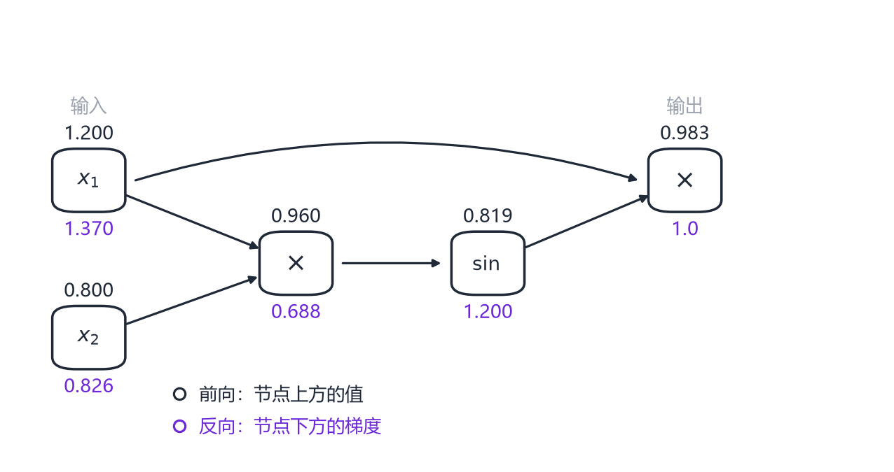
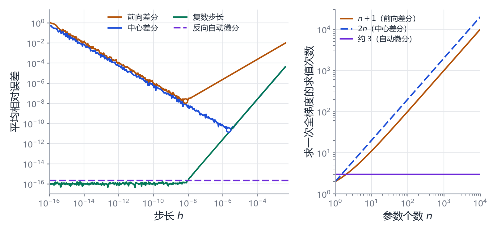

# 第 2 章 自动微分基础

> 本章导读：反问题要靠梯度，可梯度不会从模拟器里自己长出来。这一章拆开"求导"这件事：程序怎么变成一张图，梯度为什么可以顺着图往回走，往回走要付多少显存，显存不够时用什么办法换，以及为什么看起来最简单的有限差分撑不起这个活。

## 2.1 计算图与链式法则

一个两千维的形状优化，用有限差分估梯度，一次迭代要跑两千零一遍仿真，八小时。同一台机器上，一个参数量大得多的神经网络，一轮训练几秒钟。差别不在算力。神经网络每轮也要算一遍"输出对参数的导数"，它没跑两千遍，只跑了两遍。

它用的是自动微分。名字容易让人误会成数值差分或者符号求导，其实都不是：它把程序本身的复合结构利用起来，一层一层套链式法则，最后得到的是这个程序关于输入的精确导数，到浮点舍入为止。

先把"复合结构"说清楚。模拟器再复杂，写成代码以后都是一串基本运算拼起来的。取一个最小例子：

$$
u=x_1x_2,\qquad v=\sin u,\qquad y=v\,x_1 .
$$

这里 $x_1,x_2$ 是输入，$u,v$ 是中间量，$y$ 是输出。把它画成图 2-1 那样：框里 $x_1,x_2$ 是输入，$\times$ 与 $\sin$ 是运算，箭头表示"这个量喂给了那个运算"。这张图是一个有向无环图，叫计算图，也叫数据流图。

这张图的名字里有两处容易被误读的地方，先钉住。所谓"计算"，指基本运算（乘、加、$\sin$、查表）；所谓"图"，指依赖关系：每个节点是一次运算的输出，每条边表示"这个量喂给了那个运算"。"数据流图"强调的是同一件事的另一面：节点只依赖上游，所以前向可以按拓扑序求值，反向可以按逆拓扑序求导，两边都是一次遍历。

<figure class="fig">

<figcaption><b>图 2-1</b>　计算图的前向与反向（结构示意，数值按 $x_1=1.2$、$x_2=0.8$ 计算）。黑色数字是前向，写在节点上方，从输入往输出逐步算出值。紫色数字是反向，写在节点下方：从 $\bar y=1$ 出发，每经过一个运算，把上游梯度乘上该运算的局部导数，累加到它的输入上。$x_1$ 有两条出边，反向时两份贡献相加，得到 $\bar x_1=1.370$。全部反向只走一遍图，就拿到了两个输入的偏导。</figcaption>
</figure>

手工求一遍：$y=\sin(x_1x_2)\,x_1$，于是

$$
\frac{\partial y}{\partial x_1}=\cos(x_1x_2)\,x_2\,x_1+\sin(x_1x_2),
\qquad
\frac{\partial y}{\partial x_2}=\cos(x_1x_2)\,x_1^{2}.
$$

把数字代进去，反向过程可以一行一行抄下来。取 $x_1=1.2$、$x_2=0.8$（与图 2-1 一致），三角函数取弧度：

$$
u=1.2\times0.8=0.96,\qquad \sin u=0.8192,\qquad \cos u=0.5735,\qquad y=0.8192\times1.2=0.9830 .
$$

前向算出四个数：$u$、$\sin u$、$y$，外加一个 $\cos u$——它不参与前向结果，但反向要用，所以也得留下来。反向从 $\bar y=1$ 出发，四步走完：

| 步骤 | 运算 | 上游梯度 | 往下游分发 |
| --- | --- | --- | --- |
| 1 | $y=v\,x_1$ | $\bar y=1$ | $\bar v=1\times1.2=1.200$，$\bar x_1\mathrel{+}=1\times0.8192=0.8192$ |
| 2 | $v=\sin u$ | $\bar v=1.200$ | $\bar u=1.200\times0.5735=0.6882$ |
| 3 | $u=x_1x_2$ | $\bar u=0.6882$ | $\bar x_2\mathrel{+}=0.6882\times1.2=0.8259$，$\bar x_1\mathrel{+}=0.6882\times0.8=0.5506$ |
| 4 | 汇总 $x_1$ | — | $\bar x_1=0.8192+0.5506=1.3698$ |

和解析式对一下：$\cos(x_1x_2)\,x_2\,x_1+\sin(x_1x_2)=0.5735\times0.96+0.8192=1.3698$，一致；$\bar x_2=\cos(x_1x_2)\,x_1^{2}=0.5735\times1.44=0.8259$，也一致。

这四行里只有两条规则，所有自动微分实现都是它们的组合。**求和分发**：加法节点把上游梯度原样递给每个输入，因为 $\partial(a+b)/\partial a=1$。**分支累加**：同一个量在图上出现多次时，各条出边送回来的梯度相加，因为它在每一处都被用到，每一处都该记一份账。

第二条最容易漏。$x_1$ 在图里出现了两次，一次进乘法、一次进最后的乘。若只保留一条路径，$\bar x_1$ 会是 0.8192 或 0.5506，只有真值的四成到六成。程序照样跑、损失照样降，只是永远差一截，而且不报错——这类错误只能靠有限差分抓（2.5 节）。

还要注意每一步都用到了前向的一个值：$x_1$、$\cos u$、$v$。反向不是"把公式再算一遍"，而是回到现场、取出现场留下的数。这一点就是 2.3 节显存问题的种子。

自动微分不做这种代数整理，它只认一件事：每个基本运算的局部导数都很简单。乘法的局部导数是另一个因子，$\sin$ 的局部导数是 $\cos$，加法的局部导数是 1。把这些局部导数沿着图的边串起来，就是链式法则。

写成矩阵形式更清楚。整个程序是一个复合映射 $\mathbf{y}=f_k\circ\cdots\circ f_1(\mathbf{x})$，它的雅可比是

$$
\mathbf{J}=\mathbf{J}_k\mathbf{J}_{k-1}\cdots\mathbf{J}_1,
$$

$\mathbf{J}_i$ 是第 $i$ 个基本运算在当点的局部雅可比。麻烦在于这些矩阵通常很大：一个 $10^{6}$ 维的状态过一个非线性激活，$\mathbf{J}_i$ 是 $10^{6}\times 10^{6}$，存都存不下。但自动微分从不去乘它们——它只做矩阵与向量的乘积。方向有两个：

$$
\mathbf{J}\mathbf{v}=\mathbf{J}_k\left(\cdots\left(\mathbf{J}_1\mathbf{v}\right)\right),
\qquad
\mathbf{u}^{\top}\mathbf{J}=\left(\left(\mathbf{u}^{\top}\mathbf{J}_k\right)\cdots\right)\mathbf{J}_1 .
$$

左边是从右往左乘，$\mathbf{v}$ 是输入空间的一个方向，结果落在输出空间，这叫雅可比向量积。右边是从左往右乘，$\mathbf{u}$ 是输出空间的一个方向，结果落在输入空间，这叫向量雅可比积。两个方向都是 $O(k)$ 次小矩阵向量乘，代价与状态维数成线性，而不是平方。

这也是自动微分和符号求导的分水岭。符号求导会把 $\partial y/\partial x_1$ 展开成一个表达式树，稍大一点的程序就指数膨胀；自动微分不展开，它只沿图走一遍，边算边丢。

计算图的规模值得估一下，因为它决定了后面所有的麻烦。$128^{3}$ 的网格上做一步半拉格朗日平流，每个格点一次三线性插值就是 8 次乘法、7 次加法，速度场三个分量各做一次，再加压力投影里的一次稀疏求解，一步下来二十万次基本运算量级。一千步就是两亿次。也就是说，模拟器的计算图不是几十层的网络，而是一条两亿个节点、深度一千的链。链条越长，反向时"回到现场"的代价就越大。

物理模拟的图和深度学习的图长得不一样，差在两处。一是深：时间积分写成循环，展开后深度等于步数，一千步就是一千层，而深度网络几十层就到头了。二是形状会变：隐式求解器的牛顿迭代轮数、接触检测出的接触对数量，每一步都可能不同，展开出来的子图跟着变。也就是说，图不是建一次就定住的，它是每跑一步长一段。

## 2.2 前向模式与反向模式

上面两个方向对应两种模式。

**前向模式**沿着 $\mathbf{J}\mathbf{v}$ 那条路走。给每个中间量配一个"切向量"，也就是它对某个输入方向的导数。设输入的切向量是 $\dot{\mathbf{x}}$，每过一个运算，用它的局部雅可比把切向量推进一步：

$$
\dot{\mathbf{z}}_{i}=\mathbf{J}_i\,\dot{\mathbf{z}}_{i-1}.
$$

走完整个图，得到输出沿 $\dot{\mathbf{x}}$ 方向的方向导数。图 2-1 那个例子里，取 $\dot{\mathbf{x}}=(1,0)$，一路推下去就得到 $\partial y/\partial x_1$；要 $\partial y/\partial x_2$，得换 $\dot{\mathbf{x}}=(0,1)$ 再走一遍。所以 $m$ 个输入要 $m$ 遍，每遍的开销与前向同量级。

**反向模式**沿着 $\mathbf{u}^{\top}\mathbf{J}$ 那条路走。先完整跑一遍前向，把每个中间量的值记下来；然后从输出端放一个 $\bar{\mathbf{y}}$（伴随向量，也叫余切），逆着图的边往回传：

$$
\bar{\mathbf{z}}_{i-1}=\mathbf{J}_i^{\top}\bar{\mathbf{z}}_{i},
$$

到输入端的 $\bar{\mathbf{x}}$ 就是 $\bar{\mathbf{y}}^{\top}\mathbf{J}$。图 2-1 画的就是这一步。损失是标量，$\bar y=1$，一遍反向就拿到全部输入的偏导，与输入有多少个无关。

选择的规则只有一条：**哪种模式划算，取决于输入和输出哪个维数小**。输入 $m$ 维、输出 $n$ 维，前向模式走 $m$ 遍，反向模式走 $n$ 遍，每遍都按一次前向的成本计（反向单遍贵一些，约 2 到 3 倍）。

摊成一张表：

| | 前向模式 | 反向模式 |
| --- | --- | --- |
| 遍数 | $m$（输入维数） | $n$（输出维数） |
| 单遍成本 | 1 次前向 | 2–3 次前向 |
| 总成本 | $m$ | $2.5n$ |
| 额外存储 | 约一个状态 | 全部中间量 |
| 适合 | 参数少、输出多 | 参数多、输出少 |

代两组数字。本册最典型的形状是 $m=3000$、$n=1$：前向模式三千遍，反向模式两遍半，差一千二百倍。反过来，可视化的敏感度分析是 $m=1$、$n=10^{6}$——一张百万像素的图，问的是"这个参数改动之后每个像素怎么变"：前向一遍就够，反向要二百五十万遍。也就是说，两个模式没有高下，只有"谁的那一侧更小"。

物理模拟的优化问题恰好是 $m$ 很大、$n=1$：参数几千个，损失一个数。反向模式一遍顶几千遍，这就是它成为默认选择的原因，也是整个可微物理都建立在反向模式上的原因。深度学习框架之所以默认反向模式，原因同一个：一次训练只关心一个标量损失，参数上百万。这不是设计者的偏好，是任务的形状决定的。

前向模式还有一个常被低估的优点：它不需要保存中间量。切向量一路推着走，走完就丢，显存是常数。所以在超长时窗、显存吃紧、又只需要少数几个方向导数的场合，人们会退回去用前向模式——牺牲遍数，换回内存。

顺便回答一个常被问到的问题：凭什么说反向一遍是前向的两到三倍？每个基本运算在反向时要读上游梯度、算一个局部导数、再写回下游的累加，访存比前向多一次；反序遍历与前向相反，缓存命中率也差。乘加本身不贵，贵在这些额外的读写和不规则的访存。所以在 GPU 上、在稀疏结构上，这个倍数往往还要更大。

求 Hessian 时两个方向都要用，而且用法不同。外层前向、内层反向，得到的是 Hessian 与一个输出方向 $\mathbf{u}$ 的乘积 $\mathbf{H}\mathbf{u}$，要 $n$ 遍才凑出整个矩阵；反过来外层反向、内层前向，得到的是 $\mathbf{v}^{\top}\mathbf{H}$，要 $m$ 遍。前者叫 Hessian 向量积，后者叫向量 Hessian 积，挑哪个还是看 $m$ 和 $n$ 谁小。

一个绕不过去的细节：反向模式必须知道前向每一处的值。$\cos(u)$ 要 $u$，$1/x$ 要 $x$，除法要分母。这些值在前向算过一遍就丢了，除非显式留下来。自动微分框架做的正是这件事——它在前向时把每个中间量挂到计算图的节点上，反向时取出来用。这就是显存问题的源头。

## 2.3 反向模式的代价

反向的算术量不大。一次前向加一次反向，反向大约是同规模前向的两到三倍，因为每个基本运算除了算局部导数，还要做一次乘加。真正的问题在存储。

拿一个具体尺寸算。流体模拟，$128^{3}$ 的网格，大约两百一十万个格点。速度场三个分量，单精度，一个场是 $3\times 2.1\times 10^{6}\times 4$ 字节，约 25 MB。跑一百步，如果每步都留一份速度场，就是 2.5 GB。这还只是速度；压力、密度、温度各一份，加上半拉格朗日平流每个格点的插值权重（八个邻居、八个权重），一步的中间量轻松到几百兆。一百步就是几十 GB，一张 24 GB 的卡直接爆掉。

这不是实现得不好，是算法结构决定的。反向必须回到每一步的现场，而现场已经被覆盖了。

显存增长的量级可以估：设每一步的状态有 $S$ 个浮点数，共 $T$ 步，全量保存的峰值显存是

$$
M\approx c\,T\,S,
$$

$c$ 是常数，包含了中间量相对状态的倍数，实际系统里 $c$ 常常在三到十之间。$T=1000$、$S=10^{6}$、单精度、$c=4$，算出来是 16 GB。时间窗再长一点就没法算了。

还有一个不太被注意的成本：记录本身。反向要知道"这个量是由哪个运算、用哪些输入算出来的"，这份记录就是 tape。每个运算一条记录，一条记录几十个字节，一步模拟几十万次运算，一千步就是几亿条。tape 的字节数往往和数值数据一样多，甚至更多。按这个估：一条记录至少写运算类型、输出指针、两三个输入指针，凑整算 40 字节；一步二十万次运算就是 8 MB，一千步 8 GB。记录本身就抵得上一整份状态序列，而它存在的唯一目的是让你能倒着走一遍。

比数值更贵的是图的结构。深度学习里的图是固定的：层数定下来，拓扑就不变，框架可以提前把反向的内存池分配好。物理模拟的图是动态的：每步的接触对数量不同、迭代求解器的轮数不同、自碰撞的邻居数不同，反向时的内存访问是乱的。这些不规则的结构让"预先算好显存用量"变成一句空话，实际峰值往往比估算值高一倍以上。

显存墙带来的后果很实际。批量大小只能设成一，因为一条轨迹就已经占满了；想并行跑几条轨迹做集成或者多起点，得换卡或者换算法。这也是为什么检查点、伴随法这些"用时间换显存"的手段在可微物理里比在深度学习里重要得多——深度网络的反向图深度只有几十层，物理模拟的图深度是时间步数，一千起步。

把上面那个 16 GB 的数字换成判断：一张 24 GB 的卡，$c=4$、$S=10^{6}$ 时全量保存只能撑到约 1500 步。超过这个长度，要么砍时间窗，要么上检查点，要么换成伴随法。这不是调参，是被显存逼出来的裁剪，而裁剪会改掉问题的答案——窗口一短，长时程的信息就没了。

## 2.4 检查点与重算

思路很朴素：不存每一步，只存少数几步；反向走到某一段时，从最近的检查点重新往前算一遍，把需要的中间量补出来。

设总步数 $T$，均匀分成 $k$ 段，每段 $m=T/k$ 步。前向时只保存每段开头的那一个状态，共 $k$ 份；反向进到某一段，从这个段的起点重算 $m$ 步，重算过程中把中间量留在内存里，用完就丢。

把账单写成式子。单步状态连同反向必需的中间量折合 $S$ 个浮点数，常数 $c$ 是"中间量相对状态"的倍数：

$$
M_{\text{全量}}=c\,T\,S,
\qquad
M_{\text{检查点}}=c\left(k+\frac{T}{k}\right)S,
\qquad
M_{\text{递归}}=c\,L\,T^{1/L}S .
$$

第一行随 $T$ 线性涨。第二行是两份账单之和：$k$ 份检查点常驻，加一份正在重算的段内中间量（是 $T/k$，不是 $T$）。对 $k$ 求极小，$\frac{\mathrm{d}}{\mathrm{d}k}\left(k+\frac{T}{k}\right)=1-\frac{T}{k^{2}}=0$，得 $k=\sqrt{T}$，代回去

$$
M_{\text{检查点}}^{\min}=2c\,S\sqrt{T},
$$

是全量的 $2/\sqrt{T}$ 倍。时间账是另一笔：前向一遍，反向时每段各重算一次，加起来又一遍前向，于是总时间从"一加反向"变成"二加反向"。

把数字代进 2.3 节那个例子：$S=10^{6}$ 个浮点数（4 MB），$c=4$。

| 步数 $T$ | 全量保存 | 两级检查点 | 省几倍 |
| --- | --- | --- | --- |
| 100 | 1.6 GB | 0.32 GB | 5 |
| 1000 | 16 GB | 1.0 GB | 16 |
| $10^{4}$ | 160 GB | 3.2 GB | 50 |
| $10^{5}$ | 1.6 TB | 10 GB | 160 |

省下的倍数按 $\sqrt{T}/2$ 涨，所以窗口越长越值得用检查点；反过来，$T$ 只有几十步时检查点几乎没有意义，白白多一层实现复杂度。

这个界还能再压。递归地用检查点：每段内部再分段，只存子段的起点。层数 $L$ 时显存是 $O(L\,T^{1/L})$，时间是 $O(L)$ 倍前向。实践中两三层就够，再多省不下多少，时间却涨得难受。代入 $T=1000$：$L=2$ 是 63 份，$L=3$ 是 30 份，$L=4$ 是 22 份；再往下压，$L$ 每加一层只挤出几份，时间却按层数成倍涨。

物理模拟用检查点有个额外的好处，也有个额外的坑。

好处是状态是马尔可夫的：第 $t$ 步的状态完全决定了后面的一切，所以"重算"可以只从保存的状态重启，不需要重放运算记录。这和深度学习里必须重放整个前向图不一样，物理的状态是自足的。

坑在于"重算"未必和"原来那次"逐位相同。求解器里的共轭梯度有迭代终止判据，浮点求和顺序不同就可能多迭代一次；接触检测的宽相用哈希，桶的顺序与线程调度有关；随机数（比如域随机化里的扰动）如果不显式保存种子，重算出来的是另一条轨迹。这些差别在单步上看是 $10^{-7}$ 量级，可梯度是把上千步的贡献加起来，符号可能就反了。工程上的做法是：把影响分支的离散决策（迭代次数、接触对、随机种子）一起存进检查点，重算时强制走同一条路。

还有一个变种是存盘。显存不够就写到 NVMe 上，一千步的状态几个 GB，顺序读写几个 GB/s，反向时读回来。这实际上是把显存压力换成了带宽压力，在单机上常常是最省事的选择。按 2.3 节的尺寸算：一千步、每步约 34 MB，是 34 GB；NVMe 顺序读写按 3 GB/s，写一遍 11 秒、读一遍 11 秒，比重跑一遍前向（假设 30 秒）便宜得多。

## 2.5 有限差分的误差与成本

有限差分是所有人第一个想到的办法，也是所有人第一个放弃的办法。

前向差分用两点：

$$
\frac{\partial L}{\partial\theta_i}\approx\frac{L(\theta+h\mathbf{e}_i)-L(\theta)}{h},
$$

$\mathbf{e}_i$ 是第 $i$ 个方向的单位向量，$h$ 是步长。泰勒展开给出误差的两项：截断误差来自丢掉的高阶项，量级是 $h\,|L''|/2$；舍入误差来自两个相近的数相减，量级是 $\epsilon|L|/h$，$\epsilon$ 是浮点相对精度。一个随 $h$ 减小而减小，一个随 $h$ 减小而增大，加起来在 $h\approx\sqrt{\epsilon}$ 处最小，双精度下约 $10^{-8}$，相对误差也就到 $10^{-8}$ 这一档。

中心差分用三点，$h$ 的偶次项相消，截断误差降到 $h^{2}$，最优 $h$ 在 $\epsilon^{1/3}$ 附近，精度能到 $10^{-11}$ 这一档。五点格式再降一阶，但点数多了，舍入误差的系数也变大，实际改善有限。

<figure class="fig">

<figcaption><b>图 2-2</b>　有限差分与自动微分的误差对比（真实计算）。测试函数 $f(x)=e^{\sin(x^{3})}$，解析导数 $f'(x)=e^{\sin(x^{3})}\cos(x^{3})\,3x^{2}$ 作基准，在 $x\in[0.35,0.65]$ 上取 15 个点，对相对误差取平均以压掉舍入抖动。左：平均相对误差随步长 $h$ 的变化，双精度，$\epsilon=2.2\times10^{-16}$。前向差分在 $h$ 大时受截断误差支配（斜率 1），$h$ 小时受舍入误差支配（斜率 $-1$），谷底在 $h=6.9\times10^{-9}$，误差 $1.8\times10^{-8}$；中心差分的截断项是 $h^{2}$，谷底右移到 $h=2.1\times10^{-6}$，误差降到 $2.3\times10^{-11}$；复数步长没有相消误差，一路平在 $10^{-16}$ 附近。紫色虚线是反向自动微分的误差，与 $h$ 无关。右：求一次全梯度所需的求值次数随参数个数 $n$ 的增长，前向差分为 $n+1$，中心差分为 $2n$，反向自动微分是常数（按前向的两到三倍计）。</figcaption>
</figure>

图 2-2 左边那条谷形曲线是所有做过数值实验的人都见过的。它说明一件事：差分的精度有一个天花板，靠调 $h$ 只能逼近它，不能突破它。多参数的时候还有第二个问题——每个参数都要单独扰动一次，$n$ 个参数 $n+1$ 次求值，中心差分 $2n$ 次。图 2-2 右边画的就是这个增长，$n=3000$ 时前向差分要三千零一次仿真，反向自动微分还是那一次前向加一次反向。

在模拟器上做差分还有两个隐藏成本。一是每次扰动都要从头跑：哪怕只动第 300 个参数的第一个时间步，后面一千步照样得跑完，所以差分的账不是"$n+1$ 次一步"，而是"$n+1$ 次一整段"。二是损失里只要有随机性，差分测到的就不是导数：采样、域随机化、多线程求和的顺序不一致，都会让 $L(\theta+h)$ 和 $L(\theta)$ 差出一截噪声。工程上的做法是固定随机种子、固定求和顺序，让两次评估除了 $h$ 之外完全一致；这一条不做，差分算出来的是噪声除以 $h$，量级可以任意大。

有一个绕开舍入误差的技巧值得记一笔：复数步长。取

$$
\frac{\partial f}{\partial x}\approx\frac{\operatorname{Im}\,f(x+\mathrm{i}h)}{h},
$$

$\mathrm{i}$ 是虚数单位，$\operatorname{Im}$ 取虚部。因为 $f(x+\mathrm{i}h)=f(x)+\mathrm{i}h f'(x)-\frac{h^{2}}{2}f''(x)+\cdots$，虚部里没有 $f(x)$ 这一项，不存在两个大数相减，舍入误差不再被 $1/h$ 放大。图 2-2 里那条贴着 $10^{-16}$ 的线就是它，$h$ 取 $10^{-20}$ 都没问题。

复数步长有两个前提：函数必须是复解析的，代码必须支持复数类型。物理模拟里到处是取绝对值、取最大值、开平方的实数分支、查表和条件判断，这两条都不满足。所以它在小函数上非常好用，在整个求解器上基本用不了。

差分真正的位置是**校验**。自己写的反向传播有没有错，拿中心差分对拍最快：随机取一个方向 $\mathbf{v}$，比较 $(\nabla L)^{\top}\mathbf{v}$ 与 $(L(\theta+h\mathbf{v})-L(\theta-h\mathbf{v}))/(2h)$，相对误差在 $10^{-5}$ 以内就算过。注意要取方向导数而不是逐个分量：逐分量对拍在参数多的时候太慢，而且单个分量的梯度可能很小，相对误差被放大得看不出问题。

## 2.6 不可导操作

到这里为止，讲的都是光滑函数。真实程序里有一堆不光滑的地方，它们不是边角情况，而是核心。

最小的例子是 $\max(a,b)$。它在 $a=b$ 处没有导数，左右导数分别是 0 和 1。自动微分必须给一个约定：PyTorch 返回 0.5，TensorFlow 返回 0 或 1（取决于实现），数学上这叫次梯度，取次微分集合里的某一个元素。约定本身没错，错在有人以为它是真的导数。

物理模拟里这类操作密布。接触力在间隙过零处跳变：没接触时法向力为零，接触时是正的，中间没有过渡。碰撞检测的输出是布尔值，两个三角形相交为真、不相交为假，这个量对顶点坐标的导数是零——几乎所有地方都是零，只在切换的那一瞬间是无穷。摩擦力的方向由切向速度的符号决定，$\operatorname{sign}(v_t)$ 在 $v_t=0$ 处的导数是零，于是静摩擦状态下这个自由度完全收不到梯度。

后果很具体。用 $\operatorname{sign}$ 写摩擦，训练时会发现物体在静止之后再也不动，因为梯度恒为零，优化器没有信号让它往前推。用 $|x|$ 写距离，$x$ 穿过零的时候梯度从 $-1$ 跳到 $+1$，中间那一格是零，参数卡在那里。用"间隙小于半径"判断球体碰撞，阈值附近梯度是零，优化器永远学不会把两个球推到刚好接触的位置。

处理办法有三类，都不完美。

**换一个光滑的写法**。把 $|x|$ 换成 $\sqrt{x^{2}+\varepsilon^{2}}$，$\varepsilon$ 是软化尺度，函数处处可导，代价是在 $x=0$ 附近不再是尖角而是圆角，$\varepsilon$ 越大越圆。把 $\max(0,x)$ 换成 softplus，把硬阈值换成 sigmoid。这一招在物理里用得最多，代价是引入了本不存在的光滑性，模型在 $\varepsilon$ 尺度以下的细节被抹掉了。$\varepsilon$ 的选取是个权衡：太小则梯度仍然接近跳变，数值上还会出现 $1/\varepsilon$ 的放大；太大则物理被改掉了。

算一下它改掉了多少梯度。$f(x)=\sqrt{x^{2}+\varepsilon^{2}}$ 的导数是 $x/\sqrt{x^{2}+\varepsilon^{2}}$。取 $\varepsilon=10^{-3}$ m（一毫米），在 $x=10^{-4}$ m 处，真导数在正侧应当是 1，软化后是

$$
\frac{10^{-4}}{\sqrt{10^{-8}+10^{-6}}}=\frac{10^{-4}}{1.005\times10^{-3}}\approx0.1 .
$$

只剩十分之一。也就是说，在软化尺度以内，梯度被按 $|x|/\varepsilon$ 的比例压扁，越靠近零压得越狠；优化器在接触附近会走得又慢又黏，看上去像"学不动"。$\varepsilon$ 调大，压扁的区间跟着变宽，物理被改得更多。这个权衡没有最优解，只有和场景匹配的选择：布料自碰撞常用 0.1 毫米量级，颗粒用粒径的十分之一。

**次梯度与直通估计**。反向时直接指定一个替代导数，不管前向实际是什么。直通估计（STE）在量化网络里很常见：前向取整，反向假装取整是恒等映射。物理里也有类似做法，接触检测的反向直接忽略"是否碰撞"这个离散判断，只对穿透深度求导。这个"假装"的后果可以量化：把 $x$ 舍入到 $1/255$ 的刻度上，真实导数在刻度之内处处为零、在刻度边界根本不存在；替代导数处处取 1，于是一个本该沉默的维度被强行赋了满格信号。训练能走下去，但走的方向来自替代约定，不来自函数本身。

**改成松弛的物理模型**。这是第 4 章的主题：把刚性接触换成弹簧阻尼、把库仑摩擦换成正则化的粘滞摩擦，让力随间隙连续变化。梯度变得有定义，但得到的梯度和真问题不是同一个问题的梯度，二者的差就是第 4 章要量的那个偏差。

拿库仑摩擦举例。原始写法是 $f_t=\mu f_n\operatorname{sign}(v_t)$，$v_t$ 是切向速度，$\mu$ 是摩擦系数；$v_t=0$ 时它没有导数。正则化写法是 $f_t=\mu f_n\tanh(v_t/v_0)$，$v_0$ 是速度尺度。取 $\mu=0.5$、$f_n=10$ N、$v_0=0.01$ m/s，在 $v_t=0.001$ m/s 处：原始模型给 5 N，正则化模型给 $5\times\tanh(0.1)=0.5$ N——只有十分之一。也就是说，$v_0$ 不是一个数值小量，它是"静摩擦到底有多黏"的物理设定；$v_0$ 越小越接近库仑，梯度越陡，数值上越难伺候。

还有一类不可导操作容易被忽略：排序与索引。对数组排序，排序后的值关于输入是可导的，但"第 $i$ 个位置上放的是原来第几个元素"这个索引关于输入不可导。邻域搜索、稀疏矩阵的非零结构、网格重连，都属于这一类。自动微分对它们的态度是直接返回零，于是这些结构决策在优化里变成了常数——形状优化时网格拓扑不会自己变，除非你显式地让它可以变。举个最常见的例子：碰撞检测先按空间哈希把粒子分桶，桶内再按距离排序。排序不改变任何物理量，只改变计算顺序；可它在反向里是一个断点，梯度到那里就断，桶的划分方式本身收不到任何信号。想让"谁和谁是邻居"也参与优化，只能换一种可微的写法，比如把硬截断的核函数换成光滑衰减的核。

更麻烦的是，不可导点常常和检查点撞在一起。重算时如果某个分支的判断因为舍入误差而翻转——穿棱判为不穿、迭代多跑了一轮——前向记录的分支和重算走的分支就不一致，反向拿到的局部导数属于另一条路。这种错误不报错，梯度也看上去正常，只是误差大到无法察觉。所以可微模拟的调试里有一个习惯：先把求解器的分支固定住（固定迭代次数、固定接触对顺序、固定自适应步长），确认梯度对得上，再把自适应打开。

## 2.7 实现方式

把上面这套东西变成能跑的程序，有三条路。

**运算符重载**。定义一个张量类型，里面除了数值还挂两个字段：一个是梯度，一个是"生成它的运算"的引用。每一次算术运算都拦截下来，算出结果，记录一条边。反向时按拓扑逆序遍历这张图，逐个调用每个运算注册好的反向函数。PyTorch、JAX 的 grad 变换（用跟踪建图）、TensorFlow 的 eager 模式，走的都是这条。优点是写起来自然，用户的代码不用改；缺点是每个运算都要经过一次语言层的分派，Python 里一次分派几微秒，一个时间步几十万次运算，光分派就要半秒以上。算细账：取 3 微秒一次，一个时间步二十万次运算光分派就 0.6 秒，一千步 600 秒——十分钟，这十分钟里没做任何数值计算。

**源码变换**。把程序当源码解析，静态地生成一份"反向程序"。原本算 $y=f(x)$ 的地方，旁边多出一段算 $\bar x\mathrel{+}=\bar y\,f'(x)$。反向程序和前向程序一样是编译好的机器码，没有运行时开销，还能和循环融合、和 GPU 内核融合。Tapenade 处理 Fortran，Enzyme 在 LLVM IR 层面做，Julia 的 Zygote 在语言层面做。难点是要处理控制流：条件分支要知道前向走了哪一边，循环要知道迭代了多少次，动态内存分配要能重新分配。

**tape（记录带）**。前向时把每条运算的输入、输出、类型写进一个线性的记录，反向时倒着读。它本质上是运算符重载的一个变体，区别在于记录是显式的、可持久化的，方便做检查点、跨进程、跨设备。很多可微渲染器和早期的可微物理实现用的是这个，因为记录可以写盘，显存不够的时候能落盘再读回来。

tape 的代价在解释开销。反向时每条记录要被读出来、按运算类型分派到对应的反向函数，一次几十纳秒；一亿条记录就是几秒到几十秒，纯开销，不算数值。反过来说，记录一旦落盘，前向可以在一台机器上跑、反向在另一台机器上读，这对超长时窗很有用。

对物理模拟，这三条路的选择几乎是注定的。模拟的内核是几百次迭代的循环、是 GPU 上几百万线程的并行、是稀疏的邻居访问，用 Python 逐个运算符重载根本跑不动。所以可微物理的实现大多走源码变换：写一个领域特定语言，或者一个能标记"这段要可微"的编译器，让它生成反向内核。DiffTaichi 就是这条路——用户在 Taichi 的 DSL 里写前向，编译器自动生成反向，反向代码里带着对稀疏数据结构的原子加、对并行循环的正确处理，跑在 GPU 上 [@hu2020]。ChainQueen 用的是同一套思路做软体机器人 [@hu2019]。

手工写反向属于源码变换的一种人肉版本：作者自己推导每一步的伴随方程，自己写代码。它最快，也最容易错，而且每换一个本构就要重推一遍。它的价值在于对照——自动微分生成的反向如果和手推的对不上，多半有一方错了，这时候有限差分就是裁判。工程上的常见流程是：先用几十行的玩具模型手推、对拍，确认框架本身没理解错，再把模型放大到真实规模，之后只信自动微分。

刚体接触是对这三条路的压力测试。冲量求解器的每一次迭代、每一对接触的增删、每一个迭代终止的判断，都得被记录下来并且反着走一遍。Werling 等人做的就是把整个刚体求解器展开成计算图，让自动微分穿过多面体之间的接触，再在那张图上做轨迹优化与参数辨识 [@werling2021]。这类工作能成立，前提正是同一个：程序里的每一步都必须是可微的。这条要求会反过来塑造你怎么写模拟器——用光滑的接触模型、避免不必要的数据依赖分支、把离散决策集中到少数几个地方。第 3 章接下来要做的选择，就是在这个前提下决定反向走哪条路。
