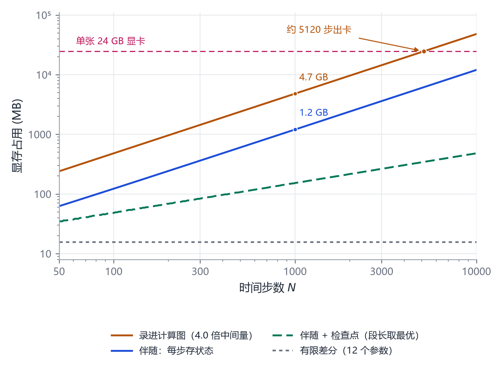

# 第 3 章 可微物理的三条路线

> 本章导读：一段能求导的模拟程序，可以用三种很不一样的方式做出来。一种把整条轨迹录成计算图，一种解一条反向的方程，还有一种拿笔推完再抄进代码。三者在纸面上算出的梯度相同，在时间和显存上能差一个数量级，出错的方式也各不相同。这一章把三者摊开，讲清每一种的代价花在哪里。

## 3.1 一次调了三天的参数

2019 年之后，很多实验室都撞上过同一堵墙。

手上的布料模拟器能把一块布抖得很像，代码是几年攒下来的，力、积分、约束求解都在，参数也调顺了。现在要给这块布定一个物理量：弯曲刚度。手上有一段高速摄影，布从桌面滑落、铺开、边缘卷起；模拟里同一个动作做一遍，两条曲线的差距当作损失，希望优化器给出刚度值。

要定的不止一个。拉伸、弯曲、面积、阻尼，加上初始姿态的几个量，十几个。参数一多，最自然的做法是有限差分：每个参数加一点、减一点，各跑一次，差分得到方向导数。十几个参数就是二三十次仿真，一次三分钟，一轮梯度一个多小时；优化器通常要几百轮。

于是转向“可微模拟”。想法很直接：整个模拟是一个程序，程序里全是加减乘除和几个循环，那它本来就该能求导，只是没人把导数算出来。换一个能记录运算的框架，前向跑一遍，反向跑一遍，一次拿到十几个参数的梯度。时间从一小时降到几分钟。

第一次跑，损失不降反升。把梯度打印出来逐项核对，方向看着没错，量级错了三个数量级，换一个初始姿态还会变号。查了两天，原因是状态数组在时间步里被原地覆盖：记录下来的不是“第 $n$ 步结束时的速度”，而是那块内存的地址。前向跑完，所有记录都指向最后一步的值。程序不报错，梯度照常输出，只是全错。

这类事故很常见。它说明了可微模拟真正的门槛在哪里：数学上“求解器可导”是一句话，工程上“求解器能被录下来”是另一件事。后面三节讲三种实现路线，它们的差别不在于能不能求导，而在于谁承担记录的成本、谁承担推算的成本，以及错了以后你能不能发现。

## 3.2 时间步是一串复合函数

先把记号摆干净。一个时间步是一个映射。状态记作 $\mathbf{u}_n$，装着位置和速度，也许还有体积、塑性应变、温度；参数记作 $\boldsymbol{\theta}$，是你想调的那些数。那么

$$
\mathbf{u}_{n+1} = S(\mathbf{u}_n, \boldsymbol{\theta}),
$$

$S$ 就是“走一步”这件事：算力、解约束、更新状态。跑 $N$ 步，等于把 $S$ 叠 $N$ 次：

$$
\mathbf{U} = S^N(\mathbf{u}_0, \boldsymbol{\theta}).
$$

损失 $L$ 是整条轨迹的函数，可能只看最后一帧，也可能对每一帧求加权和。

对 $\boldsymbol{\theta}$ 求导，用链式法则。麻烦在中间：第 $n+1$ 步的输出依赖第 $n$ 步的输入，这个依赖是一个矩阵 $\partial S/\partial \mathbf{u}_n$，尺寸是状态维数的平方。物理上它有名字，叫灵敏度矩阵或者切线刚度，回答的问题是“上一刻速度偏了一点点，下一刻位置会偏多少”。整条轨迹的导数就是这些矩阵连乘。

$N$ 步的连乘有两个方向可以走。

从左往右，先算第一步对参数的敏感度，再把它推进到第二步、第三步。这叫前向模式。每推一步都要带上一份“参数方向的扰动向状态传播”的量，所以参数有几个，就要推几遍，代价正比于参数个数。

从右往左，先把“损失对最后一帧的敏感度”算出来，再往回问“上一帧该承担多少责任”。这叫反向模式。往回传的量是一个和状态同维的向量，不管参数有几个，一次就够。

这个不对称性决定了后面所有的取舍。训练一个网络、辨识一组参数、优化一条控制序列，几乎都是“输出少、输入多”：损失是一个标量，参数成千上万。反向模式一轮搞定，前向模式要成千上万轮，这就是自动微分框架清一色用反向模式的原因。

代价藏在另一处。从左往右推的时候，每一步的中间结果用完就可以扔；从右往左推的时候，第 $n$ 步的导数需要第 $n$ 步的中间结果，而那时它已经被覆盖过几百次了。要么存下来，要么重算。存下来吃显存，重算吃时间，第三条路是拿笔推公式把中间量消掉。三条路线就是这么来的。

## 3.3 路线一：把求解器录进计算图

最省心的做法是什么都不改，只换运行时。

把数组换成可微张量，把 `for` 循环照原样写，框架会在每次运算时记一笔：这个输出是由哪几个输入、经过什么算子得到的。前向跑完，一张有向无环图就躺在内存里，图上的节点数正比于步数乘每步的算子数。反向时按拓扑逆序走一遍，每个算子调用自己的反向函数，把上游传来的梯度乘上局部雅可比再加起来。

这条路线的实现细节有三种：运算符重载（改了数组类型就自动记录，Python 里最常见）、源码变换（编译期生成带反向代码的版本）、以及显式 tape（自己往一张表里追加操作）。对使用者来说差别不大，差别大的是“什么东西能被记下来”。

判定标准很简单：一个操作能不能被录，取决于它的输出是不是输入的纯函数。碰撞检测里的空间哈希、稀疏矩阵求解器里的排序、网格重建里的拓扑翻转，这些东西的输出依赖内存布局和遍历顺序，框架没法为它们写反向函数。它们就成了计算图上的断点：梯度传到断点处只能置零，或者报“该算子不支持求导”。

比断点更隐蔽的是覆盖。上面那个调了三天的例子就栽在这里。原地写入在数值代码里是肌肉记忆：`v += dv`、`x[i] = x[i] + dt * v[i]`、重用缓冲区。可在磁带里，记录下来的往往是指针，前向结束时所有指针都指向同一份最终值。修复办法是让被记录的量在写入前先复制一份，代价是显存再涨一截。

第二个坑是循环次数由数据决定。接触数、牛顿迭代次数、子步数，这些量在前向时依赖当前状态，反向时必须按同一套次数重放。如果前向收敛用了 7 次迭代、反向时状态变了只用 5 次，两边的图就对不上。实践中的处理是固定迭代次数，或者把每次迭代的稀疏结构一起记下来。

显存是这条路线的硬约束。一步的中间量不只是状态本身，还有力、单元的局部雅可比、临时向量。以一块五万顶点的布料为例，状态一份约 1.2 MB，中间量加起来大约四倍，一步接近 5 MB；一千步就是 4.7 GB，五千步正好顶满一张 24 GB 的卡。图 3-2 会把这个账算清楚。

缓解办法是检查点。每 $\sqrt{N}$ 步存一份完整状态，反向时从最近的检查点重放那一小段，把中间量重新算出来再反传。显存从正比于 $N$ 变成正比于 $\sqrt{N}$，代价是多跑一遍前向，时间涨三成左右。这个技巧在长序列训练里是标配，早期把整套可微模拟跑通的工作几乎都靠它压显存 [@hu2020]。

尽管有这些坑，这条路线的门槛依然最低。改动是局部的，一个写好的模拟器换成可微数组通常几天能跑起来；能求导的参数没有限制，材料参数、初始状态、控制序列、网络权重可以混在一起优化。软体机器人的实时可微模拟就是这样落地的，把整个 MPM 时间步写成可微算子，反向传过几百步，用来做控制器和形状的联合优化 [@hu2019]。

它适合的问题有个共同特征：步数不多。几十步到几百步，状态量中等，显存够用，那就不必再折腾别的。

## 3.4 路线二：解一条反向的方程

第二条路线不建图。它承认梯度就是一组递推，直接把递推写出来，用数组算，不经过任何自动微分框架。

记号要从“状态”挪到“状态的作用”上。定义伴随变量

$$
\boldsymbol{\lambda}_n = \left(\frac{\partial L}{\partial \mathbf{u}_n}\right)^{\!\top},
$$

它是一个和状态同维的列向量，分量含义是“第 $n$ 步的状态里，这个分量每增加一个单位，最终损失变多少”。反向递推只有两步：

$$
\boldsymbol{\lambda}_N = \left(\frac{\partial \ell}{\partial \mathbf{u}_N}\right)^{\!\top},\qquad
\boldsymbol{\lambda}_n = \left(\frac{\partial S}{\partial \mathbf{u}_n}\right)^{\!\top} \boldsymbol{\lambda}_{n+1} + \left(\frac{\partial \ell}{\partial \mathbf{u}_n}\right)^{\!\top},
$$

$\ell$ 是单帧损失（没有的话那一项为零）。参数梯度最后一次性累加：

$$
\frac{\mathrm{d} L}{\mathrm{d} \boldsymbol{\theta}} = \sum_{n=0}^{N-1} \left(\frac{\partial S}{\partial \boldsymbol{\theta}}\right)^{\!\top} \boldsymbol{\lambda}_{n+1}.
$$

这个形式和上一节的反向模式是同一个东西，区别在于谁来提供 $\left(\partial S/\partial \mathbf{u}_n\right)^{\top}$。自动微分靠编译器从算子里拼出来，伴随法靠你自己写。省下的是图：没有节点，没有节点上的值，只有递推和几个数组。

代价跟着省下的东西来。要算第 $n$ 步的转置雅可比乘向量，得知道第 $n$ 步的状态；状态不在手边就得先重算一遍。所以伴随法必须保存整条轨迹的状态，一份一份存，不漏步。状态比中间量小得多，通常只是三分之一到五分之一，但仍然是正比于步数。

真正让伴随法在物理模拟里站住脚的，是隐式积分。

隐式的一步不是显式公式，而是解方程。以最常见的后向欧拉为例，位置更新写成

$$
\mathbf{G}(\mathbf{u}_{n+1}, \mathbf{u}_n, \boldsymbol{\theta})
= \mathbf{M}\left(\mathbf{x}_{n+1} - \mathbf{x}_n - \Delta t\, \mathbf{v}_n\right) - \Delta t^2 \mathbf{f}(\mathbf{x}_{n+1}) = \mathbf{0},
$$

$\mathbf{M}$ 是质量矩阵，$\mathbf{f}$ 是内力，$\Delta t$ 是步长。这个方程用牛顿法解，每次牛顿迭代都是一个线性系统，矩阵是

$$
\mathbf{A} = \mathbf{M} + \Delta t^2 \mathbf{H},\qquad \mathbf{H} = -\frac{\partial \mathbf{f}}{\partial \mathbf{x}},
$$

$\mathbf{H}$ 是能量对位置的二阶导，正定时 $\mathbf{A}$ 也正定，可以 Cholesky 分解。

现在问“$\boldsymbol{\theta}$ 变一点，解出来的 $\mathbf{u}_{n+1}$ 变多少”。$\mathbf{G}$ 恒等于零，两边求全微分，得到隐函数定理的标准形式：

$$
\frac{\mathrm{d} \mathbf{u}_{n+1}}{\mathrm{d} \boldsymbol{\theta}}
= -\left(\frac{\partial \mathbf{G}}{\partial \mathbf{u}_{n+1}}\right)^{-1}
  \frac{\partial \mathbf{G}}{\partial \boldsymbol{\theta}},
$$

而 $\partial \mathbf{G}/\partial \mathbf{u}_{n+1}$ 正是牛顿迭代里那个 $\mathbf{A}$。转置以后放进伴随递推，就是

$$
\mathbf{A}^{\top} \mathbf{z} = \boldsymbol{\lambda}_{n+1},\qquad
\boldsymbol{\lambda}_n = -\left(\frac{\partial \mathbf{G}}{\partial \mathbf{u}_n}\right)^{\!\top} \mathbf{z}.
$$

这一行是整套可微求解器的核心。它说的是：反传一个时间步，不需要把牛顿迭代的七次、二十次展开成计算图，只需要拿前向已经分解过的矩阵再解一次线性系统。矩阵对称时连分解都不用重做，两次回代就完事 [@hu2019]。

省下来的东西很具体。前向 20 次牛顿迭代如果全部展开，反向要穿过 20 层，显存和时间的常数因子都是 20；用隐函数定理，反向的代价是一次前向的线性求解，通常只占前向的三分之一。时间上前向加反向大约是前向的三倍，而展开迭代的做法可以到十倍以上 [@li2020]。

伴随法还有一个容易被忽略的好处：它给出的是“离散问题的精确梯度”。有人会问，是不是该先对偏微分方程求伴随，再离散？答案是否定的。先求导再离散，你得到的是连续问题的梯度，和你的前向程序算的不是同一个函数，两者差一个 $\mathcal{O}(\Delta t)$ 的项；步长一大，梯度检查就对不上，你会花几天去查一个不存在的 bug。先离散再求导，也就是所谓的离散伴随，才和前向严格一致。

它的代价在实现。每个算子都要有转置，而转置不是把矩阵转一下那么简单：半拉格朗日平流的转置是散射（把梯度按权重撒回原位置），压力投影的转置是再解一次泊松，摩擦让系统矩阵非对称，那时 $\mathbf{A}^{\top}$ 和 $\mathbf{A}$ 的分解必须分别做。转置写错不会崩，只会给出一个量级像样、方向可疑的梯度。

## 3.5 路线三：拿笔推完再抄进代码

第三条路线把中间量彻底消掉。不记录、不重算，直接推导出 $\partial S/\partial \boldsymbol{\theta}$ 与 $\left(\partial S/\partial \mathbf{u}\right)^{\top}$ 的闭式表达式，写进代码。

这条路走通过的最完整例子是多体系统的接触动力学。冲量法把一步的解写成一个线性互补问题的解：法向冲量由速度约束决定，摩擦冲量由库仑锥裁剪，关节由等式约束定住。整件事的灵敏度可以逐项推出来，包括“接触力对接触力的耦合”“摩擦对法向的耦合”。推完之后，一次前向加上一次解析的反向，比把迭代展开成计算图快几倍，显存只留当前步 [@geilinger2020]。

省下的不只是显存，还有“哪些项该存在”的确定性。自动微分会把计算图里出现的一切都求导，包括你本来想当作常数的那部分；解析推导逼你把每一项的物理意义说清楚，哪些是刚度、哪些是几何、哪些是约束力的杠杆。这个过程中经常发现前向代码里有一处近似被当成了精确。

代价是每改一次前向，反向要跟着改。改一个算子要重推一遍转置；加一种新的力（比如各向异性摩擦、粘弹性阻尼）要把耦合项补全。手工推的代码量通常是前向的三到五倍，而且这些代码没有测试就毫无价值，因为它的错误形式是“数值合理”。

唯一可靠的安全网是有限差分对拍。取一个随机方向 $\mathbf{d}$，比较

$$
\frac{L(\boldsymbol{\theta} + \varepsilon \mathbf{d}) - L(\boldsymbol{\theta} - \varepsilon \mathbf{d})}{2\varepsilon}
\quad\text{与}\quad
\mathbf{g}^{\top} \mathbf{d},
$$

$\mathbf{g}$ 是算出来的梯度。$\varepsilon$ 取 $10^{-6}$ 乘上参数范数的量级，双精度下两者的相对误差应当落在 $10^{-6}$ 到 $10^{-4}$ 之间。差得远说明梯度错了；差得太小（比如 $10^{-12}$）反而要警惕，那通常意味着前向里根本没用上这个参数。对拍不能只做一次，要随机取十个方向、取两三组参数，因为错项常常只在特定构型下才显形。

这套对拍对三条路线都适用，你应该在前向能跑通的当天就写好它，并且在每次改完求解器之后重跑。它是唯一能在几分钟内告诉你“梯度还对不对”的手段，而一个错梯度的调试成本，远远高于写这个脚本的成本。

## 3.6 三条路线的代价

把三种做法放在同一张表上看。表里的时间以“一次前向”为单位，显存按状态量 $|\mathbf{u}|$ 与步数 $N$ 记，实现量是主观估计，指的是“改动多少代码、需要多少人懂”。

**表 3-1**　三条路线的代价（数量级）

| 做法 | 反向时间 | 显存 | 实现量 | 适合的问题 |
| --- | --- | --- | --- | --- |
| 录进计算图 | 前向的 2–3 倍，展开迭代后可达 10 倍 | 每步中间量，正比于 $N$ | 低 | 步数几十到几百，状态不大 |
| 伴随，存状态 | 前向的 2–3 倍 | 每步状态，正比于 $N$ | 中 | 步数上千，显存不够存中间量 |
| 伴随，加检查点 | 前向的 3–4 倍 | 正比于 $\sqrt{N}$ | 中高 | 长时窗，单卡 |
| 手工解析 | 前向的 1.2–2 倍 | 只留当前步 | 高 | 求解器固定、要跑很多次 |
| 有限差分 | $p+1$ 次前向，可全部并行 | 一份 | 极低 | 参数少于二十，有并行机器 |

图 3-1 把三条主要路线的时间流画在一起。差别一眼能看出来：第一条路在正向就把所有东西堆起来了，第二条只堆状态、反向时现算现用，第三条几乎不堆。

<figure class="fig">

<figcaption><b>图 3-1</b>　三条路线的数据流（示意图）。上：把求解器录进计算图，每一步的中间量都存下，反向时直接乘；中：伴随，只存每步的状态，反向时重算转置雅可比并解一次线性系统；下：手工解析，推导一次性完成，反向只剩公式。右侧括号标的是每一步要存多少东西。</figcaption>
</figure>

显存这一项值得单算一遍，因为它是实际项目里第一个撞到的墙。图 3-2 用的模型是：一块五万顶点的布料，每个顶点六个单精度数（位置三个、速度三个），一份状态 1.2 MB；录进计算图时每步还要存力、单元雅可比和临时量，按四倍算，一步 4.8 MB。四条曲线分别对应四种做法，横轴是时间步数。

<figure class="fig">

<figcaption><b>图 3-2</b>　显存随步数的增长（按给定模型真实计算）。模型：五万顶点布料，每顶点六个单精度数，一份状态 1.2 MB；录图时每步中间量按四倍算得 4.8 MB/步；检查点按 $\sqrt{N}$ 分段并在每段重算；有限差分假定 12 个参数、串行执行。水平虚线是单张 24 GB 显卡的容量。</figcaption>
</figure>

两条斜线的斜率不同，这是关键：同样是一千步，录图要 4.7 GB，只存状态要 1.2 GB，差四倍。五千步左右前者出卡，后者才用了 6 GB。检查点那条曲线是弯的，因为它把显存换成了时间，而且这个交换有个最优点：段太长，每段重算的中间量吃掉优势；段太短，要存的检查点太多。图里的点是按段长逐个试出来的最优值。有限差分那条线是水平的，它不吃显存只吃时间，参数十二个就要跑十三次前向。

还有一个维度表格没写：精度。三条路线在双精度下都能对到 $10^{-8}$ 量级，差别出在单精度和 GPU 上。求和顺序不同、稀疏求解器的容差不同、并行规约的树形结构不同，都会让同一个梯度在小数点后第五位分家。梯度检查要在**同一种精度**下做，容差也要跟着放宽，否则你会把舍入噪声当成 bug 查。

## 3.7 怎么选

把上面的东西压成几条判断。

先算显存，再选路线。$N \times$ 每步字节数，这个乘法在前向跑通的那天就能估出来，不需要写完反向。如果乘出来小于显存的十分之一，就别折腾，直接用第一条路线，它的开发速度是其他路线的三倍以上。

参数少于二十、机器上能并行跑 $p+1$ 个仿真，有限差分往往是最优解。它的梯度是对步长的平均，碰到接触、碰撞这类不连续的地方反而更稳，因为平均把尖峰抹平了。真正不能用的场合是参数多、或者前向本身跑在单机上。

步数上千、状态又不小，就用伴随。这个区间里没有别的选择，录图的显存会直接压死你。伴随的实现难度主要在于“每个算子都要有转置”，而这部分工作有固定的套路：把一个时间步拆成几个可逆或易转置的块，逐块写，逐块对拍。

求解器里有迭代（牛顿、PGS、PCG），就用隐函数定理，不要把迭代展开。这一条几乎没有例外：展开迭代得到的是“对未收敛的解精确求导”，方向看似对，幅值不准，而且迭代次数一变，梯度就跳一下。

需要反复用同一个求解器、或者要算二阶信息，才值得上手工解析。前者指的是控制、形状优化这类一轮要算几百次梯度的场景；后者其实很少有人真去做二阶，常见的是把一阶雅可比拼成 $\mathbf{J}^{\top}\mathbf{J}$ 当 Gauss-Newton 用，而 $\mathbf{J}$ 用一次反向就能拿到。

最后一条是关于验证的。三条路线给出同一个梯度的前提，是它们都在算同一个离散函数。这句话听着像废话，实际上大部分“可微模拟不对”的事故都死在这里：前向里有一处 `if` 没被记录，一个缓冲区被复用，一次求解用了不同的容差。选路线时，把“我能不能对它做梯度检查”当成一个硬指标——如果一条路线快一倍但你没办法验证，它就不该被选。
