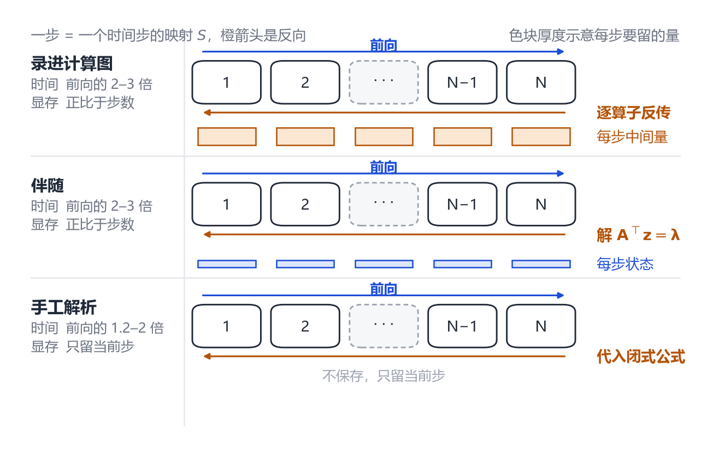

# 第 3 章 可微物理的三条路线

> 本章导读：一段能求导的模拟程序，可以用三种很不一样的方式做出来。一种把整条轨迹录成计算图，一种解一条反向的方程，还有一种拿笔推完再抄进代码。三者在纸面上算出的梯度相同，在时间和显存上能差一个数量级，出错的方式也各不相同。这一章把三者摊开，讲清每一种的代价花在哪里。

## 3.1 一次调了三天的参数

2019 年之后，很多实验室都撞上过同一堵墙。

手上的布料模拟器能把一块布抖得很像，代码是几年攒下来的，力、积分、约束求解都在，参数也调顺了。现在要给这块布定一个物理量：弯曲刚度（bending stiffness，抵抗弯折的本领，越大布越硬挺）。手上有一段高速摄影，布从桌面滑落、铺开、边缘卷起。模拟里同一个动作做一遍，两条曲线的差距当作损失，希望优化器给出刚度值。

要定的不止一个。拉伸、弯曲、面积、阻尼，加上初始姿态的几个量，十几个。参数一多，最自然的做法是有限差分（finite difference，把参数轻轻推一下看输出变多少，用比值当斜率）：每个参数加一点、减一点，各跑一次。十二个参数就要跑二十四次；一次三分钟，一轮梯度七十二分钟；优化器还要跑几十上百轮，“调了三天”就是这么来的。

也就是说，瓶颈不在优化算法，在一个乘法上：一次梯度等于二十几次前向。这个乘数决定了后面所有的选择。

于是转向“可微模拟”。想法很直接：整个模拟是一个程序，程序里全是加减乘除和几个循环，那它本来就该能求导，只是没人把导数算出来。换一个能记录运算的框架，前向跑一遍，反向跑一遍，一次拿到十几个参数的梯度。时间从一小时降到几分钟。

第一次跑，损失不降反升。把梯度打印出来逐项核对，方向看着没错，量级错了三个数量级，换一个初始姿态还会变号。查了两天，原因是状态数组在时间步里被原地覆盖：记录下来的不是“第 $n$ 步结束时的速度”，而是那块内存的地址。前向跑完，所有记录都指向最后一步的值。程序不报错，梯度照常输出，只是全错。

这个事故的形状值得记住。它不崩、不警告、不发散，只安静地给出一个错误方向。你能察觉它的唯一办法，是拿它和别的东西对一遍：有限差分、一个能手算的小例子、或者物理直觉。前两种手段后面都会用到。

它说明了可微模拟真正的门槛在哪里：数学上“求解器可导”是一句话，工程上“求解器能被录下来”是另一件事。后面三节讲三种实现路线，它们的差别不在于能不能求导，而在于谁承担记录的成本、谁承担推算的成本，以及错了以后你能不能发现。

## 3.2 时间步是一串复合函数

先把记号摆干净。一个时间步是一个映射。状态记作 $\mathbf{u}_n$，装着位置和速度，也许还有体积、塑性应变、温度；参数记作 $\boldsymbol{\theta}$，是你想调的那些数。那么

$$
\mathbf{u}_{n+1} = S(\mathbf{u}_n, \boldsymbol{\theta}),
\tag{3.1}
$$

$S$ 就是“走一步”这件事：算力、解约束、更新状态。$\mathbf{u}_n$ 是一根列向量，长度等于状态维数；$\boldsymbol{\theta}$ 也是一根列向量，长度等于要调的参数个数。跑 $N$ 步，等于把 $S$ 叠 $N$ 次：

$$
\mathbf{U} = S^N(\mathbf{u}_0, \boldsymbol{\theta}).
\tag{3.2}
$$

损失 $L$ 是整条轨迹的函数，可能只看最后一帧，也可能对每一帧求加权和。

对 $\boldsymbol{\theta}$ 求导，用链式法则。麻烦在中间：第 $n+1$ 步的输出依赖第 $n$ 步的输入，这个依赖是一个矩阵 $\partial S/\partial \mathbf{u}_n$。

它的尺寸要先说清，因为这是整章所有取舍的根源。一块五万顶点的布料，每个顶点六个自由度（位置三个、速度三个），状态就是三十万维。那个矩阵是三十万乘三十万，一共 $9\times10^{10}$ 个元素，单精度存下来要 360 GB。也就是说，这个矩阵只存在于数学里，不存在于任何一张显卡上。所有实际算法算的都是“矩阵乘一根向量”，从不把矩阵本身拼出来。

物理上它有名字，叫灵敏度矩阵（sensitivity matrix）或者切线刚度（tangent stiffness），回答的问题是“上一刻速度偏了一点点，下一刻位置会偏多少”。整条轨迹的导数就是这些矩阵连乘。

拿一个标量的小例子手算一遍，后面反复要用它。设一步是

$$
\mathbf{u}_{n+1} = \mathbf{u}_n + \Delta t\,(a\, \mathbf{u}_n + \theta),
$$

取 $\Delta t = 0.1$、$a = -2$、$\theta = 1$、$\mathbf{u}_0 = 0$。这里 $\partial S/\partial \mathbf{u} = 1 + \Delta t\, a = 0.8$，$\partial S/\partial \theta = \Delta t = 0.1$。跑三步：$\mathbf{u}_1 = 0.1$，$\mathbf{u}_2 = 0.18$，$\mathbf{u}_3 = 0.244$。

现在要 $\mathrm{d}\mathbf{u}_3/\mathrm{d}\theta$。把三个因子乘起来再加：$0.8^2\times 0.1 + 0.8\times0.1 + 0.1 = 0.244$。手算的结果和 $\mathbf{u}_3$ 恰好相同，这是初值为零、映射线性带来的巧合，别当规律记。

$N$ 步的连乘有两个方向可以走。

从左往右，先算第一步对参数的敏感度，再把它推进到第二步、第三步。这叫前向模式（forward mode）。每推一步都要带上一份“参数方向的扰动向状态传播”的量，所以参数有几个就要推几遍，代价正比于参数个数 $p$。

从右往左，先把“损失对最后一帧的敏感度”算出来，再往回问“上一帧该承担多少责任”。这叫反向模式（reverse mode）。往回传的量是一根和状态同维的向量，不管参数有几个，一次就够。

上面的例子里，前向模式要推三次；反向模式从 $\lambda_3 = 1$ 出发，得 $\lambda_2 = 0.8$、$\lambda_1 = 0.64$、$\lambda_0 = 0.512$，再把每步的 $0.1$ 乘上去累加，$0.1\times(1+0.8+0.64)=0.244$。两条路给出同一个数，但干的活不一样。

这个不对称性决定了后面所有的取舍。训练一个网络、辨识一组参数、优化一条控制序列，几乎都是“输出少、输入多”：损失是一个标量，参数成千上万。反向模式一轮搞定，前向模式要成千上万轮。这就是自动微分框架清一色用反向模式的原因。

反过来的场景也真存在。只标定三个相机外参、损失写成逐像素的差，参数三个、输出三十万维，前向模式推三遍就完，反向模式却要在图里存下整帧的中间量。也就是说，“反向模式更划算”不是定律，它依赖参数个数与输出维数的比值；物理模拟里这个比值通常是 $10^4$ 比 $1$，所以结论很硬，但它有条件。

代价藏在另一处。从左往右推的时候，每一步的中间结果用完就可以扔；从右往左推的时候，第 $n$ 步的导数需要第 $n$ 步的中间结果，而那时它已经被覆盖过几百次了。要么存下来，要么重算。存下来吃显存，重算吃时间，第三条路是拿笔推公式把中间量消掉。三条路线就是这么来的。

## 3.3 路线一：把求解器录进计算图

最省心的做法是什么都不改，只换运行时。

把数组换成可微张量（differentiable tensor，值之外还带着“我是由哪些输入、用哪个算子算出来的”这条线索的数组），把 `for` 循环照原样写，框架会在每次运算时记一笔：这个输出由哪几个输入、经过什么算子得到。前向跑完，一张有向无环图（directed acyclic graph，节点是中间量、边是依赖关系的图）就躺在内存里，节点数正比于步数乘每步的算子数。

反向时按拓扑逆序走一遍，每个算子调用自己的反向函数，把上游传来的梯度乘上局部雅可比再加起来。也就是说，整条轨迹的求导被拆成每步几十个小算子的求导，每一个都短到能手写。一个加法算子的反向是把梯度原样往两边分，一个乘法算子的反向是乘上对方的值，一个矩阵乘法的反向是各乘一个转置——没有一个是难事。

这条路线的实现细节有三种。运算符重载（operator overloading）改掉数组类型，重载 `+`、`*` 这些符号，一写表达式就自动记录，Python 里最常见。源码变换（source transformation）在编译期把函数体改写成带反向代码的版本，运行时不额外记录，省内存。显式 tape 是自己往一张表里追加操作，控制权最大，但每个算子都要手写登记。

对使用者来说三者差别不大，差别大的是“什么东西能被记下来”。

判定标准很简单：一个操作能不能被录，取决于它的输出是不是输入的纯函数（pure function，同样的输入永远给同样的输出，不看内存地址也不看遍历顺序）。碰撞检测里的空间哈希、稀疏矩阵求解器里的排序、网格重建里的拓扑翻转，这些东西的输出依赖内存布局和访问顺序，框架没法为它们写反向函数。它们就成了计算图上的断点：梯度传到断点处只能置零，或者报“该算子不支持求导”。

比断点更隐蔽的是覆盖。上面那个调了三天的例子就栽在这里。原地写入在数值代码里是肌肉记忆：`v += dv`、`x[i] = x[i] + dt * v[i]`、重用缓冲区。可在磁带里，记录下来的往往是指针，前向结束时所有指针都指向同一份最终值。修复办法是让被记录的量在写入前先复制一份，代价是显存再涨一截；一块五万顶点的布料，每个时间步多复制三四份状态，一千步就多出三四个 GB。

第二个坑是循环次数由数据决定。接触数、牛顿迭代次数、子步数，这些量在前向时依赖当前状态，反向时必须按同一套次数重放。如果前向收敛用了 7 次迭代、反向时状态变了只用 5 次，两边的图就对不上。实践中的处理是固定迭代次数，或者把每次迭代的稀疏结构一起记下来。

显存是这条路线的硬约束。一步的中间量不只是状态本身，还有力、单元的局部雅可比、临时向量。以一块五万顶点的布料为例，状态一份约 1.2 MB，中间量加起来大约四倍，一步接近 5 MB；一千步就是 4.7 GB，五千步正好顶满一张 24 GB 的卡。图 3-2 会把这个账算清楚。

缓解办法是检查点（checkpointing，只存少数几个完整状态，反向时从最近的检查点重新算那一段）。每 $\sqrt{N}$ 步存一份完整状态，反向时从最近的检查点重放那一小段，把中间量重新算出来再反传。显存从正比于 $N$ 变成正比于 $\sqrt{N}$，代价是多跑一遍前向，时间涨三成左右。这个技巧在长序列训练里是标配，早期把整套可微模拟跑通的工作几乎都靠它压显存 [@hu2020]。

带数字看一遍这个交换。$N=5000$ 步、每步中间量 4.8 MB，全存要 24 GB，正好卡的容量。若分成 $s$ 段，显存约等于 $s$ 份状态加上一段的中间量，即 $1.2s + 5000\times4.8/s$ 兆字节。$s$ 取 141 时两项都约 170 MB，合计 340 MB，是原来的七十分之一。代价只有前向多跑一遍。

尽管有这些坑，这条路线的门槛依然最低。改动是局部的，一个写好的模拟器换成可微数组通常几天能跑起来；能求导的参数没有限制，材料参数、初始状态、控制序列、网络权重可以混在一起优化。软体机器人的实时可微模拟就是这样落地的，把整个 MPM 时间步写成可微算子，反向传过几百步，用来做控制器和形状的联合优化 [@hu2019]。

它适合的问题有个共同特征：步数不多。几十步到几百步，状态量中等，显存够用，那就不必再折腾别的。一个反例是“整段布料下落十秒”这种任务：十秒按 1/240 秒一步就是两千四百步，一条轨迹的中间量已经逼近 12 GB，做几次试验就把显存吃干净了。

## 3.4 路线二：解一条反向的方程

第二条路线不建图。它承认梯度就是一组递推，直接把递推写出来，用数组算，不经过任何自动微分框架。

记号要从“状态”挪到“状态的作用”上。定义伴随变量（adjoint variable）：

$$
\boldsymbol{\lambda}_n = \left(\frac{\partial L}{\partial \mathbf{u}_n}\right)^{\!\top},
\tag{3.3}
$$

它是一个和状态同维的列向量。逐符号读：$L$ 是最终那个标量损失；$\partial L/\partial \mathbf{u}_n$ 是损失对第 $n$ 步状态的梯度，按惯例是一根行向量；右上角的转置把它转成列向量，好和后面的矩阵相乘。

分量的含义是“第 $n$ 步的状态里，这个分量每增加一个单位，最终损失变多少”。带数字说：若 $\boldsymbol{\lambda}_n$ 的第一个分量是 $3.5$，意思是那一刻质心的 $x$ 坐标多走一个单位，最终损失就多 $3.5$ 乘以相应单位。也就是说，伴随变量是一张“责任分配单”，把最后那个数摊回每一步的每一个自由度。

反向递推只有两步：

$$
\boldsymbol{\lambda}_N = \left(\frac{\partial \ell}{\partial \mathbf{u}_N}\right)^{\!\top},\qquad
\boldsymbol{\lambda}_n = \left(\frac{\partial S}{\partial \mathbf{u}_n}\right)^{\!\top} \boldsymbol{\lambda}_{n+1} + \left(\frac{\partial \ell}{\partial \mathbf{u}_n}\right)^{\!\top},
\tag{3.4}
$$

$\ell$ 是单帧损失（没有的话那一项为零）。$\left(\partial S/\partial \mathbf{u}_n\right)^{\top}\boldsymbol{\lambda}_{n+1}$ 这一步有个名字，叫转置雅可比乘向量（vector-Jacobian product），简称 VJP。它不需要那个三十万乘三十万的矩阵，只需要能回答一个问题：拿一根向量去乘这个矩阵的转置，结果是什么。

参数梯度最后一次性累加：

$$
\frac{\mathrm{d} L}{\mathrm{d} \boldsymbol{\theta}} = \sum_{n=0}^{N-1} \left(\frac{\partial S}{\partial \boldsymbol{\theta}}\right)^{\!\top} \boldsymbol{\lambda}_{n+1}.
\tag{3.5}
$$

逐项读：$\partial S/\partial \boldsymbol{\theta}$ 是“参数动一点，这一步的状态动多少”，尺寸是状态维数乘参数个数；乘上 $\boldsymbol{\lambda}_{n+1}$ 就把“状态的责任”换算成“参数的责任”；对所有步求和，是因为同一个参数在每一步都在起作用。

这个形式和上一节的反向模式是同一个东西，区别在于谁来提供 $\left(\partial S/\partial \mathbf{u}_n\right)^{\top}$。自动微分靠编译器从算子里拼出来，伴随法靠你自己写。省下的是图：没有节点，没有节点上的值，只有递推和几个数组。

代价跟着省下的东西来。要算第 $n$ 步的 VJP，得知道第 $n$ 步的状态；状态不在手边就得先重算一遍。所以伴随法必须保存整条轨迹的状态，一份一份存，不漏步。状态比中间量小得多，通常只是三分之一到五分之一，但仍然是正比于步数。

真正让伴随法在物理模拟里站住脚的，是隐式积分。

隐式的一步不是显式公式，而是解方程。以最常见的后向欧拉为例，位置更新写成

$$
\mathbf{G}(\mathbf{u}_{n+1}, \mathbf{u}_n, \boldsymbol{\theta})
= \mathbf{M}\left(\mathbf{x}_{n+1} - \mathbf{x}_n - \Delta t\, \mathbf{v}_n\right) - \Delta t^2 \mathbf{f}(\mathbf{x}_{n+1}) = \mathbf{0},
\tag{3.6}
$$

$\mathbf{M}$ 是质量矩阵，$\mathbf{f}$ 是内力，$\Delta t$ 是步长，$\mathbf{x}$ 是位置，$\mathbf{v}$ 是速度。这个方程用牛顿法解，每次牛顿迭代都是一个线性系统，矩阵是

$$
\mathbf{A} = \mathbf{M} + \Delta t^2 \mathbf{H},\qquad \mathbf{H} = -\frac{\partial \mathbf{f}}{\partial \mathbf{x}},
\tag{3.7}
$$

$\mathbf{H}$ 是能量对位置的二阶导，去掉负号后就是刚度矩阵。$\mathbf{H}$ 正定时 $\mathbf{A}$ 也正定，可以 Cholesky 分解。取一块布料的实际量级：一个顶点质量 $10^{-4}$ 千克，连到邻居的弹簧刚度 $1000$ 牛每米，$\Delta t = 1/240$ 秒，那么 $\Delta t^2 k \approx 0.017$，比 $10^{-4}$ 大了两个数量级。这就是隐式积分“贵但稳”的算术来源：稳住格式的那一项，压倒了惯性项。

**隐函数定理：五步走完。** 现在问“$\boldsymbol{\theta}$ 变一点，解出来的 $\mathbf{u}_{n+1}$ 变多少”。$\mathbf{G}$ 恒等于零，这条恒等式对任何 $\boldsymbol{\theta}$ 都成立，两边对 $\boldsymbol{\theta}$ 求全微分仍然是零。这就是隐函数定理（implicit function theorem）的用法，步骤可以固定成五步。

第一步，写出残差方程 $\mathbf{G}(\mathbf{u}, \boldsymbol{\theta}) = \mathbf{0}$，并确认它在解附近对 $\mathbf{u}$ 可微、且 $\partial \mathbf{G}/\partial \mathbf{u}$ 可逆。这一步不是形式，它决定了能不能往下走：接触问题里主动集一变，$\mathbf{A}$ 就换了一张，可逆性和解的存在性都要重新看。

第二步，对两边求全微分，得到

$$
\frac{\partial \mathbf{G}}{\partial \mathbf{u}}\, \mathrm{d}\mathbf{u} + \frac{\partial \mathbf{G}}{\partial \boldsymbol{\theta}}\, \mathrm{d}\boldsymbol{\theta} = \mathbf{0}.
\tag{3.8}
$$

第三步，解出 $\mathrm{d}\mathbf{u}$：

$$
\frac{\mathrm{d} \mathbf{u}}{\mathrm{d} \boldsymbol{\theta}}
= -\left(\frac{\partial \mathbf{G}}{\partial \mathbf{u}}\right)^{-1}
  \frac{\partial \mathbf{G}}{\partial \boldsymbol{\theta}}.
\tag{3.9}
$$

而 $\partial \mathbf{G}/\partial \mathbf{u}$ 正是牛顿迭代里那个 $\mathbf{A}$，它已经被分解过了。也就是说，公式里那个求逆是免费的：分解在前向就做完了，反向只多两次回代。

第四步，不要真的去拼 $\mathrm{d}\mathbf{u}/\mathrm{d}\boldsymbol{\theta}$ 这个矩阵。参数十二个时它是“三十万行、十二列”，勉强存得下；参数十万个（比如一整条控制序列）时它有三万亿个元素。正确做法是把它和损失的梯度乘起来，把求逆挪到另一边，变成一个线性系统：

$$
\mathbf{A}^{\top} \mathbf{z} = \boldsymbol{\lambda}_{n+1},\qquad
\boldsymbol{\lambda}_n = -\left(\frac{\partial \mathbf{G}}{\partial \mathbf{u}_n}\right)^{\!\top} \mathbf{z}.
\tag{3.10}
$$

第五步，参数梯度从同一份 $\mathbf{z}$ 得到：

$$
\frac{\mathrm{d} L}{\mathrm{d}\boldsymbol{\theta}}
\;\leftarrow\;
\frac{\mathrm{d} L}{\mathrm{d}\boldsymbol{\theta}}
-\left(\frac{\partial \mathbf{G}}{\partial \boldsymbol{\theta}}\right)^{\!\top} \mathbf{z}.
\tag{3.11}
$$

这一行是整套可微求解器的核心。它说的是：反传一个时间步，不需要把牛顿迭代的七次、二十次展开成计算图，只需要拿前向已经分解过的矩阵再解一次线性系统。矩阵对称时连分解都不用重做，两次回代就完事 [@hu2019]。

**手算一遍。** 用一个一维的弹簧例子把这五步走完。质量 $m = 1$ 千克，步长 $\Delta t = 0.01$ 秒，上一刻位置 $x_n = 0.1$ 米、速度 $v_n = 0$，刚度 $k = 100$ 牛每米是待辨识参数，这一步没有外力。残差方程是

$$
G(x, k) = m\left(x - x_n - \Delta t\, v_n\right) + \Delta t^2 k\, x = 0,
$$

第一项是惯性，第二项是弹簧力乘步长的平方。第一步不用做什么。第二步要两个偏导：$\partial G/\partial x = m + \Delta t^2 k = 1.01$，$\partial G/\partial k = \Delta t^2 x = 10^{-4} x$。第三步解出

$$
x = \frac{m\left(x_n + \Delta t\, v_n\right)}{m + \Delta t^2 k} = \frac{0.1}{1.01} = 0.09901\ \text{米},
$$

$$
\frac{\mathrm{d}x}{\mathrm{d}k} = -\frac{\Delta t^2 x}{m + \Delta t^2 k}
= -\frac{10^{-4}\times 0.09901}{1.01} = -9.80\times10^{-6}.
$$

读法：刚度每增加 1 牛每米，这一步的位置往后退 9.8 微米。粗核对一分钟就能做完：把 $k$ 翻倍到 200，位置变成 $0.1/1.02 = 0.09804$，差 $0.97$ 毫米，除以 100 得 $9.7\times10^{-6}$，和上面的数对得上。

第四、五步换个问法。设损失对下一步状态的梯度是 $\lambda_{n+1} = 1$。解 $\mathbf{A}^{\top}\mathbf{z} = \lambda_{n+1}$ 得 $z = 1/1.01 = 0.9901$；于是 $\lambda_n = -(\partial G/\partial x_n)^{\top} z = m z = 0.9901$，梯度往回传时被压了百分之一。参数那一份是 $-(\partial G/\partial k)^{\top} z = -10^{-4}\times 0.09901\times0.9901 = -9.80\times10^{-6}$，和第三步的结果相同。两条计算路径给出同一个数，这是检查实现有没有写错的最快办法。

顺带看清一件事：$\mathbf{A}$ 等于 $m + \Delta t^2 k$，刚度越大它越大，$\lambda_n$ 被压得越狠。刚度大意味着系统“硬”，一步之内信息传得远；反过来，伴随往回传时衰减得多。这与直觉相反，但式子就是这样：隐式格式把放大率压到 1 以下，代价是每一步都要解一次系统。

省下来的东西很具体。前向 20 次牛顿迭代如果全部展开，反向要穿过 20 层，显存和时间的常数因子都是 20；用隐函数定理，反向的代价是一次前向的线性求解，通常只占前向的三分之一。时间上前向加反向大约是前向的三倍，而展开迭代的做法可以到十倍以上 [@li2020]。

还有一个容易被忽略的好处：它给的是“离散问题的精确梯度”。有人会问，是不是该先对偏微分方程求伴随，再离散？答案是否定的。先求导再离散，你得到的是连续问题的梯度，和你的前向程序算的不是同一个函数，两者差一个 $\mathcal{O}(\Delta t)$ 的项；步长一大，梯度检查就对不上，你会花几天去查一个不存在的 bug。先离散再求导，也就是所谓的离散伴随（discrete adjoint），才和前向严格一致。

它的代价在实现。每个算子都要有转置，而转置不是把矩阵转一下那么简单：半拉格朗日平流的转置是散射（把梯度按权重撒回原位置，而不是从原位置收集），压力投影的转置是再解一次泊松，摩擦让系统矩阵非对称，那时 $\mathbf{A}^{\top}$ 和 $\mathbf{A}$ 的分解必须分别做。转置写错不会崩，只会给出一个量级像样、方向可疑的梯度——和第 3.1 节那个覆盖事故属于同一类，“安静地错”。

## 3.5 路线三：拿笔推完再抄进代码

第三条路线把中间量彻底消掉。不记录、不重算，直接推导出 $\partial S/\partial \boldsymbol{\theta}$ 与 $\left(\partial S/\partial \mathbf{u}\right)^{\top}$ 的闭式（closed form，能写成一行公式、不用迭代）表达式，写进代码。

这条路走通过的最完整例子是多体系统的接触动力学。冲量法把一步的解写成一个线性互补问题（linear complementarity problem，一组“两者相乘为零、各自非负”的条件）的解：法向冲量由速度约束决定，摩擦冲量由库仑锥裁剪，关节由等式约束定住。整件事的灵敏度可以逐项推出来，包括“接触力对接触力的耦合”“摩擦对法向的耦合”。推完之后，一次前向加上一次解析的反向，比把迭代展开成计算图快几倍，显存只留当前步 [@geilinger2020]。

一维情形能看清这种推导长什么样。一个质量 $m$ 的球从高度 $h$ 落下，撞地后停住（恢复系数为零）。

$$
\lambda = m\sqrt{2gh},
$$

$\sqrt{2gh}$ 是撞地瞬间的速度大小，$\lambda$ 是地面给球的法向冲量。对 $h$ 求导只要一行：

$$
\frac{\mathrm{d}\lambda}{\mathrm{d}h} = \frac{mg}{\sqrt{2gh}}.
$$

带数字：$m = 1$ 千克、$h = 0.2$ 米、$g = 9.8$，撞地速度 $1.98$ 米每秒，冲量 $1.98$ 牛秒；导数等于 $9.8/1.98 = 4.95$ 牛秒每米。也就是说，初始高度多一厘米，地面收到的冲量多 $0.0495$ 牛秒。这种式子在自动微分里当然也能得到，但推导一遍花五分钟，之后每次反向都省下穿图的开销。

省下的不只是显存，还有“哪些项该存在”的确定性。自动微分会把计算图里出现的一切都求导，包括你本来想当作常数的那部分；解析推导逼你把每一项的物理意义说清楚：哪些是刚度、哪些是几何、哪些是约束力的杠杆。这个过程中经常发现前向代码里有一处近似被当成了精确。一个真实的例子是摩擦锥：前向用了四棱锥，推导时才发现反向上理所当然地把棱锥当成了圆锥，两者在斜方向上差了将近三成。

代价是每改一次前向，反向要跟着改。改一个算子要重推一遍转置；加一种新的力（比如各向异性摩擦、粘弹性阻尼）要把耦合项补全。手工推的代码量通常是前向的三到五倍，而且这些代码没有测试就毫无价值，因为它的错误形式是“数值合理”。

唯一可靠的安全网是有限差分对拍。取一个随机方向 $\mathbf{d}$，比较

$$
\frac{L(\boldsymbol{\theta} + \varepsilon \mathbf{d}) - L(\boldsymbol{\theta} - \varepsilon \mathbf{d})}{2\varepsilon}
\quad\text{与}\quad
\mathbf{g}^{\top} \mathbf{d},
\tag{3.12}
$$

$\mathbf{g}$ 是算出来的梯度。$\varepsilon$ 取 $10^{-6}$ 乘上参数范数的量级，双精度下两者的相对误差应当落在 $10^{-6}$ 到 $10^{-4}$ 之间。差得远说明梯度错了；差得太小（比如 $10^{-12}$）反而要警惕，那通常意味着前向里根本没用上这个参数。

带数字看一次对拍。参数是刚度 $k = 200$，取 $\varepsilon = 2\times10^{-4}$，也就是相对 $10^{-6}$，随机方向 $\mathbf{d} = 1$。两次前向得到 $L(200.0002)$ 与 $L(199.9998)$，两者相差 $1.4\times10^{-7}$，除以 $2\varepsilon$ 得 $3.5\times10^{-4}$。解析梯度 $\mathbf{g} = 3.5000\times10^{-4}$，相对误差 $10^{-7}$，通过。若解析梯度是 $3.3\times10^{-4}$，相对误差 $6\%$，那就一定有一项漏了或符号反了。

对拍不能只做一次，要随机取十个方向、取两三组参数，因为错项常常只在特定构型下才显形。这套对拍对三条路线都适用，你应该在前向能跑通的当天就写好它，并且在每次改完求解器之后重跑。它是唯一能在几分钟内告诉你“梯度还对不对”的手段，而一个错梯度的调试成本，远远高于写这个脚本的成本。

## 3.6 三条路线的代价

把三种做法放在同一张表上看。表里的时间以“一次前向”为单位，显存按状态量 $|\mathbf{u}|$ 与步数 $N$ 记，实现量是主观估计，指的是“改动多少代码、需要多少人懂”。

**表 3-1**　三条路线的代价（数量级）

| 做法 | 反向时间 | 显存 | 实现量 | 适合的问题 |
| --- | --- | --- | --- | --- |
| 录进计算图 | 前向的 2–3 倍，展开迭代后可达 10 倍 | 每步中间量，正比于 $N$ | 低 | 步数几十到几百，状态不大 |
| 伴随，存状态 | 前向的 2–3 倍 | 每步状态，正比于 $N$ | 中 | 步数上千，显存不够存中间量 |
| 伴随，加检查点 | 前向的 3–4 倍 | 正比于 $\sqrt{N}$ | 中高 | 长时窗，单卡 |
| 手工解析 | 前向的 1.2–2 倍 | 只留当前步 | 高 | 求解器固定、要跑很多次 |
| 有限差分 | $p+1$ 次前向，可全部并行 | 一份 | 极低 | 参数少于二十，有并行机器 |

图 3-1 把三条主要路线的时间流画在一起。差别一眼能看出来：第一条路在正向就把所有东西堆起来了，第二条只堆状态、反向时现算现用，第三条几乎不堆。

<figure class="fig">

<figcaption><b>图 3-1</b>　三条路线的数据流（示意图）。上：把求解器录进计算图，每一步的中间量都存下，反向时直接乘；中：伴随，只存每步的状态，反向时重算转置雅可比并解一次线性系统；下：手工解析，推导一次性完成，反向只剩公式。右侧注出反向那一步在做什么，以及每步要存多少东西。</figcaption>
</figure>

显存这一项值得单算一遍，因为它是实际项目里第一个撞到的墙。图 3-2 用的模型是：一块五万顶点的布料，每个顶点六个单精度数（位置三个、速度三个），一份状态 1.2 MB；录进计算图时每步还要存力、单元雅可比和临时量，按四倍算，一步 4.8 MB。四条曲线分别对应四种做法，横轴是时间步数。

<figure class="fig">

<figcaption><b>图 3-2</b>　显存随步数的增长（按给定模型真实计算）。模型：五万顶点布料，每顶点六个单精度数，一份状态 1.2 MB；录图时每步中间量按四倍算得 4.8 MB/步；检查点按 $\sqrt{N}$ 分段并在每段重算；有限差分假定 12 个参数、串行执行。水平虚线是单张 24 GB 显卡的容量。</figcaption>
</figure>

两条斜线的斜率不同，这是关键：同样是一千步，录图要 4.7 GB，只存状态要 1.2 GB，差四倍。五千步左右前者出卡，后者才用了 6 GB。检查点那条曲线是弯的，因为它把显存换成了时间，而且这个交换有个最优点：段太长，每段重算的中间量吃掉优势；段太短，要存的检查点太多。图里的点是按段长逐个试出来的最优值。有限差分那条线是水平的，它不吃显存只吃时间，参数十二个就要跑十三次前向。

“正比于 $\sqrt{N}$”这句话可以用一行算术推出来。把 $N$ 步分成 $s$ 段，显存等于 $s$ 份检查点加上一段的中间量：

$$
M(s) = s\,|\mathbf{u}| + \frac{N}{s}\, m_{\text{step}},
\tag{3.13}
$$

$|\mathbf{u}|$ 是一份状态的字节数，$m_{\text{step}}$ 是一步中间量的字节数。对 $s$ 求导令其为零，得 $s^{*} = \sqrt{N\, m_{\text{step}}/|\mathbf{u}|}$，代回去得 $M^{*} = 2\sqrt{N\,|\mathbf{u}|\, m_{\text{step}}}$。也就是说，最小值恰好长得像 $\sqrt{N}$，系数由两个字节数的几何平均定下。

代入数字：$N = 1000$，$|\mathbf{u}| = 1.2$ MB，$m_{\text{step}} = 4.8$ MB，得 $s^{*} = \sqrt{1000\times4} = 63$ 段，$M^{*} = 2\sqrt{1000\times1.2\times4.8}\ \text{MB} = 2\sqrt{5760}\ \text{MB} \approx 152\ \text{MB}$。和全存的一千步 4.8 GB 相比，是三十三分之一。

现在把时间也算成表。任务还是上面那块布，一千步，前向 180 秒，十二个参数。

**表 3-2**　同一任务上五条路线的手算结果

| 做法 | 反向要付的时间 | 反向后总时间 | 峰值显存 | 需要几张卡 |
| --- | --- | --- | --- | --- |
| 录进计算图 | $2.5\times180 = 450$ s | $630$ s（约 10.5 分钟） | $4.8$ GB | 1 |
| 录图 + 检查点 | $450$ s 再加一次重算 $60$ s | $690$ s（约 11.5 分钟） | $0.15$ GB | 1 |
| 伴随，存状态 | $2\times180 = 360$ s | $540$ s（9 分钟） | $1.2$ GB | 1 |
| 手工解析 | $0.5\times180 = 90$ s | $270$ s（4.5 分钟） | $2.4$ MB | 1 |
| 有限差分 | 不适用 | $24\times180 = 4320$ s 串行，并行时 $180$ s | $2.4$ MB | 24 |

表里的数都是乘出来的，没有调过参。读法有三层。头两层说明“录图最费显存、伴随居中、手工最省”这个顺序，与显存一栏完全一致，两者互为印证。第三层不那么直观：并列的最后一行在墙钟时间上并不难看——二十四张卡并行，三分钟就出梯度，比所有单卡方案都快。它输在“需要二十四张卡”和“参数一多就线性变慢”两件事上。

还有一笔账表格没有写：带宽。检查点方案只要一百多兆显存，代价是每反向一步都要回读一份状态，一千步就是 1.2 GB 的读。这份数据如果放在卡内显存，可以忽略；放到主机内存，走 PCIe 每秒十几 GB，就是零点一秒，看着不多，但它是一千次小传输，实际耗时常常是理论值的三四倍。也就是说，省显存和省内存在这里互相牽制：把检查点搬出卡外，省下的显存会变成一倍的时间。

还有一个维度表格没写：精度。三条路线在双精度下都能对到 $10^{-8}$ 量级，差别出在单精度和 GPU 上。求和顺序不同、稀疏求解器的容差不同、并行规约的树形结构不同，都会让同一个梯度在小数点后第五位分家。梯度检查要在**同一种精度**下做，容差也要跟着放宽，否则你会把舍入噪声当成 bug 查。

## 3.7 怎么选

把上面的东西压成几条判断。

先算显存，再选路线。$N \times$ 每步字节数，这个乘法在前向跑通的那天就能估出来，不需要写完反向。如果乘出来小于显存的十分之一，就别折腾，直接用第一条路线，它的开发速度是其他路线的三倍以上。换句话说，选择的第一道门是算术，不是品味。

参数少于二十、机器上能并行跑 $p+1$ 个仿真，有限差分往往是最优解。它的梯度是对步长的平均，碰到接触、碰撞这类不连续的地方反而更稳，因为平均把尖峰抹平了。真正不能用的场合是参数多、或者前向本身跑在单机上——二百个参数就要二百零一次前向，单卡上一轮梯度就是十小时，优化器等不起。

步数上千、状态又不小，就用伴随。这个区间里没有别的选择，录图的显存会直接压死你。伴随的实现难度主要在于“每个算子都要有转置”，而这部分工作有固定的套路：把一个时间步拆成几个可逆或易转置的块，逐块写，逐块对拍。

求解器里有迭代（牛顿、PGS、PCG），就用隐函数定理，不要把迭代展开。这一条几乎没有例外：展开迭代得到的是“对未收敛的解精确求导”，方向看似对，幅值不准，而且迭代次数一变，梯度就跳一下。一个具体的数：牛顿迭代二十次、残差降到 $10^{-8}$，展开求导得到的是第 20 次迭代那个近似解的导数，它和真解的导数差着一个与残差同阶的量；前向多给两次迭代，梯度就变，这种梯度没法拿去比较两个方案。

工程上的常见做法不是“三选一”，而是分段混合。前两百步用录图，因为它代码改动最小、调试方便；后两千步用伴随加检查点，因为它吃得起显存也压得住时间。一个真实的例子是软体机器人控制：一帧控制周期里只展开 50 步，直接录图；而训练时跑 2000 步的 rollout，就切到伴随。两条路径共享同一份前向代码，只有这样才不用维护两套物理。

需要反复用同一个求解器、或者要算二阶信息，才值得上手工解析。前者指的是控制、形状优化这类一轮要算几百次梯度的场景；后者其实很少有人真去做二阶，常见的是把一阶雅可比拼成 $\mathbf{J}^{\top}\mathbf{J}$ 当 Gauss-Newton 用，而 $\mathbf{J}$ 用一次反向就能拿到。

最后一条是关于验证的。三条路线给出同一个梯度的前提，是它们都在算同一个离散函数。这句话听着像废话，实际上大部分“可微模拟不对”的事故都死在这里：前向里有一处 `if` 没被记录，一个缓冲区被复用，一次求解用了不同的容差。选路线时，把“我能不能对它做梯度检查”当成一个硬指标——如果一条路线快一倍但你没办法验证，它就不该被选。
