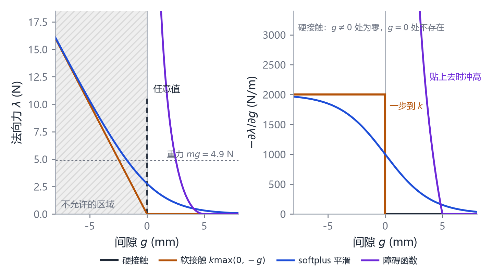

# 第 4 章 可微刚体与接触

> 本章导读：刚体最难的地方不是旋转，是“碰上了”这件事。一个物体的位置可以把整条链求导求得很漂亮，可一旦接触的开关打开或关上，导数就断成两截。这一章讲清断在哪里、几种磨圆的办法各自付出什么代价，以及哪些任务其实根本不需要穿过接触的梯度。

## 4.1 手指为什么钻进方块

一个常见的抓取任务。桌面上放一个方块，两根手指从两侧合拢，夹住，然后整体抬起来。如果夹得够紧，方块跟着上去；夹松了，它滑回桌面。

用可微模拟做这件事，损失写得很自然：抬起之后方块的高度越高越好，或者方块与目标位置的距离越小越好。参数是两根手指的合拢位置。梯度一算，优化器开始动，两根手指往里走，走进方块内部，然后继续走。损失确实在降——方块被“夹”得更紧了，因为它和手指重叠得更多。

用数字把这件事说明白。方块质量 0.2 千克，重力 1.96 牛。手指每侧压进去 2 毫米，接触刚度为 2000 牛每米，法向力就是 4 牛；摩擦系数取 1，两侧的摩擦上限合计 8 牛，远大于 1.96 牛，方块稳稳被夹住。压进去 0.5 毫米时，法向力 1 牛，摩擦上限 1 牛，托不住，方块下滑。也就是说，在这套软化过的接触模型里，“多穿一点”确实等价于“夹得更紧”，梯度指向内部是完全诚实的——它只是诚实地报告了一个被改过的题目。

这就是穿透利用（penetration exploitation）。几乎所有用可微刚体做控制的人，头一周都会撞上它。做控制的人第一反应是怪优化器，或者怪学习率，把步长调小、把迭代加多，手指还是往里钻。

问题不在优化器，在接触那一段的导数上。求解器把“不穿透”写成了一个约束，约束的影子价格是接触力；可一旦你问“手指再往里一毫米，损失变多少”，问题的答案取决于你把“一毫米”解释成穿透还是解释成压缩。软化的接触会说“穿透更省能量”，于是梯度指向内部。这不是数值误差，是模型被压到它定义域之外以后，仍然很有信心地给出了一个导数。

这一章的顺序是：先把能求导的部分说清楚，再说断在哪，再说几种把断口磨平的办法各自付什么账，最后说哪些任务其实不必付这笔账。

## 4.2 自由飞行的那一段是可微的

刚体的状态是十三个数：质心位置三个，姿态四元数（quaternion，四个数表示一个三维旋转的写法）四个，线速度三个，角速度三个。半隐式的一步写成

$$
\mathbf{v}_{n+1} = \mathbf{v}_n + \Delta t\, \mathbf{M}^{-1} \mathbf{f},
\qquad
\mathbf{x}_{n+1} = \mathbf{x}_n + \Delta t\, \mathbf{v}_{n+1},
\tag{4.1}
$$

$$
\boldsymbol{\omega}_{n+1} = \boldsymbol{\omega}_n + \Delta t\, \mathbf{I}_{\mathrm{w}}^{-1}
\left(\boldsymbol{\tau} - \boldsymbol{\omega}_n \times \mathbf{I}_{\mathrm{w}} \boldsymbol{\omega}_n\right),
\qquad
\mathbf{I}_{\mathrm{w}} = \mathbf{R}(\mathbf{q}_n)\, \mathbf{I}_{\ell}\, \mathbf{R}(\mathbf{q}_n)^{\top},
\tag{4.2}
$$

$$
\mathbf{q}_{n+1} = \frac{\mathbf{q}_n + \tfrac{\Delta t}{2}\, \boldsymbol{\Omega}(\boldsymbol{\omega}_{n+1})\, \mathbf{q}_n}
{\left\| \mathbf{q}_n + \tfrac{\Delta t}{2}\, \boldsymbol{\Omega}(\boldsymbol{\omega}_{n+1})\, \mathbf{q}_n \right\|}.
\tag{4.3}
$$

逐符号读一遍。$\mathbf{M}$ 是质量矩阵，对角线上是质量和转动惯量；$\mathbf{f}$ 是外力（重力、空气阻力）；$\boldsymbol{\tau}$ 是力矩；$\mathbf{I}_{\ell}$ 是局部坐标下的惯性张量（inertia tensor，描述“绕哪个轴难转”的 $3\times3$ 矩阵）；$\mathbf{R}(\mathbf{q})$ 是由四元数得到的旋转矩阵，把局部方向转到世界方向；$\boldsymbol{\Omega}(\boldsymbol{\omega})$ 是把角速度写成四元数乘法的那个 $4\times4$ 反对称矩阵。

$\mathbf{I}_{\mathrm{w}}$ 那一行值得停一下。同一块砖，绕自己的长轴转很容易，绕短轴转很难，这个差别写在 $\mathbf{I}_{\ell}$ 里；但它在世界里斜着放的时候，惯性的方向也跟着斜。$\mathbf{R}\mathbf{I}_{\ell}\mathbf{R}^{\top}$ 做的正是这件事：把“局部坐标里的惯性”搬到“世界坐标里”，两侧各乘一次旋转矩阵，中间夹着那个固定的张量。

带数字走一步。$m = 0.5$ 千克、只受重力、步长 $\Delta t = 1/240$ 秒、初速为零。那么 $v_{n+1} = 0 + (1/240)\times(-4.9) = -0.0204$ 米每秒，$x_{n+1} = 0 + (1/240)\times(-0.0204) = -8.5\times10^{-5}$ 米。也就是说，第一步下落 0.085 毫米。这两个乘法里没有任何判断，所以它们对任何参数都可微。

这一串运算里没有分支，没有比较，没有取最大最小。四元数乘法是双线性型，$\mathbf{R}(\mathbf{q})$ 是 $\mathbf{q}$ 的二次型，矩阵求逆在惯性张量正定时光滑，归一化除以一个恒为正的模长。所以整段飞行是处处可微的，而且导数写出来很短。

姿态那一行有个细节值得停一下。归一化的雅可比是

$$
\frac{\partial \hat{\mathbf{q}}}{\partial \mathbf{q}}
= \frac{1}{\|\mathbf{q}\|}\left(\mathbf{I} - \hat{\mathbf{q}}\hat{\mathbf{q}}^{\top}\right),
\tag{4.4}
$$

$\hat{\mathbf{q}}$ 是单位化之后的四元数，$\mathbf{I}$ 是 $4\times4$ 单位阵。这是一个投影矩阵，秩为三：它把任何四维向量投影到与 $\mathbf{q}$ 正交的那个三维子空间上。

取 $\mathbf{q} = (1,0,0,0)$ 手算一次。模长为 1，所以系数是 1；$\hat{\mathbf{q}}\hat{\mathbf{q}}^{\top}$ 只有左上角那个元素是 1；雅可比是一个对角阵，第一个对角元是 $1-1 = 0$，其余三个是 1。也就是说，沿第一维（实部）动一点，单位化之后什么都不会变；沿另外三维动，变化原样保留。

含义很直接：四元数是四个数表示三个自由度，多出来的那一维是冗余的，求导时沿 $\mathbf{q}$ 自身方向的分量被消掉。所以你对四元数四个分量分别求导，会得到一个“有一个方向恒为零”的梯度场，这不是 bug，是参数化的必然。

工程上的后果是优化轨迹依赖参数化。同样一个姿态误差，用四元数的四个分量写损失，和用旋转向量写损失，梯度场不一样，收敛路径也不一样。有人在这上面浪费过很久，以为求解器有问题。

自由飞行好对付，约束才是分界线。等式约束（铰链、滑块）用拉格朗日乘子解一个小型 KKT 系统，只要参与约束的集合不变，整个系统对参数是光滑的；关节限位是不等式，一旦碰上就退回互补问题，和接触是同一类麻烦。

## 4.3 间隙为零处的那一跳

把问题压到一维，剩下的东西就看得清了。一个质点，地面在原点，间隙 $g$ 就是它的高度。法向接触力记作 $\lambda$，理想硬接触的完整描述是三个条件：

$$
g \ge 0, \qquad \lambda \ge 0, \qquad g\, \lambda = 0 .
\tag{4.5}
$$

逐项读。$g$ 的单位是米，规定向上为正，$g \lt 0$ 就是穿透；$\lambda$ 的单位是牛，规定地面只能推、不能拉；第三行是一个“乘法开关”：两个非负数相乘为零，等于说至少有一个为零。

也就是说，这三行写的是三句话：不许穿进去；地面不会粘着你；分开时没力，有力的时候一定贴着。

这三句话里没有“$\lambda$ 等于 $g$ 的某个函数”这回事。间隙为正时力是零；间隙为零时力可以是任意非负值，具体多少由动力学和别的约束一起决定；间隙为负是不允许的状态。所以问“力对间隙的导数是多少”，在 $g=0$ 处没有答案——不是无穷大，是不存在。图 4-1 的左边画的就是这个形状。

把这件事画在 $(g, \lambda)$ 平面上，图像是一个 L：$g \gt 0$ 那一段是贴上横轴的水平线，$g = 0$ 处是一条向上无限延伸的竖线，$g \lt 0$ 那块是空白。一条“曲线”在一个横坐标上对应多个纵坐标，它就不是函数，谈不上斜率。数学上的说法是：硬接触不是从间隙到力的映射，而是一个约束条件；力是“为了满足约束而付出的代价”，不是“对间隙的响应”。

真实的代码不会真的去处理“不存在”。它给的是一个分段光滑的映射：约束的主动集（active set，当前真正起作用的那一批约束）固定时，接触力对参数是仿射的，导数是常数；主动集一换，导数跳一下。优化器看到的是一个台阶状的梯度场，两个台阶之间没有任何过渡信息。

一维例子能把这件事说透。一块木块（质量 $0.5$ 千克，重力 $4.9$ 牛）被水平推力 $F$ 按在竖直墙面上，接触法向力就是 $\lambda = F$，于是 $\mathrm{d}\lambda/\mathrm{d}F = 1$，一个漂亮的常数。把 $F$ 降到零，木块在某个时刻离开墙面；离开之后 $\lambda = 0$，导数变成零，再减推力也不会有任何变化。两个区间里导数都是精确成立的常数，中间那个切换点上却没有定义。你调推力的时候，梯度场在一个看不见的位置上断了一次，而优化器恰好会走过那里。

摩擦把这件事再抬高一档，而且数字很好看。同一块木块，摩擦系数 $\mu = 0.3$，重力向下 $4.9$ 牛。切向要托住它，需要 $4.9$ 牛的摩擦力，而摩擦上限是 $\mu\lambda = 0.3F$。所以推力必须大于 $16.3$ 牛才托得住。

推力在 $3$ 牛时，上限 $0.9$ 牛，木块在滑；推力增到 $16.3$ 牛那一瞬，它从滑动切成粘住。切向力对推力的导数，在滑动区间里等于 $\mu\cdot 1 = 0.3$，在粘住区间里等于 $0$（粘住时切向力就被重力钉死在 $4.9$ 牛，不再随推力变）。也就是说，导数在 $F = 16.3$ 牛处从 $0.3$ 直接跳到 $0$，中间没有任何值。

这还不是全部。切向力有两种状态：粘住时它由约束决定（和法向力一起解出来），滑动时它等于 $\mu \lambda$、方向沿相对速度反向。切换的判据是 $|\lambda_t| = \mu \lambda_n$，在切换点上切向力对速度的导数不连续。再加上摩擦锥的近似——为了把二阶锥变成线性互补问题，很多引擎用四棱锥或八棱锥代替圆锥——方向上又多了几处折角。

还有一个不连续藏在时间里。时间步里通常有一句“如果间隙小于零，就为这个接触建立约束”。这个判断让接触的出现与消失成了一个开关，而开关对参数的导数是零。于是“落地时刻”这类量，对初始高度几乎没有梯度，尽管它明显依赖初始高度。这件事的量化放在 4.6 节，那里会看到梯度变成了稀疏的脉冲。

一个真实的反例值得记下来。有人为了“保证接触一直存在”，直接把接触写成等式 $g = 0$，用 KKT 求导，觉得这样梯度的公式干净。在方块一直贴着的场合，它是对的；可一旦方块被抛起来，约束还在，$\lambda$ 算出来是负数（地面在拉方块），梯度也照样输出。你拿到的不是“这个参数不该变”，而是“在一个不存在的约束下，损失会怎么变”。

## 4.4 把拐角磨圆

既然断口在 $g=0$，最直接的办法是把那里磨圆。三种磨法各有各的账。它们共享同一个想法：把“约束”换成“能量”。不穿透不再是一条硬规矩，而是一个“越穿透越贵”的势函数，于是力自然而然地变成了势函数的导数。这类做法统一叫松弛（relaxation，把不连续的要求换成光滑的近似的做法）。

第一种是软接触，也叫惩罚接触。给穿透装一根弹簧：

$$
\lambda = k \max(0, -g),
\tag{4.6}
$$

$k$ 是接触刚度，单位牛每米，读法是“每穿进去一米要付多少牛”，穿一毫米就乘 $0.001$。它在 $g=0$ 处连续，但导数从零跳到 $k$，只是把“跳变”从力挪到了刚度上。

带数字：$k = 2000$ 牛每米时，穿 $2$ 毫米得到 $4$ 牛，穿 $5$ 毫米得到 $10$ 牛；$0.2$ 千克的方块压在上面，平衡时穿透 $mg/k = 1.96/2000 = 0.98$ 毫米。也就是说，你要么接受一毫米的穿透，要么把 $k$ 加大十倍。

加刚度有代价。显式积分下，稳定步长约为 $2/\omega$，$\omega = \sqrt{k/m}$ 是接触振荡的角频率。$k = 2000$、$m = 0.2$ 时 $\omega = 100$ 弧度每秒，步长上限 $0.02$ 秒，$1/240$ 秒没问题；$k$ 加到 $2\times10^{5}$，$\omega = 1000$，上限变成 $0.002$ 秒，$1/240$ 秒就直接炸了。隐式积分不会炸，但条件数随 $k$ 线性变差，牛顿法会开始不收敛。想同时要“不穿透”和“好解”，这两个要求在软接触里是矛盾的。

第二种是平滑。把 $\max$ 换成 softplus 一类的光滑函数：

$$
\lambda = k\,\varepsilon \ln\left(1 + \mathrm{e}^{-g/\varepsilon}\right),
\tag{4.7}
$$

$\varepsilon$ 是软化尺度，单位是长度，读法是“力从零长到满值，用了多长一段间隙”。$\varepsilon$ 趋于零时它回到软接触；有限 $\varepsilon$ 时它在 $g=0$ 处的斜率是 $k/2$，处处无穷次可微。

代价是力会隔空作用。$k = 2000$、$\varepsilon = 2$ 毫米时，$g = 0$ 处的力是 $0.693\,k\varepsilon = 2.77$ 牛；间隙还有 $4$ 毫米（两个 $\varepsilon$）时，力已经有 $0.127\,k\varepsilon = 0.51$ 牛。也就是说，物体在真正贴上之前就被推开了一点，顶住的力道大约是一个鸡蛋的重量。

$\varepsilon$ 取多大是个新问题，它既不能大到改变几何，又不能小到让梯度在数值上重新变成台阶。经验上取最小几何特征的千分之一到百分之一。一块 $20$ 厘米的方块，最小特征是手指的 $5$ 毫米倒角，那么 $\varepsilon$ 在 $5$ 到 $50$ 微米之间。跨度一个数量级，这一整段里都没有理论告诉你该取哪个值，只能看任务。

第三种是障碍函数，近年最常被引用的形式来自不可相交约束的那套做法 [@li2020]：

$$
b(g) = -\kappa\,(g - \hat{g})^2 \ln\frac{g}{\hat{g}}, \qquad 0 \lt g \lt \hat{g},
\tag{4.8}
$$

$\hat{g}$ 是激活距离（超过它完全不管），$\kappa$ 是刚度，$b$ 是势能而不是力。它在 $g = \hat{g}$ 处函数值和一阶导都为零，所以接得平滑；$g$ 趋近零时它发散，力趋于无穷，因此只要迭代始终保持可行，穿透在数学上就不可能发生。

代价是必须保证可行性：步长要被连续碰撞检测截断，线搜索要过滤掉不可行的试探点，牛顿法在贴近时条件数很差。它的刚度不是常数：在 $g=\hat{g}$ 处为零，往内走迅速变大，$\hat{g}=5$ 毫米到 $g=1$ 毫米这四毫米里，二阶导从 $0$ 涨到 $35\kappa$。牛顿法最怕的就是这种矩阵。换来的是严格不穿透，这在布料和柔体上很值钱。

三种磨法都把断口抹掉了，但抹掉的方式不同：软接触把不连续换成刚度和穿透的交换，平滑把不连续摊到一个宽度 $\varepsilon$ 上，障碍把不连续推到了边界之外（代价是不许越界）。没有一种真的消掉了不连续，它们只是把它搬到了别的地方。

<figure class="fig">

<figcaption><b>图 4-1</b>　法向力与间隙的关系（真实计算）。参数：接触刚度 $k=2000$ N/m，平滑尺度 $\varepsilon=2$ mm，障碍的激活距离 $\hat{g}=5$ mm，刚度取到使它在 5 N 附近与软接触几乎重合。左图：横轴为间隙，负值表示穿透，灰色斜线区域是理想硬接触不允许进入的部分。右图：力对间隙的斜率的负值，也就是接触刚度，纵轴截到 3400 N/m，障碍那条线在零附近冲出图外。水平虚线是半公斤物体的重力 4.9 N，它和力曲线的交点就是平衡穿透深度。</figcaption>
</figure>

图 4-1 把四条曲线放在同一组坐标里。左图看力的形状，右图看导数。硬接触在左图里只有一条贴着横轴的水平线段，加上一条标着“任意值”的竖线：在 $g=0$ 处力是多少由别的方程决定，所以它根本不是一个函数。右图里那段竖线不是导数，是“导数不存在”的记号。软接触的右图是一个台阶，零到 $k$ 一步到位；softplus 把它撑成一条宽度约 $\varepsilon$ 的过渡带；障碍的曲线在零附近冲上去，这正是它能挡住穿透的原因，也是它的条件数为什么那么差。

交点读出来也很有意义。半公斤的物块压在接触上，平衡时软接触的穿透深度是 $mg/k = 2.5$ 毫米；softplus 把它摊成 $1.8$ 毫米，代价是间隙还有 4 毫米时就隔空顶住了 0.5 牛；硬接触则一点不陷。如果你在做抓取演示，2.5 毫米的穿透在手指尖上是看得见的。

这三种都是“改模型”。还有两种不改模型、只改梯度的做法，它们和松弛的差别恰好是本节要回答的选择题。

次梯度（subgradient）是其中最便宜的一种。把力写成 $\max(0, s)$，$s = -g$，它在 $s = 0$ 处的次微分是整个区间 $[0,1]$，实现里取哪一个取决于你写的是小于号还是小于等于号。写小于号等于宣布“边界上没力”，写小于等于号等于宣布“边界上力已经满”，取平均 $0.5$ 是一种折中。

这三选的后果都很具体。取零的那一侧，$g$ 刚进到零时梯度还是零，优化器会多推一段才收到反馈；取满的那一侧，刚碰到就得到一个满力度的反推，优化器立刻回退。两侧的方向相反，所以参数会停在 $g = 0$ 附近来回跳。抖动幅度大约等于“学习率乘梯度量级”：学习率 $10^{-3}$、梯度 $5$，每次就动 $5$ 毫米，比穿透本身还大。它不会崩，但你会看到参数在某个值附近抖，怎么调学习率都压不住。

随机平滑是另一种。把力写成带噪声的期望：

$$
\bar{\lambda}_\varepsilon(g) = \mathbb{E}_{\xi}\left[\lambda(g + \varepsilon \xi)\right], \qquad \xi \sim \mathcal{N}(0,1),
\tag{4.9}
$$

$\xi$ 是标准正态噪声，$\varepsilon$ 是它的尺度，$\mathbb{E}$ 是对噪声取平均。实际用 $K$ 次采样估计，误差按 $1/\sqrt{K}$ 降：$K = 100$ 时误差约十分之一，$K = 4$ 时误差一半。它给的是邻域内的平均斜率，所以能跨过跳变，代价是 $K$ 倍的前向计算和一份方差。噪声尺度 $\varepsilon$ 又成了新超参数：太小等于没平滑，太大等于把接触的几何细节一起抹掉。

**该选哪一个。** 把上面几段压成一个判断顺序，它比记住“哪种最好”有用。

第一问：梯度需要跨过边界吗？如果优化过程中主动集基本不变（手指一直贴着、箱子一直摄着），边界根本不会被踩到，次梯度就够用，而且它最便宜、最不改变物理。如果任务本身要求“从分开到贴上”这个转变（抛掷、堆叠、放下），那必须用某种松弛，否则梯度在关键时刻恒为零。

第二问：你能接受模型被改吗？松弛不是免费的数值技巧，它把“刚性约束”换成了“可压的弹簧”，平衡位置真的会变。如果你要输出的就是这个物理量（接触力、穿透深度、承载极限），松弛会把答案一起磨平；这时只有隐式微分（4.5 节）这类做法可选。

第三问：超参数由谁定？松弛把决定权交给了你：$k$ 或 $\varepsilon$ 选多大，等于你提前告诉优化器“多深的穿透算正常”。次梯度不引入参数，但引入了不可预测的抖动。两者都比硬接触好调，但都不如一套可靠的隐式微分干净。

还有一条数学上的差别，实践里很要紧。次梯度法的收敛要求步长递减，而且收敛到的是次稳定点，不一定是真解；松弛把问题变成了光滑的，可以用 Adam、拟牛顿这类对光滑问题有效的方法，收敛快得多，但它收敛到的是“改过的模型”的解。如果改过的模型和原模型差 2 毫米，你优化得再准，也就准到 2 毫米。

## 4.5 冲量法的反向

游戏引擎里更常见的是冲量法，它的反向和前面几种都不一样，因为正向本身就是一个迭代。

一维情形够用。速度更新写成

$$
\mathbf{v}^{+} = \mathbf{v}^{-} + \mathbf{M}^{-1}\mathbf{J}^{\top}\boldsymbol{\lambda},
\qquad
0 \le \boldsymbol{\lambda} \;\perp\; \mathbf{J}\mathbf{v}^{+} + \mathbf{b} \ge 0 ,
\tag{4.10}
$$

$\mathbf{J}$ 是接触雅可比，把速度映射成法向相对速度，一行对应一个接触；$\mathbf{b}$ 是偏置项，用来修正已经发生的穿透；$\boldsymbol{\lambda}$ 是冲量，单位牛秒；上标负与正分别表示“碰前”和“碰后”。那个 $\perp$ 符号读作“互补”：每个接触的冲量非负、碰后相对速度非负、两者相乘为零。

它和 4.3 节那三个条件是同一组条件，只是把间隙换成了速度。也就是说，硬接触的全部麻烦在这里重新出现了一次，只是换成了一个有限维的优化问题。

投影高斯-赛德尔（projected Gauss-Seidel）按约束逐个更新：

$$
\lambda_i \leftarrow \max\left(0,\; \lambda_i - \omega\,
\frac{\mathbf{J}_i \mathbf{v} + b_i}{\mathbf{J}_i \mathbf{M}^{-1} \mathbf{J}_i^{\top}}\right),
\tag{4.11}
$$

$\omega$ 是松弛因子，取 $1$ 就是单纯把括号里的值截到非负；分母 $\mathbf{J}_i\mathbf{M}^{-1}\mathbf{J}_i^{\top}$ 是第 $i$ 个约束的有效质量，倒过来就是“这个接触对速度的操控能力”。冲量越大，有效质量越小。更新完一个约束就立刻把它的冲量写回速度，再处理下一个，所以扫一遍不等于解一遍。

带数字走一步。一个约束、质量 $1$ 千克、碰前速度 $-1$ 米每秒、没有穿透修正。分母是 $1$，括号里是 $-1$，截到非负得 $\lambda = 1$ 牛秒，速度从 $-1$ 变成 $0$。加上穿透修正 $b = 0.096$ 米每秒（相当于穿 $2$ 毫米、用 $0.2$ 的恢复系数拿回来）后，$\lambda = 1.096$，碰后速度变成 $+0.096$。读法：多出的那 $0.096$ 牛秒专门用来把已经穿进去的部分推出来。

把 $T$ 轮迭代展开成计算图，反向就要穿过 $T$ 个 $\max$。这条路能走通，也确实有人这么做，大规模并行的那套刚体引擎就是在 GPU 上同时跑几千个环境、反向穿过固定轮数的迭代 [@freeman2021]。但要清楚它给你的是什么。

三个问题。第一，梯度依赖 $T$。$T$ 不够时前向没解准，反向对一个没解准的解精确求导，方向常常还像样，幅值不能信。第二，主动集跳变。$T$ 足够大、前向接近收敛时，梯度会趋近隐式微分的结果，但主动集一变还是跳。第三，摩擦锥的离散化在方向上引入了额外的折角，反向穿过它的时候，切向冲量会在几个固定方向之间跳。

把反向穿过 $\max$ 这件事写清楚，才知道它到底给了什么。$\max(0, z)$ 的导数是一个开关：$z \gt 0$ 时是 $1$，$z \lt 0$ 时是 $0$，$z = 0$ 时框架随便挑一个（通常是 $0$）。所以反向传播的路径上一个约束要么全通、要么全断。$T = 20$ 轮、$1000$ 个接触时，图里就有两万个这样的开关串联；一个约束的梯度要能传回去，它得在每一轮里都保持“开”。只要有一轮被截断，整条链上的梯度就是零。

这解释了一个常见现象：抓取任务里，大部分接触的梯度是零，只有少数几个“一直压着”的接触有梯度。既不是坏事也不是好事，它是开关串联的必然结果。

要拿到“对的”梯度，做法是解完之后把结果当作隐函数的解，对活跃集 $\mathcal{A}$ 解一次灵敏度系统：

$$
\begin{bmatrix} \mathbf{M} & -\mathbf{J}_{\mathcal{A}}^{\top} \\ \mathbf{J}_{\mathcal{A}} & \mathbf{0} \end{bmatrix}
\begin{bmatrix} \mathrm{d}\mathbf{v} \\ \mathrm{d}\boldsymbol{\lambda}_{\mathcal{A}} \end{bmatrix}
=
\begin{bmatrix} \partial_{\boldsymbol{\theta}}(\cdot) \\ \mathbf{0} \end{bmatrix},
\tag{4.12}
$$

$\mathrm{d}\boldsymbol{\lambda}_{\mathcal{A}}$ 就是接触力对参数的导数，$\mathcal{A}$ 是解出来时真正非零的那批约束。矩阵和正向求解时是同一套结构，分解可以复用，多花的时间相当于多解一次。这套做法在铰接刚体上被做到了“功能完整”——接触、摩擦、关节限位以及它们之间的耦合都进同一套灵敏度分析，结果和解析推导一致 [@werling2021]。同一件事还有纯解析的版本，把多体动力学的接触冲量显式线性化，速度快但没有自动微分的灵活性 [@geilinger2020]。

**手算一遍这个灵敏度系统。** 球质量 $m = 1$ 千克从 $h = 0.2$ 米落下，撞地停住。这一个约束下，正向的解就是 $\lambda = m|v^{-}|$，$v^{+} = 0$。现在把质量当成参数，问 $\mathrm{d}\lambda/\mathrm{d}m$。

正向就一步：$|v^{-}| = \sqrt{2gh} = 1.98$ 米每秒，所以 $\lambda = 1.98$ 牛秒。解析地看，$\partial\lambda/\partial m = 1.98$——也就是说，球重一倍，地面受到的冲量也重一倍。

用灵敏度系统走一遍。把式 (4.10) 对 $m$ 微分：$\mathrm{d}v^{+} = \mathrm{d}v^{-} + \mathrm{d}(m^{-1})\lambda + m^{-1}\mathrm{d}\lambda$。限制是碰后速度为零，$\mathrm{d}v^{+} = 0$；碰前速度 $v^{-} = -\sqrt{2gh}$ 和质量无关，所以 $\mathrm{d}v^{-} = 0$。于是 $0 = -m^{-2}\lambda\,\mathrm{d}m + m^{-1}\mathrm{d}\lambda$，整理得 $\mathrm{d}\lambda/\mathrm{d}m = \lambda/m = 1.98$，和解析值相同。

这个例子太简单，但它把三件事都交代清楚了：限制方程要一起微分（不是只微动量方程），碰前的量要分清哪些依赖参数（$v^{-}$ 不依赖 $m$），以及解出来的 $\mathrm{d}\lambda$ 是两个方程联立的结果，不是一行相除。

这两种做法的共同前提是主动集固定。主动集在优化过程中会变，变的那一步梯度就是错的，只是错的范围被限制在“切换的那一步”里。工程上的处理通常是：检测主动集变化，变化时把这一步的学习率降下来，或者干脆丢掉这一步的梯度。丢掉不丢人，错梯度比没梯度难查。

还有一个实现细节值得记一笔。展开迭代的反向不能跨帧复用：每一帧的接触数不同、主动集不同，图的结构也跟着变，所以每次反向都要重新走一遍 $T$ 轮。场景里若有上千个接触、一帧迭代二十轮，反向的规模就是两万层，显存和时间都按这个量级涨。搁在一张卡上，这意味着每一步反向都要重新分配一次图的内存，光分配开销就能把 GPU 卡住。隐式微分只解一个与接触数同规模的线性系统，规模不随迭代次数增长。理由还是那一条：不要展开迭代。

## 4.6 偏差有多大

定性说完，来看一个能算准的一维例子。

一个质点从高度 $h$ 自由下落，步长固定为 $\Delta t = 1/240$ 秒，重力 $9.8$。程序每一步检查位置是否小于零，一旦小于零就记录下这一步的时刻 $T_d$。真实的落地时刻是

$$
T(h) = \sqrt{\frac{2h}{g}}, \qquad \frac{\mathrm{d}T}{\mathrm{d}h} = \frac{1}{\sqrt{2gh}} .
\tag{4.13}
$$

$h = 0.2$ 米时，$T = 0.202$ 秒，导数是 $0.505$ 秒每米。也就是说，高度多一厘米，落地晚五毫秒。$h$ 在 $0.1$ 到 $0.6$ 米之间变化时，导数从 $0.71$ 降到 $0.29$，是一条光滑的曲线。

离散版本给不出这条曲线。$T_d$ 只能取 $\Delta t$ 的整数倍，所以它是一条阶梯，台阶高 $4.17$ 毫秒，位置由真实曲线决定。把两者相减，得到一条锯齿：齿的斜边是真实曲线在走，齿的竖直落差是记录时刻被向上取整到整数倍步长。图 4-2 左边是这个差值的局部放大，齿高恰好等于步长。

阶梯的导数在几乎每个点上都是零，只在台阶处有一个脉冲。用步长 $\delta = 2$ 毫米的前向差分去测，得到的值是 $0$ 或者 $\Delta t/\delta \approx 2.08$ 秒每米——要么完全没有信息，要么是被放大了四倍的跳变。这就是图 4-2 右边的样子。

这件事的性质要说清楚。误差不会随着 $\Delta t$ 变小而消失。$\Delta t$ 减半，台阶变密，脉冲变窄，但每个脉冲的面积不变（面积等于高度 $\Delta t/\delta$ 乘宽度 $\delta$，恰好是台阶高 $\Delta t$）。对优化器来说，它一步只看一个点，所以它看到的是“要么零、要么很大”，这与真实导数“处处中等”差得很远。

<figure class="fig">

<figcaption><b>图 4-2</b>　接触梯度偏差（一维真实计算）。参数：重力 $9.8$，步长 $1/240$ 秒，差分步长 $\delta = 2$ mm，高度取 0.10 到 0.60 米。左图为 0.10 到 0.19 米的局部放大：离散时刻减解析时刻，锯齿的齿高恰好等于步长；右图横跨全程，蓝线为解析导数 $1/\sqrt{2gh}$，橙色虚线为差分值，它只能取零或 $\Delta t/\delta \approx 2.08$ 秒每米。</figcaption>
</figure>

把数字摊开就更清楚了。$h$ 在 0.2 米附近时导数是 $0.51$，真实时刻在 1 厘米的高度变化里要走 5 毫秒，比一个台阶的高度还大，所以 $T_d$ 在这一段里跳一次；到 $h = 0.5$ 米，导数降到 $0.32$，要 1.3 厘米才跳一次，中间十几个采样点的梯度全是零。参数越靠低处，脉冲越密，梯度越接近真实；越在高处，越像没有梯度。优化器从高处往下走，越走越顺，从低处往上走，动不了。

把视角拉开又会看到一件好事。阶梯的长期平均斜率精确等于真导数：每个台阶上升 $\Delta t$，横向跨度恰好是 $\Delta t$ 除以 $\mathrm{d}T/\mathrm{d}h$，两者相除又回到真值。所以如果你不是取一个点，而是对参数邻域里的一批点取平均（随机平滑、或者多个环境并行），平均效应会把脉冲抹平，误差随样本数按 $1/\sqrt{K}$ 下降。这也解释了 4.4 节里那次选择：平均是有效的，它只是用样本换分辨率。

更糟的情形是损失函数直接定义在最终位置上。软接触下物块最终静止的位置是 $x_\infty = -mg/k$，与下落高度无关，于是梯度严格为零。真实轨迹明明依赖 $h$，损失对 $h$ 的导数却是零。这不是精度问题，是结构性的缺失。

## 4.7 哪些任务不必付这笔账

到这里可以下一个判断：精确的接触梯度很贵，而且很多任务并不需要它。

接触模式在解附近不变的时候，梯度是可以信的。抓取、堆叠、支撑都属于这一类：手指一直贴着方块，盒子一直摆着，脚一直踩着地面。这时主动集是固定的，把接触当成等式约束、用 KKT 求导，得到的梯度是对的，中间那点不连续根本没被触发。真正的风险在“要脱离”的那一步，比如提起的过程中方块滑了、塔塌了。如果你的任务不允许这种事发生，精度就不成问题。

具体一点。一个码垛任务：四个箱子摆成一列，机械手把第五个放上去，参数是每个箱子的初始位置。整个过程中所有接触都存在、都没分离，主动集从头到尾是同一批。用 KKT 求导，一次反向就把五个箱子的位置修正量算出来，误差在 $10^{-6}$ 量级，与梯度检查对得上。这是工程上最常见的情形，也是“可微刚体真的能用”的原因。

只需要方向的时候，也不必追求精确。随机平滑加少量采样、进化策略、甚至有限差分跨过跳变取平均，都能给出可用的下降方向。大规模并行的那套引擎在几千个环境上做对比，发现采样类方法在环境数足够多时并不吃亏 [@freeman2021]。梯度在这里的作用是“指示往哪边走”，不是“告诉你能走多远”。

一个具体的对比：抓取任务里，$K = 64$ 个并行环境的随机采样梯度，与精确梯度的夹角通常在 $20$ 度以内；两者跑同样的优化器，最终抓取成功率差不到三个百分点。但前者不需要对接触做任何特殊处理，也不怕接触数变化。

目标本身是事件时刻的时候，正确做法是换变量而不是磨平力。把时间重参数化：让步长在接近碰撞时自动缩短，碰撞时刻成为参数的连续函数，于是“落地时间”对初始高度就重新有了光滑的梯度。这比软化接触干净得多，代价是实现复杂度高，需要连续碰撞检测和事件排序 [@hu2020]。做撞击、弹跳、堆叠倒塌这类任务，这条路的性价比通常比软化高。

参数很少的时候，有限差分的平均效应反而是优点。它给的是跨过跳变的平均斜率，方向常常正确，而且不受不可导的影响，因为它压根不问导数的定义。

反过来的情形也要说。如果你要的是接触力本身的灵敏度——比如“这个抓取最多能承受多大的横向扰动”“这个支点再加一牛顿会不会滑”——那就没有替代品，只能老老实实做隐式微分，检查主动集，对拍梯度。这类问题里，梯度的量级本身就是答案，用平滑糊过去等于把答案糊掉了。

一条实用的分界线是看损失对接触事件的敏感程度。损失里有一项直接依赖“什么时候碰上”“碰上了没有”，那接触梯度就是主项，值得认真做；损失只依赖稳态的形状或位置，接触只是把物体托在那里，那梯度大多来自约束之内，台阶几乎踩不到。前者是投掷、堆倒、弹跳，后者是抓取、支撑、装配。两类任务的实现代价能差一个数量级。

最后一个反例值得记住。有人为了“让梯度更平滑”，把所有接触都换成 $\varepsilon = 1$ 厘米的 softplus，包括一个需要精确测量承载力的装配任务。结果优化很稳，损失平滑下降，但最后报出来的最大承载力比实测低了百分之十五——因为那 $1$ 厘米的隔空力把接触提前“顶住”了。梯度确实是光滑的，只是它光滑的那个模型不是你想要的模型。

磨平接触不是让问题变简单，而是把不连续搬到了别处：搬到刚度，搬到穿透，搬到你调不动的那两个超参数上。判断该不该磨，问的不是“能不能求导”，而是“我能不能接受这些参数替我做的决定”。
