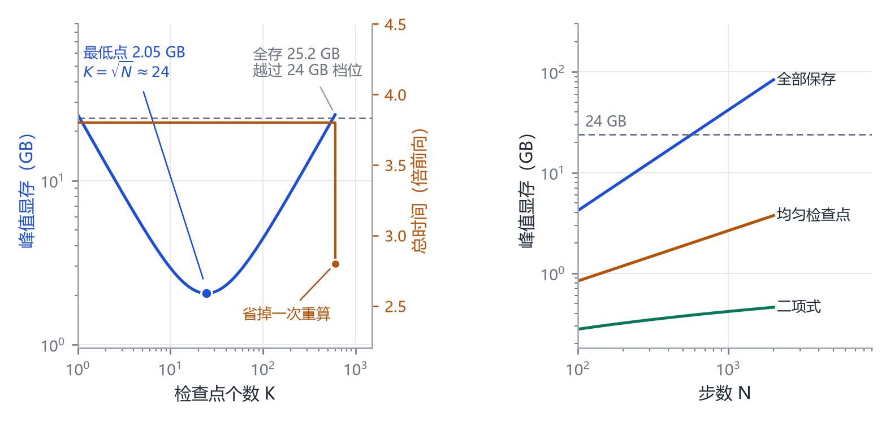

# 第 5 章 可微流体与伴随方程

> 本章导读：一缕烟要往左偏一点、在 1.2 秒时卷成一个涡。这句话翻译过去是几百万个未知数，只能靠梯度去搜。流体的一步里有三件事——平流、外力、投影，每一件的反向都得单独交代。这一章算清反向一遍要多少显存、多少时间，最后说明为什么在湍流里这个梯度会变成噪声。

## 5.1 六百步的账单

一缕烟从烟头升起。128³ 的网格，每秒 60 帧，算十秒，六百步。每一步要留下速度的三个分量、压力、烟的浓度，五个 128³ 的单精度场，$5\times128^{3}\times4$ 字节，合 41.9 MB。六百步连起来是 25 GB。

一张 24 GB 的卡，把这条十秒的轨迹完整存下来都做不到。这是做可微流体撞上的第一堵墙，而且它出现在写任何一行反向代码之前。

导演的要求是另一回事。烟在第 72 帧（1.2 秒）要卷起来，形状对上一张参考图。可调的旋钮摆在那里：初始涡量场，三个分量，每个 128³，六百三十万个数；或者随时间变化的风，六百步乘三个分量。目标函数是渲染图与参考图的差的平方，记作 $L$。

六百三十万个未知数，用有限差分求梯度就要六百三十万次前向。每次前向按分钟计，这个方案在纸上就不成立。梯度只能从一次前向里顺带算出来，这就是伴随的全部动机：反向一遍的成本与未知数的个数无关，只与时间步数有关。

代价转移到两个地方。时间上，反向一步比前向一步贵，因为流体的一步不是一个矩阵乘，而是三个映射的复合，每个映射的转置都要单独实现、单独调对。显存上，反向走时间倒序，第 $n$ 步的反向需要第 $n$ 步的状态，于是要么把六百步全存下来，要么重算。

一步流体在做什么，先把这件事摊开。记速度场为 $\mathbf{u}$，一步可以拆成三个映射：

$$
\mathbf{u}^{*} = \mathcal{A}(\mathbf{u}^{n}),\qquad
\mathbf{u}^{**} = \mathbf{u}^{*} + \Delta t\,\mathbf{f},\qquad
\mathbf{u}^{n+1} = \mathcal{P}(\mathbf{u}^{**}) .
\tag{5.1}
$$

$\mathcal{A}$ 是平流，把速度按自身搬运；$\mathbf{f}$ 是外力（重力、浮力、风力）除以密度；$\mathcal{P}$ 是投影，解一个压力泊松方程再减掉压力梯度，让结果无散。烟气浓度只被平流，不参与投影，所以它的反向只有 $\mathcal{A}^{\mathsf{T}}$ 这一件事。

反向走的是相反顺序，每一步要用到对应映射的转置：$\mathcal{P}^{\mathsf{T}}$、恒等（外力是线性加法）、$\mathcal{A}^{\mathsf{T}}$。三件事里投影的转置最省事也最容易被想复杂，平流的转置最麻烦，外力的转置几乎不要钱。

<figure class="fig">

<figcaption><b>图 5-1</b>　前向与伴随的时间线，示意图，不按比例。上排是前向：状态按 $t_0$ 到 $t_N$ 依次生成。中排对比两种显存策略——全存每一个状态，或只存若干个检查点、反向经过时把中间的状态重算出来。下排是反向：按 $t_N$ 到 $t_0$ 逆序，每一步解一次该步线性化算子的转置系统，虚线表示这一步需要哪一个前向状态。整张图的要点是两条：反向的路径长度与前向相同，所以时间至少翻倍；反向要走倒序，所以状态的存法决定了显存。</figcaption>
</figure>

## 5.2 不可压约束的伴随

MAC 网格上，速度存在面心，压力存在体心。散度算子 $\mathbf{D}$ 把面心速度映到体心标量，梯度算子 $\mathbf{G}$ 把体心压力映到面心。均匀网格上取好面积与体积的缩放之后，这两个算子精确互为负转置：

$$
\mathbf{G} = -\mathbf{D}^{\mathsf{T}} .
\tag{5.2}
$$

投影写成

$$
\mathbf{P} = \mathbf{I} - \mathbf{G}\,\mathbf{L}^{-1}\mathbf{D},\qquad
\mathbf{L} = \mathbf{D}\mathbf{G} = -\mathbf{D}\mathbf{D}^{\mathsf{T}} ,
\tag{5.3}
$$

$\mathbf{L}$ 是离散拉普拉斯，$\mathbf{I}$ 是单位算子。读法是：先算散度，解泊松拿到压力，再减掉压力梯度。$\mathbf{L}^{-1}$ 从不显式构造，每步解一次。

投影是幂等的，$\mathbf{P}^{2}=\mathbf{P}$。代进去看，$\mathbf{G}\mathbf{L}^{-1}\mathbf{D}\mathbf{G}\mathbf{L}^{-1}\mathbf{D}=\mathbf{G}\mathbf{L}^{-1}\mathbf{L}\mathbf{L}^{-1}\mathbf{D}=\mathbf{G}\mathbf{L}^{-1}\mathbf{D}$，中间那个 $\mathbf{L}$ 正好消掉。物理含义很朴素：投影一次之后速度已经无散，再投影一次不会变。

真正省事的一条性质是自伴。把 $\mathbf{P}$ 转置，用式 5.2 把 $\mathbf{G}^{\mathsf{T}}$ 换成 $-\mathbf{D}$、把 $\mathbf{D}^{\mathsf{T}}$ 换成 $-\mathbf{G}$，两个负号相乘抵消：

$$
\mathbf{P}^{\mathsf{T}} = \mathbf{I} - \mathbf{G}\,\mathbf{L}^{-\mathsf{T}}\mathbf{D} .
\tag{5.4}
$$

$\mathbf{L}=-\mathbf{D}\mathbf{D}^{\mathsf{T}}$ 对称，所以 $\mathbf{L}^{-\mathsf{T}}=\mathbf{L}^{-1}$，式 5.4 和式 5.3 是同一个式子。投影的伴随就是投影本身。

这条性质的工程含义很直接：反向经过投影时不需要新代码，也不需要第二个求解器。把上游传下来的梯度当作一份"速度"，算它的散度，解同一个泊松方程，再按同样的方式减掉梯度，就完事了。代价是一次泊松求解，与前向同样的价钱——压力求解往往占前向一步的一半以上，所以它也是反向一步的主要成本。

对称性会在四种情况下破掉，每种都要单独处理。

第一种是迭代求解器的停止准则。CG 或 Jacobi 按残差阈值停，那么"解泊松"这个动作对右端项就不是线性的：右端小的时候迭代少，右端大的时候迭代多。$\mathbf{P}$ 于是不再是一个固定矩阵，而是一个依赖输入的映射，它的雅可比不等于 $\mathbf{P}$ 本身。前向把残差放到 $10^{-4}$ 图快，反向的梯度就带着同一量级的偏差，而且这个偏差不是随机噪声，它会系统性地偏在某个方向上。要在反向里保住对称性，最省事的做法是把迭代次数写死，让求解器退化成严格线性的算子；代价是前向变慢，也算得比原来准。

第二种是自由表面。液体用 ghost fluid 处理界面时，拉普拉斯在界面附近的系数不再是常数，$\mathbf{L}$ 变得不对称，式 5.4 里的 $\mathbf{L}^{-\mathsf{T}}$ 就不能换成 $\mathbf{L}^{-1}$。这时反向要解转置系统，用 BiCGSTAB 之类的非对称求解器，价钱大约是前向的两倍。

第三种是变密度。烟和空气的密度差用 Boussinesq 近似时，$\mathbf{L}$ 变成 $\mathbf{D}\,\rho^{-1}\,\mathbf{D}^{\mathsf{T}}$，仍然对称。但密度由未知的标量场（温度、烟浓度）决定时，整个一步是非线性的，投影外面要套一层不动点迭代，反向也得跟着套，外层迭代的收敛容差同样会漏进梯度。

第四种是预条件子。用了多重网格或代数多重网格，预条件算子也要一起转置。对称的预条件子不成问题，非对称的（某些 ILU 变体）就得另写一份。

一个数量上的观察值得记下来：前向里压力只用于推进，反向里压力只用于传播梯度，两边都不需要保存压力场本身。省显存的第一条就是别存压力，五个场砍掉一个，25 GB 变成 20 GB。

稳态的伴随 CFD 里，这套写法从八十年代就成熟了：解一次伴随方程就拿到目标对全部设计变量的梯度。那里的"一步"只有一次，没有时间维度。非稳态的麻烦在于每一步都有一个泊松方程，反向就有六百个，成本随步数线性增长，而每一步的右端都不一样，没有一个可以复用的分解。

## 5.3 平流的伴随

半拉格朗日平流的写法是：对每个网格点 $x_c$，沿速度回溯一步，得到出发点 $x_d=x_c-\Delta t\,\mathbf{u}^{n}(x_c)$，在 $x_d$ 周围做三线性插值，

$$
u^{n+1}(x_c) = \sum_{k} w_{ck}\,u^{n}(x_k) ,
\tag{5.5}
$$

$u$ 是某一个速度分量（浓度同理），$x_k$ 是 $x_d$ 所在单元的八个角点，$w_{ck}$ 是三线性权重，八个加起来等于一。

写成矩阵，$\mathbf{W}$ 是一个每行八个非零元、每行和为一的稀疏矩阵。它从不被构造，只被应用：一次 gather，读八写一。

转置就是一次 scatter，把上游梯度按同样的权重加回八个角点：

$$
\bar{u}^{n}(x_k) \mathrel{+}= w_{ck}\,\bar{u}^{n+1}(x_c) .
\tag{5.6}
$$

浮点运算次数完全一样。变的是访存模式：gather 是读八写一，scatter 是读一写八。在 GPU 上后者要用原子加，多个网格点可能同时写同一个角点，累加顺序由调度决定。同一段代码跑两遍，梯度在最低几位上不一样。这不是 bug，是并行归约的固有性质；要复现就得固定归约顺序，或者用双精度累加再降回来。

真正麻烦的不是转置，是被丢掉的那一项。

式 5.5 里的权重 $w_{ck}$ 依赖出发点 $x_d$，而 $x_d$ 依赖 $\mathbf{u}^{n}(x_c)$。所以对 $\mathbf{u}^{n}$ 求导时，除了"取到的值变了"，还有"取样的位置挪了"：

$$
\frac{\partial u^{n+1}(x_c)}{\partial u^{n}(x_j)}
= w_{cj} \;-\; \Delta t\,\frac{\partial u^{n}}{\partial x}\bigg|_{x_d}\cdot\mathbf{e}_{c} ,
\tag{5.7}
$$

$\mathbf{e}_{c}$ 是 $u$ 在 $x_c$ 处的分量方向，第二项就是"位置挪动"的贡献。它的量级是 $\Delta t\,\partial u/\partial x$，用中心差分估一下就是 CFL 数 $|\mathbf{u}|\Delta t/h$，工程里通常取 0.5 到 1。

也就是说，把回溯位置当作常数（俗称冻结权重）的做法，丢掉的不是一个小修正，而是一个与主项同量级的东西。梯度检查会立刻把它抓出来：与中心差分对拍，相对偏差就是几十个百分点，量级与 CFL 相当，而不是与 $\Delta t$ 相当。

补上这一项要多花什么：一次在 $x_d$ 处求速度梯度（又一次 gather），加一次对出发点的 scatter。反向平流从一倍变成两倍左右的成本，实现上还要小心权重对坐标的导数——三线性权重的导数在单元内部是常数，跨单元处不连续，跨单元的那一层网格点上要单独取值。

用了误差补偿的平流（MacCormack、BFECC），一步里有两三次插值，正反两个方向都有，雅可比里的项更多。这种地方不要手推，让自动微分去展开，人只负责把算子写成可微的形式。

耗散与外力这两段反而简单。显式黏性 $\mathbf{u}^{**}=\mathbf{u}^{*}+\nu\Delta t\,\mathbf{L}_{v}\mathbf{u}^{*}$，$\mathbf{L}_{v}$ 是对称的七点拉普拉斯，转置就是它自己，一行代码都不用改。隐式黏性 $\left(\mathbf{I}-\nu\Delta t\,\mathbf{L}_{v}\right)^{-1}$ 的转置要解一次转置系统，$\mathbf{L}_{v}$ 对称，用的还是同一个求解器。黏度自己的梯度最便宜：$\partial L/\partial\nu$ 只需要把伴随速度与"拉普拉斯作用后的速度"做一次内积，一次全局归约。

## 5.4 显存

六百步、每步 42 MB、全存 25 GB。省显存的办法有四种，代价各不相同。

不存压力。压力只用于当前步的投影，反向不需要它。五个场砍到四个，25 GB 变 20 GB，省两成，聊胜于无。

fp16 存检查点。存的时候压一半，重算时转回 fp32，12.6 GB。麻烦在于从 fp16 的状态出发重算，得到的轨迹与原来那条不完全一样；耗散流里偏差有界，但梯度的保真度掉到 $10^{-3}$ 量级。粗调可以，做梯度检查不行。

均匀检查点。每 $K$ 步存一个状态，反向经过某一段时把这一段重算一遍，重算过程中把段内的状态留在显存里，走完再丢。峰值显存是

$$
M(K) = \left(K+\frac{N}{K}\right)S ,
\tag{5.8}
$$

$N$ 是总步数，$S$ 是单步状态的大小。第一项是检查点本身，第二项是正在重算的那一段的长度。对 $K$ 求极小得 $K=\sqrt{N}$，峰值是 $2\sqrt{N}\,S$。

代进 $N=600$、$S=41.9$ MB：最优的 $K$ 是 24 或 25，峰值 2.05 GB。比起全存的 25 GB 省了十二倍；比起一步不存、每步都从头重算（$N^{2}/2$ 次前向的活儿），时间省了三百倍。$\sqrt{N}$ 这个数很朴素，但它同时压住了显存与时间，是这类问题的通用答案。

二项式检查点（revolve）把这笔账做得更极端。它按二分的层次组织 $N$ 步，显存只要 $\log_{2}N$ 个状态，重算次数是 $O(\log N)$ 次前向。$N=600$ 时十个状态、420 MB，重算约两到三次前向。代价是实现复杂，而且要能精确重放——状态必须逐位可复现，这对用了原子加的 GPU 代码是一条硬要求。

时间上，检查点省不掉重算。一段 $K$ 步的段重算一遍就是 $K$ 步前向的工作量，六百步总共多出一次完整前向。加上反向本身约等于 1.8 次前向（多一次平流散射、多一次泊松、多一次外力转置），总时间约为前向的 3.8 倍；全存的话是 2.8 倍。

<figure class="fig">

<figcaption><b>图 5-2</b>　左：$N=600$ 步、单步状态 41.9 MB（128³ 网格，速度三分量加压力加浓度，单精度）时，峰值显存 $M(K)=(K+N/K)S$ 与总时间随检查点个数 $K$ 的变化，横纵轴均取对数。显存是 U 形，最低点在 $K=\sqrt{N}\approx24.5$，峰值 2.05 GB；虚线是 24 GB 的显存档位，全存策略正好越界。时间是分段常数：$K$ 小于 $N$ 时恒为前向的 3.8 倍（一次前向、一次重算、一次反向各按 1、1、1.8 计），只有 $K=N$ 时降到 2.8 倍。右：同一模型下三种策略的峰值显存随步数增长，全存按 $NS$ 线性涨，均匀检查点按 $2\sqrt{N}S$ 涨，二项式按 $\log_{2}N\cdot S$ 涨。曲线都是按公式算出来的，没有拟合。</figcaption>
</figure>

左右两张图说的是同一件事的两面。左图里，显存有最优解，时间是平的——把 $K$ 从 2 加到 500，显存先降后升，时间纹丝不动。这意味着检查点个数不是一个需要权衡的参数，它有一个明确的最优值，照着 $\sqrt{N}$ 取就行。右图里，三种策略的差距随步数拉大：步数翻四倍，全存的显存翻四倍，均匀检查点只翻两倍，二项式只多两个状态。

流体比布料在这件事上更吃亏。布料的隐式求解可以缓存矩阵分解，反向直接复用；流体的泊松方程每步右端都不同，反向必须重解一次，所以"重算一步"的价钱几乎等于"前向一步"，不存在打折。

## 5.5 长时窗

六百步的 rollout，梯度要穿过六百个雅可比矩阵的乘积。显存的问题上一节解决了，剩下的问题是这些梯度在时间上的形状。

反向传播在时间上的动作，可以直接读成一句话：把伴随速度场倒着平流。伴随的平流把上游梯度按速度场反向搬运，搬的过程中它同样被拉伸、折叠、压缩。结果是越往前传，梯度越散、越乱。

这与耗散直接相关。黏性和数值耗散都在抹掉小尺度，抹掉小尺度的同时也抹掉了"参数的信息"。改一下 0.1 秒时的风，这个改动要经过十秒的翻滚才能影响到最后一帧，而每一次翻滚都在把它的影响摊薄一层。于是 $\partial L/\partial(\text{0.1 秒的风})$ 接近零。

接近零不等于不重要。线性化说的是无穷小扰动；一个有限的改动（风偏 15%）可以完全改变烟的走向，可它的导数在参数空间的那个点上确实是零。这是"梯度看不见大改动"的典型样本，也是优化卡住的常见原因：损失对参数是平的，加大步长就跨过悬崖，减小步长就原地不动，调参调到怀疑人生。

处理办法有两条。截断：只对最后 0.3 秒求导，窗口起点的状态当作常数。偏差来自"窗口起点其实依赖参数"这件事，窗口越短偏差越大；只要窗口超过流场的记忆时间，偏差就落到可观测量之下。重加权：给近处的残差更大的权重，等于人为地把梯度的有效时间尺度压短，代价是远处的目标被弱化。

窗口长度怎么定，有一个可操作的判据。做一次前向，在中间某一帧加一个 $10^{-6}$ 的随机扰动，看这个扰动传到目标帧时还剩多少。剩下不到千分之一，这一段就可以截断；剩下百分之几，说明这一段的信息还在，必须求导穿过去。这个实验只要一两次前向，比任何理论估计都可靠。

## 5.6 湍流的梯度噪声

湍流的梯度问题不在算法，在流场本身。

先算一个数。128³ 的网格铺在 1 米的立方体里，格距 7.8 mm，最小能分辨的涡大约两格，16 mm。风速取 1 m/s。这个尺度上的翻转时间是

$$
\tau = \frac{\ell_{\min}}{u} = \frac{0.016}{1} = 16\ \text{ms} .
\tag{5.9}
$$

每一次翻转，两个初值相差 $\delta$ 的流场之间的差别大致乘上 $e$。要把 $10^{-9}$ 的差别放大到 $O(1)$，需要 $\ln 10^{9}\approx20.7$ 次，也就是 0.33 秒。

十秒的镜头，0.33 秒之后的所有细节与初值的第九位无关。换一种说法：$L$ 对初值的依赖在 0.33 秒之后就变成了一个随机数。梯度仍然存在，它是 $L$ 在某条特定轨迹上的线性化，可这条轨迹与"稍微改一下参数之后会发生什么"已经脱钩。

把网格加密，结论更刺眼。格距减半，最小可解尺度减半，翻转次数翻倍，可预报的窗口减半。提高分辨率让前向更准，同时让梯度更快失效。算得越准，优化越难，这是可微流体里最反直觉的一条。

数值层面的噪声有三处来源，量级都能估。泊松解到 $10^{-4}$，投影就不准到 $10^{-4}$，速度差 $10^{-4}$，经过九次翻转（0.15 秒）就长到 $O(1)$。单精度浮点的舍入是 $10^{-7}$，十六次翻转。平流的插值是二阶的，误差 $O(h^{2})$，它不是随机噪声而是一个系统性偏置，会一直留在梯度里，不会因为多跑几个种子而互相抵消。

既然这样，为什么还有人能做成？因为目标函数通常是粗的。要的是"烟在两秒时到达画面的左上三分之一"，不是"第 137 帧第 42 行第 7 列的浓度等于 0.031"。粗目标对细节不敏感，它的梯度被空间平均过，噪声被压下去，剩下的方向虽然仍有抖动，但期望方向是有意义的。实践里的配方基本都是这一条：低通滤波后的目标、时间平均后的目标、多个随机种子平均后的梯度。

对控制问题还有一条更实用的做法：短窗加滚动。每次只优化未来 0.3 到 0.5 秒的控制量，算了梯度，走一步，重新观测，再优化。窗口比可预报时间长，梯度就没意义；比它短，偏差就大。0.3 秒不是拍脑袋来的，它就是上面那个 $\ln(1/\delta)\,\tau$。

一个容易被忽略的细节：梯度噪声与目标函数的尺度有关。同一个流场，用像素差的平方做目标，噪声随分辨率的提高而增大；用"质心位置"或"总涡量"这类低阶矩做目标，噪声反而随分辨率提高而收敛。选目标函数的时候，噪声特性应该和物理精度一起考虑。

## 5.7 应用

三类问题，各自的账不同。

参数辨识。黏度、浮力系数、空气阻力、烟源的初始温度，未知数几个到几十个。这类问题用有限差分完全可行，一个参数一次前向；伴随的优势只是"一次算完"，在参数多、前向贵的时候才显出来。真正的困难在可辨识性：粗网格上黏度和数值耗散几乎等价，两者都能让涡衰减得一样快，梯度会在两个方向的组合上给出一个近乎奇异的 Hessian，优化器于是一路沿着那条退化方向漂。

控制。风机、火焰、爆炸、尾迹。未知数是时间序列，几百到几万个。这类必须用伴随，而且要用滚动窗口。把时间步写成循环、让自动微分穿过去、显存靠检查点压住，这套组合是 DiffTaichi 这类框架的主要用途 [@hu2020]。

形状优化。车身、船体、风机叶片。这是伴随方法最早的战场，稳态问题只解一次伴随方程。搬到这里要额外注意两点：目标是时间平均的还是某一帧的；几何扰动会不会引起网格拓扑变化，拓扑变了离散算子就变了，前后两次的梯度不可比。

判断该不该上伴随，看三个数。未知数的个数，超过一百个，有限差分就不划算。目标的时间跨度与可预报时间之比，超过三倍，梯度就只能当方向用，不能当下降方向用。流场是不是自由湍流，管内流动和喷口这类强制流动梯度干净，自由剪切层和尾迹里梯度很脏。

三个数都友好的时候，伴随给出的梯度与有限差分一致、成本低两个数量级，这类投入是值得的。有一个不友好，就该退回去用粗目标、短窗、随机化，或者在前面挂一层代理模型，让梯度只负责粗调。三个都不友好的时候，梯度不是工具，是错觉。
