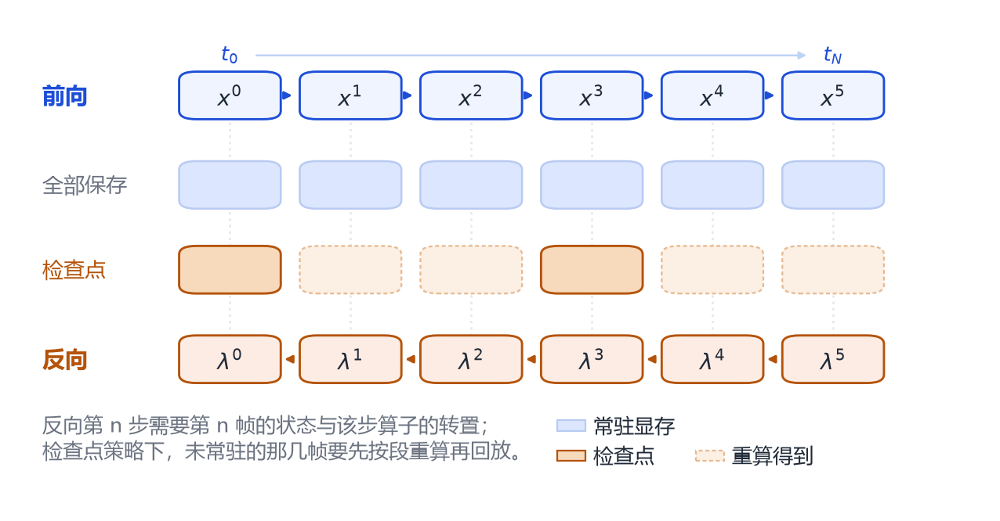

# 第 5 章 可微流体与伴随方程

> 本章导读：一缕烟要往左偏一点、在 1.2 秒时卷成一个涡。这句话翻译过去是几百万个未知数，只能靠梯度去搜。流体的一步里有三件事——平流、外力、投影，每一件的反向都得单独交代。这一章算清反向一遍要多少显存、多少时间，最后说明为什么在湍流里这个梯度会变成噪声。

## 5.1 六百步的账单

一缕烟从烟头升起。128³ 的网格，每秒 60 帧，算十秒，六百步。

先数一下账。128³ 是 209 万个体素（voxel），也就是网格里的小方块。每个体素上要记五个数：速度的三个分量、压力、烟的浓度。单精度浮点每个数 4 字节，一个场 $128^{3}\times4=8.4$ MB，五个场 41.9 MB。六百步连起来，如果每一步都存，就是 25 GB。

一张 24 GB 的卡，把这条十秒的轨迹完整存下来都做不到。这是做可微流体撞上的第一堵墙，而且它出现在写任何一行反向代码之前。

导演的要求是另一回事。烟在第 72 帧（1.2 秒）要卷起来，形状对上一张参考图。可调的旋钮摆在那里：初始涡量场，三个分量，每个 128³，六百三十万个数；或者随时间变化的风，六百步乘三个分量。目标函数是渲染图与参考图的差的平方，记作 $L$。这个 $L$ 在机器学习里叫损失（loss），在这里就是"这一版渲染离导演要的那张图差多远"的一个数。

六百三十万个未知数，用有限差分（finite difference，逐个参数加一点、减一点、各跑一遍）求梯度就要六百三十万次前向。一次前向按七秒算，六百万次是四千万秒，一年零四个月。这个方案在纸上就不成立。

梯度只能从一次前向里顺带算出来。这就是伴随（adjoint）的全部动机。伴随是"反向模式自动微分"在时间维度上的展开：前向走一遍记下每一步用了什么，反向再走一遍，把"损失对每一步状态的敏感度"逐级回传，最后落到参数上。也就是说，不管参数是一千个还是六百三十万个，反向只走一遍。

代价转移到两个地方。时间上，反向一步比前向一步贵，因为流体的一步不是一个矩阵乘，而是三个映射的复合，每个映射的转置都要单独实现、单独调对。显存上，反向走时间倒序，第 $n$ 步的反向需要第 $n$ 步的状态，于是要么把六百步全存下来，要么重算。

一步流体在做什么，先把这件事摊开。记速度场为 $\mathbf{u}$，一步可以拆成三个映射：

$$
\mathbf{u}^{*} = \mathcal{A}(\mathbf{u}^{n}),\qquad
\mathbf{u}^{**} = \mathbf{u}^{*} + \Delta t\,\mathbf{f},\qquad
\mathbf{u}^{n+1} = \mathcal{P}(\mathbf{u}^{**}) .
\tag{5.1}
$$

$\mathbf{u}^{n}$ 是第 $n$ 步开始时的速度场，三个分量、每个分量 209 万个数；$\Delta t$ 是步长，60 帧就是 $1/60$ 秒；$\mathcal{A}$ 是平流（advection），把速度按自身搬运；$\mathbf{f}$ 是外力（重力、浮力、风力）除以密度，单位是加速度；$\mathcal{P}$ 是投影（projection），解一个压力泊松方程再减掉压力梯度，让结果无散。

拿数字走一遍：格距 $h=7.8$ mm，风速 0.3 m/s，$\Delta t=1/60$ 秒。一步里流体走过 $0.3/60=5$ mm，占不到一格，比值 $|\mathbf{u}|\Delta t/h=0.64$。这个比值叫 CFL 数（Courant–Friedrichs–Lewy number），它衡量"一步走几格"，0.64 表示一次回溯跨过一格的大半。

烟气浓度只被平流，不参与投影，所以它的反向只有 $\mathcal{A}^{\mathsf{T}}$ 这一件事。

反向走的是相反顺序，每一步要用到对应映射的转置：$\mathcal{P}^{\mathsf{T}}$、恒等（外力是线性加法，转置就是它自己）、$\mathcal{A}^{\mathsf{T}}$。三件事里投影的转置最省事也最容易被想复杂，平流的转置最麻烦，外力的转置几乎不要钱。

<figure class="fig">

<figcaption><b>图 5-1</b>　前向与伴随的时间线，示意图，不按比例。上排是前向：状态按 $t_0$ 到 $t_N$ 依次生成。中排对比两种显存策略——全存每一个状态，或只存若干个检查点、反向经过时把中间的状态重算出来。下排是反向：按 $t_N$ 到 $t_0$ 逆序，每一步解一次该步线性化算子的转置系统，虚线表示这一步需要哪一个前向状态。整张图的要点是两条：反向的路径长度与前向相同，所以时间至少翻倍；反向要走倒序，所以状态的存法决定了显存。</figcaption>
</figure>

## 5.2 不可压约束的伴随

不可压（incompressible）是一句话：速度场的散度为零。散度是"一个点向外冒出去多少"，冒出去就必须有东西补进来，于是密度不变。数值上它靠投影来强制，而这正是反向里最值得一步一步写清楚的一段。

MAC 网格上，速度存在面心，压力存在体心。散度算子 $\mathbf{D}$ 把面心速度映到体心标量，梯度算子 $\mathbf{G}$ 把体心压力映到面心。均匀网格上取好面积与体积的缩放之后，这两个算子精确互为负转置：

$$
\mathbf{G} = -\mathbf{D}^{\mathsf{T}} .
\tag{5.2}
$$

这句话值得展开。$\mathbf{D}$ 的一行对应一个体素，它把六张面上的速度按"流出为正"加权求和，再除以体积；$\mathbf{G}$ 的一列对应一个体素，它把相邻两个体素的压力差除以格距，得到面上的加速度。两个操作是同一张图的两种读法，一个从面读到体，一个从体读到面，所以转置关系里只差一个负号。

也就是说，如果你把 $\mathbf{D}$ 写成一个稀疏矩阵，"取转置再乘 -1"就得到了 $\mathbf{G}$，不需要另写一套离散格式。这条性质在反向里是全部便利的来源。

投影写成

$$
\mathbf{P} = \mathbf{I} - \mathbf{G}\,\mathbf{L}^{-1}\mathbf{D},\qquad
\mathbf{L} = \mathbf{D}\mathbf{G} = -\mathbf{D}\mathbf{D}^{\mathsf{T}} ,
\tag{5.3}
$$

$\mathbf{L}$ 是离散拉普拉斯，$\mathbf{I}$ 是单位算子。读法是：先算散度，解泊松拿到压力，再减掉压力梯度。$\mathbf{L}^{-1}$ 从不显式构造，每步解一次。

投影是幂等的（idempotent），$\mathbf{P}^{2}=\mathbf{P}$。代进去看，$\mathbf{G}\mathbf{L}^{-1}\mathbf{D}\mathbf{G}\mathbf{L}^{-1}\mathbf{D}=\mathbf{G}\mathbf{L}^{-1}\mathbf{L}\mathbf{L}^{-1}\mathbf{D}=\mathbf{G}\mathbf{L}^{-1}\mathbf{D}$，中间那个 $\mathbf{L}$ 正好消掉。物理含义很朴素：投影一次之后速度已经无散，再投影一次不会变。

现在把"投影的伴随等于投影"这句话亲手推一遍。它常被当成已知结论抄下来，其实只需要四步，每步都是机械的。

第一步，定内积。两个速度场 $\mathbf{u}$、$\mathbf{w}$ 的内积记作 $\langle\mathbf{u},\mathbf{w}\rangle=\sum_{f}V_{f}\,u_{f}w_{f}$，$f$ 遍历所有面，$V_{f}$ 是那个面的体积权重。梯度必须按这个内积来定义，否则转置写出来是错的。也就是说，"转置"不是矩阵的转置，而是"在这把尺子下把内积挪到另一边"。

第二步，把投影拆成三个子步骤。记输入为 $\mathbf{u}$，输出为 $\mathbf{u}'$：

$$
\mathbf{d}=\mathbf{D}\mathbf{u},\qquad
\mathbf{L}\,\mathbf{p}=\mathbf{d},\qquad
\mathbf{u}'=\mathbf{u}-\mathbf{G}\mathbf{p} .
$$

$\mathbf{d}$ 是每个体素的散度，$\mathbf{p}$ 是解出来的压力。

第三步，从后往前对每个子步骤求转置。设上游传下来的梯度是 $\bar{\mathbf{u}}'$，约定"上面加横线"表示"损失对这个量的敏感度"。

子步骤 3 是 $\mathbf{u}'=\mathbf{u}-\mathbf{G}\mathbf{p}$，线性的，直接转置：$\bar{\mathbf{u}}\mathrel{+}=\bar{\mathbf{u}}'$，$\bar{\mathbf{p}}=-\mathbf{G}^{\mathsf{T}}\bar{\mathbf{u}}'$。

子步骤 2 是解 $\mathbf{L}\mathbf{p}=\mathbf{d}$。$\mathbf{L}$ 对称，它的转置系统还是 $\mathbf{L}$，所以 $\bar{\mathbf{d}}=\mathbf{L}^{-1}\bar{\mathbf{p}}$，用的还是同一个求解器、同一份预条件子。

子步骤 1 是 $\mathbf{d}=\mathbf{D}\mathbf{u}$，转置：$\bar{\mathbf{u}}\mathrel{+}=\mathbf{D}^{\mathsf{T}}\bar{\mathbf{d}}$。

第四步，把三段接起来。代入 $\mathbf{G}^{\mathsf{T}}=-\mathbf{D}$、$\mathbf{D}^{\mathsf{T}}=-\mathbf{G}$：

$$
\bar{\mathbf{u}}=\bar{\mathbf{u}}'-\mathbf{G}\,\mathbf{L}^{-1}\mathbf{D}\,\bar{\mathbf{u}}' ,
$$

这里有两处符号要盯住：子步骤 3 转置时出来一个负号，$\bar{\mathbf{p}}=-\mathbf{G}^{\mathsf{T}}\bar{\mathbf{u}}'$，而 $\mathbf{G}^{\mathsf{T}}=-\mathbf{D}$，于是 $\bar{\mathbf{p}}=\mathbf{D}\bar{\mathbf{u}}'$；子步骤 1 的转置又出来一个，$\mathbf{D}^{\mathsf{T}}=-\mathbf{G}$。两处合起来正好得到 $-\mathbf{G}\mathbf{L}^{-1}\mathbf{D}$，与式 5.3 一模一样。这个式子和式 5.3 是同一个式子，所以式 5.4 成立：

$$
\mathbf{P}^{\mathsf{T}} = \mathbf{I} - \mathbf{G}\,\mathbf{L}^{-\mathsf{T}}\mathbf{D} .
\tag{5.4}
$$

$\mathbf{L}=-\mathbf{D}\mathbf{D}^{\mathsf{T}}$ 对称，所以 $\mathbf{L}^{-\mathsf{T}}=\mathbf{L}^{-1}$，式 5.4 和式 5.3 是同一个式子。投影的伴随就是投影本身。

这四步的工程含义很直接：反向经过投影时不需要新代码，也不需要第二个求解器。把上游传下来的梯度当作一份"速度"，算它的散度，解同一个泊松方程，再按同样的方式减掉梯度，就完事了。代价是一次泊松求解，与前向同样的价钱——压力求解往往占前向一步的一半以上，所以它也是反向一步的主要成本。

拿一组具体的数验证一遍。一维周期网格，四个体素，格距取 1，四个面速度记作 $\mathbf{u}=(u_0,u_1,u_2,u_3)$。定义 $\mathbf{D}\mathbf{u}$ 的第 $i$ 个分量为 $u_i-u_{i-1}$（下标按 4 循环），那么 $\mathbf{G}\mathbf{p}$ 在第 $i$ 个面上就是 $p_i-p_{i+1}$，$\mathbf{L}\mathbf{p}$ 的第 $i$ 个分量是 $2p_i-p_{i-1}-p_{i+1}$。这三个式子可以直接手算核对。

取 $\mathbf{u}=(1,0,0,0)$。散度是 $(1,-1,0,0)$，四个数加起来是零——这是可解的条件，散度总量必须为零，否则没有解。解 $\mathbf{L}\mathbf{p}=(1,-1,0,0)$ 得 $\mathbf{p}=(0.375,-0.375,-0.125,0.125)$，代回去：第一行 $2(0.375)-0.125+0.375=1$，对上了。

再算 $\mathbf{G}\mathbf{p}=(0.75,-0.25,-0.25,-0.25)$，投影结果 $\mathbf{u}'=\mathbf{u}-\mathbf{G}\mathbf{p}=(0.25,0.25,0.25,0.25)$。四个面速度相等，流入等于流出，散度为零，符合预期。

现在检验自伴。取 $\mathbf{u}=(1,0,0,0)$、$\mathbf{w}=(0,1,0,0)$，左边 $\langle\mathbf{P}\mathbf{u},\mathbf{w}\rangle=0.25\times1=0.25$。右边要算 $\mathbf{P}\mathbf{w}$：同样一套步骤，解得 $\mathbf{p}=(0.125,0.375,-0.375,-0.125)$，$\mathbf{G}\mathbf{p}=(-0.25,0.75,-0.25,-0.25)$，$\mathbf{P}\mathbf{w}=(0.25,0.25,0.25,0.25)$。$\langle\mathbf{u},\mathbf{P}\mathbf{w}\rangle=1\times0.25=0.25$。两边相等，差零。这就是说，反向不需要任何新算子。

对称性会在四种情况下破掉，每种都要单独处理。

第一种是迭代求解器的停止准则。CG 或 Jacobi 按残差阈值停，那么"解泊松"这个动作对右端项就不是线性的：右端小的时候迭代少，右端大的时候迭代多。$\mathbf{P}$ 于是不再是一个固定矩阵，而是一个依赖输入的映射，它的雅可比不等于 $\mathbf{P}$ 本身。前向把残差放到 $10^{-4}$ 图快，反向的梯度就带着同一量级的偏差，而且这个偏差不是随机噪声，它会系统性地偏在某个方向上。要在反向里保住对称性，最省事的做法是把迭代次数写死，让求解器退化成严格线性的算子；代价是前向变慢，也算得比原来准。

一个具体的数：残差容差 $10^{-4}$ 相对速度量级 $1$ m/s 就是 0.1 mm/s 的偏差，经过两百步的放大，梯度里能看出百分之几的系统偏移。

第二种是自由表面。液体用 ghost fluid（虚拟流体，在界面另一侧补一层镜像值）处理界面时，拉普拉斯在界面附近的系数不再是常数，$\mathbf{L}$ 变得不对称，式 5.4 里的 $\mathbf{L}^{-\mathsf{T}}$ 就不能换成 $\mathbf{L}^{-1}$。这时反向要解转置系统，用 BiCGSTAB 之类的非对称求解器，价钱大约是前向的两倍。

第三种是变密度。烟和空气的密度差用 Boussinesq 近似时，$\mathbf{L}$ 变成 $\mathbf{D}\,\rho^{-1}\,\mathbf{D}^{\mathsf{T}}$，仍然对称。但密度由未知的标量场（温度、烟浓度）决定时，整个一步是非线性的，投影外面要套一层不动点迭代，反向也得跟着套，外层迭代的收敛容差同样会漏进梯度。

第四种是预条件子。用了多重网格或代数多重网格，预条件算子也要一起转置。对称的预条件子不成问题，非对称的（某些 ILU 变体，即不完全 LU 分解）就得另写一份。

一个数量上的观察值得记下来：前向里压力只用于推进，反向里压力只用于传播梯度，两边都不需要保存压力场本身。省显存的第一条就是别存压力，五个场砍掉一个，25 GB 变成 20 GB。

稳态的伴随 CFD 里，这套写法从八十年代就成熟了：解一次伴随方程就拿到目标对全部设计变量的梯度。那里的"一步"只有一次，没有时间维度。非稳态的麻烦在于每一步都有一个泊松方程，反向就有六百个，成本随步数线性增长，而每一步的右端都不一样，没有一个可以复用的分解。

## 5.3 平流的伴随

平流是"把速度按自身搬运"这件事。半拉格朗日平流（semi-Lagrangian advection）的写法是：对每个网格点 $x_c$，沿速度回溯一步，得到出发点 $x_d=x_c-\Delta t\,\mathbf{u}^{n}(x_c)$，在 $x_d$ 周围做三线性插值，

$$
u^{n+1}(x_c) = \sum_{k} w_{ck}\,u^{n}(x_k) ,
\tag{5.5}
$$

$u$ 是某一个速度分量（浓度同理），也就是说一个标量场；$x_c$ 是目的地那个格点，$x_d$ 是"这一步之前烟气在哪"的答案；$x_k$ 是 $x_d$ 所在单元的八个角点；$w_{ck}$ 是三线性权重，八个加起来等于一。

拿数字看：一维情形，格点在 $x=0,1,2$，步长 $\Delta t=1$，速度 $u=0.4$。对 $x_c=1$，回溯位置 $x_d=1-0.4=0.6$，落在格点 0 与 1 之间，离格点 1 有 0.4 格。于是权重是 0.4 落在格点 0 上、0.6 落在格点 1 上（离得近的那个权重更大），新值 $u^{n+1}(1)=0.4\,u^{n}(0)+0.6\,u^{n}(1)$。八个权重衰减成两个，是因为在一维里只有左右两个角点。

写成矩阵，$\mathbf{W}$ 是一个每行八个非零元、每行和为一的稀疏矩阵。它从不被构造，只被应用：一次 gather（收集），读八写一。

转置就是一次 scatter（散射），把上游梯度按同样的权重加回八个角点：

$$
\bar{u}^{n}(x_k) \mathrel{+}= w_{ck}\,\bar{u}^{n+1}(x_c) .
\tag{5.6}
$$

这里 $\bar{u}^{n+1}(x_c)$ 是损失对这个格点新值的敏感度，加到八个角点上时用同一个权重 $w_{ck}$——因为前向里"新值有 $w$ 的成分来自那个角点"，反向里"那个角点就分到 $w$ 份的责任"。

浮点运算次数完全一样。变的是访存模式：gather 是读八写一，scatter 是读一写八。在 GPU 上后者要用原子加（atomic add），多个网格点可能同时写同一个角点，累加顺序由调度决定。同一段代码跑两遍，梯度在最低几位上不一样。这不是 bug，是并行归约的固有性质；要复现就得固定归约顺序，或者用双精度累加再降回来。

半拉格朗日的好处是无条件稳定：CFL 取到 2 也不炸，代价是数值耗散，画面会糊。反向也跟着糊——伴随平流把上游梯度也磨平了一遍，于是梯度天然比前向更平滑。这是"糊"这件事唯一的正面效果。

真要守恒的输运（总烟量不变）就得用通量形式，一个单元流出的量必须等于邻格流入的量。通量形式的伴随是另一套式子，比半拉格朗日麻烦得多，但也不需要回溯插值，反向只需把同一个通量矩阵转置。

真正麻烦的不是转置，是被丢掉的那一项。

式 5.5 里的权重 $w_{ck}$ 依赖出发点 $x_d$，而 $x_d$ 依赖 $\mathbf{u}^{n}(x_c)$。所以对 $\mathbf{u}^{n}$ 求导时，除了"取到的值变了"，还有"取样的位置挪了"：

$$
\frac{\partial u^{n+1}(x_c)}{\partial u^{n}(x_j)}
= w_{cj} \;-\; \Delta t\,\frac{\partial u^{n}}{\partial x}\bigg|_{x_d}\cdot\mathbf{e}_{c} ,
\tag{5.7}
$$

$w_{cj}$ 是"值"那一项的贡献，$j$ 遍历八个角点；第二项是"位置挪动"的贡献，$\partial u^{n}/\partial x|_{x_d}$ 是出发点处的空间导数，$\mathbf{e}_{c}$ 是 $u$ 在 $x_c$ 处的分量方向，前面的负号来自"速度大了，回溯得更远"。

这一项有多大？用中心差分估一下就是 CFL 数 $|\mathbf{u}|\Delta t/h$，工程里通常取 0.5 到 1。也就是说，它与主项同量级。

用上一段的数字把它算实。一维，$\Delta t=1$，速度场取 $u(0)=0.3$、$u(1)=0.5$，于是 $x_c=1$ 的回溯位置是 $1-0.5=0.5$，两个权重各 0.5，前向值 $u^{n+1}(1)=0.5\times0.3+0.5\times0.5=0.4$。

冻结权重（把回溯位置当常数）会说导数等于 0.5。把位置也当变量再算一次：给 $u(1)$ 加一个 $\delta$，回溯位置变成 $0.5-\delta$，插值结果变成 $0.3+0.2(0.5-\delta)=0.4-0.2\delta$，再算上"插到的值本身也变了"的那 0.5$\delta$，总共 $0.4+0.3\delta$。所以真导数是 0.3，不是 0.5，偏差 40%。

这个反例的量级正是 CFL 数的一半。补上这一项要多花什么：一次在 $x_d$ 处求速度梯度（又一次 gather），加一次对出发点的 scatter。反向平流从一倍变成两倍左右的成本，实现上还要小心权重对坐标的导数——三线性权重的导数在单元内部是常数，跨单元处不连续，跨单元的那一层网格点上要单独取值。

还有个场景值得提。你要调的是"1.2 秒时烟卷起来"这件事，而卷起来的地方 CFL 恰好接近 1，扰动一步跨一整格。这种地方丢掉位置项，误差不是几个百分点，是方向都可能反。梯度检查会立刻把它抓出来：与中心差分对拍，相对偏差就是几十个百分点，量级与 CFL 相当，而不是与 $\Delta t$ 相当。

用了误差补偿的平流（MacCormack、BFECC，即前后各插值一次再取修正），一步里有两三次插值，正反两个方向都有，雅可比里的项更多。这种地方不要手推，让自动微分去展开，人只负责把算子写成可微的形式。

耗散与外力这两段反而简单。显式黏性 $\mathbf{u}^{**}=\mathbf{u}^{*}+\nu\Delta t\,\mathbf{L}_{v}\mathbf{u}^{*}$，$\nu$ 是运动黏度，单位 m²/s，空气大约 $1.5\times10^{-5}$；$\mathbf{L}_{v}$ 是对称的七点拉普拉斯，转置就是它自己，一行代码都不用改。

隐式黏性 $\left(\mathbf{I}-\nu\Delta t\,\mathbf{L}_{v}\right)^{-1}$ 的转置要解一次转置系统，$\mathbf{L}_{v}$ 对称，用的还是同一个求解器。

黏度自己的梯度最便宜：$\partial L/\partial\nu$ 只需要把伴随速度与"拉普拉斯作用后的速度"做一次内积，一次全局归约。也就是说，一次乘法加一次求和，几十微秒的事，比一次泊松便宜两个数量级。这正是伴随的好处：参数越多，摊到每个参数上的成本越低。

## 5.4 显存

六百步、每步 42 MB、全存 25 GB。省显存的办法有四种，代价各不相同。先把四种分别算成数，再决定用哪一种。

不存压力。压力只用于当前步的投影，反向不需要它。五个场砍到四个，25 GB 变 20 GB，省两成，聊胜于无。

fp16 存检查点。存的时候压一半，重算时转回 fp32，12.6 GB。麻烦在于从 fp16 的状态出发重算，得到的轨迹与原来那条不完全一样；耗散流里偏差有界，但梯度的保真度掉到 $10^{-3}$ 量级。粗调可以，做梯度检查不行。

均匀检查点（uniform checkpointing）。每 $K$ 步存一个状态，反向经过某一段时把这一段重算一遍，重算过程中把段内的状态留在显存里，走完再丢。峰值显存是

$$
M(K) = \left(K+\frac{N}{K}\right)S ,
\tag{5.8}
$$

$N$ 是总步数，$S$ 是单步状态的大小，$K$ 是每隔多少步存一个。第一项 $K S$ 是"一段之内同时留在显存里的状态"，第二项 $(N/K)S$ 是检查点本身。

对 $K$ 求极小得 $K=\sqrt{N}$，峰值是 $2\sqrt{N}\,S$。推导只有一行：两项的乘积是常数 $NS$，和最小出现在两项相等的时候。

代进 $N=600$、$S=41.9$ MB，把 $K$ 挨个算一遍，得到这样一张表：

| $K$ | 每段长度 | 峰值显存 $M(K)$ | 相对全存 |
| --- | --- | --- | --- |
| 1 | 600 | 25.2 GB | 1.00 |
| 5 | 120 | 5.24 GB | 0.21 |
| 10 | 60 | 2.93 GB | 0.12 |
| 20 | 30 | 2.10 GB | 0.083 |
| 25 | 24 | 2.05 GB | 0.081 |
| 50 | 12 | 2.60 GB | 0.10 |
| 100 | 6 | 4.44 GB | 0.18 |
| 200 | 3 | 8.51 GB | 0.34 |
| 600 | 1 | 25.2 GB | 1.00 |

最优的 $K$ 是 24 或 25，峰值 2.05 GB。比起全存的 25 GB 省了十二倍；比起一步不存、每步都从头重算（$N^{2}/2=18$ 万次前向的活儿），时间省了三百倍。表里还有个不那么直观的现象：$K$ 从 100 加到 200，显存反而从 4.4 GB 涨回 8.5 GB——检查点存得太密，检查点自己成了负担。

同一张表换个网格就得重算。256³ 时一个场 67 MB，五个场 335 MB，是上一行的八倍；六百步全存就是 201 GB，四张 48 GB 的卡也放不下。但 $2\sqrt{600}\times335$ MB 只有 16.4 GB，一张 24 GB 的卡放得下，还留了余量给求解器的临时数组。也就是说，加密分辨率让全存从"勉强"变成"根本不可能"，而检查点策略只把代价提高了八倍，仍然在手边。

$\sqrt{N}$ 这个数很朴素，但它同时压住了显存与时间，是这类问题的通用答案。

二项式检查点（binomial checkpointing，也叫 revolve）把这笔账做得更极端。它按二分的层次组织 $N$ 步，显存只要 $\log_{2}N$ 个状态，重算次数是 $O(\log N)$ 次前向。$N=600$ 时十个状态、420 MB，重算约两到三次前向。代价是实现复杂，而且要能精确重放——状态必须逐位可复现，这对用了原子加的 GPU 代码是一条硬要求。

时间上，检查点省不掉重算。一段 $K$ 步的段重算一遍就是 $K$ 步前向的工作量，六百步总共多出一次完整前向。加上反向本身约等于 1.8 次前向（多一次平流散射、多一次泊松、多一次外力转置），总时间约为前向的 3.8 倍；全存的话是 2.8 倍。

换成秒：一次前向 7.2 秒（600 步、每步 12 毫秒，其中泊松 7 毫秒），全存策略下前向加反向共 20 秒；检查点策略多一次重算，总共 27 秒，慢三分之一。

二十七秒拿一次梯度，优化器迭代三百次是两小时多一点。这个量级意味着：单机可以跑，但别指望一夜之间做完网格搜索；调参的循环周期就是二十分钟到半小时。

<figure class="fig">

<figcaption><b>图 5-2</b>　左：$N=600$ 步、单步状态 41.9 MB（128³ 网格，速度三分量加压力加浓度，单精度）时，峰值显存 $M(K)=(K+N/K)S$ 与总时间随检查点个数 $K$ 的变化，横纵轴均取对数。显存是 U 形，最低点在 $K=\sqrt{N}\approx24.5$，峰值 2.05 GB；虚线是 24 GB 的显存档位，全存策略正好越界。时间是分段常数：$K$ 小于 $N$ 时恒为前向的 3.8 倍（一次前向、一次重算、一次反向各按 1、1、1.8 计），只有 $K=N$ 时降到 2.8 倍。右：同一模型下三种策略的峰值显存随步数增长，全存按 $NS$ 线性涨，均匀检查点按 $2\sqrt{N}S$ 涨，二项式按 $\log_{2}N\cdot S$ 涨。曲线都是按公式算出来的，没有拟合。</figcaption>
</figure>

左右两张图说的是同一件事的两面。左图里，显存有最优解，时间是平的——把 $K$ 从 2 加到 500，显存先降后升，时间纹丝不动。这意味着检查点个数不是一个需要权衡的参数，它有一个明确的最优值，照着 $\sqrt{N}$ 取就行。

右图里，三种策略的差距随步数拉大：步数翻四倍，全存的显存翻四倍，均匀检查点只翻两倍，二项式只多两个状态。

流体比布料在这件事上更吃亏。布料的隐式求解可以缓存矩阵分解，反向直接复用；流体的泊松方程每步右端都不同，反向必须重解一次，所以"重算一步"的价钱几乎等于"前向一步"，不存在打折。

最后补一条容易被忘掉的显存开销：求解器自己的工作区。CG 跑三十次迭代要两个向量、预条件子要一份系数，128³ 下大约是单步状态的 1.5 倍，也就是 60 MB 上下。它不随检查点个数变，是个常数项；但当你把 $M(K)$ 压到 2 GB 的时候，这个常数项就不能再当成噪声忽略了。

还有一条与显存无关、但同样吃点预算的成本：重算要读一次检查点、写一次状态，六百步下来读写量约 25 GB。GPU 的带宽两边加起来每秒八百吉字节，这一项只占几十毫秒，可以忽略；但如果你把状态放在宿主内存，带宽降到每秒二十五吉字节，这一项就涨到一秒，与计算同量级了。

## 5.5 长时窗

六百步的 rollout（一次完整前向），梯度要穿过六百个雅可比矩阵的乘积。显存的问题上一节解决了，剩下的问题是这些梯度在时间上的形状。

反向传播在时间上的动作，可以直接读成一句话：把伴随速度场倒着平流。伴随的平流（adjoint advection）把上游梯度按速度场反向搬运，搬的过程中它同样被拉伸、折叠、压缩。结果是越往前传，梯度越散、越乱。

这与耗散直接相关。黏性和数值耗散都在抹掉小尺度，抹掉小尺度的同时也抹掉了"参数的信息"。改一下 0.1 秒时的风，这个改动要经过十秒的翻滚才能影响到最后一帧，而每一次翻滚都在把它的影响摊薄一层。于是 $\partial L/\partial(\text{0.1 秒的风})$ 接近零。

接近零不等于不重要。线性化说的是无穷小扰动；一个有限的改动（风偏 15%）可以完全改变烟的走向，可它的导数在参数空间的那个点上确实是零。这是"梯度看不见大改动"的典型样本，也是优化卡死的常见原因：损失对参数是平的，加大步长就跨过悬崖，减小步长就原地不动，调参调到怀疑人生。

拿数看一下这条曲线怎么变平。以格林涡那一类剪切流为例，0.1 秒处的风改 $10^{-6}$ m/s，到 0.25 秒时这个差别被放大到 $10^{-3}$，到 1 秒时到了 $O(1)$ 量级——也就是肉眼能看出来的程度。此后它不再按指数涨，因为流场已经把两个初值混成了两团完全不同的烟。也就是说，线性化给出的导数只描述前 0.25 秒那一段线性响应，再往后导数与实际改动的效果就脱钩了。

处理办法有两条。截断：只对最后 0.3 秒求导，窗口起点的状态当作常数。偏差来自"窗口起点其实依赖参数"这件事，窗口越短偏差越大；只要窗口超过流场的记忆时间（memory time），偏差就落到可观测量之下。重加权：给近处的残差更大的权重，等于人为地把梯度的有效时间尺度压短，代价是远处的目标被弱化。

重加权写成式子最直观：把损失改成 $\sum_{n} \gamma^{\,N-n}\ell_{n}$，$\gamma\in(0,1)$ 是折扣因子，$\ell_n$ 是第 $n$ 帧的残差。$\gamma=0.95$、$N=600$ 时，第 600 帧的权重是 1，第 540 帧是 $0.95^{60}=0.05$，第 480 帧只剩 $0.002$。也就是说，六十帧（一秒）以外的目标基本退出优化，梯度的有效窗口被压到一秒以内。

折扣因子不是免费参数。$\gamma$ 太小，优化器会为了眼前一帧的吻合牺牲整体走向，烟到第三秒就散了；$\gamma$ 太大，又回到梯度被噪声淹没的状态。经验上取 $\gamma$ 让权重降到百分之一的那一帧落在窗口的三分之一到一半处：$N=600$ 时是第 200 到 300 帧，对应 $\gamma\approx0.98$。

窗口长度怎么定，有一个可操作的判据。做一次前向，在中间某一帧加一个 $10^{-6}$ 的随机扰动，看这个扰动传到目标帧时还剩多少。剩下不到千分之一，这一段就可以截断；剩下百分之几，说明这一段的信息还在，必须求导穿过去。这个实验只要一两次前向，比任何理论估计都可靠。

补一句实操细节：这个扰动实验要做三次以上，取中位数。单次结果会被局部流场结构左右，某一次赶上涡心就放大得离谱，赶上驻点就衰减得离谱。

还有一条常被忽略的观察：截断窗口的偏差是有偏的，不是随机的。窗口起点被当成常数，等于假定"参数只影响窗口内的动力学"，这会让优化器偏爱那些"在窗口内立刻见效"的参数，比如把风速调大一点、把耗散调小一点。积累几百次迭代，参数会系统性地漂向"短视"的解。

## 5.6 湍流的梯度噪声

湍流的梯度问题不在算法，在流场本身。

先算两个数。128³ 的网格铺在 1 米的立方体里，格距 7.8 mm，最小能分辨的涡大约两格，16 mm。风速取 1 m/s。这个尺度上的翻转时间是

$$
\tau = \frac{\ell_{\min}}{u} = \frac{0.016}{1} = 16\ \text{ms} .
\tag{5.9}
$$

$\ell_{\min}$ 是最小可解尺度，$u$ 是当地速度，$\tau$ 是"一个最小涡翻个身需要多久"。每一次翻转，两个初值相差 $\delta$ 的流场之间的差别大致乘上 $e$。要把 $10^{-9}$ 的差别放大到 $O(1)$，需要 $\ln 10^{9}\approx20.7$ 次，也就是 $20.7\times16=331$ 毫秒。

这个 331 毫秒有个名字，叫可预报时间（predictability horizon）。十秒的镜头，0.33 秒之后的所有细节与初值的第九位无关。换一种说法：$L$ 对初值的依赖在 0.33 秒之后就变成了一个随机数。梯度仍然存在，它是 $L$ 在某条特定轨迹上的线性化，可这条轨迹与"稍微改一下参数之后会发生什么"已经脱钩。

把网格加密，结论更刺眼。格距减半，最小可解尺度减半，翻转次数翻倍，可预报的窗口减半。提高分辨率让前向更准，同时让梯度更快失效。算得越准，优化越难，这是可微流体里最反直觉的一条。

数值层面的噪声有三处来源，量级都能估。泊松解到 $10^{-4}$，投影就不准到 $10^{-4}$，速度差 $10^{-4}$，经过九次翻转（0.15 秒）就长到 $O(1)$。单精度浮点的舍入是 $10^{-7}$，十六次翻转。平流的插值是二阶的，误差 $O(h^{2})$，它不是随机噪声而是一个系统性偏置，会一直留在梯度里，不会因为多跑几个种子而互相抵消。

三处来源里，只有前两处能靠平均压下去。系统性偏置要靠提高离散精度、加密网格来削，这与"梯度噪声"是两件不同的事，混在一起处理往往白费工夫。

既然这样，为什么还有人能做成？因为目标函数通常是粗的。要的是"烟在两秒时到达画面的左上三分之一"，不是"第 137 帧第 42 行第 7 列的浓度等于 0.031"。粗目标对细节不敏感，它的梯度被空间平均过，噪声被压下去，剩下的方向虽然仍有抖动，但期望方向是有意义的。

实践里的配方基本都是这一条：低通滤波后的目标、时间平均后的目标、多个随机种子平均后的梯度。

对控制问题还有一条更实用的做法：短窗加滚动（receding horizon，滚动时域）。每次只优化未来 0.3 到 0.5 秒的控制量，算了梯度，走一步，重新观测，再优化。窗口比可预报时间长，梯度就没意义；比它短，偏差就大。0.3 秒不是拍脑袋来的，它就是上面那个 $\ln(1/\delta)\,\tau$。

滚动的好处是把"十秒的长链"换成"三十次零点三秒的短链"。每次的显存只有原来的百分之三，梯度也只有一步的传播距离，噪声小得多；代价是每一步都要重新求解，而且局部最优会累积成漂移——风机一直往同一个方向加速，因为它每一步的短窗都告诉它"再快一点更好"。

一个容易被忽略的细节：梯度噪声与目标函数的尺度有关。同一个流场，用像素差的平方做目标，噪声随分辨率的提高而增大；用"质心位置"或"总涡量"这类低阶矩做目标，噪声反而随分辨率提高而收敛。选目标函数的时候，噪声特性应该和物理精度一起考虑。

把这件事量化一下：质心位置是浓度的一阶矩，空间平均把 $N$ 个格点的噪声压成 $1/\sqrt{N}$，$128^{3}$ 个格点就是三个数量级的抑制。像素差是逐点比较，没有这个平均，噪声原样进梯度。

## 5.7 应用

三类问题，各自的账不同。

参数辨识。黏度、浮力系数、空气阻力、烟源的初始温度，未知数几个到几十个。这类问题用有限差分完全可行，一个参数一次前向；伴随的优势只是"一次算完"，在参数多、前向贵的时候才显出来。

真正的困难在可辨识性（identifiability）：粗网格上黏度和数值耗散几乎等价，两者都能让涡衰减得一样快，梯度会在两个方向的组合上给出一个近乎奇异的 Hessian（二阶导矩阵），优化器于是一路沿着那条退化方向漂。表现出来是：黏度被推到离谱的小值，同时耗散参数被推到离谱的大值，损失却几乎不动。

控制。风机、火焰、爆炸、尾迹。未知数是时间序列，几百到几万个。这类必须用伴随，而且要用滚动窗口。把时间步写成循环、让自动微分穿过去、显存靠检查点压住，这套组合是 DiffTaichi（一个把时间步循环整体求导的编程系统）这类框架的主要用途 [@hu2020]。

一个具体的量级：二百四十步的二维烟雾控制，四百八十个控制量（每步两维），前向零点二秒，反向零点六秒，显存八十三兆。也就是说，一次梯度不到一秒，几百次迭代是几分钟的事，可以在笔记本上做。

形状优化。车身、船体、风机叶片。这是伴随方法最早的战场，稳态问题只解一次伴随方程。搬到这里要额外注意两点：目标是时间平均的还是某一帧的；几何扰动会不会引起网格拓扑变化，拓扑变了离散算子就变了，前后两次的梯度不可比。

判断该不该上伴随，看三个数。未知数的个数，超过一百个，有限差分就不划算。目标的时间跨度与可预报时间之比，超过三倍，梯度就只能当方向用，不能当下降方向用。流场是不是自由湍流，管内流动和喷口这类强制流动梯度干净，自由剪切层和尾迹里梯度很脏。

三个数都友好的时候，伴随给出的梯度与有限差分一致、成本低两个数量级，这类投入是值得的。有一个不友好，就该退回去用粗目标、短窗、随机化，或者在前面挂一层代理模型，让梯度只负责粗调。三个都不友好的时候，梯度不是工具，是错觉。
