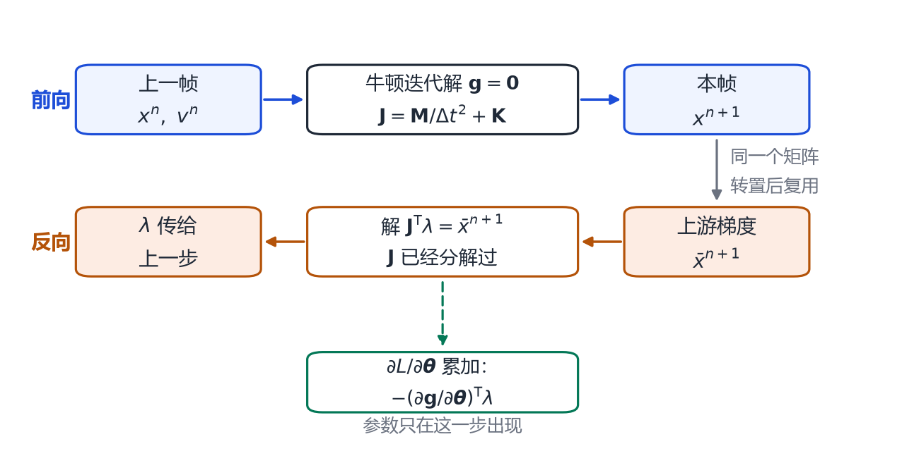

# 第 6 章 可微柔体与布料

> 本章导读：一段丝绸在风扇前飘了四秒，要在一块布上复现出同样的褶皱密度和下垂感。手调参数要两三天，换成梯度下降只要一下午——前提是梯度能穿过去。这一章讲隐式积分的求导为什么便宜、材料参数的导数长什么样，以及自碰撞、摩擦、断裂这三处为什么把这条路截断了。

## 6.1 一块布的参数

一段丝绸在风扇前飘四秒。素材已经拍好，要做的是在自己手里的布料解算器里把它复现出来：同样的褶皱密度、同样的下垂、同样的抖动频率。

摆在面前的旋钮有五六个，每个都有个大概的量级：面密度（areal density，每平方米多少千克）0.05 到 0.2 kg/m²；拉伸刚度 $10^{3}$ 到 $10^{5}$ N/m，棉布硬、丝绸软；弯曲刚度 $10^{-4}$ 到 $10^{-2}$ N·m，这个量级小得反直觉，因为它衡量的是"把一条一毫米宽的布条弯成半径一米的弧需要多大力矩"；阻尼 0.1 到 5 每秒；风扇给的风压 1 到 20 Pa。

每一个都有物理上的大致范围，可"看起来对"的那个值落在这个范围的哪里，只能试出来。改一次，解一段，渲一遍，看一眼，再改。一天试二十次算快的。

试不出来不是手笨，是参数之间有耦合。拉伸调硬一点，同一阵风下布料铺得更开，视觉上反而显得弯曲更软；阻尼调大，高频褶皱先消失，低频摆动还在，看上去像换了一种材料。一个人靠眼睛在五维空间里搜索，找的是"感觉对"，不是"数值对"，换一个镜头就得重来。

一个常见的反例：只调拉伸刚度。把它调硬，褶皱变少，看上去更"挺括"，于是一直加；加到某个值，布料在下落时像纸板一样整片翻过去，再想调回来就得把弯曲刚度一起降。参数不是一排独立旋钮，而是耦合空间的几个坐标，单独转一个，另一个的"正确值"跟着变。

把这件事写成一个数就没有歧义了。目标帧的顶点位置与参考位置的距离平方，记作 $L$；参数记作 $\boldsymbol{\theta}$。要的是 $\partial L/\partial\boldsymbol{\theta}$。有了它，五六维的搜索就变成沿着一个方向走几步的事。也就是说，"像不像"被换成了一个可以比较大小的数，而这个数对每个旋钮有多敏感，就是梯度。

先算一笔账，看看布料比流体便宜还是贵。一件衣服五万个顶点，十五万个自由度。隐式积分每帧要解一个十五万阶的稀疏线性系统，一次牛顿迭代十毫秒上下，一帧三五次迭代，平均三十毫秒一帧。四秒二百四十帧，前向七八秒。

显存方面，每帧存位置与速度是 $50000\times3\times4\times2$ 字节，1.2 MB，二百四十帧 288 MB。

每个顶点只存位置和速度两个三维向量，二百四十帧加起来不到三百兆，一张显卡绰绰有余。比起三维流体那种每步几十兆、六百步几十吉字节的量级，这里小了两个数量级，时间也短得多。

布料的可微化因此看起来不难，早期的工作也确实在几百帧的窗口上跑通了反问题 [@liang2019]。难的部分不在规模，在三处不可导的地方：自碰撞、摩擦、断裂。它们加起来占了几十页篇幅，也占了所有失败案例的大半。

## 6.2 隐式积分的隐函数定理求导

隐式欧拉的两行更新是

$$
\mathbf{x}^{n+1} = \mathbf{x}^{n} + \Delta t\,\mathbf{v}^{n+1},\qquad
\mathbf{M}\left(\mathbf{v}^{n+1}-\mathbf{v}^{n}\right) = \Delta t\left(\mathbf{f}_{\mathrm{int}}(\mathbf{x}^{n+1};\boldsymbol{\theta}) + \mathbf{f}_{\mathrm{ext}}\right),
\tag{6.1}
$$

$\mathbf{x}$ 是全部顶点位置拼起来的向量，长度 $3\times50000=150000$；$\mathbf{v}$ 是同样长度的速度；$\mathbf{M}$ 是质量矩阵，对角的，每个顶点一个质量，单位 kg；$\mathbf{f}_{\mathrm{int}}$ 是内力（弹簧力、弯曲力、面积保持力），单位 N；$\mathbf{f}_{\mathrm{ext}}$ 是外力（重力、风力）；$\Delta t$ 是步长，$1/240$ 秒。

第一行是"位置按新速度推进"，第二行是"速度按新位置的力更新"。两行都是隐式的：右边用的都是带 $\,n+1\,$ 上标的量。

把第一行代进第二行，消掉速度，得到一个只含 $\mathbf{x}^{n+1}$ 的方程：

$$
\mathbf{g}(\mathbf{x}^{n+1};\mathbf{x}^{n},\mathbf{v}^{n},\boldsymbol{\theta})
= \frac{\mathbf{M}}{\Delta t^{2}}\left(\mathbf{x}^{n+1}-\mathbf{x}^{n}-\Delta t\,\mathbf{v}^{n}\right)
- \mathbf{f}_{\mathrm{int}}(\mathbf{x}^{n+1};\boldsymbol{\theta}) - \mathbf{f}_{\mathrm{ext}} = \mathbf{0} .
\tag{6.2}
$$

$\mathbf{g}$ 是"残差"（residual），意思是"这一步的方程还差多少才算解对"。第一项是惯性项：$\mathbf{M}/\Delta t^{2}$ 乘上"按旧速度走一步应该到哪、实际到了哪"的差，单位是力；第二、三项是内力与外力。$\mathbf{g}=\mathbf{0}$ 就是牛顿法要压到零的东西。

拿一个自由度看这个式子：一个顶点，质量 $2\times10^{-6}$ kg，$\Delta t=1/240$，一根刚度为 200 N/m 的弹簧。惯性系数 $\mathbf{M}/\Delta t^{2}=2\times10^{-6}/1.736\times10^{-5}=0.115$ N/m。这个数以后会反复出现，它衡量"惯性有多硬"。

式 6.2 是隐式的：$\mathbf{x}^{n+1}$ 同时出现在线性项和内力项里，没有闭式解，靠牛顿迭代。而它恰好是一个"给定输入、解出输出"的方程，这正是隐函数定理（implicit function theorem）的适用场合。

把 $\mathbf{x}^{n+1}$ 看成 $\boldsymbol{\theta}$ 的隐函数，两边对 $\boldsymbol{\theta}$ 求导，链式法则给出

$$
\frac{\partial\mathbf{g}}{\partial\mathbf{x}^{n+1}}\cdot\frac{\partial\mathbf{x}^{n+1}}{\partial\boldsymbol{\theta}}
+ \frac{\partial\mathbf{g}}{\partial\boldsymbol{\theta}} = \mathbf{0}
\quad\Longrightarrow\quad
\frac{\partial\mathbf{x}^{n+1}}{\partial\boldsymbol{\theta}}
= -\left(\frac{\partial\mathbf{g}}{\partial\mathbf{x}^{n+1}}\right)^{-1}\frac{\partial\mathbf{g}}{\partial\boldsymbol{\theta}} .
\tag{6.3}
$$

读法是：$\boldsymbol{\theta}$ 变一点，先把方程右边搅动一点（$\partial\mathbf{g}/\partial\boldsymbol{\theta}$），系统再沿着"让残差回零"的方向挪回去（乘上雅可比的逆，带负号）。也就是说，参数的影响要经过一次"解线性系统"才变成状态的变化。

关键在于那个矩阵是什么。对式 6.2 求 $\mathbf{x}^{n+1}$ 的偏导：

$$
\frac{\partial\mathbf{g}}{\partial\mathbf{x}^{n+1}} = \frac{\mathbf{M}}{\Delta t^{2}} - \frac{\partial\mathbf{f}_{\mathrm{int}}}{\partial\mathbf{x}} = \frac{\mathbf{M}}{\Delta t^{2}} + \mathbf{K} ,
\tag{6.4}
$$

$\mathbf{K}=-\partial\mathbf{f}_{\mathrm{int}}/\partial\mathbf{x}$ 是切线刚度矩阵（tangent stiffness matrix），对称正定。式 6.4 就是牛顿迭代里那个矩阵，前向刚刚解过它。

用上面那个单自由度的数核对：$\mathbf{M}/\Delta t^{2}=0.115$，弹簧刚度 200，两个加起来 200.1——单自由度时刚度项压倒惯性项。五万顶点的布上，惯性项与刚度项都是 $O(0.1)$ 到 $O(1)$，比值决定条件数，通常在一百到一万之间，所以 CG 要跑几十到上百次迭代。

这件事的经济学含义值得单独说一遍。反向传播经过一步隐式积分，要解的线性系统和前向是同一个；如果前向用了 Cholesky 或 LDLT，转置的分解就是它自己，连分解都能复用。反过来，显式积分的反向不需要解方程，但要把每一步的状态全存下来，而且它的伴随传播矩阵是 $\mathbf{I}+\Delta t^{2}\mathbf{M}^{-1}\mathbf{K}$，特征值大于一，误差随步数放大。隐式积分在梯度这件事上是双重划算的：省求解，还稳。

隐函数定理有一个前提，容易被忽略：式 6.2 必须在数值意义上真的解到零。前向的牛顿迭代按残差阈值停，残差是 $10^{-6}$ 还是 $10^{-10}$，决定了式 6.3 是一个等式还是一个近似。残差不为零时，"隐函数"并不存在，$\boldsymbol{\theta}$ 的小改动会先被用来消除残差，再走真正的响应路径；两项混在一起，梯度就带上了与残差同量级的偏置。

布料这一步比流体宽容，把残差压到 $10^{-6}$ 以下，梯度通常就稳了；放到 $10^{-4}$ 图快，梯度检查会开始不稳定，而且先乱的往往是符号，不是最后几位数字。

注意"先乱符号"这件事的含义：残差大到一定程度，$\partial\mathbf{x}^{n+1}/\partial\boldsymbol{\theta}$ 里"消残差"那一项盖过了"真实响应"那一项，优化器会往反方向走。它不会报错，只会让你觉得这个参数"越调越差"。

把单步的导数串起来，就得到伴随递推。设损失 $L$ 依赖若干帧的位置，把 $\boldsymbol{\lambda}^{n}$ 记作"损失对第 $n$ 帧状态的敏感度"，从最后一帧往回推：

$$
\boldsymbol{\lambda}^{n} = \left(\frac{\partial\mathbf{x}^{n+1}}{\partial\mathbf{x}^{n}}\right)^{\!\mathsf{T}}\boldsymbol{\lambda}^{n+1} + \frac{\partial L}{\partial\mathbf{x}^{n}},\qquad
\frac{\partial\mathbf{x}^{n+1}}{\partial\mathbf{x}^{n}} = \left(\frac{\mathbf{M}}{\Delta t^{2}}+\mathbf{K}\right)^{-1}\frac{\mathbf{M}}{\Delta t^{2}} .
\tag{6.5}
$$

$\boldsymbol{\lambda}^{n}$ 与 $\mathbf{x}^{n}$ 同长度，就是十五万个"责任"，每个顶点三个数；$\partial L/\partial\mathbf{x}^{n}$ 是损失对这一帧的直接依赖，只有参与损失的帧才不为零；后面那个矩阵是"状态的传播算子"，它回答"这一帧的扰动传到下一帧还剩多少"。

整个反向一步只有两件事：解一次 $(\mathbf{M}/\Delta t^{2}+\mathbf{K})^{\mathsf{T}}\boldsymbol{\lambda}=\mathbf{u}$（$\mathbf{u}$ 是上游传下来的量），再乘以 $\mathbf{M}/\Delta t^{2}$（对角，逐元素相乘），最后加上本帧的直接项。

式 6.5 里那个传播矩阵的性质可以直接看出来。取 $\mathbf{K}\boldsymbol{\phi}=\omega^{2}\mathbf{M}\boldsymbol{\phi}$ 的广义特征对，传播矩阵在 $\boldsymbol{\phi}$ 上的作用是把分量乘上 $1/(1+\Delta t^{2}\omega^{2})$，永远小于一。

把数代进去看得更清楚。$\Delta t=1/240$，所以 $\Delta t^{2}=1.736\times10^{-5}$。

下垂与摆动这类低频模态，频率 3 Hz，$\omega=2\pi\times3=18.85$，$\Delta t^{2}\omega^{2}=0.0062$，因子 $0.994$。走一秒（240 步）剩 $0.994^{240}=0.23$，走十秒剩 $0.23^{10}=4\times10^{-7}$。

褶皱这类高频模态，频率 30 Hz，$\omega=188.5$，$\Delta t^{2}\omega^{2}=0.617$，因子 $0.618$。走十步只剩 $0.008$，走零点一秒（24 步）只剩十万分之一。

一百赫兹的抖动，因子 $0.127$，五步之后就没了。

这条性质的物理读法：伴随传播对高频是强收缩的，对低频几乎不衰减。布料的高频褶皱在反向传播里几帧就消失了，整体下垂和摆动却能把梯度送到几百帧以外。长时窗的布料反问题之所以能做，靠的就是低频那一部分没被抹掉。

顺带解释了另一个现象：训练时如果损失只盯着高频细节（褶皱的精确形状），梯度传不了几步就没了，优化器看到的是一个"看不见远处"的信号，只能改最近几帧的参数；盯着整体形状，梯度才传得远。

把这一节的推导压成一张流程，实际实现时要走的就是这五步：

第一步，前向解到底。牛顿迭代，直到残差小于 $10^{-6}$；把最后的切线刚度矩阵 $\mathbf{M}/\Delta t^{2}+\mathbf{K}$ 留着，或者留它的分解。

第二步，算直接项。看这一帧是否参与损失，参与就把 $\partial L/\partial\mathbf{x}^{n}$ 算出来（通常就是 $2(\mathbf{x}-\mathbf{x}^{\mathrm{ref}})$），不参与就是零。

第三步，解伴随系统。用同一份分解解 $(\mathbf{M}/\Delta t^{2}+\mathbf{K})\boldsymbol{\lambda}=\mathbf{u}$，转置在这里不用做，因为矩阵对称。

第四步，累加参数梯度。把 $\boldsymbol{\lambda}^{n+1}$ 与 $\partial\mathbf{g}/\partial\boldsymbol{\theta}$ 做内积，按符号累加到 $\partial L/\partial\boldsymbol{\theta}$ 上。

第五步，把 $\boldsymbol{\lambda}^{n+1}$ 乘上 $\mathbf{M}/\Delta t^{2}$，得到 $\mathbf{u}$，交给上一帧，回到第一步。

五步里没有一步需要重新组装矩阵，也没有一步需要重新求解一个不同的系统。这就是"隐式积分反向便宜"的全部内容。

顺便把显存也结一下。布料的反向要的是每帧的 $\mathbf{x}$；$\mathbf{x}$ 一帧 600 KB（五万顶点、三个分量、单精度），二百四十帧 144 MB，可以全存，不必上检查点。存不下的是分解——十五万阶的稀疏分解有上千万个非零元，几十兆到上百兆——所以反向是重新分解、重新解一次。

这一条修正了一个容易想当然的地方：反向既不会比前向贵，也不会真的白拿。前向一步要三到五次牛顿迭代、每次一次求解，反向一步只要一次求解，所以它的钱大约是前向一步的四分之一到三分之一。省下的部分来自"不用重新组装矩阵、不用重复线搜索"，多付的部分来自"分解要重做"。

图 6-1 把这一步的前向与反向并列画出来，左边一列是状态在时间上的流向，下面那一段是这个推导唯一用到参数的地方。

<figure class="fig">

<figcaption><b>图 6-1</b>　隐式积分一步的求导结构，示意图。上面一行是前向：由上一帧状态与参数出发，牛顿迭代解 $\mathbf{g}=\mathbf{0}$，得到本帧位置。下面一行是反向：由上游梯度出发，用同一个矩阵的转置解一次线性系统得到 $\boldsymbol{\lambda}$，再与 $\partial\mathbf{g}/\partial\boldsymbol{\theta}$ 相乘累加到参数梯度上，$\boldsymbol{\lambda}$ 继续传给上一帧。整张图想说明的是：反向不需要重新组装矩阵，它用的就是前向刚分解过的那个 $\mathbf{M}/\Delta t^{2}+\mathbf{K}$。</figcaption>
</figure>

## 6.3 材料参数的梯度

式 6.3 里的 $\partial\mathbf{g}/\partial\boldsymbol{\theta}$ 具体长什么样，取决于本构模型（constitutive model，即"材料怎么把变形变成力"这套规则）。两种常见的情形都可以手算，而且都很便宜。

第一种是弹簧。第 $e$ 根弹簧连接顶点 $a$ 与 $b$，原长 $L_{0}$，刚度 $k_{e}$，两端位移差 $\mathbf{d}=\mathbf{x}_{b}-\mathbf{x}_{a}$，长度 $\ell=|\mathbf{d}|$。内力是

$$
\mathbf{f}_{e} = -k_{e}\left(\ell-L_{0}\right)\frac{\mathbf{d}}{\ell},
\tag{6.6}
$$

负号表示拉力：$\ell>L_{0}$ 时弹簧要缩短，力指回对方。$\mathbf{d}/\ell$ 是单位方向向量，没有量纲；$(\ell-L_{0})$ 是伸长量，单位 m；$k_e$ 单位 N/m，所以 $\mathbf{f}_e$ 单位 N。

对 $k_{e}$ 求偏导，只剩方向向量乘上伸长量：

$$
\frac{\partial\mathbf{f}_{e}}{\partial k_{e}} = -\left(\ell-L_{0}\right)\frac{\mathbf{d}}{\ell} .
\tag{6.7}
$$

这个量在前向里已经算过了，就是"单位刚度下的弹簧力"。反向要用它的时候不需要任何额外计算，读出来乘一下就行。

手算一个具体的例子。$a$ 在原点，$b$ 在 $(0.12,0,0)$，$\mathbf{d}=(0.12,0,0)$，$\ell=0.12$ m，$L_{0}=0.10$ m，$k_e=200$ N/m。式 6.6 给出 $\mathbf{f}_e=-200\times0.02\times(1,0,0)=(-4,0,0)$ N，也就是 $b$ 被往 $-x$ 方向拉 4 牛。

式 6.7 给出 $\partial\mathbf{f}_e/\partial k_e=-0.02\times(1,0,0)=(-0.02,0,0)$ m。读法：刚度每加 1 N/m，$b$ 上的力往 $-x$ 多 0.02 牛。验算一下，$k_e=201$ 时力是 $-201\times0.02=-4.02$ 牛，正好差 0.02。

这个导数怎么进梯度？按式 6.9 的形式，把伴随变量与它做内积。若这一帧的伴随在这个顶点上是 $\boldsymbol{\lambda}=(0.5,0,0)$，内积 $\boldsymbol{\lambda}\cdot\partial\mathbf{f}_e/\partial k_e=-0.01$，取负号后每步贡献 $+0.01$；一百二十步都这样，总共 $+1.2$。也就是说，刚度每加 1 N/m，损失涨 1.2——在这个局部模型下，该把刚度调小。

也可以从"状态"这一侧验算同一件事：$\partial x/\partial k=-\left(\partial g/\partial k\right)/\left(\mathbf{M}/\Delta t^{2}+K\right)=-0.02/200.1=-1.0\times10^{-4}$ m。刚度加 10 N/m，位移改 1 毫米。两条路给出的量级对得上。

第二种是连续介质的本构，比如 St. Venant-Kirchhoff（一种把线弹性推广到有限变形的模型）。能量写成两个 Lamé 参数的函数，

$$
E = \frac{\lambda}{2}\left(\mathrm{tr}\,\boldsymbol{\varepsilon}\right)^{2} + \mu\,\mathrm{tr}\left(\boldsymbol{\varepsilon}^{2}\right),\qquad
\boldsymbol{\varepsilon} = \tfrac{1}{2}\left(\mathbf{F}^{\mathsf{T}}\mathbf{F}-\mathbf{I}\right),
\tag{6.8}
$$

$\mathbf{F}$ 是变形梯度（deformation gradient，$2\times2$ 或 $3\times3$，描述"这一小块被拉成什么形状"），$\boldsymbol{\varepsilon}$ 是格林应变（Green strain），$\mathrm{tr}$ 是迹（对角线之和），$\lambda$、$\mu$ 是 Lamé 参数，单位都是 Pa。

手算一组数。取一块 $2\times2$ 的材料，$\mathbf{F}=\begin{pmatrix}1.03 & 0.02\\ 0 & 0.97\end{pmatrix}$，意思是横向拉长 3%、纵向压短 3%、再带一点剪切。

先算 $\mathbf{F}^{\mathsf{T}}\mathbf{F}=\begin{pmatrix}1.0609 & 0.0206\\ 0.0206 & 0.9413\end{pmatrix}$。减掉单位矩阵再除以 2，得 $\boldsymbol{\varepsilon}=\begin{pmatrix}0.03045 & 0.0103\\ 0.0103 & -0.02935\end{pmatrix}$。

迹是 $0.03045-0.02935=0.0011$，很小：拉长与压短几乎抵消。$\mathrm{tr}(\boldsymbol{\varepsilon}^{2})$ 是 $0.03045^{2}+2\times0.0103^{2}+0.02935^{2}=0.000927+0.000212+0.000861=0.0020$，主要是剪切贡献。

于是 $\partial E/\partial\lambda=\tfrac{1}{2}(\mathrm{tr}\,\boldsymbol{\varepsilon})^{2}=6.0\times10^{-7}$，$\partial E/\partial\mu=\mathrm{tr}(\boldsymbol{\varepsilon}^{2})=2.0\times10^{-3}$。后者是前者的三千多倍。

这两个数就是"增大 $\mu$ 比增大 $\lambda$ 有用得多"的定量版本：这块材料几乎不改变面积，只改变形状（等容剪切），而 $\mu$ 恰好管形状、$\lambda$ 管体积。梯度自己会告诉你这一点，不用人事先想明白。

对 $\lambda$ 与 $\mu$ 求偏导，得到 $\tfrac{1}{2}(\mathrm{tr}\,\boldsymbol{\varepsilon})^{2}$ 与 $\mathrm{tr}(\boldsymbol{\varepsilon}^{2})$，两个逐单元的标量，不需要解任何方程。

所以材料参数的梯度可以写成一句很干净的话：把伴随变量与应变方向做内积，按时间、按单元累加。写成式子，

$$
\frac{\partial L}{\partial\boldsymbol{\theta}} = -\sum_{n}\sum_{e}\boldsymbol{\lambda}^{n+1}\cdot\frac{\partial\mathbf{f}_{e}}{\partial\boldsymbol{\theta}}\bigg|_{\mathbf{x}^{n+1}} .
\tag{6.9}
$$

$n$ 遍历时间步，$e$ 遍历所有单元（弹簧、三角形、四面体），$\boldsymbol{\lambda}^{n+1}$ 是那一帧的伴随，$\partial\mathbf{f}_e/\partial\boldsymbol{\theta}$ 是那个单元的内力对参数的导数。

它的物理含义是可以读出来的。$\boldsymbol{\lambda}^{n+1}$ 是一个"往哪个方向动能让损失变小"的向量场；$\partial\mathbf{f}_{e}/\partial k_{e}$ 是一个"增大这根弹簧的刚度会让力往哪边变"的向量场。两者同向，说明增大刚度会让损失下降；反向，说明该减小。梯度就是这两件事在所有单元、所有时间上的相关性总和。

代价花在哪：不需要额外求解，但需要应变。可以存（每个单元一个对称矩阵，六个浮点，十万个单元 2.4 MB 一帧），也可以重算（重算时顺带算一遍，几乎不要钱）。布料选重算，因为存的量乘以帧数并不便宜。

弯曲力也有同样便宜的形式。写成二面角（dihedral angle，相邻两个三角形的夹角）的函数：$E_b=\tfrac{1}{2}k_b\,(\theta-\theta_0)^{2}$，$k_b$ 是弯曲刚度，$\theta_0$ 是平衡角。对 $k_b$ 求导只剩 $\tfrac{1}{2}(\theta-\theta_0)^{2}$，一个逐内边的标量。一块布十万条内边，一帧就是十万个数，不需要解任何方程。

这就是为什么式 6.9 能写得这么干净：无论弹簧、三角形还是二面角，对参数的导数都只是"一个已经算过的量"。

一个实践中的坑：量纲。拉伸刚度是 $10^{4}$ 量级，弯曲刚度是 $10^{1}$ 量级，两者的梯度也差三个数量级。在原始参数上做梯度下降，学习率被最大的那个分量绑架，小的分量永远走不动。标准做法是在对数参数上优化，或者给每个参数配一个自己的步长；这在数学上等价于用一个对角预条件子。

图 6-2 是一条具体的小链：十一根弹簧串起来，一端固定，摆 0.5 秒，拿末帧位置与一条"真值"轨迹求距离，再用上面的式子算每条弹簧刚度的梯度。

<figure class="fig">

<figcaption><b>图 6-2</b>　一条十一根弹簧串成的链（$m=0.05$ kg、原长 $1/11$ m、$\Delta t=1/240$ s、隐式欧拉、120 步，一端固定，初始与竖直方向成 $30^\circ$ 后自由摆动）的材料参数梯度，真实计算。左：每根弹簧的刚度，实线是真值（第 5 至 7 根被调到外侧的 $0.35$ 倍），虚线是优化初值（软段被错放在第 9、10 根）。右：损失对每根弹簧刚度的导数，圆点是式 6.9 的伴随结果，叉号是中心差分的对拍，两者在图上完全重合，最大相对偏差 $9\times10^{-7}$，量级就是差分本身的截断误差。梯度在第 9 根上出现尖峰，那正是初值放错的地方；从第 1 根到第 8 根的单调下降说明越靠近固定端的弹簧，改它对末态的影响越大。</figcaption>
</figure>

这张图值得多看两眼，它把"梯度是一张图"这件事画出来了。横轴的序号对应空间位置，纵轴的梯度大小对应"改这根弹簧有多管用"。

两个现象能直接读出来。第一，尖峰落在错的那几根上——梯度自己指出了"最该改的地方"，不需要人去看。第二，越靠近固定端，梯度越小却单调变化，因为那几根的作用被整条链的惯量摊薄了。

这两个现象合起来说明优化的行为：先修正错得最狠的地方（尖峰），再慢慢调整整体的刚度分布（斜坡）。若把学习率放大十倍，尖峰那一步会跨过头，整条链抖起来；缩小十倍，斜坡那段要迭代几千次才挪得动。

最后一句提醒：这里的梯度对"每个单元一个参数"是对的，若参数在所有单元上共享（比如只有两个全局的 $\lambda$、$\mu$），式 6.9 还要对内层求和一次。共享参数的梯度往往比单个单元大两三个数量级，学习率要跟着改。

## 6.4 自碰撞与摩擦

一块布折起来，两层贴在一起。这个动作在解算器里叫自碰撞（self-collision）：每帧检测十万对三角形，几百到几千个活跃接触，每个接触给出一对法向约束和一对摩擦约束。

约束的写法是互补条件（complementarity）：法向间隙 $g_n\ge0$、法向冲量 $f_n\ge0$、两者相乘为零。三条合起来的意思是：要么没有接触（间隙正、力为零），要么贴着（间隙零、力为正）。这个"要么要么"就是不可导的源头。

三个地方不可导，性质各不相同。

接触集的开关。两个三角形从不相交到相交，法向力从零跳到某个正值。参数的微小改动会让某个接触在这一帧出现或消失，一旦出现或消失，这一步的雅可比就换了一个。梯度在跳变点不存在，在跳变两侧也不连续。更麻烦的是影响会级联：一个接触的开关改变了几何，下一帧的另外三个接触跟着变。

摩擦的方向。库仑摩擦的切向力是 $-\mu f_{n}\,\mathbf{v}_{t}/|\mathbf{v}_{t}|$，$\mu$ 是摩擦系数（丝绸 0.2 上下，棉 0.4），$f_n$ 是法向力，$\mathbf{v}_t$ 是切向相对速度。在 $\mathbf{v}_{t}=\mathbf{0}$ 处是对符号函数求导，等于无穷大乘零。静止与滑动的临界点上，梯度要么为零要么爆掉，取决于从哪一侧取。

最近点的位置。点与三角形的接触用最近点定义，最近点从"落在面内"变成"落在一条边上"时，法向量突变。这也是一个分段常数的量。

量化一下严重程度。单次接触开关引起的力跳变是"刚度乘穿透深度"这个量级：取罚刚度 $10^{5}$ N/m、穿透 $10^{-3}$ m，跳变 100 N，而正常的内力量级是 1 N。也就是说，一个接触的开关能在力的记录里造成两个数量级的台阶。在褶皱密集的布料上，接触集在一段动画里会反复地变，每一次变都是一次跳变。

梯度检查因此会失败得很难看：单侧差分的相对误差可以到百分之百，甚至符号相反，而且它是系统性的，不是噪声。

一个具体的场景：丝绸袖子在手臂上滑落。褶皱密集处每平方厘米有两三个接触点，一片两千平方厘米的袖子就是四五千个活跃接触；越贴身的区域接触越密，而那正是观众看得最仔细的区域。也就是说，视觉上最重要的地方，恰好是梯度最不可信的地方。

有个反例值得记住，因为它很常见：可微的布料优化会学会"把布推穿"。袖子贴着身体，梯度发现"再往里挤一点，接触力反过来把布压得更贴"，于是参数把布推到与身体重叠。渲染出来是一块布嵌在胳膊里，损失却比"正确"的解低。这和刚体里的穿透利用是同一个病，只是发生在布上更难看出来。

补救有四条路，代价依次上升。

软化。把非穿透写成一个刚度很大的罚弹簧，或者写成一个在距离趋于零时趋于无穷的势垒。后者是增量势接触（IPC，incremental potential contact）的做法，接触力连续、梯度存在，代价是条件数爆炸，需要专门的线搜索与求解器 [@li2020]。势垒的厚度是一个自由参数，太厚布料会"浮"在表面上，太薄求解器解不动。经验值是平均边长的一半，四毫米的网格上就是两毫米。

正则化摩擦。把符号函数换成 $\tanh(\mathbf{v}_{t}/\epsilon)$ 或者一个滞后模型。$\epsilon$ 大于真实滑动速度时梯度平滑，但物理被改了；小于它时梯度又开始抖。选 $\epsilon$ 的经验值是典型滑动速度的十分之一：布在皮肤上滑 1 cm/s，就取 1 mm/s。

随机化。训练时给接触检测加随机抖动，或者在参数上加噪声，让梯度在期望意义上平滑。这是域随机化在可微模拟里的近亲，代价是方差大、收敛慢。

不求导。把接触力当作给定的常数（stop-gradient），只让梯度穿过非接触的部分。做法粗暴，但在策略学习和参数粗调里用得很多，因为它至少不会给出错误的方向。

把这四条路合起来看，能说出一个不太好听但准确的判断：接触的梯度要么不真，要么很贵。工程上的选择往往不是"选一个正确的"，而是"选一个错误方式可控的"。

ADD（Analytically Differentiable Dynamics）走的是另一条路：把多体动力学与摩擦接触的导数手工推导出来，配合平滑的接触模型，换来比自动微分快几倍的速度 [@geilinger2020]。代价是对接触模型的假设被固定住了，换一个摩擦模型就要重推一遍。

手工推一遍的规模可以估：一个接触给三个约束（一个法向、两个切向），每个约束对两个三角形的六个顶点各有贡献，一块布上千个活跃接触就是上万个 $3\times3$ 的块。这些块进的是同一个稀疏系统，所以矩阵本身不大，麻烦在"哪些块存在"这件事每帧都在变。

## 6.5 拓扑变化

一根布条被拉断。或者一张纸被撕开，裂口一路跑到底。

这件事与前几节的问题不在一个层面上。前面所有推导都假定状态空间的维数是固定的：顶点数不变，拓扑不变，$\mathbf{x}$ 的长度不变。断裂破坏了这个前提。裂口张开时，本来重合的两个顶点分开，网格被切开，新的边界被生成，自由度可能增加。

也就是说，梯度的定义域本身在变。式 6.3 里那个矩阵的大小会变，$\partial\mathbf{x}^{n+1}/\partial\boldsymbol{\theta}$ 的列数会变，任何"固定形状的雅可比"都写不出来。

梯度的处境因此变成这样。断裂判据通常是一个阈值：应变超过 $\varepsilon_{c}$ 就断开。这是一个阶跃函数，导数几乎处处为零，在跳变点是无穷大。取 $\varepsilon_c=0.05$（拉伸 5% 就断，接近棉纸），那么在一个小区间里改参数，只要应变还在 5% 以下，损失纹丝不动，梯度是零；一旦跨过 5%，布料整体断开，损失跳一大截。

优化器看到的是一片平地，怎么改参数都不断，或者一改就断，损失跳变，梯度为零，走不动。

更糟的是不连续性。断裂之后，两段的运动完全不同：一段还在原地抖，另一段飞出去。损失随参数的变化是跳变的，不是连续的，任何基于"小步长改进"的方法都失去依据。

可用的办法有三种，都不优雅。

把断裂软化。引入一个损伤变量 $D\in[0,1]$，随应变连续增长，刚度乘上 $(1-D)$。断裂变成渐进的，梯度处处存在。代价是物理被改了：真实的脆性断裂是突发的，软化之后的材料看起来像橡胶而不是纸。

软化函数的形状有讲究。最常用的是 $D=\max(0,1-\varepsilon_{c}/\varepsilon)$ 或者一个指数形式 $\exp(-\varepsilon/\varepsilon_{0})$；前者在 $\varepsilon=\varepsilon_c$ 处导数不连续，后者处处光滑但没有真正的"断"。两种都要试，因为梯度对形状比你想象的敏感。

把断裂当作离散决策。用采样、蒙特卡洛、或者策略梯度那一套。方差大，样本效率低，但至少方向是无偏的。

只对断裂之后的段求导。把断裂时刻与断裂位置当作给定输入，优化"断之后怎么飘"。这把问题缩到一个可导的子问题上，代价是"该在哪里断"这个最有意思的问题被排除在外。

断裂的网格处理本身也是一个坑。自适应断裂要在裂尖加密、要重新三角化、要保持无翻转，这些操作在可微框架里都没有对应的导数 [@pfaff2014]。有的实现会在断裂前后各存一套拓扑，把它当成两次独立的模拟拼接起来，梯度在拼接处断开，等于承认了不可导。

一个具体的数：裂尖附近网格边长 1 毫米，裂口每秒跑 1 米，一帧（1/240 秒）跑 4 毫米，也就是每帧要切掉四层单元。每切一层，顶点数、边数、约束数都变，前向的数据结构要重新分配，反向的历史要重新对齐。这类操作在 CPU 上是几十微秒的事，在可微框架里却要重建整张计算图。

一句话概括：拓扑变化是梯度方法的边界，不是它的难点。边界之外要靠搜索，靠采样，靠人的判断，不靠下降。

## 6.6 从视频反推

把前面几节拼起来，就是一个完整的逆问题：给定一段布料的运动，反推它的材料参数与外力和初始状态。

流程有五步，每一步都有值得说的地方。

重建。从视频里拿到三维的运动。多视角标定最准，单目要靠轮廓与先验，无论哪种，重建误差都比后面所有环节加起来大。这一步的误差会直接变成参数误差，而且它是有偏的，不是随机的。

对齐。找到视频第一帧对应的模拟初始状态。这是个配准问题，通常用前几帧做一次粗优化。对齐错了，后面全错。

损失。顶点到重建表面的距离，用点到面而不是点到点。点到点会惩罚布料沿自身表面的滑动，而那恰恰是布料最自然的运动，用它做损失会把参数往"更硬"的方向拉偏。

优化。在对数参数上做 Adam，学习率衰减，几百次迭代。每次迭代一次前向加一次反向，二百四十帧的片段二十秒上下，几百次就是几个小时。

验证。留出一段没参与优化的视频，看预测误差。这一步不能省，它是唯一能区分"参数对了"和"参数补偿了模型误差"的手段。

第五步值得展开。真实的布有塑性、有各向异性、有空气阻力、有静电，模拟器里没有。优化器会用现有的旋钮去补偿缺失的物理：把阻尼调大来假装空气阻力，把弯曲调软来假装塑性。结果是一组偏离真值但拟合得很好的参数。

这在工程上完全可以接受——只要能预测，参数叫什么不重要。在科学上就不行——参数没有物理意义，换个场景立刻失效。判别方法只有一个：用这组参数预测没见过的运动，不同的风速、不同的夹持点、不同的初始姿态。误差仍然小，参数是可迁移的；只在训练的运动上准，那就是过拟合到了模型误差上。

从观测里能恢复什么，也受可观测性限制。拉伸刚度在布料被拉紧的帧里才可辨识；弯曲刚度在布料自然下垂、褶皱舒展的帧里才可辨识；阻尼在自由振荡的衰减里才可辨识。如果素材里布料一直绷得很紧，弯曲刚度基本是无解的，优化器会把它推到初值附近随便一个地方。设计实验（拍什么动作）和设计优化器一样重要。

一个数量上的例子。一段四秒的丝绸，二百四十帧，五万顶点，一次前向七秒、一次反向十二秒，几百次迭代是两小时。其中真正把弯曲刚度定下来的，可能只有布料离手自由下落的那二十帧；剩下的两百二十帧对弯曲刚度贡献的梯度基本是零，只对拉伸与阻尼有用。也就是说，素材的信息密度极不均匀，采样窗口的选择比迭代次数重要。

## 6.7 实践与失败模式

五条经验，按踩坑的频率排。

梯度检查必须做，但步长要选对。中心差分的误差是 $O(h^{2})$ 的截断加 $O(\epsilon/h)$ 的舍入，最优步长在 $h\approx\epsilon^{1/3}|\theta|$，双精度下 $\epsilon=2\times10^{-16}$，$h\approx6\times10^{-6}|\theta|$，工程上取 $10^{-5}|\theta|$。拉伸刚度 $10^{4}$ 就取 $0.1$ N/m 的步长。有接触的问题还要更大，因为 $h$ 必须大于接触集变化的尺度，否则差分测到的是接触开关，不是材料响应。这两条要求经常冲突，冲突的时候以"能对上量级和符号"为标准，不要追求小数点后六位。

参数尺度要归一化。对数参数，或者显式给每个参数配一个自己的步长。这一步做不到，后面的所有调参都是在跟条件数搏斗。对数参数下取每步步长 $10^{-2}$ 到 $10^{-1}$，三百次迭代能走完三个数量级；原始参数下同样的步长，会让刚度量级的分量几乎不动，而柔度量级的分量一次跳到底。

不可辨识要用实验设计解决，不是用优化器解决。两个参数在某些运动下给出几乎相同的轨迹，Hessian 在那个方向上的特征值接近零，任何二阶方法都会在那里乱走。正确的做法是换一段能区分它们的运动，而不是加正则项硬压。

局部极小是常态。从差的初值出发，梯度下降会收敛到"布像塑料袋"的解：拉伸很硬、弯曲很软、阻尼很大，看上去能凑合，实际上每个参数都错。多起点、粗到细、先用低分辨率网格再升上去，这三招合用能躲掉大半。

训练窗口要和评估窗口一致。用三十帧训练、三百帧评估，误差会累积，而且累积的方式与参数有关——阻尼大的参数在长窗里误差反而小，优化器于是偏爱大阻尼。要么训练时就用长窗（贵），要么在训练时加噪声让模型对漂移鲁棒。

把这五条反过来看，可微布料真正解决的问题只有一个：把"调参"从凭感觉试错变成一个有几百年历史的技术——梯度下降。它没有解决接触、摩擦、断裂的不可导，只是把这些地方挪到了可以单独处理的位置：接触用软化，断裂用搜索，拓扑用人工。剩下的部分，梯度给出的方向是可信的、代价是算得起的，这就够了。
