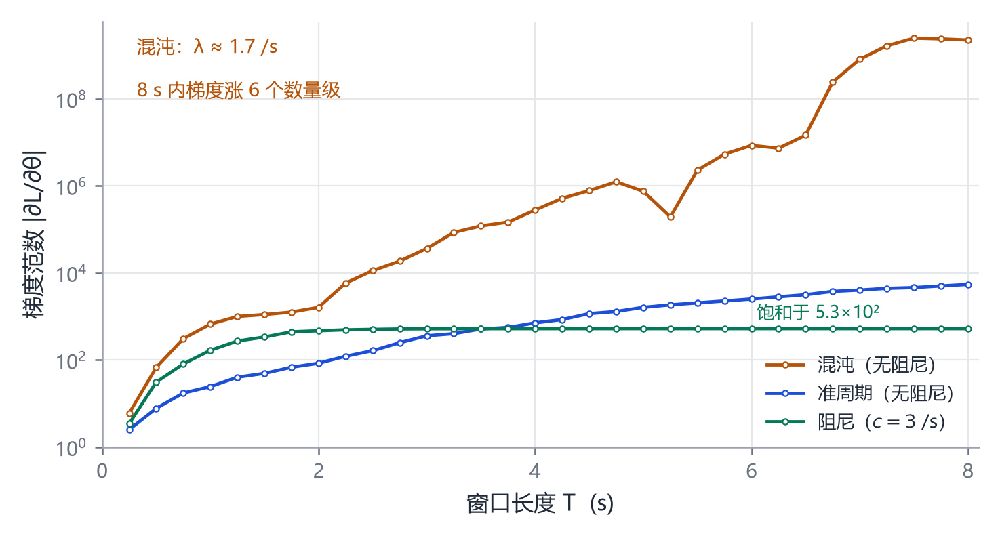

# 第 7 章 长时窗、梯度消失与爆炸

> 本章导读：一段一秒的动作，梯度还在百的量级；同一段模拟延长到八秒，梯度到了十的九次方。学习率没动，优化器第一步就把参数踢出了可行范围。这一章把梯度拆成一串雅可比的乘积，量一量混沌系统的放大率，看清截断窗口究竟丢掉了哪一段信号，再把梯度检查这件事放到长窗上重新审一遍。

## 7.1 梯度是一串雅可比的乘积

先摆一个小场景。双摆，两根一米长的杆，杆端各挂一个一千克的质点，从水平偏下 2.4 弧度处放手。步长六百分之一秒，用四阶龙格库塔积分。要辨识的量是第二根杆的长度，记作参数 $\theta$，单位米。损失取逐时刻的跟踪误差：

$$
L=\frac{1}{2}\sum_{t=0}^{T}\left\|\mathbf{x}_t-\mathbf{x}^{*}_t\right\|^{2} ,
\tag{7.1}
$$

$\mathbf{x}_t$ 是四维状态，两个摆角加两个角速度；$\mathbf{x}^{*}_t$ 是参考轨迹，由稍长一点的杆长 1.05 米算出；$T$ 是窗口的总步数。公式前面那个 $\frac{1}{2}$ 没有物理含义，只是为了让求导时少冒出一个因子 2。

带数字看一遍这个损失有多大。窗口一秒，就是 $T=600$ 步；假设每一步两个摆角各差 0.01 弧度，平方和约 $2\times10^{-4}$，乘 600 步得 $0.12$，再乘 $\frac{1}{2}$ 是 $0.06$。这个数小、正、随窗口长度线性增长，后面讲量纲时会拿它做参照。

模拟器的一步写成

$$
\mathbf{x}_{t+1}=\mathbf{f}\left(\mathbf{x}_t,\theta\right) ,
\tag{7.2}
$$

$\mathbf{f}$ 内部是四次右端函数求值加一次加权平均。这句话的意思是，一步模拟里发生的事情并不神秘，就是把"当前状态加上半步"试算四次，再按固定比例拼起来。可微性也就藏在这四次拼装里：每一步都是加法和乘法，没有分支，导数自然存在。

对 $\theta$ 求导，会同时出现三样东西：状态对参数的敏感度 $\mathbf{S}_t=\partial\mathbf{x}_t/\partial\theta$，一步映射自身的雅可比 $\mathbf{A}_t=\partial\mathbf{f}/\partial\mathbf{x}_t$，以及参数的直接导数 $\mathbf{c}_t=\partial\mathbf{f}/\partial\theta$。

先说雅可比。把 $\mathbf{f}$ 在当前位置做一次一阶泰勒展开（Taylor expansion），状态动一点点 $\delta\mathbf{x}$，输出就按一个矩阵线性地动。这个矩阵就是雅可比矩阵（Jacobian matrix）：四个状态对四个状态，正好 $4\times4$。也就是说，雅可比是"这一步模拟在这一点上的放大率表"，它一格一格地告诉我们，往某个方向推一下，下一步会变成什么样。$\mathbf{c}_t$ 则是同样意思的参数版本，是一根四维列向量：参数动一米，这一步的四个状态分量各自动多少。

三者的关系是一个线性递推：

$$
\mathbf{S}_{t+1}=\mathbf{A}_t\mathbf{S}_t+\mathbf{c}_t .
\tag{7.3}
$$

逐项读：$\mathbf{S}_t$ 是"到第 $t$ 步为止，参数的影响累积成了什么样"；$\mathbf{A}_t\mathbf{S}_t$ 是"这份累积影响再经过一步模拟之后的样子"；$\mathbf{c}_t$ 是"第 $t$ 步自己新产生的那一份影响"。三样加起来，就是第 $t+1$ 步的总敏感度。

带数字走一步。设某一步 $\mathbf{S}_t=\left(0.02,-0.01,0.3,-0.2\right)^{\mathsf T}$，设 $\mathbf{A}_t$ 近似是对角的，把前两个分量放大 1.1 倍、后两个缩小 0.9 倍，而 $\mathbf{c}_t=\left(0.001,0,0.05,0\right)^{\mathsf T}$。那么 $\mathbf{S}_{t+1}=\left(0.023,-0.011,0.32,-0.18\right)^{\mathsf T}$。手算一遍就能看出两件事：老影响会被放大或缩小，新影响每一步都在往里加，加进去之后又要被后面所有步继续放大。

把递推展开，$\mathbf{S}_T$ 是一串乘积的和：

$$
\mathbf{S}_T=\sum_{t=0}^{T-1}\left(\mathbf{A}_{T-1}\cdots\mathbf{A}_{t+1}\right)\mathbf{c}_t .
\tag{7.4}
$$

括号里那串连乘是全部麻烦的来源。它的长度等于 $T-t$：第 0 步产生的那份影响，要被乘 $T-1$ 次；第 $T-2$ 步产生的那份，只被乘一次。窗口拉长一倍，连乘就长一倍，而每个因子都可能是放大的。

梯度是把每个 $\mathbf{S}_t$ 和当时的残差 $\mathbf{r}_t=\mathbf{x}_t-\mathbf{x}^{*}_t$ 做内积再求和。这种"从末端一路往回乘、顺手把梯度累加"的做法，在深度学习里有个专门的名字：沿时间反向传播（backpropagation through time，简称 BPTT）。名字里的"沿时间"是字面意思——同一个映射 $\mathbf{f}$ 被复制了 $T$ 份，梯度必须穿过这 $T$ 份副本，才能回到最早那个参数。

取范数，得到一个不靠技巧的上界：

$$
\left\|\mathbf{S}_T\right\|\leq\sum_{t=0}^{T-1}\left\|\mathbf{A}_{T-1}\cdots\mathbf{A}_{t+1}\right\|\left\|\mathbf{c}_t\right\| ,
\tag{7.5}
$$

而连乘的范数不会超过各步范数的乘积，$\left\|\mathbf{A}_{T-1}\cdots\mathbf{A}_{t+1}\right\|\leq\prod_{i}\left\|\mathbf{A}_i\right\|$。每步放大多少，由 $\mathbf{A}_i$ 的谱半径决定。谱半径（spectral radius）的定义是矩阵所有特征值模的最大值，记作 $\rho$。它只回答一个问题：反复乘同一个矩阵，最坏情况下每次放大几倍。定义

$$
\lambda=\frac{1}{\Delta t}\ln\rho\left(\mathbf{A}\right) ,
\tag{7.6}
$$

$\Delta t$ 是步长，$\lambda$ 的单位是每秒，读法是"扰动每过一秒被放大 $e^{\lambda}$ 倍"。除以 $\Delta t$ 这一步不能省：谱半径是"每一步"的放大率，跟步长绑在一起，要换成"每秒"才能跨步长比较。

这个换算有多要紧，算一个数就知道。设 $\rho=1.05$，步长 $\Delta t=1/600$ 秒。那么 $\lambda=600\ln 1.05\approx29.3$ 每秒，一秒（600 步）之后的放大倍数是 $1.05^{600}\approx5.1\times10^{12}$。每步只放大百分之五，听起来无害；换成秒，就是一万亿倍。这就是长窗梯度爆炸的全部算术。

$\lambda$ 的符号把长窗梯度分成三种命运。

$\lambda \lt 0$ 时，每步都在收缩，连乘的长度越长反而越小，梯度最后收敛到一个由最近几步决定的平台。带阻尼的系统属于这一类。双摆加上阻尼系数 3 每秒的耗散项，逐时刻损失下的梯度范数从 3.5 涨到一秒时的 168，三秒时到 523，此后一直停在 526 不动。窗口再长，梯度也不再变，因为早期那段的历史已经被忘干净了。反过来说，这类系统上训练，用八秒窗口和用三秒窗口得到的东西几乎一样，多花的算力全在重复已经消失的信息。

$\lambda=0$ 时，每步既不放大也不收缩，直觉上梯度应该稳。实测不是这样。摆角 0.45 弧度、无阻尼的双摆是准周期的，两个不可通约的频率在转，谱半径的平均值只有 0.07 每秒，几乎没有放大；但梯度范数在八秒里从 2.5 涨到 5470，涨了两千倍，大致按窗口长度的二到三次方走。这就是非正规性：谱半径只管长期指数率，管不了有限时间内的多项式放大。物理上对应的东西很熟悉，无阻尼振子被推到共振附近，解的振幅里会多出一个 $t$ 因子。雅可比矩阵的幂次可以像 $t$ 一样长，而特征值的模一直是 1。

$\lambda \gt 0$ 时，连乘按指数长，八秒的窗口足以让梯度涨七个数量级。混沌系统的极限集上就是这种情形。

图 7-1 左图画的是三个系统的谱：把若干时刻的 $\mathbf{A}_t$ 的四个特征值点在复平面上，单位圆就是分界。右图是同一批参数下梯度范数随窗口长度的变化，纵轴取对数。

<figure class="fig">

<figcaption><b>图 7-1</b>　左：一步雅可比的特征值在复平面上的位置，单位圆内收缩、圆外放大，三种参数设置各取 120 个时刻。右：逐时刻跟踪损失下，梯度范数随窗口长度的变化（双对数纵轴）。参数：杆长 1 m，质点 1 kg，$\Delta t=1/600$ s，参考轨迹杆长 1.05 m；混沌与阻尼算例初值 $\theta_1=2.4$、$\theta_2=2.2$ rad，准周期算例 $\theta_1=0.45$、$\theta_2=0.35$ rad；阻尼系数 3 s$^{-1}$。</figcaption>
</figure>

左图的读法很直接：特征值落在单位圆内，那一步的扰动会被缩回去；落在圆外，会被放大；贴着圆走，就是第三种命运。右图把三种命运翻译成梯度：一条先涨后平，一条涨得比预期快，一条几乎笔直往上冲。

有一个量比单步谱半径更贴近 BPTT 的实际行为：整段连乘矩阵本身的谱半径。把 $T$ 步的因子乘起来记作 $\mathbf{P}=\mathbf{A}_{T-1}\cdots\mathbf{A}_0$，它的谱半径 $\rho\left(\mathbf{P}\right)$ 直接给出"从第一步到第 $T$ 步，最坏方向的放大倍数"。单步谱半径的乘积给的是上界，$\rho\left(\mathbf{P}\right)\leq\prod_i\rho\left(\mathbf{A}_i\right)$，两者在均匀系统上重合，在参数沿轨迹变化的系统上会分开。用上面的数字对一下：$\lambda=1.7$ 每秒、八秒窗口，$e^{13.6}\approx8\times10^{5}$，也就是说从第一步到末端的敏感度放大了八十万倍，与直接乘 $\mathbf{P}$ 量到的量级一致。

三种命运对应三种训练故障。放大那种，学习率稍大就发散；收缩那种，训到后面梯度消失，参数停在半路；边际那种不报警，但训练曲线会缓慢地漂，越训越不稳。真实项目里常见的是混合版：一段动作前半段有阻尼（$\lambda<0$），后半段接触到自由飞行（$\lambda>0$），梯度范数在窗口里先降后升，裁剪阈值一设就顾此失彼。

判定自己属于哪种，不需要跑训练，跑一段模拟、把 $\mathbf{A}_t$ 的谱半径平均一下就够了。具体做法是每隔几十步抽一个 $\mathbf{A}_t$，算它的四个特征值，取模最大那个，按 7.6 换成每秒，再对抽样求平均。

## 7.2 混沌：放大率从哪来

谱半径算的是无穷小的、一步的放大。真实的放大率要用两条轨迹量。从同一个状态出发复制一份，给它一个 $10^{-7}$ 量级的扰动，两条轨迹一起往前跑。距离 $d\left(t\right)$ 在混沌系统上按 $d_0e^{\lambda t}$ 长，但 $e^{\lambda t}$ 很快就把距离顶到相空间尺度，之后就没法线性外推了。办法是不断地拽回来：每当距离超过 $10^{-6}$，把它缩回 $10^{-7}$，同时把这一个区间里量到的对数增长累加。

$$
\lambda\approx\frac{1}{T}\sum_{k}\ln\frac{d_k}{d_0} ,
\tag{7.7}
$$

$d_k$ 是第 $k$ 次重正化之前量到的距离，$T$ 是总时长。这个平均数收敛到最大李雅普诺夫指数（largest Lyapunov exponent），条件是积分时间足够长。名字里的"最大"很关键：一个四维系统有四个李雅普诺夫指数，从小到大排开，量两条轨迹只能得到最大的那个，因为其他三个方向上的分离会被最大方向很快盖住。

也就是说，李雅普诺夫指数是"两条几乎相同的轨迹，平均每秒分开多少倍"的对数度量。它是系统的性质，不是某条轨迹的性质：换初值、换步长，只要还在同一个混沌吸引子上，量出来的数基本一样。

带数字走一遍这个平均。八秒窗口，每 0.5 秒量一次距离，一开始是 $10^{-7}$，按 $\lambda=1.7$ 每秒算，0.5 秒应该变成 $10^{-7}e^{0.85}\approx2.3\times10^{-7}$，1.0 秒变成 $5.4\times10^{-7}$，1.5 秒变成 $1.3\times10^{-6}$——已经超过阈值，于是缩回 $10^{-7}$，并记下这一段的对数增长 $\ln 13\approx2.55$。八秒里这样的记录有五六次，每次 2.55 除以 1.5 秒，回到 $\lambda=1.7$ 每秒。手算和测量就是这么对上的：每一次重正化只是把指数曲线切成一段段直线，斜率不变。

数字本身比定义更有说服力。$\lambda=1.7$ 每秒意味着，$10^{-7}$ 的位置误差在八秒后变成 $10^{-7}e^{13.6}$，约 $8$ 厘米。一根一米的杆，初始差一个原子尺度的位置，八秒后两根杆的方向毫无关系。这不是数值误差，是方程本身的性质，加密时间步、换四阶方法都改不了。这一点值得强调，因为初学者遇到发散的第一反应总是"步长太大了"，于是把 $\Delta t$ 减半、再减半，跑到算不动为止，结果梯度还是炸——因为两条真轨迹本来就该分开。

李雅普诺夫指数还有一个加法性质，可以用来做一次免费的核对。四个指数之和等于相空间体积的平均收缩率，也就是一步雅可比行列式的对数平均。无阻尼的双摆是哈密顿系统，相空间体积守恒，四个指数之和应该是零；实测 $\lambda_1\approx1.7$，$\lambda_2\approx0.01$，$\lambda_3\approx-0.01$，$\lambda_4\approx-1.7$，加起来在零附近。加了阻尼系数 3 之后，和变成 $-3$ 上下，正好等于阻尼项造成的耗散率。用这个等式检查自己的实现，比看梯度曲线可靠。

反例也在这里。把初始角度从 2.4 弧度降到 0.45 弧度，同一个模拟器、同一份代码，两条相距 $10^{-7}$ 的轨迹跑完八秒仍然相距 $10^{-7}$ 量级，指数率根本量不出来。小振幅下双摆近似于两个独立的谐振子，准周期、可预测、梯度只按幂次长。此时若套用"八秒放大八十万倍"的经验，结论会完全错。

对梯度的第一层后果是量级。$\mathbf{S}_t$ 按 $e^{\lambda t}$ 长，残差 $\mathbf{r}_t=\mathbf{x}_t-\mathbf{x}^{*}_t$ 也在按同样速率发散，两者相乘，损失里的分项大致按 $e^{2\lambda t}$ 的量级往上走。实测的八秒窗口里，梯度从 $6.0$ 涨到 $2.3\times10^{9}$，拟合出的对数增长率约 2.5 每秒，比 $\lambda$ 大一截，多出来的部分正是残差自己的发散——$\ln\left(2.3\times10^{9}/6.0\right)/8\approx2.7$，与 2.5 的差别在拟合区间上。

第二层后果不那么显眼，但对训练更致命。梯度里每一项的符号由轨迹本身决定，而轨迹对初值敏感，所以两个只差一点点的参数值，梯度方向可以差得很远。在双摆上做一次检查：把参考轨迹的杆长从 1.05 改成 1.0501，相对改动 $10^{-5}$，八秒窗口下的梯度值相对变化 $7\times10^{-4}$，方向几乎没动。这个测试说明的是单参数情形下的鲁棒性，不能外推。参数多到几十个时，各项的正负配比会变得很脆，梯度的方向被少数几项主导，而那几项又由混沌轨迹随机选出。

关于前向的可信度还有一点值得说清。混沌系统虽然初值敏感，数值轨迹仍然"贴近"某条真实轨迹：误差被吸收进一个微小的初值修正里，后续演化大体上是一条真实轨迹。这个性质就是影子轨迹（shadowing）。它解释了一个现象：前向模拟很准，长时间跑的统计数据也对，但导数不准。因为导数容不下"换一条轨迹"这件事，它只看到固定轨迹上被拉长的切向量。

第三层后果和损失的定义有关。如果把损失只挂在最后一个时刻，$L=\frac{1}{2}\left\|\mathbf{x}_T-\mathbf{x}^{*}_T\right\|^{2}$，那么梯度是全窗连乘的一次性乘积，量级直接是 $e^{\lambda T}$。这时反传的每一步都在放大，早期分项压倒晚期分项，实测早期与晚期分项的量级比约 $5\times10^{3}$。逐时刻损失把这种集中摊平了一些，但没有消除集中，只是把"压在哪一端"换了个方向，这一点下一节用图说话。

一个真实场景可以结束这一节。做布料参数辨识时，有人用四秒的整段视频、逐像素跟踪误差、八秒的模拟窗口去拟合弯曲刚度。前向画面看着很好，褶皱的位置和数量都对；梯度却每一轮都在 $10^{7}$ 上下跳，Adam 把刚度从 $10^{-3}$ 拖到 $10^{-9}$。诊断的办法就是这一节讲的：跑两条相距 $10^{-7}$ 的轨迹，看它们四秒后分不分开。分开，就说明问题不在优化器，而在窗口长度。

混沌不等于不能训练。八秒的窗口太长，一秒的窗口里，同样的系统仍然是光滑的、可微的、梯度方向可用的。真正要放弃的是"用一个长窗覆盖整段动作"这个想法，不是可微模拟本身。把长任务切成短窗，每一窗从真实状态或者存下来的状态重新开始，这是所有实际训练都在做的事。

## 7.3 截断窗口与重加权

截断的做法很朴素：往前跑十步，把状态从计算图上摘下来，当作新的起点，只对窗口内的部分求导。反向传播的长度从 $T$ 变成 $K$，显存和梯度范数都跟着降到可控。这个做法有个正式名字：截断的沿时间反向传播（truncated BPTT）。名字说得比"截断"准确——被截断的不是时间，是梯度对历史的依赖。

代价是梯度里少了窗口之前那段历史对参数的依赖。少掉的这一块不是可有可无的噪声，它常常正是参数最该被拉动的方向：布料在前两秒被拉紧，弯曲刚度的影响全在那两秒里显形；窗口只看最后半秒，刚度就没有被约束住。

少了多少，取决于每个时刻的分项在总梯度里占多大比重。这个比重可以直接算：把窗口内每一步的分项乘上对应的残差，记 $\tau_t=\mathbf{S}_t\cdot\mathbf{r}_t$，看 $\left|\tau_t\right|$ 沿时间怎么分布。图 7-2 左图是三个系统在八秒窗口下的分布，都按各自的最大值归一化。

<figure class="fig">

<figcaption><b>图 7-2</b>　左：逐时刻分项 $\left|\tau_t\right|$ 沿窗口的分布，各自按最大值归一化。右：把窗口截到最近 $K$ 秒时，保留下来的分项质量占全窗的比例。参数与图 7-1 相同。</figcaption>
</figure>

三条曲线的形状完全不同。混沌那条几乎全部压在最后，两秒之内就装下了 99.5% 的分项质量，一秒的窗口已经有 71.7%。阻尼那条正相反，峰值在 1.6 秒附近，四秒之后基本归零，所以截到最近三秒等于把梯度整个扔掉，实测保留比例是 0。准周期那条介于两者之间，质量分布得比较开，最近两秒拿到 54%，最近四秒拿到 87%。

右图把这件事说得更清楚。混沌系统截断几乎没有偏差，因为真正有信号的那一段本来就在窗口末端；代价是训练只看最后几步，前面的动作等于没人管。阻尼系统截断偏差极大，因为它把参数影响最显著的早期整段丢掉了。准周期居中，窗口长度差不多按比例决定信息量。

窗口该取多长，有一个可以算出来的起点。设允许丢掉的分项质量是 $\varepsilon$，混沌系统上分项按 $e^{2\lambda t}$ 往后集中，那么长度 $K$ 应该满足

$$
e^{-2\lambda K}\approx\varepsilon ,
$$

也就是 $K\approx\ln\left(1/\varepsilon\right)/\left(2\lambda\right)$。取 $\varepsilon=10^{-3}$、$\lambda=1.7$ 每秒，得 $K\approx6.9/3.4\approx2.0$ 秒。这个数和右图上"两秒装下 99.5%"完全对得上，它不是巧合，是同一个指数率算两次。

还有一处偏差不在分项上，在窗口的接缝上。截断之后，窗口起点的状态被当成常数，可它其实是参数的函数。相邻两个窗口对同一段历史给出两个不同的参数估计时，接缝处就会出现一次跳变，训练时表现为损失曲线的周期性抖动，周期正好等于窗口长度。判断是不是这个原因很简单：把窗口起点改成参数无关的观测值，抖动如果消失，就是它。

这意味着"截断窗口取多少步"没有通用答案。一个常被抄来抄去的经验数，比如"截到 32 步"，在 600 Hz 下只有 0.05 秒，对阻尼系统等于什么都没学到；在 30 Hz 的刚体模拟里是 1 秒，可能刚好够用。定 $K$ 之前，先画一次分项分布，看看信号压在哪一端。分布画不出来（比如没有现成的伴随代码），就退一步用两条轨迹的分离率估 $\lambda$，再按上面的式子取 $K$。

重加权是在截断之外的另一根旋钮。给每个时刻的分项乘一个权重 $\gamma^{t}$，

$$
L_{\gamma}=\frac{1}{2}\sum_{t=0}^{T}\gamma^{t}\left\|\mathbf{x}_t-\mathbf{x}^{*}_t\right\|^{2} ,
\tag{7.8}
$$

$\gamma \lt 1$ 是折扣，把后段压下去；$\gamma \gt 1$ 是反过来，把后段抬起来。$\gamma$ 和窗口长度之间有一个等价关系：权重衰减到 $1/e$ 需要的步数是 $1/\left(1-\gamma\right)$，这个数就是"有效窗口长度"。$\gamma=0.99$ 时是 100 步，在 600 Hz 下只有 0.17 秒；$\gamma=0.999$ 时是 1000 步，约 1.7 秒。所以调 $\gamma$ 实际上是在调窗口，只不过这个窗口是软的、边缘渐弱的，不会像硬截断那样在接缝上跳。

对阻尼系统，早期信号占绝对多数，而任务真正关心的是末端的状态，$\gamma \gt 1$ 可以把注意力往末端挪，代价是梯度的方差变大。对混沌系统，$\gamma \lt 1$ 能把那几个主导一切的分项压下来，让梯度范数进入正常范围，代价是引入偏差，$\gamma$ 越小偏差越大。

一个实用的折中是滑动窗口加定期全窗校验。训练时用长度 $K$ 的窗口、窗口起点每轮随机，让不同时间段都被覆盖；每隔若干轮用一次全窗梯度，只看方向和范数，不看它的具体值，用它检查短窗梯度有没有系统性偏斜。全窗那一次很贵，所以只当作标尺。

最后留一个反例，免得把截断当成万能药。任务很短、系统很稳的时候，比如半秒的弹簧振子辨识，截断反而有害：半秒里每一次采样都带着参数信息，砍掉前四分之一，就等于把观测删掉四分之一。这时正确的做法是整段反传，代价只是显存，而显存在这里根本不紧张。判断标准始终是"分项质量压在哪"，不是"窗口越短越安全"。

## 7.4 长时伴随的稳定性

反向传播在数值上不是把前向过程倒着放一遍那么简单。伴随变量（adjoint variable）$\mathbf{a}_t=\partial L/\partial\mathbf{x}_t$ 满足

$$
\mathbf{a}_t=\mathbf{A}_t^{\mathsf{T}}\mathbf{a}_{t+1}+\mathbf{r}_t ,
\tag{7.9}
$$

上标 $\mathsf{T}$ 表示转置。这个式子和 7.3 的敏感度递推是一对：一个往前推、一个往回推，形式一样，方向相反。逐项读：$\mathbf{a}_{t+1}$ 是"后面所有的损失对第 $t+1$ 步状态的抱怨"，$\mathbf{A}_t^{\mathsf{T}}$ 把这份抱怨翻译成"对第 $t$ 步状态的抱怨"，$\mathbf{r}_t$ 是第 $t$ 步自己那份残差。也就是说，伴随是一张从末端往前传的账单，每一站都追加一笔。

转置不改变特征值的模，所以放大率和前向一样是 $e^{\lambda}$ 每秒，但方向反了：前向是越往后越大，反向是越往回越大。八秒窗口里，从末端往回走八秒，伴随的齐次部分被放大 $e^{13.6}$，约 $8\times10^{5}$ 倍。这个倍数不取决于你从哪一端开始算，只取决于窗口有多长。

这个放大作用在两种东西上，两种都不是我们想要的。

第一种是浮点舍入。双精度下每个状态分量的相对误差约 $10^{-16}$，八秒的单精度模拟是 $10^{-7}$ 量级；放大 $8\times10^{5}$ 倍之后，前者到 $10^{-10}$，还够用，后者到 $10^{-1}$，梯度的有效位数只剩一位。用单精度跑长窗伴随，得到的梯度基本是噪声，而且噪声的形状和真梯度很像，肉眼看不出来：损失曲线照样下降，因为那一成真的信息还在，只是每轮都被另外九成噪声重新洗了一遍。

第二种是求解器本身的迭代误差。隐式积分每一步要解一个非线性方程组，通常迭代到残差 $10^{-8}$ 就停。这个残差进到下一步的状态里，成了下一步的初始误差，又被后面的连乘放大。长窗上的规则是：单步求解精度要按 $e^{-\lambda T}$ 反向定，$\lambda T=13.6$ 时，要保住 $10^{-3}$ 的梯度精度，单步残差得压到 $10^{-11}$ 以下。这在双精度里还做得到，在单精度里做不到。换句话说，容差不是随手定的 $10^{-8}$，它得和窗口长度、放大率一起算。

三段式的处理办法在实际代码里最常见。把窗口切成若干段，每段开头存一份状态，反向时从存下的状态重新线性化，而不是从整段的最末端一路乘回来。这样每段内的连乘长度只有段长，舍入被放大的倍数从 $e^{\lambda T}$ 降到 $e^{\lambda T/n}$。切八段，放大倍数从 $8\times10^{5}$ 降到 $e^{1.7}\approx5.5$，段与段之间用存下的状态衔接，误差不再跨段累积。代价是显存，存 $n$ 份状态，和检查点（checkpointing）的账完全一样：$n$ 越大，精度越高，显存越贵。

这里的取舍可以量化。切 $n$ 段，显存涨 $n$ 倍（相对只存起点），放大倍数按 $e^{\lambda T/n}$ 降。$n$ 从 1 到 8，放大从 $8\times10^{5}$ 掉到 5.5，收益巨大；$n$ 从 8 到 64，放大从 5.5 掉到 1.24，收益已经很小，显存却涨了八倍。所以 8 到 16 段是甜点，继续加只是在买心安。

另一个技巧来自李雅普诺夫指数的计算。既然放大是按指数来的，可以在反向过程中每隔若干步把伴随向量归一化，记下缩放因子，最后把因子乘回去。这能避免上溢，但救不了精度，被压缩掉的信息已经丢了。它对"方向"有用，对"量级"没用，适合只需要梯度方向的场景，比如符号梯度或者归一化后的更新。实际用的时候，归一化间隔不能太长：间隔 $m$ 步，浮点里仍要容得下 $e^{\lambda m\Delta t}$ 的跨度，$\lambda=1.7$、$\Delta t=1/600$ 时，$m=200$ 对应 $e^{0.57}\approx1.8$，很安全；$m=2000$ 对应 $e^{5.7}\approx300$，也还行；再长就该切了。

还要提一句时间方向的一个不对称。前向模拟里，误差在稳定方向上会被自然抹平；反向的伴随里，稳定方向变成了放大的方向。所以一个前向看起来很稳的系统，反向可能很不稳，判断标准不能只看前向的 $\rho$，要看 $\rho$ 在整段上的最大值，而不是平均值。平均值在这里会骗人：一段动作里若有 5% 的时间处于接触冲击，那 5% 的 $\rho$ 可能是 50，平均下来只有 3.5，而梯度炸不炸，由那 50 决定。

一个工程上的检查清单可以收尾。跑长窗之前，先用双精度算一次梯度范数，再用单精度算一次，两者差超过 $10^{-3}$，就说明精度不够，别急着调学习率。然后数一下窗口内 $\rho$ 的最大值出现在哪几步，如果是接触或者碰撞的那几帧，考虑在那几帧上加检查点。

## 7.5 梯度检查

写完反向代码，第一件事是拿有限差分对拍。做法是给参数加一个小扰动 $h$，前向跑两遍，用中心差分估一个梯度方向：

$$
g_{\mathrm{fd}}=\frac{L\left(\theta+h\right)-L\left(\theta-h\right)}{2h} ,
\tag{7.10}
$$

和反向算出来的 $g$ 比相对误差。这个式子读起来简单，两个损失相减、除以两倍扰动，就是斜率的近似。误差有两项：截断误差 $O\left(h^{2}\right)$，因为中心差分把二阶项消掉了、留下三阶；舍入误差 $O\left(\epsilon/h\right)$，$\epsilon$ 是双精度的 $10^{-16}$，$h$ 越小，两个大数相减丢掉的位数越多。两项一个随 $h$ 减、一个随 $h$ 增，最优的 $h$ 在 $\epsilon^{1/3}\approx6\times10^{-6}$ 附近。

这个检查在短窗上很好用，在长窗上会骗人。

用的就是 7.1 节那个双摆。窗口一秒时，$h=10^{-6}$ 的中心差分和灵敏度递推给出的梯度相对误差 $1.7\times10^{-8}$，算是完美对上。窗口四秒，最好的相对误差 $1.3\times10^{-7}$，还行。窗口八秒出了状况：$h=10^{-4}$ 时两个数差 94%，$h=10^{-6}$ 时差 $4.9\times10^{-4}$，只有把 $h$ 压到 $10^{-8}$ 才回到 $8\times10^{-7}$。

原因在差分本身。$h=10^{-4}$ 的扰动量在经过八秒的指数放大之后，已经不是"小扰动"了，两条轨迹跑到相空间的两个角落，中心差分的二阶截断误差 $O\left(h^{2}\right)$ 被放大成主导项。这时的差分算的是"两个不同轨迹的差"，不是导数。把 $h$ 减小能救回来，减到 $10^{-8}$ 时扰动的放大结果还在可分辨范围；但再小就撞上双精度的舍入，$L$ 的两个值都只剩十几位有效数字，差分会把这点有效数字全部吃掉。

有一个更稳的替代品，值得在长窗上优先用：复步长差分（complex-step differentiation）。把扰动放到虚部上去，

$$
g_{\mathrm{cs}}=\frac{\operatorname{Im}L\left(\theta+\mathrm{i}h\right)}{h} ,
$$

$\mathrm{i}$ 是虚数单位，$\operatorname{Im}$ 取虚部。这个式子没有相减，所以没有相消误差，$h$ 可以取到 $10^{-20}$ 而不损失精度，误差是机器精度量级。代价是损失函数必须能接受复数输入，整条模拟链都得是解析的，遇到 $\max$、绝对值、条件分支就得改写。很多物理模拟器恰好满足这个条件（全是加减乘除和三角函数），所以它在可微模拟里特别顺手。用复步长在八秒窗口上对拍，相对误差 $2\times10^{-14}$，比任何实差分都干净。

所以长窗的梯度检查要换个做法。一种是把窗口切段，逐段对拍，每段只查几秒，段内的放大倍数小，差分可用。另一种是查导数结构而不是末端的标量：把 $\mathbf{A}_t$ 和 $\mathbf{c}_t$ 单独拿出来，对一步映射做有限差分，逐个矩阵比对。一步映射的对拍与窗口长度无关，永远可靠，而长窗的问题几乎都出在连乘的组装上，不在单步。

对拍不上时，排查顺序按经验排是这样的。先确认前向是确定性的，同一个输入跑两遍逐位相同；多线程浮点归约顺序不定、GPU 上的原子加都会破坏这一点，而这种不确定性在长窗上会被放大成肉眼可见的差。然后查 detach 的位置：提前摘断会让梯度偏小，漏摘会让梯度偏大，两者的相对误差在短窗上往往是常数倍，一看就知道。再查原地修改有没有被记录，很多 AD 框架对原地写是静默错误的。最后查隐式求解器的迭代次数：迭代次数随输入变化时，离散程序在数值上不可微，梯度里会夹着跳变。

有一个原则值得记住：对拍通过说明反向代码和这段离散程序一致，不说明它和连续方程一致。时间步长、迭代容差、软化参数都在改变程序本身，程序的导数跟着变。做收敛性检查时要同时缩步长和容差，只看其中一项会得到一个稳定的错误答案。经验上，步长减半、容差降两个数量级，梯度应该朝同一个方向收敛；如果方向两边都稳定、量级却差一倍，那多半是容差没跟上。

还有一个反例，说明对拍通过也可能没用。有人把损失里的 $\left\|\mathbf{r}\right\|$ 写成 $\sqrt{\mathbf{r}\cdot\mathbf{r}+\epsilon}$，$\epsilon=10^{-8}$ 防除零。反向代码和这个式子完全一致，对拍误差 $10^{-9}$，通过。但 $\epsilon$ 改变了问题：残差接近零时，真实导数是 0，这个式子的导数是 $\mathbf{r}/\sqrt{\epsilon}$，量级差了 $10^{4}$ 倍。短窗上残差大，看不出；长窗上残差在末端趋近零，梯度被这一项主导，方向完全错了。对拍只保证一致性，不保证建模正确。

## 7.6 训练策略

所有策略都围绕一件事：让梯度的量级落在优化器能处理的范围里，同时不把有用的信号一起削掉。这句话可以拆成两个判据：梯度范数的对数不该随窗口长度线性漂移，梯度方向不该随窗口起点剧烈变化。前者是量级，后者是偏差。

取窗口长短是第一根旋钮。默认做法是短窗训练、长窗评估。训练用能装下"一个动作单元"的窗口，比如一次起跳、一次摆动；评估用完整的动作长度，看 rollout 误差有没有发散。这两件事不能混，训练时用长窗既贵又不稳，评估时用短窗则看不到累积误差。可微模拟做控制的实验里，窗口切短、每窗从存下的状态重新开始，几乎已经是默认配置 [@hu2020]。

第二根是损失的量纲。逐时刻误差的和会随窗口长度线性增长，窗口拉长，梯度自然变大，如果不做归一化，学习率就得跟着改。简单处理是除以步数，取平均；更好的处理是除以残差的典型量级，让损失变成无量纲的相对误差。后者在残差本身随时间变化时更稳，比如一段自由衰减的运动，末期残差很小，绝对误差下末期几乎不贡献梯度，相对误差下末期仍然是重点。

第三根是裁剪。按全局范数裁到 1 是常见配置，作用是把偶尔出现的尖峰切掉。裁剪只在梯度范数偶尔超标时有用；如果范数长期顶在阈值上，说明窗口或者量纲有问题，裁剪只是在掩盖。日志里要同时打未裁剪的范数和裁剪比例，两者一起看。一个粗判据：裁剪比例长期高于 10%，就不是尖峰，是系统性放大，回去看 $\lambda$。

第四根是参数的表示。物理参数大多有符号和范围约束，刚度、阻尼、厚度都必须为正。直接把它们当自由变量，优化过程中很容易越界，越界之后模拟发散，梯度变成 NaN，训练中断。换到对数坐标，$\kappa=\ln k$，可行域变成整个实数轴，梯度自动带上 $k$ 的缩放，小参数和大参数的步长相对一致。这一条几乎不花成本，收益很大。举例来说，$k$ 从 60 到 61 是一步 1.7%，从 0.6 到 0.61 是一步 1.7%，在对数坐标下两步一样长，在原坐标下差了 100 倍。

第五根是模型本身。阻尼、粘性、数值耗散这些"让模拟更真实一点"的项，同时也是让 $\lambda$ 变小的项。当训练怎么调都不稳时，给系统加一点物理上说得过去的阻尼，往往比调学习率有效。这不是作弊，真实系统里阻尼本来就在，去掉它只是图省事。

这些旋钮之外，还有两件常被忽略的事。一件是学习率要和窗口长度一起调：窗口拉长一倍，梯度的典型范数涨 $e^{2\lambda T}$ 的一小部分，等效学习率就该跟着降，否则同一个学习率在短窗上合适、在长窗上必然发散。另一件是初值的选择：从接近真值的参数出发，残差小，放大链条短；从远处的初值出发，前若干轮残差很大，梯度本身就大，容易在还没收敛方向之前先把参数踢飞。多起点加小步长热身的组合，比单起点大学习率稳得多。

最后一件是评估指标。单步误差小不代表长窗可用，长窗误差才是训练目标的真实检验；但长窗误差本身对初值敏感，报数时要固定初值集合、报分布而不是单个值。在混沌系统上，误差会在某个时刻之后饱和到相空间尺度，那个饱和值没有信息量，能看的只有饱和之前那一段的增长速度。报告里最好同时给出三个数：单步误差、饱和前的误差增长率、饱和时刻。第三个数量化地告诉你"这段模拟还能信多久"。
