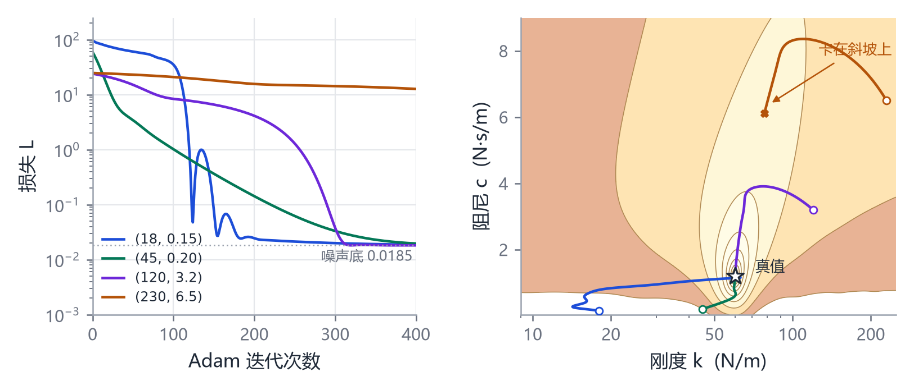
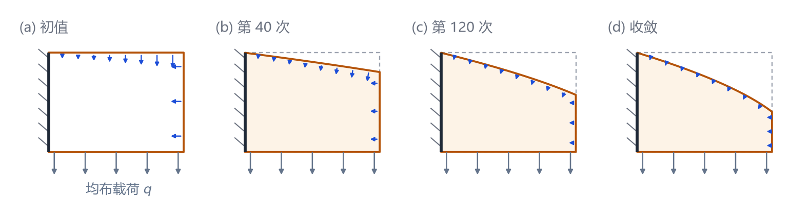

# 第 8 章 参数、形状与控制

> 本章导读：一段丝巾在风扇前飘过四秒，要反推它的弯曲刚度；一个软体泳机器人在水里扭，要改它的形状让它游得更快；一只机械手要在半秒内把球送进筐，要定它每个关节的力矩。三件事的未知量不同，一个是几个数，一个是几百个顶点，一个是几百个时间点的控制量，但落到纸上都是同一个结构：给一个目标和一台能算正问题的模拟器，求一组让它变好的输入。这一章讲这个结构怎么落地，代价在哪，以及为什么优化器经常停在一个"看起来还行"的地方。

## 8.1 参数辨识：从一个振子反推刚度和阻尼

取最朴素的一台模拟器：一个质量块挂在弹簧上，带线性阻尼。这件事在工程上叫参数辨识（parameter identification），也有人叫系统辨识（system identification）。也就是说，先假定运动方程的形式已知，只把里面几个说不准的系数当未知数，用观测数据把它们反推出来。方程写成

$$
m\ddot{u}+c\dot{u}+ku=0 ,
$$

$m$ 是质量，$k$ 是刚度，$c$ 是阻尼，$u$ 是位移，点表示对时间求导。质量取 1 千克，真值刚度 $k=60$ 牛每米，阻尼 $c=1.2$ 牛秒每米。它对应的固有角频率 $\omega_0=\sqrt{k}=7.75$ 弧度每秒，周期 $2\pi/\omega_0=0.81$ 秒；振幅按 $e^{-ct/2}$ 衰减，时间常数 $2/c=1.67$ 秒，也就是每过 1.67 秒振幅掉到原来的 37%。初值取位置 1 米、速度 0，用四阶龙格库塔、每秒 120 步跑 3 秒，这就是"真实数据"。观测只有位置，加上峰值的百分之一作噪声。

要最小化的是

$$
L\left(k,c\right)=\frac{1}{2}\sum_{i=1}^{N}\left(u_i-u_i^{\mathrm{obs}}\right)^{2} ,
\tag{8.1}
$$

$u_i$ 是模拟出来的位置，$u_i^{\mathrm{obs}}$ 是观测到的那一条，$N=360$ 是采样点数（3 秒乘 120 步每秒）。这个形式的损失叫最小二乘（least squares）：把每一时刻的偏差平方，加起来，让总和最小。平方的作用是让正负偏差都算作错误，不需要关心方向。

带数字看这个损失的量级，可以判断优化器"应该"能降到多少。噪声是峰值的百分之一，也就是 0.01 米，360 个点的平方和期望是 $360\times0.01^{2}=0.036$，再乘 $\frac{1}{2}$ 是 0.018。这就是噪声决定的下限：任何参数都不可能把损失压到这以下，压下去了说明它在拟合噪声。后面会看到，真值本身的残差是 0.0185，和这个估算只差一点点，说明这台模拟器的噪声模型和数据是对得上的。

梯度怎么来？最省事的写法是把整段模拟写成一个函数、让自动微分穿过去；手写也只要十几行，一步一步带着两个敏感度 $\partial u/\partial k$、$\partial u/\partial c$ 往前推，和 7.1 节那条递推是同一件事。两个参数、三百六十步，一次前向加一次线性化就是完整梯度。相比"给每个参数各加一次扰动、重跑一遍"的有限差分，代价从三次完整模拟降到一次，参数越多，差距越大。

图 8-1 右图画的是损失在 $\left(k,c\right)$ 平面上的等高线，取了对数刻度，因为损失横跨四个数量级。等高线是一族斜长的椭圆，长轴从左下到右上：刚度大一点、阻尼也大一点，损失可能不变。这条谷的方向就是可辨识性的几何形状，往下再说。

<figure class="fig">

<figcaption><b>图 8-1</b>　左：四个初值下损失随迭代次数的下降，两轴都取对数。右：损失在参数平面上的等高线与四条优化路径，等高线按对数取级，刚度轴取对数以便看清斜向的谷；星号为真值，叉号为各条路径的落点。参数：质量 1 kg，真值 $k=60$ N/m、$c=1.2$ N·s/m，观测 3 s、120 Hz、位置噪声为峰值的 1%，$\Delta t=1/120$ s，Adam 步长 0.5 与 0.012，400 步。</figcaption>
</figure>

从 $\left(18,0.15\right)$、$\left(120,3.2\right)$、$\left(45,0.2\right)$ 三个初值出发，400 步之后分别落在 $\left(60.04,1.19\right)$、$\left(60.05,1.20\right)$、$\left(60.03,1.18\right)$，残差 0.019 上下。真值本身在这个含噪数据上的残差是 0.0185，也就是说这三种跑法都停在了噪声决定的最优附近，参数误差在千分之一的量级。

$\left(230,6.5\right)$ 那个初值不一样。400 步之后停在 $\left(77.9,6.1\right)$，残差 12.7，比最小值大四百多倍。等高线图上能看清它停在哪：它在谷的边缘上一路往左下溜，溜到坡度变小的地方就停了。这是下一节要展开的话题，先记着。

为什么刚度好认、阻尼难认，可以算出来，不必靠感觉。刚度只影响频率，$k$ 差百分之一，$\omega_0$ 差百分之零点五。三秒里相位走了 $\omega_0t=23.2$ 弧度，相位差就是 $0.5\%\times23.2=0.116$ 弧度；乘以 1 米的初始振幅，位置差约 0.1 米，比 0.01 米的噪声大十倍。阻尼只影响包络，$c$ 差百分之一，衰减率差 $0.006$ 每秒，三秒里振幅的相对变化约 $1.8\%$；三秒时振幅只剩 0.165 米，位置差只有 0.003 米，比噪声还小。换算一下，刚度能认到百分之一的十分之一，阻尼只能认到百分之三五。

参数辨识的质量由三样东西决定，不全是优化器的事。

第一样是观测覆盖的时间尺度。把观测截到前 0.3 秒，不到半个周期，再算一次损失景观：损失低于 0.004 的区域里，刚度被夹在 56 到 62 之间，误差百分之五；阻尼则可以落在 0.63 到 1.61 之间的任何地方，上下差一倍半而损失几乎不变。原因不难想：刚度从一开始就决定曲率，第一段上升沿就能看出；阻尼决定的是振幅衰减，0.3 秒里振幅只掉了 16%，掉多少被噪声盖住了。要把阻尼认出百分之一，观测得跨过几个衰减时间常数，这里至少要 5 秒。

第二样是参数之间的耦合。频率和 $k$、衰减率和 $c$ 并不是正交的，观测同时受两者影响，于是最小二乘的 Hessian 在真值处的两个特征值差了六十多倍：0.199 和 12.6。条件数六十多意味着，最坏方向上的参数误差是最好的方向上的六十多倍：观测里 1% 的噪声，在好的方向上只变成 0.3% 的参数误差，在坏的方向上变成 20%。这个放大倍数比你想象的温和，因为这里只有两个参数、观测点三百六十个。参数涨到二十个、观测只有几十帧时，条件数会到四位数，那时任何噪声都会被放大成参数的乱跳。

第三样是正则化。加一项 $\lambda\left\|\mathbf{p}-\mathbf{p}_0\right\|^{2}$，$\mathbf{p}$ 是参数向量、$\mathbf{p}_0$ 是先验，等价于在谷的平方向上不给力，在陡方向上照旧。$\lambda$ 的选择没有普适值，但有一个可操作的做法：把它定成"观测里的噪声水平除以你对先验的信任程度"，前者可以从残差估，后者只能拍。更稳的做法是换参数化：刚度、阻尼、厚度都必须为正，取对数之后可行域变成全空间，梯度里自动带上参数本身的尺度，小参数和大参数的相对步长就一致了。这一步不改变最优解，只改变优化路径，却经常是收敛与不收敛的区别。正则化的细节留到 8.4 展开。

最后给一个反例，说明"数据量"和"信息量"不是一回事。有人只取三个时刻的位置——0.1 秒、0.5 秒、1.0 秒——去做辨识，跑得很快，损失也能压到很小，但解出来的 $k$ 从 40 到 110 都能把这三个点对上，$c$ 更是随便填。原因很简单：三个方程解两个未知数看着够，可这三个点都在第一个周期内，阻尼几乎没来得及起作用。采样率再高也补不了这个缺口，缺口在时间跨度上，不在点数上。

## 8.2 形状优化：变量选在哪一层

参数辨识的未知量是几个数，形状优化的未知量是一条边界。可以把它想成"无穷维参数辨识"，但工程上没人真的去动无穷维。

最直接的做法是把网格顶点坐标当变量。好处是通用，坏处一堆：顶点可以互相穿过，三角形可以翻面，一条边可以缩到零长，任何一项发生，模拟器要么崩要么给出荒谬的力。加正则项能压住一部分，比如限制边长变化范围、限制相邻三角形法向的夹角，但正则项一重，形状就不肯变形了。

中间一层的做法是用控制柄。把顶点位置写成少数几个控制点的函数，$\mathbf{x}_i=\sum_j w_{ij}\mathbf{q}_j$，$\mathbf{q}_j$ 是控制点坐标，$w_{ij}$ 是固定的权重，来源于自由变形或者均值坐标。变量从几万个变成十几个，形状空间被限制成光滑的、低维的、不会自交的一族。代价是你只能在这族里找，如果最优形状不在这族里，就只能找到它的最佳近似。多数设计问题里这个代价可以接受，因为制造和美术也要求形状光滑可控。

再往上一层的做法是换表示。用水平集函数 $\phi\left(\mathbf{x}\right)$ 的零等值面表示边界，优化对象是 $\phi$ 或者它的几个模态。水平集（level set）这个名字说的是：边界不是一个点集，而是一个三维标量场的零等值面，场动一点，边界就跟着动。好处是拓扑可以变：两个凸起可以合并，一个洞可以裂成两个。代价是每改一次都要重新提取网格、重新初始化，梯度在这里断了，只能用无导数方法或者松弛处理。可微的形状设计工作大多走在"用少量参数表示形状、再让梯度穿过去"这条线上，软体游泳者的形状插值就是一个例子 [@diffaqua2021]。

不管用哪一层，形状的目标函数都有一个共同点：它对边界的高频细节极其敏感。边界上多一个不到一毫米的锯齿，法向曲率就跳一下，边界附近的应力和压力跟着跳，损失里就出现一个尖峰。梯度会诚实地去找这个尖峰的位置，然后把顶点往能削掉它的方向拖。出来的形状是一堆小鼓包，不是设计。抑制的办法不是调小学习率，是在目标里加一项与曲率或者与网格正则性相关的惩罚，并且用低通滤波后的形状参与损失计算。

形状导数的直觉值得单独说一句。边界沿法向移动一个速度场 $v_n$，目标函数的变化率是

$$
\frac{\mathrm{d}J}{\mathrm{d}s}=\int_{\partial\Omega}g\left(s\right)v_n\left(s\right)\mathrm{d}s ,
\tag{8.2}
$$

$s$ 是边界上的弧长参数，$\partial\Omega$ 是边界曲线，$g$ 是敏感度（边界单位长度的目标变化率），$v_n$ 是法向速度。这个式子的要点在于：形状导数只关心法向移动，切向移动不改变形状。离散之后，顶点沿切向的分量是"白给"的自由度，优化器会在这上面乱走，所以要么把切向分量投影掉，要么用一个只产生法向运动的参数化。

带数字读一遍这个积分。设边界总长 0.2 米，某次迭代里敏感度平均 $g=200$，法向速度处处 $0.01$ 米每秒。那么 $\mathrm{d}J/\mathrm{d}s=200\times0.01\times0.2=0.4$，意思是按这个速度推，目标每秒下降 0.4。这个数就是"敏感度"在实际迭代里的样子：它把"边界该往哪推、推多快"变成了一根箭头，图 8-2 里的短箭头画的就是它。

图 8-2 是一个两维悬臂形状优化的示意，四帧从初值到收敛，箭头是当前迭代的法向敏感度。

<figure class="fig">

<figcaption><b>图 8-2</b>　形状优化的四帧示意（示意图，非真实计算结果）：左端固支的悬臂剖面，边界沿法向按敏感度移动，末帧为收敛形状；短箭头表示当前迭代的法向敏感度方向，箭头长度不代表真实量值。</figcaption>
</figure>

一个真实场景可以说明"选哪一层"的决定性。软体游泳机器人的形状优化里，如果直接动两百个顶点，前几十轮迭代会看到形状变得坑坑洼洼，模拟器在某个尖角处算出巨大的局部应变，时间步被迫缩到 $10^{-6}$ 秒，整个训练卡住。换成六个控制柄的参数化之后，同样的目标、同样的梯度，形状始终光滑，迭代能跑到收敛。差别不在优化器，在变量空间的大小和光滑性。

反例则在另一边。控制柄把形状限制得太死，出现过"最优形状需要一根细长的鳍，而控制柄只能做出圆润的凸包"的情况。这时梯度会一直把控制点往外推，推到参数上下界上停住，损失曲线变成一条水平线。看到这种"参数顶在边界上不动"的现象，先怀疑参数化不够，而不是学习率不对。

## 8.3 控制与滚动时域

控制的未知量是时间序列。把控制量记作 $\mathbf{u}_0,\dots,\mathbf{u}_{T-1}$，动力学由模拟器给出 $\mathbf{x}_{t+1}=\mathbf{f}\left(\mathbf{x}_t,\mathbf{u}_t\right)$，要最小化的是一个跑到末端的目标：

$$
J=\Phi\left(\mathbf{x}_T\right)+\sum_{t=0}^{T-1}\ell\left(\mathbf{x}_t,\mathbf{u}_t\right) ,
\tag{8.3}
$$

$\Phi$ 是末端代价，$\ell$ 是每步的代价，比如控制量的平方。这个结构和 7.1 节的损失一模一样，区别只在未知量从"一个参数"变成了"一串控制"。

两种组装方式。把整段模拟当成一个大函数、让梯度从末端一路传回第一个控制量，叫单次打靶（single shooting）。反向传一次就拿到全部 $T$ 个控制量的梯度，代价是连乘长度等于 $T$，7.1 节讲过的放大问题原样出现。把时间切成若干段、每段单独优化、段与段之间用等式约束连接，叫多次打靶（multiple shooting）。每段内的连乘变短，梯度稳定，代价是外层多了一个约束优化。

不管哪种，有一件事是采样方法做不到的。参数维度是 $p$ 时，有限差分要 $p+1$ 次完整 rollout 才得到一个梯度；反向传播一次 rollout 就够。控制的 $p$ 是几百到几万，这个差距是几个数量级，也是"可微模拟做控制"这件事在工程上能成立的全部理由。带接触的铰接刚体上，把接触的求解过程也做成可微的，能够让接触丰富的操作任务直接用梯度优化 [@werling2021]。

梯度有了，还不等于能在线用。真实系统不能等一整段模拟算完再动，所以要滚动：每到一个控制周期，只优化未来 $H$ 步的控制序列，执行第一步，然后重新观测、重新优化。这就是模型预测控制（model predictive control，MPC）。名字里的"预测"是指用模型往前算，"滚动"是指每次都只执行开头那一小段，然后把整段扔掉重来。

MPC 的结构里有两个时域，容易混。预测时域 $H$ 是"往前看多远"，控制时域 $H_c$ 是"这几步里我允许自由改多长"，通常 $H_c\le H$，$H_c$ 之后假设控制量保持不变。$H$ 决定你看得多远，$H_c$ 决定你手里的自由度有多少。带数字说：控制频率 60 Hz，$H=30$ 对应 0.5 秒的预测窗，$H_c=10$ 对应 0.17 秒的自由控制段，后面的 0.33 秒按常数延拓。

$H$ 的取法有一个硬约束和一个软约束：硬约束是 $H$ 不能超过梯度的可信长度，也就是 7 节那个放大率的倒数；软约束是 $H$ 要覆盖被控对象的主要动态，太短会短视，比如单摆只剩最后一步时，最优策略是"什么都不做"。软约束这边可以给个数：双摆的摆动周期约 1 秒，$H$ 小于 0.3 秒时，代价函数看不到"甩上去"的收益，只会把摆往当前能立刻降低代价的方向推，结果是原地小幅抖动。

滚动还有一个容易忽略的好处：模型误差不会累积。单次打靶优化出的整段轨迹，一旦模型和真实差了百分之几，后段的计划就全废了；滚动每步都在用真实观测纠偏，模型错也只错一个周期。这也是为什么工程上宁可牺牲一部分最优性，也要用滚动。

计算量这一关要过。每个控制周期解一次有限时域的最优控制问题，$H=30$、状态 8 维、控制 4 维，用 iLQR（迭代线性二次调节器）跑三轮，单次约 5 毫秒，在 16 毫秒的控制周期里放得下。若要加约束（力矩上限、关节限位），问题变成带约束的二次规划，单次涨到 20 毫秒，就得放宽 $H$ 或者降低控制频率。这条账必须在设计阶段算，不能等上线才发现算不动。

约束的处理在 MPC 里通常是投影或者软约束。力矩有上限，超出就截断，这是最简单的做法，代价是梯度在截断处不连续；更稳的做法是把上限写成软约束，超出部分按平方罚，罚系数足够大时解几乎满足硬约束，而梯度处处存在。

强化学习在这里的位置需要说清。策略梯度不看模型，用采样估梯度，样本效率低但对模型误差免疫；可微模拟反过来，样本效率极高但对模型误差敏感。两者之间没有胜负，只有"你的模型有多准"这一个判据。刚体、铰接、接触清楚的机械系统，模型通常够准，可微模拟的路线更划算 [@hu2020]；软体、流体、有摩擦磨损的系统，模型差得远，域随机化加策略学习更实际。

## 8.4 多目标与约束

真实任务的目标从来不是一项。让一段布料的运动匹配视频，同时要匹配轮廓位置、匹配褶皱的密度、匹配运动的速度感，还要让参数落在物理上说得通的范围内。这些项的单位不同、量级不同、对参数的敏感度也不同，直接加权求和是最常见也最容易出错的做法。

出错的典型表现是某一项压倒其余。位置误差以米计，量级 $10^{-1}$；加速度误差以米每二次方秒计，量级 $10^{2}$；弯曲刚度以牛米计，量级 $10^{-3}$。三项乘上权重加在一起，谁的数大谁说话，而数大往往只是单位选得大。修法是把每一项除以它自己的典型量级，让它变成无量纲的相对量：

$$
\tilde{\ell}_i=\frac{\ell_i}{\sigma_i} ,
\tag{8.4}
$$

$\sigma_i$ 是第 $i$ 项在可行参数范围内的标准差，可以先跑几十组随机参数估出来。这一步做完，权重才有"相对重要性"的含义，否则调权重就是调单位。也就是说，$\sigma_i$ 是把不同物理量换算到同一把尺子上的汇率，换算之后再谈比例才有意义。

带数字看这条路为什么必要。位置项 $\sigma_1=0.1$ 米，加速度项 $\sigma_2=100$ 米每二次方秒，刚度项 $\sigma_3=0.0005$ 牛米。不做归一化时，位置项权重 1，贡献 $0.1$；加速度项哪怕权重只给 $0.001$，贡献也是 $100\times0.001=0.1$，两者打平。你以为把加速度项压到了千分之一，实际上它和位置项一样重。归一化之后三项都在 1 的量级，权重 2 才是真的“重要两倍”，调参的手感才对得上它的语义。

正则化（regularization）是这一节真正要说的第二件事。它的定义很直白：在主损失之外再加一项，惩罚你不希望出现的解。名字听起来抽象，作用却很具体——它在告诉优化器"数据没说的那些方向上，请往我先验相信的地方靠"。常用的三种形式，对应的"不希望"各不相同。

第一种是参数幅值惩罚，$\lambda\left\|\mathbf{p}-\mathbf{p}_0\right\|^{2}$，也叫 Tikhonov 正则。它不希望参数离先验太远。在 8.1 的例子里，谷的平方向上损失几乎不变，参数可以溜到很远，这一项正好在那个方向上给出唯一的力。$\lambda$ 大，解被拽回先验；$\lambda$ 小，解跟着数据走。取 $\lambda=0.01$、先验 $k_0=50$，若解跑到 $k=110$，这一项贡献 $0.01\times3600=36$，已经比数据项 0.02 大三个数量级，等于直接把解按在先验附近。

第二种是空间正则，惩罚形状的高频细节。曲率平方的积分 $\int\kappa^{2}\mathrm{d}s$ 是最常用的一种，它不希望边界出现尖角。8.2 节说过的"小鼓包"，就是这一项要压的东西。离散之后写成相邻顶点二阶差分的平方和，权重取到"鼓包贡献的能量"和"数据项下降的收益"同量级为止。有一个可操作的办法：先不加正则跑 20 轮，量一下形状的曲率最大值，再让正则项在同样的曲率下贡献主损失的 10%，这样正则不会一上来就把形状按住。

第三种是时间正则，惩罚控制量的剧烈变化，$\lambda\sum\left\|\mathbf{u}_{t+1}-\mathbf{u}_t\right\|^{2}$。它不希望力矩一顿一顿地跳。这一项在 MPC 里几乎是必需品：没有它，优化器会把力矩在相邻两步之间来回甩，因为模型里没有传感器噪声、没有执行器延迟，快速的抖动在仿真里看起来"免费"，搬到真机上就是嗡嗡响的电机。

正则化的强度怎么定，没有公式，但有两条可操作的判据。一条是 L 曲线：把正则强度从大到小扫一遍，画"数据项"对"正则项"的图，曲线通常像个 L，拐点处两项大致平衡，那里的 $\lambda$ 是常见起点。另一条是留出集：留一段没参与拟合的数据，看它上面的误差，误差最小的 $\lambda$ 就是好 $\lambda$。两条都指向同一个意思——正则强度不该由训练损失决定，因为训练损失永远偏好更小的 $\lambda$。

早停（early stopping）是正则化的一个变种，常被当成训练技巧，其实是同一件事。训练到验证误差开始上升就停，效果等价于把参数限制在初值附近的一个小范围里，也就是一种隐式的幅值正则。它的好处是不用选 $\lambda$，坏处是"什么时候停"本身是个超参数，而且对学习率敏感。

约束的处理有三条路。罚函数最简单，把约束写成 $\mu\left\|\mathbf{h}\left(\mathbf{p}\right)\right\|^{2}$ 加到目标里，$\mu$ 要大到让违反变得不划算，但 $\mu$ 一大，Hessian 的条件数跟着恶化，优化器在约束边界附近会来回跳。增广拉格朗日把罚函数和乘子结合起来，$\mu$ 可以取小一些，代价是要多一层外层迭代更新乘子。第三条是把约束吃掉：把变量参数化成天然满足约束的形式。刚度必须为正，就取对数；形状不能自交，就用凸组合的控制柄；体积必须守恒，就把形状表示成保体积的变形。第三条最稳，也最不通用。

带数字比较前两条。约束是"力矩不超过 10 牛米"，罚系数 $\mu=10^{3}$。若力矩跑到 12，罚项贡献 $10^{3}\times4=4000$，而主损失可能只有 1，梯度被罚项完全主导，优化器在边界附近一步跨出去、一步被拽回来，表现为力矩曲线的高频振荡。$\mu=10$ 时罚项贡献 40，能压住但不至于主导，可约束仍会被违反约 0.3 牛米。增广拉格朗日用 $\mu=10$ 加乘子迭代，五轮之后违反量降到 $10^{-3}$ 牛米，振荡也没有了。

软约束和硬约束要分开对待。物理上不允许违反的，比如不可穿透、不可压缩、质量守恒，必须让它结构性成立，而不是靠罚；软约束是偏好，比如"褶皱少一点"、"控制量平滑一点"，用权重表达就够。把软约束写成硬约束会让问题无解，把硬约束写成软约束会让结果不可用。

多段数据的联合拟合是多目标的一个特例，值得单列。用四段不同动作的视频反推同一块布的参数，每段的损失是一项，参数是共享的。这时不同段对参数的敏感方向不同，合起来往往能把单段里病态的方向补上：一段里阻尼看不出来，另一段里振幅衰减明显，合起来就认得出。从视频反推布料参数的工作走的就是这条路，观测量是像素，梯度要穿过渲染这一步 [@liang2019]。

## 8.5 局部极小与初值

回到图 8-1。从 $\left(230,6.5\right)$ 出发的那条路径，400 步之后残差 12.7，是全局最小值的四百多倍，而它在等高线图上并没有停在某个坑底，它停在一片几乎平的斜坡上。这就是逆问题最常见的失败方式：不是陷进局部极小，而是走进一个平缓区域，梯度小到优化器以为到了。

平缓区域从哪来。参数与观测量之间的关系是非线性的，刚度通过频率起作用，频率是 $\sqrt{k}$；阻尼通过衰减率起作用，衰减率是 $c/2$。当 $k$ 很大、$c$ 也很大时，模拟出来的信号在观测窗口内衰减得极快，剩下的一小段几乎全是零，零对参数的导数也是零。损失面对参数就是平的，任何一阶方法都会停。同一个道理在形状优化上表现为"某些顶点对目标没有影响"，在控制上表现为"某些时段控制量已经饱和"。

非凸的来源列一下，方便对照排查。参数到观测的非线性映射，上面这个；接触的开关，碰和不碰是两种动力学，中间没有过渡；模态跳变，薄壳从一个屈曲模态跳到另一个，参数连续变化而响应不连续；形状与拓扑，洞的出现和消失；还有观测本身的离散化，采样点落在波峰还是波谷，会让同一组参数给出差别不小的损失。

对策里最便宜的是多起点。八到十六个随机初值，各跑一两百步，取残差最小的三个继续细调。成本是线性的，收益是把"运气"变成概率。对图 8-1 这个问题，四个初值里有三个收敛，命中率四分之三；参数涨到十个、病态方向变多时，命中率会掉到十分之一以下，那时多起点就不够了。

第二个对策是由粗到细。先用低频、平滑、低分辨率的数据定大参数，再用全分辨率细调。刚度决定低频，先定它；阻尼决定包络，后定它；高频细节留给最后。这个顺序不是玄学，它对应着 Hessian 的特征值从大到小。带数字说：先用每 10 帧降采样一次的数据跑 100 步，把刚度定到 10% 以内，再回到全采样跑 300 步，总步数比直接细调少一半，落点还更准。

第三个是连续化。接触、摩擦、断裂这些不光滑的地方，用一个温度参数 $\epsilon$ 软化，$\epsilon$ 从大到小退火。$\epsilon$ 大时问题光滑、凸性更好，梯度能指对方向；$\epsilon$ 小时逐渐逼近真实问题。用同一条路径把解"带"过去，比直接在真实问题上硬解成功率高得多。

第四个是重参数化。有些病态是表示方式造成的，不是问题本身。刚度和阻尼在原坐标下耦合，换成"频率与衰减率"就解耦了；形状的顶点坐标在切向有冗余，换成法向位移就消掉了。凡是 Hessian 的长轴沿着某个明显方向的情况，都值得试试换个坐标。

最后一条是接受"不可辨识方向上的任意值"。条件数大的问题里,有些方向上的参数组合根本不影响观测,那些方向上的任何值都是正确答案。硬要在这上面加约束,只会让收敛变慢。判断哪些方向不可辨识,看 Hessian 的小特征值对应的特征向量就够了。8.1 那两个参数的情形里，小特征值 0.199 对应的方向大致是“$k$ 与 $c$ 同向变化”，沿着这条线把两个参数一起放大一倍，损失只变一点。

## 8.6 从仿真到真实

在仿真里认出的 $k=60$、$c=1.2$，搬到真实装置上通常不管用，这不是辨识算法的问题。

第一层原因是模型缺项。真实系统里有静摩擦、有传动间隙、有传感器的采样延迟和滤波、有电机力矩的非线性。这些项在仿真里没有，辨识算法会把它们的影响摊到已有的参数上，认出一个"等效"的刚度和阻尼。等效参数在原来的工况下好用，换了振幅或者换了速度就失效，因为静摩擦和粘性阻尼的比值随工况变。判断有没有这一层，办法是换工况再辨一次，同一组参数如果在新工况下残差明显变大，就是缺项。

给个量级。真机上粘性阻尼 $c=1.2$，静摩擦折合 0.05 牛。当振幅 1 米、速度峰值 7.75 米每秒时，粘性力 9.3 牛，静摩擦占 0.5%，辨识出来的 $c$ 偏差不到 1%。当振幅降到 0.05 米、速度峰值 0.39 米每秒时，粘性力 0.47 牛，静摩擦占 10%，同样的辨识流程会给出 $c=1.32$ 之类的偏大值。一组参数两种工况，不是算法退化，是模型里少了一项。

第二层原因是尺度。μ 级的表面粗糙度在毫米级的仿真里看不见，但接触刚度由它决定；一根绳子的弯曲刚度由纤维的编织方式决定，连续模型里只有一个数。这类差距没法靠调参补上。

补的做法有三类。第一类是在线辨识：把参数当成慢变量，用递推最小二乘在每个控制周期更新一次，观测进来就修正。这要求参数的变化比观测慢，也要求激励足够丰富，机器人在原地不动时什么参数都认不出来。

第二类是把残差学出来。物理模型负责大方向，一个小的神经网络负责修正项，修正项的输入是状态和上一刻的控制量，输出是力的偏移。训练时用真实数据，物理那部分可以冻结也可以一起调。这样做的好处是物理保证了外推的合理性，网络只在小范围内工作，不会跑飞；坏处是训练数据的覆盖范围决定了它能在哪儿用。

第三类干脆不认参数，而是让策略对参数不敏感。域随机化：训练时把刚度、阻尼、质量、延迟在合理范围内随机，策略见过了参数的分布，就不依赖某一个具体值。这条路牺牲了"认准"这个目标，换来的是鲁棒性，在接触丰富、模型难写准的任务上通常更划算。随机的范围要按实测的不确定度定，比如 $k$ 的实测离散是 $\pm15\%$，就取 $\pm20\%$，取到 $\pm100\%$ 等于放弃建模，策略会保守到什么都不做。

工程上的顺序一般是这样的：先用可微模拟做离线辨识，拿到一组能解释数据的参数；再用这组参数检查模型在留出工况上的残差，残差的结构会告诉你缺了什么项；然后决定是加项、还是在项补不上时改用域随机化。跳过第二步直接上线，往往在第一个没见过的工况上翻车。

最后一个判断值得放在这里。参数辨识值不值得做，取决于三件事能不能同时成立：参数个数少、模型结构对、观测覆盖了参数起作用的时间尺度。三条里缺一条，辨识出来的数就只能当初始值，不能当结论。
