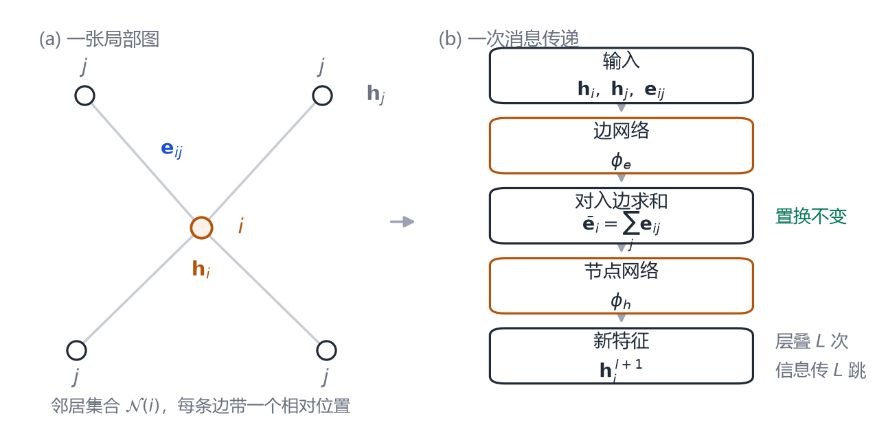
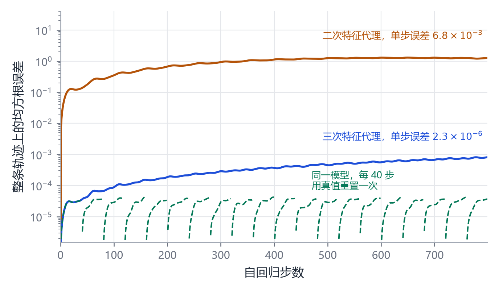

# 第 9 章 神经代理模型与图网络

> 本章导读：一堆积木倒进箱子，物理求解器每帧要 4 毫秒，换成一个网络，前五十帧挑不出毛病，第两百帧整堆开始下沉。这一章讲学习型代理模型到底替换了求解器的哪一段，为什么“单步误差很小”什么都说明不了，以及守恒、对称和稳定性怎么塞进网络里。

## 9.1 一堆积木在两百帧之后化开

一个装了两百多块积木的方箱，从侧上方倒进去。基于位置的动力学（position based dynamics，PBD，一种在约束上来回投影的求解方法）要跑十二次约束迭代，加上碰撞检测，一帧四毫秒出头。有人想把它搬到手机上，预算只有零点五毫秒，于是拿一个网络替掉整个物理步：输入全部刚体的位置、姿态、速度，输出下一帧的位置、姿态、速度。训练数据是求解器自己生成的，两千条轨迹，每条三百帧。

先把预算算清楚。手机跑每秒六十帧，一帧十六点六毫秒，物理只能分到零点五毫秒。求解器一帧四毫秒，连三十帧都跑不到；八倍的速度差不是少迭代两次能补上的，这才是“换网络”真正的来源。

单步误差报出来是零点三毫米，姿态误差零点二度。用一段新轨迹测试，前五十帧几乎看不出区别，第一百帧堆顶开始轻微起伏，第两百帧整堆明显矮了一点，第五百帧积木像沙子一样摊开，边角变得圆钝——求解器里那些尖锐的接触角没有了，取而代之的是一种均匀的发散。

零点三毫米有多小？积木边长两厘米左右，零点三毫米是边长的百分之一点五。单步误差不是“每步加零点三毫米”，它是每一步都在被放大或者被压住的一个量。

把这个放大写成一个具体的数。假设每推一步，误差被放大 $1.02$ 倍，起点是零点三毫米。第 $n$ 步的误差约是 $0.3\times1.02^{\,n}$ 毫米。两百步：$1.02^{200}\approx52.5$，误差变成十五点七毫米，接近一整块积木的边长，堆顶当然会塌一小层。若放大因子是 $1.01$，两百步是 $1.01^{200}\approx7.3$，误差二点二毫米，只是在画面上有一层薄薄的重叠。

这个现象在数值方法里叫误差累积，在做学习型模拟的人嘴里有个更具体的名字：网络在训练时看到的输入永远落在真实轨迹上，测试时它看到的是自己上一步的产物。第一次预测差零点三毫米，第二步的输入就已经偏了，网络没有在这种输入上训练过，输出偏得更多。三百步之后，偏差已经大到不属于“数据分布”了。

也就是说，误差累积不是“误差很大”，而是“误差进入了输入”。前者靠提高精度能缓解，后者不能：把单步误差降到零点零三毫米，放大因子还是一点零二，两百步之后仍然放大约五十倍，只是塌得慢一些。

这件事不是靠换一个更大的网络能解决的。偏差不在容量上，在训练与部署的错配上。这一章先从“代理模型”这个词的两种用法讲起，再回到图网络这条具体的技术路线，最后把误差累积、守恒、稳定性、评测几件事拆开讲。

## 9.2 代理模型替换的是哪一段

工程里的“代理模型”（surrogate model，也叫元模型，用一个便宜的近似函数代替昂贵计算）原本指一件很朴素的事：有一个算得慢但准的程序，想在一个优化循环里调用它几百次，于是先跑几十次，拟合一个便宜的近似，之后优化就在近似上做。响应面、克里金插值、POD 降阶，都是这个思路的不同实现。

三个词一句话：响应面（response surface）拿几个样本拟合一张二次曲面，在曲面上找极值；克里金（kriging）假设相邻样本点的误差相关，按距离衰减的权重做插值；POD 降阶（proper orthogonal decomposition，本征正交分解）把高维快照做奇异值分解，取前几个能量最大的模态。

深度学习代理模型换的是近似的形式，思路没变：用一个便宜的函数逼近一个昂贵的函数。

区别在于替换的粒度。这是选型时第一个要定的事，定错了后面全是白费。

**替换整个时间推进的一步**。网络学一个映射 $\mathbf{x}_{n+1}=f_\phi(\mathbf{x}_n)$，$\mathbf{x}_n$ 是第 $n$ 步的状态（所有粒子的位置和速度拼成的长向量），$f_\phi$ 是参数为 $\phi$ 的网络。部署时按帧循环调用：算出 $\mathbf{x}_{1}$，把它喂回去算 $\mathbf{x}_{2}$，如此下去。这条路要求网络真的学到了动力学，代价是每一步都要过一次网络，收益是保留了一切交互可能——中途可以改初值、可以加外力、可以响应用户拖拽、可以嵌进控制器里做闭环。

**替换整段轨迹**。网络学 $\mathbf{x}_{0:T}=g_\phi(\boldsymbol{\theta},\mathbf{x}_0)$，直接把参数、初值和时间一起映射到整条轨迹。这条路适合参数扫描：想知道一千组材料参数下布料怎么落，一次前向出一千条轨迹，中间不需要逐步推进。代价是失去了所有中途干预的能力，而且时间维度被当成了一个输入坐标，训练数据必须覆盖你打算查询的所有时刻。

还有第三种，替换求解器内部的某一段——本构、通量、子网格修正。它不属于“代理模型”这个词的通常用法，第 11 章专门讲它：粒度不只“一步／整段”两档，中间还有位置可以选。

两种代理模型对数据的要求完全不同。学习一步映射，相邻两帧就是一条样本，三千帧的轨迹给你三千条样本；学习整段映射，一条轨迹只给一条样本，而且这条样本的输入是参数与初值，输出是整条曲线。后者在参数空间里需要铺得足够密，否则网络只是在插值几个见过的参数点；前者在同一条轨迹上能反复取材，样本效率高得多。

还有一个经常被忽略的前提：这两种做法都要一个能跑的求解器来生成数据。如果求解器本身慢到无法接受，造数据这一步就是瓶颈，训练集规模上不去，代理模型的精度也就封顶了。有人把这叫“用贵的算便宜的”，但要补一句：便宜的只在训练分布内便宜，出了分布它比贵的更不可靠，因为它不会告诉你“我算不了”。

一个真实的对比能把这句说透。求解器在参数超出适用范围时会发散、报错、触到断言，你看得见它失败。网络不会：给它一个没见过的容器形状，它照样在一毫秒内吐出一个光滑、连续、看着很合理的答案，数值不发散也不报警，下游的碰撞检测和渲染照常跑，直到几十秒后有人发现东西穿过地面。

也就是说，代理模型的失败模式是把错误藏起来，求解器的失败模式是把错误喊出来。这决定了代理模型必须配一套自己的评测（9.7 节）。

## 9.3 图网络：把邻居的消息加起来

粒子和网格顶点都是一堆没有顺序的东西。你把粒子列表随机打乱，物理结果不该变。用全连接网络就得把整个列表拼成一个固定长度的向量，粒子数一变，网络输入维度就变了；而且这种网络不知道“谁挨着谁”，只能从坐标里自己猜。

图网络把这两件事一起解决了。它把状态表示成图：节点 $i$ 有特征 $\mathbf{h}_i$（质量、速度、类型），边 $(i,j)$ 有特征 $\mathbf{e}_{ij}$（相对位置、距离、面积），还可以有一个全局量 $\mathbf{u}$（重力、风速、容器尺寸）。一次消息传递（message passing，节点把信息沿边发给邻居，邻居再把收到的加起来）分四步：

$$
\mathbf{e}_{ij}'=\phi_e\bigl(\mathbf{h}_i,\mathbf{h}_j,\mathbf{e}_{ij}\bigr),
\qquad
\bar{\mathbf{e}}_i=\sum_{j\in\mathcal{N}(i)}\mathbf{e}_{ij}',
$$

$$
\mathbf{h}_i'=\phi_h\bigl(\mathbf{h}_i,\bar{\mathbf{e}}_i,\mathbf{u}\bigr).
$$

逐符号过一遍。$\mathcal{N}(i)$ 是节点 $i$ 的邻居集合，二维粒子系统里通常六到十二个；$\phi_e$ 是边网络，输入两端的节点特征和这条边自己的特征，输出一个消息向量，通常是一个两层、每层三十二到六十四单元的多层感知机（multilayer perceptron，MLP，几层全连接加非线性激活）；$\mathbf{e}_{ij}'$ 就是“$j$ 想告诉 $i$ 的话”；$\bar{\mathbf{e}}_i$ 是收进来的消息之和；$\phi_h$ 是节点网络，把“我原来的状态”和“大家告诉我的总和”合成新状态 $\mathbf{h}_i'$。

求和这个操作是整件事的关键：它对邻居的顺序不敏感，邻居数从六个变成七个也不影响运算，所以置换不变性和变长输入同时得到了保证。图 9-1 把这一轮画成了流程。

动手算一遍，尺度取最小。三颗粒子在一条直线上，位置 $x_1=0$、$x_2=1$、$x_3=3$，单位米，质量都是 $1\ \mathrm{kg}$。只有相邻两对之间有弹簧，劲度系数 $k=100\ \mathrm{N/m}$，自然长度为零——也就是力等于 $k$ 乘两点间距。边特征取相对位置 $\mathbf{e}_{ij}=x_j-x_i$，边网络取 $\phi_e(\mathbf{e}_{ij})=k\,\mathbf{e}_{ij}$，节点网络取“把收到的和当作力”。

边 $1\text{-}2$：$\mathbf{e}_{12}=1-0=+1$，消息 $+100\ \mathrm{N}$，从 2 发给 1。反向的 $\mathbf{e}_{21}=-1$，消息 $-100\ \mathrm{N}$，从 1 发给 2。边 $2\text{-}3$：$\mathbf{e}_{23}=3-1=+2$，消息 $+200\ \mathrm{N}$ 从 3 发给 2；$\mathbf{e}_{32}=-2$，消息 $-200\ \mathrm{N}$ 从 2 发给 3。

聚合：节点 1 收到 $+100$，节点 2 收到 $-100+200=+100$，节点 3 收到 $-200$。三个数加起来是零。这不是巧合：$\phi_e$ 关于 $\mathbf{e}$ 是奇函数（$\phi_e(-\mathbf{e})=-\phi_e(\mathbf{e})$），所以每一对边的两条消息严格大小相等方向相反，总和必然为零。这条性质在牛顿力学里叫作用与反作用，在这里它是网络结构带来的，不需要训练。

注意这个例子里 $\phi_e$ 是可以逐边独立算的，但结果自动满足成对抵消。这一条在 9.5 节还会回来：一旦 $\phi_e$ 不是奇函数，抵消就断了，系统会凭空获得动量。

再看层数。一层消息传递之后，每个节点只知道一跳邻居。上面这颗三粒子链，节点 1 在第一层收到的是节点 2 的信息，第二层才收到节点 3 的信息，第三层才知道边界以外的事。这正是卷积网络里感受野（receptive field，一个输出位置能看到多大范围）的同一件事，也和物理上“局部相互作用”的假设对得上：弹性力只依赖邻域，压力波要时间才能传远。

把距离换成数字。粒子间距一厘米，一层传一跳，五层能传五厘米；布料边长五十厘米，中间一点要感知到四个角，得几十层。所以层数不是为了“更深更强”，而是为了“信息能传多远”：太少，约束传不过来，布料的整体刚度学不出来；太多，信息被反复混合、抹平细节，每个节点最后收到的是整片区域的平均。实践中四到十层是常见区间。

Sanchez-Gonzalez 等人的做法把结构定成了三段：编码器（encoder，把物理量归一化后投到高维隐空间）、处理器（processor，若干轮消息传递）、解码器（decoder，把隐特征投回物理量）[@sanchez2020]。他们让网络预测**加速度**而不是位置，再用一步积分（半隐式欧拉，速度先更新、位置再用新速度更新）推下一步。

这个细节不是随手定的。位置是加速度积分两次的结果，直接预测位置，一步的小误差会原样进入下一步的输入；预测加速度，网络只需要学二阶导，量级更规整，积分格式本身还能带来一点数值阻尼。

<figure class="fig">

<figcaption><b>图 9-1</b>　一次消息传递的数据流（示意图）。左侧是一张局部图：中心节点 $i$ 与它的邻居 $j$，每条边上带一个相对位置 $\mathbf{e}_{ij}$，节点上带特征 $\mathbf{h}_i$。右侧是数据流：节点与边特征一起进边网络 $\phi_e$ 得到消息，所有入边消息求和后与节点自身特征进节点网络 $\phi_h$，得到新特征。求和这一步与邻居的排序无关，所以置换不变性是结构带来的，不是训练出来的；把这一层叠 $L$ 次，信息最远能传到 $L$ 跳。</figcaption>
</figure>

相对位置 $\mathbf{e}_{ij}=\mathbf{x}_j-\mathbf{x}_i$ 必须显式喂进去。网络不会从绝对坐标里自己学出平移不变性——两套完全一样、只是整体挪了一米的系统，绝对坐标差着一米，网络会认为是两个不同的输入。用相对量，系统整体平移的不变性就自动成立，这是最便宜也最常被漏掉的一条。

Pfaff 等人的版本面向网格，图建在三角网格的边上，边特征带世界坐标下的相对位移，同样预测加速度 [@pfaff2021]。这个选择让方法能吃任意网格：布料、软体、流体表面，只要是三角网格就能构造成图，不需要规则格点。代价是网格质量差的地方（细长的三角形、退化的边）会带来数值麻烦，需要在构边时做筛选。

## 9.4 单步训练与误差累积

最自然的训练方式是单步。从求解器生成的轨迹里取相邻两帧，最小化

$$
L_{\text{1步}}(\phi)=\bigl\lVert f_\phi(\mathbf{x}_n)-\mathbf{x}_{n+1}\bigr\rVert^2 ,
$$

其中 $\mathbf{x}_{n+1}$ 是求解器给出的“正确”下一步。这个损失好优化：样本独立同分布，梯度方差小，训练稳定。它的问题在于假设——它假设 $f_\phi$ 的输入永远是求解器产生的状态。

逐符号看这个损失。$\lVert\cdot\rVert^2$ 是整个状态向量的平方和，状态把两百颗粒子的位置、速度、姿态拼在一起，维度约两千；平方是为了求导干净。

部署时不是这样。$\mathbf{x}_{1}$ 是网络算的，$\mathbf{x}_{2}$ 是网络基于 $\mathbf{x}_{1}$ 算的。误差进入了输入，而输入的分布因此偏离训练分布。这个偏离有个正反馈：输入越偏，输出越偏，下一步的输入更偏。机器学习里把它叫暴露偏差（exposure bias，训练时只见过真值输入、部署时只能见到自己输出），在序列生成模型里是老问题，在这里的形态是“积木慢慢化开”。

量化一下这个反馈。设单步映射在真实轨迹附近的雅可比矩阵为 $\mathbf{J}=\partial f_\phi/\partial\mathbf{x}$，一步的误差 $\boldsymbol{\epsilon}_n$ 传到下一步变成 $\mathbf{J}\boldsymbol{\epsilon}_n$ 再加上新的模型误差 $\boldsymbol{\eta}_n$，即 $\boldsymbol{\epsilon}_{n+1}=\mathbf{J}\boldsymbol{\epsilon}_n+\boldsymbol{\eta}_n$。

若 $\mathbf{J}$ 的谱半径（spectral radius，矩阵所有特征值里绝对值最大的那个，记 $\rho$）小于一，误差会被压住，累加起来有上界 $\lVert\boldsymbol{\eta}\rVert/(1-\rho)$。这个式子值得盯住：$\rho=0.99$ 看似“每步都在收缩”，上界却是单步误差的一百倍；$\rho=0.9$ 是十倍；$\rho=0.5$ 才接近单步误差本身。也就是说，收缩得慢，等于把单步误差存起来不花掉，稳态误差仍然是一个很大的数。

若 $\rho$ 略大于一，误差按 $\rho^n$ 增长，几百步后就不可用。注意 $\rho$ 说的是最敏感的那个方向，不是平均行为。一个系统在绝大多数方向上收缩、只在少数几个方向上略微放大，单步误差看起来很小，长轨迹仍然会散。

图 9-2 把这条反馈测了出来，三条曲线分别是两个不同精度的代理和一条定期纠正的代理。

<figure class="fig">

<figcaption><b>图 9-2</b> 代理模型自回归 rollout 的误差(真实计算)。系统为 $\ddot{x}=-x-0.35x^{3}$,$\Delta t=0.05$ s,参考解由 RK4 给出;代理是状态多项式特征上的一次映射,权重用最小二乘从 300 条轨迹拟合。二次特征的单步误差 $6.8\times10^{-3}$，三次特征 $2.3\times10^{-6}$。纵轴是 32 组未见过初值的均方根误差,横轴是自回归步数。二次模型在四百步前后饱和到与振幅同量级;三次模型到 800 步仍以稳定速率增长。虚线是同一三次模型每 40 步用真值重置一次的结果,误差被钳在 $4\times10^{-5}$ 附近。</figcaption>
</figure>

这张图给的信息比任何单个数字都多。两个模型的单步误差差了近三千倍，四百步之后却是一个封顶、一个不封顶：二次模型饱和到与振幅同量级，已经不可用；三次模型到八百步还在以稳定速率往上爬。单步精度差三千倍，长时行为不是“差三千倍”，而是“一个饱和、一个发散”。

再看那条虚线。同一个三次模型，每 40 步用真值重置一次，误差被钳在 $4\times10^{-5}$ 附近，比不重置的曲线低了三个数量级。重置不是“更好的模型”，它只是切断了误差进入输入的那条反馈路径。这一条在工程上极其实用：只要有办法定期拿到真值，累积就被掐住了。

针对这件事的办法是让训练也看到多步。把 $K$ 步的误差加起来：

$$
L_{K}(\phi)=\sum_{k=1}^{K}w_k\bigl\lVert \mathbf{x}_{n+k}^{\phi}-\mathbf{x}_{n+k}^{\text{ref}}\bigr\rVert^2 ,
$$

$\mathbf{x}_{n+k}^{\phi}$ 是从 $\mathbf{x}_n$ 出发、用网络自己推 $k$ 步得到的状态，$\mathbf{x}_{n+k}^{\text{ref}}$ 是求解器的结果，$w_k$ 是第 $k$ 步的权重。$w_k$ 通常取 $1$（所有步一视同仁）或者随 $k$ 递增（更看重后面的步），因为后面的步才暴露放大问题。

要让梯度穿过 $K$ 次网络调用，这在时间上展开的反向传播（backpropagation through time，BPTT，把每一步当成一层、沿时间反着求导）里叫展开。显存大致乘 $K$，计算也乘 $K$。

具体乘多少，算一笔。两百颗粒子、一千八百条有向边、一百二十八维特征，一次前向的中间激活约六兆字节；推十步六十兆，批大小八是四百八十兆；$K$ 改成五十立刻变两点四吉字节。这就是“$K$ 取 5 到 20”的实际来源——不是理论限制，是显存账。

$K$ 取 5 到 20 是常见范围，再大就换不来相应收益了：误差在几十步内基本饱和到某个平台，训练更长的窗口只是在优化一个已经被主导的量。这句话的意思是，多步损失里第 40 步的误差量级往往已经是第 10 步的十倍以上，梯度被它主导，前十步反而学不动了。

$K$ 大不起来还有一个更硬的原因：长窗口的梯度容易爆。展开 $K$ 步相当于一个 $K$ 层的深层网络，梯度范数随 $K$ 指数变化，这一点和循环网络训练时的困难是同一个。工程上的对策是课程式增长：先用 $K=1$ 训到收敛，改成 $K=2$ 再训，逐步加到 10 或 20。每一步都在一个已经不错的解附近微调，梯度不会一开始就炸。

还有一类折中叫分段 rollout：把 $K$ 步切成若干段，段与段之间把状态 detach 掉（从计算图里摘出来，梯度到那里就停，不再往回传），不让梯度跨段回传。这样显存只与段长有关，长窗口的偏差仍然在损失里，只是梯度不再精确。便宜、有效、不严格，用的时候要清楚自己放弃的是梯度的准确性。

最后一个反例。有人对混沌系统做 $K=20$ 的 rollout 训练，训练损失降得很好，部署后两百步左右仍然偏离。混沌系统的邻近轨迹本来就按指数分离，任何模型都无法在长时上逐点对齐——该改的不是 $K$，是评测指标（9.7 节第三层）。

## 9.5 守恒与对称性怎么进网络

物理系统的性质可以分成两类：必须严格成立的（守恒律、对称性），和大致成立的（具体数值）。第一类绝对不能交给网络用数据去学，因为数据只覆盖有限情形，而守恒律要求所有情形。

这个区分可以再具体一点。平均误差零点三毫米属于第二类；总动量在三千帧里漂百分之五属于第一类，因为漂移随时间线性增长，跑一万帧就漂百分之十几。前一类靠损失函数压不住，只能靠结构。

**置换不变**（permutation invariance，输入列表换个顺序、输出不变）由结构保证。消息传递里的求和天然对邻居顺序不敏感，节点之间也没有固定编号，这一条不需要额外处理。浮点加法不满足结合律，消息按不同顺序求和，末几位会差 $10^{-16}$ 相对量级，做单元测试要用带容差的比较，不要按位相等。

**平移不变**（translation invariance，整体挪一段、结果不变）靠相对位置。只要所有几何量都以相对形式进入边特征，整体平移就不改变任何计算结果。看似平凡，实践中翻车的例子不少：有人把绝对坐标也拼进节点特征，网络于是学到一个隐含的“世界原点”，换个场景整体挪一段就失效。

**旋转不变**要难一些。三维场景里整体旋转，物理结果应当跟着旋转——这叫等变性（equivariance，输入转多少度，输出也转多少度，而不是不变）。一个只在相对位置上学特征的全连接网络做不到这一点。

区分“不变”和“等变”很关键。标量（能量、密度、距离）在旋转下不变；矢量（位置、速度、力）在旋转下跟着转。要让网络输出力，就必须让输出的矢量随输入一起转，这类结构叫 $E(3)$ 等变网络（$E(3)$ 指三维的旋转加平移）。最便宜的做法是让网络只预测每个邻居上的力的**大小**，方向用相对位置单位向量补回去，天然等变，参数还少。更彻底的做法是在消息里维护一个参考标架，让特征带上方向（向量型特征随旋转一起转，标量型特征不变），这一类结构在分子模拟里已经比较成熟。

**动量守恒**是最容易被破坏、也最容易修的一条。质点系统的总动量只有在每对相互作用的内力大小相等、方向相反时才守恒。如果网络对每条边独立预测一个力 $\mathbf{F}_{ij}$，而 $\mathbf{F}_{ji}$ 由另一次前向单独算出，两者不会严格相反，系统就会凭空获得动量——表现为整团粒子缓慢漂移，或者整体自发旋转。

算一下这个漂移有多大。两个粒子，各 $1\ \mathrm{kg}$。网络给“1 受 2 的力”算出 $1.000\ \mathrm{N}$，给“2 受 1 的力”算出 $-0.950\ \mathrm{N}$——只差百分之五，放在单步精度报告里根本看不出来。合起来是 $0.050\ \mathrm{N}$ 的净力，总质量 $2\ \mathrm{kg}$，质心加速度 $0.025\ \mathrm{m/s^2}$。一秒之后质心速度 $2.5\ \mathrm{cm/s}$，五秒（三百帧）之后位移 $31\ \mathrm{cm}$。一堆积木自己往旁边爬了三十厘米。

修法很简单：对每条无向边只算一次力，然后给两端分别加上 $+\mathbf{F}_{ij}$ 和 $-\mathbf{F}_{ij}$。这一步是纯结构的，不增加参数，也不损失表达能力（任何保守内力都能这么写）。前面 9.3 节的三粒子例子里，$\phi_e$ 是奇函数，抵消是自动的；一旦 $\phi_e$ 里带个偏置项或者用了非奇激活，就必须显式做这个对称化。

**能量守恒**一般保不住。网络学到的映射不是某个哈密顿系统（Hamiltonian system，用位置和动量写成一个能量函数、状态按能量守恒演化的系统）的精确离散，长期积分会出现能量漂移，通常是缓慢衰减——因为训练数据里的数值阻尼被学了进去，而网络又倾向于输出“平均意义上更安全”的预测，这种平均本身就带耗散。

用谐振子把“格式带来的漂移”和“网络误差带来的漂移”分开。取 $\ddot{x}=-x$，$\Delta t=0.01$。用显式欧拉（位置用旧速度更新）推一千步，能量每步乘 $1+\Delta t^2=1.0001$，一千步涨百分之十；步长加倍到 $0.02$，同样一千步涨百分之四十九。这是格式本身的错，与网络无关。换成辛欧拉（位置用新速度更新，辛指保持相空间体积），能量只在初值附近振荡。

修法有两条：一是把积分格式换成辛格式，让格式本身不引入漂移，网络的误差只体现在力的精度上；二是事后投影，把速度整体缩放到目标动能，代价是这一步不再是物理的，只在视觉类应用里可接受。

**边界条件**必须写进结构。固定顶点在每一层之后强制重置到原位；碰撞体用有向距离场（signed distance field，空间每一点到最近表面的距离，内部为负）给出，作为额外的边或全局特征；周期性边界在算相对位置时取最小镜像（把超出半个盒子的位移减去一个盒子长度）。

这些都是“已知的硬约束”，写成掩码或重置比让网络从数据里学可靠得多。一条布料两角被钉住，训练数据里所有样本都满足这个条件，网络自然也能学个八九不离十，但那“一两分”的误差每帧都在累积，几百帧后钉子处的网格就被拉出来了。

可操作的判据只有一句：能用结构保证的性质，就不要用损失函数去惩罚。软惩罚在训练分布内看起来有效，出了分布就失效，而守恒律恰恰是所有分布上都要成立的。

## 9.6 稳定性不是精度

一个模型可以在测试集上单步误差最低，同时一跑长轨迹就炸。这两件事衡量的是不同的东西：前者是模型在数据分布上的贴合程度，后者是模型自己构成的动力系统是否有界。

判断稳定性有个直接的办法：把训练好的 $f_\phi$ 当成一个离散动力系统，算它在状态空间各处的雅可比谱半径。谱半径大于一的地方就是放大器，rollout 经过那里，扰动会被放大。这个诊断不需要跑长轨迹，只需要在采样的状态点上求一次矩阵的谱。真做起来矩阵很大（两百颗粒子就是一千多维），用幂迭代（power iteration，反复乘矩阵再归一化）估最大特征值就够了，十到二十次雅可比向量积，比跑两千步便宜四个数量级。

工程上有几条互相独立的手段，通常一起用。

**噪声注入**。训练时给输入加一点高斯噪声，让网络学会“输入有小扰动时输出不要跳”。这一条对抑制放大特别有效，因为它直接惩罚了“把噪声当信号”的行为。噪声尺度要跟真实误差的量级匹配：太小没作用，太大会把真实的形变也抹平。经验上取预期的单步误差作为标准差，也就是零点几毫米；取成厘米就过大了。

**增量参数化**。让网络输出位置的增量 $\Delta\mathbf{x}$ 而不是绝对位置，并且把增量限制在一个物理上合理的范围内。上界很好算：最大速度 $10\ \mathrm{m/s}$ 乘步长 $1/60\ \mathrm{s}$，$0.167\ \mathrm{m}$。加上这个裁剪，即使网络在某些输入上失控，输出也有上界，系统不会瞬间飞出去；代价是网络一旦真的想输出更大的位移，就被削平了，表现为穿透。

**谱归一化**。限制每一层权重矩阵的谱范数（谱范数等于矩阵最大的奇异值，也就是它能把向量拉长多少倍），从而限制整个映射的 Lipschitz 常数（Lipschitz 常数是输出变化量与输入变化量之比的上界）。把每层限制在 $1$，$L$ 层的复合映射最多放大 $1^L$ 倍，这是从结构上给放大率设上界，代价是表达能力受限，适合对稳定性要求极高的场合。

**输出平滑**。高频抖动是学习型模拟最常见的视觉问题：粒子在平衡位置附近以网格尺度来回跳。原因通常是网络对局部构型过于敏感，邻居数的微小变化导致输出跳变。数字上很好识别：位置抖幅 $0.1\ \mathrm{mm}$，相邻两帧方向相反，表观速度就是 $0.1\ \mathrm{mm}\times60=6\ \mathrm{mm/s}$，看着明显在颤，而真实速度是零。在边上做一次加权平均，或者把消息聚合从求和换成带权平均，能压掉一部分；也可以在解码后对速度做一次短窗平滑，代价是引入一点数值阻尼。

**回退到物理**。最稳的办法是别让网络单独跑完全程：每若干步用物理求解器纠正一次，或者把网络嵌进一个混合格式（第 11 章）。这不是认输，是承认在分布外区域需要有人兜底。图 9-2 那条虚线就是这个思路的最小版本，只不过兜底用的是真值。

有一个常被忽略的稳定性来源：训练数据的轨迹长度。如果训练数据全是两百步的短轨迹，网络从未见过长时间演化后出现的构型（比如积木堆稳定之后的接触网络），它在这些构型上的行为是外推的。用长轨迹、多初值、覆盖各种接触状态的数据训练，比任何正则化都管用。

## 9.7 评测：单步误差说明不了什么

如果只能报一个数，多数论文报单步 RMSE（root mean square error，均方根误差，把误差平方、平均、开方）。这个数在评审里好比较，在工程上几乎没有指导意义。原因前面已经说了：单步误差与长时行为之间没有单调关系。

可行的评测要分层。

**第一层，一步精度**。在独立测试集上报 RMSE，并且分项报：位置、速度、加速度，以及不同区域（接触区、自由飞行区）分别报。接触区的误差通常比平均值大一个量级——整体报零点三毫米的模型，接触区可能是三毫米，混在一起报会把问题盖住。还要报姿态误差，它和位置误差不同源：位置靠邻域几何，姿态靠接触点分布，一个准另一个未必准。

**第二层，短时 rollout**。从若干初值出发，让模型自己推 10 步、50 步、200 步，报误差随步数的曲线。这条曲线比任何单个数字都有信息量：它是上升后饱和，还是持续增长，还是出现台阶式跳变，各自指向不同的病因。饱和说明误差被系统本身的吸引性压住了（像图 9-2 的二次模型，饱和值等于振幅，那只是“误差顶到了上限”）；持续增长说明存在放大方向；台阶说明某类事件（比如第一次碰撞）被处理错了。台阶尤其有用，它的横坐标直接告诉你哪一帧开始出错，回去看那一帧的构型，往往能找到缺口。

**第三层，长时统计**。跑几千步，看统计量而不是逐点误差：总动量的漂移、总能量随时间的曲线、速度分布、接触对的数量分布、以及能谱（把速度场做傅里叶变换，看能量在不同波数上怎么分布）。逐点误差在混沌系统里必然饱和到一个 $O(1)$ 的值，此时逐点比对已经没有意义，只能比统计量。这一层最接近“这个模型能不能替代求解器”的真实问题。

**第四层，泛化维度**。粒子数从两百变到两千，分辨率提高一倍，边界从方形换成圆形，材料参数超出训练范围——每换一维，误差怎么变。图网络在粒子数上的泛化通常比较好（因为结构上不依赖总数），在材料参数上的泛化通常很差（因为参数只是若干维归一化后的数，网络没有关于“参数应该怎么影响结果”的先验）。

这几层评测做下来，往往会得到一个不太好看的结论：某些任务上神经网络代理的精度还比不上一个调好的降阶模型，速度优势也没有想象中大，因为推理要逐步调用、每步都要构造图。真正能站住的场合有几类：状态维度极高、传统方法受限于网格分辨率的（粒子数上百万的沙堆）；需要 GPU 批量并行、跑几千条轨迹做参数扫描的；以及物理模型本身写不准、需要从数据里补的（这一条通向混合模拟）。判断一个代理模型值不值得用，先问清下游任务需要哪一层精度，再看数据能不能覆盖那个分布。两个问题有一个答不上来，就先用求解器。
