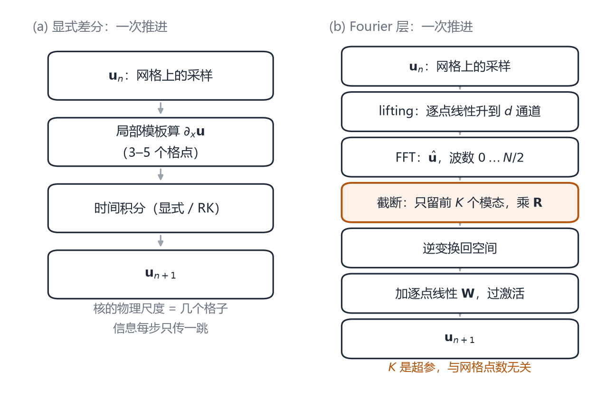
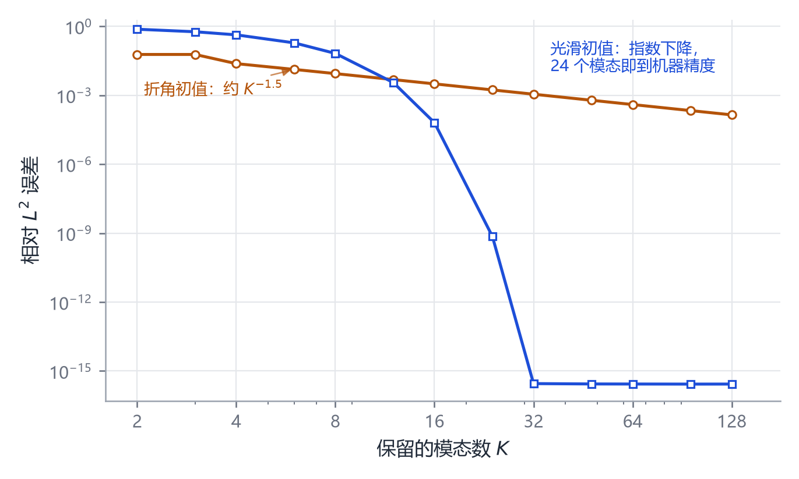

# 第 10 章 神经算子与物理约束网络

> 本章导读：一个在 64×64 网格上训练得很好的网络，换到 96×96 就误差翻倍，插值回原分辨率又好了——它学到的到底是方程，还是那张网格。这一章讲算子学习想解决的正是这件事，讲频域截断、分支主干两种参数化各自的边界，也讲把残差写进损失之后，PINN 在哪些场合真的赢，哪些场合只是把求解器换成了一个更慢的东西。

## 10.1 一份换了网格就失效的模型

地下水渗流的标准测试：给定一块非均匀多孔介质的渗透率场 $a(\mathbf{x})$，解压力场 $u(\mathbf{x})$，满足 $-\nabla\cdot(a\nabla u)=f$，边界条件固定。这种方程没有解析解，靠有限差分或有限元在网格上解。有人想跳过求解，直接学映射：输入渗透率场，输出压力场。

数据这样造：随机生成一批渗透率场（多孔介质的图案，带相关长度），用有限差分在 $64\times64$ 的格子上解出压力场，一万对样本，训练一个编码器—解码器结构的卷积网络。测试集同分布，相对误差百分之二，看着可以。

然后换个网格试试。同一批介质，用 $96\times96$ 的格子重新采样、重新求解，把在粗网格上训练好的网络直接喂细网格的输入——输入维度就对不上，得先插值到 $64\times64$，输出再插回 $96\times96$。这一插，误差从百分之二涨到百分之八，而且误差集中在介质对比度大的地方：高渗透率通道和低渗透率隔层交界处，压力梯度最陡，插值把梯度抹平了。

再做一个更干净的实验：不动分辨率，只把边界条件从一边固定压差换成两边固定压差。误差同样翻了几倍。

这两个失败指向同一件事。网络学的不是"给渗透率场算压力场"这个映射，而是"给 $64\times64$ 的数组算另一个 $64\times64$ 的数组"这个映射，而且在训练分布之外的边界条件上没有依据。前者是分辨率绑定，后者是分布绑定。第二节讲怎么摆脱前者，第五节讲后者其实无法完全摆脱。

## 10.2 算子、离散，以及网格无关指什么

把求解器写成算子。方程 $-\nabla\cdot(a\nabla u)=f$ 加上边界条件，定义了一个从系数场到解场的映射

$$
\mathcal{G}:\ a(\mathbf{x})\ \longmapsto\ u(\mathbf{x}),
$$

$a$ 和 $u$ 都是定义在连续区域上的函数，$\mathcal{G}$ 是这两个函数空间之间的算子。传统求解器做的是：先把区域离散成网格，把函数换成向量，把算子换成矩阵，解线性系统，得到一个网格上的近似解。这一串操作里，网格是手段，不是目的。可一旦你只在某一个网格上做这件事，得到的映射就是"数组到数组"。

算子学习想学的是 $\mathcal{G}$ 本身，参数化要跟离散方式解耦。这件事能不能做到，取决于网络里每一个操作的语义：它到底定义在函数上，还是定义在数组下标上。

**逐点操作**（线性变换、激活、偏置）与网格无关。函数在每一点取一个值，逐点操作就是"每点独立地做同一件事"，采样多密都不影响语义。

**局部模板**与网格有关。$3\times3$ 卷积的语义是"看周围三个格子的范围"，在 $64\times64$ 上这对应一块物理尺寸，在 $96\times96$ 上同一块物理尺寸变成四点五个格子。同一个权重，作用在不同的物理尺度上，这就是分辨率绑定最直接的来源。堆很多层可以扩大感受野，但每层的物理尺度仍然随网格变。

**频域乘法**与网格无关。傅里叶变换把函数拆成一组正弦波，每个波数上的系数是一个复数；在这个表示上做逐模态的乘法，等价于在空间上做一次全局卷积，核的支集是整片区域。模态编号对应的是物理波数，与采样点数无关——这是 Fourier 神经算子的立足点。

**积分核**也与网格无关。$(\mathcal{K}v)(\mathbf{x})=\int\kappa(\mathbf{x},\mathbf{y})v(\mathbf{y})\,d\mathbf{y}$ 里的 $\kappa$ 是两个物理位置之间的函数，离散成求和时，采样点多少只影响积分的近似精度，不改变算子本身。

与网格无关的操作有三种——逐点、频域乘法、积分核。逐点操作单独用不够，它没有空间耦合，所以真正能扩展成参数化的只有后两种：谱方法把频域乘法做进层里，积分算子把核学出来（DeepONet 的主干与图上的消息传递都属于这一类）。那个版本的图消息传递本身就是在一个邻域上做加权求和，只要求解网格本身代表物理区域，换网格不改变语义，网格上的模拟因此能在不同拓扑之间迁移 [@pfaff2021]。它的代价是依赖网格质量，好处是能吃任意形状的区域。

还有一个陷阱藏在数据里。训练数据来自某个求解器、某个网格，网络会把这个求解器的离散误差当成物理规律的一部分。有限差分在粗网格上有数值耗散，学出来的模型就带着耗散；换到细网格上，这个耗散本该消失，模型却还在施加它。所以即便网络结构是网格无关的，数据里的离散偏置仍然会把分辨率绑死在训练网格附近。这条没法靠结构解决，只能靠多分辨率的数据和评测去暴露。

## 10.3 FNO：在频域做卷积

Fourier 神经算子的结构很短。输入函数先在每个点上过一个线性层，把标量通道升到宽度 $d$（叫 lifting），然后叠若干层 Fourier 层，最后再逐点投回输出通道（projection）。一层 Fourier 层是

$$
v_{l+1}(\mathbf{x})=\sigma\Bigl(\mathbf{W}v_l(\mathbf{x})+\bigl(\mathcal{K}v_l\bigr)(\mathbf{x})\Bigr),
$$

$\mathbf{W}$ 是逐点的线性变换，$\sigma$ 是激活函数，$\mathcal{K}$ 是那个频域卷积：

$$
\bigl(\mathcal{K}v\bigr)=\mathcal{F}^{-1}\Bigl(\mathbf{R}\cdot\mathcal{F}(v)\Bigr),
$$

$\mathcal{F}$ 是离散傅里叶变换，$\mathbf{R}$ 是一组可学习的复数权重，只作用在前 $K$ 个低模态上，其余模态的系数直接置零。$\mathbf{R}$ 的尺寸是 $K\times K\times d\times d$（二维情形；一维只剩 $K\times d\times d$），与网格点数无关——这是它能换分辨率的原因。计算量是两次 FFT 加一次逐模态乘法，$O(N\log N)$，$N$ 是网格点数。

截断这件事值得单独说。它不只是一个省参数的技巧，而是一个关于解的假设：能量集中在低波数。热传导、扩散、低雷诺数流动，这个假设基本成立；湍流的高波数段有惯性区，能量按幂律衰减，截断到 $K$ 相当于做了一次低通滤波，丢掉的是小尺度结构；激波更是极端情况，间断的傅里叶系数按 $1/k$ 衰减，任何固定截断都会在间断附近产生振荡（Gibbs 现象），表现为激波两侧的波纹。

边界条件也是一个约束。离散傅里叶变换隐含周期性，非周期边界要么在两端做 padding 把边界推远，要么加一个坐标通道让网络知道自己在哪，要么换成别的基。这几条都能用，但没有一条是免费的：padding 引入人工边界，坐标通道要在训练里覆盖到边界附近的行为。图 10-1 把它和显式差分格式并排画在一起。

<figure class="fig">

<figcaption><b>图 10-1</b>　数值求解器与 Fourier 层的一次推进对照（示意图）。左侧是显式差分格式：状态经局部模板算右端项、再经时间积分得到新状态，模板的空间尺度固定为几个格子，信息每次只传一跳，传到远处要靠叠步数。右侧是 Fourier 层：状态经 FFT 变到频域，只保留前 $K$ 个模态并乘上可学习权重，再变回来与逐点线性项相加；一个模态覆盖整片区域，所以感受野是全局的，而参数个数只与 $K$ 有关，与网格点数无关。</figcaption>
</figure>

## 10.4 DeepONet：一组基和一组系数

另一条路线来自降阶模型。求解一个含参数的方程，最省的办法常常是：先算几个"模态"，把解写成这些模态的线性组合，只解组合系数。POD 加 Galerkin 投影就是这么干的，模态从数据里用奇异值分解取，系数解一个小系统。

DeepONet 把这个结构学下来。它用两个子网络：

$$
\mathcal{G}(a)(\mathbf{y})\approx\sum_{k=1}^{p}\beta_k(a)\,\tau_k(\mathbf{y})+b_0 ,
$$

$\mathbf{y}$ 是查询点的坐标，$\tau_k(\mathbf{y})$ 是主干网络输出的第 $k$ 个基函数在该点的取值，$\beta_k(a)$ 是分支网络从输入函数 $a$ 算出的第 $k$ 个系数，$p$ 是基的个数，$b_0$ 是一个标量偏置。分支网络的输入是 $a$ 在一组固定传感器点上的采样值——这组点的位置在训练前定死，可以是网格点，也可以是随机撒的点；主干网络的输入是一个坐标，输出一个 $p$ 维向量。

这个分解有几个直接后果。输出可以在任意点查询：想在哪里要解，就把那个坐标喂给主干，不需要整套网格。输入不必是网格：传感器可以稀疏、可以乱放，只要训练时用的是同一组位置。参数量比"整场输出"的网络小得多，因为基的个数 $p$ 通常取几十到几百，与网格点数无关。

代价也有。基函数 $\tau_k$ 不正交，也不保证线性无关，训练出来的可能是一组互相抵消的东西，数值上不稳但表达能力够用。主干网络在训练数据覆盖的区域之外没有意义——它学的是"这个区域内第 $k$ 个基在该点的值"，出了区域就是外推。分支网络对传感器布局敏感，换一组传感器位置就得重训。还有一点常被忽略：$p$ 同时是表达能力上限，解的空间结构比 $p$ 复杂时，再怎么训也拟合不上，误差会卡在一个平台上。

与 FNO 的分工大致是这样：区域规则、边界周期、解光滑，FNO 更省事，一次前向出一整场；区域不规则、输入是稀疏观测、只需要在若干点上求值，DeepONet 的形式更合适。两者都不是"更好的求解器"，它们是两种不同的参数化，各有各的适用面。

## 10.5 PINN：把残差写进损失

物理约束网络走的是另一条路：不用数据监督，用方程监督。构造一个以坐标为输入的网络 $u_\theta(\mathbf{x},t)$，它输出解在该点的值。把 $u_\theta$ 代进方程，得到一个残差

$$
r_\theta(\mathbf{x},t)=\mathcal{N}\bigl[u_\theta\bigr](\mathbf{x},t)-f(\mathbf{x},t),
$$

$\mathcal{N}$ 是方程的微分算子（比如 $\partial_t-\nu\partial_{xx}$），$f$ 是源项。如果 $u_\theta$ 是解，这个残差处处为零。于是损失写成

$$
L(\theta)=\frac{1}{N_r}\sum_{i=1}^{N_r}r_\theta(\mathbf{x}_i,t_i)^2
+\frac{\lambda_b}{N_b}\sum_{j}\bigl(\mathcal{B}[u_\theta]-g\bigr)^2
+\frac{\lambda_0}{N_0}\sum_{k}\bigl(u_\theta(\mathbf{x}_k,0)-u_0\bigr)^2 ,
$$

第一项在区域内部随机撒的点上算残差，第二项是边界条件（算子 $\mathcal{B}$，目标值 $g$），第三项是初始条件，$\lambda_b$、$\lambda_0$ 是两个权重。导数靠自动微分算，不需要网格，也不需要差分模板。这套框架在 Raissi 等人的工作里被系统地做出来，正问题和反问题用同一个损失，只是反问题里多了一组待学的方程参数 [@raissi2019]。

强项在哪，说清楚就不容易被误用。

**反问题**是它最站得住的场合。方程里有个未知系数（扩散率、反应速率、本构参数），把它和网络权重一起当变量优化，观测数据只需要几个点的稀疏测量。传统做法要先离散、再写伴随、再解优化，PINN 把这三步合成一次训练。参数少、维度低的时候，它确实省事。

**几何复杂、网格难生成的场合**。配点随机撒，区域是什么形状都无所谓，不需要贴体网格。血管分叉、多孔介质、以及形状在优化中不断变化的场景，省掉的网格生成工作量很可观。

**数据与方程混合**。有少量实测数据、又知道方程大概长什么样，把两项损失加在一起，比纯数据拟合外推得远，比纯方程求解更贴现实。

误用也就那几种，重复率很高。

**当成通用正向求解器**。这是最常见的一种。有人拿 PINN 解二维纳维-斯托克斯，报"损失降到 $10^{-5}$"，然后发现速度场与高精度求解器的差在百分之几。高雷诺数、长时积分、多尺度、激波，这几类问题上，PINN 的精度比成熟的数值方法差两到三个数量级，训练时间还长一到两个数量级。原因不神秘：网络的谱偏差让它先拟合低频，高频分量要极长时间才学得动；而湍流和激波的能量恰恰在高频。

**把损失小当成误差小**。残差在配点上小，不等于解对。一个满足方程但边界条件错的解，残差可以处处为零；配点稀疏时，残差在两个配点之间可以很大。所以评估 PINN 必须用独立的参考解，不能用训练损失。

**强形式对间断无定义**。方程写成二阶导的形式，解只要有激波，二阶导在激波处是分布而非函数，残差在这一带没有意义。要么改成弱形式（对测试函数积分），要么加熵条件，要么干脆别用这套。

**低估了训练成本**。残差里出现二阶导，意味着每算一次损失要做两次反向传播，单步开销是普通监督训练的两到三倍；配点数要到十万量级才谈得上覆盖区域，而每个配点在每一轮都要重新求导。有人按监督学习的经验估训练时间，结果差了十倍。

**权重靠手调**。$\lambda_b$、$\lambda_0$ 差几个数量级，训练会完全偏向某一项。自适应权重、把边界条件写成硬约束（构造一个恒满足边界的 ansatz），这两条能缓解，但没有一条让问题消失。

判断标准可以压缩成一句：**你要的是"从少量数据里把未知量挖出来"，还是"把一个已知方程解到高精度"**。前者 PINN 有优势，后者它几乎总是输。

## 10.6 分辨率泛化能信到什么程度

Fourier 神经算子最早被记住的一个性质是零样本超分辨：在一套网格上训练，直接换到更细的网格推理，误差不增大，甚至略降。这个结果在论文里被报告过，形式是同一组权重在不同分辨率上评估 [@li2021fno]。

这件事成立有条件，值得逐条拆开。

第一，网络里的操作确实定义在函数上。谱乘法的语义是"每个波数上乘一个系数"，网格加密只是把可表示的波数范围扩大，低波数的系数不变。这一点在数学上是干净的。

第二，训练时覆盖的模态足够多。如果训练只用 $K=12$ 个模态，网络对第 13 到 32 个模态的行为从未被约束，换到细网格上这些模态被激活，输出是任意的。细网格的推理能成功，隐含的前提是解的高频分量确实很小，小到没被监督也不至于出错。

第三，解足够光滑。谱方法的收敛速度取决于解的正则性：解析函数的傅里叶系数指数衰减，截断误差随模态数指数下降；有折角的函数系数按幂律衰减，误差只能代数下降；有间断的更差。图 10-2 是这条的实算：同一个平流方程，初值分别是光滑的高斯包和带折角的三角包，精确解用傅里叶级数给出，只保留前 $K$ 个模态重建，误差随 $K$ 的变化是两条斜率完全不同的曲线。

<figure class="fig">

<figcaption><b>图 10-2</b>　模态截断带来的相对误差（真实计算）。一维周期平流 $u_t+cu_x=0$，$c=1$，域长 1，演化到 $t=0.3$，精确解由 4096 点 FFT 给出；只保留前 $K$ 个模态重建后算 $L^2$ 相对误差，双对数坐标。光滑初值（宽 0.06 的高斯包）的误差近似指数下降，$K=24$ 时已到机器精度；折角初值（三角包）只按幂律下降，拟合斜率 $-1.49$，$K$ 从 8 加到 64，误差只从 $8.8\times10^{-3}$ 降到 $4.0\times10^{-4}$。截断误差由解的光滑性决定，不由网络容量决定。</figcaption>
</figure>

第四，评测方式本身可能骗人。把细网格上的解降采样到粗网格再比，误差自然小；直接在细网格上逐点比，误差才是真实的。有些"零样本"报告用的是前者。

还有一层是离散化本身带来的混叠。细网格上可表示的波数上限更高，如果网络内部某个环节对高频没有衰减，细网格上本来不存在的高频会被网络凭空造出来，表现为细密的网格尺度噪点。工程上的处理是在谱变换前做一次低通，或者按 Nyquist 频率对齐各分辨率的通道数，让不同分辨率上的语义一致。这些细节不会写进论文的主结果，但决定了同一个权重在换网格后能不能用。

综合起来，分辨率泛化最可靠的形式不是"训练一次到处用"，而是"在若干分辨率上混合训练，然后期待在中间分辨率上插值得好"。这个要求比零样本弱，但稳健得多，也更容易在工程里兑现。

## 10.7 与求解器分工

神经算子最实用的位置，往往不是替代求解器，而是嵌进去。

**给迭代求解器一个好初值**。压力泊松方程每一步都要解，迭代次数取决于初值离解多远。用上一时刻的解做初值已经是很有效的做法，用一个学了时间推进的算子做初值还能再省一些迭代；算子不必很准，只要把误差谱的低频部分对上，迭代法负责把剩下的收干净。这类用法对算子的精度要求低，对速度要求高，正好是神经算子的强项。

**粗解加细修正**。在粗网格上用一个学出来的算子快速得到近似解，再把它插值到细网格，用几步数值迭代修正。这是多重网格的想法换了个粗网格求解器。修正步是标准格式，守恒性和稳定性由它保证，学习模块只负责给出一个好的起点。Kochkov 等人在湍流上的工作就属于这一类，粗化八倍之后仍能维持统计量，靠的正是把数值格式留在环路里 [@kochkov2021]。

**替换时间推进中的一段**。把一步积分拆成"计算通量"和"更新状态"，只把前者换成网络，后者保留原来的格式。这样状态更新仍然是守恒形式，网络输出的偏差不会被放大成质量不守恒。

三种用法有一个共同点：学习模块的输出要经过一个已知正确的环节。这个环节是安全带——它保证即便网络在分布外给出离谱的值，整体也不会立刻崩。设计混合方案时，先问"安全带在哪"，比问"网络有多准"更有用。

纯算子替代仍然有它的位置：参数扫描、设计空间探索、实时预览。这些场合的共性是不要高精度、要的是快，而且结果后面还有人复核。把它们和"替代生产用的求解器"分开对待，能省掉很多不必要的争论。
