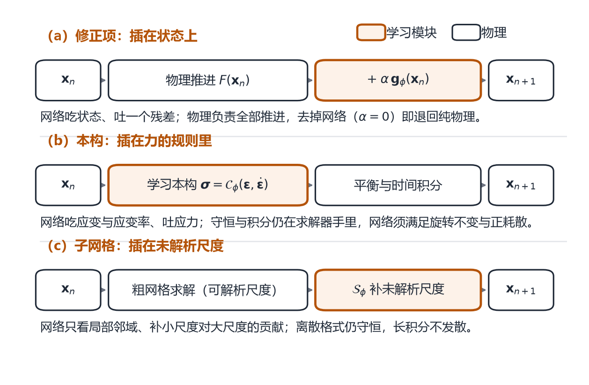
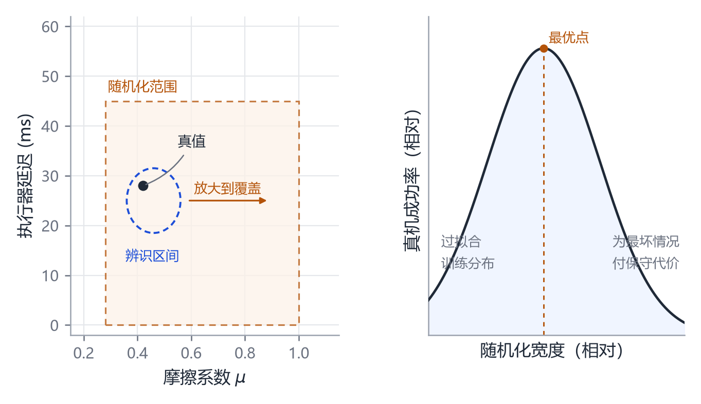

# 第 11 章 混合模拟与 Sim-to-Real

> 本章导读：一只在仿真里抓得住鸡蛋的软体夹爪，为什么到真机上要么滑落要么捏碎；学习模块能插进求解器的三个位置，位置比比例更重要；修正项想不炸要守住哪几条；域随机化不是给参数随便撒一个宽区间；可微辨识能得到什么、又会把什么藏进参数里；真实传感器的量化、漂移与延迟怎么写进训练；以及上线前的退化路径。

## 11.1 仿真里抓得起来的鸡蛋

一只三指气动软体夹爪，硅胶指，抓一枚生鸡蛋。仿真里成功率 95%，搬到真机上掉到三成，失败分成两类：鸡蛋从指尖滑出去，或者被捏裂。两种失败指向相反的方向——滑落说明仿真里的摩擦偏大，捏裂说明仿真里的材料偏软或者驱动偏猛。同一套参数不可能同时犯这两个错，所以问题不是一个数调错了，而是好几处偏差在互相抵消。

逐项查下去，会看到一串很平常的东西。硅胶对蛋壳的摩擦系数在 0.3 到 0.5 之间，有污渍时更低，仿真里填的是 0.8——这个数是从手册上抄的，手册测的是干净硅胶对干净玻璃。气动管路从阀到指根有 30 到 60 毫秒的延迟，仿真里从指令到压力是瞬时的。硅胶有明显应力松弛，恒定压力下夹持力在两百毫秒内掉一成多，仿真里用纯弹性本构。气泵标称 200 kPa，到指尖只剩 170。传感器的零点每开机一次漂一点。

这些偏差没有一个是"物理写错了"，每一条都是把真实系统简化成可计算模型的代价。问题在于它们不互相抵消，而会沿着任务放大：摩擦偏大让夹爪以为抓住了，于是在仿真里少用一点力；真机上摩擦不够，同样的力就滑了。策略学到的是"轻捏就够"，这个结论对参数的依赖比对物理规律的依赖更强。

处理这类差距有三条路，实践中往往同时用。把真机数据搬回仿真，调参数直到仿真轨迹与实测吻合，这是系统辨识。承认参数不确定，不去猜一个准确值而是在分布上训练，这是域随机化。承认模型的某一段根本写不对——硅胶的黏弹、接触面的微观形貌——干脆用学习模块替换或者补上这一段，这是混合模拟，也是这一章的主题。

混合模拟这个词容易让人以为关键是"学习和物理各占多少"。比例是最不重要的一个量，位置才是：学习模块插在求解器的哪一段、吃进什么、吐出什么、物理还剩哪些责任。同一个网络放在三个不同位置，得到的是三种不同的方法，稳定性、守恒性、可训练性都不一样。

## 11.2 学习模块能插进去的三个位置

判断一个混合方案，问三个问题就够了：网络吃进去的是什么，吐出来的是什么，去掉网络之后系统还能不能跑。

最浅的位置是修正项。求解器照常算一步，网络在结果上加一个残差：

$$\mathbf{x}_{n+1} = F(\mathbf{x}_n;\boldsymbol{\theta}) + \alpha\,\mathbf{g}_\phi(\mathbf{x}_n)$$

这里 $\mathbf{x}_n$ 是第 $n$ 步的状态，$F$ 是原来的物理推进，$\boldsymbol{\theta}$ 是物理参数，$\mathbf{g}_\phi$ 是参数为 $\phi$ 的网络，$\alpha$ 是人为给定的增益。网络不产生状态，只修正物理算错的那一点点：$\alpha=0$ 时系统退回纯物理，退化路径天然存在。坏处是隐蔽的——修正项加在状态上，它不知道哪些量必须守恒，可能一边修正误差一边把质量搬走，而这件事在单步误差上看不出来。

中间的位置是本构。求解器仍然负责平衡、积分、约束，只把"应力怎么由应变算出来"这一段换成网络：

$$\boldsymbol{\sigma} = \mathcal{C}_\phi(\boldsymbol{\varepsilon},\dot{\boldsymbol{\varepsilon}})$$

$\boldsymbol{\sigma}$ 是应力张量，$\boldsymbol{\varepsilon}$ 是应变，$\dot{\boldsymbol{\varepsilon}}$ 是应变率，$\mathcal{C}_\phi$ 是网络表示的本构关系。这个位置的好处是守恒律还留在求解器里：动量守恒由积分格式保证，本构再离谱也不会凭空产生动量。坏处是网络得遵守本构自身的规矩——旋转不变（材料不知道你从哪个方向看它）、正耗散（不能造能量）、参考状态对应零应力。普通全连接网络三条都不满足。

最深的位置是子网格。分辨率不足的地方，物理只解得出大尺度，小尺度对大尺度的贡献用一个学习算子补上。Kochkov 等人的工作是一个干净的样本：他们在粗网格上解二维湍流，把"从细网格插值到粗网格"和"粗网格离散的误差"合并成一个学习算子，插在原有差分格式的位置上 [@kochkov2021]，用八倍粗的网格拿到了数十倍加速。关键在于他们没让网络输出速度场，而是替换格式中的一个环节，整个求解器仍是守恒的差分格式，长时间积分不发散。

三个位置画在同一条推进链上就是图 11-1，判据可以压成一张表。缺"力的规则"放本构；缺"系统性偏差"放修正项；缺"解不出来的尺度"放子网格。再补两条：你希望哪条守恒律绝对成立，就把它留在求解器里；数据只覆盖小尺度统计，就别指望网络预测整场。

<figure class="fig">

<figcaption><b>图 11-1</b>　学习模块插入求解器的三个位置（示意图）。每一行是同一条推进链：状态经力与本构、经时间积分得到新状态。（a）修正项加在积分之后，网络只输出残差 $\alpha\mathbf{g}_\phi$，去掉网络即退回纯物理；（b）本构位置把应力–应变关系换成网络，守恒与积分仍由求解器负责；（c）子网格位置只在未解析尺度上补贡献，网络看到的是局部邻域而不是整场。</figcaption>
</figure>

## 11.3 修正项怎么才不炸

混合方案最典型的失败是这样：单步误差从 $10^{-2}$ 降到 $10^{-4}$，训练集上完美，一跑长轨迹，两百步后数值爆炸。查梯度没问题，查实现没问题，问题出在修正项把能量注进了物理格式本来会抑制的那部分模态。

显式差分格式带数值耗散，高频分量被压下去，这是它能稳定的原因之一。网络训练时看到的是"物理算得偏了一点"，于是学会一个把偏差拉回来的修正。这个修正对低频是对的，对高频往往变成反耗散——它把物理刚压掉的高频又加了回去。短轨迹看不出问题，长轨迹上高频分量指数增长。

对付这件事有几条互相独立的手段，实践中要一起用。

第一是加性而非替代，并且给小增益。$\alpha$ 取 0.05 到 0.2，或者把输出过一层 $\tanh$ 再乘上物理量的百分之几作为上限。修正幅度被限死，它能造成的破坏就有上界。

第二是谱约束。训练时不仅看单步误差，还要看修正项在各波数上的能量分布，不允许它在高波数上超过某个比例。Kochkov 等人把能谱作为判断稳定性的主要依据，原因就在这里：逐点误差小但谱形错了的方案跑不长。

第三是多步损失。训练用的是 $K$ 步 rollout 的累积误差，$K$ 取 5 到 20：

$$L(\phi) = \sum_{k=1}^{K} w_k\,\bigl\lVert \mathbf{x}_{n+k}^{\text{sim}}(\phi) - \mathbf{x}_{n+k}^{\text{ref}} \bigr\rVert^2$$

$w_k$ 是第 $k$ 步的权重，通常递增。只训练单步等价于 $K=1$，它永远看不到自己引入的误差在下一步被放大成什么样。

第四是噪声注入。训练时给输入加扰动，让网络学会"输入有点噪声时输出不要跳"。这一条和域随机化思路相同，用在修正项上格外有效，因为不稳定的起点往往是一次小扰动被放大。

第五是守恒投影。每一步把修正后的场投回守恒流形——不可压流把散度投影掉，颗粒系统把总质量与总动量校回来。投影这一步是纯物理、无参数的，它把网络从"必须自己学会守恒"的责任里解放出来。代价是每步多一次投影，在流体里就是多一次泊松解。

这五条之上还有一个更基本的问题：训练目标是否与粗化后的物理一致。Kochkov 等人踩过这个坑——直接用细网格解作为粗网格的目标会不稳定，因为粗化解丢掉了小尺度能量，网络被要求补一段物理上不该由它补的东西。他们的处理是让目标匹配粗化后的统计量。推广成一句：混合方案的目标函数必须与它能看到的尺度一致，否则网络学到的是"把丢失的信息编出来"，而不是"把格式的误差修掉"。

## 11.4 域随机化：用分布代替一个数

域随机化的做法在文献里写得很简单：训练时随机化物理参数，策略就会鲁棒。落到工程上，难点全在"随机化什么、随机多宽"。

设真实参数是 $\boldsymbol{\theta}^{*}$，你不知道它，只知道它落在某个范围里。按一个猜测值训练，策略会把这个猜测的每个细节都当成真的，包括猜错的部分。域随机化改成在分布上最大化期望回报：

$$\pi^{*} = \arg\max_{\pi}\; \mathbb{E}_{\boldsymbol{\theta}\sim p(\boldsymbol{\theta})}\bigl[\,J(\pi;\boldsymbol{\theta})\,\bigr]$$

$J$ 是在参数 $\boldsymbol{\theta}$ 下跑完一个 episode 的回报。学到的策略不是在某个点上最优，而是在一片区域上都不太差。

随机化哪些参数不能靠直觉列清单。一个有用的前置步骤是灵敏度分析：用可微模拟算目标对每个参数的导数 $\partial J/\partial \theta_i$，乘上该参数合理的变化范围，得到"它动一动，目标变多少"。按这个量排序，前三个到五个才值得随机化。剩下的参数即使真实值未知，对任务也没有影响，随机化它们只会扩大搜索空间、让策略变保守。

宽度取决于两件事：真机上该参数的实际波动，以及辨识能给到的精度。摩擦系数在 0.3 到 1.0 之间随机化有意义，不同物体、不同清洁度确实落在这个区间；夹爪质量在标称值上下 20% 足够，因为它是称过的。执行器延迟要单独处理，范围是 0 到 40 毫秒且不是常数——同一条指令在不同压力下延迟不一样，所以要随机化的是它的分布。

图 11-2 的右半边是宽度与性能的关系，并不单调。太窄，策略过拟合到那个窄区间，换个物体就失效；太宽，策略为了最坏情况也不出错，会把动作做得又小又慢。中间有一个最优点，位置由辨识精度决定。辨识准，最优宽度就窄，策略能既鲁棒又激进；辨识粗糙，只能靠宽随机化兜底，代价是保守。所以校准和随机化不是对立的两条路线，而是串联的两步：辨识给出分布的中心和形状，随机化给出半径。

<figure class="fig">

<figcaption><b>图 11-2</b>　辨识与随机化在参数空间里的接力（示意图，非实测数据）。左：横轴为摩擦系数，纵轴为执行器延迟，黑点为真值，虚线椭圆是辨识给出的不确定区间，浅色矩形是训练时随机化的范围；辨识把范围收窄，随机化再把它放大到覆盖残余不确定性。右：真机成功率随随机化宽度的变化，窄端是过拟合训练分布，宽端是策略为最坏情况付的保守代价，峰值位置由辨识精度决定。两侧刻度只表示相对位置。</figcaption>
</figure>

一个常见的错误是把所有参数一起随机化。十几个参数同时在宽区间上采样，策略见到的组合几乎铺满整个高维盒子，它能学到的最优解只能是"对所有组合都勉强可行"的那一个，效果比只随机化三个敏感参数差得多。另一种选择是不随机化参数而随机化观测——在读数上加噪声、加延迟、加遮挡，让策略对"看不清"鲁棒。前者对付模型错，后者对付信息缺。

## 11.5 用可微模拟做系统辨识

有了可微模拟，校准就变成一个标准优化问题。把待定参数写成 $\boldsymbol{\theta}$，让仿真从相同初值与控制输入出发，最小化仿真轨迹与实测轨迹的差：

$$L(\boldsymbol{\theta}) = \sum_{t=1}^{T} \bigl\lVert \mathbf{h}\bigl(\mathbf{x}_t(\boldsymbol{\theta})\bigr) - \mathbf{y}_t \bigr\rVert^2 + \lambda\,\lVert \boldsymbol{\theta} - \boldsymbol{\theta}_0 \rVert^2$$

$\mathbf{x}_t(\boldsymbol{\theta})$ 是仿真在第 $t$ 步的状态，$\mathbf{h}$ 把状态映射成传感器读数，$\mathbf{y}_t$ 是实测值，$T$ 是轨迹长度，第二项是往先验值 $\boldsymbol{\theta}_0$ 上拉的正则项，$\lambda$ 控制拉力。整条 rollout 被当成一个计算图，梯度一路反传到 $\boldsymbol{\theta}$，这是 DiffTaichi 那类系统最初的用法之一 [@hu2020]。

代价的账很好算。设一次仿真是 20 毫秒，梯度法几百次前向就收敛，总计几秒钟；无导数方法在三维参数上要上万次采样，同样精度要几分钟。维度上去以后差距迅速拉大：形状参数、本构参数动辄上百维，无导数方法的采样量随维度指数增长，梯度法只是把反向的显存翻倍。所以可微辨识真正不可替代的地方不是"更快"，而是"高维还能做"。

低维时它反而不划算，因为要付出改代码的代价。参数少于十个、单次仿真一秒以内，用现成的 CMA-ES 或者贝叶斯优化更省事，一行代码都不用改。

真正需要小心的是辨识结果的含义。四个坑，每一个都能让辨识"成功"而模型"更错"。

第一个是可辨识性。参数在数据里不留痕迹，优化器照样能给它一个值，那个值只是初值加噪声。典型情形：匀速段，质量与摩擦系数只有乘积可辨识；静止段，阻尼与静摩擦无法区分。做法是先算灵敏度矩阵的奇异值，接近零的方向就是数据管不到的方向，那些参数要么固定，要么加强先验。

第二个是末端主导。长轨迹的平方误差里，末端几步的偏差最大，梯度也就主要来自末端，结果是辨识只拟合了最后一段。做法是把长轨迹切成若干段，每段从实测状态重新出发，或者对误差按时间加权。

第三个最隐蔽：参数变成垃圾桶。模型缺了某段物理——硅胶的黏弹、管路的容性、接触面的微滑——辨识会把这些缺失的效果摊到现有参数上。表现是辨识出的阻尼是真实值的三倍，或者摩擦系数低到物理上不可能，拟合残差很小，模型却是错的。这种错在训练数据覆盖的工况内看不出来，换个激励频率就暴露。检查只有一条：拿没参与辨识的数据、在没参与辨识的工况上验证。残差跳一个量级，说明参数在替缺失的物理背锅，该做的是把缺的那段补进模型。

第四个是噪声偏差。观测有噪声时最小二乘估计不是无偏的，因为噪声在非线性映射下会往一个方向偏。处理方式是把噪声写进似然，或者把噪声当成待辨识参数，让优化器自己选一个与数据一致的水平。

## 11.6 传感器噪声与延迟

真机数据和仿真数据最大的差别不在精度，在性质。仿真里读到的状态是干净的、瞬时的、无偏的；真机上三个特征一个都跑不掉：量化、漂移、延迟。

量化最容易被低估。一个 12 位角度编码器一圈 4096 格，分辨率 0.09 度。位置读数的噪声看着很小，但速度是差分出来的，除以 $\Delta t$ 会把它放大：采样 120 Hz 时放大 120 倍，差分速度的噪声可以到真值的百分之几。训练用干净速度、部署用差分速度，策略看到的世界和它学的就不是一个。做法是在仿真里也走同一条差分链路，让噪声跟着链路走，而不是给状态加一个笼统的高斯噪声。

漂移是第二个特征。惯性测量单元的零偏在 0.01 到 0.1 度每秒，看着微不足道，积分十秒之后姿态误差就到 0.1 到 1 度。这类误差不是零均值白噪声，它的谱集中在低频。训练时加白噪声对它无效——白噪声在低频上能量很小，策略学不到"慢慢偏掉"这件事。建模要用一阶马尔可夫过程或者随机游走，让相关时间与真实漂移同量级。

延迟最要命。相机从曝光到出图 30 到 60 毫秒，气动从指令到压力 20 到 50 毫秒，总线与通信再叠几毫秒。这些延迟串起来，策略看到的是几十毫秒之前的世界。控制里延迟等价于相位滞后，稳定裕度随延迟下降；本来有一倍裕度的回路，加上 50 毫秒延迟可能就贴着振荡边界跑。仿真没有延迟时，策略会学会一个反应很快的动作序列，这个序列在真机上会振荡。

处理延迟的办法是把它写进状态。把最近若干帧观测排成队列，作为策略输入的一部分，策略于是能自己判断"这个读数有多旧"。仿真里对应地把观测延迟若干步再交给策略，延迟步数也要随机化，因为真实延迟随负载波动。

滤波要单独提一句。低通滤波能压掉高频噪声，代价是引入相位延迟，一阶低通在截止频率处的滞后是 45 度。用滤波后的观测作为学习目标，标签里已经含了这个延迟，网络会把延迟当成物理规律学进去，部署时换一套滤波就错位了。滤波器要和噪声模型一起设计。

可微模拟在这个环节有一个不太显眼的位置：状态估计。观测是部分的、带噪的，状态是完整的、要推断的。把观测误差对初始状态求导，得到一个可以用梯度下降求解的估计问题，本质上是一个可微滤波器。好处是不必假设噪声为白噪声，噪声模型可以任意复杂，只要可微。

## 11.7 评测与安全边界

混合方案上线前的评测不能只看单步误差。分层看：单步误差说明局部拟合，10 到 50 步的短窗误差说明误差增长速率，任务级指标——成功率、耗时、损坏率——说明能不能用。任何一层出问题都不能上线。单步好、短窗差说明误差在放大；短窗好、任务级差说明任务对某些工况敏感，而训练集没覆盖。

分布外要能被识别。真机上总会遇到没见过的情形：新物体、新光照、传感器被遮挡。识别的方法有几类：集成模型的分歧度，分歧大说明输入在训练分布外；重构误差或者密度估计；物理残差——把观测喂给可微模型，看它能不能解释这些观测。识别出来之后要能降级：切回纯物理、切回保守策略，或者停下来报警。识别不出来又不降级，是最危险的组合。

学习组件必须有三条性质，缺一条就不该给它大权限。第一条是有界：输出限幅在物理量可信范围的百分之几，修正项的符号不许改变物理量的定性方向——摩擦力方向必须与相对速度相反，接触法向力不许为负，这两条不能用网络学。第二条是可关闭：把学习模块关掉，系统要能跑，跑得差但不能崩。第三条是可监测：残差、能量、约束违反量要在线统计，超阈值就切回纯物理；指标不能只看平均，要看尾部分布，故障往往先在少数步上出现。

上线路径通常分三段。影子模式让学习模块与纯物理并行跑，输出只记录不执行，用真实工况检查它的偏差分布。然后限幅放权，在表现稳定的工况上打开学习模块，输出限幅收紧到平时的一半。最后逐段扩大工况，每扩一段都重新看残差分布。

这套流程背后是一条判断：学习组件的权限应该和它的可验证性成正比。一个局部修正项、一段本构曲线，可以单独拿出来在受控条件下验证——给它输入，看输出是否落在物理上说得通的范围内，这类组件可以给大权限。整段轨迹的预测器没法单独验证，只能看跑完的结果对不对，错了也说不清错在哪，这类组件只能给建议不能给决定权。混合模拟的工程难点从来不是把网络塞进求解器，而是想清楚塞进去的那一段，出问题时你怎么知道是它出的问题。
