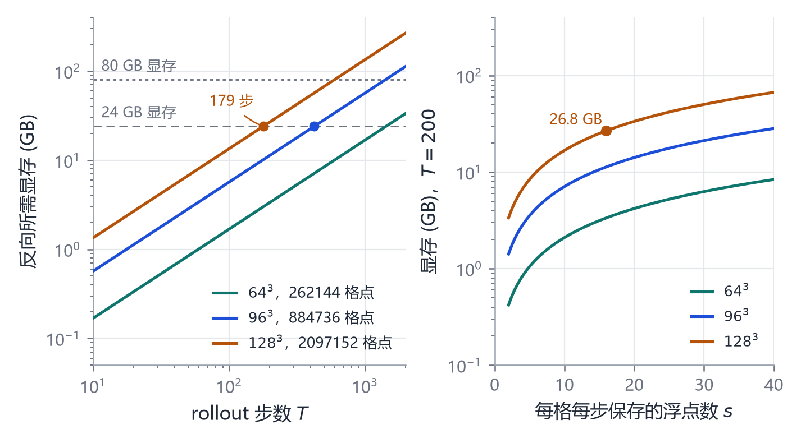

# 第 12 章 可微模拟的工程与边界

> 本章导读：一次凌晨的显存不足，怎么把可微模拟的成本结构算清楚；四个框架各自的定位，为什么不该给它们排名；显存与并行之间的真实关系；精度、中心差分的最优步长与梯度检查的判定标准；离线优化与在线控制对同一份代码提出相反的要求；以及什么情况下可微模拟是错的选择。

## 12.1 凌晨三点的显存不足

训练脚本在 100 步的 rollout 上跑了三天，没问题。改成 300 步，第一次反向就报显存不足。第一反应是把 batch 从 64 降到 8，能跑了，但吞吐掉到七分之一，一个 epoch 从四十分钟变成一个半小时。第二反应是加一张卡，数据并行之后 batch 回到 16，墙钟时间只比原来好一点——因为每张卡的显存还是那么多，能装的轨迹长度一点没变。

这两次尝试都失败在同一个误解上：以为显存是被 batch 吃掉的。实际上吃掉显存的是"步数 × 每步保存的状态"这条乘积，batch 只是第三个因子。把 batch 减一半，显存减一半，但梯度估计的方差翻倍；把步数减一半，显存减一半，但长时窗的梯度信息丢了。两个方向的代价完全不同，而报错信息不会告诉你哪一个更贵。

这两个方向的代价不同。梯度估计的方差与 batch 成反比，batch 从 64 降到 8，方差涨 8 倍，学习率要重调；轨迹从 300 降到 100，第 101 到 300 步的误差不再进梯度，而那一段往往正是误差放大的地方。前者伤训练稳定性，后者伤问题本身。

算一遍就清楚了。设网格有 $N$ 个格点，每步要保存 $s$ 个单精度浮点数（状态分量加上反向传播需要的中间量），单精度 4 字节，轨迹长 $T$ 步，批大小 $B$，那么这个 rollout 在图里占的显存是

$$M \approx 4\,N\,s\,T\,B \quad \text{字节}$$

$N$ 是格点总数，$T$ 是步数，$B$ 是批大小，$s$ 是每个格点每步要留住的浮点数个数。$s$ 之所以不是"状态有几个分量"，是因为反向传播不只要状态，还要前向算过的每一步中间量：通量、散度、泊松求解的中间向量，这些都要留着才能算梯度。

一个 $128^3$ 的网格有 $N=2.1\times10^{6}$ 个格点。速度三个分量、压力一个，这是 4 个场；反向还需要存中间的通量、散度、泊松求解的中间向量，保守估 $s=16$。代进去，每步 134 MB，200 步就是 27 GB——一张 24 GB 的卡装不下，一张 80 GB 的卡能装但只剩一半给别的东西。这就是那个报错的算术来源，和代码写得优不优雅没有关系。

三种分辨率放在一起看，这笔账更直观：

| 分辨率 | 格点数 $N$ | 每步显存（$s=16$） | $T=200$ 合计 | 24 GB 卡最长步数 |
|---|---|---|---|---|
| $64^3$ | $2.6\times10^{5}$ | 17 MB | 3.4 GB | 约 1430 步 |
| $96^3$ | $8.8\times10^{5}$ | 57 MB | 11 GB | 约 420 步 |
| $128^3$ | $2.1\times10^{6}$ | 134 MB | 27 GB | 约 180 步 |

表里最容易被忽略的是第一列到第三列的关系：格点数涨 8 倍（$64^3$ 到 $128^3$），每步显存也涨 8 倍，因为 $N$ 是长度立方的量。分辨率加一倍，显存加八倍，这是三维模拟的硬规律，和实现水平无关。

这个算式还有一个用处：在设计阶段预估，而不是在训练时撞墙。定网格分辨率之前先算一遍，就知道最长能跑多少步；定步数之前先算一遍，就知道该不该上 checkpoint。工作里更常见的顺序是反的——先把结构、分辨率、步数都定下来，跑崩了再回头找原因，而这时改任何一项都要重跑基线。

把它套回凌晨那个脚本，账就对上了。假设它用的是 $32^3$ 网格、$s=16$、batch 64：每步每样本 2.1 MB，100 步共 13 GB，24 GB 的卡能跑；300 步就是 40 GB，第一步反向就必然报错；batch 降到 8 变成 5 GB，刚好能跑。所以那两次尝试的成败不是运气，是乘法。

显存还可以拆成三块：参数、激活、工作区。参数是权重和物理常量，几 MB 到几十 MB；激活是上面那个 $M$；工作区是求解器每步的临时缓冲，比如多重网格的几层。前两块好估，第三块常被漏掉——粒子上做排序时，工作区能到激活的十分之一。

<figure class="fig">

<figcaption><b>图 12-1</b>　反向传播显存的代价模型（按公式计算，非实测）。模型 $M=4N s T B$，单精度、$B=1$。左：横轴为 rollout 步数，三条曲线对应 $64^3$、$96^3$、$128^3$ 网格，$s=16$；两条水平虚线是 24 GB 与 80 GB 的显存容量，曲线与它们的交点就是该配置能跑的最长步数，$128^3$ 在 24 GB 上只能到约 179 步。右：固定 $T=200$，横轴为每格每步保存的浮点数 $s$，三条曲线同样是三种分辨率；$s$ 从 8 涨到 32，显存跟着线性涨，因为每一项都是反向需要的中间量。</figcaption>
</figure>

图 12-1 的左半边还有一条读法：曲线在双对数坐标下是直线，斜率 1，说明显存与步数是严格线性关系，没有任何"规模上去了会摊薄"的效应。这一点和训练神经网络不同——网络加深时有一部分显存是权重，与 batch 无关；可微模拟的每一项都随步数线性增长，长时窗的代价是硬的。右半边说明第二个因子：$s$ 每加一倍，显存就翻一倍。所以省显存的两条路只有减少 $T$ 或者减少 $s$，减少 $s$ 的办法就是重算（checkpoint），用时间换空间。

## 12.2 四个框架的定位

可微模拟没有标准实现，因为"可微"要嵌进求解器内部，而求解器的写法千差万别。现有的几个框架各自锁定了不同的一类问题。说清它们的定位比排名有用，因为它们不是同一场比赛里的选手。

DiffTaichi 是一套带自动微分的编程语言，嵌在 Python 里 [@hu2020]。你用它的语法写 kernel，标好哪些是微分变量，它在编译期把前向和反向一起生成。它支持 CPU 和多种 GPU 后端，能写任意自定义的求解器——MPM、SPH、刚体、格子玻尔兹曼都有人写过。代价是你要用它的语言重写求解器，和 PyTorch 的生态隔着一层。定位很清楚：研究新的可微求解器，或者原有求解器没有现成可微实现的场合。

"编译期生成反向"这句话决定了调试体验：你不用手写反向，也就看不到反向代码；梯度错了，能查的只有前向 kernel 和自己的推导。好处是写法自由——散射、排序、稀疏结构都能写；坏处是每一段物理都得自己实现。

Warp 是 NVIDIA 的框架，思路不同：kernel 用 Python 写、JIT 编译到 CUDA 或 CPU，数组可以和 PyTorch 张量互相转换。它不要求你换语言，但要求你的部署环境有 NVIDIA 的栈。它的强项是把已有的 CUDA 求解器搬进可微管线——仿真部分用 Warp 写，学习的部分用 PyTorch，两边通过数组零拷贝地接上。定位：工业界已有自研求解器，要接机器学习。

Warp 的微分走的是"录带子"（tape）这条路：把前向执行过的算子记下来，反向时按倒序回放。这和 PyTorch 的动态图是一个思路，所以它能和 PyTorch 混着用；代价是带子上的每个算子都要支持反向，你自己写的 kernel 得手写一份反向版本。

Brax 是 JAX 上的刚体引擎 [@freeman2021]。整个引擎是纯函数，一次前向就是一次函数调用，因此可以直接用 jit 编译、用 vmap 批量并行、用 grad 求导。它的接触用位置修正那一路的做法，简单、快、可批量，代价是接触的物理保真度不如基于优化的求解器。定位：强化学习训练的吞吐，尤其是需要几千个环境同时跑的时候。

"纯函数"在这里是一个很硬的要求：同样的输入必须给同样的输出，不能有隐藏状态、不能原地改数组。满足它，jit 和 vmap 才能用；不满足，就只能退回逐环境循环，吞吐掉一个量级。这解释了为什么 JAX 系的物理引擎都要把状态写成 pytree，而不是一堆可变对象。

MJX 是 MuJoCo 在 JAX 上的重实现，沿用 MJCF 的模型描述和 MuJoCo 的接触生成方式，求解器则重新写过。它最大的价值是资产复用：手上有几百个调好的 MJCF 模型，换个后端就能批量并行、能求导。要注意它和 CPU 版 MuJoCo 的结果不是逐位一致的，接触参数的含义在两边也有细微差别，迁移时要用同一批场景对齐一次。

把 Isaac Gym 放在这里做对照有用，因为它走的不是可微路线 [@makoviychuk2021]。它把整个训练循环——环境步进、观测、奖励、策略更新——都放在 GPU 上，靠的是几千个环境并行采样，梯度来自策略梯度而不是对物理求导。它的吞吐在当时的同类工作里是数量级的领先，但它不能回答"最优参数是多少"这类问题。这说明一件事：大规模并行和可微是两个不同的工具，前者解决采样效率，后者解决梯度来源，混为一谈会导致选错。

四个框架的差别可以按"你要改哪一层"来记：

| 框架 | 你写什么 | 微分怎么来 | 最适合 | 主要代价 |
|---|---|---|---|---|
| DiffTaichi | 用它的语言写整个求解器 | 编译期生成前向与反向 | 新的可微求解器、研究原型 | 换语言，与 PyTorch 生态隔一层 |
| Warp | Python 写 kernel，数组与 PyTorch 互通 | 录带子回放，自写 kernel 要写反向 | 已有 CUDA 求解器接机器学习 | 绑定 NVIDIA 栈 |
| Brax | 只写模型与任务，引擎现成 | JAX 的 grad，纯函数天然可微 | 刚体强化学习的高吞吐训练 | 接触保真度受位置修正限制 |
| MJX | 复用 MJCF，重写求解器配置 | JAX 的 grad | 已有 MJCF 资产要批量并行 | 与原引擎不逐位一致 |

也就是说，选框架的本质是选"愿意改哪一层"：改语言（DiffTaichi）、改部署栈（Warp）、改模型精度（Brax）、改后端（MJX）。愿意改的那一层越深，得到的自由度越大，迁移成本也越高。

选择时看的不是"哪个更强"，是五个具体问题。模型资产是什么格式，MJCF 还是自定义。接触要多准，位置修正够不够，还是必须用基于优化的求解。梯度是训练要用，还是只用来做参数辨识——前者要能嵌进训练循环，后者只要一个能求导的前向。生态在哪边，团队用 PyTorch 还是 JAX，这一条往往比性能更决定成败。最后是许可与长期维护，研究代码和产品依赖是两种承诺。

这五条里最有分量的是第四条，因为它决定了"以后谁来改代码"。一个团队三个人都熟 PyTorch，选一个 JAX 框架，头三个月的时间会花在理解 pytree、jit 的静态形状、以及为什么某个循环不能写成 Python 循环上，而不是花在物理上。反过来，团队本来就写 JAX，硬上一个 PyTorch 方案，同样的税要再交一遍。

有一个反例值得记住。有人把一个调好的 MJCF 模型从 CPU 版 MuJoCo 搬到 MJX，参数和初始状态都一样，机器人却站不稳。查了两周，原因是接触求解的迭代次数和收敛判据不同，脚底出现每秒几毫米的抖动。这不是 bug，是两个求解器对"接触"的定义本就有细微差别。迁移只能拿同一批场景逐项对齐，不能假设"模型一样结果就一样"。

## 12.3 显存与并行

显存这件事有一个反直觉的地方：并行不会减少总显存，只会减少墙钟时间。数据并行把 batch 切到 $P$ 张卡上，每张卡上的 $B$ 变成 $B/P$，单卡显存确实降了；但如果你要保持原来的 batch，每张卡的显存不变，总显存乘了 $P$。所以"加卡"能解决"太慢"，解决不了"装不下"。装不下只有三条路：缩步数、缩状态、换重算。

"装不下"的三种解法代价不同。缩步数：$T$ 从 300 降到 100，显存降到三分之一，但梯度只看得到前三分之一的时间。缩状态：把 $s$ 从 16 降到 8，靠少存中间量、多算一遍。换重算：不改问题，只改"什么时候算"。三条里只有第三条不伤结果，所以它最常用。

重算的做法在第 2 章和第 5 章已经出现过，这里把账算完。把 $T$ 步切成 $\sqrt{T}$ 段，只存每段的起点，反向时从最近的起点重算一段。显存从 $O(T)$ 降到 $O(\sqrt{T})$，时间从一次前向加一次反向，变成大约两次前向加一次反向。$T=200$ 时，$\sqrt{T}\approx14$，显存降一个数量级，时间多三分之一左右。这笔交易在长时窗上是划算的，因为显存是硬约束，时间是软约束。

把数代进去：$128^3$、$s=16$ 的情况下，不留检查点是 27 GB，每 14 步存一个起点之后只剩 $14\times134$ MB，约 1.9 GB；时间上从 1 次前向加 1 次反向（约 3 个单位）变成 2 次前向加 1 次反向（约 4 个单位），多三分之一。也就是说，用 33% 的时间换 14 倍的显存，这笔交易在几乎所有"装不下"的场合都值得。

还有第四条路容易被忘掉：域分解（domain decomposition，把空间切成几块，每块交给一张卡）。它和数据并行不同——数据并行切的是 batch，每张卡都存完整的一场；域分解切的是空间，每张卡只存一块子域。8 张卡把 $128^3$ 按 2×2×2 切开，每卡存 $64^3$，显存降到八分之一。代价是每步要交换子域边界的一层数据（halo），而且下一次时间推进要等所有卡都交换完。

域分解的通信量可以估。每块子域的表面积与体积之比随切分变细而上升：$64^3$ 的块，三个方向各一层 $64\times64$ 的面，一共约 1.2 万个数，单精度下 49 KB，相对每步的计算量可以忽略；换成 64 张卡、每块 $32^3$，面数降到 3 千但计算量降到八分之一，通信占比翻倍，同步等待开始主导。

并行的另一个真相是反向比前向贵。同一个 kernel，反向要做的是把前向的每个算子转置一遍，读取前向存下的中间量，再写出对输入的梯度。访存量大约是前向的两到三倍，因此反向的墙钟时间通常是前向的 1.5 到 2.5 倍。这个比例决定了训练的每步成本：一次前向加一次反向，总时间约是纯前向的 2.5 到 3.5 倍。做预算时按 3 倍估，比按 2 倍估安全。

GPU 上还有一层：可微模拟的 kernel 往往不是矩阵乘，而是模板计算和散射。散射（一个线程往不确定的地址写）在 GPU 上要靠原子操作，原子操作的吞吐比普通写低一个数量级，而且同一地址上的竞争会让结果依赖执行顺序。这在反向里格外明显——前向的 gather 变成反向的 scatter，性能掉得比预期多。写可微求解器时，把散射改成"先排序再分段写"通常能拿回大部分性能，代价是多一遍排序。

原子操作还有一个隐蔽的副作用：它让结果不可复现。同一份输入跑两次，浮点相加的顺序不同，最后一位就可能不同；测试里写"结果必须等于某个数"会随机失败，只能改成"误差在容差内"。做过可微粒子模拟的人大多踩过这一脚。

数据并行还要算通信。每张卡算完自己的梯度，要对参数做一次全局归约，归约量是参数量乘字节数。可微模拟的参数量通常很小——一个本构网络的几万个权重——所以梯度同步不是瓶颈，真正的瓶颈是每张卡各自跑一条完整轨迹的显存。这也是为什么在这个领域，多卡很少能救"装不下"：集群的总显存很富裕，单卡的显存没变。

把三种并行放在一起，选择就清楚了。要更快、显存够：数据并行。要装下更大的场：域分解。要装下更长的轨迹：重算。三个可以叠，比如 4 卡域分解（显存降 4 倍）加每 10 步检查点（再降 20 倍），代价是通信加时间。

## 12.4 精度与梯度检查

单精度的机器 epsilon 是 $1.2\times10^{-7}$，双精度是 $2.2\times10^{-16}$，半精度是 $9.8\times10^{-4}$。这三个数决定了三件事的上限：单步计算的相对误差、梯度检查能做到的严格程度、以及长时窗里误差累积的速度。

"机器 epsilon"这个词的白话是：1 加上它之后就再也分不出来了的那个最小增量。单精度只能分辨 $10^{-7}$ 量级的相对差，所以两个数相差小于千万分之一时，减法会把有效位吃光——这叫灾难性抵消（catastrophic cancellation），梯度检查里最常见的假错误就来自这里。

有限差分是最朴素的梯度检查手段，它的误差来自两处：截断误差随步长 $h$ 的平方下降，舍入误差随 $h$ 的倒数上升。中心差分的总误差大致是

$$e(h) \approx \frac{\epsilon\,|f|}{h} + \frac{h^2}{6}\,|f'''|$$

$\epsilon$ 是机器 epsilon，$f$ 是被求导的函数，$f'''$ 是三阶导数，$h$ 是差分步长。第一项是"两个几乎相等的数相减"造成的舍入误差，第二项是"用割线代替切线"造成的截断误差。两项一个降一个升，最优点在 $h\approx(3\epsilon)^{1/3}$ 附近。

拿 $\sin$ 在 $x=0.7$ 处做实验：双精度下最优步长约 $1.4\times10^{-6}$，相对误差做到 $3\times10^{-13}$；单精度下最优步长约 $2.3\times10^{-4}$，相对误差只到 $6\times10^{-7}$，步长再小反而迅速变差，因为两个几乎相等的数相减，有效位被吃光。

这组数字给出了梯度检查的判定标准。在双精度下，自动微分与中心差分的相对差在 $10^{-9}$ 到 $10^{-7}$ 之间是正常的，超过 $10^{-5}$ 就有问题。在单精度下，玩具函数还能到 $10^{-6}$，但真实的求解器有几千次浮点运算，误差会累积，实践中的门槛放在 $10^{-3}$ 到 $10^{-2}$。用单精度做梯度检查而要求 $10^{-6}$ 的吻合，等于在查浮点舍入，不在查代码。

"几千次浮点运算"这句话可以估。$128^3$ 的 rollout 跑 20 步，每步每格上百次运算，总量在 $10^{10}$ 量级；相对误差按 $\sqrt{n}\epsilon$ 累积，$n=10^{10}$、$\epsilon=1.2\times10^{-7}$ 时约 $1.2\times10^{-2}$。这正是单精度门槛只能放到 $10^{-2}$ 的原因——不是实现差，是位数不够。

检查的方法也有讲究。逐参数比对在参数量上万时做不完，标准做法是随机取几个方向 $\mathbf{v}$，比较 $\nabla L\cdot\mathbf{v}$ 与 $(L(\theta+h\mathbf{v})-L(\theta-h\mathbf{v}))/(2h)$。方向取十来个，每个方向用两三个步长，看误差是否随 $h$ 按预期变化——如果误差不随 $h$ 减小而下降，说明问题不在舍入，在实现。

不可微点是这套流程的主要噪声源。接触的开关、$\min$ 的折点、排序、碰撞检测的布尔判断，这些地方的导数在一个点上不存在，两侧的差商差别很大。随机方向恰好穿过折点时，梯度检查会报出巨大的相对误差，而这个"错误"其实是正确的。判断的办法是看误差的分布而不是单次值：真正的实现错误会让大多数方向都错，折点只让少数方向错，而且错的方向集中在与接触法向对齐的那几个。

举个具体情形。一堆球落在平面上，法向接触力写成 $\max(0,-k\delta)$，$\delta$ 是穿透深度。$\delta$ 恰好为 0 的那一步，导数从 $-k$ 跳到 0，中心差分给出 $-k/2$。如果你的随机方向里有一个正好让这批球里的某一个停在 $\delta=0$，这个方向就会报 100% 的相对误差。做法是避开这类时刻——用带一点穿透或完全分离的状态做检查——而不是去修一个不存在的 bug。

混合精度要单独警告。训练时用半精度存激活能省一半显存，但可微模拟的状态更新里有很多小增量：速度的变化是 $g\Delta t$ 量级，位置的变化是 $v\Delta t$ 量级，在归一化尺度下可能只有 $10^{-4}$。半精度的分辨率是 $10^{-3}$，这些小增量会被直接吃掉，轨迹和梯度一起失真。要用混合精度，就得把状态更新放在单精度里做，只在存储和矩阵乘上用半精度，并且重新跑一遍梯度检查。

"被吃掉"这件事在长轨迹上会累积成系统性偏差。每次更新少加 $10^{-4}$ 的位置增量，一万步之后就是 1 个单位的位置误差，而且方向固定——不是随机噪声，是偏置。这种偏置在单步检查里看不出来，在十步的短窗里也看不出来，只有在和双精度参考解对比长轨迹时才会暴露。

梯度检查应该进持续集成。求解器改一行、本构换一处、精度调一档，都可能悄悄改掉梯度，而错的梯度不会让训练崩，只会让收敛变慢、结果变差，这种故障最难查。做法是留一个小规模算例——一百个自由度、二十步，双精度，随机方向检查——每次提交跑一遍，三十秒内出结果。小算例覆盖不到的部分，靠长轨迹的统计量对比兜底。

小算例的设计有几条经验。规模小到一分钟能跑完，又要大到触发所有分支：至少要有一次接触、一次约束求解、一次边界条件。断言写"与中心差分的相对误差小于 $10^{-6}$"，不写"梯度等于某个数"，这样重构后仍成立。再加一条"只跑前向、结果与上一版逐位相同"，把前向的意外改动也拦住。

## 12.5 部署：离线优化与在线控制

可微模拟在两个场景里的用法几乎是相反的，把两者混起来设计，两边都做不好。

离线优化是"跑一次，用很久"。影视里的形状调整、产品设计里的参数搜索、论文里的对照实验，都属于这一类。梯度用来做几千次迭代的优化，单次成本不敏感，可以在 CPU 集群上跑一整夜，可以用双精度，可以开满 checkpoint，可以每次重新编译。产物是参数、形状或者控制序列，不是求解器本身。这类场景对工程的要求低，对结果的可信度要求高：优化出来的东西要能被独立验证，所以要保留完整的日志、随机种子、以及一份不用梯度的对照结果。

"一份不用梯度的对照结果"这条别省。梯度法可能收敛到一个依赖初值的局部解，如果随机搜索或网格搜索在同一预算下找到更好的点，说明优化本身出了问题。这份对照通常很便宜——低维上几百次采样就够——但它能救掉一整轮白干。

在线控制的约束完全反过来。控制周期在 1 到 10 毫秒，一个周期里要读完传感器、算完策略、发出指令。整条 rollout 的梯度在这里没有位置，能用的只有"离线学好，在线只前向"这一条路。策略网络的前向是几十微秒的事，可微求解器的一次前向是几百微秒到几毫秒，差三个数量级。想在在线回路里用可微模拟，只有模型预测控制这一种形态：视界短到 5 到 10 步，状态小到几十维，梯度只算一次不做迭代。这样一个周期里大概花一到两毫秒，勉强塞进 10 毫秒的预算；自由度上千的软体在这个预算里做不了，只能退化成离线学好的策略。

把这条预算拆开看更清楚。一个 200 维状态的刚体系统，一次前向 0.15 毫秒，一次反向 0.3 毫秒，视界 8 步的 rollout 加一次反向约 3.6 毫秒，再加一次线搜索的前向就是 4 毫秒。10 毫秒的周期里剩 6 毫秒给传感器和通信，能跑。换成 2000 维的软体，同样的视界要 40 毫秒，超了四倍，只能把视界压到 2 步或者换更粗的模型。

部署还有几个工程细节容易被忽略。JIT 编译要求形状固定，batch 从 1 变成 8 会触发重编译，第一次调用的延迟可能是几十毫秒——放在控制回路里就是一次明显的卡顿。对策是把形状固定成上界，不足的部分用掩码补齐，代价是算力浪费一点。序列化也有坑：编译产物与驱动版本、CUDA 版本绑定，换一台机器可能要重新编译，交付时要把这一条写进部署文档。数值一致性同样要查：同一份模型在 CPU 和 GPU 上的结果不会逐位相同，涉及接触和迭代求解器时差异更大，如果下游有依赖于精确比较的逻辑，会在这里踩到。

在线部署还有两件"不做"的事值得写下来。一是不记梯度：推理时关掉自动微分，显存降一半、速度提两三成，忘了关是很常见的性能损失。二是不用双精度：在线回路里单精度够用，双精度让访存翻倍、吞吐掉一半，换来的精度在传感器噪声面前毫无意义。

监控是最后一道。上线后要记录的指标比训练时少，但更关键：每步推理耗时（看有没有触发重编译）、求解器迭代次数（看接触是不是变难了）、物理残差的滑动分位数。任何一个漂移，都说明输入分布变了或数值出了问题，而这时策略的输出看着仍然"正常"。

## 12.6 什么时候不该用可微模拟

可微模拟是一个很重的工具：要改求解器、要管理显存、要处理不可微点、要维护一套和主流生态隔着一层的代码。有几种场合，它的收益抵不上这些成本。

参数少、仿真便宜的时候。参数在十个以内、单次仿真在一秒以内，CMA-ES、贝叶斯优化、随机搜索都能在几分钟内给出结果，一行代码都不用改。梯度法的优势在维度，不在速度；低维问题上它反而慢，因为要付反向的 2 到 3 倍时间。

目标不可微或者离散的时候。拓扑优化里"要不要加这根杆"是布尔决策，材料选择是枚举，通过与否是阈值判定。这些目标对参数没有梯度，可微求解器给出的梯度指向一个连续松弛后的假问题，优化出来的解在离散化之后未必好。

长时窗且混沌的时候。湍流、多体接触网络、长时间的行星系统，轨迹对初值的敏感度按李雅普诺夫指数增长，几十步之后梯度里只剩噪声。这时候"用梯度做长时预测的优化"从根上就是错的，该做的是短窗加统计量目标，或者干脆不用梯度。

只需要"看起来对"的时候。游戏里的布料、影视里的烟，观众不测量、不比对，过程化方法加手工调整往往比物理模拟更快更可控。可微模拟的价值在于"和真实对齐"，没有真实可对齐时，这个价值是零。

已经有解析灵敏度的时候。结构力学的形状优化、电路参数的调整，这些领域有几十年积累的伴随法实现，效率比通用 AD 高一个数量级，精度也更好。用可微模拟重做一遍是绕远路。

数据充足、不需要外推的时候。端到端训练一个策略或者代理模型，只要工况分布和部署时一致，学出来的东西往往比物理加修正更简单，因为它没有两套要同时调。可微模拟的优势在于它带着物理结构，能在数据稀疏处外推；数据不缺时，这个优势用不上。

团队维护不起的时候。可微求解器的调试难度高于普通求解器：梯度错了，可能是前向错了，可能是反向写错了，可能是某个不可微点，也可能是精度不够。没有一个人能同时读懂物理、数值方法和自动微分，这套代码在团队里活不过两年。

这七条可以压成一个更短的判据：**只有当"梯度本身是你要的东西"、并且"物理结构是你缺的东西"时，可微模拟才划算。** 两条缺一条，就有更便宜的路。要梯度但不需要物理结构，端到端学习更快；要物理结构但不需要梯度，普通求解器加参数扫描更稳。

## 12.7 一张决策表

这些判断可以压成一张表（图 12-2），用的时候从左列找到最像的那一行，再看中间一列。表里的"代价"一列是必须提前知道的账，不是可选的风险提示。

**图 12-2**　可微模拟的选型决策表。每一行是一个典型场景，中间一列是首选手段，右列是这条路上绕不开的代价。

| 场景 | 首选手段 | 代价与注意 |
|---|---|---|
| 参数少于 10 个，单次仿真不到 1 秒 | 无导数优化（CMA-ES、贝叶斯优化） | 无需改代码；维度上去后采样量指数增长 |
| 参数上百维，有可信的实测轨迹 | 可微模拟 + 梯度下降做辨识 | 显存随轨迹线性增长；参数可能替缺失物理背锅 |
| 优化形状或控制序列，约束明确 | 可微模拟 + 伴随法 | 需要推导或自动生成转置；不可微点要平滑 |
| 只有视频或部分观测 | 先辨识可辨识的部分，其余随机化 | 可辨识性要先查；不可辨识方向必须加先验 |
| 需要毫秒级在线决策 | 离线学策略，在线只做前向 | 在线不用梯度；视界与状态规模被周期卡死 |
| 高维混沌，长时预测 | 短窗梯度 + 统计量目标，或不用梯度 | 超过李雅普诺夫时间后梯度无意义 |
| 已有 MJCF 资产，要批量并行 | MJX 一类的 JAX 重实现 | 与原引擎不逐位一致；接触参数要重新对齐 |
| 自研 CUDA 求解器要接 PyTorch | Warp 一类的 kernel 级框架 | 绑定 NVIDIA 栈；反向 kernel 要自己写 |
| 只要采样吞吐，不做参数推断 | 大规模并行 + 策略梯度 | 拿不到对物理参数的梯度 |
| 只要视觉可信，无人比对 | 过程化方法 + 手工调参 | 放弃与真实对齐这一目标 |

表里没有"最优"这一列，因为选型的约束通常来自表外：团队会哪种语言、机器上有几张什么卡、三个月后谁维护。技术判断能给出三四个可行解，最后的取舍往往由这些约束决定。

读这张表有两个技巧。一是从"你要什么"倒着找，而不是从"我有什么工具"正着找：先写清产物是参数、形状、控制序列还是策略，再去看哪一行对得上。二是把"代价"那一列当预算条目，逐条估一个数：显存按 $4NsTB$ 估，时间按前向的 3 倍估，精度按单精度 $10^{-2}$ 的门槛估，维护成本按"有几个人能同时读懂物理和 AD"估。四个数写下来，很多看起来诱人的方案会自己出局。

还有一个误判：把"能求导"和"适合求导"混为一谈。求解器能算出梯度，不代表梯度对参数有意义。接触主导、阈值主导、混沌主导的系统，梯度算得出来但方向不可信；该做的是换问题形式（平滑化、短窗、统计量目标），而不是换一个更强的求导工具。

真正需要提前想清楚的只有一件事：你要的是梯度，还是吞吐。这两个需求看起来都指向"把物理放到 GPU 上、让它快点跑"，但工程后果完全不同——要梯度就得保存中间状态、写反向、管显存、处理不可微点；要吞吐只要把前向写快、把环境批量堆起来、把数据搬运藏掉。两者的代码结构、调试方法、性能瓶颈都不一样，中途换方向的代价极大。所以在动手写第一行 kernel 之前，先把这个问题回答清楚：三个月后，你是想对一个参数求导，还是想多跑一万条轨迹。
