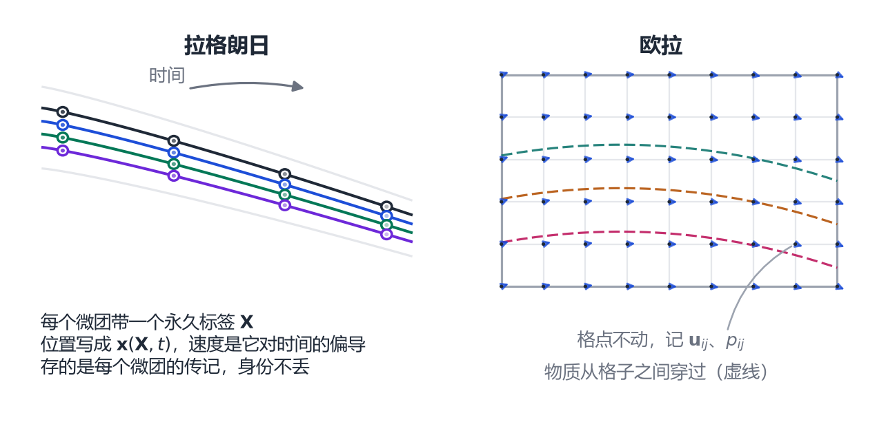
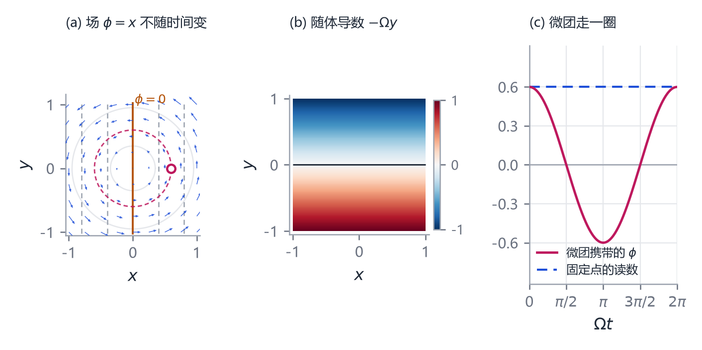

# 第 1 章 流体的两种看法

一场雨下完，路边水洼里浮着一片树叶。风把水面吹出几道皱纹，树叶慢悠悠地打转，往排水口那边挪。你盯着它看了十秒，能说出这片叶子每一秒在哪儿；可水本身哪儿也没去，水洼还是那个水洼，只是不断有新的水从叶子刚才的位置上流过去。

同一件事，可以有两种记法。一种是盯住一小块物质，跟着它走，记录它经过的每一个地方、经历的每一次形变；另一种是钉住空间里的一个点，记录每一时刻流过这个点的是什么、速度多少、压力多少。两种记法都完全描述了这个水洼，但落到程序里，它们长成两套截然不同的算法，各自在完全不同的地方崩掉。

## 1.1 跟着微团，还是守着格子

拉格朗日描述的核心是一个映射。给流体里每个微团一个永久编号，最省事的编号方法是拿它出生时刻的位置当名字，记作 $\mathbf{X}$。此后所有的量都写成编号和时间的函数：微团此刻的位置 $\mathbf{x}(\mathbf{X},t)$，速度 $\mathbf{u}(\mathbf{X},t)=\left.\partial\mathbf{x}/\partial t\right|_{\mathbf{X}}$，密度 $\rho(\mathbf{X},t)$。这里的偏导是在固定编号下取的，意思是"跟着这个微团看它的位置怎么变"。

$\mathbf{X}$ 是标签，不是坐标。两个微团永远不共用编号，也永远不会交换编号——连续介质不能自我穿透，一块物质要跑到另一块的位置上，中间必然要把对方挤走。这个"标签不交叉"的性质，是整个拉格朗日图像的底层约束。

欧拉描述把问题反过来问。它不问"3 号微团现在在哪"，只问"空间点 $(x,y,z)$ 此刻被什么占据"。于是有一张速度场 $\mathbf{u}(\mathbf{x},t)$、一张压力场 $p(\mathbf{x},t)$、一张密度场 $\rho(\mathbf{x},t)$。空间点是钉死的，物质从旁边流过；同一个 $\mathbf{x}$，这一秒被这团水占着，下一秒就换了一团。场的自变量是位置，不是身份。

两种语言从十八世纪就并存。1755 年欧拉写理想流体方程时用的就是场；拉格朗日 1788 年的《分析力学》用随体坐标处理力学系统。后人把这两种观点分别冠上他们的名字，但这不是先后替代的关系，而是两套各自完备的描述，可以互相翻译。

差别首先在信息量上。拉格朗日存的是每个微团的传记：它从哪来、走过哪条路、被拉伸了多少。欧拉存的是全城的户籍快照：每一时刻、每个位置上有什么，但没有"这个人昨天在哪"的记录。想知道某团水三天前在什么位置，拉格朗日直接读出来；欧拉得解一个反向的输运问题，把当前场沿速度场倒推回去——第 4 章的半拉格朗日回溯，做的正是这件事。反过来，想知道此刻某个位置的压力，欧拉直接查表；拉格朗日得先找出哪个微团正好在这个位置上，找不到就是空的。

落到程序上，两套描述各有自己的天然载体。粒子法存的就是标签：SPH 的每个粒子带质量、带位置、带速度，涡粒子法（vortex particle）的每个粒子带涡量，FLIP 的粒子层带质量和位置。这些方法里的"粒子"不是一个物理小球，而是一个带标签的采样点，它跟着物质走 [@harlow1964]。网格法存的是场：有限差分在格点上存速度分量，有限体积在格子中心存守恒量的平均值，格子不动，物质穿过格子界面。这两类载体不是随便挑的，它们各自把某种守恒变成免费的，也各自把某种能力变成昂贵的。图 1-1 把两种记法摆在同一个画面里：左边四条轨迹，右边一张钉死的格子。

<figure class="fig">

<figcaption><b>图 1-1</b>　同一段流动的两种记法。左：拉格朗日。四条线是四个微团的轨迹，空心圆标出同一批微团在相邻四个时刻的位置，颜色区分不同的标签 $\mathbf{X}$，时间沿箭头方向推进。右：欧拉。格子钉在空间里，箭头是每个格点上的速度，虚线是三条物质线穿过格子的样子——格子不动，物质从格子之间穿过。两边记的是同一段流动，差别只在记录的对象。示意图。</figcaption>
</figure>

把两种记法落到代码里，差别一眼就看得出来。

拉格朗日那一侧通常是一个结构体数组（array of structs）：每个微团一条记录，装着参考位置 $\mathbf{X}$、当前位置 $\mathbf{x}$、速度、质量。数组长度就是微团的个数，可以随时增长。欧拉那一侧是一排稠密数组：速度三个分量各一张，压力、温度、密度各一张，数组的下标对应空间里的格子。前者的下标是"第几颗微团"，后者的下标是"第几个格子"，这两件事完全无关——拿第 37 号微团去查第 37 号格子的压力，只是把两个恰好相同的整数拼在一起，物理上毫无意义。

也就是说，两种描述在代码里的差别不是风格问题，而是"索引代表什么"的问题。拉格朗日的索引代表身份，欧拉的索引代表位置。这一条一旦搞混，后面每一行代码都不可信。

数据结构决定的第一件事是内存。一个 $128^{3}$ 的网格有 $2.1\times10^{6}$ 个格子，速度三个分量各占一个四字节浮点数，就是 25 MB；再放压力、温度、烟浓度三张，总量靠近 50 MB。粒子法反过来：一百万颗微团，每颗存位置、速度、质量约 28 字节，一共 28 MB。两个数字看上去接近，结构完全不同——网格是满的，空着的格子照样占内存；粒子表是稀疏的，没有物质的地方一个字节都不花。

第二件事是找邻居。粒子要算密度、算压力，得先知道附近有谁，通常要先把空间切成小桶、建一张空间哈希（spatial hash，把空间划成规则的桶，只查同一个桶和相邻桶的表），这一步每帧都要重做。网格要算梯度、算散度，只要读相邻的六个格子，下标加一减一，几乎不花时间。所以网格上做一次求导是免费的，粒子上做一次求导要先付一次邻居搜索的钱，这笔钱占了粒子法每一步的大头。

第三件事是随物质增减的能力。列表能增能删，格子不能。一团水被打散成飞沫，粒子数可以临时加；网格的格子数是开跑前定死的。反过来，物质铺满整个空间时局面调转：池子的体积翻一倍，粒子数跟着翻一倍；网格的格子数只按边长增长，还可以把格距放粗。三维里这是二次与三次的差别，也是粒子法在"物质集中"时占优势、在"物质铺满全场"时立刻吃亏的算术原因。

两个具体反例。用粒子法做一池静水：池子 2 m × 2 m × 1 m，粒子间距取 1 cm，需要四百万颗微团，每颗每帧都要找邻居、算压力，还没开始算就已经花光了预算。同一池水铺 $128^{3}$ 网格，25 MB 内存，每帧只是一次平流加一次压力求解。反过来，用网格法做一杯冒泡的汽水：气泡直径 1 mm，比格子还小，整个气泡被抹成一团模糊的密度，破与没破根本分不出来。

有一件事值得先说清楚，因为后面几章会反复撞上它。拉格朗日映射必须是一一对应的，这是它成立的前提。一旦两团水撞在一起、或者一股水流被撕成两股，"谁是谁"就不再良定义。粒子法绕过这个麻烦的办法是干脆不定义拓扑：粒子之间没有连接关系，撞在一起也不会打结，撕开也不会断线。欧拉这边本来就不存物质身份，界面得靠额外的场来表示——符号距离、体积分数——而这类隐式表示对拓扑变化是免费处理的，一团水分裂成两团，只需要零等值面自己分叉。

所以"显式三角形网格做的水面最怕破碎"这件事，难点不在拉格朗日或欧拉的选择上，而在那张显式存下来的连接表上。连接表一旦写死，破碎就要拆表、合并就要接表，接缝处的拓扑维护比流体本身还麻烦。

## 1.2 物质导数：局部变化加对流变化

两套描述要能互换，得有一个翻译官。这个翻译官就是物质导数。物质导数（material derivative，也叫随体导数）回答的问题是：一个跟着流体走的探头，读到的变化率是多少。

设有一个标量场 $\phi(\mathbf{x},t)$，可以是温度、盐度、示踪剂浓度。一个微团在 $t$ 时刻位于 $\mathbf{x}$，速度是 $\mathbf{u}(\mathbf{x},t)$；过了 $\Delta t$，它走到 $\mathbf{x}+\mathbf{u}\Delta t$。微团身上带的 $\phi$ 值变了多少？把场在这一点做一阶展开：

$$
\phi(\mathbf{x}+\mathbf{u}\Delta t,\;t+\Delta t)
=\phi(\mathbf{x},t)+\Delta t\left(\frac{\partial\phi}{\partial t}+\mathbf{u}\cdot\nabla\phi\right)+O(\Delta t^{2})
\tag{1.1}
$$

两边减去 $\phi(\mathbf{x},t)$、除以 $\Delta t$、令 $\Delta t\to 0$，得到

$$
\frac{D\phi}{Dt}=\frac{\partial\phi}{\partial t}+\mathbf{u}\cdot\nabla\phi
\tag{1.2}
$$

左边这个大写 $D$ 就是物质导数，也叫随体导数。$\mathbf{u}\cdot\nabla\phi$ 是梯度的方向导数，可以拆成分量 $u\,\partial_x\phi+v\,\partial_y\phi+w\,\partial_z\phi$，其中 $u,v,w$ 是速度的三个分量。式 (1.2) 说的事情很朴素：一个跟着水走的探头读到的变化率，等于一个钉在原地的探头读到的变化率，加上它因为移动而穿过空间梯度所遇到的差异。

也就是说，微团身上那点东西变了，只有两个来源：环境自己在变，或者微团自己挪到了别处。没有第三个来源。

拿温度做个具体例子。一栋楼里的暖气片旁边立着一支温度计，那是欧拉探头，读数几乎不动，$\partial\phi/\partial t\approx 0$。同一个人从暖气片走向窗户，他身上感受到的温度一路下降——不是房间在变冷，而是他在穿过温度梯度。$\mathbf{u}\cdot\nabla\phi$ 那项就是"穿过梯度"付出的代价。

把这个例子算成数字。设温度场是

$$
\phi(x,y)=20+3x-2y
$$

单位摄氏度，$x,y$ 单位是米，原点取在暖气片所在的墙角，$x$ 朝窗户，$y$ 朝天花板。设这一带的空气以 $\mathbf{u}=(0.5,\;0.2)\ \mathrm{m/s}$ 稳定地向外、向上流动。逐项算：温度场与时间无关，所以 $\partial\phi/\partial t=0$；梯度是 $\nabla\phi=(3,\;-2)$，单位 ℃/m，意思是每往窗户方向走一米暖 3 ℃，每往天花板方向走一米冷 2 ℃；于是

$$
\mathbf{u}\cdot\nabla\phi=0.5\times3+0.2\times(-2)=1.5-0.4=1.1
$$

跟着一团空气走的探头，每秒读数上升 1.1 ℃。

验算一下。跟着这团空气走 2 秒，它在 $x$ 方向前进 1 米，在 $y$ 方向前进 0.4 米。直接查场：起点温度是 $20+0-0=20$ ℃，终点温度是 $20+3\times1-2\times0.4=22.2$ ℃，涨了 2.2 ℃，平均每秒 1.1 ℃。两条路给出同一个答案。手算的价值就在这里：物质导数不是一个记号游戏，它算出来的是一个能拿温度计验证的数。

如果房间还在缓慢升温，把场改成 $\phi=20+3x-2y+0.4t$，那么 $\partial\phi/\partial t=0.4$ ℃/s，物质导数变成 $0.4+1.1=1.5$ ℃/s。两个探头读数的差恰好是 1.1 ℃/s，那部分与房间无关，只与此地的梯度和此地的速度有关。

顺便检查量纲，这一步能抓出大半的笔误。$\partial\phi/\partial t$ 是 ℃/s；$\mathbf{u}\cdot\nabla\phi$ 是 (m/s)×(℃/m)，也是 ℃/s。两个加数必须同量纲，若算出来差了一千倍，多半是把毫米当成了米，或者梯度少除了一个格距。

有一个反例能把"有梯度"和"随体变化"这两件事彻底分开。取 $\phi=3x$，取 $\mathbf{u}=(0,\;0.5)$：温度只沿 $x$ 变，空气只沿 $y$ 走。梯度不为零，速度也不为零，可两者点乘为零，物质导数为零。微团一直待在同一条等温线上，它自己感受到的温度一丝不变。梯度存在，不代表微团会感受到它；决定感受的是速度在梯度方向上的投影。

程序里这一项怎么算？网格上一维的写法是中心差分：$(\phi_{i+1}-\phi_{i-1})/(2h)$。取格距 $h=0.1$ m、$\phi=3x$，两个隔一格的邻居相差 $3\times0.2=0.6$ ℃，除以 $2h=0.2$ m，得 3.0 ℃/m，与解析梯度一致。三维就是把三个方向各算一遍，再乘对应的速度分量加起来：六次读邻居、三次乘加，一整个对流项就出来了。这也是网格法在这里便宜的原因——它只要下标。

图 1-2 把这件事算了一遍。流场是刚体旋转，$\mathbf{u}=(-\Omega y,\;\Omega x)$，$\Omega=1$ rad/s，流线是一圈圈同心圆。标量场取 $\phi=x$，也就是示踪剂的浓度只沿水平方向变化，竖直方向完全均匀。这个场显然与时间无关，任何固定位置的探头读数恒定，$\partial\phi/\partial t=0$。可是跟着水走的微团在绕圈：它从左边转到右边时浓度下降，从右边转回左边时浓度上升。

<figure class="fig">

<figcaption><b>图 1-2</b>　刚体旋转流场里局部导数与随体导数的区别。流场 $\mathbf{u}=(-\Omega y,\Omega x)$，$\Omega=1\ \mathrm{rad/s}$，标量场 $\phi=x$。左：场是定常的，等值线竖直，任何固定点的读数都不随时间变化。中：随体导数 $\mathbf{u}\cdot\nabla\phi=-\Omega y$ 的分布，上半平面为负、下半平面为正，在 $y=0$ 上为零。右：一个从 $(0.6,0)$ 出发的微团绕行一圈，实线是它携带的 $\phi$，蓝色虚线是固定点 $(0.6,0)$ 处的读数，两者相差整整一个正弦。</figcaption>
</figure>

中间那张图是式 (1.2) 右边第二项算出来的：$\nabla\phi=(1,0)$，所以 $\mathbf{u}\cdot\nabla\phi=-\Omega y$。上半平面 $y\gt0$ 的微团往左走，浓度降低；下半平面往右走，浓度升高；$y=0$ 那条线上横穿等值线，随体变化为零。右边那张图是一个微团的完整一圈：它带的 $\phi$ 在 $\cos(\Omega t)$ 上振荡，而固定点 $(0.6,0)$ 的读数从头到尾是一条水平线。定常不代表不变，这是初学者最容易糊过去的一句话。

用前面的手算对一遍这张图。微团在 $t=0$ 时位于 $(0.6,0)$，$\phi=0.6$；绕四分之一圈到 $(0,0.6)$ 时 $\phi=0$；绕半圈到 $(-0.6,0)$ 时 $\phi=-0.6$；再绕回来又是 $0.6$。一秒钟转一弧度，所以整圈要走 $2\pi\approx6.28$ 秒，图上那条实线就是一个周期 6.28 秒的余弦。虚线纹丝不动，是因为钉在 $(0.6,0)$ 的探头永远读到同一个数。

同一个翻译官作用在速度上，就得到加速度：

$$
\mathbf{a}=\frac{D\mathbf{u}}{Dt}=\frac{\partial\mathbf{u}}{\partial t}+(\mathbf{u}\cdot\nabla)\mathbf{u}
\tag{1.3}
$$

第二项 $(\mathbf{u}\cdot\nabla)\mathbf{u}$ 叫对流项（convection term，有的书叫 advection，中文都译作对流或平流）。把它写成分量，每一项都是"速度乘速度的梯度"，所以它对速度是二次的——这是纳维-斯托克斯方程里唯一的非线性来源。非线性意味着叠加原理失效，两个解加起来不再是解；意味着湍流、涡的拉伸、激波；也意味着显式时间积分的稳定性要被一条叫 CFL 的条件卡住。

一个反直觉但很实用的事实：定常流里流体质点照样在加速。水管从粗变细，水在细段流得更快，但每一时刻、每一位置的速度都不变（假设流量恒定），$\partial\mathbf{u}/\partial t=0$。可是水从粗段进细段时确实被加速了，加速度全部来自对流项：速度沿流动方向在增加，质点顺着这个梯度往前走，本身的速度就在变。喷管、弯头、绕流的前缘驻点，都是这种"定常但不匀速"的地方。

给个数字。管径从 4 cm 收到 2 cm，流量不变则截面积降到四分之一、速度升到四倍，从 1 m/s 变成 4 m/s。过渡段长 10 cm，沿流向的加速度约 $(4-1)/0.1=30\ \mathrm{m/s^2}$，是重力加速度的三倍。这时若还用"定常所以不加速"的说法去估受力，会差出整整一个数量级。

## 1.3 控制体与雷诺输运

从拉格朗日切到欧拉，还有一个记账的问题：怎么把"一团物质的守恒"翻译成"一个固定区域里的守恒"。

这件事有个正式的名字，叫雷诺输运定理（Reynolds transport theorem）。名字唬人，内容就是会计：一个跟着物质跑的账本，它的总额变化率，等于一个钉死在空间里的账本的变化率，再加上物质穿过这个空间边界时带进带出的净额。也就是说，"物质的变化" = "此地此景的变化" + "流动搬运的变化"。式 (1.2) 是把这句话写在一点上，雷诺输运定理是把它写在一块体积上。

先看一个固定不动的盒子，体积 $V$，边界 $\partial V$，外法向 $\mathbf{n}$。盒子里某种东西的总量是 $\int_V\phi\,dV$。这个总量会变，两个原因：东西从盒子的面上流进流出，或者盒子内部有源在产生、汇在消耗。单位时间穿出某个面元的量是 $\phi\,\mathbf{u}\cdot\mathbf{n}\,dA$，$\mathbf{u}\cdot\mathbf{n}$ 是速度在法向上的投影，正值代表往外流。对全边界积分，净流出量就是 $\oint_{\partial V}\phi\,\mathbf{u}\cdot\mathbf{n}\,dA$。于是

$$
\frac{d}{dt}\int_{V}\phi\,dV=-\oint_{\partial V}\phi\,\mathbf{u}\cdot\mathbf{n}\,dA+\int_{V}s\,dV
\tag{1.4}
$$

其中 $s$ 是单位体积的源强度。这个式子的意思是纯粹记账：进来的减出去的，加上自己产的，等于存量的变化。它不需要任何关于流体本构的假设，只要求 $V$ 固定。

举个能动手的账本。一个 1 立方米的鱼缸，水里溶着盐。某一刻缸里有 0.8 kg 盐。进水口每秒带进 0.5 kg，排水口每秒带走 0.3 kg，缸里没有化学反应，$s=0$。净流出是 $0.3-0.5=-0.2$ kg/s，代入式 (1.4) 得存量变化率 $+0.2$ kg/s，也就是浓度每秒涨 $0.2\ \mathrm{kg/m^{3}}$，下一秒钟缸里就有 1.0 kg 盐。这就是式 (1.4) 的全部内容。

把面积分用散度定理换成体积分，$\oint\phi\mathbf{u}\cdot\mathbf{n}\,dA=\int_V\nabla\cdot(\phi\mathbf{u})\,dV$，再因为 $V$ 是任取的，被积函数必须逐点相等：

$$
\frac{\partial\phi}{\partial t}+\nabla\cdot(\phi\,\mathbf{u})=s
\tag{1.5}
$$

这就是守恒形式，也叫通量形式或散度形式。$\phi\mathbf{u}$ 叫通量（flux，单位时间穿过单位面积的量），它的散度是"单位体积净流出率"。

一个反例说明为什么不能只盯局部导数。一段直管里稳定地流着含盐的水，浓度沿管处处相同，任何钉死的探头读数都是常数，$\partial c/\partial t=0$。可是每一秒钟都有实打实的盐从上游流到下游，通量项不为零，它正好和别的项配平。如果只看 $\partial c/\partial t$，会得出"盐没变化、也没流动"的结论——错在漏掉了搬运。反过来，管里的水完全静止、进盐口关着，$\partial c/\partial t$ 同样为零，这一次确实什么都没发生。两个零长得一样，含义完全不同。

取 $\phi=\rho$，$s=0$，就得到连续性方程：

$$
\frac{\partial\rho}{\partial t}+\nabla\cdot(\rho\,\mathbf{u})=0
\tag{1.6}
$$

取 $\phi=\rho\,u_i$，右端写上压力、粘性、外力这些动量源，就得到动量方程。整个流体力学的基本方程，都能从这一个记账模板里长出来。

用物质导数改写 (1.6)，会得到另一个样子。把散度展开，$\nabla\cdot(\rho\mathbf{u})=\mathbf{u}\cdot\nabla\rho+\rho\nabla\cdot\mathbf{u}$，再代入式 (1.2)：

$$
\frac{D\rho}{Dt}+\rho\,\nabla\cdot\mathbf{u}=0
\tag{1.7}
$$

两个式子是同一件事的两种说法。式 (1.7) 读起来更物理：一个微团往前走，如果周围的流场在发散（$\nabla\cdot\mathbf{u}\gt0$），微团的体积就会被撑大，密度就得降下来。$\nabla\cdot\mathbf{u}$ 是体积膨胀率，量纲是 1/秒。声音在空气里传播，靠的就是这个机制：压缩的地方密度大，膨胀的地方密度小，$\nabla\cdot\mathbf{u}$ 在振荡。

有个数字可以体会这个量。式 (1.7) 说密度变化的相对速率等于负的膨胀率，所以若某处的 $\nabla\cdot\mathbf{u}=0.01\ \mathrm{s^{-1}}$，密度每秒变化百分之一，0.1 秒后变化千分之一。人说话时空气的膨胀率大约就是这个量级，密度起伏小到千分之一，耳朵却灵敏到能分辨——这也是"把空气当不可压"在多数场合行得通的原因。

不可压流体的定义就是 $\nabla\cdot\mathbf{u}=0$，也就是 $\rho$ 沿微团不变。注意这里的因果方向：不是因为密度小，而是因为体积不变。水当然不是"密度为零"的流体，它的密度是一千千克每立方米，只是这个密度在流动中几乎不变。把水当不可压，等于宣布声速无穷大——压力扰动瞬间传遍全场，没有压缩波的传播过程。这个假设在多数动画场景里完全够用，在爆炸和高速气流里立刻失效。

离散时这个账本记在格子的面上，一次搬运看得清清楚楚。一维、格距 $h=0.1$ m、流速 $u=1$ m/s，格子 $i$ 里的浓度为 1，它左边那个格子为 0。面上取迎风通量（用上游格子的值算），右面通量是 $1\times1=1$，左面通量是 $1\times0=0$，净流出 $1$。时间步取 $\Delta t=0.05$ s，则格子 $i$ 的浓度变化是 $-(0.05/0.1)\times1=-0.5$，一步之后从 1 掉到 0.5；下一步面上通量也跟着减半，只掉到 0.25，再下一步 0.125。它永远到不了零，尾巴拖得很长——这是迎风格式味道的来源，也是数值耗散的形状。与此同时右邻居正好装进同样的量，总量一分不多一分不少，只是换了位置。比值 $\Delta t/h=0.5$ 就是 CFL 数，小于 1 时物质一步最多跨过一个格子；这就是"通量记账"好处的具体形状：数量只在格子之间搬运，不会凭空生出来。

有一点必须在这里点出来，因为它决定了后面所有离散方案的形状。式 (1.5) 这种通量形式的写法，在离散时有一种特殊的性质：如果每个格子只跟邻居交换通量，并且相邻两格算出的面通量是同一个数（一个进、一个出，符号相反），那么把所有格子加起来，内部面上的通量成对抵消，总量只受边界影响。守恒性于是在构造上就成立了，不是靠精度凑出来的。有限体积法（finite volume method，把方程在格子体积上积分、只在面上记通量的做法）就是照这个思路搭的。反过来，任何不按通量记账的离散——比如对 $\mathbf{u}\cdot\nabla\phi$ 直接做中心差分——都会在界面上悄悄产生或销毁一点东西，误差随步数累积。第 4 章要讲的半拉格朗日法，耗散和这种不守恒是同一枚硬币的两面。

## 1.4 同一组方程的两种写法

有了物质导数，动量方程可以立刻写成两副样子。

随体写法把加速度放在左边，力放在右边：

$$
\rho\frac{D\mathbf{u}}{Dt}=-\nabla p+\nabla\cdot\boldsymbol{\tau}+\rho\,\mathbf{f}
\tag{1.8}
$$

其中 $p$ 是压力，$\boldsymbol{\tau}$ 是粘性应力张量，牛顿流体下 $\boldsymbol{\tau}=\mu\left(\nabla\mathbf{u}+\nabla\mathbf{u}^{\mathsf{T}}\right)$，$\mu$ 是动力粘度，$\mathbf{f}$ 是单位质量的外力（重力、浮力）。这一副写法的读法是：跟着一个微团，它的动量变化率等于作用在它上面的合外力。牛顿第二定律，逐字搬运。

守恒写法把通量放到散度里：

$$
\frac{\partial(\rho\mathbf{u})}{\partial t}
+\nabla\cdot\left(\rho\,\mathbf{u}\otimes\mathbf{u}\right)
=-\nabla p+\nabla\cdot\boldsymbol{\tau}+\rho\,\mathbf{f}
\tag{1.9}
$$

$\rho\,\mathbf{u}\otimes\mathbf{u}$ 是一个二阶张量，分量是 $\rho\,u_i u_j$，它描述动量沿各个方向的输运。这一副写法的读法是：一个固定盒子里动量的变化，等于净流入的动量加合外力。

把 $\otimes$ 摊开看。速度取 $\mathbf{u}=(1,2,0)$ m/s，那么

$$
\mathbf{u}\otimes\mathbf{u}=
\begin{pmatrix}1&2&0\\2&4&0\\0&0&0\end{pmatrix}
$$

单位是 $\mathrm{m^{2}/s^{2}}$。第 $(i,j)$ 个元素的意思是"沿 $i$ 方向的动量，正以 $j$ 方向的速度被搬走"。乘上密度 $\rho=1000$，单位变成 $\mathrm{kg/(m^{2}\cdot s)}$，也就是帕斯卡——和压力同一个单位。这不是巧合：动量通量和压力都是"单位面积上的力"，在动量方程里它们可以直接相加相减。不可压流的压力，可以理解成动量通量里各向同性的那一部分，剩下的那部分才是被流动带走的部分。

两副写法能互相换算。用 (1.2) 把 $\rho D\mathbf{u}/Dt$ 展开，再加上 $\mathbf{u}$ 乘以连续性方程 (1.7)——那一项等于零，加它不改变等式——几项合起来正好是 $\nabla\cdot(\rho\mathbf{u}\otimes\mathbf{u})$。这一步是纯代数，但它的结论很重要：

在不可压条件下，$\nabla\cdot\mathbf{u}=0$，式 (1.9) 的对流项可以化简成 $\rho(\mathbf{u}\cdot\nabla)\mathbf{u}$，与式 (1.8) 完全一致。两种写法在不可压时给出同一个对流项，所以对水、对低速空气，选哪个写都行，离散时的差别只在于你把差分作用在 $\mathbf{u}$ 上还是作用在 $\rho\mathbf{u}\otimes\mathbf{u}$ 上。

一旦可以压缩，两者就开始分家。式 (1.8) 在数学上叫非守恒形式，它假设 $\mathbf{u}$ 是处处可微的；式 (1.9) 叫守恒形式，它在弱意义下有解，允许 $\mathbf{u}$ 出现跳变。这不是数学上的洁癖。空气里一道激波，前后的密度、压力、速度都是跳变的，跳变面上导数不存在，非守恒形式在那里根本没有定义。用守恒形式离散，激波会自动满足质量、动量、能量的跳跃关系；用非守恒形式离散，激波两侧的速度会算错，而且错多少取决于你怎么把差分跨过间断。

给几个数体会跳变的幅度。空气里一道马赫数 2 的正激波，跨过去密度大约涨到 2.67 倍，压力涨到 4.5 倍，温度涨到 1.69 倍。所有这些比值都在不到一个分子自由程的厚度里完成——宏观上就是一张面。把这样一张面做成差分，等于要求格式在两个格子的距离里消化掉 167% 的密度变化，任何"平均一下"的处理都会把跳变抹成一段斜坡，或者抖出一串振荡。

图形学里很少直接碰激波，但这条经验照样管用。爆炸、枪口焰、超音速飞行器的尾迹，只要流场里出现接近间断的结构，守恒形式就是必须的。

离散层面上的分歧更尖锐。通量形式天然适合有限体积：每个面算一个通量，两个相邻格子看到的是同一个数，一个加、一个减，总量精确抵消。随体形式在粒子上天然守恒：每个粒子带固定质量，粒子不生不灭，质量守恒是定义出来的，不需要额外保证。两边的强项恰好是对方的弱项——网格上的随体形式会漏质量，粒子上的通量形式根本写不出来。

## 1.5 三个判据

选描述不是口味问题，是需求问题。有三个判据，按顺序问下去，大多数场景都能定下来。

第一个判据：物质身份重要吗。白水泡沫要追踪每个气泡从哪来、活了多久、什么时候破；泥沙、雪、混合饮料里的两相要追踪各相的体积；这些需求只有标签能给。网格法里物质身份是丢掉的，要在网格上恢复"这团水是刚才那团"，得额外解一个示踪场，多一份输运误差，多一份内存。反过来，如果只关心"这个地方此刻是烟还是空气"，身份毫无用处，网格反而更省。

第二个判据：界面锐不锐。烟没有界面——烟和空气之间是一段连续过渡的浓度，边界只是视觉上的。水面有硬界面，密度从一千跳到一点二，跨过界面就是另一相。界面越硬，越需要能表示"界面在格子内部某个位置"的机制，或者干脆用粒子把界面直接标出来。这也是为什么烟几乎总是网格（半拉格朗日平流加投影，Stam 那条路线 [@stam1999]），而水越来越多用粒子或混合方法 [@foster2001]。

第三个判据：物质占了多少空间。烟柱在一个大房间里只占一小块体积，用网格的话九成的格子是空的，每帧照样要为它们做平流、做投影、做插值。粒子只在有物质的地方存在，稀疏是免费的。这也是粒子法在烟火里始终有一席之地的原因。但要小心，稀疏只在"物质集中"时是优势；一旦物质铺满整个空间（比如一池水、一片海），粒子的数量优势立刻消失，反而要为每个粒子做邻居搜索。

三条问完，还有一条隐性判据：你要不要分辨率随空间变化。网格法的分辨率是均匀的，一个格子一个尺寸，远处的烟和近处的烟一样粗。粒子法的分辨率跟着粒子密度走，压缩的地方自然更密，拉伸的地方自然更疏——这在物理上更合理，在数值上意味着界面的采样会变稀，薄片会被拉成断续的点。两种偏差各有各的难看。

把四条问一遍，落到两个常见命题上。倒一杯水，水要撞到杯壁、溅起来、分成几颗水珠再落回去，四个问题依次是：身份不太重要、界面极硬、物质集中在杯口附近、想要近处细远处粗。答案倾向于"网格加隐式界面，或者粒子加网格的混合方案"。做一根烟囱冒出的烟，四个问题是：身份不重要、没有界面、物质稀疏但铺得很开、分辨率希望越远越粗，答案倾向于纯网格。同一个引擎里可以同时有这两套，切换的开关就是这四条。

拓扑变化常被当成一条判据，其实它更接近"实现方式的代价"。隐式界面（符号距离场、体积分数）处理拓扑变化是自动的，零等值面自己分叉合并，不需要写一行专门的代码；显式三角网格处理拓扑变化是灾难，撕裂、合并、自交都要单独写逻辑。所以真正的分界线是"界面用隐式还是显式表示"，而不是"欧拉还是拉格朗日"。

## 1.6 粒子带量，网格求解

两条路各有一半的好处，于是有人把它们拼起来。这就是混合描述，1950 年代由 Harlow 在洛斯阿拉莫斯的 PIC 方法里第一次成型 [@harlow1964]。

结构可以一句话说完：粒子负责携带物质，网格负责求解方程。每个时间步按顺序做三件事。粒子把质量、动量这些量撒到网格上（散播，scatter）；网格上按 1.4 节那套欧拉方程算出新的速度场，包括最难的那一步——解压力方程让速度场散度为零；网格再把速度插值回粒子（收集，gather），粒子按新速度移动。

撒和收用的都是同一套权重：三线性插值（trilinear interpolation，三维有八个角点，二维叫双线性、只有四个，按到各角点的距离比例把量摊开）。取一颗粒子落在二维格子 $(i,j)$ 内部的相对位置 $(0.3,\;0.7)$——格子边长为 1，它在横向走了三成、纵向走了七成。四个角点的权重是 $(1-0.3)(1-0.7)=0.21$、$0.3\times(1-0.7)=0.09$、$(1-0.3)\times0.7=0.49$、$0.3\times0.7=0.21$，四项加起来正好是 1。散播时把这颗粒子的质量按这四个数分给四个格子，收集时用同一组数把四个格子的速度加权平均回来。权重和为 1，所以质量在搬运中不会多也不会少——这是混合法能保住质量的全部秘密，只有一句话。

规模上有几个数字。一百万颗粒子，每颗往三维的八个角散播，就是八百万次带原子操作的加；网格取 $64^{3}$ 只有 26 万个格子，平均每格收到不到四颗粒子的贡献。粒子比格子多，是混合法的常态：粒子负责细节，格子只负责解方程。反过来，若粒子比格子还少，网格上会出现没有粒子贡献的空格子，那里的速度无从定义，只能靠邻格外推——这时候混进纯网格法反而更简单。

这么拼的理由是分工。粒子层天然守恒质量和体积：一个粒子带多少质量，走一万步还是那么多，不需要任何额外约束。网格层天然适合解全局约束：压力泊松方程是一个椭圆方程，全场的压力互相耦合，只有在规则网格上才有一堆成熟的快速解法。把这两件事分开做，各取所长。

代价出现在传递环节。粒子撒到网格、再从网格插回粒子，每一步都是一次低通滤波，高频信息被磨掉一点。PIC 磨得最狠，整个速度场被反复平均，涡旋几帧就糊了；FLIP 只传速度的增量，保住了大部分细节，代价是引入噪声——粒子各走各的，网格上的光滑速度场被粒子自己的抖动污染 [@brackbill1986]。第 8 章会把这条折中讲透。

磨掉的幅度可以估。三线性插值对波长 8 格的正弦波，每传一次幅度乘上大约 0.95；二十帧之后剩 $0.95^{20}\approx0.36$，一个明显的涡就只剩三分之一。波长 2 格的抖动更惨，每传一次掉到不足一半，两帧就看不见了。这解释了为什么纯 PIC 做出来的烟总像被水洗过：不是方程算错了，是每帧都在做一次低通滤波。

还有第三种混合，藏得比较深：半拉格朗日平流（semi-Lagrangian advection，沿速度场往回找"这一刻到这一格的是谁"的平流方式）本身就是一个混合描述。它在欧拉网格上工作，但每一步都在问"这个格子的物质上一刻在哪"，然后沿着速度场回溯，把那个位置的值插值回来。回溯点是一个临时的拉格朗日标签，只用一步就丢掉。所以它既享受了网格的规则结构，又借用了拉格朗日的"跟着物质走"，只是不保留身份。这个技巧让它可以取任意大的时间步而不会失稳，代价是每一步都在插值，每一步都在耗散。

回头看这一章。两种描述不是对错之分，是"你要严格保住什么"的选择。保住物质身份，就得放弃规则的格子；保住规则的格子和守恒的通量，就得放弃身份；两边都要，就得接受传递环节的滤波。后面每一章讲的离散方法，本质上都是在这个三角里挑一个位置，然后承担那个位置的后果。
