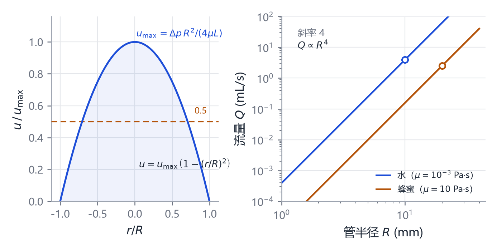
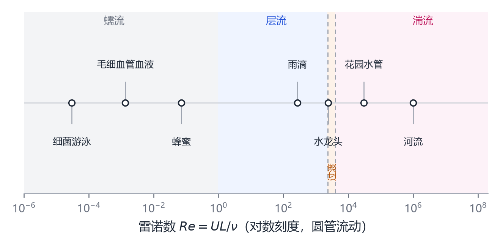

# 第 2 章 纳维-斯托克斯方程逐项拆解

拧开厨房的水龙头，让水流成一条细线。刚出口那一段，水柱像一根玻璃棒，透明、笔直、边缘清楚；往下走十几厘米，它开始变细，细到某一处忽然断开，变成一串水滴，随后整段水柱开始左右摆。

关小一点，同样的高度，水柱一路笔直到底，不断开，也不摆。

同一个水龙头、同一种水，唯一的差别是流量。可是现象换了样子：一处是稳定、光滑、可预测的层流，一处是摆动、破裂、看上去有点乱的流动。这一章要做的事，就是把"流量"这个模糊的词换成方程里的一项一项，看看哪些项在什么条件下变大、哪些可以划掉。

## 2.1 动量方程的四项

不可压牛顿流体的动量方程，就是上一章式 (1.8) 把粘性应力展开后的样子：

$$
\rho\left(\frac{\partial\mathbf{u}}{\partial t}+(\mathbf{u}\cdot\nabla)\mathbf{u}\right)
=-\nabla p+\mu\nabla^{2}\mathbf{u}+\rho\,\mathbf{f}
\tag{2.1}
$$

两边都是单位体积的力，量纲是牛每立方米。$\rho$ 是密度，$\mathbf{u}$ 是速度，$p$ 是压力，$\mu$ 是动力粘度，$\mathbf{f}$ 是单位质量的外力加速度，最常见的就是重力 $\mathbf{g}=(0,0,-9.8)\ \mathrm{m/s^2}$。

左边括号里两项合起来是物质导数，也就是微团的加速度。第一项 $\partial_t\mathbf{u}$ 是流场随时间的变化，第二项 $(\mathbf{u}\cdot\nabla)\mathbf{u}$ 是微团穿过空间速度梯度带来的变化。这两项乘以密度，就是"让这块水加速所需的力"。

右边三项是"能给出来的力"。

压力项 $-\nabla p$ 的负号表示流体从高压被推向低压，推力正比于压力的梯度而不是压力本身。一盆静水的底部压力比表面大得多，但水不会往上涌，因为水平方向没有梯度，竖直方向被重力抵消。

粘性项 $\mu\nabla^{2}\mathbf{u}$ 是动量的扩散。相邻两层流体速度不同，就会互相拖拽，快的被拖慢、慢的被拖快，拖拽的强度正比于速度的曲率。用 $\nu=\mu/\rho$ 代替 $\mu$，$\nu$ 叫运动粘度，量纲是平方米每秒，可以读成"动量扩散率"，和热扩散率 $\alpha$ 是同一类东西。

外力项 $\rho\mathbf{f}$ 只要给得出就能加。重力、电磁力、旋转坐标系里的科里奥利力、人为添加的吸引子、风场，都从这里进来。它是最容易加的一项，也是最容易被滥用的一项——后面会看到，很多"看起来像流体"的效果，其实是外力项的功劳，而不是方程解得好。

四项在离散上的难度完全不一样，这件事比它们的物理意义更影响程序结构。

对流项是唯一非线性的，它决定时间步。显式格式下，一个格子里的物质一步内不能跨过两个格子，于是有限制 $\Delta t\lt h/|\mathbf{u}|$，这就是 CFL 条件；粘性扩散还额外给一条 $\Delta t\lt h^{2}/(2d\nu)$，$d$ 是维数，网格一细，这条限制恶化得比 CFL 快得多。

压力项是唯一全局耦合的。它不含时间导数，是一个瞬时约束，某个格子的压力取决于整个流场。要在离散系统里求出它，就得解一个覆盖全场的椭圆方程，这一步通常是整帧里最贵的。第 3 章整章都在讲这件事。

粘性项是抛物型的，扩散的稳定性和精度都要靠隐式或半隐式来救，尤其在粘度大的时候。外力项没有结构，随时可加，代价只在你自己的想象力上。

有一个极端案例可以把四项的关系看清楚：圆管里的泊肃叶流。取一根水平直管，半径 $R$，长度 $L$，两端压差 $\Delta p$，流体定常、层流、充分发展（速度剖面沿轴向不再变化）。此时 $\partial_t\mathbf{u}=0$，对流项也为零（速度只沿轴向、且不随轴向变化），重力被静压抵消，方程里只剩压力与粘性两项在打架——压差在推，粘性在拖：

$$
0=\frac{\Delta p}{L}+\mu\,\frac{1}{r}\frac{d}{dr}\left(r\frac{du}{dr}\right)
\tag{2.2}
$$

$r$ 是到轴心的距离，$u(r)$ 是轴向速度。这个常微分方程可以直接积分两次，边界条件是无滑移 $u(R)=0$ 和轴心处有限：

$$
u(r)=\frac{\Delta p}{4\mu L}\left(R^{2}-r^{2}\right)
\tag{2.3}
$$

剖面是一个抛物线，轴心最快，$u_{\max}=\Delta p\,R^{2}/(4\mu L)$；管壁为零。对剖面做面积分得到流量

$$
Q=\frac{\pi R^{4}\Delta p}{8\mu L}
\tag{2.4}
$$

流量与半径的四次方成正比。半径减半，流量掉到十六分之一；同样的压差下想让流量翻倍，管子半径只要放大百分之十九。血管、毛细管、土壤渗流全受这条规律支配，它也是"水管用久了内壁结垢就明显变慢"的定量解释。

<figure class="fig">

<figcaption><b>图 2-1</b>　圆管泊肃叶流。左：充分发展流动的速度剖面，横轴为归一化半径 $r/R$，纵轴为 $u/u_{\max}$，曲线由式 (2.3) 归一化得到 $u/u_{\max}=1-(r/R)^{2}$，与流体性质和管径无关；虚线是平均速度，恰好是轴心速度的一半。右：流量随半径增长，双对数坐标下斜率 4。两条线分别取水（$\mu=1.0\times10^{-3}$ Pa·s，$\Delta p/L=1$ Pa/m）与蜂蜜（$\mu=10$ Pa·s，$\Delta p/L=400$ Pa/m，$\rho\approx1400$ kg/m³），平行是因为斜率只由几何决定。圆点是 $R=10$ mm 与 $R=20$ mm 两个算例，对应 $Q\approx3.9$ mL/s 与 $2.5$ mL/s。水的这一组：$u_{\max}=25$ mm/s，平均速度 12.5 mm/s，$Re=250$。图中曲线全部由式 (2.3)、式 (2.4) 算出。</figcaption>
</figure>

图 2-1 右边那条斜率 4 的直线值得记住。它说明在这个流态下，几何的影响远大于材料：把管径缩小一倍带来的阻力变化，相当于把粘度提高十六倍。后面讲多孔介质、讲血管、讲渗流，用的都是这一条。

## 2.2 不可压，以及压力为什么是乘子

不可压条件是一句朴素的话：任何一块水的体积不变。

$$
\nabla\cdot\mathbf{u}=0
\tag{2.5}
$$

散度是体积膨胀率，量纲 1/秒。这个约束没有对应的演化方程，它必须每一时刻都成立，而不是"逐渐趋近"。这一点很关键，它决定了方程组的数学结构。

把式 (2.1) 的两边取散度。左边 $\nabla\cdot\partial_t\mathbf{u}=\partial_t(\nabla\cdot\mathbf{u})=0$（因为散度恒为零），对流的散度是 $\nabla\cdot\left((\mathbf{u}\cdot\nabla)\mathbf{u}\right)$；右边粘性项的散度是 $\mu\nabla^{2}(\nabla\cdot\mathbf{u})=0$，外力的散度记作 $\nabla\cdot(\rho\mathbf{f})$。于是

$$
\nabla^{2}p=-\rho\,\nabla\cdot\left((\mathbf{u}\cdot\nabla)\mathbf{u}\right)+\nabla\cdot(\rho\mathbf{f})
\tag{2.6}
$$

这就是压力泊松方程。压力不是从某个状态方程算出来的，而是由"速度场必须无散"这个约束反解出来的。方程的形式是椭圆型的：任何一点的压力都依赖全场的源项，边界上的一点扰动会瞬间传遍整个区域。数值上，这意味着每个时间步都要解一个线性系统，规模是格子数，而不是逐格独立计算。

从变分角度看，压力的身份更清楚。给定一个速度场，把它分解成无散的部分和某个标量的梯度之和，取其中无散的那个，等价于在所有无散场里找离原场最近的一个，也就是最小化动能。这个带约束的极小化问题的拉格朗日乘子，正是压力。所以在数学上，压力是约束的乘子，不是独立的物理量。

这个身份带来三个直接的后果，都会在后面反复出现。

第一，压力只能定到相差一个常数。式 (2.6) 配纯诺伊曼边界时解不唯一，程序里必须自己钉一个参考点，比如把某个格子的压力设为零，或者每步减掉全场均值。

第二，压力是全局的。真实的水里，压力靠声波传递，声速大约 1500 m/s，走一米要 0.67 ms；把水当不可压，等于宣布这个传播时间可以忽略，压力响应是瞬时的。动画里一秒 24 帧、每帧 42 ms，这个近似毫无问题。爆炸的冲击波前沿、水管里的水锤，就不能这么算。

第三，压力不做功。它只改变速度的方向与分布，不改变总动能，所以能量方程里没有它的位置。这条性质在离散时要小心维护，否则投影步骤会凭空造出或吃掉动能。

实际计算时，先不管压力，用对流、粘性、外力把速度推进半步，得到一个会轻微压缩或膨胀的场 $\mathbf{u}^{*}$；然后解 $\nabla^{2}p=\frac{\rho}{\Delta t}\nabla\cdot\mathbf{u}^{*}$，再用 $\mathbf{u}=\mathbf{u}^{*}-\frac{\Delta t}{\rho}\nabla p$ 修正。修正后的场散度为零，压力在这个过程中被顺带算出来 [@stam1999]。第 3 章会把这个流程拆开，这里只需要记住一件事：压力不是被预测的，是被反解的。

## 2.3 无量纲化与三个数

方程里全是量纲，不方便比较各项大小。把长度除以特征尺度 $L$，速度除以特征速度 $U$，时间除以 $L/U$，压力除以 $\rho U^{2}$，代入式 (2.1)，两边同除 $\rho U^{2}/L$，得到

$$
\frac{\partial\tilde{\mathbf{u}}}{\partial\tilde{t}}
+\left(\tilde{\mathbf{u}}\cdot\tilde{\nabla}\right)\tilde{\mathbf{u}}
=-\tilde{\nabla}\tilde{p}+\frac{1}{Re}\tilde{\nabla}^{2}\tilde{\mathbf{u}}
+\frac{1}{Fr^{2}}\,\hat{\mathbf{g}}
\tag{2.7}
$$

带波浪号的都是无量纲量，$\hat{\mathbf{g}}$ 是重力方向的单位向量。三个系数分别是

$$
Re=\frac{\rho UL}{\mu}=\frac{UL}{\nu},\qquad
Fr=\frac{U}{\sqrt{gL}},\qquad
We=\frac{\rho U^{2}L}{\sigma}
\tag{2.8}
$$

$Re$ 是雷诺数，惯性力与粘性力之比。$Fr$ 是弗劳德数，惯性力与重力之比，它的平方出现在重力项前面，因为重力是加速度、要乘 $L/U^{2}$ 才变成无量纲的力。$We$ 是韦伯数，惯性力与表面张力之比，$\sigma$ 是表面张力系数，单位牛每米；它没出现在式 (2.7) 里，因为表面张力只作用在界面上，是边界条件的一部分。

把数字代进去，三个数立刻把流体分成几类。

一杯水被勺子搅动：$U\approx0.1$ m/s，$L\approx0.03$ m，$\nu=10^{-6}\ \mathrm{m^2/s}$，$Re\approx3000$。搅完后水会转几圈才停。

一勺蜂蜜从勺子上流下：$U\approx0.01$ m/s，$L\approx0.05$ m，$\nu\approx7\times10^{-3}\ \mathrm{m^2/s}$（蜂蜜的粘度跨度很大，取 $\mu\approx10$ Pa·s、$\rho\approx1400$），$Re\approx0.07$。惯性几乎不存在，停止施力，流动立刻停止，不会有过冲。

一条河：$U\approx1$ m/s，深度 $L\approx1$ m，$Re\approx10^{6}$。惯性完全主导，粘性只在贴近河床的薄层里起作用。

细菌在游泳：$U\approx30\ \mu\mathrm{m/s}$，$L\approx1\ \mu\mathrm{m}$，$Re\approx3\times10^{-5}$。它活在一个完全没有惯性的世界里，松开鞭毛就立刻停下，所谓"滑行"是不存在的。

从 $10^{-5}$ 到 $10^{6}$，跨了十一个数量级，物理行为完全不同。图形学里做的水，$Re$ 通常在 $10^{4}$ 到 $10^{6}$，也就是必然落在湍流区；而网格分辨率只够解析到 $Re$ 几百的尺度，剩下的部分必须靠模型或靠噪声补。

$Re$ 小的时候，式 (2.7) 左边整块可以丢掉，方程变成线性的斯托克斯方程，解唯一、光滑、时间可逆——把边界条件反过来，流场就精确倒放。$Re$ 大的时候，粘性项只在很薄的边界层和剪切层里重要，其余地方流体近似无粘，方程退化为欧拉方程，解可以出现间断，可以有多解。

$Fr$ 决定重力是否重要。水池里的水、溃坝、海面波浪，$Fr$ 是 1 的量级，重力与惯性同阶，重力的作用不能忽略。一滴水在空气里下落，$Fr$ 可以到 10 以上，重力把它拉得很快，表面张力来不及把它维持成球形。

$We$ 决定液滴会不会碎。$We\lt1$ 时表面张力占上风，液滴被压成接近球形，风吹不散；$We$ 大到十几，惯性压过表面张力，液滴被气流撕开。喷雾、浪花、雨滴在强风里的破碎，都是 $We$ 越过阈值的现象。加上 $Re$ 一起看，就是液滴破碎的那些分区图，横轴 $We$、纵轴 $Re$，几条曲线把"振荡"、"袋状破碎"、"剪切破碎"分开。

<figure class="fig">

<figcaption><b>图 2-2</b>　圆管流动的雷诺数与流态。横轴 $Re=UL/\nu$，对数刻度；两条竖直虚线之间是过渡区，分界取常用的经验值 $Re\approx2300$ 与 $4000$。圆点是若干实际流动的估算值，括号内是取用的 $U$ 与 $L$：细菌游泳（30 μm/s，1 μm）、毛细血管血液（0.5 mm/s，8 μm）、蜂蜜（0.01 m/s，0.05 m）、雨滴（2 m/s，2 mm）、自来水龙头（0.3 m/s，8 mm）、花园水管（2 m/s，15 mm）、河流（1 m/s，1 m）。运动粘度取水 $10^{-6}$、血液 $3\times10^{-6}$、蜂蜜 $7\times10^{-3}$、空气 $1.5\times10^{-5}$ m²/s，雨滴用空气。示意图：分界位置受入口扰动与管壁粗糙度影响，不是物理常数。</figcaption>
</figure>

图 2-2 里那两个分界值不是自然常数，是从实验里总结出来的经验值，依赖入口扰动、管壁粗糙度和来流的湍流度。同一根管子，入口做得极光滑、隔振做得极好，层流可以维持到 $Re$ 上万；入口有个小台阶，两千就转捩。所以"层流上限 2300"要读成"通常在这个数附近失稳"，而不是一条物理定律。

回到水龙头。开得小，出口速度低，$Re$ 小，粘性把扰动压住，水柱一路稳定；开得大，$Re$ 上去，出口处的微小扰动被放大，水柱开始摆动，摆动的波长和频率由射流的不稳定性决定。断成水滴那一段则是表面张力在起作用：表面出现小幅波动，波长接近 $2\pi\sqrt{2}\,\bar{r}$（$\bar{r}$ 是射流半径）的模式增长最快，波峰处半径最小，表面张力在那里把水柱掐断。这是瑞利-普拉托不稳定性，和 $We$ 直接相关。

## 2.4 边界决定解

纳维-斯托克斯方程是二阶的，需要边界上给定速度。给什么速度，流场就长成什么样。四种边界在流体模拟里几乎覆盖了全部场景。

无滑移是最真实的物理边界。真实的固体壁面上，紧贴壁面的一层流体与壁面同速，相对速度为零——这不是近似，是实验事实，一百多年前由库埃特和达西的实验确立。数学上写成 $\mathbf{u}=\mathbf{u}_{\text{wall}}$，壁面不动就是 $\mathbf{u}=0$。这条条件制造了边界层：速度从壁面为零，经过一层薄薄的过渡区，上升到外部流速。边界层厚度随 $Re$ 增大而变薄，大约正比于 $L/\sqrt{Re}$。$Re=10^{6}$ 时，一米长的物体边界层只有一毫米厚，比一个体素还薄。

所以图形学的网格几乎从来解析不了它。一个 256³ 的网格覆盖一米见方的区域，格距四毫米，边界层里的速度梯度全被压进了最外面一层格子，那里要么用壁面函数糊过去，要么干脆放弃无滑移。

自由滑移是这种放弃的正式说法：法向速度为零，切向速度不受约束。

$$
\mathbf{u}\cdot\mathbf{n}=0,\qquad \frac{\partial u_{t}}{\partial n}=0
\tag{2.9}
$$

$\mathbf{n}$ 是壁面法向，$u_{t}$ 是切向速度分量。它对应"壁面无摩擦"，物理上只有超流和理想流体才真的这样，但在粗网格里它常常比错误的无滑移更接近正确答案：既然边界层解析不了，不如不让它假装存在。很多烟和云的分辨率下用自由滑移，物体绕流的大尺度结构反而更对。

自由表面是水和空气的交界。两条条件：法向应力平衡，切向应力平衡。忽略空气侧的粘性与压力（相对于水可以忽略），写成

$$
p=p_{\text{atm}}+\sigma\kappa,\qquad
\boldsymbol{\tau}\cdot\mathbf{n}\cdot\mathbf{t}=0
\tag{2.10}
$$

$\sigma$ 是表面张力系数，$\kappa$ 是曲率（凸面为正，符号约定各书不同），$\mathbf{t}$ 是界面切向。第一式是拉普拉斯压差：弯曲的界面两侧压力不等，曲率越大差得越多，气泡越小内部压力越高。第二式是"界面不承受剪切"，因为空气几乎不粘。

数值上这两条不好办，因为界面在格子之间移动，压力只在液相一侧有定义。第 6 章会讲怎么用符号距离场或体积分数把界面找出来 [@foster2001]，怎么在界面附近用单侧差分，怎么处理"界面扫过某个格子"的那一帧。这里只需要记住：自由表面的压力条件是狄利克雷型的（给定值），而固壁是无滑移或自由滑移（给定导数），两者的离散处理完全不同，混用会让压力方程变成病态的。

入口和出口是人为的截断。入口一般给定速度剖面，出口一般给定压力（通常为零）并允许流体自由流出。出口处理不当是最常见的"模拟炸掉"的原因之一：如果出口用零梯度外推，回流一旦出现，外面的扰动就会被吸进来，涡在出口处堆积、反弹。稳妥的做法是出口给压力、速度外推，并在外面留一段缓冲，让涡有时间散掉。

还有一类边界不属于流体本身：移动的固体、旋转的螺旋桨、摆动的旗帜。它们要求壁面上的法向速度等于固体速度，也就是不可穿透条件 $\mathbf{u}\cdot\mathbf{n}=\mathbf{v}_{\text{solid}}\cdot\mathbf{n}$。这一条比无滑移更硬，违反了会看到流体穿墙；无滑移违反一点只是摩擦力算错。所以耦合固流时，优先保证不可穿透，其次才是切向的粘性拖拽。

## 2.5 温度、浮力与被带走的热量

烟会上升，火会往上窜，热气球能飞，靠的都是同一件事：热的地方密度小，冷的地方密度大，重力把重的往下拽，轻的就被挤上去。

严格做这件事要在可压缩方程里让密度随温度变，压力也随之变，整套方程耦合在一起，代价大且难稳。图形学里普遍用布西内斯克近似：只在重力项里让密度随温度变化，其他所有地方都当密度是常数。

$$
\rho=\rho_{0}\left(1-\beta\left(T-T_{0}\right)\right)
\tag{2.11}
$$

$\rho_{0}$ 是参考密度，$T_{0}$ 是参考温度，$\beta$ 是热膨胀系数，量纲 1/开尔文。代进重力项，单位体积的浮力是

$$
\mathbf{f}_{\text{buoy}}=\left(\rho-\rho_{0}\right)\mathbf{g}
=-\rho_{0}\beta\left(T-T_{0}\right)\mathbf{g}
=\rho_{0}\beta\left(T-T_{0}\right)g\,\hat{\mathbf{z}}
\tag{2.12}
$$

最后一步用了 $\mathbf{g}=-g\hat{\mathbf{z}}$，$\hat{\mathbf{z}}$ 是竖直向上的单位向量，$g=9.8\ \mathrm{m/s^2}$。于是温度高于参考值的地方受到向上的力，低于参考值的地方受到向下的力，大小正比于温差。注意这个力的方向和环境温度有关，参考温度本身是一个可以调的艺术参数：把 $T_{0}$ 调低，整团烟都变"热"，都往上跑。

温度自己也要被带走。它满足一个和速度一样的输运方程：

$$
\frac{\partial T}{\partial t}+\mathbf{u}\cdot\nabla T=\alpha\nabla^{2}T+S
\tag{2.13}
$$

$\alpha$ 是热扩散率，$S$ 是热源。这个方程的形式和后面要讲的标量平流完全一样，所以同一套平流代码可以同时搬运温度、密度、烟浓度、燃料。区别只在源项：燃料有个消耗率，温度有个冷却率，烟浓度有个衰减率。

式 (2.13) 里没有压力，也没有体积膨胀。这是布西内斯克近似的核心交易：温度场产生浮力，浮力驱动速度，速度带走温度，但温度不改变速度场的散度。整个循环里流体始终保持不可压，于是 2.2 节那套投影求解原封不动能用。代价是这套方程描述不了燃烧膨胀、爆炸冲击、大温差下的对流——那些场合密度变化太大，"只在重力项里变"的假设站不住。

Fedkiw 等人的烟模拟把这条链条跑通了：解无散速度场，同时平流温度与烟浓度，用温度算浮力，再用涡量约束把被数值耗散磨掉的小涡补回来 [@fedkiw2001]。烟柱之所以会翻滚、会卷成蘑菇状，靠的是浮力造成的斜压涡量——浮力方向竖直、等温线水平，两者的错位不断制造旋转。均匀加热不会产生涡，只有加热不均匀才会。

火的模拟再加一层：燃料、氧气、温度三个场，反应速率正比于燃料与氧气的乘积，反应消耗燃料、放热、生烟。温度高到一定程度开始发光，颜色由黑体辐射或经验曲线给出。

## 2.6 尺度一换，方程就瘦了

同一个方程，在不同尺度下可以砍掉不同的项。砍得对不对，取决于你想看什么。

$Re\ll1$ 时砍掉对流项，得到斯托克斯方程：

$$
0=-\nabla p+\mu\nabla^{2}\mathbf{u},\qquad \nabla\cdot\mathbf{u}=0
\tag{2.14}
$$

方程变成线性的、定常的、时间可逆的。搅一杯蜂蜜，停止搅动它就立刻停；把边界条件倒过来，它精确地按原路退回。这个"可逆"是低雷诺数的标志，也是微生物游泳必须用非对称摆动的原因——对称的往复运动在斯托克斯流里不产生净位移，这是扇贝定理。

斯托克斯流解起来不一定便宜。式 (2.14) 是一个鞍点问题，压力作为乘子出现，离散后是一个对称不定的线性系统，规模是全场的自由度。粘性主导意味着信息传得远（一个球的扰动只按 $1/r$ 衰减），远场相互作用不能截断。

浅水方程是另一个方向的简化：水平尺度远大于水深，竖直方向的加速度可以忽略，压力近似静压分布 $p=\rho g(\eta-z)$，$\eta$ 是水面高度，$z$ 是竖直坐标。把三维方程沿深度积分，得到二维的方程组

$$
\frac{\partial h}{\partial t}+\nabla\cdot\left(h\,\bar{\mathbf{u}}\right)=0,\qquad
\frac{\partial\left(h\bar{\mathbf{u}}\right)}{\partial t}
+\nabla\cdot\left(h\,\bar{\mathbf{u}}\otimes\bar{\mathbf{u}}\right)
=-gh\nabla\eta
\tag{2.15}
$$

$h$ 是水深，$\bar{\mathbf{u}}$ 是沿深度的平均速度。这一对方程便宜得多，一池水变成一个二维问题，网格数从 $N^{3}$ 降到 $N^{2}$。它适合湖泊、河流、近岸的海浪，甚至可以用来做游戏里的水面。代价是它描述不了翻卷的破碎波——那种流动竖直方向的加速度很大，静压假设直接失效，必须回到三维或者用专门的破碎模型。

$Re\to\infty$ 时砍掉粘性项，得到欧拉方程。它是无粘的，允许滑移边界，允许解出现间断，允许涡量永远不衰减。用它算激波和爆炸初期是合适的，用它算管道里的水会得到一个永远在振荡的答案，因为真实世界里粘性会把那些振荡吃掉。

还有一条不是简化而是分层：高 $Re$ 时把流场分成"远离壁面的无粘区"和"贴壁的薄边界层"，两边用不同的方程，在交界处匹配。这是航空领域的主流做法，图形学里很少用，但它的思路值得借鉴——同一个场景里不同区域用不同的分辨率、不同的模型，是唯一能同时兼顾大尺度和小尺度的办法。

回到水龙头。开得小，$Re$ 小，射流的扰动被粘性压住，表面张力把水柱收成一段光溜溜的圆柱；开得大，$Re$ 上去，射流对扰动的放大率上升，摆动开始出现，而表面张力在波长最合适的那个模式上把水柱掐断。一个动作，三个机制在抢主导权，结果由三个无量纲数定；方程没变，只是每一项的相对大小变了。
