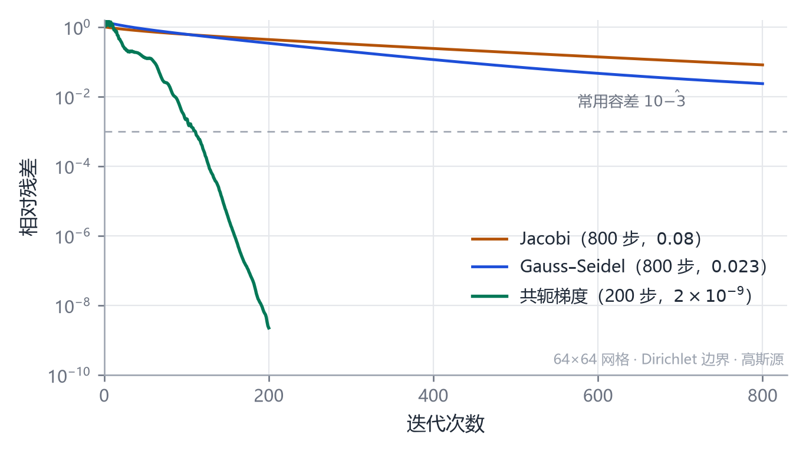
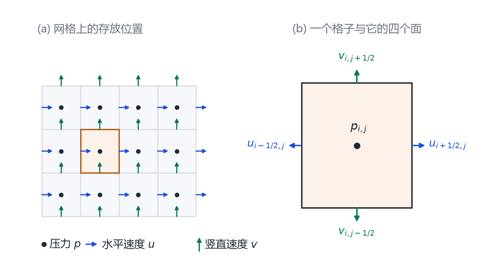

# 第 3 章 网格法：投影与压力泊松

倒一杯水进方箱，水面会自己找到水平。没有人告诉它“应该平”：水多的地方压力高，压力高就推开周围的水，直到处处一样。整套机制里没有哪个部件知道“水平”这个词，压力只是每时每刻在纠正局部的拥挤。

程序里要复现这件事，也得让压力这样工作。它不是一个存下来、随时间演化的量，而是每一步现算出来的数，专门负责把速度场里不该有的压缩顶回去。这一章讲这一步怎么算，以及它在离散世界里会在哪里漏气。调试视图里那些水面缓慢爬升、烟团自己胀开的怪现象，几乎都能在这章里找到出处。

## 3.1 一项一项地算

不可压的动量方程是

$$
\frac{\partial \mathbf{u}}{\partial t} + (\mathbf{u}\cdot\nabla)\mathbf{u} = -\frac{1}{\rho}\nabla p + \nu \nabla^2 \mathbf{u} + \mathbf{f},
\qquad \nabla\cdot\mathbf{u} = 0
\tag{3.1}
$$

四个项性格完全不同。对流是双曲的，信息沿特征线走，显式推进受 CFL 限制；扩散是抛物型的，扰动向四周铺开（数学上无限快），显式推进受 $h^2$ 限制；压力是椭圆的，它没有自己的时间，全场同时确定；外力最老实，直接加。把四项塞进同一个积分器，步长会被最苛刻的那项拖住——一杯水里 $\nu$ 很小，但蜂蜜里 $\nu$ 是水的上百万倍，同一个积分器不可能两头都合适。

算子分裂（operator splitting）把一步拆成几小段，每段只处理一种物理：

$$
\mathbf{u}^{*} = \mathcal{A}(\Delta t)\,\mathbf{u}^{n},
\qquad
\mathbf{u}^{**} = \mathcal{D}(\Delta t)\,\mathbf{u}^{*},
\qquad
\nabla^2 p = \frac{\rho}{\Delta t}\nabla\cdot\mathbf{u}^{**},
\qquad
\mathbf{u}^{n+1} = \mathbf{u}^{**} - \frac{\Delta t}{\rho}\nabla p
\tag{3.2}
$$

$\mathcal{A}$ 是平流算子，第 4 章整章讲它；$\mathcal{D}$ 是扩散算子，可以显式也可以隐式；最后一步叫投影。$\mathbf{u}^{*}$ 与 $\mathbf{u}^{**}$ 都只是中间量，它们不满足无散条件，只有 $\mathbf{u}^{n+1}$ 满足。

拆开的代价是：每一段用的是别的项的“上一版”信息。平流把速度搬走时，压力还是旧的；扩散也看不到平流刚带来的变化。误差是一阶的，正比于 $\Delta t$。把扩散劈成两半、一半放平流前一半放平流后（Strang 分裂）能到二阶，但投影必须留在最后——它是唯一保证散度为零的一步，挪到中间就没有意义了。

一个具体场景。杯子里滴进一滴牛奶，一帧之内它要过三件事：被水流搬走（平流）、被搅动摊开（扩散）、然后整个速度场被压力重新整理成“不增不减”的样子（投影）。前两件事都会把速度场弄“脏”——搬走会在原处留下凭空消失的东西，扩散会让相邻格子互相借速度——只有投影知道怎么把它们修回去。也就是说，平流和扩散谁先谁后有讲究但不致命，投影必须收尾。

顺序上还有一个坑值得单独说。重力加在哪一步，决定了水面会不会自己往下沉。重力必须在投影之前加：加完之后速度朝下，散度为负，压力解出来偏高，正好把向下的速度顶回去，剩下的就是一个平衡的静水压梯度。如果重力加在投影之后，压力就没机会看见它，水面每帧都往下掉一格，几十帧后整杯水塌到杯底。这个错误在初学者的代码里出现频率极高，因为慢速场景里几乎看不出来。

压力为什么必须每帧重算，这一点值得停一下。不可压的意思是声速无穷大：压力扰动瞬间传遍全场，液体里任何一处的挤压，别处立刻知道。真实的水声速约 1500 m/s，一个十米长的池子，声音七毫秒穿过去。若按声波去限制步长，$\Delta t$ 得在 $10^{-5}$ 秒量级，一帧要算上千步。把压力当成约束、每帧解一次椭圆方程，等于声明“声波已经传完了”，把那七毫秒折叠进了一个时间步。这是不可压模型最大的便宜，也是它最硬的限制：它算不出冲击波。第 10 章讲爆炸时必须换回带声速的可压缩方程，正是因为这一步近似在那里失效了。

图形学里这套三步流程的普及是从 Stable Fluids 开始的，它把平流、扩散、投影打包成一个步长几乎不受限制的时间步，烟第一次能在单机上按帧算出来 [@stam1999]。代价是那篇论文里的一切误差都被“看起来像烟”盖过去了——这也是这本书要逐项拆开讲的原因。

## 3.2 压力从哪里冒出来

对投影后的速度取散度，要求它为零：

$$
\nabla\cdot\mathbf{u}^{n+1} = \nabla\cdot\mathbf{u}^{**} - \frac{\Delta t}{\rho}\nabla^2 p = 0,
\qquad\text{于是}\qquad
\nabla^2 p = \frac{\rho}{\Delta t}\,\nabla\cdot\mathbf{u}^{**}
\tag{3.3}
$$

这就是压力泊松方程。它不是在说“压力满足某个规律”，而是在说“为了让散度为零，压力必须取这个值”。压力是约束的乘子，它的值完全由约束反推出来。

右端是平流和扩散之后攒下的多余散度。一个格子里被搬进来的流体太多，就会“挤”，$\nabla\cdot\mathbf{u}^{**}$ 为负，解出来的 $p$ 偏高，接着用高压把这个格子里的水往外推。整个系统是自我纠正的，不需要维护任何“水面高度”之类的状态量。

系数 $\rho/\Delta t$ 值得看一眼。步长越小，同样的散度需要越大的压力去顶；但压力本身不出现在速度里，进入速度的是 $\frac{\Delta t}{\rho}\nabla p$，两者抵消，所以最终的速度修正对步长不敏感。真正受步长影响的是右端的大小：步长小，右端大，同样的相对残差对应的绝对散度也大。

边界条件决定这个方程有没有解、解是什么。三种常见情形。

固壁。壁面法向速度必须为零。由 $\mathbf{u}^{n+1}\cdot\mathbf{n} = 0$ 可得

$$
\frac{\partial p}{\partial n} = \frac{\rho}{\Delta t}\,\mathbf{u}^{**}\cdot\mathbf{n}
\tag{3.4}
$$

如果平流后壁面法向速度已经处理好（例如把壁面速度固定成零再插值），右边就是零，退化成常见的 $\partial p/\partial n = 0$。

自由表面。界面外的空气压力取常数，通常设为零，忽略表面张力时有 $p = 0$，这是 Dirichlet 条件。它把“水面可以自由升降”翻译成了“界面处压力等于大气压”。

出口。可以给 $p=0$，也可以给 $\partial p/\partial n = 0$。前者让流体自由流出、压力不积累；后者更像“管道延伸出去”，但容易在出口附近留下驻波，烟从出口飘回去。影视里常用前者，代价是出口会多吸走一点东西。

纯 Neumann 问题（整个边界都是固壁）有两个麻烦。第一，解不唯一：给任何一个解加上常数，仍然是解，因为方程里只有 $p$ 的导数。第二，相容性条件

$$
\int_\Omega \nabla\cdot\mathbf{u}^{**}\,dV = \oint_{\partial\Omega}\mathbf{u}^{**}\cdot\mathbf{n}\,dA = 0
\tag{3.5}
$$

必须成立，否则方程无解。它的意思很直白：一个封闭的箱子，流进来的总量必须等于流出去的总量。而 $\mathbf{u}^{**}$ 是平流和扩散之后的中间速度，它的净通量一般不为零，于是严格来说每帧的泊松方程都是不可解的。迭代器总会在某个“最接近”的解上停下，那个解对应的就是体积变化。3.7 节回来处理这件事。

边界在程序里到底怎么写，值得展开一次，因为它是“公式都对、结果不对”的最常见来源。

**壁面：边界写在对角线上。** 一维看最清楚。格子 1 到 $N$，格子 1 左边是墙。在格子 1 上写泊松方程，需要墙外的虚拟值 $p_0$：

$$
\frac{p_2 - 2p_1 + p_0}{h^2} = b_1
$$

$\partial p/\partial n = 0$ 时镜像给出 $p_0 = p_1$，代入后变成 $p_2 - p_1 = h^2 b_1$。原来那个 $-2$ 变成了 $-1$。也就是说，边界条件最终就体现为矩阵对角线上一个被改掉的数：二维内部行对角是 4，贴一面墙是 3，贴两面墙的角落是 2，贴着三面墙（一根细柱子的拐角）是 1。这些数不必背，只要每次都能推一遍就不会错。

这里有个容易忽略的细节：改对角线的做法与“用有限体积写通量”是等价的，前提是散度也用同一套面。如果散度用中心差分、边界用镜像，两边就对不上，贴壁那一圈会长期残留散度。表现是贴壁的水“粘”在墙上不动，像长了水垢——这正是 3.3 节第二条坑的具体样子。

**自由表面：距离要被算进去。** 界面上的 $p=0$ 不在格心上，所以不能简单令虚拟值为零。设界面到液体格心的距离是 $\theta h$，$\theta\in(0,1]$，把压力沿法向线性外推到界面外一格：

$$
p_g = -p_i\,\frac{1-\theta}{\theta}
$$

$\theta = 1$ 表示界面正好落在相邻面上，此时 $p_g = 0$；$\theta = 0.5$ 表示界面在中间，$p_g = -p_i$；$\theta\to 0$ 表示这个格子几乎全是空气，系数趋于无穷。

把它代回方程，得到的是一个系数被放大的行：贴界面的格子在法向上的“有效电导”是 $1/\theta$。$\theta = 0.1$（格子只装了十分之一液体）时，这一行的系数是满格子的十倍。也就是说，界面把一个本来很均匀的矩阵改成了量级差十倍的矩阵，条件数随之恶化。这是 3.6 节“小格子”问题的数学根源，也是为什么工程代码宁可把 $\theta < 0.1$ 的格子直接判成空气。

**出口与入口。** 出口给 $p = 0$（Dirichlet），虚拟值取 $-p_i$；给 $\partial p/\partial n = 0$（Neumann），虚拟值取 $p_i$。入口如果规定了速度，那它其实也是一个 Neumann 条件，只不过右端不是零：通量已知，把它挪到 $b$ 里去。也就是说，规定“压力多少”是 Dirichlet，规定“进出多少”是 Neumann，后者改右端项，前者改对角线。

**角点。** 二维的角落格子有两个虚拟值，一个在南一个在西，两个都要按上面的规则填，填完对角是 2；三维的角落有三个，对角是 1。这些数必须一致地出现在矩阵里，否则求解器会在角落附近收敛得很慢——它不报错，只是残差降不下去。

**用掩码把固体排除。** 实际代码通常不删行，而是给每个格子一个标记（液体、空气、固体），固体格子的行写成 $p = 0$、$b = 0$（对角 1）。矩阵尺寸不变、并行结构不变，只是在固体格子上解出一个无意义的零。这比动态压缩矩阵省事得多，代价是固体占的体积比不能太大，超过一半就该换数据结构了。

## 3.3 投影：把梯度那部分剪掉

任意一个向量场都可以拆成无散部分加一个梯度场，这叫 Helmholtz–Hodge 分解：

$$
\mathbf{u}^{**} = \mathbf{u}^{n+1} + \frac{\Delta t}{\rho}\nabla p,
\qquad \nabla\cdot\mathbf{u}^{n+1} = 0
\tag{3.6}
$$

投影算子就是

$$
\mathcal{P} = \mathbf{I} - \nabla(\nabla^2)^{-1}\nabla\cdot
\tag{3.7}
$$

它先求散度，解泊松得到标量，再取梯度减回去。$\mathcal{P}^2 = \mathcal{P}$，是个投影；而且是正交投影——在所有无散场里，$\mathcal{P}\mathbf{u}^{**}$ 是离 $\mathbf{u}^{**}$ 最近的那个。正交这一点不只是数学上的好看：它意味着投影不会凭空造出动能，只会减掉梯度那部分携带的能量。离散之后如果梯度和散度不互为伴随，这个性质就丢了，投影可能越投能量越大，跑几百帧后速度场自己涨起来。

换成傅里叶空间看会更清楚。设 $\hat{\mathbf{u}}(\mathbf{k})$ 是速度的谱，投影的作用是

$$
\hat{\mathcal{P}}\,\hat{\mathbf{u}} = \hat{\mathbf{u}} - \frac{\mathbf{k}\,\mathbf{k}\cdot\hat{\mathbf{u}}}{|\mathbf{k}|^2}
\tag{3.8}
$$

也就是把沿 $\mathbf{k}$ 方向的分量减掉，只留垂直于波矢的部分。$|\mathbf{k}|$ 小的地方分母接近零，同样的散度需要巨大的压力。低频散度是最难消的，这是下一节所有求解器都在低频上卡住的根源。

把一整步算一遍，比读十条性质有用。一维周期域，四个格子，$h = 1$，$\rho/\Delta t = 1$，速度存在面上（交错网格的一维版）。假设平流和扩散之后，面上的速度是

$$
\mathbf{u}^{**} = (1,\ 3,\ 2,\ 2)
$$

四个数依次是格子 1 与 2、2 与 3、3 与 4、4 与 1 之间那个面上的速度。

先求散度。格子 $i$ 的散度是“右边面减左边面”除以 $h$：

$$
\nabla\cdot\mathbf{u}^{**} = (1-2,\ 3-1,\ 2-3,\ 2-2) = (-1,\ 2,\ -1,\ 0)
$$

第二个格子被挤得最厉害（散度 2），第一、三个格子里的流体在被抽走（散度 $-1$）。四个数加起来是零——周期域里这是必然的，进出必须相等。

再解泊松。离散方程是

$$
p_{i+1} - 2p_i + p_{i-1} = b_i,\qquad b = (-1,\ 2,\ -1,\ 0)
$$

四个未知数、四行方程，但只有三个线性无关——加一个常数仍然是解。手工令 $p_1 = 0$ 逐行推：第一行给 $p_2 + p_4 = -1$，第二行给 $p_3 = 2p_2 + 2$，第四行给 $p_3 = 2p_4$。合起来得 $p_2 = -1$、$p_3 = 0$、$p_4 = 0$，即

$$
\mathbf{p} = (0,\ -1,\ 0,\ 0)
$$

中间那个格子压力最低——它散度是正的，正在往外喷，需要低压把它拉住。压力为负不代表“负压”，只是常数还没定；把全场加 10，物理完全一样，因为进速度的只有压力的差。

最后修正速度。面上的修正是相邻两格的压力差：

$$
u_i^{\text{new}} = u_i^{**} - \frac{p_{i+1}-p_i}{h}
$$

逐个算：面上 1 是 $1-(-1-0) = 2$，面上 2 是 $3-(0+1) = 2$，面上 3 是 $2-0 = 2$，面上 4 是 $2-(0-0) = 2$。四个面全变成 2。

校验：新速度的散度是 $(0,\ 0,\ 0,\ 0)$，一个不剩。平均值 $(1+3+2+2)/4 = 2$ 和 $(2+2+2+2)/4 = 2$ 相同——压力修正的梯度绕环一周加起来是零，所以它不动环量，也不动总流量。

结果看上去很傻：非均匀的速度场被压成了一个常数。这不是算错。一维周期域里，唯一满足无散的场就是常速场——水不能在一条线上绕着流。真正的剪切和涡要二维三维才有空间长出来。这个例子值钱的地方在别处：它把“散度→泊松→梯度修正→校验”这条链完整走了一遍，而四个格子的手算和两百万个格子的程序走的是同一条链，一行都没变。

离散之后有两个坑。

一是离散散度和离散梯度不匹配。连续世界里 $\nabla\cdot\nabla = \nabla^2$ 恒成立；离散之后，如果你用中心差分散度、中心差分梯度，两者拼出来的拉普拉斯模板与直接写出的拉普拉斯模板不是一个东西。结果就是投影做完了、泊松也解准了，离散散度仍然不为零，残留量随网格变细下降，但永远存在。解决办法是让两者在离散层面互为负伴随，也就是交错网格，3.5 节。

二是边界。靠近固壁的格子，梯度模板需要壁外的压力值，而那个值不存在。用镜像（$\partial p/\partial n = 0$ 时令 $p_{\text{ghost}} = p_{\text{in}}$）或单侧差分都行，但必须与散度的边界处理配套。配不上，壁面附近就会长期留着一层散度，表现出来是贴壁的一层水“不动”，像长了水垢。

## 3.4 解泊松：三种做法与各自的瓶颈

离散之后是一组线性方程 $\mathbf{A}\mathbf{p} = \mathbf{b}$。$\mathbf{A}$ 是五点（三维七点）拉普拉斯，稀疏、对称、正定（取负号后）。未知数从几万到几千万，三维下直接分解（Cholesky）内存就爆了，只能迭代。

Jacobi 迭代最直白：每个格子用邻居的平均值更新自己，

$$
p^{k+1}_{i,j} = \frac{1}{4}\left(p^{k}_{i+1,j} + p^{k}_{i-1,j} + p^{k}_{i,j+1} + p^{k}_{i,j-1} - h^2 b_{i,j}\right)
\tag{3.9}
$$

每个格子只读上一轮的邻居，天然并行，GPU 上一条 kernel 就够。问题在收敛率。误差按傅里叶模式分解，波数为 $k$ 的分量每步的衰减因子是

$$
\lambda(k) = \frac{\cos(k_x h) + \cos(k_y h)}{2} \approx 1 - \frac{k^2 h^2}{4}
\tag{3.10}
$$

高频衰减很快，低频几乎不动。整个求解的速度由最慢的模态决定，即 $\lambda_{\max} = \cos(\pi/N)$，$N$ 是每边格数。$N=64$ 时是 0.9988，单看这个最慢模态，降一个 $e$ 要八百多次迭代；实际曲线前期会陡一些，因为误差里还混着能被快速消掉的高频成分。而投影要的恰恰是低频散度被消掉——那些大尺度的整体膨胀。Jacobi 干不了这个活，它只配当多重网格里的“平滑器”。

Gauss-Seidel 把刚算出来的新值立刻用上：

$$
p^{k+1}_{i,j} = \frac{1}{4}\left(p^{k}_{i+1,j} + p^{k+1}_{i-1,j} + p^{k}_{i,j+1} + p^{k+1}_{i,j-1} - h^2 b_{i,j}\right)
\tag{3.11}
$$

收敛因子约为 Jacobi 的平方，迭代数减半。代价是顺序依赖：第 $(i,j)$ 个格子要等 $(i-1,j)$ 和 $(i,j-1)$ 算完。红黑排序解决并行问题：按 $i+j$ 的奇偶把格子分成两色，同色格子互不相邻，可以同时更新，两趟交替，结果与顺序扫描完全相同。GPU 上这是最常用的一档。

共轭梯度（conjugate gradient，CG）换了个思路。它不逐点松弛，而是在 Krylov 子空间里找让残差最小的解，每步沿一个与之前所有方向 $\mathbf{A}$-共轭的方向走一次。对 $n$ 维对称正定系统，理论上 $n$ 步内精确收敛。

实际收敛速度由条件数决定，迭代数大约是 $\sqrt{\kappa}$ 的量级。二维拉普拉斯的条件数

$$
\kappa \approx \frac{4}{\pi^2}N^2
\tag{3.12}
$$

$N=64$ 时约一千六，开方约四十。实测一百五十次左右能把相对残差压到 $4\times10^{-6}$，两百次到 $2\times10^{-9}$，而 Jacobi 在同样的两百次还停在 $0.4$ 附近（图 3-1）。代价是每次迭代要做两次内积，也就是两个全局归约；GPU 上归约是同步点，规模一大就被通信拖住。加预条件（不完全 Cholesky、MIC(0)）能把迭代数降到二三十，但预条件本身往往不好并行，这一步的取舍要看硬件。

多重网格是另一种量级的东西。它利用的正是 Jacobi 的短处：低频误差在细网格上难消，但把它限制（restrict）到粗一倍的网格上，同一个波形的波数翻倍，就变成高频，Jacobi 两三次就压下去了。一个 V 循环是：细网格平滑几次，限制到粗网格，递归，插值回细网格，再平滑几次。收敛因子与网格规模无关，每次循环残差降一个固定倍数（做得好是 0.1 到 0.2），总复杂度与未知数成线性。代价是实现复杂：限制与插值算子要配套，粗网格的边界要单独处理，自由表面区域每帧变化时层级要重建。

<figure class="fig">

<figcaption><b>图 3-1</b>　同一个泊松问题的残差曲线。64×64 网格，Dirichlet 边界，右端项取两个高斯源之差（模拟平流后残留的散度），初值全零。Jacobi 与红黑 Gauss-Seidel 各走八百步，CG 走两百步；纵轴是相对残差 $\lVert\mathbf{b}-\mathbf{A}\mathbf{p}\rVert/\lVert\mathbf{b}\rVert$ 的对数。两条松弛曲线在步数增加后越来越平，那是高频误差消完、只剩低频误差的结果；CG 的斜率几乎不变，两百步时已到 $2\times10^{-9}$，还在往下掉。</figcaption>
</figure>

图 3-1 里三条线的形状比终值更有信息量。Jacobi 走完八百步停在 $0.08$，Gauss-Seidel 同一步数到 $0.023$，两者都是缓慢下沉的直线——在对数坐标上是直线，意味着每一步乘一个固定因子，而这个因子离一很近。CG 的曲线陡得多，且在两百步内没有变缓的迹象。这件事说明：迭代法的速度不由单步的算术量决定，而由“最慢的那个误差模态”决定。

工程上的选择基本由规模决定。实时游戏用 64³ 到 128³ 的网格，每帧预算几毫秒，选 Jacobi 或红黑 Gauss-Seidel，跑二十到四十次就停，剩下的散度靠涡量补偿和渲染糊过去。影视用 256³ 以上，每帧可以花几百毫秒，选 MIC(0)-PCG 或几何多重网格。有一件事比选求解器更重要：判断标准不该是残差范数，而是投影后散度的最大值。残差范数是全局平均，散度最大值反映的是画面里那种“某一块在胀”的局部错误，后者才是眼睛看得见的。

再算一笔带宽账，它比算浮点账更接近真相。128³ 的网格有约两百一十万个格子，一趟红黑 Gauss-Seidel 就是两百一十万次格子更新；每次更新读七个邻居写一个值，按单精度算约 32 字节，一趟下来 67 MB 的访存。想把残差从 1 压到 $10^{-6}$，按最慢模态估算要上千趟，也就是 67 GB；显卡带宽按 300 GB/s 算，光搬运就要 0.2 秒。一帧的预算只有 16 毫秒。

同一个问题交给多重网格：一个 V 循环（细网格上两前两后平滑，加上粗网格的零头）约等于细网格上五趟的工作量，而残差每次都乘 0.15 左右，降到 $10^{-6}$ 要七个循环。七乘五等于三十五趟，约 2.3 GB、八毫秒。也就是说，两者差的不是一个“快几倍”的系数，而是访存量差一个数量级——这也是为什么影视里几乎没有不用多重网格的流体求解器。

CG 还有一个前提：矩阵必须正定。如果离散里藏着零空间，CG 会在那里漂，残差降不下去却不报错。零空间从哪来，是下一节的事。

## 3.5 MAC 网格：把量放在它该在的地方

上一节默认了“五点拉普拉斯”是现成的，其实它怎么摆，决定了投影能不能成立。

先看反例。假设压力 $p$、速度分量 $u$、$v$ 都放在格子中心，散度用中心差分 $(u_{i+1}-u_{i-1})/2h$，梯度也用中心差分。取一个棋盘模式 $p_{i,j} = (-1)^{i+j}$，代入：

梯度方向，$p_{i+1,j} - p_{i-1,j} = (-1)^{i+j}\left[(-1) - (-1)\right] = 0$，棋盘压力产生的速度修正恒为零。拉普拉斯方向，$4p_{i,j} - p_{i+1,j} - p_{i-1,j} - p_{i,j+1} - p_{i,j-1} = 8(-1)^{i+j}$，不为零。

于是棋盘压力是这个离散系统的零空间：它满足方程（右端为零时），却不产生任何速度。求解器可以在这个方向上随便漂，画出来的压力是一片黑白噪声，速度场看起来还挺对——直到你用它算浮力或者表面张力，噪声就全跑出来了。三维里还有四色模式，“看起来对”的假象更难发现。

上面这段推导有个地方要补精确，否则会误以为棋盘只是“恰好”落在零空间里。

投影真正用到的不是那个紧凑的五点拉普拉斯，而是“先取梯度、再取散度”复合出来的算子。同位网格上，格心的梯度用中心差分，速度的散度也用中心差分，复合起来得到的是

$$
\frac{p_{i+2} - 2p_i + p_{i-2}}{4h^2}
$$

注意它跨了两格：$p_{i+2}$ 和 $p_{i-2}$，中间的 $p_{i+1}$、$p_{i-1}$ 根本不出现。把周期波 $p_i = e^{ikx_i}$ 代进去，它的傅里叶乘子是

$$
-\frac{\sin^2(kh)}{h^2}
$$

$kh = \pi$ 就是棋盘模式，$\sin\pi = 0$，乘子为零。也就是说，棋盘压力对这个复合算子完全隐形：它不产生任何散度，任何散度也不产生它。可你实际在解的是那个紧凑的 $p_{i+1}-2p_i+p_{i-1}$，它在棋盘上取 $4/h^2$，一点也不小。两件事对不上，求解器就会在这个方向上自由漂移。

交错网格把这件事掐死在源头。散度只用面、梯度也只用面，复合出来正好是紧凑的三点（二维五点）：

$$
\frac{p_{i+1} - 2p_i + p_{i-1}}{h^2},
\qquad\text{傅里叶乘子}\ -\frac{4\sin^2(kh/2)}{h^2}
$$

$kh = \pi$ 时 $\sin(\pi/2) = 1$，乘子是 $-4/h^2$，恰是这个算子能取到的最大绝对值。棋盘不但不是盲区，反而是它最敏感的方向。两种布局的差别可以摆成一张表：

| 模式 | 同位网格（中心差分复合） | 交错网格 |
|---|---|---|
| $kh\to 0$（常数） | $0$ | $0$ |
| $kh=\pi/2$ | $-1/h^2$ | $-2/h^2$ |
| $kh=\pi$（棋盘） | $0$ | $-4/h^2$ |

只有“常数”那一行两列都是零——这就是零空间里唯一合法的成员。二维的棋盘是 $(-1)^{i+j}$，等于两个一维模式的乘积，结论照搬；四色模式同理，因为它在 $x$ 或 $y$ 方向上总是一个棋盘。

Harlow 与 Welch 为 marker-and-cell 方法设计的布局避开了这件事（图 3-2）：压力存格子中心，$u$ 存在格子的左右两个面上，$v$ 存在上下两个面上，三维再加 $w$ 在前后两面。每个量都待在自己该待的地方。

于是散度写成

$$
(\nabla\cdot\mathbf{u})_{i,j} = \frac{u_{i+1/2,j} - u_{i-1/2,j}}{h} + \frac{v_{i,j+1/2} - v_{i,j-1/2}}{h}
\tag{3.13}
$$

每一项都是同一个格子的两个相对面上的速度之差，没有插值，没有跨格子的平均。四个面正好围住这个格子，在离散意义上这就是“净流出通量除以体积”，与有限体积法的散度逐字相同。

压力梯度写成

$$
\left(\frac{\partial p}{\partial x}\right)_{i+1/2,j} = \frac{p_{i+1,j} - p_{i,j}}{h}
\tag{3.14}
$$

结果正好落在 $u_{i+1/2,j}$ 的位置上。压力与速度不需要互相插值，各自在自己的位置上做差分。这就是交错网格的全部秘密，也是它能存在六十年的原因。

<figure class="fig">

<figcaption><b>图 3-2</b>　MAC 网格上各量的位置（示意图）。实心点为压力，存在格心；向右的箭头为 $u$，存在格子的左右面；向上的箭头为 $v$，存在上下面。右侧放大画出格子 $(i,j)$：它的散度只用四个面上的速度，压力梯度只用两个相邻格心的压力，两者共用同一套面，因此离散散度与离散梯度严格配对。</figcaption>
</figure>

这样配出来的 $-(\nabla\cdot)(\nabla)$ 就是标准五点模板，对称、负定、边界干净。投影在这个离散空间里是真正的正交投影，散度能压到机器精度——前提是泊松解得够准。棋盘零空间不再存在，因为这两个算子用的是同一批面，任何“看不见的”压力模式都会在散度上留下痕迹。

代价是索引麻烦。$u$ 在 $i \pm 1/2$ 上，读一个格子的 $u$ 要写两套下标，插值到格心又是一套，边界还要补 ghost 层。实际代码里通常用三个数组，尺寸各差一格，再用宏或者访问器把下标藏起来。这份麻烦换来的是散度与梯度的严格配对，值这个麻烦。

还有一处容易踩的坑：交错网格上的插值方向。要把 $u$ 插到 $v$ 的位置上（比如算对流速度），必须四个面平均；只沿一个方向插值会引入方向偏置，走久了圆形会变成菱形。这类错误不会让程序崩，只会让烟的形状缓慢地“方”下去。

## 3.6 自由表面的压力边界

真实的水有界面，界面外是空气。空气密度是水的千分之一，忽略它的惯性，界面上的压力就等于大气压，取零。于是泊松方程的定义域不再是矩形，而是液体占据的那部分，边界上 $p=0$。

这一步把问题从“解一个规则区域上的方程”变成“解一个每帧都在变的区域上的方程”，难度上了一个台阶。

区域标记。每帧根据界面表示（level set 或体积分数）把格子分成三类：液体满格、空气格、固体格。只在液体格上列方程，其余的格子不参与。这样矩阵的尺寸每帧变化，形状也不规则。飞溅、薄膜、破碎的浪花会让液体区域碎成几百个小块，每块的矩阵都很小，并行度反而下降——GPU 上这是很难受的一种负载。

界面条件怎么落，有三种做法，各有代价。

Dirichlet ghost：在界面外放一个虚拟压力，值由 $p=0$ 沿法向外推得到，界面位置用 level set 的 $\phi$ 插出真实距离。方程仍留在规则网格上，但系数变成变系数（界面到格心的距离进了分母），矩阵不再对称常系数。

Ghost fluid：把 $p=0$ 直接外推成界面外第一层格子的值，模板不变，只改右端项。实现最简单、最稳，界面位置精度只有一阶。影视里大量使用，因为界面位置的一阶误差在画面上看不出来，而稳定性出问题一眼就看见；那篇讲烟的文章就是用这个办法处理浮力区的边界的 [@fedkiw2001]。

体积加权（cut-cell）：部分填充的格子按液体体积分数加权，通量按实际被液体覆盖的面积算。守恒最好，但会产生体积分数接近零的“小格子”，矩阵条件数爆炸，必须合并小格或者给体积分数加下限。做水的工程代码里，小格合并往往是整个求解器里最难调的一段。

还有一类常被忽略的东西：被困住的空气。一个气泡封在水里，泡内压力不是零，而近似是 $p_g = p_0 V_0 / V$（等温）或者带绝热指数。如果把气泡简单标成空气、压力取零，它会在周围液体的压力下不断被压缩、最终塌掉；反过来，气泡膨胀时又会把水吸出一个洞。要正确模拟，得把气泡当成一个额外的未知量，与液体压力联立求解，这也正是气泡上浮时“抖”的常见来源。

一个具体场景能把三种做法的区别说出来。玻璃杯里倒进半杯汽水，杯壁挂着一层气泡。用 ghost fluid 处理界面，气泡就是“界面上一块 $p=0$ 的圆斑”，它会以正确的浮力上浮，形状略扁——一阶界面精度在画面上就是“气泡不够圆”。用体积加权的 cut-cell，气泡能保持圆，但当一个气泡刚好跨在两个格子之间、液体只占百分之几时，那格的系数变得极大，矩阵开始抖，气泡会左右跳。这就是为什么做水的代码通常给体积分数加一个下限（比如 $10^{-3}$），再配小格合并——宁可牺牲一点精度，也要让方程组保持可解。

反例：界面法向估错的代价。自由表面的 Dirichlet 位置是由界面法向定出来的；法向如果从 $\phi$ 的中心差分算，在波长接近两格时会剧烈摆动。位置一摆，压力跟着摆，水面上出现一层固定的格子纹——不是噪声，是每帧都一样的静态纹路。加一步对法向的平滑，或者用更宽的模板估法向，纹路就散了。

## 3.7 体积去哪了

即使每一步投影都解得很准，长时间跑下来液体总量还是会变。这不是某个 bug，是四个误差源叠加的结果。

其一，泊松没解完。每次迭代都在减少残差，但总留下一点散度。残留散度乘以格子体积、再乘以步长，就是每步漏掉的体积。它可能只有 $10^{-4}$，但一秒六十帧、跑一分钟就是三千六百步的累积。

其二，界面平流不守恒。半拉格朗日把界面搬过去时，插值会造出新的体积分数，也会抹掉一点。界面在格子内部的位置用 $\phi$ 或体积分数表示，两者的平流都不是严格守恒的。体积误差从这一步进来，与泊松无关，所以调求解器调不好它。

其三，相容性条件被破坏。3.2 节说过，纯 Neumann 边界要求中间速度的净通量为零。实际它不为零：平流把质量搬到壁面上，壁面速度虽然是零，但格子内部的通量并不自动平衡。方程无解，迭代器停在一个最小二乘意义上的解上，那个解对应的正是净体积变化。

其四，散度与梯度的离散不匹配。用了同位网格，或者边界处理与内部不一致，投影后离散散度就不会严格为零。这类错误最隐蔽，因为它随网格变细而减小，看起来像“分辨率不够”。

这也解释了一件常被误解的事：把步长减小并不能治好体积漂移。每步漏掉的体积正比于 $\Delta t$，而同样长的物理时间里步数正比于 $1/\Delta t$，两者相乘恰好抵消。也就是说，减小步长只是把同一条漂移曲线画得更细，斜率的符号和大小都不变。要治它只能改右端项或者改界面平流，靠加时间分辨率没用。

对策有软硬两种。

软的做法是在右端项里扣掉平均散度：

$$
b \leftarrow b - \frac{1}{|\Omega|}\int_\Omega b\,dV
\tag{3.15}
$$

也就是强制相容性成立，等价于强制边界净通量为零。这一步几乎不花钱，能把单调漂移压成随机游走，是绝大多数解算器的标准配置。

硬的做法是每帧统计液体总体积，与目标体积比较，把差额均摊到界面格子上，或者做一次全局缩放。它保证体积精确，代价是引入一点人为压缩——差额大时，画面上会看到水面轻微地“呼吸”。

诊断体积漂移只要画一条曲线：总体积随帧数变化。健康的解算器是围绕某个值小幅波动；不健康的是单调斜线。如果斜率恒定，多半是某个边界格子被错误地标成了液体，或者右端项里有一个常数的散度源没被扣掉。如果曲线是阶梯状的，几百帧不动然后突然掉一截，那是界面拓扑变化时的体积分数处理出了问题，得去看界面重构，而不是看压力。

最后区分一件事：体积守恒不等于质量守恒。单相流里两者等价，密度是常数；多相流里不是。油和水混在一起，体积相加，质量按密度加权。只保证其中一个，界面就会缓慢漂移，几十秒后油水的位置全错。第 9 章讲多相流时会回到这一点。
