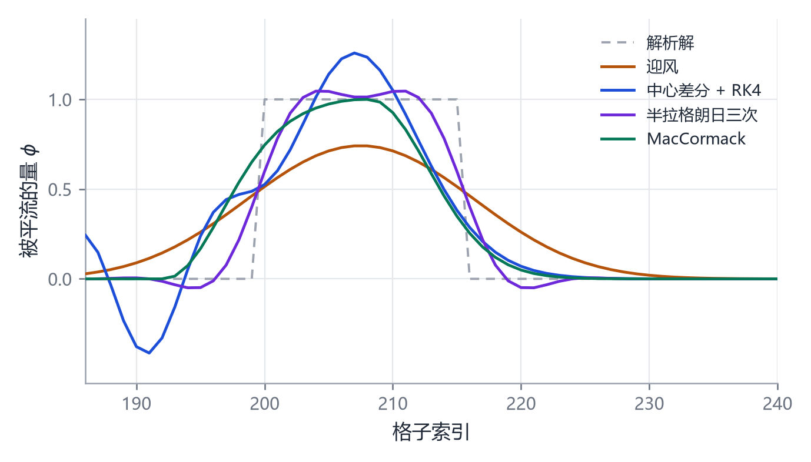
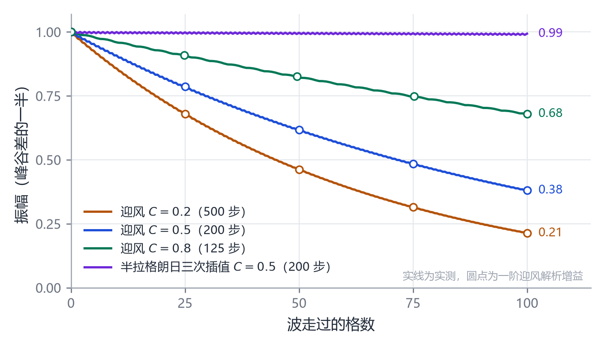

# 第 4 章 平流：耗散、振铃与补偿

先做一个只有二十行的一维测试。两百五十六个格子，中间放一段高为一、宽为十六格的方波，速度处处为一，每步走半格，跑两百步。理论上它应该原样平移一百格，形状一点不变。

实际结果是四种样子。一阶迎风把它压成一个矮土丘，峰掉到七成四，两侧铺开一大片；中心差分加 RK4 保住了高度，却在台阶两侧长出一串对称的振荡，峰冲到一点二六、谷掉到负零点四一，像水彩画洇开的水痕；半拉格朗日配三次插值介于两者之间，峰上有将近五个百分点的过冲，边角圆了；MacCormack 加限制器最接近原形，峰稳在一，只是角上被削圆了一点。

同一道方程、同一个初值、同样两百步，四种答案。这一章讲的就是为什么。平流是流体里出现频率最高的一步——烟、水、温度、涡量全都要被速度搬着走——它也是数值误差最主要的产地。

## 4.1 回溯一步：半拉格朗日

最直接的想法是显式平流：这个格子里的量，减去“上游带来的差”，写成

$$
\phi_i^{n+1} = \phi_i^{n} - \Delta t\,u\,\frac{\phi_i^{n}-\phi_{i-1}^{n}}{h}
\tag{4.1}
$$

稳定条件是 $\Delta t \le h/|u|$。喷口速度 5 m/s，格子 1 cm，步长上限 2 ms；一帧 16 ms 要八个子步，三维还要再乘上三。更麻烦的是速度不均匀：全场按最坏的那一格定步长，喷口附近细，其余地方白白浪费。

半拉格朗日换了个问法。不问“这一格的东西会流到哪去”，而问“这一格里的东西是从哪来的”：

$$
\mathbf{x}_d = \mathbf{x} - \Delta t\,\mathbf{u}(\mathbf{x}, t)
\tag{4.2}
$$

$\mathbf{x}_d$ 叫出发点，一般落在格子之间。在那里插值取回 $\phi$，赋给 $\mathbf{x}$。一维写出来是

$$
\phi_i^{n+1} = (1-\alpha)\,\phi_{i-s}^{n} + \alpha\,\phi_{i-s-1}^{n},
\qquad s = \lfloor C \rfloor,\quad \alpha = C - s,\quad C = \frac{u\Delta t}{h}
\tag{4.3}
$$

$s$ 是回溯经过的整格数，$\alpha$ 是余下的小数部分，$C$ 是 CFL 数。$C=0.5$ 时，$s=0$、$\alpha=0.5$，新值是两个相邻旧值的平均。

无条件稳定，理由简单到不需要证明：新值是两个旧值的凸组合，权重非负且和为一，所以不可能放大。Stam 1999 的 Stable Fluids 就是靠这一点，把整帧的烟塞进一个大步长里 [@stam1999]。代价是精度，认了。

代价列一列。插值把两个格子的值混在一起，信息一旦混了就回不去；回溯再往前推不回到原值，可逆性丢了；总量不严格守恒，因为插值不是守恒算子；细节被抹平，抹平的量与格子尺度成正比。这四条里，第三条可以靠后处理修正，第一、四条只能靠提高插值阶数，第二条没法救。

二维做平流有两条路。维度分裂：先沿 $x$ 做一次一维回溯，再沿 $y$ 做一次。写起来省事，回访内存也规整，但有额外的 $O(\Delta t)$ 误差和沿轴偏置，圆形烟团会被算得略微发方。直接二维回溯：出发点用双线性（或双三次）插值，没有轴向偏置，但斜向的细节丢得更厉害，因为双线性插值在两个方向上各平均了一次。三维再往上，这个差别更明显：维度分裂在三个方向上依次抹一遍，斜向的涡管会被压扁；三线性回溯则是八个角点一起平均，代价是每个格子八次访存。影视里两者都有人用，实时里维度分裂居多，因为它对缓存友好。

有个事实常被忽略：均匀流场里，线性插值的半拉格朗日与一阶迎风完全等价。$C=0.5$ 时两者都写成 $0.5\phi_i + 0.5\phi_{i-1}$。这不是巧合，两者做的事一样——取上游两个格子的加权平均。所以抱怨“半拉格朗日太糊”，本质上是在抱怨一阶迎风太糊。想改善只能提高插值阶数，也就是下面要算的那笔账。

## 4.2 耗散从哪来，有多少

把格式放进傅里叶空间。设 $\phi_i^n = G^n e^{ikx_i}$，代入一阶迎风：

$$
G = 1 - C\left(1 - e^{-ik}\right),
\qquad
|G|^2 = 1 - 2C(1-C)\left(1-\cos k\right)
\tag{4.4}
$$

$|G| \lt 1$ 就是耗散，$|G|=1$ 是无耗散。对小波数展开，$1-\cos k \approx k^2/2$，得

$$
|G| \approx 1 - \frac{1}{2}C(1-C)\,k^2
\tag{4.5}
$$

把它和“精确解加上一个扩散项”对齐。扩散方程 $\phi_t = \nu\phi_{xx}$ 的每步增益是 $1-\nu k^2\Delta t$，两者对上，得到等效的数值扩散系数

$$
\nu_{\text{num}} = \frac{1}{2}(1-C)\,u\,h
\tag{4.6}
$$

这个系数不由物理决定，由格式、步长、格子尺寸决定。$C$ 接近一时它趋于零，$C$ 很小时它接近 $uh/2$，$C=0.5$ 落在中间，是 $uh/4$。这里说的是“按物理时间折算”的耗散：$C$ 越小，每一步抹得越少，但同样的物理时间要走的步数越多，总账反而是耗散更大。这解释了很多人的困惑——“为什么我把步长改小，烟反而更糊了？”因为步长减半、$C$ 从 0.8 降到 0.4，数值扩散系数从 $0.1uh$ 涨到了 $0.3uh$。变的不是精度，是格式自带的粘性。

定义一个数值雷诺数：

$$
Re_{\text{num}} = \frac{u L}{\nu_{\text{num}}} = \frac{2N}{1-C}
\tag{4.7}
$$

$L = Nh$ 是计算域长度。$N=128$、$C=0.5$ 时 $Re_{\text{num}} \approx 512$。这句话的分量在于：一个一百二十八格的半拉格朗日烟，无论你写下的物理粘性多小，它都不会呈现出超过约五百的雷诺数对应的细节。网格分辨率决定了能看见的最小涡，格式耗散决定了那个尺度之上还有多少被吃掉。想看到更细的涡，两条路：加网格，或者换格式。

把数值扩散和真实的粘性比一下会更直观。$u=1$ m/s、$h=1$ cm、$C=0.5$ 时 $\nu_{\text{num}} = 2.5\times10^{-3}$ m²/s，是水的运动粘性（约 $10^{-6}$ m²/s）的两千五百倍，是空气（约 $1.5\times10^{-5}$ m²/s）的一百六十倍。也就是说，网格上的水其实是一锅糖浆，只是这锅糖浆的粘性没有写进方程，所以你调不动它——它藏在格式里。

提高插值阶数能降低耗散。三次插值（Catmull–Rom）的误差是 $O(h^3)$，数值扩散降到 $h^3$ 量级，同样分辨率下细节明显更多。代价是插值核里有负权重：它会把远处的值往外拉，在台阶两侧造出过冲与下冲。这就是振铃，下一节。

单调三次插值（Fritsch–Carlson 那一类）把负权重剪掉，振铃没了，但在极值附近退化成一阶，方波的角被削圆。没有哪个插值核能同时做到“高阶”和“不产生新极值”，这是同一个定理的两种说法。

代价还可以从另一个角度看：一次三次插值要读四个格子，比线性插值多一倍访存；在 GPU 上，平流这步往往是带宽瓶颈而不是算力瓶颈，所以“更高阶的插值”在实时里经常直接换算成“更少的帧”。

## 4.3 中心与迎风：两端

中心差分是二阶的：$\phi_x \approx (\phi_{i+1}-\phi_{i-1})/2h$。配上显式欧拉：

$$
\phi_i^{n+1} = \phi_i^{n} - \frac{C}{2}\left(\phi_{i+1}^{n} - \phi_{i-1}^{n}\right),
\qquad
G = 1 - iC\sin k,
\qquad
|G| = \sqrt{1 + C^2\sin^2 k} \gt 1
\tag{4.8}
$$

无条件不稳定。增益大于一，任何高频噪声都会被放大，几个时间步就炸。教科书上说“中心差分是二阶精度”，说的是空间离散的截断误差，没说时间推进能不能稳。这两件事必须分开看，混在一起的后果就是把一个精度更高的格式写成一个不能用的格式。

换成 RK4，问题变形但没消失。RK4 的稳定域在虚轴上延伸到 2.83，纯对流（特征值纯虚）是稳的。可是相位有误差，数值相速度是

$$
c_{\text{num}} = \frac{\sin k}{k}
\tag{4.9}
$$

长波接近一，短波趋近于零。方波的台阶由各种波数叠成，高频分量走得比低频慢，台阶后面就拖出一串振荡。这是色散，不是耗散：振幅几乎不衰减，振荡会一直留在那里。在烟里表现为细丝状的水彩边，在水面边缘表现为细密的波纹。

一阶迎风在另一端：绝对稳定、单调（不产生新的极值），但耗散极强。中间地带是 Lax–Wendroff 这类二阶格式：

$$
\phi_i^{n+1} = \phi_i^{n} - \frac{C}{2}\left(\phi_{i+1}-\phi_{i-1}\right) + \frac{C^2}{2}\left(\phi_{i+1}-2\phi_i+\phi_{i-1}\right)
\tag{4.10}
$$

耗散降到四阶小量，色散仍在，台阶两侧照样振。$C=1$ 时它精确，$C$ 偏离一就开始振。这就是二阶线性格式的宿命：不可能同时做到二阶精度和单调。

把开头那四种格式放到同一道题上各跑两百步，差别就摆在眼前了（图 4-1）。

<figure class="fig">

<figcaption><b>图 4-1</b>　方波平流两百步后的形状。$N=256$，$u=1$，$h=1$，$\Delta t=0.5$（$C=0.5$），周期边界，初值为宽十六格、高为一的方波，灰虚线是初值，它已在周期环上平移了一百格。四种格式：一阶迎风、中心差分加 RK4、半拉格朗日配三次插值、MacCormack 配限制器。迎风的峰掉到 $0.74$；中心差分过冲到 $1.26$、下冲到 $-0.41$；半拉格朗日三次插值峰为 $1.05$；MacCormack 峰保持 $1.00$。</figcaption>
</figure>

图 4-1 里四个结果摆在一起，能看出两条独立的“坏法”。迎风只在做一件事：把陡的变缓，信息总量不丢但空间上散开了。中心差分在另一条轴上出错：台阶的高度保住了，位置却错开，高频分量落后，形成对称的振铃，峰冲过一、谷掉到负。这两种错误在画面上完全不同——前者是糊，后者是水彩边——所以“加一个涡量补偿”对前者有效，对后者只会把振铃卷起来。

还有一个量比形状更好量化：振幅。用波长三十二格的正弦波，换不同步长跑同样的物理时间，能直接看到数值扩散的系数在变。

<figure class="fig">

<figcaption><b>图 4-2</b>　振幅随行程的衰减。$N=256$，$u=1$，$h=1$，周期边界，初值为波长三十二格的正弦波；横轴是波走过的格数，纵轴是峰谷差的一半（归一化）。三条实线都是一阶迎风，$C$ 分别取 $0.2$、$0.5$、$0.8$，分别跑 $500$、$200$、$125$ 步，终点都对应走过一百格；白心圆点是一阶迎风的解析增益，$k=2\pi/32$，每二十五格取一点，与实测曲线逐点重合。同样走过一百格，$C=0.2$ 只剩 $0.21$，$C=0.8$ 还有 $0.68$。第四条紫色线是 $C=0.5$ 的半拉格朗日三次插值，两百步后仍有 $0.99$。</figcaption>
</figure>

图 4-2 把“耗散”这件事量化了。三条迎风曲线与解析增益逐点重合（误差在千分位上），说明一阶迎风的耗散完全可以用公式预测，不需要实验；三条线的差别全部来自 $C$：走过同样的距离，$C=0.2$ 的振幅只剩五分之一，$C=0.8$ 还剩三分之二。紫色那条换成了半拉格朗日三次插值，同样两百步几乎不衰减，这是阶数带来的，不是运气。

图 4-1 和图 4-2 合起来说明一件事：耗散与色散是两个独立的旋钮。迎风只动耗散旋钮，中心差分只动色散旋钮，三次插值两个都动了但都动得很轻，代价是过冲。想同时把两个都收干净，得靠下一节那种“去一次、回一次”的补偿思路。

## 4.4 MacCormack 与 BFECC

MacCormack 的想法很聪明：既然一个方向的差分有偏，那就两个方向各做一次，让偏差互相抵消。

预测步，用前向差分（$\phi_{i+1}-\phi_i$）平流一次：

$$
\hat{\phi}_i = \phi_i^{n} - C\left(\phi_{i+1}^{n} - \phi_i^{n}\right)
\tag{4.11}
$$

校正步，把 $\hat{\phi}$ 用后向差分（$\hat{\phi}_i-\hat{\phi}_{i-1}$）反推回原位置：

$$
\tilde{\phi}_i = \hat{\phi}_i - C\left(\hat{\phi}_i - \hat{\phi}_{i-1}\right)
\tag{4.12}
$$

平均：

$$
\phi_i^{n+1} = \frac{1}{2}\left(\phi_i^{n} + \tilde{\phi}_i\right)
\tag{4.13}
$$

思路是：第一次的截断误差主项带某个符号，第二次带相反的符号，平均之后主项抵消，剩下的误差是二阶的。代价是两次平流，收益是耗散和色散都小的二阶精度。写起来只多十几行，不需要解任何线性系统，这让它在图形学里极受欢迎。

问题在间断处过冲。方波的角上会出现大于一和小于零的值，烟里表现为边缘发亮的一圈，像描了边。解决办法是限制器：

$$
\phi_i^{n+1} \leftarrow \operatorname{clamp}\!\left(\phi_i^{n+1},\ \min_{\text{nb}}\phi^{n},\ \max_{\text{nb}}\phi^{n}\right)
\tag{4.14}
$$

邻域取上游三个格子。这一步把格式在极值附近的精度降到一阶，但只在极值附近；光滑区域仍是二阶。思路是“宁可局部降阶，也不让解长出新极值”，这是 TVD（total variation diminishing）格式的实用版本。

限制器也有副作用。裁剪掉的过冲不会消失，它会以“整片压平”的形式还回来：方波的角被削圆，烟里的小涡被削成小方块，细节变得有点块状。有人干脆不加限制器，宁可留一圈亮边，因为亮边看起来像“烟被照亮”，块状看起来像“分辨率不够”。这是口味问题，但得知道自己在选什么。

BFECC 走得更远一步。它的出发点是可逆性：如果平流算子 $\mathcal{F}$ 可逆，那么“平流过去、再反平流回来”应该回到原值；回不到原值，差额就是往返两次误差之和。估出这个差额，就能补偿：

$$
\mathbf{e} = \phi^{n} - \mathcal{B}\big(\mathcal{F}(\phi^{n})\big),
\qquad
\phi^{\star} = \phi^{n} + \mathbf{e},
\qquad
\phi^{n+1} = \mathcal{F}(\phi^{\star})
\tag{4.15}
$$

$\mathcal{F}$ 是平流，$\mathcal{B}$ 是反平流（速度取反，或者时间倒推一步），$\mathbf{e}$ 是往返误差。三次平流，二阶精度，而且对插值格式的具体形式不敏感——用线性插值也能得到比线性插值高一阶的结果。它被引入图形学之后，半拉格朗日“越算越糊”的问题基本被解决了一半。

两者在一维均匀流下是等价的。MacCormack 取的是往返误差的一半（去一次、回一次，再平均），BFECC 取全部再平流一次，最终结果在常系数线性情形下相同。差别在多维和非线性速度场：BFECC 的误差估计更直接，MacCormack 的两次差分方向要按速度符号选，写起来更绕，也更容易在速度过零的地方出错——那里“上游”是模糊的。

局限得说清楚。BFECC 假设误差是线性可加的，在速度场剧烈剪切的区域（涡核、喷口边缘），往返误差估计会失真，仍然振铃；它也不守恒，只是把误差从“抹平”改成了“振荡”。所以限制器还得加，成本变成三次平流加一次裁剪。相比一阶迎风，同样步长下细节多四到八倍，这笔交换在影视里永远划算，在实时里要看预算——三次平流意味着三倍的带宽，而带宽通常才是实时流体的瓶颈。

## 4.5 粒子平流与涡量补偿

网格平流的所有麻烦都来自插值。那就别插值：把量放到粒子上，让粒子自己走。

粒子平流的写法是

$$
\mathbf{x}^{n+1} = \mathbf{x}^{n} + \Delta t\,\mathbf{u}\!\left(\mathbf{x}^{n} + \frac{\Delta t}{2}\,\mathbf{u}(\mathbf{x}^{n})\right)
\tag{4.16}
$$

中点法，二阶。速度从网格插值到粒子位置，这一步也有插值，但只插速度场，不插被输运的量；量本身跟着粒子走，没有被平均。理论上没有数值耗散，代价是粒子分布会变得不均匀：拉伸区变稀，压缩区变密，采样噪声上来。

PIC 与 FLIP 用的就是这个思路。速度在网格上解，粒子携带质量与速度（或速度增量），粒子移动不靠插值，所以平流项没有耗散，第 8 章会详细展开。这也是为什么 FLIP 的水看起来比纯网格的水“活”：小尺度的速度结构没被插值抹掉，飞溅的边缘能保持锋利到格子以下。

网格法也有办法把耗散掉的东西补回来。涡量补偿（vorticity confinement）是 Fedkiw 等人在那篇讲烟的文章里给出的做法 [@fedkiw2001]：

$$
\boldsymbol{\omega} = \nabla\times\mathbf{u},
\qquad
\mathbf{N} = \frac{\nabla|\boldsymbol{\omega}|}{\big|\nabla|\boldsymbol{\omega}|\big|},
\qquad
\mathbf{f}_{\text{conf}} = \varepsilon\, h\,(\mathbf{N}\times\boldsymbol{\omega})
\tag{4.17}
$$

$\boldsymbol{\omega}$ 是涡量，$|\boldsymbol{\omega}|$ 是它的模，$\mathbf{N}$ 是“涡量强度增长最快”的方向，$\varepsilon$ 是补偿系数，典型值在 $0.05$ 到 $0.3$ 之间，$h$ 是格子尺度。力的方向是 $\mathbf{N}\times\boldsymbol{\omega}$，把流体往涡量更集中的地方推，等于把被抹平的小涡重新收紧。

这是明确的作弊：加进去的动量不来自任何物理，能量不守恒，$\varepsilon$ 调大了会看到烟自己拧成麻花、水面自己长出细密的疙瘩。但它补的正是网格耗散吃掉的那部分，画面上表现为烟“有丝、有卷”，而不是一团棉花。这是 2001 年之后几乎所有网格烟解算器的标配开关，也是技术美术最常调的一个数。

涡粒子法把这件事做得更彻底 [@selle2005]。它不在网格上存速度，而把涡量放到粒子上，速度由 Biot–Savart 求和给出：

$$
\mathbf{u}(\mathbf{x}) = -\frac{1}{4\pi}\sum_i \frac{\boldsymbol{\Gamma}_i \times (\mathbf{x}-\mathbf{x}_i)}{\big|\mathbf{x}-\mathbf{x}_i\big|^{3}}
\tag{4.18}
$$

$\boldsymbol{\Gamma}_i$ 是第 $i$ 个粒子携带的涡量（乘上了粒子体积），求和遍历所有粒子。涡量随粒子运动，拉伸通过粒子间距的变化体现，耗散通过一个粘性核——把近距离的 $1/r^3$ 抹平——来实现。

好处是完全摆脱网格耗散，细丝状结构能保持到很小的尺度，特别适合爆炸的烟柱、火焰边缘、水花拉出的细线。代价是求和是平方复杂度，粒子数上万就要用快速多极子或者树结构；涡量重建回网格用于渲染时，又是一次插值，前面省下的耗散会在这里还回来一部分。CPU 上几十万粒子很吃力，GPU 上可行，但粒子的分裂与合并（保持间距）本身会引入误差，涡量在合并时会损失一点。

## 4.6 步长：CFL 与它的邻居

平流的显式稳定条件是

$$
C = \frac{|\mathbf{u}|\Delta t}{h} \le 1
\tag{4.19}
$$

物理含义：一步之内，信息不能跨过两个格子。跨过去了，数值依赖域就覆盖不到真实的依赖域，格式解的是另一道题。

半拉格朗日不受这个限制（凸组合），但精度受。$C$ 超过一，回溯要经过多个格子，插值累积的误差变大；$C$ 超过五之后，一步直线近似连速度场的弯曲都跟不上，回溯路径会穿墙——粒子本该绕过障碍物，直线回溯却从障碍物中间穿过去，把另一侧的值搬了过来。这就是半拉格朗日在 $C$ 很大时“烟穿过墙”的来路，也是为什么它虽然无条件稳定，实际使用时仍然要限制步长。

扩散有自己的限制。显式扩散在三维下要求 $\nu\Delta t/h^2 \le 1/6$，也就是 $\Delta t \le h^2/(6\nu)$。室温的水 $\nu \approx 10^{-6}$ m²/s，1 cm 的格子给出 $\Delta t \le 1.7$ 秒，完全不是瓶颈；蜂蜜 $\nu \approx 1$，同样的格子给出 $\Delta t \le 1.7\times10^{-5}$ 秒，比平流限制紧三个数量级。高粘的流体（熔岩、糖浆、融化的巧克力）必须把扩散做成隐式，否则步长被粘性拖死，一帧算到天亮。

表面张力也有限制：

$$
\Delta t \le \sqrt{\frac{\rho\,h^{3}}{2\pi\sigma}}
\tag{4.20}
$$

$\sigma$ 是表面张力系数，$\rho$ 是密度。它随 $h^{3/2}$ 缩小：分辨率提高一倍，步长要减到 35%。水面细节越细，这一项越紧，这就是高分辨率的水面模拟一定要用隐式表面张力或者专门界面处理的原因，第 9 章会讲。

实际系统里这些限制同时存在，取最小值。常见做法是每帧先按最大速度和一个安全系数（0.5 到 0.9）定 $\Delta t$，然后把一帧剩下的时间切成若干固定子步。子步数变化会让画面轻微抖动，所以很多系统宁愿固定子步数，把 $\Delta t$ 改成“这一帧实际用掉的步长”，让物理时间略微不均——观众看不出来，程序省了分支。另一种做法是把子步数锁在 2 的幂，让时间步的可预测性换来调试时的省心。

用局部最大速度定步长偏保守：一个格子的速度尖峰会把全场步长压下去。折中的做法是取速度的高分位数，或者给每帧的步长一个上限。反过来，如果某个区域速度特别高（喷口、瀑布落点、船首），更好的办法是局部子步：那个区域每个大步骤做多次小平流，其余区域一次，代价是两边的时间要对齐，交界面上的量要做时间插值。

最后把四种格式摆在一张表里，各自的账很清楚。

| 格式 | 稳定性 | 耗散 | 色散 | 每步成本 |
|---|---|---|---|---|
| 一阶迎风 | 条件（$C\le1$） | 强 | 无 | 一次一阶差分 |
| 中心差分加 RK4 | 条件（虚轴稳定域） | 无 | 强 | 四次差分 |
| 半拉格朗日（线性） | 无条件 | 强，与迎风相同 | 弱 | 一次线性插值 |
| 半拉格朗日（三次） | 无条件 | 弱 | 中 | 一次三次插值 |
| MacCormack 或 BFECC | 条件 | 弱 | 中 | 两到三次平流加裁剪 |

表里没有最优。烟的广告片要细节，选 BFECC 加涡量补偿；实时游戏要稳，选半拉格朗日线性再加一点补偿；水面要守恒，平流干脆交给粒子或者体积分数，用另一套逻辑。选择的依据从来不是“哪个格式精度高”，而是“这一种流体最怕丢掉什么”。烟怕丢细节，水怕丢体积，火怕丢边界——这三件事对应三套完全不同的数值取舍，后面每一章都会再碰一次。

还有一层现实：同一个解算器里，平流要对好几种量各做一遍。速度场自己平流自己，要求保涡；密度和温度被平流，要求不出现负值，形状错一点没关系；level set 被平流，要求界面不破，还得做重新初始化。这三件事对格式的要求并不一致，所以成熟的解算器里通常不止一个平流函数，而是按量选格式，甚至同一个量在不同区域用不同格式。
