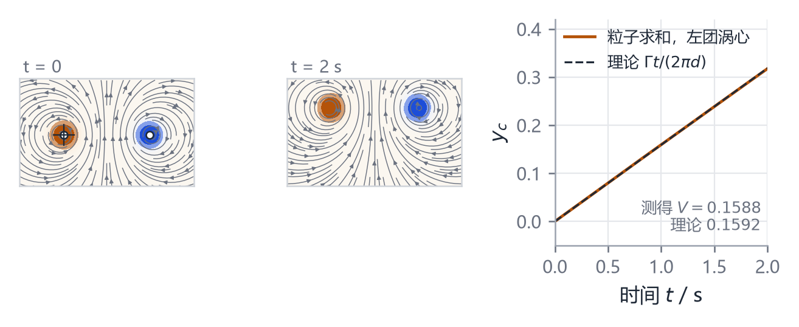
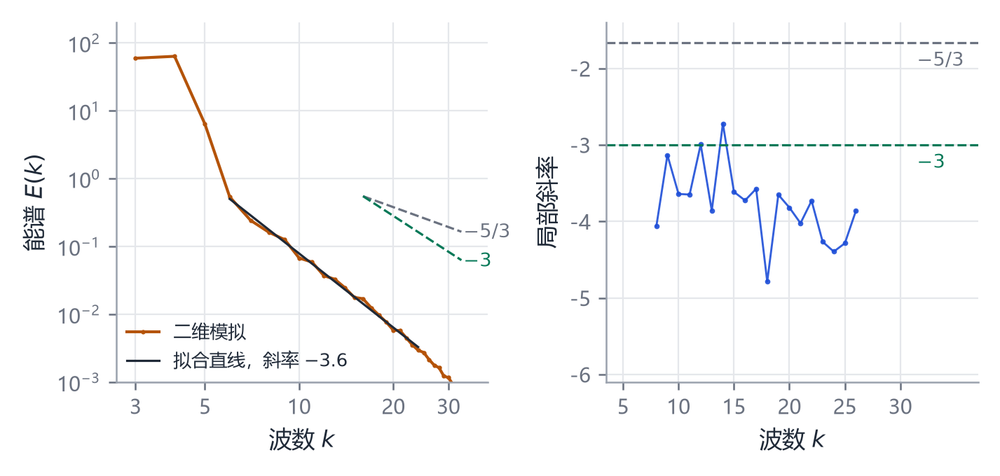

# 第 5 章 涡量、湍流与涡粒子

> 本章导读：速度场是一团箭头，涡量场是几个斑点。斑点好数、好追、好画，而且不可压流的速度几乎由它决定。这一章从一缕卷起来的烟讲起，写出涡量方程，看拉伸项为什么让三维和二维变成两种流体；然后是三件事：用涡量约束把被平流抹掉的锐度补回来，用涡粒子代替网格携带涡量，用能谱描述那些算不出来的小涡。

## 5.1 一条烟丝卷成了花

点一支烟放在窗台上，没有风。烟丝从烟头升起来，头两三厘米是一条几乎笔直的细线，再往上忽然开始左右摆，摆幅越来越大，然后卷成一串喇叭口朝上的"花"。花的间距在整条烟柱上大致相等，好像有人拿尺子量着排过。换一根蜡烛吹灭，那一缕白烟也一样，先直后摆，最后碎掉。

间距相等这件事不是巧合。烟柱内部是一层剪切：轴心上升得快，外层被静止空气拖着走得慢，两层之间速度有跳变。这样的界面按开尔文–亥姆霍兹不稳定性卷起，卷起的波长由剪切层的厚度自己选出来，大约是厚度的几倍，于是同一段烟柱上卷出的花尺寸一致。卷起来之后每朵花自成一个涡，相邻两朵环量相反，互相诱导，一朵把另一朵往上推，整串花才开始蛇形摆动。

同样的形态出现在别处。老式螺旋桨飞机起飞时翼尖拖出两条白线，那是翼尖涡；浴缸放水靠近排水口，漂浮的头发会被拉成一根螺旋；河里桥墩后面一排交错的涡，卡门一百年前就拍过照片。这些都来自同一件事：速度在空间里被拧了一下。

把某一帧的速度场画成箭头，屏幕上一片密密麻麻，看不出任何结构，只知道哪里快哪里慢。改画旋度，箭头全部消失，剩下几个亮斑和暗斑：涡在哪、多大、朝哪个方向转，一眼就清楚。这是涡量最实用的价值，它把流场压缩成若干个可以数、可以追踪的对象。

定义很直接，涡量是速度的旋度：

$$
\boldsymbol{\omega}=\nabla\times\mathbf{u}.
$$

二维流只有一个分量，$u$ 是水平速度、$v$ 是竖直速度，则

$$
\omega=\frac{\partial v}{\partial x}-\frac{\partial u}{\partial y},
$$

它垂直于平面，是一个标量，量纲是 $1/\mathrm{s}$。物理意义要说准一点：涡量是微团角速度的两倍。刚体旋转时 $\mathbf{u}=\boldsymbol{\Omega}\times\mathbf{r}$，代进去得 $\boldsymbol{\omega}=2\boldsymbol{\Omega}$。半个涡量才是"转得多快"，这个因子 2 藏在所有曲率、环量的公式里，漏掉就会差出一倍。

压力是全局的：由整个流域的散度条件决定，你没法"追踪一个压力斑块"。涡量是局部的、有结构的，剪切层、翼尖、涡环、卡门涡街全都以涡量集中区的面目出现。二维不可压流里这条更强：速度场由涡量唯一决定，两者之间只差一个无旋的背景流。涡量因此是真正的状态变量，而压力像一个每一步都要重新算一遍的辅助量。

数值上还有一层好处。涡量是速度的一阶差分再取一次差分，对格式的耗散格外敏感：同一帧，速度图看着差不多，涡量图上一眼就能看出半拉格朗日把峰削掉了多少。调参时盯涡量图比盯速度图有效得多。

## 5.2 涡量方程里的三项

把动量方程两边取旋度，压力项直接消失，因为梯度场没有旋度，$\nabla\times\nabla p=\mathbf{0}$。这一步是整个推导里最有内容的：不可压流中压力只是维持无散条件的拉格朗日乘子，它推着流体走，却不产生涡量。反过来，涡量的变化只能来自三个来源。

$$
\frac{\partial\boldsymbol{\omega}}{\partial t}
+\left(\mathbf{u}\cdot\nabla\right)\boldsymbol{\omega}
=\left(\boldsymbol{\omega}\cdot\nabla\right)\mathbf{u}
+\nu\nabla^{2}\boldsymbol{\omega}
+\nabla\times\frac{\mathbf{f}}{\rho},
$$

左边第二项是对流，涡量被自己的速度场带着走，和染料、温度一样只是被搬运。右边第一项是拉伸与倾斜，第二项是粘性扩散，第三项是外力带的涡量，重力这种有势的力不会出现在这里。

二维时拉伸项恒等于零。原因是几何：$\boldsymbol{\omega}$ 垂直于平面，$\mathbf{u}$ 在平面内，沿垂直于平面的方向求导自然是零。这条恒等式把二维和三维劈成了两种流体。二维涡量只能被带走、被扩散，不会凭空增强；三维里涡管被拉长，涡量按长度比例增长，这正是角动量守恒的直观版本——一根涡管拉长一倍，截面缩一半，涡量翻一倍。

拉伸解释了烟为什么越升越碎。浮力把烟柱往上拽，柱体被拉长，里面的涡环被拉细，涡量随之变大，涡与涡之间开始互相诱导、互相缠绕，最后碎成一堆小涡。二维模拟做不出这件事，因为那一项不存在；二维烟柱的涡会一直保持很大的尺度，看起来"太干净"。

它也决定了能量往哪边走。三维里拉伸把大涡压成小涡，能量从大尺度流向小尺度（正向级串）；二维没有拉伸，小尺度的涡反而两两合并成大涡，能量往大尺度走（逆向级串），而涡量往小尺度走。5.5 节会看到，这两种级串给出的能谱斜率完全不同。

拉伸项在离散时最难处理。它乘在 $\boldsymbol{\omega}$ 上，等于给涡量一个随方向变化的增长率：涡轴被拉伸的方向上涡量放大，被压缩的方向上缩小，而且这个方向每步都在变。中心差分离散这一项会把高频噪声也一起放大，跑几百步之后涡量场上出现细密的棋盘纹。稳妥的做法是把它和对流项一起用迎风格式处理，或者干脆把涡量交给粒子带走、只在网格上做投影，也就是下一节的路子。

数值上的后果不一样。二维无粘时涡量守恒，可以交给粒子精确携带，5.4 节就用这个性质；三维涡量不守恒，粒子必须按拉伸显式放大，忘了这一步涡会无故变弱。网格法在二维丢涡量只是画面变糊，在三维丢的是整条能量传递的通道——小尺度没有能量补充，湍流就散了。

## 5.3 涡量约束：把抹平的锐回来

半拉格朗日平流每步要插值一次，插值抹平一点峰。一帧看不出来，三十帧之后烟柱上的涡旋一个个淡下去，最后整根烟变成一条光滑的软管，边缘没有任何卷曲。这不是物理，是数值耗散在吃涡量。

[@fedkiw2001] 给的办法很直接：找到涡量大小变化最陡的方向，在那个方向上把流体往涡量大的地方推。

$$
\mathbf{f}_{\mathrm{conf}}=\varepsilon\,h\left(\mathbf{N}\times\boldsymbol{\omega}\right),
\qquad
\mathbf{N}=\frac{\nabla\left|\boldsymbol{\omega}\right|}
{\left|\nabla\left|\boldsymbol{\omega}\right|\right|},
$$

$h$ 是网格间距，$\varepsilon$ 是一个无量纲系数，$\mathbf{N}$ 是从低涡量指向高涡量的单位向量。$\mathbf{N}$ 与 $\boldsymbol{\omega}$ 叉乘得到一个既垂直于涡轴、又指向涡心的加速度，效果是把散开的涡重新捏紧。被抹平的涡旋在几帧之内就锐回去，烟柱重新长出卷曲的边缘。

有两件事得说清楚。第一，这个式子的量纲是不严的，把 $h$ 当时间尺度用了，所以 $\varepsilon$ 只能按分辨率标定：换一套网格就得重调，网格越细取得越小，常见范围从 $10^{-4}$ 到 $10^{-3}$。第二，它只放大已经存在的涡，不会凭空造出结构。原始模拟里如果一点涡量都没剩下，涡量约束什么也救不回来——它放大而不是创造，这一点决定了它只能在"细节还活着但太弱"的阶段起作用。

第三个问题是能量不受控。$\varepsilon$ 一调大，注入的能量可能超过物理耗散，烟会像被搅进一堆碎纸片，或者干脆发散。实际使用时的经验是把它当成动画参数而不是物理参数：先看基础模拟的涡量峰值衰减得多快，再定 $\varepsilon$ 让峰值在若干帧内大致持平。

实现顺序也有讲究。这个力要加在自平流之后、压力投影之前：先让被抹平的涡量显形，再把它捏紧，最后让投影把由此产生的散度清掉。反过来先投影再加力，散度会一直留在场上，压力解每步都在纠正上一步的错，收敛变慢。$\nabla\left|\boldsymbol{\omega}\right|$ 本身也要留意，它在涡核内部接近零（涡量取极值的地方梯度为零），除法的分母需要加一个下限，否则 $\mathbf{N}$ 在那里乱转，力方向随机。

被放大的是已有的涡，被创造的是没有的涡，这两件事分开看，就能理解为什么这条路之外还有别的路：让小尺度由另一种表示承担。涡粒子把涡量从网格上搬走，噪声和小波把频带上的能量按统计规律补回来，网格只管大尺度和压力。它们的分工在 5.4 与 5.6 里展开。

<figure class="fig">

<figcaption><b>图 5-1</b>　二维涡对的涡量场与诱导流线。两团环量相反的涡（$\Gamma=\pm1\ \mathrm{m^2/s}$，高斯核 $\sigma=0.1$，中心间距 $d=1$）拆成 $2\times121$ 个粒子，按 Biot–Savart 求和求速度，四阶龙格库塔推进到 $T=2\ \mathrm{s}$（$\Delta t=0.005\ \mathrm{s}$）。左：初始涡量场，色块为涡量（红正蓝负，分档取 $0.1$、$0.4$、$1$、$2$、$4$、$8\ \mathrm{s^{-1}}$，核内峰值 $31.8\ \mathrm{s^{-1}}$ 已被截断），灰线是由同一速度场积出的流线；中：$t=2\ \mathrm{s}$，两团涡整体上移，形状仍接近圆形；右：左团涡心的纵坐标随时间，几乎是一条直线，测得 $0.1588$，理论 $\Gamma/(2\pi d)=0.1592$，虚线为理论线。长度以 $d$ 归一化。</figcaption>
</figure>

## 5.4 涡粒子与 Biot–Savart

二维一团集中在一点上的涡，诱导的速度场是

$$
\mathbf{u}(\mathbf{x})=\frac{\Gamma}{2\pi}\,
\frac{\left(-\left(y-y_{0}\right),\ x-x_{0}\right)}{r^{2}},
\qquad
r^{2}=\left(x-x_{0}\right)^{2}+\left(y-y_{0}\right)^{2},
$$

$\Gamma$ 是环量，量纲 $\mathrm{m^2/s}$，等于绕涡一圈的速度环积分。速度按 $1/r$ 衰减，沿半径 $r$ 的圆周走一圈长度是 $2\pi r$，两者相乘正好是 $\Gamma$，环量与半径无关，这是涡的守恒量。

三维由 Biot–Savart 定律给出：

$$
\mathbf{u}(\mathbf{x})
=-\frac{1}{4\pi}\int
\frac{\left(\mathbf{x}-\mathbf{x}'\right)\times\boldsymbol{\omega}\left(\mathbf{x}'\right)}
{\left|\mathbf{x}-\mathbf{x}'\right|^{3}}\,\mathrm{d}\mathbf{x}'.
$$

这个积分和电磁学里电流产生磁场的公式同形，涡量对应电流密度，诱导速度对应磁感应强度。物理内容就是：每一小段涡都像一根通电导线，绕着它产生环流，所有小段的贡献叠加成总速度场。

$r\to 0$ 时积分发散，因为真实涡核有有限尺寸。处理办法是把核抹平，用涡核函数代替 $1/r^{2}$，常见形式是

$$
\mathbf{u}\sim\frac{\Gamma}{2\pi}\,\frac{\mathbf{r}^{\perp}}{r^{2}+\sigma^{2}},
$$

$\sigma$ 是涡核半径。$\sigma$ 必须不小于粒子间距，否则两颗粒子靠近时速度爆炸——这是涡粒子法最常见的崩掉原因，比格式误差致命得多。工程上的做法是每步检查最小粒子间距，必要时合并粒子。

图 5-1 是一个二维涡对。两团环量相反的涡，中心间距 $d$，各自躺在对方的诱导场里，被推着往同一个方向走，合成一个匀速平移的偶极子。平移速度可以手算：每团涡中心处的诱导速度是 $\Gamma/(2\pi d)$，两个贡献同向叠加，所以整个偶极子以 $V=\Gamma/(2\pi d)$ 平移，方向垂直于两心连线。图里 $\Gamma=1$、$d=1$，于是 $V=0.159$。用 242 个粒子算 Biot–Savart 求和，轨迹的斜率是 $0.1588$，与理论值差千分之一，剩下的误差来自涡核有有限尺寸：每团涡的不同部分受到对方的诱导速度略有差异，核内不再是刚体式的一整块。

图 5-1 里两团涡到末态仍然接近圆形，原因是核半径只有间距的十分之一，变形量在百分之几。把 $\sigma$ 提到与 $d$ 同量级，两团涡就开始互相缠绕、拉出细丝，那时 Biot–Savart 求和的粒子数要跟着涨，否则细丝会被粒子间距糊掉。

代价在计算量。$N$ 颗粒子两两求和是 $O(N^{2})$：一万粒子是一亿次作用，单帧几百毫秒；几万粒子就必须上树结构做近似（把远处的粒子团当成一个更大的涡），或者用快速多极。图形学里涡粒子很少单独使用，主流做法是和网格混合 [@selle2005]：粒子携带并平流涡量，把涡量散布到网格上做一次压力投影保证无散，再把网格速度插值回粒子。网格因此可以很粗，细节住在粒子上，而压力在大尺度上仍然是对的。

三维还要处理拉伸。粒子被流场拉开时，间距变大、占据的体积变大，涡量必须按体积比的倒数缩小，否则环量不守恒、涡会凭空增强。这一步在二维不需要（拉伸项为零），在三维漏掉就会看到烟柱越算越"有力"。

涡粒子适合涡量集中、界面不重要、拓扑自由的流体：烟、爆炸的涡环、快速掠过的尾迹、龙卷的漏斗。不适合需要精确自由表面和压力边界的水——粒子的压力估计撑不住，那是 SPH 与 FLIP 的活。判断依据不在"哪种方法更先进"，而在"这条流体最需要被保住的是涡结构，还是界面"。

## 5.5 湍流的能级串与谱

雷诺数一高，同一个流场里同时存在许多尺度的涡。大涡的尺度由几何决定：烟柱直径、翼尖间距、搅拌棒宽度。小涡小到被粘性吃掉。中间那一段既不记得边界的形状，也不受粘性影响，只负责把能量从大尺度搬到小尺度，这一段叫惯性区。

Kolmogorov 在 1941 年的论证只用两个量：能量通量 $\varepsilon$（单位质量、单位时间传下去的能量，量纲 $\mathrm{m^2/s^3}$）和波数 $k$（量纲 $1/\mathrm{m}$）。惯性区里的能谱只能由这两个量决定，量纲拼起来只有一种组合：

$$
E(k)=C\,\varepsilon^{2/3}k^{-5/3},
$$

$C$ 是 Kolmogorov 常数，实测在 $1.5$ 附近。$E(k)$ 的定义是波数落在 $k$ 附近的单位波数区间里携带的动能，量纲 $\mathrm{m^3/s^2}$。对数坐标下这是一条斜率 $-5/3$ 的直线，往右每十倍波数能量掉 $10^{-5/3}\approx0.022$ 倍。

耗散尺度由粘性与通量定出，$\eta=(\nu^{3}/\varepsilon)^{1/4}$，惯性区的要求是 $k\eta\ll1$。大尺度 $L$ 与 $\eta$ 的比值是 $\mathrm{Re}^{3/4}$：雷诺数 $10^{4}$ 时约 $10^{3}$，一维要一千个格子才"直接解析"全部尺度，三维就是十亿格。直接数值模拟只做小雷诺数，图形学永远在算没解析完的湍流，这不是取舍，是算术。

补不上的那部分叫亚格子。Smagorinsky 模型给它一个涡粘性 $\nu_{t}=(C_{s}\Delta)^{2}\left|\mathbf{S}\right|$，$\Delta$ 是网格尺度，$\left|\mathbf{S}\right|$ 是应变率张量的模。它的作用只有一条：让大尺度感觉到小尺度在耗散能量。它不制造任何细节，画面该糊还是糊。所以图形学的烟很少靠亚格子模型，而是靠 5.3 和 5.6 那些"加细节"的手段。

二维是完全另一套统计。没有拉伸，涡量不能被压小，能量反而往大尺度合并（逆级串），涡量往小尺度传（正级串）。涡量级串区的能谱是

$$
E(k)\propto k^{-3},
$$

比三维陡得多。原因可以这样想：二维里被传下去的是涡量而不是能量，涡量谱 $Z(k)=k^{2}E(k)$ 才是那个不随 $k$ 变化的量，于是 $E$ 掉 $k^{-2}$ 的因子，再加上壳层计数带来的一个 $k^{-1}$。

图 5-2 就是这样算出来的：$192^{2}$ 的谱方法，起始场把能量放在 $k\approx3$，用八阶超粘性在高端截断，跑 32 个时间单位、取后半段的时间平均。实测惯性区斜率 $-3.6$，$-5/3$ 的参考线在旁边明显更平。曲线上还能看到低波数的峰和小幅振荡，那是有限计算域与有限平均时间留下的痕迹；湍流的谱从来不是一条干净的直线，只有平均够久才接近。

实测比 $-3$ 更陡，这件事本身值得说。惯性区在这台计算上只有半个多数量级，超粘性从 $k\approx25$ 起就已在抽能量，右图逐段的局部斜率在 $-3$ 与 $-4.5$ 之间摆动，高波数一侧还往下掉。二维湍流文献里报出的斜率大多落在 $-3$ 到 $-4$ 之间，$-3$ 是无限惯性区加对数修正的理想值。把 $-3$ 当成必须命中的靶子去调参数，是把自己骗过去。

测量谱本身有一堆细节。半径落在 $k$ 到 $k+1$ 之间的模数只有 $2\pi k$ 量级，$k$ 小的时候一个壳层里只有几个模，统计噪声很大；$k$ 大的时候模数多了，但靠近截断波数，超粘性正在把能量抽走，谱会陡降。真正能用来拟合斜率的只有中间那段既模数够多、又远离截断的波数，所以图上的拟合区间取 $k=8\sim24$。低分辨率的模拟往往整段都在“两头都不干净”的区域里，这时算出的斜率只能当量级看，拿它去争论 $-5/3$ 还是 $-3$ 没有意义。

<figure class="fig">

<figcaption><b>图 5-2</b>　二维湍流的能谱。$192^{2}$ 伪谱法，涡量–流函数形式，起始场在 $k=2\sim5$ 注入能量，八阶超粘性系数 $2\times10^{-13}$，$\Delta t=0.008$，共 4000 步（$t=32$），谱按 $t\gt14$ 的时间平均。左：双对数坐标下的 $E(k)$，粗线是 $k=8\sim24$ 的最小二乘拟合，斜率 $-3.6$；右上方两段虚线是 $-5/3$ 与 $-3$ 的参考斜率，位置任意、只比倾斜程度。右：逐段局部斜率 $\mathrm{d}\ln E/\mathrm{d}\ln k$，围绕 $-3.5$ 摆动，高波数一侧的下跌来自超粘性。为二维结果，不对应三维惯性区。</figcaption>
</figure>

这张图值得停一下，因为它说明了一件常被忽略的事：便宜能算的是二维，而二维湍流的统计规律和三维不一样。拿二维烟去核对三维的 $-5/3$，方向就错了。反过来说，二维烟在画面上够用，是因为烟本来就不需要正确的高频统计，只需要看起来有结构、有层次、有小尺度的卷曲。

## 5.6 人工湍流：在哪一层加细节

分辨率不够就要补，补法按加在哪一层分成三类。

最小的一层是加速度。5.3 的涡量约束属于这一类：一行力项，最便宜，代价是控制最差，参数只能靠眼睛调。

中间一层是加在频带上。小波湍流 [@kim2008] 拿一段高分辨率模拟（或者从统计模型生成的）能谱做模板，把低分辨率速度场做小波分解，按局部能量把高频系数朝模板的比例缩放，再重建。它比涡量约束更"有谱"，因为注入的能量分布被统计规律约束住了，不会只在涡量梯度最大的地方堆；代价是要一次三维小波变换，以及"局部能量"这个量取得对不对——取全局的，烟柱粗的地方和细的地方细节一样多，一眼就假。

最小尺度的一层加在边界附近。物体尾迹的湍流条带来自边界层，网格解析不了边界层，就在壁面附近按经验分布注入扰动，让尾迹的宽度、脱离位置、破碎节奏和参照对上 [@pfaff2012]。这类做法在车、飞机、建筑绕流里比在自由烟柱里更常见。

还有一条和物理无关但很好用的路：旋度噪声。取三个噪声场 $\boldsymbol{\psi}$，令

$$
\mathbf{u}_{\mathrm{noise}}=\nabla\times\boldsymbol{\psi},
$$

则 $\nabla\cdot\mathbf{u}_{\mathrm{noise}}=0$，因为旋度场无散。这个速度可以随便叠加到任何地方而不破坏不可压条件，代价是它需要重新构造。第四维喂时间，噪声场就随时间演化；让噪声被局部速度平流，细节会跟着烟走而不是钉在空间里。

三条经验。注入必须按局部量缩放：用当地速度或者当地涡量做基准，噪声幅度取它的百分之几。注入会改变大尺度：噪声速度若达到当地速度的一成，烟柱会被明显推散，这不是"看起来更湍流"，而是整条烟被吹走了。最后，离散采样之后噪声的散度不再严格为零，要么补一次投影，要么接受一点点压缩——前者贵，后者在多数镜头上看不出来。

把这几种手段放在一起看，判断标准就清楚了：涡量约束像给画面加锐化，噪声注入像贴一层纹理，小波湍流像按统计规律续写。要物理上用得住选第一个，要可控选第二个，要谱对得上选第三个。三者都不解决"模拟本身算错"的问题，它们只是让有限分辨率的画面里多出一些本不该缺的结构。
