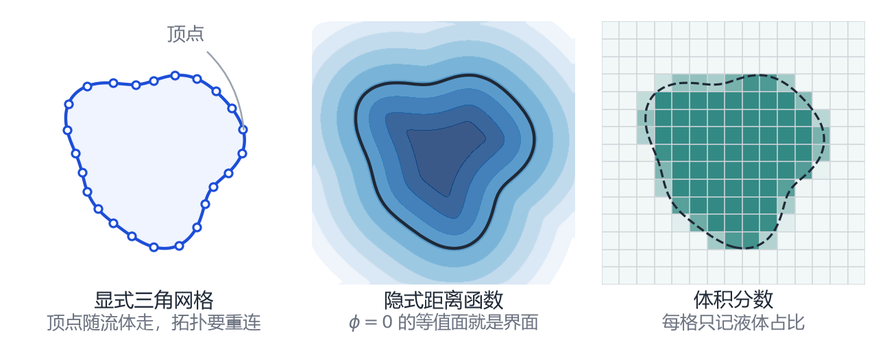
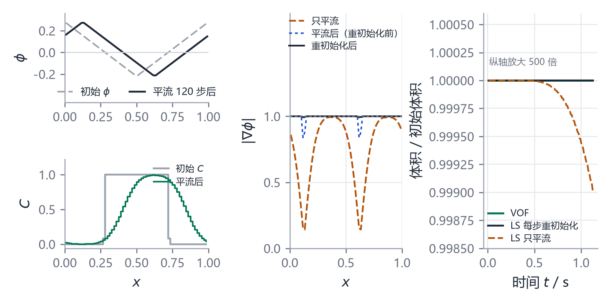

# 第 6 章 自由表面：Level Set、VOF 与粒子

> 本章导读：水流得对不对，一半看速度场，一半看"哪边是水"。界面会断裂、会飞溅、会合并，用顶点网格去追它就得反复修改拓扑。这一章比较三种表示：隐式的距离函数、只记体积分数的格子、以及根本不表示界面的粒子；然后算清各自在守恒与几何精度上亏了什么，最后接到表面张力和白水上。

## 6.1 一杯水倒进杯子

把一杯水倒进玻璃杯，慢一点，水是一根连续的水柱；快一点，水柱半途就断成一串水珠，砸到杯底溅起几点飞到桌面上。贴着杯壁的那一层水会往上爬一小段，然后停住。整个过程里没有一样东西叫"水面"——水在断、在合、在碎成小点，任何一张跟随流体的曲面都会在断裂处失去定义。

这就是自由表面的麻烦。界面不是流体的一部分，它是"这一点在水的哪一边"的判断规则。真正要模拟的是这个判断，而不是一张曲面。判断怎么存，决定了后面所有算法的形状。

三种存法，图 6-1 画在一起。第一种存曲面本身：一堆顶点连成的三角网格，顶点随流体运动。第二种存一个函数：给空间中每一点一个实数，零等值面就是界面，这叫隐式表示。第三种存格子里的份额：每个格子记一个 $0$ 到 $1$ 的体积分数，表示这格有多少比例是水。

<figure class="fig">

<figcaption><b>图 6-1</b>　同一个水滴的三种表示（示意图）。左：显式三角网格，圆点是顶点，界面就是这些顶点连成的线；中：隐式距离函数，灰度是 $\phi$ 的大小，零等值面（黑线）就是界面；右：体积分数，每格的灰度表示被液体占据的比例，$0.5$ 附近需要靠界面重构才能定位。三幅图都没有画时间演化，只为对照存储方式。</figcaption>
</figure>

评价这几种存法要看五件事。拓扑会不会变：水柱断成水珠，网格要重新连边，隐式函数什么也不用做。守恒好不好：水不能凭空多出来，也不能少。几何精度：法线和曲率算得准不准，直接决定高光和表面张力。查询成本：给一个点，多久能知道它在水内还是水外。平流好不好写：把界面推进一步有多麻烦。

没有一种存法五项全赢。这一章剩下的部分就是把这五项上的亏空一笔一笔算清楚。

## 6.2 Level Set：把界面变成一个距离

隐式表示里最常用的是符号距离函数。对空间中每一点 $\mathbf{x}$，令

$$
\phi\left(\mathbf{x}\right)=
\begin{cases}
-\operatorname{dist}\left(\mathbf{x},\ \partial\Omega\right), & \mathbf{x}\in\Omega,\\[2pt]
+\operatorname{dist}\left(\mathbf{x},\ \partial\Omega\right), & \mathbf{x}\notin\Omega,
\end{cases}
$$

$\Omega$ 是水占据的区域，$\partial\Omega$ 是它的边界，$\operatorname{dist}$ 是到边界的欧氏距离。水内为负、水外为正，界面就是 $\phi=0$ 的等值面。这个函数有两个好性质：梯度的模恒为 $1$，$\left|\nabla\phi\right|=1$；梯度方向就是界面的法线。

于是法线和曲率都能直接写出来：

$$
\mathbf{n}=\frac{\nabla\phi}{\left|\nabla\phi\right|},
\qquad
\kappa=\nabla\cdot\left(\frac{\nabla\phi}{\left|\nabla\phi\right|}\right).
$$

$\mathbf{n}$ 指向水外，$\kappa$ 是主曲率之和，凸出去的水面 $\kappa$ 为正。这两样在渲染里是法线贴图，在物理里是表面张力的驱动量，一个公式同时供了两处。

拓扑变化是免费的。水柱断开时，$\phi$ 在两处分别趋近零，零等值面自然分成两个闭合曲面，没有任何代码去"断开"它。两滴水合并也一样。这一条的理由值得说清：拓扑住在等值面的连通性里，而等值面是由标量场隐式定义的，场的连续性允许连通性在一个点上改变，而显式网格的连通性存在顶点和边的表里，要改变就得改表。

平流也简单，界面跟着流体走，就是 $\phi$ 跟着流体走：

$$
\frac{\partial\phi}{\partial t}+\mathbf{u}\cdot\nabla\phi=0 .
$$

这是一条纯对流方程，用半拉格朗日推进即可，无条件稳定。到此为止它看起来无可挑剔，问题全部出在"插值"这两个字上。

半拉格朗日每步要回溯并插值，插值把 $\phi$ 的斜坡抹缓。$\left|\nabla\phi\right|$ 从 $1$ 掉到 $0.8$、$0.5$，界面从一层格子厚变成三四层格子厚。$\phi$ 本身还是连续的，零等值面的位置大致还在原处，但法线变钝、曲率算不准，表面张力随之出错。几十帧之后，一道薄薄的水膜会糊成一片雾。

三道补丁。第一是重初始化，把抹钝的 $\phi$ 重新变回距离函数，下一节讲。第二是只算界面附近，远处不必存：窄带法只在界面两侧各留三到五层格子，其余格子不存 $\phi$，内存从 $O(N^{3})$ 掉到 $O(N^{2})$。窄带外面怎么处理，用八叉树最自然：靠近界面细分到最细，远处用大格子，格子的尺寸随距离变化 [@losasso2004]。这一步带来的另一个好处是压力求解也能稀疏化——只需要解液体内部与窄带内的格子，其余格子直接给定压。代价是数据结构复杂，格子邻居的查找不再是一次索引，而要走树的遍历，GPU 上尤其难写；所以很多实时实现宁愿用均匀网格，把窄带固定成界面两侧各四层，多花一点内存换代码简单。第三是让粒子来守细节，6.5 节讲。

## 6.3 重初始化与体积的账

重初始化的目标是让 $\left|\nabla\phi\right|$ 回到 $1$，同时不动零等值面。做法是解一条伪时间方程，把 $\phi$ 当作初值，往稳态推：

$$
\frac{\partial\phi}{\partial\tau}
+S\left(\phi_{0}\right)\left(\left|\nabla\phi\right|-1\right)=0,
\qquad
S\left(\phi_{0}\right)=\frac{\phi_{0}}{\sqrt{\phi_{0}^{2}+\Delta x^{2}}} .
$$

$\tau$ 是伪时间，与物理时间无关；$\phi_{0}$ 是重初始化开始时的场，整个过程中固定不变；$S$ 取 $\phi_{0}$ 的符号，所以界面外侧 $\phi$ 增大、内侧减小，两边都朝距离函数收缩。$S$ 用平滑版本而不是硬符号 $\operatorname{sign}$，是为了避免零等值面正上方出现符号跳变：硬符号在那里会让方程左右两侧的推进方向打架，把界面推歪半格。

$\left|\nabla\phi\right|$ 的离散要用迎风，具体是 Godunov 格式：分别取左右、上下、前后的单侧差分，按下式的规则组合，$\phi_{0}$ 为正是取正部、为负取负部。用中心差分会在界面处振荡，振荡把 $\phi$ 推过零，凭空造出一个气泡。

实际工程很少把这条方程解到稳态。迭代三到六次，$\left|\nabla\phi\right|$ 就能回到 $0.98$ 以上，剩下那点误差不值得多花时间；每帧做一次，或者每几帧做一次，看界面的移动速度。

代价是一笔体积账。平流把界面抹成一条厚带，重初始化把厚带压回一条锐线，压缩的方向总是朝零等值面，于是两侧的体积各被吃掉一点，液体净损失。损失率与界面的曲率、移动速度、格子尺寸都有关，典型情况下几十帧累计百分之几。慢镜头里能看出来：一池静水放十分钟，水面下降了一点点。

修补的办法有两个，都不干净。一是全局平移：算出当前体积与目标体积之差，把 $\phi$ 整体减一个常数，体积立刻回正，但界面位置会跳一下。二是给重初始化方程加源项，让收缩补偿体积，代价是 $\phi$ 不再是严格的距离函数，后面算曲率又要吃一次误差。工程上取第一个，因为跳一下看不出来，而曲率错了每一帧都在错。

<figure class="fig">

<figcaption><b>图 6-2</b>　一维剖面上 Level Set 与 VOF 的账。格子数 $N=64$，液体初始占中间 $0.44$ 的区间，速度 $u=1$，$\mathrm{CFL}=0.6$，共 120 步（$t=1.125$），周期边界。左上：$\phi$，初始为折线，平流并逐帧重初始化后位置右移、形状保持；左下：体积分数 $C$，灰色与绿色的阶梯分别是初始与末态的格子值，一阶迎风的通量格式把界面抹成一条宽约 $0.2$ 的斜坡；中：$\left|\nabla\phi\right|$，单步平流后在界面处掉到 $0.84$，只平流不重初始化则跑 120 步后累积到 $0.14$，逐帧重初始化（每步 6 次迭代）后回到 $0.99$ 以上；右：液体体积随时间，纵轴放大 500 倍，VOF 与逐帧重初始化的 Level Set 都停在 $1.000$，只平流的 Level Set 掉到 $0.999$。</figcaption>
</figure>

图 6-2 把这笔账摊在一维里，一维的好处是每个量都能手算核对。左上图是 $\phi$：初始是一条标准折线 $\phi=\max\left(x_{0}-x,\ x-x_{1}\right)$，推进之后位置右移，形状没有走样，这是逐帧重初始化的效果。如果只平流、不重初始化，斜坡会一层层变缓，最后连零等值面的位置都对不准。左下图是体积分数 $C$：一阶迎风的通量格式把原本一格宽的阶跃抹成一条宽约 $0.2$ 的斜坡，比较的是初始与末态两根阶梯。这是 VOF 的老毛病——体积一分不差，界面却糊了。

中图是 $\left|\nabla\phi\right|$。单步平流后它在界面处掉到 $0.84$，逐帧重初始化（每步迭代 6 次）把它按回 $0.99$ 以上；而只平流不要重初始化，同样 120 步之后它掉到 $0.14$，几乎平了。这就是重初始化存在的理由：不跑它，几秒钟之后 $\phi$ 就不再是距离函数，法线与曲率全是错的。

右图是体积。横轴 120 步，纵轴放大五百倍，才看得见差异：VOF 与逐帧重初始化的 $\phi$ 都停在初始值上，只平流的 $\phi$ 掉了千分之一。一维里看不到重初始化的代价，因为界面没有曲率，收缩两侧对称，体积抵消。真正的损失要到三维才显出来——曲面把收缩的方向偏过来，每一帧都吃一点。

一维看起来很温和，三维里这些误差会被曲率放大。界面越弯，抹宽越不均匀，重初始化的收缩越不对称，体积损失的方向性也越强。一池静水看不出问题，一滴下落的水珠会明显缩水。

## 6.4 VOF：只记每格有多少水

体积分数换了个存法：每个格子存一个 $C\in\left[0,1\right]$，表示被液体占据的体积比例。界面不再有位置，只有"这一格里有多少"。$C=1$ 是满水，$C=0$ 是空气，$0\lt C\lt 1$ 的格子就是界面所在的格子。

平流用通量形式：算每一对面在一步里流过去多少体积，左边流出多少右边就流入多少，总量自动守恒。这是它最硬的优势：体积严格守恒，一分不差。原因不在格式多聪明，而在写法——通量是一对一对配平记的，算错也是成对地错。

第二个优势是界面尖锐。$C$ 的过渡带永远只有一个格子宽，不会像 $\phi$ 那样越算越厚。代价是这一格里的界面位置未知，必须重构：假定格子里界面是一段直线，用 $C$ 定它切在哪儿，用周围 $C$ 的梯度定它的法向（Youngs 方法），然后在相邻格子之间按这段直线的几何算通量。三维里要切一个小立方体算体积，代码量不小。

几何精度因此只有半格到一格。想更准就要更细的格子，这和隐式函数用插值拿到亚格精度是两回事。曲率更糟：$\kappa$ 需要 $C$ 的二阶差分，而 $C$ 是阶梯函数，二阶差分是噪声。用带噪声的曲率乘表面张力系数，得到的是一层随机力，静止的水滴会自己抖起来。

三维还多一层麻烦。重构要切立方体，算体积要算六面切割，代码长度随维度膨胀得很快。二维 VOF 是几百行的练习，三维能上生产环境的实现要维护好几套边界情形，每一套都可能是漏水的伪影来源。

于是出现最常见的组合：用 VOF 输运和守恒，用 Level Set 提供法线和曲率，两者每步都对一次，让 $\phi$ 的零等值面贴着 $C=0.5$ 的等值面。VOF 保住体积，Level Set 保住几何。这个组合在工业 CFD 里已经很标准，图形学里也常用，代价是要同时平流两个场、还要维护它们的一致性，出错的地方多了一倍。

反过来的组合也存在：用 $\phi$ 平流，用 $C$ 做体积修正。区别在谁说话算数：前者以几何为准，后者以体积为准。选哪个取决于镜头——水花四溅的镜头怕体积丢，静水面的镜头怕法线粗糙。

## 6.5 粒子：界面从粒子里长出来

SPH 与 FLIP 里根本没有界面，只有一堆粒子。渲染需要界面，于是有两条路：把粒子当球直接画，或者从粒子的分布里提取一个等值面。

直接画球的问题在数量。一毫升水要几十万个粒子才能把表面画平，飞溅的上百万粒子渲染成本不现实，除非只用于近景的几团飞沫。

提取等值面有三条常见路线。一是算密度场：把粒子质量按核函数抹到格子上，密度超过阈值的地方算水内，然后跑 marching cubes。这条路的问题在采样噪声：粒子在表面附近的分布不均匀，密度场抖动，提取出来的表面一帧一个样，看起来在"呼吸"。二是算距离场：每格找最近的粒子，取到它的距离作为 $\phi$。这在粒子稀疏的飞溅区会破——最近的粒子可能在几十格之外，$\phi$ 变成一片高原，界面在那里消失。三是粒子修正现有 $\phi$：这条路是 [@enright2002] 的做法，也是这类方法里最实用的一条。

粒子修正的分工要说清。$\phi$ 负责大片的、连续的水面：水面、水柱、水膜，这些地方网格插值足够。粒子负责 $\phi$ 管不住的地方：飞出去的小水珠、被拉薄到不足一格的水膜、断裂处的尖角。做法是在界面两侧撒一层粒子，水内的粒子（负粒子）记 $\phi=-r_{p}$，水外的粒子（正粒子）记 $\phi=+r_{p}$，$r_{p}$ 是粒子半径。粒子被速度场平流，然后检查每个粒子还在不在自己的 $\phi$ 该在的地方：一个正粒子跑到水内了，说明那里的 $\phi$ 说错了，用它的距离把 $\phi$ 拉上来；负粒子跑到水外也一样，反向拉。这样错了的地方被改对，对的地方不动。

"修正"而不是"生成"是这套方法的关键。由粒子直接生成 $\phi$ 会在粒子稀疏处留洞，而修正只改 $\phi$ 明显算错的位置，$\phi$ 的连续性由它自己维持。另外粒子还要被约束在界面附近：跑远了就删掉，界面移动了就在新位置补粒子，否则粒子层会被拉散、失效。

FLIP 的表面有另一类问题。粒子在格子与粒子之间来回插值，采样误差累积成抖动，界面提取出来每帧都在闪。缓解的办法是对 $\phi$ 或密度场做时间上的低通，代价是水花变"软"；或者提高粒子数，代价是内存。

## 6.6 表面张力、曲率与接触角

表面张力的宏观表现是界面两侧有压差，弯曲的界面凹侧压力高：

$$
\Delta p=\sigma\kappa,
$$

$\sigma$ 是表面张力系数，水在室温下约 $0.072\ \mathrm{N/m}$，$\kappa$ 是主曲率之和。球形水滴 $\kappa=2/R$，于是 $\Delta p=2\sigma/R$。代入数字：半径 $1\ \mathrm{mm}$ 的水滴，压差 $144\ \mathrm{Pa}$，相当于 $1.5\ \mathrm{cm}$ 高的水柱；半径 $1\ \mathrm{cm}$ 时只剩 $14\ \mathrm{Pa}$，约 $1.5\ \mathrm{mm}$ 水柱。这两个数字说明了表面张力的适用范围：厘米级的水面它几乎不起作用，毫米级的飞沫里它是主导力。

无量纲数把这个判断写成公式。Weber 数 $\mathrm{We}=\rho U^{2}L/\sigma$ 比较惯性力与表面张力，Bond 数 $\mathrm{Bo}=\rho gL^{2}/\sigma$ 比较重力与表面张力。$\mathrm{Bo}$ 小于 $1$ 时水滴接近球形，大于 $1$ 时被重力压扁。一滴 $2\ \mathrm{mm}$ 的水，$\mathrm{Bo}\approx0.55$，所以它几乎是圆的；一滴 $2\ \mathrm{cm}$ 的水，$\mathrm{Bo}\approx55$，摊在桌面上。

数值实现用 CSF 模型：把压差写成体积力，加在界面附近的几层格子上，

$$
\mathbf{f}_{\sigma}=\sigma\kappa\nabla\alpha ,
$$

$\alpha$ 是相指示函数，水内为 $1$、空气里为 $0$，界面处光滑过渡。$\nabla\alpha$ 只在界面几格内非零，所以这个力是局部的，不会污染整个流场。

所有误差都从 $\kappa$ 进来。$\phi$ 的二阶差分噪声大，界面厚度只有两三格时，曲率的相对误差可以到几十个百分点。后果是虚假流：一个本该静止的水滴，界面上出现持续的向内或向外的力，驱动出一对涡，速度可以到每秒几厘米，比真实流动还大。这不是小瑕疵，它会让水滴自己振动、飞沫自己散开。

缓解手段有三个层次。算之前把 $\phi$ 平滑几遍，噪声降下来，代价是界面变钝。算的时候用更高阶的离散，或者不直接在笛卡尔网格上算曲率，而是在界面附近建局部高度函数、拟合一段圆弧。最后是在时间上滤波表面张力，让它慢慢起作用，虚假流不会被激发。三条都不彻底，工程上通常叠加使用。

接触角是壁面上的边界条件。水面与固体壁相交处有一个角度 $\theta$，由三相的界面能决定，数值上写成

$$
\nabla\phi\cdot\mathbf{n}_{\mathrm{wall}}=\cos\theta ,
$$

$\mathbf{n}_{\mathrm{wall}}$ 是壁面法线。$\theta$ 小于 $90^{\circ}$ 时水摊开（亲水，玻璃），大于 $90^{\circ}$ 时水珠立起来（疏水，荷叶）。实现上在固体格子里给 $\phi$ 一个虚拟值，让界面在壁面附近的斜率满足这个条件。

接触角处理不好会出现一种特别的错：水滴慢慢往壁面上"爬"，几秒钟之后整片壁面被薄薄一层水覆盖。原因是边界条件不满足能量极小，界面在不停地寻找更低的位置。真实的水也有类似的爬升（毛细爬升），但有接触角滞后挡着：前进角和后退角不等，水珠在斜面上能停住，在玻璃上会粘着不滚。数值上要复现这个"粘"，需要一个随界面运动方向切换的角度，实现麻烦，多数实时水面直接放弃了这一项。

## 6.7 白水

浪打到礁石上，破碎的地方是一大片白。船头推开水面，两侧各拖一条白色带子。瀑布底下，水砸进潭里，白色泡沫翻上来，慢慢散掉。这些白色的东西尺度在厘米到毫米，数量以百万计，解析它们是不可能的。

所以白水不是模拟出来的，是"种"出来的。主模拟给出速度场、涡量、界面位置和它的运动，然后在这些量超过阈值的地方生成泡沫粒子：界面附近的拉伸率大、曲率剧烈变化、涡量大、或者界面在那里断裂，都是候选点。生成速率正比于局部的能量耗散率，这是唯一有物理依据的挂钩——泡沫本来就是湍流把小气泡卷进水里形成的。

三类东西要分开。泡沫贴在水面上，是一层覆盖度，寿命一到三秒；飞沫是弹道粒子，脱离水面之后只受重力，寿命零点几秒到一秒；气泡在水下，上浮、合并、到水面破裂，寿命最长。三者共用一套平流代码，但参数完全不同：飞沫不衰减只落地，泡沫衰减但不动，气泡上浮且分裂。

泡沫的覆盖度是个 $0$ 到 $1$ 的标量，跟着速度场平流，生成时累加、之后按指数衰减：

$$
\frac{\partial c}{\partial t}+\mathbf{u}\cdot\nabla c
=a\left(\mathbf{x},t\right)-\frac{c}{T_{\mathrm{life}}},
$$

$a$ 是生成率，$T_{\mathrm{life}}$ 是寿命，右边两项一个加一个减，稳态时 $c=aT_{\mathrm{life}}$。覆盖度超过 $1$ 的地方要截断，否则泡沫会越积越厚，看起来像肥皂。泡沫跟着水流走的时候还要限制：离开水面一定距离就删掉，不让它飘到空中。

这套东西是单向的：白水不影响流体。理由很实在——泡沫改变水面粗糙度、飞沫带走动量，这些效应比数值误差小得多，而双向耦合会让参数难调十倍。大片飞溅的镜头里，主模拟的体积本来就在丢，再让飞沫把动量还回去，画面会变得不可控。

渲染接的是三个量：覆盖度纹理、粒子位置、以及它们带的寿命。覆盖度用来混合水面材质，泡沫处失去镜面反射、增加漫散射；粒子用来做体积感的泡沫团和飞溅的水点，需要按距离做层次——远处的泡沫只用纹理，近处才用粒子。光要在泡沫里散射，不能用表面的光照模型直接套，否则泡沫看起来像塑料。这几件事在渲染管线里是独立的一层，物理模拟只需要把覆盖度和粒子位置交出去，怎么画是另一半工作。
