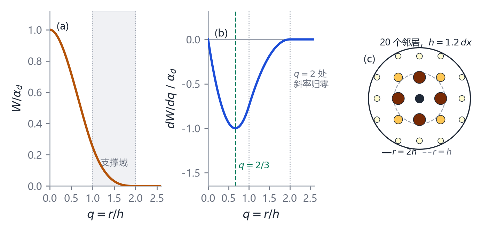
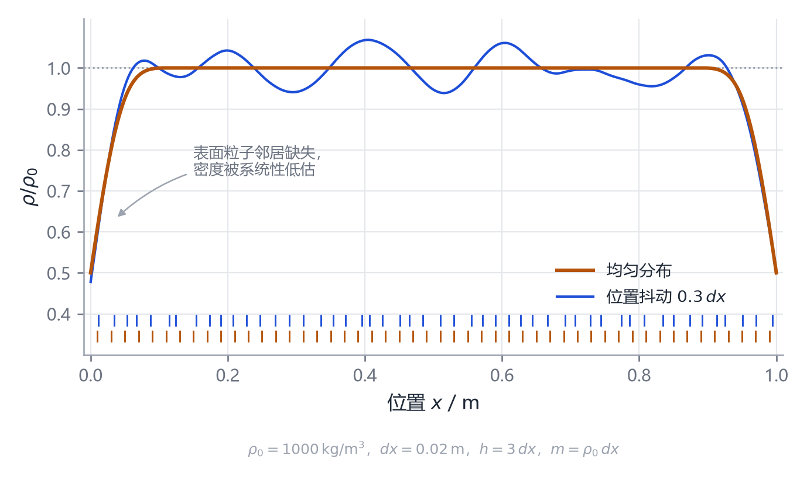

# 第 7 章 SPH：核函数、压力与稳定性

> 本章导读：一杯水泼出去，水会拉成细丝、碎成雾滴，界面每一帧都在换形状。粒子法不去追界面，它让一团带质量的点自己走，密度和压力在邻域里现算。这一章从一个很朴素的问题开始——一个粒子所在位置的密度到底是多少——再把核近似、密度求和、状态方程、负压聚团、隐式压力和边界处理依次拆开，最后说清在哪些镜头上这套办法划算。

## 7.1 一个点的密度是多少

水龙头底下放一只盘子，水柱砸在盘底，向四周铺开一层很薄的水膜，膜的外缘不断撕出小珠。这种画面用网格法做很别扭：界面在每个时间步都会断开、合并、再拉出细丝，网格要么被加密到看不见的尺度，要么被切成七零八落的小块。粒子法省事得多，往水里撒点，让点自己走，界面就是"有粒子的地方"。

可是写第一行代码就会卡住。粒子带的是质量 $m$、位置 $\mathbf{x}$、速度 $\mathbf{v}$，没有体积，也没有密度。密度按定义是 $\rho=\lim_{\Delta V\to 0}\Delta m/\Delta V$，这个极限在离散点集上取不到：$\Delta V$ 缩得比粒子间距还小，里面可能一个粒子都没有，比值是零；缩到正好套住一个粒子，比值发散。密度在粒子身上不是"存着"的量，只能在邻域里估出来。

办法是给每个粒子配一个窗口函数，把邻域里的质量摊到空间上。窗口叫核函数 $W(\mathbf{x},h)$，$h$ 是它的宽度，叫光滑长度。密度于是写成

$$
\rho(\mathbf{x})=\sum_j m_j\,W(\mathbf{x}-\mathbf{x}_j,\,h) ,
\tag{7.1}
$$

求和形式上跑遍所有粒子，实际上只跑支撑域内的那些。$W$ 要满足四个条件：在全空间积分为一，这样常数密度场能被原样还原；有紧支撑，超出两倍 $h$ 就严格为零，否则邻域搜索停不下来；非负，不然密度会出现负值；关于原点对称且二阶连续，前者保证一阶精度，后者保证压力不因核的折角而抖。

最常用的是三次样条核，写成 $q=r/h$ 的一元函数：

$$
W(q)=\alpha_d
\begin{cases}
1-\tfrac{3}{2}q^2+\tfrac{3}{4}q^3, & 0\le q\lt 1,\\[2pt]
\tfrac{1}{4}(2-q)^3, & 1\le q\lt 2,\\[2pt]
0, & q\ge 2 ,
\end{cases}
\tag{7.2}
$$

归一化系数在二维是 $10/(7\pi h^2)$，三维是 $1/(\pi h^3)$，一维是 $2/(3h)$。$\alpha_d$ 里的 $h^d$ 不是装饰：支撑体积随 $h^d$ 变，系数必须跟着除，否则密度会随分辨率整体漂移。这一点在把二维代码改成三维时最容易漏，症状是密度整体偏掉一个跟 $h$ 有关的倍数，压力跟着整体偏移，换个分辨率还会再偏一次。

$h$ 决定分辨率，也决定邻域里有多少粒子。三维里支撑球半径是 $2h$，体积 $\tfrac{32}{3}\pi h^3$，邻居数大约是 $\tfrac{32}{3}\pi h^3\rho/m$。取 $h=1.2\,dx$，二维支撑圆里有二十个邻居，三维支撑球里有五十八个。再少一些，求和的涨落就压不住；上百个除了让每一步更慢，没有别的好处。$h$ 也不是越小越准，它同时是滤波尺度：$h$ 小了，密度估计会随粒子分布剧烈抖动，压力跟着抖，水面就"沸"了。

核近似本身是有阶的。把 $A(\mathbf{x}')$ 在 $\mathbf{x}$ 处展开：

$$
\langle A(\mathbf{x})\rangle=\int A(\mathbf{x}')\,W(\mathbf{x}-\mathbf{x}',h)\,d\mathbf{x}'
=A(\mathbf{x})+\nabla A\cdot\underbrace{\int(\mathbf{x}'-\mathbf{x})W\,d\mathbf{x}'}_{=\,0}
+\tfrac{1}{2}\nabla\nabla A:\int(\mathbf{x}'-\mathbf{x})(\mathbf{x}'-\mathbf{x})^{\mathsf T}W\,d\mathbf{x}'+\cdots
\tag{7.3}
$$

一次项因为 $W$ 是偶函数而消失，剩下的误差是 $O(h^2)$。前提是 $W$ 的整个支撑域都参与了积分。到了自由表面，支撑域被切掉一半，一次项不再为零，密度被系统性低估，这是后面所有麻烦的源头。

<figure class="fig">

<figcaption><b>图 7-1</b>　三次样条核的形状与支撑域。左图为轮廓函数 $W/\alpha_d$ 随 $q=r/h$ 的变化，灰色带是第二段多项式所在的区间 $1\le q \lt 2$，竖虚线标出 $q=1$ 的接缝与 $q=2$ 的截断位置；中图是一阶导数的真实取值，它在 $q=2$ 处归零，所以核在支撑边缘是平滑接到零的，绿虚线标出 $q=2/3$，二阶导数在这里变号；右图是二维、$h=1.2\,dx$ 的规则格点上，中心粒子的 20 个邻居，实线圆半径 $2h$，虚线圆半径 $h$，点的深浅与大小对应权重。</figcaption>
</figure>

## 7.2 从积分到求和

核近似还是连续形式，要变成能算的东西，得把积分换成求和。支撑域内的一小块体积 $d\mathbf{x}'$ 被一个粒子占据，它的体积用质量除以密度代替，$V_j=m_j/\rho_j$，于是任意量的粒子近似是

$$
A_i=\sum_j A_j\,\frac{m_j}{\rho_j}\,W_{ij} ,
\qquad W_{ij}=W(\mathbf{x}_i-\mathbf{x}_j,h) .
\tag{7.4}
$$

把 $A$ 换成密度，得到最常用的密度求和式：

$$
\rho_i=\sum_j m_j\,W_{ij} .
\tag{7.5}
$$

这个式子的好处是"没有历史"：密度只由当前粒子位置决定，粒子被挤到一起，密度立刻升高，压力立刻响应，反馈是即时的。代价是它不守恒——粒子数固定时总质量当然守恒，但密度是从位置反推的，一旦粒子分布出现空洞，密度就掉下去，而没有任何机制把它补回来。

另一条路是把连续性方程离散掉。连续形式是 $d\rho/dt=-\rho\nabla\cdot\mathbf{v}$，用对称的散度算子写成

$$
\frac{d\rho_i}{dt}=\sum_j m_j\,(\mathbf{v}_i-\mathbf{v}_j)\cdot\nabla_i W_{ij} ,
\tag{7.6}
$$

其中 $\nabla_i W_{ij}$ 是核函数对第一个变量的梯度，方向从 $i$ 指向 $j$（核随距离递减，梯度朝内）。这一版是守恒的：粒子对之间交换的量严格反号，总质量在积分过程中不会凭空出现或消失。缺点是它会漂移，长时间跑下来密度慢慢偏离初值，尤其是表面附近。

两个式子在实际代码里常常混用：初始化时用求和式定密度，之后每步用连续性方程推进，每隔若干步再用求和式校正一次。工程上还有一种更省事的做法，把密度换成数密度 $\rho_i=m_i\sum_j W_{ij}$，单相流里两者等价，多相流里能避免质量差异带来的偏置。

压力梯度也需要一个"对称"的写法。直接用 $\nabla p_i=\sum_j m_j(p_j/\rho_j)\nabla W_{ij}$ 会出问题：常压场下这个和不为零，整片水会被一个虚假的力推动。改成

$$
\nabla p_i=\rho_i\sum_j m_j\left(\frac{p_i}{\rho_i^2}+\frac{p_j}{\rho_j^2}\right)\nabla_i W_{ij} ,
\tag{7.7}
$$

两项一正一负，粒子 $i$ 对 $j$ 的力和 $j$ 对 $i$ 的力严格等大反向，动量守恒；常压时 $p_i=p_j$，括号里是常数，求和退化成 $\sum_j m_j\nabla W_{ij}/\rho$，在规则分布下近似为零。这个"零和"性质只在分布均匀时成立，表面处仍然有残余，这就是表面附近会出现虚假加速度的原因。

邻域搜索是这一步的主要开销。规则网格哈希，格子边长取 $2h$，每个粒子只查周围 27 个格子（二维 9 个），再用距离判据筛一遍。粒子数到百万级时，这一步能占到总时间的一半以上，所以空间填充曲线排序、GPU 上的紧凑化都是围绕它做的。

密度估计准不准，可以拿一维的例子量一遍。图 7-2 是一维的实测。五十个粒子均匀排在 $[0,1]$ 上，间距 $dx=0.02$，每个粒子质量取 $m=\rho_0\,dx$，用 $h=3\,dx$ 的三次样条核去估密度。中间一段几乎贴着 $\rho_0$，误差在千分之几；两端各有一个明显的下凹，最外侧的粒子位置上只剩六成，边界点更低到一半。原因很直白：最外侧的粒子只有一侧有邻居，支撑域被截掉一半，式 (7.3) 里那个本该为零的一次项不再为零。

同样的 deficiency 在三维的自由表面上更严重。表面的粒子邻居数只有内部的一半，密度估计偏低三成到四成，如果压力由状态方程给出，这些粒子会得到负压。负压意味着"拉扯"，于是表面粒子被向内吸，水面出现一层绷紧的壳，水花边缘会自己卷成小球。这不是表面张力，是数值假象。

把粒子位置随机抖动 $0.3\,dx$ 之后（图 7-2 的虚线），曲线整体还是那个形状，但叠了一层幅度百分之五上下的波纹。这层波纹就是常说的 SPH 噪声：密度对粒子位置的导数不均匀，粒子稍微一动，密度就跳一下，压力跟着跳，速度再跟着跳。它不会发散，但也压不下去，除非改核、改分布或者加平滑。

<figure class="fig">

<figcaption><b>图 7-2</b>　一维密度估计的真实计算。五十个粒子，间距 $dx=0.02\,\mathrm{m}$，目标密度 $\rho_0=1000\,\mathrm{kg/m^3}$，质量 $m=\rho_0\,dx$，三次样条核取 $h=3\,dx$。实线为均匀分布，虚线为位置抖动 $0.3\,dx$ 的分布，横轴下方的小竖线标出粒子位置。两端下凹是支撑域被截断造成的密度缺失，抖动曲线的波纹是粒子无序带来的估计噪声。</figcaption>
</figure>

处理办法各有取舍。把 $h$ 调大能压平波纹，代价是细节被抹掉，两团靠得很近的水会提前"看见"对方；把 $h$ 调小则噪声变大，压力更抖。Shepard 修正（把权重和归一化）能修掉表面缺口的平均值，但会把密度梯度也一起拉平，压力场变得迟钝。更彻底的是放弃"密度"这个中间量，直接解密度约束（7.5 节），让压力和位置一起满足 $\rho=\rho_0$，表面就不再有低估。

## 7.3 状态方程：把压力写成密度的函数

水在常压下几乎不可压：从 1 个大气压加到 10 个大气压，体积只缩了万分之四。真按这个刚度去算，声速是 1480 m/s，时间步得小到纳秒级，画一帧水花要算上百万步，没人受得了。

SPH 的解法是"允许一点点压缩"。把压力写成密度的显函数，最常用的是 Tait 形式：

$$
p=B\left[\left(\frac{\rho}{\rho_0}\right)^{\gamma}-1\right] ,
\qquad B=\frac{\rho_0\,c_0^2}{\gamma} ,
\tag{7.8}
$$

$\rho_0$ 是参考密度，$c_0$ 是人为设定的声速，$\gamma$ 对水取 7，对空气取 1.4。$B$ 的量纲是压力，它决定了"压缩多少才产生一个大气压"。$\gamma=7$ 的曲线在 $\rho/\rho_0$ 略大于 1 时非常陡，压缩百分之一就能撑起上千帕，这就是弱可压这个名字的来历：物理上允许压缩，数值上压缩小到看不出来。

$c_0$ 怎么选，是这一节唯一需要动脑子的事。流体里真实的压力扰动是 $\tfrac{1}{2}\rho v^2$ 的量级，而压力又是靠密度差撑起来的，$p\approx \rho c_0^2\,\Delta\rho/\rho_0$，两式一联立就得到密度误差和马赫数的关系：

$$
\frac{\Delta\rho}{\rho_0}\approx\frac{1}{2}\left(\frac{v}{c_0}\right)^2 .
\tag{7.9}
$$

想把密度误差压在百分之一，$c_0$ 就得是最大流速的七倍；想压到千分之一，得二十倍。取 $v_{\max}=10\,\mathrm{m/s}$、$c_0=100\,\mathrm{m/s}$，$B\approx1.43\times10^{6}\,\mathrm{Pa}$；此时动压 $50\,\mathrm{kPa}$ 的地方密度高出约 $0.5\%$，压力响应足够快，水看起来是"硬"的。

代价立刻落到时间步上。显式积分要满足声速的 CFL 条件，$\Delta t\le 0.25\,h/c_0$。取 $h=0.02\,\mathrm{m}$、$c_0=100\,\mathrm{m/s}$，得到 $\Delta t\le5\times10^{-5}\,\mathrm{s}$，一秒钟的动画要两万步。这就是为什么早期的 SPH 水看起来总是"慢动作的糖浆"：为了让步数降下来，人们把 $c_0$ 压到 $20\,\mathrm{m/s}$，同样的流速下密度误差涨到一成以上，水变得可压缩，撞墙时会先"缩"一下再弹回来。

气体是另一回事。烟和火的密度变化本来就大，$\gamma=1.4$ 的状态方程是物理的，不需要"弱可压"这个幌子；真正难的是温度场和浮力，那部分留到后面讲烟的时候再说。

## 7.4 负压、聚团与张力不稳定

把一勺水甩出去，水膜边缘会碎成一串小珠。真实的物理里这是表面张力在起作用，Rayleigh-Plateau 不稳定把细长的液柱掐断。但如果 SPH 的水膜在没有加任何表面张力模型的情况下也自己收缩成珠，而且珠子排列得像晶体，那就不是物理，是数值。

机制是这样的。压力为负时，式 (7.7) 给出的力从排斥变成吸引。两个粒子靠近，核的梯度变大，吸引力随之变强；再靠近，吸引力更大。如果核的二阶导数在某个距离区间为正，这个吸引就没有回复力，粒子会一路贴到一起，形成间距远小于 $dx$ 的粒子对。这些对再互相吸引，聚成团簇，团簇之间留下空洞。渲染出来就是水面上一层颗粒感，或者水下出现一串串气泡状的暗斑。

判据可以写得很简单。把粒子对之间的作用力对间距求导，稳定要求这个导数为负（偏离平衡位置时有回复）。对式 (7.7) 做这个求导，会得到一项正比于 $p\,W''(r)$ 的贡献；当 $p\lt 0$ 且 $W''(r)\gt 0$ 时，这一项为正，平衡点失稳。三次样条核的 $W''$ 在 $q\gt 2/3$ 的区域为正，也就是说，凡是间距超过 $0.67h$ 的粒子对，只要压力是负的，就会开始互相吸引。这个现象在文献里叫张力不稳定。

四种处理办法，按代价从低到高：

第一种，把压力截断，$p=\max(p,0)$。一行代码，立刻见效。代价是表面没有任何内聚力，飞溅的水珠不会自己收圆，破碎的水膜会像沙子一样散开。对于远处的白水和大规模水花，这个损失可以接受。

第二种，加人工压力项，在低密度区补一个短程排斥力，专门抵消聚团。Monaghan 的做法是在压力里加一项正比于 $(W_{ij}/W(\Delta x))^4$ 的量，只在粒子过近时起作用。参数需要调，调不好会让水变得"颗粒感"很重。

第三种，显式建模表面张力，用连续表面力或者粒子间的凝聚力。这样负压可以保留，表面也能收圆，但多了一个需要标定的系数，而且凝聚力本身会加剧聚团，得和人工压力一起用。

第四种，从根上避免负压：用隐式压力，直接约束 $\rho=\rho_0$，让压力只在需要推开粒子时出现。这时表面粒子不再因为邻居缺失而得到负压，聚团的驱动力就没了。代价是每步要解一个线性系统，这就是下一节的内容。

## 7.5 隐式压力：把体积约束解出来

显式状态方程的问题是压力由密度瞬时决定，密度一抖，压力就抖，而时间步又被声速卡死。既然我们真正想要的结果只有一条——每个粒子周围的体积不变——那就不必真的去模拟声波，直接把压力当成拉格朗日乘子，解一个"让密度回到 $\rho_0$"的方程。

IISPH 是这条路上最清楚的实现 [@ihmsen2014]。一步分成三段。先算预测速度 $\mathbf{v}^{*}=\mathbf{v}^{n}+\Delta t\,(\mathbf{g}+\mathbf{f}_{\text{visc}}/\rho)$，用连续性方程推进密度，得到预测值 $\rho_i^{*}$。然后解压力，使得加上压力加速度之后密度回到 $\rho_0$。压力对密度的作用是二阶的：

$$
\rho_i^{n+1}=\rho_i^{*}-\Delta t^{2}\sum_j V_j^{2}\left(p_i-p_j\right)\left|\nabla_i W_{ij}\right|^{2} ,
\tag{7.10}
$$

$V_j=m_j/\rho_j$ 是粒子体积。把 $\rho_i^{n+1}=\rho_0$ 代进去，得到一个关于 $p$ 的线性系统 $\mathbf{A}\mathbf{p}=\mathbf{b}$。矩阵的对角元是 $d_i=\Delta t^{2}\sum_j V_j^{2}|\nabla_i W_{ij}|^{2}$，非对角元是 $-\Delta t^{2}V_j^{2}|\nabla_i W_{ij}|^{2}$，行和为零，常数压力落在它的零空间里，这正对应着只有压力差才有意义这件事。矩阵对称、非对角元全为负，Jacobi 迭代就够：

$$
p_i\leftarrow(1-\omega)\,p_i+\frac{\omega}{d_i}\left(\rho_i^{*}-\rho_0+\Delta t^{2}\sum_j V_j^{2}\,p_j\left|\nabla_i W_{ij}\right|^{2}\right) ,
\tag{7.11}
$$

$\omega$ 取 $0.5$ 到 $0.8$，迭代三到五次，密度误差通常能压到千分之几。注意每一步迭代都要重新遍历邻域，所以一次迭代的成本和一次显式压力计算差不多，五次迭代就是五倍。但只要时间步能放大十倍，这笔账还是赚的。

预测-校正（PCC）走的是另一条路 [@solenthaler2009]。它不建矩阵，先按当前压力预测一步，量一下每个粒子的密度误差，再按误差大小成比例地调整压力，反复几轮，直到所有粒子的密度误差都低于阈值（常用 $0.1\%$）。收敛慢一些，但对大步长更稳，而且实现简单，不需要知道矩阵长什么样。后来的 DFSPH 把这件事推到极致：同时约束密度和散度为零，用两个求解器交替，代价是每步的邻域遍历次数更多。

隐式压力的另一个好处在表面。因为约束的是"每个粒子周围的体积"，表面粒子不再需要邻居补全，也就不会出现负压，7.4 节的聚团问题自动消失。表面张力要另外加，但那时它是物理的，可以用曲率算。

## 7.6 边界：粒子、力与镜像

水总要碰到东西。SPH 的边界处理比网格法麻烦，因为核的支撑域在墙边被截断，密度、梯度、压力全都不完整。

最简单的办法是撒一层静止的边界粒子。墙面上按同样的间距铺两层到三层粒子，它们不移动，但参与密度求和。这样内部粒子的支撑域被填满，密度不再掉。问题在于边界粒子自己不参与压力求解，流体粒子压上来时，它们只会"让路"——表现为流体穿墙，或者穿进去一半再被推出来。改进是给边界粒子一个虚拟质量，或者让它们也带压力，但压力从哪来又成了新问题。

第二种是惩罚力。给场景一个符号距离场，每个粒子查一下自己在墙的哪一侧、离墙多远。一旦穿进去，就加一个法向弹簧力加阻尼，把它推回来。实现极简，对任意几何都成立，缺点是刚度：要让水感觉是硬墙，弹簧系数就得很大，显式积分下会振；软了又会穿。折中的做法是只在穿透深度超过阈值时施力，再配一个位置投影把粒子硬推回表面。

第三种是镜像粒子。在每个流体粒子关于墙面的对称位置放一个虚拟粒子，速度按边界条件反射：无滑移时切向速度取反，自由滑移时只反射法向。镜像粒子的作用是让核在墙边看到"另一半自己"，密度和压力都对称延拓，边界条件自然满足。效果最好，代价是每步都要重建镜像，墙多、粒子多时成本翻倍。

第四种是体积图。预计算边界粒子对空间中任意点的核权重积分，写成一张三维纹理，流体粒子查表就知道边界贡献了多少密度和法向。这样不需要真的生成边界粒子，也不需要每步重建，适合复杂静态几何。动态刚体还是要回到前三种。

到底选哪个，看两件事：墙的几何复杂度，和流体对墙的"压迫"程度。一面平板加一池静水，镜像粒子完全够用；一艘船在浪里颠簸，得用动态边界粒子加双向耦合；场地里几百个道具，惩罚力最省心。

## 7.7 什么时候该用 SPH

把上面的东西合起来看，SPH 的强项和弱项都很清楚。

它擅长界面主导、拓扑剧烈变化的问题。浪花拍岸、水花四溅、水倒进杯子、血液在瓣膜间回流，这些场景里"水在哪里"比"压力是多少"重要，粒子的自由移动正好对上。它也擅长和刚体、布料做双向耦合，因为粒子对任意几何都不挑，接触检测就是一个距离判断。百万级粒子在 GPU 上跑实时，是这条路线的现实上限。

它不擅长三件事。第一件是大体积的平静水体：一池水要看出波纹，需要几十万粒子，而同样的画面用网格加 FFT 只要几毫秒；粒子在这里既贵又没必要。第二件是低马赫数的精确压力：如果关心的是管道里的压降、翼型上的升力，SPH 的密度误差和表面缺口的噪声会淹没有效信号，有限体积法在同样的网格数下精度高一个量级。第三件是长时间的分层流：粒子的数值扩散和聚团会让界面在几十秒后糊掉，而网格法可以一直保持锐利。

判断的标准可以归结成一句话：画面里最重要的东西是"界面在哪"，SPH 划算；是"压力场准不准"，它就不划算。介于两者之间的，比如一整条河加几处礁石，常见的做法是用网格解主体，只在礁石附近撒粒子补白水，两套表示在一个时间步里交换速度和体积，这也是下一章要讲的混合思路的起点。
