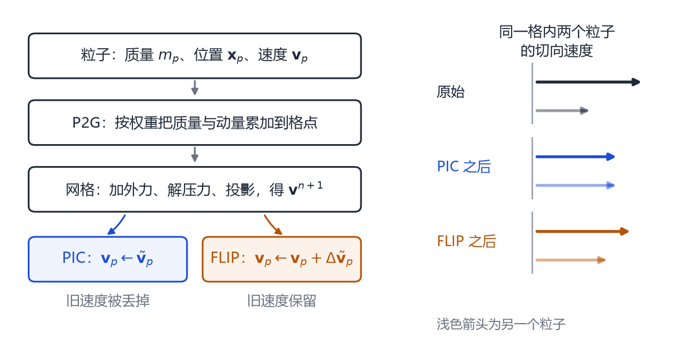
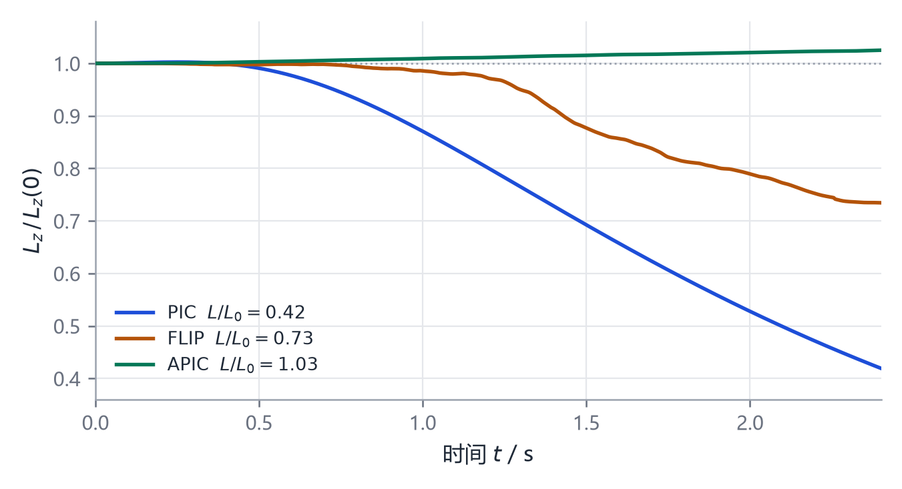

# 第 8 章 FLIP、PIC 与 APIC

> 本章导读：一桶水泼到石板上，水铺开、翻卷、边缘撕出白花，这套镜头大多是 FLIP 做的。同一套代码把某个参数拧过头，水面就开始"沸腾"：粒子在格子里乱窜，体积忽大忽小，静置的一池水永远停不下来。这一章把 PIC、FLIP、APIC 三种传递方式摊开对比，看清每一步里哪些量被抹平、哪些量被保住，以及这些差别在什么尺度上会被人眼看见。

## 8.1 两套账本

粒子法的好处是平流干净：粒子带着自己的速度走，没有插值，界面自动出现，拓扑变化不花一分钱。坏处是压力难解：压力泊松方程需要"邻居"，而粒子的邻居会随流动变形，压缩区里挤成一团，稀疏区里一个都没有，离散出来的系数矩阵条件数极差，解出来的压力场坑坑洼洼。

网格正好相反。格点的邻居是固定的，二维四个、三维六个，拉普拉斯算子写出来规规矩矩，可以用共轭梯度、多重网格甚至 FFT 快速求解，投影之后的散度能压到机器精度。但网格上的平流要靠插值，界面会被抹成一片雾。

PIC 家族的想法很直接：让粒子和网格各干擅长的事。粒子存质量、位置、速度，负责平流和界面；网格只在每个时间步临时出现，负责解压力。这个家族的三个成员——PIC（particle-in-cell，质点网格法）、FLIP（fluid implicit particle，流体隐式粒子）、APIC（affine particle-in-cell，仿射质点网格法）——共享同一套骨架，区别只在最后一步怎么把速度还回去。也就是说，读懂了这一节，后面三节都是在同一个流程上换一个零件。

一步里有五件事。第一件是清空网格，把质量、动量全部置零。第二件是把粒子账本上的东西摊到网格上（P2G，particle to grid）：

$$
m_i=\sum_p w_{ip}\,m_p ,
\tag{8.1}
$$

$$
(m\mathbf{v})_i=\sum_p w_{ip}\,m_p\,\mathbf{v}_p ,
\qquad
\mathbf{v}_i=\frac{(m\mathbf{v})_i}{m_i} ,
\tag{8.2}
$$

$p$ 是粒子编号，$i$ 是格点编号，$w_{ip}$ 是粒子 $p$ 落到格点 $i$ 上的权重，$m_p$ 是粒子质量，$\mathbf{v}_p$ 是粒子速度，$m_i$ 是格子累加出来的质量，$(m\mathbf{v})_i$ 是格子累加出来的动量，$\mathbf{v}_i$ 是格子速度。注意第三个式子是"动量除以质量"，不是"速度的平均"——两者只有在每格粒子质量相等时才一样，而粒子聚散之后质量并不相等。

拿一个最小的例子把这三步走一遍。二维，格子边长 $dx=1$，一个格子四个粒子，各在四分之一处，质量都是 $m_p=0.25\,\mathrm{kg}$，速度沿 $x$ 依次是 $1$、$2$、$3$、$4\,\mathrm{m/s}$。双线性权重是 $x$ 方向和 $y$ 方向的乘积，粒子 $(0.25,0.25)$ 对左下角格点 $(0,0)$ 的权重是 $0.75\times0.75=0.5625$，对右上角 $(1,1)$ 是 $0.25\times0.25=0.0625$。四个粒子对 $(0,0)$ 的权重加起来是 $0.5625+0.1875+0.1875+0.0625=1$，所以 $m_{(0,0)}=0.25\times1=0.25\,\mathrm{kg}$——正好是四分之一的粒子落在这里，合理。

动量那边更值得看：$m_{(0,0)}=0.25$，动量是 $0.25\times(0.5625\times1+0.1875\times2+0.1875\times3+0.0625\times4)=0.4375$，于是 $\mathbf{v}_{(0,0)}=1.75\,\mathrm{m/s}$。四个粒子的平均速度是 $2.5\,\mathrm{m/s}$，格点上是 $1.75$——离得近的那个粒子权重大，它把平均值往下拉。这就是 P2G 的本质：**一次加权平均**。也就在这一步，格子尺度上的速度差异第一次被压缩。

这里藏着一个经典 bug：忘了乘质量，把网格速度写成 $\sum_pw_{ip}\mathbf{v}_p/\sum_pw_{ip}$。单相流里质量全相等，两种写法完全一样，测试跑得通；一旦引入大小不同的粒子（飞沫、气泡）或者和刚体耦合（刚体粒子的"质量"大几个量级），小粒子就会把大粒子的速度带跑，水会被一股看不见的风吹着走。判断办法很简单：把粒子质量人为改掉十倍，如果画面变了，就是这里错了。

第三件是在网格上加外力、解压力、做投影：

$$
\mathbf{v}^{*}=\mathbf{v}^{n}+\Delta t\,\mathbf{g},
\qquad
\nabla\cdot\left(\frac{\Delta t}{\rho}\nabla p\right)=\nabla\cdot\mathbf{v}^{*},
\qquad
\mathbf{v}^{n+1}=\mathbf{v}^{*}-\frac{\Delta t}{\rho}\nabla p ,
\tag{8.3}
$$

$\mathbf{v}^{*}$ 是加了重力但还没做压力修正的速度（上标 $*$ 表示"中间态"），$\mathbf{g}$ 是重力加速度，$\rho$ 是密度，$p$ 是压力，$\Delta t$ 是时间步。中间那个方程是压力泊松方程：它要找一组 $p$，使得修正之后的速度无散度。这一步和第三章的网格法完全一样，可以直接借用成熟的求解器。

带数字看这个方程在算什么。取 $\rho=1000\,\mathrm{kg/m^3}$、$\Delta t=10^{-3}\,\mathrm{s}$、$dx=0.01\,\mathrm{m}$，某个格子里流体以 $1\,\mathrm{m/s}$ 往右冲、右边一格是静止的，于是跨越一格的散度约是 $-100\,\mathrm{s^{-1}}$（挤进来了）。压力修正要把它抬回零，也就是造出 $+100\,\mathrm{s^{-1}}$ 的散度，而 $\nabla^2p\approx\Delta p/dx^2$，代进去得 $|\Delta p|=\rho\,dx^2\,|\nabla\cdot\mathbf{v}|/\Delta t=1000\times10^{-4}\times100/10^{-3}=10^{4}\,\mathrm{Pa}$。也就是说，零点一个大气压的压差，正好把一个格子里的“挤进来”顶回去。

第四件是把速度插回粒子，第五件是让粒子走一步：

$$
\tilde{\mathbf{v}}_p=\sum_i w_{ip}\,\mathbf{v}_i^{n+1},
\qquad
\mathbf{x}_p^{n+1}=\mathbf{x}_p^{n}+\Delta t\,\tilde{\mathbf{v}}_p .
\tag{8.4}
$$

$\tilde{\mathbf{v}}_p$ 是从网格取回来的粒子速度（波浪号表示"临时的、待定的"），$\mathbf{x}_p$ 是粒子位置。前两件事合起来叫 P2G，后两件叫 G2P（grid to particle），压力求解夹在中间。整步结束，网格数据全部丢弃，下一帧重新累加。这个"用完就扔"的设计很关键：网格不保存任何历史，粒子才是唯一的状态，所以不会出现网格法那种界面越算越糊的问题。

权重函数决定了很多事情。二维双线性（bilinear）只用周围四个格点，三维八个；二次 B 样条（quadratic B-spline）在二维用九个、三维二十七个，权重是分段二次的，一阶导连续。B 样条的权重可以写成一维函数的乘积，一维部分在 $|x|\lt0.5dx$ 时是 $0.75-x^2/dx^2$，在 $0.5dx\le|x|\lt1.5dx$ 时是 $0.5(1.5-|x|/dx)^2$。B 样条的代价是邻居多、散射写冲突多，好处是粒子跨过格子边界时速度不会突变，噪声明显小。绝大多数制作级实现都用 B 样条。

网格只在一步里存在，这件事还有个副作用：压力求解没有热启动。每一帧的初值都是零，共轭梯度要从头迭代，通常二三十次才能把残差压下去。有人试过把上一帧的压力插值过来当初值，收敛能快两三成，代价是引入一点和当前粒子分布不匹配的记忆，水面会多出一层轻微的黏滞感。

还有一件常被忽略的事：网格里有些格子是空的。空气格子没有质量，不能参与压力求解，否则会出现"空气被压缩"的假压力。做法是给每个格子算密度 $\rho_i=m_i/V_{\text{cell}}$，低于某个比例就标成空气，压力固定为零，解算时把它的行换成 $p_i=0$。这个比例通常取参考密度的 $0.5$ 倍到 $0.9$ 倍。举个数字：每格四个粒子、单粒子质量 $0.25\,\mathrm{kg}$、$dx=1\,\mathrm{m}$，满格密度是 $1\,\mathrm{kg/m^3}$，那么质量低于 $0.5\,\mathrm{kg}$（只剩两个粒子）的格子就算空气。表面附近的格子处于半满状态，这个判断的粗糙程度直接决定了水面的干净程度：门槛太高，水面会被削掉一层；门槛太低，半空的格子会撑起假压力，把水往外顶成一圈鼓包。

时间步也有讲究。这套方法对 CFL 不算敏感，但压力求解在 $\Delta t$ 太大时会解不准，表现为体积剧烈振荡。常用的判据是 $\Delta t\le0.5\,dx/v_{\max}$。取 $dx=0.01\,\mathrm{m}$、$v_{\max}=5\,\mathrm{m/s}$，得到 $\Delta t\le10^{-3}\,\mathrm{s}$，也就是每帧（24 fps）要跑四十步左右；这也解释了为什么一帧水面要在后台算很久。

## 8.2 PIC：每一步把速度重采样一次

最老的做法是把插值回来的速度直接赋给粒子：

$$
\mathbf{v}_p^{n+1}=\tilde{\mathbf{v}}_p .
\tag{8.5}
$$

PIC 这个名字来自 1960 年代的质点网格法，最初是为等离子体和可压缩流设计的，粒子只是"携带质量的标记"，所有动力学都在网格上完成。它的问题后面会讲，但先看清它的动作有多简单：粒子的旧速度被丢掉，换成从网格取回来的那个值。

P2G 是一次加权平均，G2P 又是一次加权平均，两次合起来是一个低通滤波器（low-pass filter），也就是把高频（空间上变化快的）成分削弱、低频保留。滤波核的宽度大约是一个格子，方差在每步都累加，$n$ 步之后等效模糊宽度按 $\sqrt{n}$ 增长。按双线性的方差粗算，走一百步相当于模糊了三个格子；涡的尺度一旦降到这个量级，就再也看不见了。

耗散有多快，可以做一次完整的手算。一维，$dx=1$，一个格子里两个粒子，位于 $x=0.25$ 和 $x=0.75$，质量都是 $0.5\,\mathrm{kg}$，速度分别是 $3\,\mathrm{m/s}$ 和 $1\,\mathrm{m/s}$，格点在 $0$ 和 $1$。P2G：格点 $0$ 的权重是 $0.75$ 和 $0.25$，质量 $0.5\times(0.75+0.25)=0.5$，动量 $0.5\times(0.75\times3+0.25\times1)=1.25$，速度 $2.5$；格点 $1$ 的动量是 $0.5\times(0.25\times3+0.75\times1)=0.75$，速度 $1.5$。

假设这一步没有任何力，投影也不改变速度场（一维、均匀密度，散度为零），那么 G2P 就是把这两个格点速度插回去：粒子一在 $0.25$ 处取 $0.75\times2.5+0.25\times1.5=2.25$，粒子二在 $0.75$ 处取 $0.25\times2.5+0.75\times1.5=1.75$。两个粒子的速度差从 $2$ 变成 $0.5$，一步就被压掉四分之三，而平均值 $2\,\mathrm{m/s}$ 精确保住。

把这个结果迭代下去：第二步差 $0.125$，第三步 $0.03$，十步之后 $2\times0.25^{10}\approx2\times10^{-6}$。这就是 PIC 水的观感：倒下去的水柱始终连着，落到底部不飞溅，搅出来的漩涡几秒钟就自己停转，整体像蜂蜜或者非常稠的糖浆。也正因为每步都在抹，PIC 几乎不可能炸——高频扰动根本长不起来。一个反面例子：把近景飞溅交给 PIC，一滴水从杯沿甩出去，十帧之后它就不再是水滴，而是一小团缓缓下沉的雾，边缘完全平滑，没有任何"甩出去"的速度感。

耗散有多重，还可以换个角度量。给一个初始的旋转流场，记录总角动量随时间的变化：PIC 的曲线是一条平滑的下降线，前面几十步还看不出差别，之后越落越快，几百步就掉到初始值的一半以下；同样的流场换成 FLIP，下降慢一个档次。这个落差全部来自每步一次的重采样，和网格分辨率、粒子数的关系反而弱，和累计插值次数成正比，所以把一帧拆成四个子步，PIC 会耗散得更快，FLIP 几乎不受影响。

关于角动量，有个常见的误解需要澄清。很多人说 PIC 一步就把刚体旋转的角动量扔了，其实不是。B 样条对线性函数是精确再生的，速度场如果是 $\mathbf{v}=\boldsymbol{\omega}\times\mathbf{x}$ 这种线性形式，插值回来分毫不差，单步的角动量是保住的。PIC 真正丢的是"粒子团内部的自转"，也就是速度在粒子邻域里的变化部分。真实流场不是仿射的，每次重采样都会把这一层结构抹掉一点，于是旋转的云缓慢停转，涡量被一点点磨平。这个区别在 8.5 节讲 APIC 时会看得更清楚。

PIC 的优点也很实在：它几乎不可能炸。速度场每步都被磨平，高频扰动长不起来，所以时间步可以取得比较大，粒子数少一点也不会出乱子。泥浆、熔岩、颜料这类高粘流体，用 PIC 反而比 FLIP 更像；远处的低细节水面用 PIC 也更省。

## 8.3 FLIP：只传增量

1986 年 Brackbill 做自适应网格的流体计算，嫌 PIC 的耗散太重，把传递方式改了一处：不从网格取速度，只取速度的变化量 [@brackbill1986]。

$$
\mathbf{v}_p^{n+1}=\mathbf{v}_p^{n}+\sum_i w_{ip}\left(\mathbf{v}_i^{n+1}-\mathbf{v}_i^{n}\right) .
\tag{8.6}
$$

括号里是网格速度在这一步的增量，它来自重力、压力冲量和粘性。粒子自己的速度原封不动地留着，网格只贡献"这一步该加速多少"。$\mathbf{v}_i^{n}$ 是这一步开始时的网格速度（由 P2G 得到），$\mathbf{v}_i^{n+1}$ 是投影之后的网格速度，两者相减就是网格在这一步里受到的全部作用。

用上一节那组数字看差别。两个粒子速度 $3$ 和 $1$，同一个格子。假设这一步重力让每个格点都加速 $0.5\,\mathrm{m/s}$，也就是 $\mathbf{v}_i^{n+1}-\mathbf{v}_i^n=0.5$。FLIP 给两个粒子各加 $0.5$，变成 $3.5$ 和 $1.5$——差还是 $2$，整体一起被推了一下。PIC 则把插值结果直接盖上：粒子拿回 $2.75$ 和 $2.25$，差被压到 $0.5$。这就是图 8-1 右图画的那件事：一个保住差异，一个抹平差异。

效果立竿见影：水花能拉成细丝，丝能断成珠，珠能弹跳；倒进杯子里的水会翻卷、会溅出来，搅一下能转很久。这也是它统治影视流体的原因。FLIP 这个名字来自"流体隐式粒子"（fluid implicit particle），说的是压力隐式求解、粒子显式推进这两件事合在一起；后来名字被当成了这套传递格式的专称，和原始含义已经脱了钩。

代价是这套格式没有任何数值阻尼。PIC 里那些被低通滤掉的高频分量，在 FLIP 里全部保留并继续演化。物理上它们本该被粘性耗散掉，但影视里的水通常按无粘处理，粘性系数小到可以忽略，于是这些分量没有任何出口，只能越攒越多。

还有一个结构性的问题：式 (8.6) 里的增量在同一个格子内是常数。同一个格子里的一百个粒子，不管它们各自速度差多少，这一步加上的加速度完全一样。格子尺度上的速度差因此不会被修正，只会被保留。这正是下一节噪声的来源。

<figure class="fig">

<figcaption><b>图 8-1</b>　PIC 与 FLIP 一步之差的示意图。左图是两者共用的流程：粒子把质量与动量交给网格，网格解压力、做投影，再插回粒子，分岔只发生在最后一步——PIC 用插值结果覆盖粒子速度，旧速度直接丢掉；FLIP 只把网格速度的变化量加回去，旧速度保留。右图是同一格子里两个粒子的切向速度（浅色箭头是第二个粒子）：原始状态两者一快一慢，PIC 之后被抹成同一个值，FLIP 之后快慢之差还在，只是整体被一起推动。</figcaption>
</figure>

## 8.4 噪声从哪来

FLIP 的水放在那里不动，水面也会持续地细微沸腾；倒进容器后，粒子会沿着壁面上下串动，局部体积膨胀，看起来像在发泡。这些现象有四个来源，前三个是数值的，第四个是前三个引起的反馈放大。

第一个是格子尺度的速度跳变。增量按格子分配，相邻两个格子的增量不同，落在边界两侧的粒子就会拿到不同的加速度。投影保证的是格心处的散度为零，可粒子并不在格心上，它所在位置的实际散度可以是正的也可以是负的。正散度的地方粒子散开，负散度的地方粒子挤在一起，下一帧这些地方的压力又特别大，把粒子猛地推开。一来一回，就是"沸腾"。

这一步的误差有多大，可以估。格心散度为零、粒子位置偏离格心 $\delta x$，散度的偏差约是 $\nabla^2\mathbf{v}\cdot\delta x$ 量级，而 $\delta x$ 最多半个格子，$\nabla^2\mathbf{v}$ 的量级是 $v/dx^2$，于是偏差约 $v/(2dx)$。取 $v=1\,\mathrm{m/s}$、$dx=0.01\,\mathrm{m}$，得到 $50\,\mathrm{s^{-1}}$ 的散度误差——听起来很大，但它只持续一个时间步，位移误差是 $50\times\Delta t^2$，$\Delta t=10^{-3}$ 时是 $5\times10^{-5}\,\mathrm{m}$，相当于千分之五个格子。单步可以忽略，问题是它不衰减，还会被压力反馈放大。

第二个是权重函数的平滑程度。双线性的权重在格子边界上连续，但它的梯度不连续；粒子从一格走到另一格，插值出来的速度会有折角。折角本身就是高频信号，而 FLIP 不衰减高频。换成二次 B 样条能缓解，因为它的导数连续。

第三个在表面。粒子飞出水面之后，它所在的格子里质量很小，压力解不出来，甚至被标成空气。这些粒子只受重力，飞一段又落回来，落回来时带着和周围完全不同的速度。飞沫越多，这种"孤粒子"越多，表面就越毛躁。一个具体的画面：水花破碎时一粒水珠飞出 $5\,\mathrm{cm}$，在空中待 $0.1\,\mathrm{s}$，落回来时速度约 $1\,\mathrm{m/s}$，方向和周围水面的速度完全无关，插值进去就是一个脉冲。

第四个是正反馈。粒子聚成一团，局部密度高出参考值两三成，压力随之变大，把团推开；推开之后密度掉下去，压力消失，粒子又被邻居的吸引拉回来。这个循环的周期正好是几个时间步，频率落在人眼最敏感的那一段——大约 10 到 30 Hz，正好是水"沸腾"看起来最刺眼的位置。

噪声的幅度大致和格子尺寸成正比：网格加密一倍，速度跳变小一半。但三维里格子数翻八倍，成本也跟着翻八倍，所以靠加密网格压噪声是最贵的一条路，通常排在混合和位置修正之后。

缓解手段有几种，通常一起用。最简单的是把 PIC 掺进来（8.7 节），用一点点耗散换稳定。其次是位置修正：每步用密度估计量一下每个粒子周围的体积，偏大就把它往邻居方向拉，偏小就推开，把 $\rho/\rho_0$ 压在百分之一以内；这一步不改变速度，所以不会引入新的动量。第三是子步：一帧里解两到四次压力，每次的增量小一半，格子尺度的跳变也跟着小一半，代价是求解成本翻倍。第四是粒子重采样：粒子挤得太密或者散得太开时，按目标密度重新撒一遍，位置和速度插值过去，把已经积累的分布误差清掉。

## 8.5 APIC：给每个粒子一个小速度场

PIC 假设粒子是一个点，速度只有一个值；FLIP 保留了粒子的速度历史；APIC 换了个角度：粒子占据一小块体积，块内的速度不是常数，而是一个仿射函数（affine function，也就是"线性函数加一个常数"）[@jiang2015]。

$$
\mathbf{v}(\mathbf{x})=\mathbf{v}_p+\mathbf{C}_p\left(\mathbf{x}-\mathbf{x}_p\right) ,
\tag{8.7}
$$

$\mathbf{v}_p$ 是粒子中心的速度，$\mathbf{x}_p$ 是中心位置，$\mathbf{x}$ 是粒子内部的任意一点，$\mathbf{C}_p$ 是一个 $d\times d$ 的矩阵（二维 $2\times2$，三维 $3\times3$），它就是粒子所在处的速度梯度。这个梯度可以拆成两半：反对称部分对应角速度，对称部分对应拉伸和剪切。粒子不再是一颗只有速度的沙子，而是一小团会转、会变形的东西。

P2G 时把这个仿射部分也折算进动量：

$$
(m\mathbf{v})_i=\sum_p w_{ip}\,m_p\left[\mathbf{v}_p+\mathbf{C}_p\left(\mathbf{x}_i-\mathbf{x}_p\right)\right] .
\tag{8.8}
$$

$\mathbf{x}_i-\mathbf{x}_p$ 是从粒子中心指向格点的偏移，$\mathbf{C}_p(\mathbf{x}_i-\mathbf{x}_p)$ 是"格点处比粒子中心快多少"。也就是说，粒子不是把同一个速度摊给周围所有格点，而是按各自的偏移量给不同的值：靠前的一侧给得快一点，靠后的一侧给得慢一点。这一项在实现里叫仿射动量（affine momentum）。量一下它有多大：$m_p=0.25\,\mathrm{kg}$、$|\mathbf{C}_p|=1\,\mathrm{s^{-1}}$、偏移 $0.5\,\mathrm{m}$，仿射项贡献 $0.125\,\mathrm{kg\cdot m/s}$，和粒子自身的动量 $0.25\,\mathrm{kg\cdot m/s}$ 是同一个量级——它不是小修正，而是与平移同等份量的信息。

G2P 时要同时把 $\mathbf{v}_p$ 和 $\mathbf{C}_p$ 解出来：

$$
\mathbf{v}_p=\sum_i w_{ip}\,\mathbf{v}_i ,
\qquad
\mathbf{C}_p=\Big[\sum_i w_{ip}\,\mathbf{v}_i\left(\mathbf{x}_i-\mathbf{x}_p\right)^{\mathsf T}\Big]\mathbf{D}_p^{-1} ,
\tag{8.9}
$$

$$
\mathbf{D}_p=\sum_i w_{ip}\left(\mathbf{x}_i-\mathbf{x}_p\right)\left(\mathbf{x}_i-\mathbf{x}_p\right)^{\mathsf T} .
\tag{8.10}
$$

$\mathbf{D}_p$ 是粒子周围格点分布的惯性矩阵（moment matrix），它记录"粒子周围的格点朝哪些方向散开、散得多开"。$\mathbf{D}_p^{-1}$ 是它的逆，作用是把不同尺度的偏移归一化——没有它，靠近格点的粒子算出的梯度会偏大，远处的会偏小。

只要粒子周围至少有三个不共线的格点分到权重（实际中总是如此），$\mathbf{D}_p$ 就是正定的，可以直接求逆；粒子恰好落在格点上时它退化成 $0.25\,dx^2$ 乘单位阵，照样可逆。二维是一次 $2\times2$ 求逆，三维是 $3\times3$，代价不高，但每步每个粒子都要做一次。

手算一遍。二维、$dx=1$，粒子正好在格心 $(0.5,0.5)$，四个格点在四角，权重都是 $0.25$。偏移是 $(\pm0.5,\pm0.5)$，于是 $\mathbf{D}_p=0.25\times[4\times0.25]$ 对两个对角元、交叉项两两抵消，得到 $\mathbf{D}_p=0.25\,\mathbf{I}$，逆矩阵是 $4\,\mathbf{I}$——这就是前面说的"$0.25\,dx^2$ 乘单位阵"。

现在让格点速度构成一个刚体旋转，角速度 $\omega=1\,\mathrm{rad/s}$，绕格心转：节点速度 $\mathbf{v}=(-\omega y,\ \omega x)$，四个角从左下、右下、左上、右上依次是 $(0.5,-0.5)$、$(0.5,0.5)$、$(-0.5,-0.5)$、$(-0.5,0.5)$。G2P 的第一步给出 $\mathbf{v}_p=0$（四个速度对称抵消），这符合"绕中心转，中心不动"。第二步算 $\sum_iw_{ip}\mathbf{v}_i(\mathbf{x}_i-\mathbf{x}_p)^{\mathsf T}$，逐项相加得到 $\begin{pmatrix}0&-0.25\\0.25&0\end{pmatrix}$，乘上 $\mathbf{D}_p^{-1}=4\mathbf{I}$，得到 $\mathbf{C}_p=\begin{pmatrix}0&-1\\1&0\end{pmatrix}$，正好是 $\omega=1$ 的旋转矩阵。粒子把自己的自转完整地认了出来。

这一项带来的变化很大。粒子团的自转现在被 $\mathbf{C}_p$ 记着，传回网格时又通过式 (8.8) 贡献了对应的动量，所以角动量不会在传递中丢掉。同时 $\mathbf{C}_p$ 每步都从当前的网格速度重新算，不是累积的，所以 FLIP 那种噪声越攒越多的问题不会出现。它保住的又恰好是被 PIC 抹掉的那一层旋转，所以耗散比 PIC 小得多，图 8-2 里它的曲线比 FLIP 还平：PIC 丢的是结构，FLIP 丢的是精度，APIC 两头都占。

代价落在传递上。式 (8.8) 那一项在实现里叫仿射动量，三维中每个粒子要往周围二十七个格点各写一个 $3\times3$ 的量，写入量是 PIC 的三倍左右，而且这些量不是标量，不能像质量那样用原子加随便堆。所以 APIC 的传递通常比 PIC 慢三到四成，换来的是不用把 $\alpha$ 调得很低就能压住噪声。

图 8-2 是一组实测。二维周期网格 $64\times64$，一万六千多个粒子铺满全域，初始速度是一个中心涡（Lamb-Oseen 型，峰值环向速度 $1\,\mathrm{m/s}$，涡核半径 $0.12\,\mathrm{m}$，远处用紧支撑截断以保证周期域上的连续性），三种传递方式各跑六百步，每步都做压力投影，记录以区域中心为原点算出的总角动量。跑完两秒四，PIC 只剩初始值的四成二，而且是一条几乎平滑的下降线；FLIP 还剩七成三，曲线上有一段段台阶，那是格子尺度的噪声被原样带下去的结果；APIC 不降反升，末端是 1.03，涨出来的这一小截是插值与投影的残余误差，量级和真正的耗散完全不在一条线上。

<figure class="fig">

<figcaption><b>图 8-2</b>　三种传递方式的角动量随时间。真实计算：$64\times64$ 周期网格，密度 $1000\,\mathrm{kg/m^3}$，每格四个粒子（共 16384 个），初始为带紧支撑截断的 Lamb-Oseen 涡，峰值环向速度 $1\,\mathrm{m/s}$，涡核半径 $0.12\,\mathrm{m}$，粘度为零，时间步 $\Delta t=0.004\,\mathrm{s}$，共 600 步，纵轴为总角动量与初始值之比，图例中的数字是末值。PIC 单调下降，FLIP 下降较慢但带台阶状抖动，APIC 始终贴着 1.0。</figcaption>
</figure>

APIC 也不是万能的。它保住的是"粒子团内部的线性速度结构"，而这个结构只能在一个格子范围内定义：间距远小于格子的粒子，相对速度里超出仿射的那一部分照样会被投掉。所以它不会凭空造出细节，网格解不出的涡，APIC 也解不出来，它只是不让已有的涡被自己的传递格式吃掉。近景水花仍然要靠更高的分辨率和更多的粒子，APIC 换来的是同一分辨率下更长的涡寿命。

顺带一提，$\mathbf{C}_p$ 本身就是速度梯度，粘性力、涡量、形变率都可以直接从这里取，不需要再差分一次。在把 APIC 用到沙子、雪这类弹塑性材料上时，这一项还能让形变梯度的更新稳定不少，这也是它后来成为 MPM（material point method，物质点法）标配的原因。

## 8.6 传递的守恒性

PIC 家族的每一步都是加权求和，能不能守恒，取决于权重和以及传递的两端是否用同一套权重。

质量是精确的。P2G 按式 (8.1) 累加，G2P 不改变质量，只要权重满足 $\sum_i w_{ip}=1$（B 样条满足），网格上的总质量就等于粒子总质量，与网格分辨率无关。

动量也是精确的。P2G 送上去的是 $m_p\mathbf{v}_p$，G2P 用同一组权重取回来，两次求和的核一样，所以

$$
\sum_i (m\mathbf{v})_i=\sum_p m_p\mathbf{v}_p ,
\qquad
\sum_p m_p\tilde{\mathbf{v}}_p=\sum_i m_i\mathbf{v}_i .
\tag{8.11}
$$

左边是说"网格上的总动量等于粒子总动量"，右边是说"插回粒子后的总动量等于网格总动量"。两个等号都靠同一个条件：$\sum_iw_{ip}=1$，也就是权重必须归一。压力投影在这一步不会改变总动量（封闭域或周期域里，压力梯度的和为零），重力则会规规矩矩地加上 $M\mathbf{g}\Delta t$。所以动量这条账是干净的。

角动量不是自动的。把粒子的速度场按式 (8.7) 展开，对一个粒子团求 $\sum_p m_p(\mathbf{x}_p-\mathbf{x}_c)\times\mathbf{v}_p$，会得到两项：一项是质心平移的贡献（等于质心速度乘以总质量再叉乘力臂），一项是

$$
\mathbf{L}_{\text{spin}}=\sum_p m_p\left(\mathbf{x}_p-\mathbf{x}_c\right)\times\mathbf{C}_p\left(\mathbf{x}_p-\mathbf{x}_c\right) ,
\tag{8.12}
$$

也就是粒子团自己的自转。$\mathbf{x}_c$ 是团心，$\mathbf{x}_p-\mathbf{x}_c$ 是力臂，$\mathbf{C}_p(\mathbf{x}_p-\mathbf{x}_c)$ 是这个粒子相对团心的速度。PIC 每步把 $\mathbf{C}_p$ 清零，这一项就丢了；APIC 把它带回网格再带回来，这一项保住；FLIP 用增量传递，大致保住但带着噪声。

这笔损失可以手算。二维、$dx=1$，一个格子里只有两个粒子，质量都是 $1\,\mathrm{kg}$，位置 $(0.75,0.5)$ 和 $(0.25,0.5)$，速度分别是 $(0,0.25)$ 和 $(0,-0.25)\,\mathrm{m/s}$，也就是绕格心 $(0.5,0.5)$ 以 $1\,\mathrm{rad/s}$ 转。真实的角动量按 $\sum m\,r\,v$ 算：两个粒子力臂都是 $0.25\,\mathrm{m}$，各贡献 $1\times0.25\times0.25=0.0625$，合计 $0.125\,\mathrm{kg\cdot m^2/s}$。

PIC 走一步。P2G 的权重：粒子 A 对四个格点的权重是 $0.375$、$0.125$、$0.375$、$0.125$，粒子 B 正好反过来。四个格点累加出来的质量都是 $0.5\,\mathrm{kg}$，$y$ 方向速度从 $x=0$ 处的 $-0.125$ 线性升到 $x=1$ 处的 $+0.125$。G2P 把这个线性场插回粒子：A 在 $x=0.75$ 处得到 $+0.0625$，B 在 $x=0.25$ 处得到 $-0.0625$。速度只剩原来的四分之一，角动量变成 $0.03125$——一步丢了四分之三。

为什么恰好是四分之一？因为网格上的速度场只保留了"一个格子范围内的一次变化"，而粒子间距恰好是半个格子，插值把梯度摊薄了两倍、P2G 又摊薄了两倍。如果每格粒子更多、排布更细，这个因子会更接近一，损失变慢；如果每格只有一个粒子，损失就更快。所以 PIC 的耗散率不是一个普适常数，它取决于粒子数与格子数之比——这也是"粒子越密，PIC 越像 FLIP"的原因。

换成 FLIP：这一步没有任何外力，网格速度没变，增量是零，两个粒子原样不动，角动量还是 $0.125$。换成 APIC：两个粒子的 $\mathbf{C}_p$ 都是 $\begin{pmatrix}0&-1\\1&0\end{pmatrix}$，按式 (8.8) 送上去的仿射动量正好补偿了被摊薄的梯度，网格速度场恢复成真实的那条直线，插回来也分毫不差，角动量还是 $0.125$。

式 (8.12) 还解释了一个反直觉的现象：一团质心速度相同的粒子，只要每个粒子自己带着一点自转，相对质心的总角动量就不为零。PIC 看不见这种转，因为它的粒子没有内部结构。反过来说，一团看起来"整体在转"的粒子，如果每个粒子的 $\mathbf{C}_p$ 都是零，那它其实是一堆各自平移的点，只是位置恰好在转——APIC 会把这个区别如实记下来。

能量谁都不守恒。PIC 每步滤波，动能单调减少；FLIP 没有阻尼，数值噪声把能量往上推，跑久了总动能会超过初始值；APIC 基本持平，既不认真耗散，也没有明显的注入。画面上表现为 PIC 的水越搅越懒，FLIP 的水越放越躁，APIC 的水放了一夜还在原速转。

上面这些账都是对整块流体算的，实际操作里还得注意一点：周期域里压力梯度的总和严格为零，但如果场景有固壁，壁面法向压力乘上壁面位置会贡献一个力矩，必须有壁面对流体的反力矩抵消，否则角动量会出现缓慢的整体漂移。这也是角动量测试通常在周期域里做的原因。

体积守恒是另一回事。投影只保证格心散度为零，粒子位置上的散度有 $O(dx^2)$ 的残余，几百步之后会累积成可见的体积漂移：水要么胀出来一层，要么缩进容器壁。按前面的估算，单步位移误差千分之几个格子，六百步累积起来约是百分之几的格子宽度——听起来小，但水面是一层薄壳，几毫米的偏差就足以让水面看起来"鼓起"或"塌陷"。这就是为什么制作流程里几乎一定会加一个位置修正的环节，它不守恒任何东西，只是把密度硬拉回参考值。

| | 质量 | 动量 | 角动量 | 能量 | 噪声 |
|---|---|---|---|---|---|
| PIC | 精确 | 精确 | 逐步丢失 | 单调减少 | 无 |
| FLIP | 精确 | 精确 | 大致保住 | 缓慢增加 | 明显 |
| APIC | 精确 | 精确 | 精确 | 基本持平 | 轻微 |

## 8.7 参数怎么调

真正落到项目上，能调的只有五六个旋钮，每个都有明确的物理含义。调参的顺序很重要：先定网格和粒子数（它们决定分辨率和成本），再定时间步和子步数（它们决定稳定性），最后才调混合比例（它决定观感）。反过来先调 $\alpha$ 会掩盖掉分辨率和步长的问题。

混合比例。把两种传递方式线性组合，$\mathbf{v}_p\leftarrow\alpha\mathbf{v}_p^{\text{FLIP}}+(1-\alpha)\mathbf{v}_p^{\text{PIC}}$，$\alpha$ 取 $0.95$ 到 $0.99$。$\alpha=1$ 是纯 FLIP，细节最多也最吵；$\alpha=0$ 是纯 PIC，稳定但稠。

$\alpha$ 的可感差异可以直接算。PIC 每步把格内结构压到大约四分之一（上一节的手算），混合之后每步保留的比例是 $\alpha+(1-\alpha)/4$。取 $\alpha=0.97$，每步剩 $0.9775$，也就是每步只损失 $2.25\%$；一百步之后剩 $0.9775^{100}\approx0.10$。取 $\alpha=0.90$，每步剩 $0.925$，三十步就剩 $0.096$——涡的寿命差了三四倍。影视项目常用 $0.97$ 到 $0.98$，配合位置修正压噪声；实时应用为了稳，会降到 $0.9$ 附近。这个参数没有"正确值"，只有和镜头匹配的值：近景的水花要 $\alpha$ 高，远景的水面 $\alpha$ 低一点反而更干净。实时应用里还有一个额外的约束：$\alpha$ 越低，单帧计算越稳定，可以少加子步，把预算留给分辨率。反过来，如果一定要用 $\alpha=0.99$，那就得准备两个子步加位置修正，否则飞沫会把画面噪得像电视雪花。

每格粒子数。三维里每格八个（每个方向两个）是常见起点，二维是四个。粒子少了，表面会碎，格子里的质量分布不均，投影出来的压力有颗粒感；粒子多了，P2G 和 G2P 的成本线性上涨，而精度的提升很快饱和。经验上每格粒子数超过四的三次方（三维六十四）之后，画面几乎没有变化，只是更慢。

网格分辨率与粒子数是两个独立的旋钮，管的事不一样。网格决定能解出的最小涡，大约是两到四个格子；粒子数决定表面的细节和飞沫的数量。把网格加密一倍，涡的尺度减半，但表面不会更细；把粒子加密一倍，表面更细，但大尺度的运动一点没变。预算有限时，先看镜头里最重要的是大块的翻滚还是边缘的碎沫。

时间步。PIC 家族对 CFL 不算敏感，但压力求解在 $\Delta t$ 太大时会解不准，表现为体积剧烈振荡。常用的判据是 $\Delta t\le0.5\,dx/v_{\max}$，$v_{\max}$ 取这一帧的最大速度。有快速飞溅的镜头，宁可加子步，也不要把 $\Delta t$ 顶到极限。子步的成本是线性的：两个子步就是两倍求解时间，但每个子步的增量小一半，格子尺度的跳变也小一半，噪声能降三到四成。

位置修正。每步（或每两帧）用密度估计量一次每个粒子周围的体积，误差超过 $1\%$ 就沿密度梯度把粒子挪一点。它是唯一能压住体积漂移的手段，代价是会抹掉一点细节，而且如果阈值设得太小（比如 $0.1\%$），粒子会被不停地推来推去，表面出现细密的"呼吸"。

| 场景 | $\alpha$ | 每格粒子 | 子步 | 位置修正 |
|---|---|---|---|---|
| 近景水花、特写飞沫 | $0.98$ | $2^3$ | 2 | $1\%$，每步 |
| 中景水面加碰撞 | $0.97$ | $2^3$ | 1–2 | $1\%$，每两步 |
| 远景大水面 | $0.94$ | $2^3$ | 1 | $2\%$，每四步 |
| 高粘泥浆、颜料 | $0.85$ | $2^3$ | 1 | $1\%$，每步 |

还有一件不属于传递、却经常被当成传递问题的事：静水不静。一池水放上几百帧，水面会缓慢起伏，粒子沿着壁面往上爬。原因多半在压力求解的收敛精度和表面的空气判定上，而不是 FLIP 的噪声。诊断办法很简单：把 $\alpha$ 临时调到零，起伏消失，说明是传递的噪声；起伏还在，就是压力或者边界的问题，这时调 $\alpha$ 只是把症状按下去。

爬壁是另一个典型症状，值得单独说。粒子贴着墙往上走，往往是因为墙面格子的空气判定把固壁当成了自由面：壁面附近的格子质量不足，被标成空气，压力为零，流体在那一侧没有支撑，于是沿着墙"漏"上去。改法是给固壁格子强制设定法向速度为零，并把它们的压力设成邻居压力的镜像，而不是零。

成本分布大致是这样：P2G 和 G2P 占六到七成，因为它们是散射写和收集读，访存不规则；压力求解占两到三成；粒子平流和邻域之外的部分占剩下的一点点。所以优化的大头在传递，而不是在泊松求解器上——这一点和网格法正好相反。
