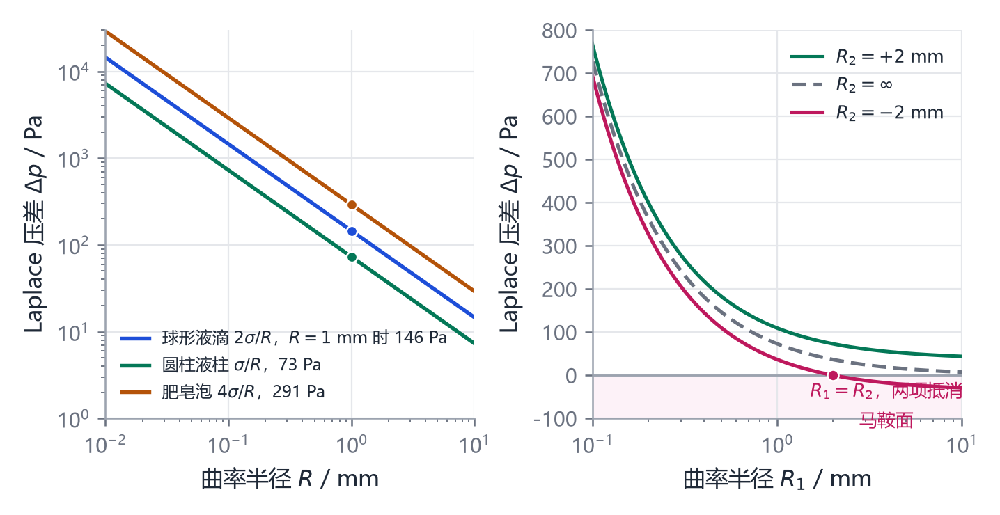
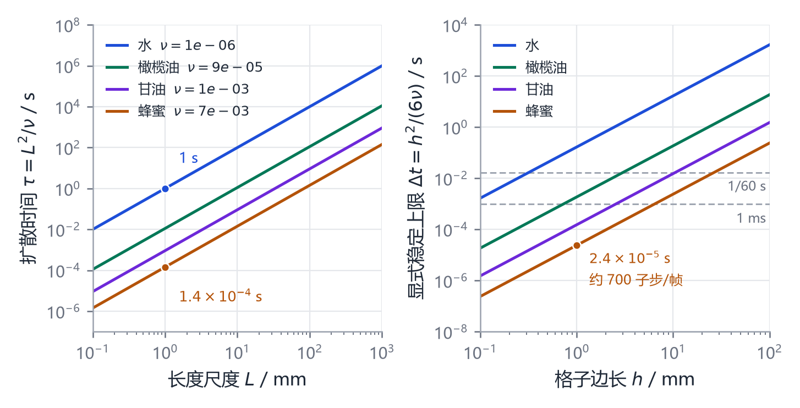

# 第 9 章 粘性、表面张力与多相流

> 本章导读：一片叶子上的水珠为什么是球，蜂蜜为什么拉成丝才断，油和水放在同一个格子里为什么会在界面附近"漏"出假流。这一章补上动量方程里被跳过的那一项粘性应力，补上界面上那一项表面张力，再处理两种流体密度差一千倍时，离散会坏在什么地方。

## 9.1 叶子上的水珠

雨后的荷叶上，水聚成一颗颗珠子，风一吹就滚，滚到叶缘停住，叶尖倒挂着也不掉下来。同一片叶子上滴一滴掺了洗洁精的水，珠子立刻塌成一片水膜，摊开，顺着叶脉流走。水还是那杯水，差别只在界面那一层的分子还认不认彼此。

蜂蜜是另一回事。一勺蜂蜜举高，它拉出一条细流，落到盘子上不溅，盘成一小堆，堆到一定高度开始盘绕成螺旋，几秒钟之后才慢慢塌下去。它也怕表面张力，但更显眼的是粘性：相邻两层流体互相拖拽，动得慢的那层拽住动得快的那层，整团东西都黏在一起。

这两种效应在前面都被省掉了。拆方程的时候，粘性项被标成"通常很小"，投影那一步里只有压力和重力。对一团上升的烟、对一道拍上岸的浪，这个省略没大问题，因为它们的雷诺数高，粘性只在贴着壁面的一薄层里起作用。对一滴挂在叶尖的水、对一条倒下来的蜂蜜、对油和水的混合物，省略掉的正好是决定现象的那一项。

这一章按"界面"和"体积"两条线走。界面那条线是表面张力，它只在两种流体的分界面上存在，量级不大但方向永远指向曲率中心。体积那条线是粘性，它在流体内部处处存在，量级取决于流体本身。最后把两条线合到一起，看多相流的格子里会出什么毛病。

## 9.2 曲率决定压差

先算水珠为什么圆。把一颗液滴想象成切成两半的苹果，看其中一半受的力。表面张力沿着切口那圈圆周作用，单位长度上的力是 $\sigma$，水的表面张力系数在二十摄氏度时约 $0.073\ \mathrm{N/m}$，圆周长 $2\pi R$，合力 $2\pi R\sigma$，方向指向另一半——表面像一张绷紧的膜，要把这半边往回拉。

这半边液滴能被拉住，靠的是内部压力比外部高。多出来的那部分压力乘上切口面积 $\pi R^2$，正好抵住表面张力的合力：

$$2\pi R\sigma=\Delta p\,\pi R^{2}\quad\Longrightarrow\quad \Delta p=\frac{2\sigma}{R}$$

这就是 Laplace 压差。它说的事情很反直觉：液滴越小，内部压力越高。两个大小不同的气泡用一根细管连起来，小的那个压力高，气会从小泡流向大泡，小泡越缩越小直到消失。肥皂泡吹出来总是一串大小不一的泡先合并成一个大泡，原因就在这。

曲面一般不是球。在曲面上取一点，总可以找到两个互相垂直的方向，沿这两个方向弯曲得最厉害和最平缓，对应的曲率半径记作 $R_1$ 与 $R_2$。把上面那套力平衡推广过去，得到

$$\Delta p=\sigma\left(\frac{1}{R_1}+\frac{1}{R_2}\right)$$

半径按"曲率中心落在液体内部为正"取符号。球形液滴两个半径相等，回到 $2\sigma/R$；一根圆柱形液柱沿轴向不弯，$R_2$ 无穷大，压差是 $\sigma/R$；马鞍面上两个半径一正一负，大小相等时压差为零，肥皂膜能在铁丝框里拉出马鞍形，就是因为两侧压力相同，膜不必往任何一边鼓。

这些数在图形尺度上不算小。半径 1 毫米的水珠，$\Delta p$ 约 146 Pa；半径 0.1 毫米的雾滴，1460 Pa。大气压是 $1.0\times10^{5}\ \mathrm{Pa}$，可压力梯度是 $\Delta p/R$，1 毫米处约 $1.5\times10^{5}\ \mathrm{Pa/m}$，比水的重度 $\rho g\approx 9.8\times10^{3}\ \mathrm{Pa/m}$ 大十五倍。也就是说，一毫米以下，表面张力比重力更能决定形状。

拿什么尺度去比，有一个专门的量，叫毛细长度：

$$\ell_c=\sqrt{\frac{\sigma}{\rho g}}$$

水算出来 2.7 毫米。比它小的液滴重力几乎不起作用，形状接近球；比它大的，重力把底面压平。雨滴直径两到五毫米，正好横跨这个长度，所以真实的大雨滴是上圆下扁的汉堡形，不是教科书插图上那种完美球体。另有一个无量纲数把这件事说得更干净，邦德数 $\mathrm{Bo}=\rho g L^{2}/\sigma$，重力与表面张力之比，远小于 1 时表面张力赢。

图 9-1 左边把三条曲线摆在一起：球形液滴的 $2\sigma/R$、圆柱液柱的 $\sigma/R$、以及有内外两层表面的肥皂泡的 $4\sigma/R$，取的都是水的表面张力。纵轴取对数之后三条线平行，斜率都是负一，说明压差对半径是一次反比，只差一个常数因子。右边固定第二个半径 $R_2$，让它分别取 $+2\ \mathrm{mm}$、无穷、$-2\ \mathrm{mm}$，看压差随 $R_1$ 怎么走。三条曲线都随 $R_1$ 变小而上升，但位置不同：$R_2$ 取正时整条抬高，等于把另一项的正贡献叠上去；$R_2$ 取无穷时就是单曲率那条；$R_2$ 取负时整条压低，并在 $R_1=2\ \mathrm{mm}$ 处穿过零点，那里两个曲率刚好抵消，是马鞍面。$R_1$ 再大，压差变负，凹进去那一侧的压力反而更低。三张曲线放在一起说明的是同一件事：曲率的符号跟大小一样要紧，正负两项能互相抵掉。

<figure class="fig">

<figcaption><b>图 9-1</b>　Laplace 压差与曲率半径（按 $\Delta p=\sigma(1/R_1+1/R_2)$ 直接计算）。左：$\sigma=0.073\ \mathrm{N/m}$，球形液滴（$2\sigma/R$）、圆柱液柱（$\sigma/R$）、肥皂泡（内外两层表面，$4\sigma/R$）三条曲线；双对数坐标下三条线斜率均为 $-1$，三个圆点是 $R=1\ \mathrm{mm}$ 处的取值，数值一并写在同一项的图例里（146、73、291 Pa）。右：固定 $R_2$ 为 $+2\ \mathrm{mm}$、无穷、$-2\ \mathrm{mm}$，压差随 $R_1$ 的变化，横轴对数、纵轴线性；$R_2=-2\ \mathrm{mm}$ 那条在 $R_1=2\ \mathrm{mm}$ 处过零，即马鞍面，更深处的负压区用浅色带标出。</figcaption>
</figure>

## 9.3 把压差摊成体积力

投影求解器只认识体积力。它先算一个不含压力的中间速度，再减去压力梯度把散度压到零，整个过程里没有"界面两侧压力不同"这个说法。要让表面张力进来，得把它改写成作用在界面附近一小片区域上的力，也就是 CSF 模型的做法：

$$\mathbf{f}_{\mathrm{st}}=\sigma\,\kappa\,\delta_s(\varphi)\,\mathbf{n}$$

$\varphi$ 是符号距离，$\mathbf{n}=\nabla\varphi/|\nabla\varphi|$ 是界面法向，$\kappa=\nabla\cdot\mathbf{n}$ 是曲率，$\delta_s$ 是一个只在界面附近非零的平滑 delta 函数，宽度取一到两格。

三个因子各有各的麻烦。法向最好办，中心差分再归一化就够，$\varphi$ 是真的距离函数时 $|\nabla\varphi|$ 接近 1，数值上很稳。曲率难办，它含二阶导数，会把 $\varphi$ 里的高频噪声放大十几倍。界面刚被平流、刚重新初始化之后，$\varphi$ 上有格子尺度的抖动，$\kappa$ 就变成正负跳变的噪声，画面上表现为液滴表面长出一层小疙瘩，而且这层疙瘩自己会动。常见的补法有两种：一是算曲率之前对 $\varphi$ 做两三次平滑，二是只在界面带内算，别处不管。平滑的代价是曲率被低估，液滴显得比理论值软一点，这个偏差得认下来。

$\delta_s$ 的宽度是另一处取舍。宽到三四格，张力被摊到流体内部，行为像个体积里的重力，界面反而不清楚；窄到半格，界面往前一挪就采样不到，张力断断续续，液滴会抖。一到两格是常用值，代价是液滴的实际半径比设定值大一点点。

还有一条硬限制。表面张力显式进方程时，毛细波必须能被时间步分辨，稳定条件大致是

$$\Delta t\le\sqrt{\frac{\rho h^{3}}{2\pi\sigma}}$$

取水 $\rho=1000\ \mathrm{kg/m^{3}}$、格子 $h=1\ \mathrm{mm}$，上限约 1.5 ms；$h$ 减半，上限降到 0.53 ms，不是减半而是降到三分之一。想算清楚直径几毫米的液滴，网格要 0.25 mm，这个条件会盖过 CFL，成为步长的真正主人。

静止的液滴还有一个麻烦，叫虚假流。把一颗球放在静止空气里，如果初始压力场没有按 Laplace 压差设好，投影第一步就会算出错误的压力，界面附近出现一圈持续旋转的小涡。它们不会自己衰减，因为每一次投影都在重新制造同样的误差。速度量级大约是 $\sqrt{\sigma/(\rho h)}$，$h=1\ \mathrm{mm}$ 时接近 $0.27\ \mathrm{m/s}$，跟真实流动同一个量级，不能当噪声忽略。修法有两种：给初始压力场一个解析的 Laplace 分布，或者把表面张力做成隐式，让 $\kappa$ 和压力泊松方程一起解。

## 9.4 粘性扩散：显式卡在哪，隐式买到什么

粘性项可以单独拎出来看。常粘度、不可压的前提下，动量方程里除它以外的项都不带二阶空间导数，于是粘性那一步就是一个标准扩散方程，三个速度分量各解各的：

$$\frac{\partial \mathbf{u}}{\partial t}=\nu\,\nabla^{2}\mathbf{u}$$

$\nu$ 是运动粘度，单位 $\mathrm{m^{2}/s}$，等于动力粘度除以密度。水在二十摄氏度时 $\nu\approx1.0\times10^{-6}\ \mathrm{m^{2}/s}$，橄榄油约 $9\times10^{-5}$，甘油 $1.1\times10^{-3}$，蜂蜜在 $7\times10^{-3}$ 上下。这四个数横跨三个半数量级，而它们在方程里出现的位置完全一样。

显式写法最直白，套一次拉普拉斯再乘以 $\nu\Delta t$ 加上去。三维七点格式的稳定性条件是

$$\Delta t\le\frac{h^{2}}{6\nu}$$

分母的 6 是三维七点格式最大特征值 $6/h^{2}$ 带来的，一维情形下同一个条件写作 $h^{2}/(2\nu)$。代两组数进去。水、格子一厘米，上限是 16.7 秒，随便怎么跑都稳。蜂蜜、格子一毫米，上限是 $1\times10^{-6}/(6\times7\times10^{-3})=2.4\times10^{-5}$ 秒，一帧 $1/60$ 秒要切成七百个子步。

这就是刚性，而刚性的来源是两个时间尺度的比值。涡量在格子之间传一遍要 $h^{2}/\nu$，流体本身走过一格要 $h/U$，两者之比就是格子雷诺数 $\mathrm{Re}_h=Uh/\nu$。$\mathrm{Re}_h$ 远大于 1 时扩散比对流慢，显式扩散根本不是约束；$\mathrm{Re}_h$ 远小于 1 时扩散快得像瞬时的，显式格式为了追上它只能把步长切碎。水在厘米网格上、速度 10 mm/s 时 $\mathrm{Re}_h$ 是 10，两者都不卡人；蜂蜜在毫米网格上同样速度，$\mathrm{Re}_h$ 是 0.0014，扩散快过流动三个量级，这就是刚性一词的来历：一帧该走的时间没变，步数却被扩散项逼着翻了几百倍。网格越细越糟，$h$ 减半，上限除以四。

隐式写法把扩散项放到新时刻：

$$\left(\mathbf{E}-\nu\Delta t\,\mathbf{L}\right)\mathbf{u}^{n+1}=\mathbf{u}^{n}$$

$\mathbf{E}$ 是单位阵，$\mathbf{L}$ 是离散拉普拉斯矩阵。三维 $128^{3}$ 是两百多万个未知数，这个矩阵每行只有七个非零元，对称正定，共轭梯度几十轮就收敛，几何多重网格更快。跑一轮隐式求解，比显式跑七百个子步便宜得多，而且无条件稳定，$\Delta t$ 只剩对流那一条约束。

隐式不是白拿的。反向 Euler 的放大因子是 $1/(1+\nu\Delta t k^{2})$，真实衰减是 $\exp(-\nu\Delta t k^{2})$，$k$ 大时前者远大于后者。翻译过来就是：本该一步就衰减殆尽的最细的抖动，隐式只衰减掉一部分。高粘流体在隐式格式下会留下一层抹不掉的网格尺度噪声。Crank-Nicolson 更准，但它在高频会翻符号，抖得更难看。工程上的折中是反向 Euler 加一次轻度平滑，或者用 TR-BDF2 这类 L 稳定的格式。

交错网格在这里能捡一个便宜。速度存在面上，同一分量的相邻两个面正好差一整格，$\nu\nabla^{2}u$ 不需要任何插值就能写；压力在格心，梯度算出来也正好落在面上。要是速度存在格心，拉普拉斯得先插值再差分，边界附近会宽出一格，无滑移条件就落不到墙上，整面墙像涂了油。

边界条件决定粘性到底起不起作用。固壁给无滑移 $\mathbf{u}=0$，做法是在壁面外侧补一个镜像的零值；自由表面给零切向应力，$\partial u_t/\partial n=0$。这里有一项常被忘掉：法向的粘性应力 $2\mu\,\partial u_n/\partial n$ 也要进压力边界条件，它让高粘液滴显得更硬，上升速度反而更接近同尺寸刚性球的 Stokes 解 $2\Delta\rho gR^{2}/(9\mu)$；而气泡内部可以自己循环，表面看着更“软”，阻力更小。

图 9-2 把粘度的作用摆在同一张图上。左图是扩散时间 $\tau=L^{2}/\nu$ 随长度尺度 $L$ 的变化，四条线对应四种流体。同一个毫米尺度的运动，在水里 1 秒扩散完，在蜂蜜里只要 0.14 毫秒。这个方向跟“黏”的直觉相反：粘度大不等于扩散慢，$\nu$ 越大动量传得越快；蜂蜜黏的表现是同样的应力下应变率小，也就是流动本身慢，跟动量传得快是两件事。

右图换成显式格式的稳定上限 $h^{2}/(6\nu)$ 随格子边长的变化，再画两条参考线：60 帧的时间片 16.7 ms 和 1 ms。曲线落在参考线之上，显式格式就不用管扩散项；落在之下，就需要子步。水在 $h$ 大于 $0.32\ \mathrm{mm}$ 时都在 16.7 ms 之上，蜂蜜要到 $h$ 大于 26 mm 才回到线上方；1 mm 的蜂蜜已经跌到 $2.4\times10^{-5}\ \mathrm{s}$，要切七百个子步。两者在同一个求解器里共存，唯一的办法是把扩散项隐式化。

<figure class="fig">

<figcaption><b>图 9-2</b>　粘性扩散的时间尺度与显式稳定性上限（直接按公式计算）。左：$\tau=L^{2}/\nu$ 随尺度 $L$ 的变化，$\nu$ 取水 $1.0\times10^{-6}$、橄榄油 $9\times10^{-5}$、甘油 $1.1\times10^{-3}$、蜂蜜 $7\times10^{-3}\ \mathrm{m^{2}/s}$；$L=1\ \mathrm{mm}$ 处水为 1 s，蜂蜜为 $1.4\times10^{-4}\ \mathrm{s}$。粘度越大扩散越快，图上的线越靠下。右：显式三维七点格式的稳定上限 $\Delta t=h^{2}/(6\nu)$ 随格子边长 $h$ 的变化，虚线是 60 帧时间片 16.7 ms 与 1 ms；蜂蜜在 $h=1\ \mathrm{mm}$ 处的上限为 $2.4\times10^{-5}\ \mathrm{s}$，相当于每帧约 700 个子步。</figcaption>
</figure>

## 9.5 非牛顿：番茄酱、湿沙与回弹

番茄酱在瓶里倒不出来，拍一下瓶底就流出来了，流出来之后又变稀。同一瓶酱，粘度不是一个数，它随你搓它的快慢变。凡是有这种脾气的东西，都叫非牛顿流体，意思只是“粘度不是常数”。

幂律模型给一个最省事的描述：$\mu=K\dot{\gamma}^{\,n-1}$，$\dot{\gamma}$ 是剪切率的大小，也就是应变率张量的模，$K$ 和 $n$ 是拟合参数。$n$ 小于 1 是剪切变稀，番茄酱、血液、油漆、酸奶都在这一类；$n$ 大于 1 是剪切增稠，玉米淀粉浆能让人在上面跑，就是因为脚踩下去的瞬间局部粘度暴涨，踩完就沉。

宾汉塑性是另一类。应力低于屈服应力 $\tau_y$ 时材料根本不动，超过之后像牛顿流体一样流：

$$\tau=\tau_y+\mu\dot{\gamma}\quad(\tau\gt\tau_y),\qquad \dot{\gamma}=0\quad(\tau\le\tau_y)$$

牙膏、蛋黄酱、新鲜混凝土属于这一类。湿沙和雪介于两者之间，用 $\mu(I)$ 流变描述：有效摩擦系数随惯性数 $I=\dot{\gamma}d/\sqrt{p/\rho_s}$ 增长，$d$ 是颗粒直径，$p$ 是围压。把沙当流体算的那类方法，本质上是给一个随压力变化的等效粘度，让静止时粘度极高、流动时接近摩擦流体 [@zhu2005]。

搬到代码里，第一件事是避开除零。$\dot{\gamma}$ 趋零时幂律粘度和宾汉粘度都发散。Papanastasiou 正则化把宾汉律改写成

$$\mu_{\mathrm{eff}}=\mu+\frac{\tau_y\left(1-e^{-m\dot{\gamma}}\right)}{\dot{\gamma}}$$

$m$ 越大越接近理想宾汉，$\dot{\gamma}\to0$ 时极限是 $\mu+m\tau_y$，有限。另一种做法是直接截断，$\mu_{\mathrm{eff}}=\min(\mu_{\mathrm{eff}},\mu_{\max})$，$\mu_{\max}$ 就是“当固体看”的粘度，通常是溶剂粘度的 $10^{3}$ 到 $10^{5}$ 倍。

第二件事是 $\dot{\gamma}$ 本身带噪声。界面附近速度抖动一格，$\dot{\gamma}$ 能跳一倍，粘度跟着跳，流动又被粘度改变，正反馈。实用的补法是对 $\dot{\gamma}$ 做时间上的指数平滑，或者干脆用上一时间步的值算这一步的粘度，滞后一步换稳定。

第三件事是隐式求解变难。粘度依赖 $\dot{\gamma}$，而 $\dot{\gamma}$ 依赖未知的速度，矩阵不再是常系数。要么外迭代几次：固定 $\dot{\gamma}$ 解线性系统，用新速度更新 $\dot{\gamma}$，再解一次；要么退回显式，把步长压到很小。前者在粘度变化剧烈时收敛慢，后者在屈服面附近几乎必然出问题，因为那里的 $\partial\mu/\partial\dot{\gamma}$ 最陡。

粘弹性是更贵的一类。Maxwell 和 Oldroyd-B 模型让应力张量自己带一个演化方程，需要平流一个对称三乘三张量场，还得保证它保持正定，数值上稍不留神就跑出负的拉伸。粒子法里有个便宜的替代：给每对相邻粒子一根会松弛的弹簧，既拉又耗散，视觉上能出粘丝和回弹 [@clavet2005]。

## 9.6 密度差一千倍

水和空气的密度比是 1000，水和油是 1.2，水和沙是 2.65。三个数看着只是大小不同，在离散里却是两类事。

多相时密度不再是常数，它跟着界面走：

$$\frac{\partial\rho}{\partial t}+\mathbf{u}\cdot\nabla\rho=0$$

动量方程要写成守恒形式 $\partial(\rho\mathbf{u})/\partial t+\nabla\cdot(\rho\mathbf{u}\otimes\mathbf{u})$，否则重的那一相会被轻的那一相拖得太厉害。麻烦在于求速度时要除以 $\rho$，而 $\rho$ 在界面上一格之内能跳三个数量级。插值 $\rho$ 的误差被放大一千倍，速度就废了。

第二个麻烦是静水平衡。静止的水面上，压力满足 $\partial p/\partial y=-\rho g$。离散时如果 $p$ 在格心、$\rho$ 也在格心，而重力加在面上，那么一格之内的差分就不严格满足这条关系，界面附近会留下一层持续旋转的涡。它不会衰减，因为每一步投影都在重新制造同样的不平衡。这类虚假流在多相代码里几乎必然出现，量级随密度比增大。

处理办法三条路，代价各不相同。

第一条是把界面抹开。用体积分数或平滑过的 level set，让 $\rho$ 在两三格内连续过渡。简单、稳，适合密度比不大的情况。代价是界面变厚，直径小于五六格的气泡会被数值表面张力直接压没，气泡在粗网格里“消失”是这条路的典型症状。

第二条是 ghost fluid。界面保持锐利，两侧各自解压力，把另一侧的压力用外推延拓过来，界面处再补上 Laplace 跳变。界面清楚，虚假流小，代价是要写外推、要处理界面的拓扑变化，代码复杂度上一个台阶。

第三条是把密度放到面上，和速度同一个位置。这样 $\rho\mathbf{g}$ 与 $\nabla p$ 都在面上，静水平衡可以精确到机器精度，代价是整个离散要重新设计，尤其是平流和重新初始化。三条路可以混着用：锐利界面、带内受限平滑、ghost fluid 压力边界，再加一步静水平衡的初值化。四样都做，虚假流能压到真实流动的百分之一以下。

多相里还有一个现象值得单独提。气泡上升速度对粘度很敏感：Stokes 解是 $2\Delta\rho gR^{2}/(9\mu)$，线性依赖半径平方。直径 1 mm 的空气泡在水里按这个式子算出来是 $0.54\ \mathrm{m/s}$，实测只有 $0.2\ \mathrm{m/s}$ 上下，因为气泡已经在摆、尾巴开始变形。直径 10 mm 时气泡不再是球，而是个帽子，尾流里拖出一串小泡。想把这些形态算出来，网格必须细于气泡半径，这正是小尺度气泡模拟贵的原因。

## 9.7 接触角、钉扎与破碎

液滴落在桌面上摊开，边缘和桌面形成一个夹角，叫接触角 $\theta$。三相接触线上力的平衡给出 Young 方程：

$$\sigma_{sv}=\sigma_{sl}+\sigma\cos\theta$$

$\sigma_{sv}$ 是固气界面张力，$\sigma_{sl}$ 是固液界面张力。$\theta$ 小叫亲水，水会摊开；$\theta$ 大叫疏水，水珠会立起来。荷叶的 $\theta$ 超过 150 度，叫超疏水，水珠几乎不沾。

在 level set 里实现接触角，是改边界条件：在壁面上把界面法向从垂直改成斜的，$\mathbf{n}=\mathbf{n}_w\cos\theta+\mathbf{t}_w\sin\theta$，等价于给 $\varphi$ 一个 Neumann 条件 $\partial\varphi/\partial n=\cos\theta$。看着简单，实际有两个坑。

一个坑是分辨率。壁面附近弯月面的高度只有毛细长度那个量级，2.7 mm。网格 0.5 mm 时弯月面占五六格，形状勉强能看出来；网格 1 mm 以上，弯月面根本不存在，接触角变成一个纯渲染参数。想在粗网格上表现润湿，只能加亚格子模型，或者用一层薄薄的滑移来伪造接触线的移动。

另一个坑是钉扎。真实表面不干净也不平整，接触线会被卡住：往前走需要更大的角度（前进角），往后退需要更小的角度（后退角），差值叫接触角滞后。有了滞后，液滴在斜面上能停住；没滞后，一滴水放在斜面上会一直滑下去，看着假。代码里就存两个角度，按接触线的移动方向选用。

气泡与液滴的合并、破碎是另一类问题，因为它改拓扑。level set 是单值函数，两滴液体靠近时符号距离场会互相穿过，界面该合并的地方合不上，或者合出一层薄得看不见的桥。VOF 靠体积分数天然能合并，但表面张力驱动的断裂它算不准，因为断裂点上的界面厚度低于一格。

表面张力驱动的断裂有个漂亮的标度。半径 $R$ 的圆柱射流，表面扰动里增长最快的是波长 $\lambda\approx9.0R$ 的那一支，所以射流会断成间距约 $9R$ 的液滴，液滴半径约 $1.9R$。这就是 Plateau-Rayleigh 不稳定，水龙头滴水的节奏由它决定。想把它算出来，网格要能分辨 $R$，至少三四格。

气流里的液滴会不会碎，看韦伯数 $\mathrm{We}=\rho_g U^{2}D/\sigma$。大约超过 12，液滴开始从边缘被撕出小片；超过 50 会炸成雾。这个阈值在模拟里比在实验里模糊，因为破碎依赖网格能不能分辨那些小片，同一组参数换个分辨率可能就从“碎”变成“不碎”。

拓扑变化、毛细时间步和曲率噪声三件事叠在一起，解释了为什么小尺度液体那么贵。想看清一滴水碎成几颗，网格要细到 0.1 mm，步长被毛细波压到 0.1 ms 以下，一秒钟的画面要上万步，每步都要解一次泊松。这也是自适应网格在水滴场景里几乎必用的原因：只在界面所在的格子加密，其余地方粗算 [@losasso2004]。

