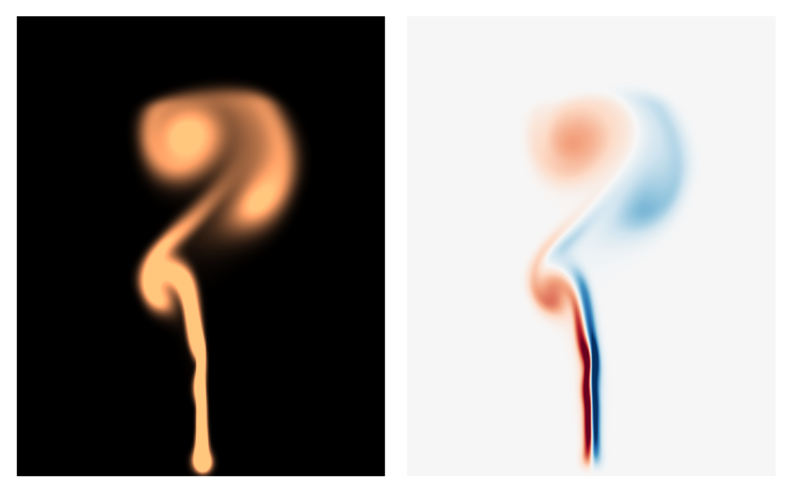
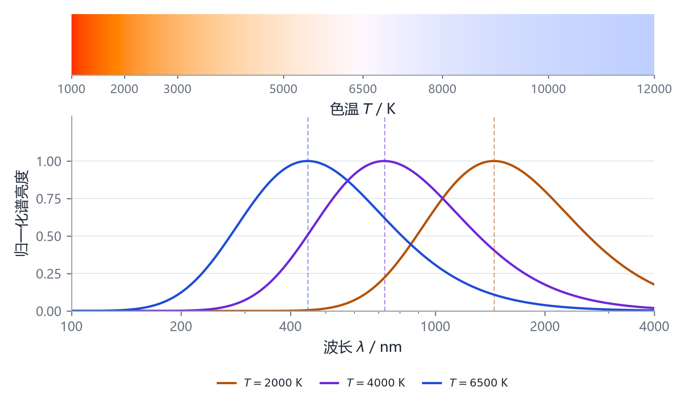

# 第 10 章 烟、火与爆炸

> 本章导读：一支烟在没风的房间里为什么会有一段笔直的烟柱，然后突然散成一团乱麻；火焰的颜色是不是画上去的；爆炸为什么不能用算烟的那套方法；一个模拟网格交到渲染器手上，应该带哪几个场。这一章从浮力讲起，一路走到体渲染接口和成本预算。

## 10.1 一支烟的两段人生

一间没有风的房间，桌上点一支烟。烟雾往上走，头二三十厘米是一条几乎笔直的细柱，边缘光滑，像一根竖着的线。再往上，它忽然扭起来，左右摆，卷成一团一团的蘑菇，然后整片散开。同一股烟，两个完全不同的形态，中间没有过渡，切换点就在某个高度上。

这段现象在实验室里被反复看过。烟柱底部的浮力把它往上推，速度剖面在中心最快、边缘最慢，边缘上有一层强剪切。剪切层不稳定，扰动的增长率正比于当地速度除以当地宽度，烟柱往上走，速度变大、宽度变小，增长率越来越高，到了某个高度就压不住了，层流一下子转成湍流。判据是当地雷诺数超过几十，卷烟的烟柱在切换高度上算出来大约两百，所以切换点对烟的温度、房间的微小气流都很敏感。

估一下量级。烟柱底部速度 $0.2\ \mathrm{m/s}$、烟柱直径 $5\ \mathrm{mm}$，空气的运动粘度 $1.5\times10^{-5}\ \mathrm{m^{2}/s}$，$\mathrm{Re}=UD/\nu=0.2\times0.005/1.5\times10^{-5}\approx67$。判据是两百，底部还差三倍，所以下面是老老实实的层流；往上走，速度剖面的剪切层越剪越薄，按剪切层厚度算的雷诺数一路往上爬，爬到某个高度就越线了。也就是说，切换高度不是个固定高度，它随烟的初速、房间的微弱气流、甚至香烟的直径变——同一支烟在无风的柜子里能直上四十厘米，在有空调的房间里三五厘米就散。

对写代码的人来说，这件事有一层直接的含义：如果你算出来的烟始终是一条笔直的柱，一直到顶都没散，不是物理对了，是数值耗散把它抹平了。半拉格朗日平流加一个粗网格，每一个时间步都像给烟做一次模糊，小涡活不过两三帧。表现是烟看起来"太干净"，缺少情绪，像一块被拉长的棉花糖。

第 4 章讲过怎么用 MacCormack 或 BFECC 把耗散压下去，那是从平流格式入手。还有一个更省事的补法，叫涡量约束：算出速度场之后，找涡量集中的地方，沿涡量梯度方向加一点力，把正在被抹掉的涡"顶"回去 [@fedkiw2001]。这个力在数学上补回的是被数值格式吃掉的能量，物理上没什么道理，但它恰好作用在小尺度上，对大尺度流动的影响很小，是影视流体里最常被打开的一个开关。

<figure class="fig">

<figcaption><b>图 10-1</b>　二维浮力羽流的温度场与涡量场（涡量-流函数形式的真实计算，同一帧）。网格 $160\times200$，格子边长取 1（无量纲），$\Delta t=0.05$，浮力系数 $\alpha=0.03$，涡量扩散系数 0.08，底部中央宽 2.5 格的连续热源（中心带周期 9 的轻微横向摆动），共推进 2400 步，顶部两成是海绵层。左：温度场，可见细长的柱身与卷曲的蘑菇状头部；右：同一帧的涡量，柱身两侧是一对方向相反的涡量带，头部的涡环对在二维切片上表现为左右一正一负两团。</figcaption>
</figure>

## 10.2 羽流的骨架

抛开湍流不谈，羽流有一个很稳的骨架，可以用三行标度律说清。假设一团浮力流体从一个小孔往上冒，它沿途不断把周围的静止空气卷进来，卷吸速度正比于当地上升速度，比例系数记作 $\alpha_e$。在这个假设下，体积通量 $Q$、中心速度 $w$、浮力 $b$ 随高度 $z$ 的变化是

$$Q\propto z^{5/3},\qquad w\propto z^{-1/3},\qquad b\propto z^{-5/3}$$

三条式子是同一个守恒关系的三种写法：浮力通量沿高度不变，而质量通量一直涨，涨得比面积快，所以速度往下掉。落到画面上就是烟柱越往上越宽、越淡、越慢，这跟直觉一致，但指数不是凭感觉猜的，$5/3$ 是从卷吸假设推出来的。

三条标度律可以用一组数验一下。若高度 $z_1$ 处中心速度是 $0.2\ \mathrm{m/s}$，到 $z_2=4z_1$ 处，速度按 $z^{-1/3}$ 乘 $4^{-1/3}=0.63$，降到 $0.126\ \mathrm{m/s}$；宽度按 $z$ 长成四倍；浮力按 $z^{-5/3}$ 掉到十六分之一。也就是说，高度翻四倍，烟只慢了三分之一，宽度却涨到四倍、淡了十六倍，画面上最直观的变化是“淡”，不是“慢”。

浮力从哪来，值得写成一行。密度随温度变，$\rho=\rho_0\left[1-\beta\left(T-T_0\right)\right]$，$\beta$ 是热膨胀系数，理想气体取 $1/T_0$；$T$ 是当地温度，$T_0$ 是环境温度。室温 $T_0=300\ \mathrm{K}$ 时 $\beta\approx3.3\times10^{-3}\ \mathrm{K^{-1}}$，温度高出 30 K，密度就低一成。单位体积的浮力是 $(\rho_0-\rho)g=\rho_0\beta(T-T_0)g$，方向朝上，跟温差成正比。

如果密度差远小于环境密度，可以只在浮力项里保留 $\Delta\rho$、在惯性项里一律用 $\rho_0$，这一步叫 Boussinesq 近似（Boussinesq approximation，意思是“密度变化只在产生浮力的那一项里算数”）。它省掉一个变系数的泊松方程，代价是要求 $\beta(T-T_0)\ll1$。

火恰好不满足这个条件。$T=1200\ \mathrm{K}$、$T_0=300\ \mathrm{K}$，$1-T_0/T=0.75$，密度掉到四分之一，惯性项里那个 $\rho_0$ 差了四倍。也就是说，烟跟室温差二三十度时 Boussinesq 好用得很，火焰里必须用真实的变密度，否则上升速度和卷吸量都会算小，火苗会显得“黏”在地上发不起来。

这里有一个容易搞错的地方：浮力本身不直接产生涡量。涡量方程里与浮力有关的只有斜压项 $(\nabla\rho\times\nabla p)/\rho^{2}$，只有当密度梯度与压力梯度不平行时它才非零。竖直方向上，密度梯度朝上、压力梯度朝下，两者平行，所以羽流中心不产涡；涡量全都产在羽流边缘，那里密度梯度有水平分量。这就是为什么羽流两侧总是先起涡、先卷，而中心一直比较干净。

数值上，羽流的宽度是最容易被网格骗的地方。半拉格朗日平流加粗网格，界面的过渡带每步都会宽一点点，等效于一个数值粘度 $\nu_{\mathrm{num}}$，量级是 $Uh/2$。羽流宽度按 $\sqrt{\nu_{\mathrm{num}}t}$ 长，于是粗网格上的烟柱会胖得像气球，而且越算越胖。想让宽度对，只能提高分辨率把数值粘度压下去；做不到就接受它，把网格调到宽度看起来正好——影视里很多"看起来对"的烟就是这么调出来的，只是不能改分辨率，一改就得重调。

图 10-1 是同一帧的两个场。左边是温度场，能看见细长的柱身和卷曲的头部；右边是涡量，柱身两侧是一对方向相反的涡量带，头部那一对涡环在二维切片上就是一正一负两团。两个场放一起能看出因果：密度差提供浮力，浮力在边缘造出涡，涡把周围的空气卷进来，卷进来的空气又稀释了密度。整个循环在图上是一个闭环。

## 10.3 火：燃料、温度与熄灭

火不是"红色的烟"。一团火焰里至少有三个场在互相牵制：燃料的质量分数、温度、烟尘的浓度。三者的时间尺度不同，燃料烧完是毫秒级，温度降下来是几十毫秒，烟尘被氧化掉又是另一个尺度。

最朴素的写法是一步总包反应，燃料加氧气生成产物加热量，反应速率用 Arrhenius 形式

$$k=A\exp\!\left(-\frac{E_a}{R_uT}\right)$$

$E_a$ 是活化能，$R_u$ 是通用气体常数，$A$ 是指前因子。这个式子的脾气极坏：$E_a$ 取 $1\times10^{5}\ \mathrm{J/mol}$、温度从 1000 K 变到 1100 K，指数项就差三倍。放进显式积分里，步长会被最陡的那一小块反应钉死，而那一小块往往只有几个格子大。

把数代进去看它有多陡。$E_a=1.0\times10^{5}\ \mathrm{J/mol}$ 除以 $R_u=8.314\ \mathrm{J/(mol\cdot K)}$ 得 $1.2\times10^{4}\ \mathrm{K}$；$T=1000\ \mathrm{K}$ 时指数是 $e^{-12.0}=6.1\times10^{-6}$，$T=1100\ \mathrm{K}$ 时是 $e^{-10.9}=1.8\times10^{-5}$，比值 2.9。温度只涨一成，速率涨三倍；温度掉一成，速率掉到三分之一。也就是说，反应速率对温度的敏感是指数的，而任何数值格式在反应区里的温度误差都是百分之几起步。

图形学里的常规做法是绕开它，用"混合即燃烧"：反应速率正比于燃料和氧气的乘积除以一个混合时间，或者干脆用一个温度阈值加一个固定的消耗率。火在画面上的样子主要由热释放的位置和量决定，而不是由反应动力学的细节决定，所以这个简化代价不大。真要做爆燃、回火、熄火这类现象时才需要把 Arrhenius 请回来，那时候通常也要配合自适应网格，只在小区域里解。

绕开的正式说法是混合分数（mixture fraction）$Z$：把燃料和氧化剂合成一个守恒标量，$Z=1$ 表示纯燃料，$Z=0$ 表示纯空气，两者按比例掺时 $Z$ 在中间线性过渡。$Z$ 只被平流和扩散，不被反应源项改变，因为化学反应既不创造也不消灭原子。火该在哪，由“燃料和氧气恰好配平”的那个值决定，记作化学计量值 $Z_{\mathrm{st}}$，甲烷在空气里约 0.055。于是火焰面就是 $Z=Z_{\mathrm{st}}$ 的一张等值面——盯一个标量的等值面，比追踪反应速率场便宜也稳得多。

到底是“混合控制”还是“动力学控制”，由一个无量纲数定，叫达姆科勒数（Damköhler number）$\mathrm{Da}$，定义是流动时间尺度除以化学时间尺度。$\mathrm{Da}\gg1$ 时化学比混合快得多，烧不烧只看混没混到，一个混合速率就够；$\mathrm{Da}$ 掉到个位数时化学跟不上，火焰会被拉伸和冷却吹熄，这时 Arrhenius 必须留着，否则根本算不出“火灭了”这件事。

温度方程比组分方程重要得多。写成

$$\frac{\partial T}{\partial t}+\mathbf{u}\cdot\nabla T=\kappa\nabla^{2}T+\frac{\dot{q}}{\rho c_p}-c_{\mathrm{rad}}T^{4}$$

最后一项是辐射冷却，四次方，量纲上是 $\mathrm{K/s}$，系数里塞着斯特藩-玻尔兹曼常数和发射率。这一项很值得留着：它让火焰有明确的边界，中心热、边上冷，冷却快的边缘会自动收缩；它让火焰在燃料断掉之后自己熄灭，不需要额外的判据；它还让火焰的亮度随温度强烈变化，因为辐射功率正比于 $T^{4}$。

烟尘这一项最容易被忘掉。它决定火焰发黄还是发蓝：完全燃烧时几乎没有烟尘，火焰偏蓝，那是气体分子的谱线发射；缺氧燃烧时烟尘多，烟尘颗粒接近黑体，发出连续谱的黄橙光。模拟里常用一个标量表示烟尘浓度，它由燃料的不完全燃烧产生，被氧化消耗，也跟着流场平流。渲染时它同时承担发光和消光两个角色，这一点在 10.6 节还会碰到。

一个常见的错是把火焰整个当发光体。真实的火焰里，蓝的那部分几乎不发光，只占根部薄薄一层；黄橙的部分是烟尘在发，亮度能高两个数量级；外缘还有一圈看不见的红外辐射，占能量的大头却不出现在画面上。按温度查表得到的颜色如果一律乘同一个强度，火就变成一根均匀的亮棒；正确的做法是让发射强度跟烟尘浓度成正比，蓝焰区只留很低的强度。

## 10.4 颜色是温度算出来的

把一根铁条放进炉子，先是暗红，再是橙，然后是黄白。颜色不是铁条自己选的，是它的温度决定的，而且这个对应关系跟材料几乎无关：烧红的铁块、钨丝、煤块、恒星表面，温度一样颜色就一样。这个东西叫黑体辐射。

谱亮度由 Planck 公式给出：

$$B_{\lambda}(T)=\frac{2hc^{2}}{\lambda^{5}}\frac{1}{e^{hc/(\lambda kT)}-1}$$

$h$ 是普朗克常数，$k$ 是玻尔兹曼常数，$c$ 是光速。$hc/k=1.4388\times10^{-2}\ \mathrm{m\cdot K}$，记住这一个组合就够了。分母那个指数项决定了谱的形状：长波一侧近似为 $e^{-hc/(\lambda kT)}$，短波一侧被 $1/\lambda^{5}$ 压制，两头都趋于零，中间有个峰。

顺带记一下单位。谱亮度的单位是 $\mathrm{W/(m^{2}\cdot sr\cdot m)}$，每平方米面积、每球面度方向、每米波长间隔上的功率。换成对频率积分时式子长得不一样，$B_{\nu}\propto\nu^{3}/\left(e^{h\nu/kT}-1\right)$，两条曲线的峰值位置不同，换算要连带 $|\mathrm{d}\lambda/\mathrm{d}\nu|$ 一起换，忘了这一项是常见错误。

把整条谱积起来更省事。单位面积的总辐射功率是 $\sigma_{\mathrm{SB}}T^{4}$，$\sigma_{\mathrm{SB}}=5.67\times10^{-8}\ \mathrm{W/(m^{2}\cdot K^{4})}$，叫斯特藩-玻尔兹曼常数。1000 K 时是 $5.7\times10^{4}\ \mathrm{W/m^{2}}$，3000 K 时是 $4.6\times10^{6}$，正好八十一倍——温度三倍，功率八十一倍，这就是四次方的意思。真实物体还要乘一个发射率 $\epsilon$，取值零到一：铁、煤、烟尘都接近 0.9，抛光金属只有 0.1。所以同样是 1000 度，一块抛光的钢看上去远不如一块烧红的铁亮。

峰的位置由 Wien 位移定律给出，对 $\lambda$ 求导置零就得到

$$\lambda_{\max}T=2.898\times10^{-3}\ \mathrm{m\cdot K}$$

代进去算：1000 K 时峰在 2.9 微米，远红外，肉眼一点看不到；3000 K 时 966 纳米，还在红外，所以白炽灯丝大部分能量白白变成热；5000 K 时 580 纳米，黄绿，太阳的峰差不多在这里；6500 K 时 446 纳米，蓝紫。温度再高，峰继续往紫外跑，可见光那一小段反倒落在谱的尾巴上。

颜色还要靠人眼来定。把谱亮度乘上 CIE 1931 的三个配色函数，在 380 到 780 纳米上积分，得到 XYZ 三刺激值，再乘一个矩阵转到 sRGB。图 10-2 上半部分就是这么算的：横轴温度从 1000 K 到 12000 K，纵向一条色带，每个温度对应一段颜色。1000 K 是暗红，2000 K 是橙，3000 K 发黄，5000 到 6500 K 接近白，10000 K 以上开始发蓝。注意这里是对每个温度单独归一的，所以看到的只是色相，不是亮度；实际亮度按 $T^{4}$ 长，3000 K 的物体比 1000 K 的亮八十倍，看上去两者完全不是一回事。

图 10-2 下半部分把三个温度的谱画在一起，横轴波长取对数，纵轴是归一化后的谱亮度。可以看见两个趋势：温度升高，整条谱抬高、峰值左移。三条曲线在长波一侧几乎平行，说明那里的形状对温度不敏感，颜色差主要来自短波那一侧被拉高了多少。这也解释了为什么高温物体总是偏蓝白：可见光的短波端被抬起来了。

火焰颜色在实现上用一个一维查找表。温度做自变量，采样几十到上百个点，每个点存一个线性空间的 RGB。运行时对温度做线性插值查表，再乘以一个发射强度。这个表在初始化时用 Planck 公式积一遍就行，不占运行时开销。表怎么建，也有几个数要注意。温度区间按场景定：只画烟头火星，300 到 1500 K 就够；要画炉火到白炽，得铺到 3000 K 以上。取 64 个采样点时，1500 K 的区间每档 23 K，在低温段（颜色随温度变最快的地方）偏粗；改成按 $\log T$ 均匀采样，或者直接取 256 点，误差就落到视觉上分辨不出的范围。表里存的是线性 RGB 的相对比例，乘上强度才是最终值。

需要小心的是色彩空间：表里存的必须是线性值，不能是已经做过 gamma 的 sRGB，否则叠加多个发光体时颜色会偏；也不能把超过 1 的值截掉，火焰亮度远超白点，得靠后面的 tone mapping 去压。

另一个容易被忽略的坑是整张画面的白平衡。物理上算出来的月光、烛光、阳光三套颜色放同一格里，如果全部按同一个参考白点做归一，烛光会偏橙得离谱、月光偏蓝得发黑。实际管线里会先把每种光源的色温映射到一个共同的显示白点，再调亮度；这一步是摄影的语言，不是物理的语言。

<figure class="fig">

<figcaption><b>图 10-2</b>　黑体辐射的颜色与光谱（按 Planck 公式与 CIE 1931 配色函数计算）。上：色温自 1000 K 到 12000 K，每个温度对可见光积分后转到 sRGB，按最亮通道归一化，所以只体现色相；1000 K 偏红，3000 K 发黄，6500 K 接近白，10000 K 以上转蓝。下：三个温度的归一化谱亮度，横轴波长取对数，竖虚线标出各自峰值位置（Wien 定律），2000 K 对应 1449 nm，4000 K 对应 724 nm，6500 K 对应 446 nm。</figcaption>
</figure>

## 10.5 爆炸：不可压算不了的那部分

一团炸药在零点几微秒内从固体变成高温高压气体，压力从大气压跳到几十 GPa，温度到三四千开，爆轰波以每秒几公里的速度往外推。这个前沿后面的空气被压缩到五到十倍密度，压力降下来之后又膨成负压区，然后再被外面的空气推回去。整个过程在一毫秒内完成，留下的是一道向外跑的冲击波和一团到处乱滚的涡。

这一节要说清楚一件事：不可压求解器算不了它，不是精度不够，是假设不成立。不可压的核心是把声波无穷快这件事当成真的，取极限之后压力不再是独立变量，而是约束的乘子，密度是常数。冲击波恰恰是一个密度和压力都跳变的间断面，它靠的就是可压缩性。用不可压求解器去算爆炸，能算出来的只有“一团热气体在膨胀”，没有冲击波，没有负压相，也没有那个标志性的球面壳层。

先记住几个数。1 kg TNT 在自由空气里爆开，一米处的超压大约 1 MPa，也就是十个大气压；三米处 100 kPa，差不多一个大气压；十米处 10 kPa，还能把窗玻璃推碎。正压相（压力高于环境的那一段）只持续几毫秒，负压相跟在后面，时间会长两三倍。整个过程中密度在波前后面跳三到五倍，这种跳变就是不可压求解器看不见的东西。

要算就得解可压缩的 Euler 方程，三个守恒律：

$$\frac{\partial\rho}{\partial t}+\nabla\cdot(\rho\mathbf{u})=0,\qquad \frac{\partial(\rho\mathbf{u})}{\partial t}+\nabla\cdot(\rho\mathbf{u}\otimes\mathbf{u}+p\mathbf{E})=0$$

再加上能量方程与状态方程 $p=(\gamma-1)\rho e$，$\gamma$ 是比热比，空气取 1.4。数值上用 Godunov 类格式：每个格子上解一个 Riemann 问题，把左右两个状态换成通量，激波和接触间断自然出现在解里；重构用 WENO 之类的高阶格式，避免在间断附近振荡。

代价有两个。一是步长被声速钉死，CFL 条件里的特征速度是 $|\mathbf{u}|+c$，$c$ 是声速，马赫数大的时候声速远大于流速，时间步被压得很小。二是数值扩散会把激波抹厚：真实的激波厚度是分子自由程量级，网格上永远是两三格，而抹厚意味着峰值压力被削平。冲击波对物体的作用力几乎全在峰值上，削平之后“炸飞”的效果就弱了，这是一道很难绕过的坎。

步长有多小，代个数就知道。声速 340 m/s、流速 100 m/s、格子 1 cm，$\Delta t\le0.01/(340+100)=2.3\times10^{-5}\ \mathrm{s}$，一毫秒要四十三步；想把激波抹得薄一点，格子取 1 mm，一秒就要四十三万步。这就是为什么爆炸镜头的可压缩部分几乎总是在很小的区域里、很短的时间里算完，再交给别人接手。

图形学的常见对策是分层，把不同尺度交给不同方法。近场用球对称的经验解，远场用不可压求解器加膨胀源，中间用涡量粒子把冲击波后面的流动接过去 [@selle2005]。近场那个经验解可以用 Taylor-Sedov 自相似解：点爆炸的能量 $E$ 在均匀介质里释放，冲击波半径满足

$$R(t)=\xi\left(\frac{Et^{2}}{\rho_0}\right)^{1/5}$$

$\xi$ 是量级为 1 的常数，$\gamma=1.4$ 时约 1.03。取 $E=1\times10^{6}\ \mathrm{J}$（大约两百多克 TNT）、$\rho_0=1.2\ \mathrm{kg/m^{3}}$，$t=10\ \mathrm{ms}$ 时 $R\approx2.5\ \mathrm{m}$。这个式子好在没有自由参数，唯一的输入是能量，而能量从火球大小反推也很容易。半径定下来，后面的压力、速度、密度剖面都有对应的自相似形式，$t^{2/5}$ 的标度意味着冲击波一开始极快、然后迅速减速。

接着往下是做减法的活儿。碎片与烟尘用粒子或低分辨率体素接管，冲击波之后的浮力上升用不可压求解器接管，摄像机看得见的部分其实不到全部的一成。也就是说，管线里真正分配给可压缩求解的预算，往往只有屏幕上一小块矩形。

碎片和烟尘是另一回事。碎片用刚体加粒子，跟流体单向耦合就能看；烟尘用粒子或者低分辨率体素，跟着涡量走。真正难的是把三层拼在一起时的时间同步：可压缩的近场用微秒步长，不可压的远场用毫秒步长，粒子用另一个。工程上的做法是让每层自己跑，只在交界处交换一遍冲量和质量，接口的误差比层内的误差大一个量级，但因为只在几帧里出现，看上去不明显。

一个反例值得记住：拿不可压求解器当爆炸的“外圈”接得不好，会看见冲击波过后本该有的一圈压缩壳不见了，只剩一团慢慢膨胀的热气。这不是参数没调对，而是那一圈壳的存在本身依赖可压缩性。遇上了别去调黏度、调涡量约束，调不出来。

## 10.6 交到渲染器手上的四张场

模拟和渲染之间有一道很窄的接口，弄错一个量的单位，画面就会错得很离谱。流体解算器算完一帧，手里有的东西比渲染器要的多，但真正需要传过去的只有四张三维场。

第一张是消光系数，单位是每米。它回答“光穿过这一段被挡掉多少”，不是密度。密度到消光系数之间差一个消光截面，烟尘浓淡不同这个系数也不同，所以不要把密度直接当消光用。第二张是温度，它决定发射。这里的温度要跟 10.4 的查找表对得上，两边都用开尔文，不要一边用归一化的“热度”。第三张是速度，它用来做运动模糊和体纹理的时间偏移，没有它，快速上升的烟在镜头里会显得硬。第四张是反照率或者散射系数，决定烟被侧面光打亮时有多亮。

消光系数怎么用，一行式子说清：光线沿视线走一段长度 $s$，透射率记作 $\mathcal{T}=\exp\left(-\int\sigma_t\,\mathrm{d}s\right)$，$\sigma_t$ 就是消光系数，单位 $\mathrm{m^{-1}}$。一段 1 米厚、$\sigma_t=2\ \mathrm{m^{-1}}$ 的烟，透射率 $e^{-2}=0.135$，八成六的光被挡掉，算是浓烟；同一段烟如果 $\sigma_t=0.02$，透射率 $e^{-0.02}=0.98$，几乎透明。浓淡在渲染上只有一个旋钮，就是 $\sigma_t$，而它跟模拟里的密度只差一个每单位质量的消光截面 $\kappa_t$：$\sigma_t=\kappa_t\rho$。这个截面因烟而异：柴油烟和香烟烟同样密度，挡光能力能差好几倍，所以它是艺术参数，不是物理常数。

ray marching 的步长也归这个量管。步长超过 $1/\sigma_t$ 就会跳采样，画面上出现一圈圈条带；经验值是步长取 $0.1/\sigma_t$ 以下，或者让步长随当地的 $\sigma_t$ 自适应，浓的地方走细、稀的地方走粗。

单位与坐标要一起传。网格索引坐标跟世界坐标之间差一个仿射变换，模拟可能在以“格”为单位的世界里跑，渲染在米里。忘了这一层，烟会渲染成一个小方块。同理，密度源每秒喷出多少质量、火焰的发射强度是每个单位体积多少，这些量都要约定好，否则一换镜头就要重新调参。

分辨率不匹配是另一道坑。模拟跑 $128^{3}$，渲染采样 $512^{3}$，中间得插值。三线性插值会把密度块化成台阶，因为三线性的一阶导数在格子边界上不连续；换成三次 B 样条或者三线性加一个预平滑，块状感少很多。反过来，如果把 $128^{3}$ 直接拉大到 $512^{3}$ 当作真实细节，高频永远缺失，画面就是一团毛玻璃，这就需要 10.7 的噪声去补。

症状可以描述得很准：三线性插值在一格之内是线性的，密度梯度在格子边界上突然折一下，ray marching 走过这些折点时，积分出来的亮度就出现一格一格的台阶。把 $128^{3}$ 的场插到 $512^{3}$，台阶的间距正是原网格的格子，放大到屏幕上就是能看出的方块。三次 B 样条把折点抹平，代价是每采样一次要读 64 个邻点，比三线性贵七八倍；折中的做法是三线性加一次高斯预平滑，只在前处理里做一次。

时间上的不匹配更隐蔽。模拟跑 30 帧每秒，渲染要 60 或 120 帧，中间那些帧没有物理解。两种做法：一是在两个快照之间做线性插值，画面会糊，火焰会拖影；二是用速度场把密度往回溯半个子帧，相当于只做平流不做压力，细节能保住，代价是要多算一次平流。火焰的发射场对时间尤其敏感，直接帧间插值会闪，专业管线往往在渲染侧做一次时间上的指数累积，把闪烁抹平。

举个具体症状：模拟 30 帧、渲染 60 帧，两个快照之间隔 33 ms。一个以 1 m/s 上升的火苗在这段时间里走了 3.3 cm，如果直接线性插值，中间那一帧会出现两层火焰叠在一起的“双层边”，业内叫 ghosting。用速度回溯半个子帧没有这个问题，代价是每帧多一次平流。

最后一个是色彩。体渲染输出应该是预乘 alpha 的线性 HDR，不是经过 tone mapping 的 sRGB。火的亮度动辄是白点的几十倍，如果在模拟侧就截到 1，后面的景深、光晕、色彩分级都失去依据。把截断交给渲染器的最后一道，模拟只管把物理量算对。

## 10.7 导演的手与噪声预算

模拟能算对不代表能看。导演要的是“这股烟往左飘，绕过柱子，三秒的时候被上面掉下来的东西撞散”，而模拟器只会按照方程走。两者之间隔着三层东西：引导、注入、回滚。

引导最直接的做法是加外力。全局风是一个常数力，加进去再投影一次，烟就整团平移，不会变形。局部引导麻烦一点，常用形式是把速度往一个目标速度拉，$\mathbf{f}=k(\mathbf{v}_{\mathrm{target}}-\mathbf{v})$，$k$ 取 $0.1/\Delta t$ 量级。$k$ 太大会跟投影打架，下一帧投影把速度拉回无散度，拉回来的部分又变成振荡，表现是烟原地抽搐。正确做法是先加引导力、把速度拉向目标，再做一次投影，接受“无散度优先”。

注入是另一层。烟圈、涡环、局部扰动都能当源加进去：在指定位置放一个高斯形的涡量核，或者打开涡量约束并调高 $\varepsilon$。涡量约束的强度是一个很好用的旋钮，$\varepsilon$ 从零到二十，“细节量”就从“干净得像塑料”变成“卷得像真的”，而它几乎不改变大尺度形状 [@fedkiw2001]。障碍物也要处理，用 level set 表示物体，边界用 ghost fluid 外推，否则烟会直接穿墙，一旦穿过去就再也回不来。

碰撞与尾流这类东西很难靠“加力”蒙对。一个更靠得住的结构是分层引导：先跑一个粗网格、带全部障碍物和力的引导模拟，再在它上面跑细节。物体后面的湍流也可以合成，在物体边界上播一层带正确统计量的速度扰动，让尾流自己长起来，而不是靠网格去分辨那些小涡 [@pfaff2012]。这种做法把“哪里该有湍流”变成了一个可以调参的模型，比等分辨率便宜得多。

噪声预算是最后一块。$128^{3}$ 的单精度场是 8.4 MB，$512^{3}$ 是 537 MB，三个场就过 1.5 GB，每帧还要解一次泊松。实战几乎都是粗网格跑物理、细节用程序化方法补。这笔账要连场一起算：一个完整的解算器手里不止一个场，速度三分量、压力、密度、温度、烟尘、两套 level set，加起来十来个，$128^{3}$ 就接近 100 MB，$512^{3}$ 是 6 GB 上下，还得留一份双缓冲给压力迭代。这也是为什么“模拟跑 128、细节靠噪声”不是偷懒，而是显存和时间的唯一出路。一条路是小波湍流：把速度场做小波分解，低频保留，高频用满足 $k^{-5/3}$ 谱的随机相位场补上，再反变换回去，低频一点不动 [@kim2008]。关键在于只在能量不足的频带加，否则会把已有的涡盖掉。

$k^{-5/3}$ 是从哪来的？湍流的能量级串：大涡把能量一级一级传给小涡，传到最小尺度被粘性耗散掉。Kolmogorov 的标度给出惯性区的能谱 $E(k)\propto k^{-5/3}$，$k$ 是波数。也就是说，波长缩短一半，能量掉 $2^{5/3}\approx3.2$ 倍。小波那条路之所以敢只补高频，就是因为这段谱的形状是确定的：随机相位填进去，统计上跟真湍流分不出来。

另一条路更便宜，叫旋度噪声。取几个倍频的噪声当势函数 $\psi$，用它的旋度 $\nabla\times\psi$ 当速度增量。旋度场的散度恒为零，所以加的细节天然不可压，不需要再投影一次。噪声的幅度要随局部浮力和涡量调制：火焰头部、烟柱边缘多给一点，远处少给，否则整团烟都在抖，看着像电视雪花。时间上也得连续，把噪声的第三个维度当时间，或者用速度场去平流噪声坐标，不然每帧一换，闪烁比细节更抢眼。

旋度噪声的幅度也要有数。经验做法是让它贡献的速度不超过当地速度的一成：一个上升速度 $0.5\ \mathrm{m/s}$ 的烟柱，就补 $0.05\ \mathrm{m/s}$ 量级的扰动；同时让它在三个方向上等强度，否则烟会朝一个方向被“拉成亚麻纹”。超出这个范围，烟就不再是烟，而是一团会自己抽搐的噪声。

渲染侧还能再补一层。做 ray marching 的时候拿三维噪声去扰动密度场，也就是 domain warping，成本比模拟低一个数量级，效果是表面变得毛糙、边缘变得不规则。它只改外观不改流动，所以不能用来产生大尺度运动，但在“把一块平滑的体素变成一团烟”这件事上，性价比最高。
