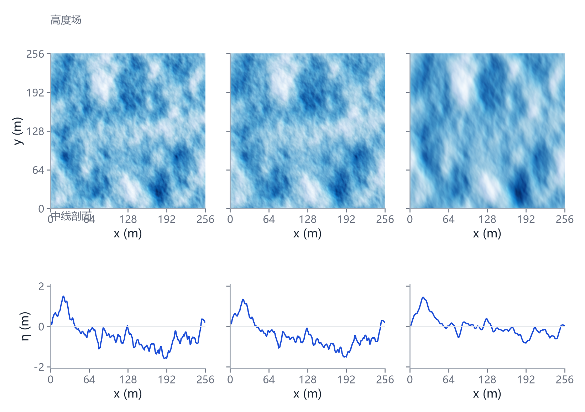
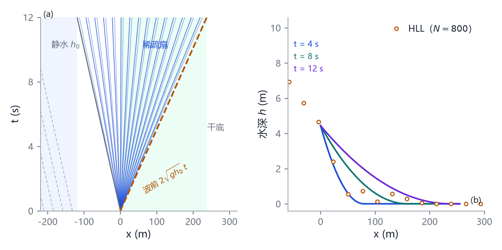

# 第 11 章 水面、海浪与白水

一艘船从画面左边开进来，船头两侧各拖出一道斜纹，浪尖翻出白沫，夕阳在波谷里碎成一条晃动的亮线。这个镜头要跑六十帧，导演还想把机位从贴水面的两米高推到两公里外的航拍。贴图做不到：近处要看得出波峰的厚度、浪尖的倒角和泡沫的颗粒，远处要维持一片不重复的花纹。

水面这一段在制作里通常被拆成两半。一半是形状，要的是一张高度场，它有正确的波长分布、正确的粗糙度和正确的白水分布；另一半是动力学，要的是能量怎么在水里传、船怎么被水推、水又怎么被船推开。形状可以只用几百行 FFT 做到六十帧，动力学往往只能用完整的纳维-斯托克斯求解器在几十米范围内做，或者用深度积分的浅水方程在几公里范围内做。

先把账算清楚。一平方公里的海面，如果要求最小 1 cm 的涡被分辨，网格就是 $10^{10}$ 量级；而一公里外的 1 cm 细节在 4K 屏幕上占不到一个像素。这个落差是海面所有工程选择的来源，也决定了本章的顺序：先讲怎么用统计量把形状造出来，再讲近岸那段必须解方程的地方，最后讲白水、浮体和渲染的接口。

## 11.1 三个尺度，三条路

最贵的一条路是把纳维-斯托克斯方程直接解在一片海上。要同时满足两个条件：最小的涡要被分辨，最大的波要装在计算域里。1 cm 的涡意味着网格间距 2 mm，1 km 的域意味着每条边五十万个格子，这是不可能的。退一步只算破碎带，域缩到 50 m×50 m×10 m，间距 2 cm，也有三百万个格子，每帧几十到几百毫秒。所以这条路只在镜头贴着水面的那几个镜头里用，而且用完就要切走。

第二条路放弃动力学，只保留统计量。问题从"这个波为什么在这里"变成"波长在 100 m 附近的波一共有多少能量、朝哪个方向走"。答案是一个谱。有了谱，海面就是一个高斯随机场，一次逆 FFT 得到一整片高度场。这条路能覆盖几公里，成本只与网格数有关、与海面面积无关，代价是它给出的海是稳态的：能量分布不随时间变，没有破碎、没有飞沫，也没有船开过之后留下的尾迹。

第三条路在两者之间。浅水方程把垂向动量方程扔掉，只留两个水平方向加一个水深，算不出单个碎浪的翻滚，但能算出浅滩上波高怎么涨、什么时候碎、碎完之后那道涌潮怎么往岸上推。域可以做到 10 km，网格 10 m，成本比完整求解低三个数量级。

三条路怎么选，看镜头到水面的距离，以及镜头里有没有"接触"。贴着水面、有船、有礁石、有浪拍岸，必须有一条能给出真实接触的路径；离水面 20 m 以上、船只是背景里的一个点，统计法足够，而且更好调，因为它的参数（风速、风向、波高）直接对应美术能理解的东西。

## 11.2 一个正弦波能说清的事

海水的基本解是正弦波。取波长 $\lambda$、振幅 $a$ 的一个波，它的圆频率 $\omega$ 与波数 $k=2\pi/\lambda$ 被一个关系锁住：

$$\omega^{2}=gk\tanh(kh),$$

其中 $g=9.81\ \mathrm{m/s^2}$，$h$ 是水深。深水时 $\tanh(kh)\to 1$，得到 $\omega=\sqrt{gk}$。这条式子最反直觉的地方是长波跑得快：$\lambda=100$ m 的浪，相速度 $c=\omega/k=\sqrt{g/k}=12.5$ m/s，周期 8.0 s；$\lambda=10$ m 的浪只有 3.95 m/s，周期 2.5 s。一片海里，长波总是先到、短波跟在后面，这就是涌浪能在风暴还没靠近时就抵达海岸的原因——它从几百公里外出发，一路以十几米每秒跑，把当地刚被风刮起来的小浪远远甩在后面。

有限水深时 $\tanh$ 这一项把速度压下来。$h=5$ m、$\lambda=100$ m 时 $kh=0.314$，$\tanh(kh)=0.304$，相速度从 12.5 掉到 6.9 m/s。速度一慢，波长就缩短；而能量通量必须守恒，波高就涨。这是"浪越靠近岸越高"的第一层原因。第二层是海底坡度把波峰推前、波谷拖后，波形变得前陡后缓，直到前面陡到立不住，于是碎了。第 11.4 节会回到这件事。

真实的海是无数个这样的正弦波叠起来。要描述它，只需要一个函数：单位频率间隔内的能量 $S(\omega)$，量纲是 $\mathrm{m^2\cdot s}$。它的零阶矩 $m_0=\int S\,d\omega$ 是海面高度的方差，有义波高 $H_s=4\sqrt{m_0}$，含义是"最高的三分之一浪的平均高度"，航海和工程都用它当口径。

Pierson-Moskowitz 谱是最老也最常用的一个，描述风刮了足够久、足够远之后的海：

$$S(\omega)=\frac{\alpha g^{2}}{\omega^{5}}\exp\left[-1.25\left(\frac{\omega_p}{\omega}\right)^{4}\right],$$

$\alpha=0.0081$ 是无量纲常数，$\omega_p=0.877g/U$ 是峰值频率，$U$ 取海面上 19.5 m 处的风速。把 $U=10$ m/s 代进去数值积分，$m_0=0.284\ \mathrm{m^2}$，$H_s=2.1$ m。这个数对得上经验：十米每秒的风（五级）吹出来的浪大约一人多高，船会明显摇。把风速加到 15 m/s，$H_s$ 变成 4.8 m，涨了不止一倍——谱的能量按 $U^4$ 走，波高按 $U^2$ 走。

实际海况很少是"充分成长"的，风区有限、风刮的时间也有限，谱形会偏向低频、峰值更尖。JONSWAP 谱在 PM 谱上乘一个峰值增强因子 $\gamma^{r}$，$\gamma$ 通常取 3.3，$r$ 是一个以 $\omega_p$ 为中心的窄高斯，于是同一风速下长波更多、短波更少，海面看起来是几条长长的涌浪上叠着碎浪，而不是一团均匀的粗糙。图形学里另一种常用的是 Phillips 谱，形如 $P(k)\propto k^{-4}\exp[-1/(kL)^2]$，物理上不那么讲究，但它的能量按倍频程均分，各个尺度看起来一样强，很适合做"粗糙度"而不是"某次具体的风暴"。

方向也要分配。取方向谱 $S(\omega,\theta)=S(\omega)D(\theta)$，$D$ 用 $\cos^{2s}(\theta/2)$ 归一化，$s$ 大就窄（长涌），$s$ 小就宽（乱浪）。$s$ 取 2 到 8 之间的值能覆盖从开阔洋面到被陆地遮挡的海湾。

## 11.3 用 FFT 造一张高度场

把谱变成空间里的形状，标准做法是一次逆快速傅里叶变换。取一块边长 $L$ 的正方形水面，分成 $N\times N$ 网格，波矢只能取离散值 $k_x=2\pi n/L$、$k_y=2\pi m/L$，$n,m$ 取 $-N/2$ 到 $N/2-1$。这套离散的含义很直接：最长能表示的波是 $L$，最短是 $2L/N$，中间每个整数格点占住一段。

每个格点上放一个复振幅。振幅的大小从谱来，相位随机：

$$\tilde h_0(\mathbf{k})=\frac{1}{\sqrt{2}}\left(\xi_r+i\xi_i\right)\sqrt{P(\mathbf{k})\,\Delta k^{2}},$$

$\xi_r,\xi_i$ 是两个独立的标准高斯随机数，$P$ 是该波矢处的二维谱密度，$\Delta k=2\pi/L$ 是波矢间隔。$\sqrt{2}$ 和 $1/2$ 这类因子只是为了让 $\tilde h_0$ 的方差等于 $P\Delta k^2$，具体归一到哪个常数可以后面统一缩放，重要的是相位必须是随机的、大小必须严格由谱决定。这一点常被做错：随手给每个波一个随机振幅再加权，得到的高度场看起来也像海，但它的能量谱是错的，缩放到远景时会发现大浪不够大、小浪又太密。

时间演化靠色散关系。每个波以自己的 $\omega=\sqrt{g|\mathbf{k}|}$ 转相位，而实值场要求正负波矢共轭成对：

$$\tilde h(\mathbf{k},t)=\tilde h_0(\mathbf{k})\,e^{i\omega t}+\overline{\tilde h_0(-\mathbf{k})}\,e^{-i\omega t}.$$

一次二维逆 FFT 得到 $h(\mathbf{x},t)$。整个过程的成本是 $O(N^2\log N)$，$256^2$ 的网格在 CPU 上一毫秒量级，$1024^2$ 放到 GPU 上也不到一毫秒。这是海面能用统计法做的根本原因：造一张有正确波长分布的高度场，比解一小块流体便宜五个数量级 [@tessendorf2001]。

纯高度场做出来的海面像一张起伏的布，波峰是圆的、波谷也是圆的。真实海浪的剖面不对称：波峰尖、波谷宽，波峰向前倾。补这个的办法是给水平位置也加一个位移，让网格点自己往波峰方向挤：

$$\mathbf{D}(\mathbf{k},t)=-i\,\frac{\mathbf{k}}{|\mathbf{k}|}\,\tilde h(\mathbf{k},t),\qquad \mathbf{x}'=\mathbf{x}+\lambda\mathbf{D}.$$

$\lambda$ 是控制尖锐度的无量纲参数，1 左右就够，取大了会让网格折叠。这个位移把正弦波变成摆线（trochoid），波峰被挤尖、波谷被拉平，剖面立刻对了。代价是水平位移之后网格不再均匀，法线不能用简单的中心差分算，而且折叠区域的三角形会翻面，需要额外的剔除或"折叠即泡沫"的处理——这条恰好成了白水的来源之一，第 11.5 节会用到。

尺度问题是这条路唯一的硬伤。$L=512$ m、$N=512$ 意味着格距 1 m，最短波长 2 m。摄像机在 3 m 高处看近处的水面，1 m 的格距连一个浪花都撑不起来。实际做法是叠几层：$L$ 取 1024 m 到 8 m 之间的三到四个值，每层都跑自己的 FFT，远处只用大 $L$ 的层，近处补上小 $L$ 的层。四层 $256^2$ 也就是四次小 FFT，比一层 $1024^2$ 还便宜。层与层之间按距离加权混合，混合区要留够宽度，否则能看到明显的接缝。

<figure class="fig">

<figcaption><b>图 11-1</b>　同一风速 $U=12$ m/s、同一块 $256\ \mathrm{m}\times 256\ \mathrm{m}$ 水面（$N=256$，格距 1 m），三种谱各造一张高度场，都缩放到 $H_s=3.1$ m 以便比较形状。上排是高度场，共用一条色标，亮处高、暗处低；下排是穿过水面中线的一条剖面。PM 谱给出均匀的短峰浪；JONSWAP 谱（$\gamma=3.3$）把能量压在低频，剖面是一条长涌浪上叠碎浪；Phillips 谱的倍频程能量均分，剖面在每个尺度上都有起伏，最像"粗糙度"。</figcaption>
</figure>

图 11-1 里三张场的波高一样，观感差别全在能量怎么分配到波长上。PM 谱那张的典型波长在 40 m 上下，视野里能看到六七个大浪，浪与浪之间高度差别不大。JONSWAP 那张的长波更显著，剖面在 0 到 256 m 之间只走了一个多起伏，看起来"慢"。Phillips 那张最碎，缩到远景会觉得密度合适、缩到近景就露馅，因为它没有任何一个尺度占主导。选哪个谱，取决于镜头要的是"某次风暴"还是"随便一片海"。

## 11.4 浅水方程：能量往岸上走的那一段

FFT 给出的是稳态的海。它没有"深处来的浪在浅滩上变高"这回事，因为它根本没有水深这个量。近岸那一段必须回到方程。

浅水方程的出发点是静压假设：垂向加速度比起水平对流可以忽略，于是压力沿深度线性分布，$p=\rho g(\eta-z)$，$\eta$ 是自由面高度。把这个压力代进水平动量方程、再沿深度积分，垂向速度就消失了，只剩水深 $h$ 和水平流量 $q=hu$ 两个量（一维写法）：

$$\frac{\partial h}{\partial t}+\frac{\partial (hu)}{\partial x}=0,\qquad
\frac{\partial (hu)}{\partial t}+\frac{\partial}{\partial x}\left(hu^{2}+\frac{1}{2}gh^{2}\right)=-gh\frac{\partial b}{\partial x},$$

$b(x)$ 是海底高程，最后一项是底坡对流体的作用。第一个式子是体积守恒，第二个是动量守恒，$\frac{1}{2}gh^2$ 那一项是静水压力沿深度的积分。这组方程和欧拉方程长得几乎一样，只是把"密度"换成了"水深"，把"声速"换成了 $\sqrt{gh}$。

写成拟线性形式，特征速度就是 $u\pm\sqrt{gh}$。沿着 $dx/dt=u\pm\sqrt{gh}$ 这两族曲线，有两个量保持不变：

$$J_{\pm}=u\pm 2\sqrt{gh}.$$

这就是浅水方程的黎曼不变量。它们说明两件事。第一，信息以有限速度传播，速度是 $u+\sqrt{gh}$，在水深 10 m 时约 10 m/s，所以水深越浅、波越慢。第二，$J_+$ 和 $J_-$ 分别沿着两族特征线守恒，边界条件只能各给一个——给两个就过定，一个都不给就欠定。数值格式的构造、边界处理、乃至"为什么入流边界只能指定一个量"这类工程细节，全都从这里来。

最干净的解析例子是溃坝。初始时刻 $x\lt 0$ 一侧水深 $h_0$、流速为零，$x\gt 0$ 一侧是干的，闸门在 $t=0$ 抬起。解是一束从原点散开的特征线（稀疏扇），在扇内

$$h(x,t)=\frac{1}{9g}\left(2\sqrt{gh_0}-\frac{x}{t}\right)^{2},\qquad u(x,t)=\frac{2}{3}\left(\frac{x}{t}+\sqrt{gh_0}\right),$$

适用范围是 $-\sqrt{gh_0}\,t\le x\le 2\sqrt{gh_0}\,t$。$h_0=10$ m 时 $\sqrt{gh_0}=9.9$ m/s，波前以 19.8 m/s 推进；流速在闸门处为零，线性过渡到波前的 $2\sqrt{gh_0}$。这个解不需要任何数值方法就能算出来，所以它是检验浅水代码的第一道关。

<figure class="fig">

<figcaption><b>图 11-2</b>　$h_0=10$ m 的溃坝，$g=9.81\ \mathrm{m/s^2}$，$\sqrt{gh_0}=9.9$ m/s。左图是 $x$–$t$ 平面上的特征线：实线是 $dx/dt=u+\sqrt{gh}$，虚线是 $dx/dt=u-\sqrt{gh}$，从原点散开的一束构成稀疏扇，扇外两侧特征线平行。右图是 $t=4,8,12$ s 三个时刻的水深剖面，按 Ritter 解析解逐点计算，波前位置分别为 79 m、158 m、238 m；圆圈是同一初值下 HLL 有限体积格式（$N=800$，CFL 0.5）的结果，波前被抹开了约两个格子。</figcaption>
</figure>

图 11-2 右图里圆圈和实线的差别是数值粘性。HLL 格式在激波和稀疏扇处都会抹平，抹开的宽度正比于格子尺寸，加密网格才能收窄。这不是格式的毛病，是双曲型方程的一阶格式的固有性质——除非上高阶重构加限制器，否则间断总会被摊到两三个格子上。

真正难的不是溃坝，是干底和破碎。干底意味着 $h\to 0$，$\sqrt{gh}\to 0$，特征速度退化为零，波前变成一条竖直的线，数学上是一个激波。数值上必须给水深设一个下限（典型取 $10^{-3}$ m 或初始水深的 $10^{-4}$），否则除零；而设了下限又会让水在没有水的地方"渗"出去，质量慢慢丢。工程代码里有一整套"干湿处理"技巧，常见的是把流量在干格点强制归零、只在湿格点上计算通量，以及在界面处做特殊的黎曼求解。这些细节写出来都很琐碎，但少一个就会在长时积分里看到水位缓慢下沉或者凭空出现一薄层水。

破碎另说。真实的海浪在浅滩上会失去对称性，前坡陡到一定程度就翻卷、掺气、变成白水。浅水方程在形式上还能继续算（它允许"水跃"这种间断解），但它算出的间断是一个没有厚度的跳跃，而真实的破碎带有几米厚、里面全是气泡。所以工程上通常用判据把它"标记"出来而不是"解"出来：局部的波高与水深之比超过 0.6 到 0.78（0.78 是孤立波的极限，实际海况下 0.6 更常见），或者自由面坡度超过某个阈值，就认为这一格碎了，把动量的一部分扣掉（能量耗散），同时在该处生成白水。这个做法不守恒、不精确，但视觉上对，而且便宜。

## 11.5 白水的三个来源

浪尖上的白不是一个东西。至少三种机制在生成它，混在一起才像。

第一种是几何压缩。FFT 海面加了水平位移之后，网格点在波峰处被挤到一起，某个区域的雅可比行列式 $\det(\partial \mathbf{x}'/\partial \mathbf{x})$ 掉到 1 以下，说明这个区域被压缩了；掉到 0 说明网格折叠了，表面在那里自己压自己。真实的海浪在波峰处正是这样：水质点被挤压、表面开始失稳、然后卷破。所以把 $1-\det J$ 映射成一个泡沫强度，是一个既有物理依据又几乎免费的做法。它天然出现在波峰内侧，位置对。

第二种是速度梯度。泡沫在湍流强的地方生成，而湍流的强度可以用应变率张量的模或者涡量来估计。在浅水或完整求解里，直接算 $|\nabla\mathbf{u}|$ 或者 $|\omega|$，超过阈值的地方产生泡沫。要注意量纲：应变率的单位是 1/s，阈值和网格尺寸有关，粗网格上算出来的梯度天然偏小，同一个阈值换个分辨率就不灵，必须随格距标定。

第三种是坡度与曲率。波峰处曲率大，翻卷的浪尖曲率更大。用高度场的二阶导做判据，简单但有噪声，容易在坡上生成一片不该有的白，实践中常作为前两种的补充，权重低一些。

生成的泡沫要能消失。做法是维护一张泡沫密度图 $f(\mathbf{x})$，每帧按

$$f\leftarrow\max\left(f-\frac{\Delta t}{\tau},\ g(\mathbf{x},t)\right)$$

更新，$g$ 是本帧的生成强度，$\tau$ 是寿命。$\tau$ 取 1 到 3 s 比较合适：真实的白浪从生成到消散大约是这个量级，太短会闪，太长会在平静的海面上留下擦不掉的脏斑。这条更新式里有个细节——用 $\max$ 而不是相加，意味着新生成的泡沫直接覆盖旧的，不会累积到饱和，这比相加稳。

覆盖度是个可以对照实际观测的量。开阔洋面上，白浪覆盖的面积比例大致按风速的三点四次方增长，十米每秒时约百分之一，十五米每秒时约百分之四。这个关系是现场观测的拟合，离散度极大（同样风速下不同海域能差两倍），只能用来看数量级。它的用处是给调参一个锚点：如果你调出来的海在十米每秒的风下有一半面积是白的，那肯定过了。

白水在渲染上是另一种材质，不是"白色的水"。泡沫是多孔介质，光进去之后散射很多次再出来，所以它亮、几乎不反光、颜色偏青白，边缘半透明。把泡沫图和高度场一起交给着色器，用泡沫密度调制反照率、粗糙度和次表面强度，是最简单也最有效的接法。

## 11.6 船与浮体

船在水里，第一件事是排水：静止时排开的水的重量等于船重，$\rho V=m$。一艘 5000 吨的船要排开 5000 立方米的海水，这个体积决定了吃水和湿表面积。湿表面积决定摩擦阻力，吃水决定它能不能过浅滩，两者都是从这一个等式出来的。

第二件事是稳性。浮心（排水体积的形心）和重心不一定在同一条铅垂线上，横倾一个角度 $\phi$ 之后浮心移动，产生一个恢复力矩。这个力矩的力臂叫稳心高度 $GM$：$GM$ 为正时船扶正，为负时船会继续倾下去。横摇周期是

$$T=2\pi\sqrt{\frac{I}{\rho g \nabla\, GM}},$$

$I$ 是绕纵轴的转动惯量，$\nabla$ 是排水体积。$GM$ 小，周期长、摇得慢但幅度大；$GM$ 大，周期短、摇得频但幅度小。乘客觉得"这船摇得难受"，通常是 $GM$ 太大、周期落在一两秒这个跟人的内脏共振的区间。设计上要在这两者之间选，跟数值方法无关，但如果你在模拟里发现船摇的周期比这个式子算出来的短一半，那基本可以断定是把附加质量算漏了，第 12 章会专门讲这件事。

第三件事是兴波。船在水面走，会在船头船尾各激起一组波，两组波在开尔文角 $\theta$ 内叠加，$\sin\theta=1/3$，即 19.47°。这个角与船速无关，只与深水色散关系有关，所以从皮划艇到航母，尾迹的张开角度都一样。这个结论只用到了 $\omega=\sqrt{gk}$，是一个很好的例子：一条色散关系能定死一片几何。

兴波阻力随弗劳德数 $Fr=U/\sqrt{gL}$ 变化，$L$ 取水线长。$Fr$ 在 0.4 到 0.5 之间有一个阻力峰（hump），因为船头波和船尾波在这个速度下同相叠加、波高最大。一艘 50 m 长的船，$Fr=0.45$ 对应 10 m/s，也就是 20 节——这正是很多中型船舶的巡航速度区间，也是为什么"再快一点"在阻力曲线上特别贵。

数值上怎么把船放进去，取决于要什么。只要尾迹好看，用一张 FFT 海面，在船的位置叠一个局部扰动（或者干脆在船体周围用解析的船首波加尾迹），成本几乎为零。要船真的被浪推、被浪托，就得把船当作一个移动的固体边界，让流体在它表面满足不可穿透，再把压力积分回船体。这一步是第 12 章的主题，它比看上去难得多，因为水比船"重"的时候，显式的双向耦合会炸。

## 11.7 从形状到像素

高度场交给渲染之前还差三样东西：法线、细节、分层。

法线可以直接在频域算。$h$ 的偏导对应乘上 $ik_x$ 和 $ik_y$，所以再跑两次逆 FFT（或者一次复数 FFT 同时拿到两组），就有精确的 $\partial h/\partial x$ 和 $\partial h/\partial y$，比在空间域做中心差分准，也不额外花钱。这一点在网格粗的时候尤其重要：1 m 格距的高度场做差分，法线在波长 2 m 附近会完全失真。

细节靠法线贴图补。高度场的格距决定了它能表达的最短波长，比它更短的波不参与几何，只参与着色。做法是把高频那段谱另外合成一张可平铺的法线图，按世界坐标采样，随时间平移。这张图的能量必须和高度场的谱接上——如果高频图比几何亮太多，近处的细节会"浮"在表面；太少，水面会像塑料。

分层则按距离。远处一片水面在屏幕上只有几十个像素，跑 $512^2$ 的 FFT 是浪费；近处相反。常见做法是按距离切换 FFT 层数，或者把同一张高度场按距离做多级 mip，远处用低一级的采样。判断标准只有一个：屏幕上两个相邻像素对应水面上多大的距离，这个距离决定你需要的最大波数，超过它的波对这张图没有贡献。

最后是水本身的光学。水面是介质的分界面，反射和折射都要，泡沫是散射体，深水有吸收（红光先没），浅水有底部反射。这些交给着色器，但有一个约束来自模拟端：泡沫图、法线、高度必须共用同一套坐标和同一时刻，否则白水会和浪尖错开，一眼就假。这听起来是废话，实际项目里因为三张图由不同管线生成，错半帧、错一个 tile 的事情很常见。

本章给出的都是"形状"层面的东西：怎么造一张统计上正确的海、怎么在浅滩上用方程算一段、怎么把泡沫标出来。船怎么被水推、水怎么被船推，以及"为什么一个泡沫箱丢进水里会抖成那样"，是下一章的事。
