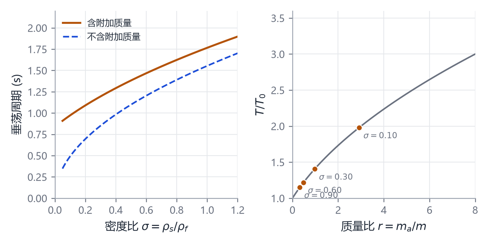
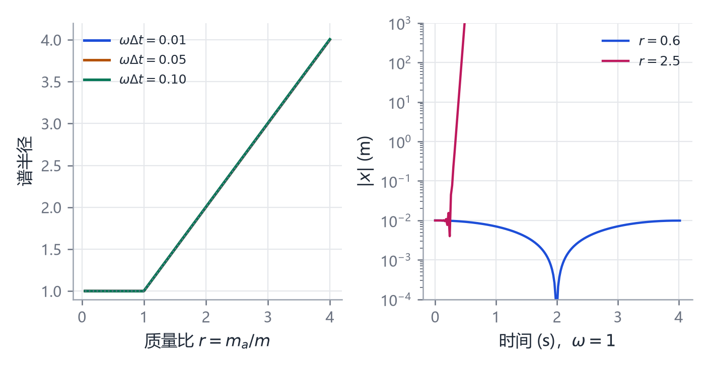

# 第 12 章 固流耦合与交互

一个泡沫塑料箱被人扔进泳池，落水、下沉、然后猛地弹回水面，接下来它不会安静地浮着，而是在水面上剧烈地上下颠、左右晃，幅度越颠越大，直到有人伸手按住。同一池水里扔一块同样大小的木头，它浮起来、晃两下、稳住了。

两个物体的形状一样、排水量接近、受到的浮力也接近，行为差了一个数量级。差别在质量：泡沫箱的等效密度大约是水的十分之一，木头是水的六成。这个比值会以两种完全不同的方式进入计算——物理上它决定附加质量占了多大比重，数值上它决定显式耦合会不会发散。这两件事其实是同一件事的两面，本章要把它拆开。

先把场景分成三类。水只作为背景，物体纯靠动画驱动，这是无耦合；物体推水、水不推物体，这是单向耦合；两边互相推，这是双向耦合。三类之间的界线不是精度问题，是"能不能算"的问题：双向耦合在密度比不利的时候会直接炸掉，而这不是调参数能救的。

## 12.1 谁推谁

最省事的做法是根本不耦合。角色在雨里跑，雨滴是粒子，落到肩膀上消失；船在水上开，水面是一张 FFT 高度场，船沿一条预设的曲线走。观众看到的是"船在水上"，实际上两个系统互不知情。这种做法在远景、在背景、在不需要特写的地方完全够用，而且它有一个别的手段给不了的好处：完全可控。美术想让船在哪里就在哪里，不用跟求解器吵架。

单向耦合往前一步：固体影响流体，流体不影响固体。桨划水、手搅动烟、螺旋桨搅起尾流，都属于这一类。实现上就是把固体的表面速度作为流体的边界条件，或者在固体占据的格子里加一个体积力把流体推到固体速度。这一步很便宜，只要在流体求解器里多一个"固体速度场"的查询。

单向够不够用，看两边的惯性。一米见方的空气是 1.2 kg，一米见方的水是 1000 kg，差三个数量级。一个人挥手排开几十升空气，那点空气的反作用力小到可以忽略，所以"人在烟里"永远可以单向；同一个人在水里挥手，排开的水的质量跟他手臂差不多，反作用力立刻就看得见了，所以"人在水里"必须双向。中间地带是薄物体：一片纸、一片树叶、一根羽毛，它们的质量小，但排开的水也少，比值不一定极端，要看具体形状——一片纸平着落水，附加质量可以是它自身质量的几十倍。

双向耦合的实现只有两件事要做：把固体的存在告诉流体（几何或力），把流体的作用告诉固体（压力与剪切积分）。两件事听上去对称，麻烦却不对称——前者是几何问题，后者是稳定性问题。

## 12.2 把固体塞进流体：罚力、浸没边界与切割网格

最直接的做法是罚力。在每个被固体占据的格点上加一个体积力，把流体速度往固体速度上拉：

$$\mathbf{f}=-k\left(\mathbf{u}-\mathbf{u}_s\right),$$

$\mathbf{u}$ 是该格点的流体速度，$\mathbf{u}_s$ 是固体在该处的速度，$k$ 是一个量纲为 $\mathrm{kg/(m^3\cdot s)}$ 的刚度系数。$k$ 越大，流体越"听话"，边界越锐利；但 $k$ 大到一定程度，这个力本身变成了一个刚性源项，显式积分要求 $\Delta t\lt 2\rho/k$，步长被它锁死。实际调参是在"边界漏流"和"步长"之间找平衡，而这两个都随网格加密变差：网格细一倍，格点体积小八倍，同样的 $k$ 对应的加速度大八倍。

这种做法有个好听的名字叫 penalization，也有个不好听但更准确的名字叫"糊边界"。它在快速原型、在只需要大致阻挡效果的地方很好用，在对阻力和升力有要求的地方就不行，因为它算出来的边界是一层厚为一个格子的过渡带，形状被抹圆了。

第二个做法是浸没边界法。它不修改流体方程，而是在流体方程里加一个只在固体表面附近非零的力：

$$\mathbf{f}(\mathbf{x})=\int_{\Gamma}\mathbf{F}(s)\,\delta\left(\mathbf{x}-\mathbf{X}(s)\right)ds,$$

$\Gamma$ 是固体表面，$\mathbf{X}(s)$ 是表面上的拉格朗日点，$\mathbf{F}(s)$ 是表面力密度，$\delta$ 是光滑化的狄拉克函数（宽度约一个格子）。速度则反向插值：$\mathbf{U}(s)=\int\mathbf{u}(\mathbf{x})\delta(\mathbf{x}-\mathbf{X}(s))d\mathbf{x}$，再用 $\mathbf{U}$ 与目标速度的差去更新 $\mathbf{F}$。

这套做法的关键是那个 $\delta$ 函数。用同一个 $\delta$ 做散布和插值，力的总和与反作用力才严格相等——这是动量守恒在离散层面的要求，破坏了它，物体会凭空获得推力。这一点在代码里非常容易写错：散布用了一套权重、插值用了另一套，跑起来物体缓慢加速，怎么也找不到原因。

浸没边界的优点是它不要求边界与网格对齐，物体可以任意运动、任意变形，甚至可以是布、是膜、是一根鞭子。缺点是边界仍然被抹开到一两个格子，而且 $\mathbf{F}$ 的更新是迭代式的（每个时间步内几轮），刚性大时收敛慢。

第三个做法最贵也最准：切割网格。把跨过固体表面的格子切开，按固体占据的体积分数分配通量，边界条件直接在切面上施加。二维里这很成熟，三维里要处理无穷多种切割模式。虚拟节点法把这件事做得更系统：把跨界面的格子补上一个"镜像"的虚拟节点，其值由边界条件外推得到，于是所有格子都能用同一套差分模板 [@molino2004]。

切割网格的代价在小格子。一个格子被切掉 99%，剩下的 1% 会让显式的 CFL 条件恶化一百倍，必须做合并（把小格子和邻居并成一个大格子），合并之后数据结构就变成了八叉树。八叉树自适应在流体里的经典用法是"只在界面附近细分"，远处用大格子，这样三维的成本从 $N^3$ 降到接近 $N^2$ [@losasso2004]。第 13 章还会回到这个结构。

三种做法都有一个共同的隐性要求：移动边界的质量守恒。物体在水里移动，它前面的水必须被推开，后面的水必须补进来。用罚力或者浸没边界，这件事是自动发生的（力把水推开），但推开多少取决于那个力够不够强，网格粗的时候水会从物体内部"穿过"，看起来像物体是筛子做的。用切割网格，质量守恒是显式构造的，穿模不会发生，但要额外处理"一个格子从全湿变成全干"那一瞬间的体积变化。工程上有一个便宜的检验：把一个封闭物体在水里推一圈，看计算域的总水量变了没有。变了说明质量不守恒，而这一点在画面上表现为水面缓慢升高或者降低，几个镜头之后才有人发现。

## 12.3 附加质量：物体周围那层"跟着加速的水"

把物体放进流体，让它加速。物体自己需要 $m\mathbf{a}$ 的力，这是牛顿第二定律。但物体周围的水也得加速，因为水不能穿过物体，物体一动，紧贴着它的那层水必须让开。让开需要力，而这个力最终是从物体表面传出去的。结果是：推动物体所需的力比 $m\mathbf{a}$ 大，多出来的部分正比于加速度，可以写成一个"额外的质量"：

$$\mathbf{F}=\left(m+m_a\right)\mathbf{a},\qquad m_a=C_m\,\rho_f V,$$

$\rho_f$ 是流体密度，$V$ 是物体排开的体积，$C_m$ 是无量纲的附加质量系数。球体在理想流体里 $C_m=1/2$，这个值是精确的，可以用势流解出来。垂直于自身平面运动的很薄的圆盘是 $C_m=8/(3\pi)\approx0.85$，长圆柱横向运动接近 1，这些数在船舶和海洋工程的手册里都能查到。

要强调一件容易被误解的事：$m_a$ 不是"粘在物体上的一坨水"。那坨水会跟着物体走、会有惯性延迟、会在物体停下之后继续往前冲，那是阻力的一部分。附加质量没有延迟，它随物体的加速度同步变化，效果等价于物体的质量变大了。两者的区别在于：质量变大改变的是 $\omega=\sqrt{k/m}$，而阻力改变的是振幅的衰减。

对一个浮体，垂荡的恢复力来自水线面：物体下沉 $z$，多排开的水产生 $-\rho_f g A z$ 的浮力增量，$A$ 是水线面积。于是

$$\omega=\sqrt{\frac{\rho_f g A}{m+m_a}},\qquad T=\frac{2\pi}{\omega},$$

分母里必须同时有 $m$ 和 $m_a$。漏掉 $m_a$，算出来的周期会偏短，而且偏得很有规律：轻的物体偏得多。

取一个半径 0.25 m、高 0.6 m 的圆柱浮标，等效密度比 $\sigma=\rho_s/\rho_f$ 从 0.1 变到 0.95，$\rho_f=1000$。水线面积 $A=0.196\ \mathrm{m^2}$，恢复刚度 $\rho_f gA=1926$ N/m，质量 $m=117.8\sigma$ kg，附加质量取 $m_a=0.7\rho_f\pi R^3=34.4$ kg（薄圆盘解析值 $\frac{8}{3}\rho_fR^3$ 与球体值 $\frac{1}{2}\rho_f\cdot\frac{4}{3}\pi R^3$ 之间）。

<figure class="fig">

<figcaption><b>图 12-1</b>　圆柱浮标 $R=0.25$ m、$H=0.6$ m、$\rho_f=1000\ \mathrm{kg/m^3}$、$g=9.81$。左图是垂荡周期随等效密度比 $\sigma$ 的变化，实线含附加质量 $m_a=0.7\rho_f\pi R^3=34.4$ kg，虚线不含；右图是周期被拉长的比例 $T/T_0=\sqrt{1+m_a/m}$，只依赖附加质量与自身质量之比 $r$，四个点是 $\sigma=0.9$（冰块与重木）、0.6（木船）、0.3（钢壳船）、0.1（泡沫浮标）。</figcaption>
</figure>

图 12-1 左图的两条线在重的一端几乎重合，在轻的一端岔开一倍。$\sigma=0.5$ 时周期从 1.10 s 变成 1.38 s，长了 26%；$\sigma=0.1$ 时从 0.49 s 变成 0.97 s，长了 98%。右图把这件事压缩成一条曲线：$T/T_0=\sqrt{1+r}$，$r=m_a/m$，与形状、与密度都无关，只与这个比值有关。这条曲线的形状告诉你怎么估：$r\lt 0.2$ 时忽略附加质量误差不到 10%，$r=1$ 时误差 41%，$r=3$ 时误差 100%——也就是周期整整翻倍。

所以判断"要不要算附加质量"有一条粗略的线：船、潜艇、木头，$r$ 在 0.1 到 0.6，忽略它意味着周期的误差在 5% 到 25%，对动画够用，对船舶设计不够；气泡、泡沫、气球、薄板，$r$ 在 1 以上，忽略它是错的，而且不是"差一点"，是"差一倍"。

## 12.4 密度比为什么会把显式耦合炸掉

附加质量在物理上只是"质量变大"，在数值上却是另一回事。分区（partitioned）耦合的常规做法是每个时间步先解固体、再解流体，或者反过来。假设先解固体：用它上一帧的速度去问流体"你给我的力是多少"，流体根据这个速度算出压力，压力积分回固体，固体据此更新速度。问题在于，流体给出的这个力并不是对固体当前加速度的响应，而是对上一帧运动的响应。

把这个过程简化成一维的模型。物体质量 $m$，接一根刚度 $k$ 的弹簧（就是恢复力），流体对它的力写成 $m_a$ 乘上一个滞后一步的加速度：

$$m\frac{v_{n+1}-v_n}{\Delta t}=-k x_n-m_a\frac{v_n-v_{n-1}}{\Delta t}.$$

令 $r=m_a/m$、$\omega^2=k/m$，整理得

$$v_{n+1}=(1-r)v_n+r\,v_{n-1}-\omega^{2}\Delta t\,x_n,\qquad x_{n+1}=x_n+\Delta t\,v_{n+1}.$$

这是一个三元线性递推，写成矩阵求特征值就能看清稳定性。特征多项式里有一个因子恰好给出 $\lambda=-r$：每走一步，这个模态的符号翻一次、幅度乘上 $r$。也就是说，$r\lt 1$ 时它是衰减的（幅度按 $r^n$ 掉），$r=1$ 时原地不动，$r\gt 1$ 时它指数增长，并且带符号交替——这就是肉眼看到的"抖"，每帧反向、幅度越来越大。

<figure class="fig">

<figcaption><b>图 12-2</b>　显式分区耦合的一维模型，$\omega^2=k/m$，$r=m_a/m$。左图是递推矩阵的谱半径随 $r$ 的变化，三条线对应 $\omega\Delta t=0.01$、$0.05$、$0.1$：$r\le 1$ 时谱半径为 1（中性），$r\gt 1$ 时谱半径等于 $r$，与步长几乎无关。右图是同一模型的位移绝对值时程，初值 $x_0=0.01$ m、$v_0=0$，$\omega\Delta t=0.02$：$r=0.6$ 的曲线始终停在 $10^{-2}$ m 量级，$r=2.5$ 的曲线在 0.1 s 内就冲到 1 m 以上。</figcaption>
</figure>

图 12-2 左图里那三条线几乎叠在一起，这件事比曲线的形状更重要：放大因子是 $r$，与 $\Delta t$ 无关。很多人第一反应是"抖了就把步长减小"，在这里完全无效——步长减半，增长因子还是 $r$，只是增长得更"细"了，看起来从大抖变成了快抖，本质上还是发散的。这是附加质量不稳定与刚度不稳定最根本的区别：刚度不稳定（第 12.2 节的罚力）可以通过减小步长解决，附加质量不稳定不能。

右图给出量级。$r=2.5$ 意味着每步放大 2.5 倍，十步是 $2.5^{10}\approx9500$。从 $x_0=0.01$ m 出发，十几步就跑到米级，一帧之内就能看到物体"飞出去"。这也解释了为什么泡沫箱在粗糙的模拟里会像被弹弓打出去。

按这个判据回看各种物质：球体 $C_m=0.5$，$r=0.5\rho_f/\rho_s$，要求 $\rho_s\gt 0.5\rho_f$ 即密度比大于 0.5 才安全。木船 $\sigma=0.5$ 时 $r=0.58$，勉强过关；钢壳船等效 $\sigma=0.3$，$r=0.97$，已经在边界上；泡沫 $\sigma=0.05$，$r=10$，完全没法用显式耦合。这就是为什么流体模拟里凡是"轻物体"都要特殊照顾。

三条修法，代价递增：

第一条是把附加质量显式地加到固体的质量上。既然知道 $m_a=C_m\rho_fV$，那就解 $(m+m_a)\mathbf{a}=\mathbf{F}$，让物体"自愿"变重。这等价于把 $r$ 从方程里消掉，一步到位，代码只改一行。缺点是 $C_m$ 对不规则形状没有解析值，而且它随姿态变化（一个长方体横着动和竖着动的 $C_m$ 差一倍以上），近似成常数会在某些姿态下过冲、某些姿态下迟钝。

第二条是耦合迭代。在一个时间步内反复交替求解固体和流体，直到两者的界面速度差小于阈值。这等价于用迭代解出那个隐式的 $m_a$ 项，迭代次数取决于 $r$：$r=3$ 时大概要五到八轮才能把误差压到百分之一，$r=10$ 时可能要二十轮以上，而且用固定的松弛因子会震荡，得上 Aitken 之类的自适应松弛。

第三条是整体求解。把固体和流体的未知量放进同一个线性系统，一次性解出来。这是唯一无条件稳定的做法，代价是要组装一个跨越两种介质的矩阵，规模大、条件数差，通常只在二维或者小规模三维里做。

## 12.5 布料与水

布料是流体耦合里最麻烦的一类，原因有三个，每个都单独成立。

第一是尺度。布料厚度 0.1 mm，流体网格 2 cm，差两百倍。布料不能当成一个"有厚度的固体"塞进网格，只能当成一张零厚度的面。做法是把布料三角形的法向力散布到周围格点（浸没边界），再把格点速度插值到布料顶点。散布和插值必须用同一套权重，否则动量不守恒，布料会莫名其妙地被水"吸"。

第二是质量。一块面密度 0.2 kg/m² 的布，一平方米只有 0.2 kg；它排开的水按 1 cm 厚度算是 10 kg。附加质量是自身质量的五十倍。按第 12.4 节的判据，$r=50$，显式耦合没有任何机会。所以布料入水几乎从来不用显式分区耦合，要么整体隐式，要么把水的作用简化成"阻力加浮力"，直接放弃附加质量那一项。

放弃附加质量在动画里是常见的选择，效果也不算差，因为它只影响"布料随水加速"的那一部分响应，而布料在水里的运动主要由阻力和自身重力主导。代价是布料会"穿"过快速运动的水——水猛地冲过来时，布料不会跟着加速，而是让水从它身上过去。这个错误在慢镜头里看得出来，在正常速度下几乎看不出来。

第三是接触。布料与水耦合时，布料往往还要跟自身、跟角色、跟池壁碰撞。三套约束同时作用在一个顶点上，迭代求解会互相打架：碰撞把顶点推进水里，水的压力把它推出来，下一轮碰撞又推进去。表现是布料在水面附近高频抖动。工程上的处理是给水面一个"软"边界（允许几毫米的穿透），或者把水的力当作外力先施加、再做碰撞投影，顺序固定下来。

湿衣的视觉是另一套事情。布料吸水之后，面密度可以涨到四倍，弯曲刚度涨得更多（湿的棉布比干的硬），摩擦系数也变。渲染上还要变颜色（深一个色调）、变透光（湿布贴身、透光增加）。这些都不难，难的是"湿到哪里"要有数据：用一张饱和度图，逐顶点累积，往上渗透靠毛细（可以简化为沿重力反方向扩散），往下流靠重力。这张图同时驱动质量、刚度、颜色三组参数，所以它必须是同一个量。

## 12.6 耦合策略与预算

把上面的东西收成一套可执行的策略，大概是这样几层。

第一层，判断需不需要双向。固体的质量与被它排开的流体质量之比大于 10（木头对水、金属对水基本都在这个量级），且固体的运动不由流体主导（船有推进器、人有肌肉），单向就够。反过来，固体是被流体推着走的（落叶、纸片、泡沫、气泡），必须双向。

第二层，判断显式耦合会不会炸。算 $r=C_m\rho_f/\rho_s$。$r\lt 0.5$ 可以直接用显式分区，每帧交替一次，稳定。$0.5\lt r\lt 1.5$ 加松弛或把 $m_a$ 加到质量上。$r\gt 1.5$ 必须迭代或整体求解。这条线不是绝对的，它依赖耦合界面的具体形式，但它能提前告诉你"这个镜头会不会出事"。

第三层，判断要不要全场耦合。大规模场景里，几百个物体跟水交互，全场双向的成本是不可接受的。常见的做法是只对近场的少数物体做强耦合，远场物体用简化的浮力加阻力模型（不解流体，只查高度场和局部流速），更远的用纯动画。判断"近场"的标准可以简单到"离摄像机 30 m 以内"或者"屏幕上大于 100 个像素"。

有一类耦合经常被忽略：物体之间的流体中介。两条船靠得很近时，中间的水被挤出去，两船会互相吸引（这是真的，叫船吸效应）；一个物体快速掠过另一个静止物体，会把它"吸"过来。这些现象只有全场双向耦合才能自动出现，而它们恰好是视觉上最有说服力的细节。所以预算够的时候，宁可减少物体数量，也要保证耦合是真的。

最后是时间步。流体和固体往往要不同的步长：流体的 CFL 由最快的波决定，固体的步长由刚度决定，两者可能差十倍。让它们各自走自己的步长，在耦合界面上做插值，是工程上最常见的做法；代价是插值引入的误差，以及"这一帧固体推了水、水还没来得及推回固体"的半拍延迟——这个延迟在 $r$ 大的时候正是发散的来源，所以插值必须小心，不能让它变成一个额外的滞后。

把选择画成一条带子会更清楚：横轴是密度比 $\rho_s/\rho_f$，左侧（重物体）三种方法都能用，选便宜的；越往右可选的越少，最后只剩整体隐式。这条带子上没有"更好的方法"，只有"在这个密度比下还能用的方法"。

一次具体的预算可以说明这条带子怎么用。假设一帧 16 ms，流体分到 8 ms，固体分到 2 ms，剩下是渲染与引擎开销。流体部分用 $128^3$ 的网格，每帧三十次多重网格迭代，已经吃掉 6 ms；如果在这个预算里还要做两轮耦合迭代，流体就要算两遍，直接超支。所以 $128^3$ 的场景里，双向耦合只能给一两个物体，其余必须降级成单向或者浮力近似。把网格降到 $96^3$，成本降一半多，就能承担两轮迭代；代价是最小的涡变粗，烟的细节丢一层。这类交换没有正确答案，只有"这个镜头里哪一个错误更看得出来"。

本章讲的耦合都是"一个物体一片水"的规模。真实项目里是几十个物体、几百万格点、还要在十六毫秒里算完。剩下的问题——误差从哪来、成本怎么算、分辨率怎么分配——是下一章的事。
