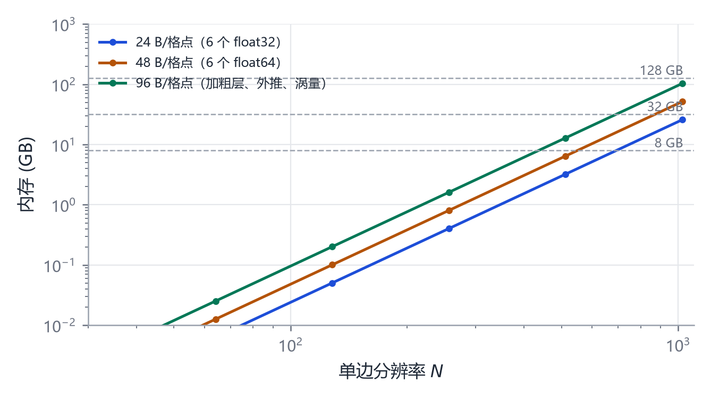

# 第 13 章 精度、稳定性与性能

> 本章导读：好看、够快、不抖，这三件事偏偏由同一组旋钮控制，拧一个另外两个就掉。这一章把误差拆成三笔、把步长拆成四条限制、把内存和带宽算成一张表，再讲并行、稀疏和 LOD 各自把成本挪到了哪里。

一个烟柱镜头，模拟组给了三版。第一版很好看，烟丝细、翻滚自然，但一帧四十分钟；第二版能跑到五分钟一帧，烟变成一团模糊的棉花；第三版速度合适，可烟柱升到一半就开始抖，顶上炸开一片方格。导演看不出这三版背后是同一套代码的两个参数在动。

四十分钟一帧，相对 16.7 ms 的实时预算是十四万倍；五分钟一帧是一万八千倍。也就是说，这三版之间的差距不是"优化一下"能追回来的，它们是三种不同的取舍：一版把细节放在最优先，一版把速度放在最优先，一版什么都没优先，于是两边都丢。

这类三选一在每个项目里都会出现。它的本质是：流体模拟的精度、稳定性、速度三者被同一组旋钮控制，而这三个旋钮不是正交的。本章要把这些旋钮拆开，说明每个旋钮拧动时具体坏在哪里，以及怎么在给定的预算下选一套坏得最不难看的方法。

## 13.1 三笔误差账

流体的误差不是一种，是三种，它们各自有独立的来源和独立的测法。混在一起谈"精度"没有意义。

第一笔是平流耗散。它来自平流格式本身：半拉格朗日回溯加线性插值，等价于每一步在流体里加了一点粘性。这个等效粘性可以算出来，一阶迎风的数值粘性是

$$\nu_{\text{num}}=\frac{|\mathbf{u}|\Delta x}{2}\left(1-\text{CFL}\right),$$

$\mathrm{CFL}=|\mathbf{u}|\Delta t/\Delta x$。逐符号看：$|\mathbf{u}|\Delta x/2$ 是"每步插值把一个格子宽的误差抹开"的强度，$(1-\mathrm{CFL})$ 是"步子越小、抹得越多"的修正。代一个合法的数：$|\mathbf{u}|=0.5$ m/s、$\Delta x=0.01$ m、$\Delta t=0.01$ s，CFL 正好 0.5，$\nu_{\text{num}}=1.25\times10^{-3}\ \mathrm{m^2/s}$。水的运动粘度是 $10^{-6}$，也就是说这个格式给出的"假粘性"是真实水的 1250 倍。后果很具体：一个 10 cm 的涡，靠真实粘性要三个小时才衰减，靠这个假粘性八秒就没了。

原式只在 CFL 小于 1 时成立。若 $|\mathbf{u}|=2$ m/s、$\Delta x=0.02$ m、$\Delta t=1/60$ s，CFL=1.67，半拉格朗日仍然能跑（它不受 CFL 限制），但误差的性质变了：每步的插值误差是 $O(\Delta x^2)$，累积到时间 $T$ 的等效扩散大约是 $\Delta x|\mathbf{u}|T$ 的量级。数字不好看，但测法很直接：放一个被动标量团，在均匀流里推一段时间，量它的方差增长。纯扩散的方差是 $\sigma^2(t)=\sigma_0^2+2Dt$，拟合出来的 $D$ 减去物理粘性，就是数值耗散。也就是说，"我的烟为什么越来越糊"这个问题，可以用一个标量团加一条直线拟合定量回答，不必靠眼睛。

第二笔是投影误差。压力泊松方程是迭代解的，迭代不够就有残余散度，残余散度意味着流体会缓慢地"涨"或者"缩"。测法是 $\max|\nabla\cdot\mathbf{u}|\cdot\Delta x/|\mathbf{u}|$，这个无量纲数的含义是"一个格子上每步漏掉的体积占流过体积的比例"，$10^{-3}$ 以下肉眼看不见，$10^{-2}$ 时体积会明显漂移。换个说法：$10^{-2}$ 意味着每流过一百升水就少了一升，一秒钟流过一立方米的话，每秒少十升，十秒就是一桶。

第三笔是界面误差。Level Set 和 VOF 都会丢体积，前者因为重新初始化时把界面挪了位置，后者因为界面重构不精确。测法是体积：一个静止的球在水里，算十秒，看体积还剩多少。好的实现是每秒丢千分之一，差的能丢百分之一。半径 5 cm 的球体积是 $5.2\times10^{-4}\ \mathrm{m^3}$，每秒丢百分之一，十秒之后少了十分之一，直径缩了 3%，在特写里能看出来。

三笔误差的量级不同，处理优先级也不同。平流耗散决定"细节能留多久"，投影误差决定"体积对不对"，界面误差决定"水面看起来动不动"。做烟的时候第一笔最要命，做水的时候第二笔和第三笔更显眼，因为水面就是界面本身。

三笔账之间还会互相伪装。耗散把细节抹平，看起来像"分辨率不够"；于是有人加密网格，细节回来了、步长掉了、帧率崩了，而真正的解法是给平流加个补偿格式。投影误差让体积缓慢流失，看起来像"界面误差"；于是有人去调重新初始化的参数，其实问题在压力求解的迭代次数。分辨这两种情况的办法是分别测：把平流换成一个只在周期小算例里做得到的谱方法，如果细节立刻回来，问题就在平流；把压力迭代加到收敛，如果体积不漂了，问题就在投影。做一次这样的对照实验，比读十篇论文有用。

这套对照实验有一份最小清单：均匀流里的一个标量团（测耗散）、静水里的一个球（测体积）、一个周期性的剪切层（测涡量保持）、一个溃坝（测质量守恒）。四个算例都在 $64^2$ 或 $64^3$ 上跑几百步，十分钟能跑完，但改一行代码之后它们能立刻告诉你坏了哪一笔账。

有一个现成的对照算例值得常备：Taylor–Green 涡。它是一个有解析解的二维衰减流，初始是一排反向旋转的涡，粘性让动能按 $e^{-2\nu k^2 t}$ 衰减。在 $64^2$ 网格上跑半拉格朗日，把动能曲线的斜率拟合成 $\nu_{\text{eff}}$，通常会得到真实粘性的三到五倍。这个数字就是你的格式的"底噪"：任何比它更弱的物理粘性都测不出来，任何比它更细的结构都会被它吃掉。

## 13.2 最短的那个时间尺度

显式方法的步长由最快的那个过程决定，而流体里同时住着好几个速度差很多的过程。把它们列出来，取最小值，这就是你的步长——不是"你想用"的步长。

对流给出 $\Delta t\le\Delta x/|\mathbf{u}|_{\max}$。$|\mathbf{u}|=5$ m/s、$\Delta x=0.02$ m 时是 4 ms，比一帧 16.7 ms 小四倍，一帧要四个子步。

重力波给出 $\Delta t\le\Delta x/\sqrt{gh}$。水深 10 m 时 $\sqrt{gh}=9.9$ m/s，$\Delta x=0.02$ m 给出 2.0 ms，比对流还紧一点；两者同时存在时该取 $\Delta t\le\Delta x/(|\mathbf{u}|+\sqrt{gh})$，也就是 1.34 ms，一帧十二个子步。浅水方程里 $\sqrt{gh}$ 可以远大于流速（河流的流速 1 m/s，波速 10 m/s），此时步长被波速锁死而不是被流速锁死——这也是为什么河流模拟里"水看起来流得慢"却依然很贵。

粘性扩散给出 $\Delta t\le\Delta x^{2}/(6\nu)$（三维，每维 $\Delta x^2/(2\nu)$ 相加）。水的运动粘度 $10^{-6}\ \mathrm{m^2/s}$，$\Delta x=0.01$ m 时是 16.7 s，完全不限制；$\Delta x=0.02$ m 时是 67 s；换成甘油（$\nu\approx10^{-3}$）就变成 17 ms，正好卡在一帧；换成糖浆（$\nu\approx10^{-1}$），是 0.17 ms，一帧要一百个子步。这就是第 9 章说的"高粘流体必须隐式"的算术依据。注意它对 $\Delta x$ 是平方依赖：网格细一倍，允许的步长掉到四分之一，比对流的线性依赖更狠。

表面张力最狠，因为它对网格尺寸的依赖是 $3/2$ 次方。毛细波的频率是 $\omega=\sqrt{\sigma k^{3}/\rho}$，最短能被网格表示的波数是 $k_{\max}=\pi/\Delta x$，显式稳定要求 $\Delta t\lt 2/\omega$：

$$\Delta t\lt 2\sqrt{\frac{\rho\,\Delta x^{3}}{\sigma\pi^{3}}}.$$

$\rho=1000$、$\sigma=0.072$（水）时，$\Delta x=1$ cm 给出 42 ms，不限制；$\Delta x=5$ mm 给出 15 ms，开始卡；$\Delta x=1$ mm 给出 1.3 ms，一帧要十三个子步。也就是说，你想把水滴做细一倍，步长要除以 2.8。这是为什么"高精度水滴"在离线渲染里也贵得离谱：不是格子多，是子步多。

把这四个限制画在一张图上，横轴是 $\Delta x$，四条线各自的斜率是 1、1、2、1.5。网格越细，粘性和表面张力这两条 $1.5$ 与 $2$ 次方的线下降得越快，最终一定会接管步长。判断"我的模拟会不会被刚性拖死"，只需要算这几个数，看哪条线最低。

把 $\Delta x=2$ cm 那一列的具体数字并排放一次，就能看出谁在管：对流 4 ms、重力波 2 ms、两者合并 1.34 ms、粘性 67 s、表面张力 120 ms。最紧的是合并后的 1.34 ms，所以步长取 1 ms 上下、每帧十六到十七个子步。如果这个镜头里有水滴飞溅，网格要降到 1 mm，表面张力变成 1.3 ms，和原来同一个量级——这时候"水滴"和"主体水流"可以用同一个步长，不必分开算。若把水滴做到 0.5 mm，表面张力变成 0.46 ms，一帧三十六步，成本翻倍还多。

有一件事必须说清楚：把这四个限制都满足，只保证"不炸"，不保证"算对"。步长取到稳定上限的一半，误差通常已经在可见范围；要更准就得继续减，而减步长的成本是线性的，比加密网格（三维是立方）便宜得多。工程上的经验是：先减步长到误差不再明显变化，再考虑加密网格。也就是说，先花在"时间"上的钱比花在"空间"上的钱划算，直到时间误差被空间误差盖住为止。

把四条线放在一起看，会得到一个叫"刚性比"的量：最长与最短时间尺度之比。一池静水里滴几滴牛奶，最长尺度是池子的晃荡（十秒量级），最短尺度是液滴表面的毛细波（毫秒量级），比值上万。显式方法只能按最短的走，于是十秒的物理要算一万步。刚性比超过一百，就该考虑把扩散项和表面张力项写成隐式：稳定限制消失，代价是每步要解一个线性系统，扩散是二阶的泊松型，表面张力是四阶的，后者在三维里极其昂贵。隐式不是免费午餐，它把"步长小"换成了"每步贵"，只有步长能放大十倍以上才划算。一个常见的中间路线是半隐式：表面张力隐式、对流显式，或者只对最细的几层做隐式。

把账算清楚再决定。显式扩散在 $\Delta x=1$ cm、$\nu=10^{-3}$（甘油）时步长 17 ms，一帧一步，很便宜；改成隐式，步长可以取 170 ms，但每步要解一个泊松型系统，三十次多重网格迭代约等于三十遍扫描，一帧的成本从一遍扫描变成三十遍，亏了。换成糖浆，步长 0.17 ms，一帧一百步、每步一遍扫描；隐式一步三十遍，反而省三倍。也就是说，隐式只在"步长能放大超过迭代次数"时才划算，这个比值必须按你自己的求解器实测，不能照抄论文。

## 13.3 三维的 N³

一维加密一倍，成本翻倍；二维翻四倍；三维翻八倍。这个立方关系是所有三维流体痛苦的根源，而它最直接的表现是内存。

一个典型的欧拉求解器每格点要存：速度三个分量、压力、一个界面函数（Level Set 或体积分数）、温度或密度。六个数，双精度就是 48 字节。加上多重网格的粗层（约 1/7）、外推用的临时层、涡量约束用的涡量场，实际能到 96 字节。这 96 字节里没有一个是"可以省掉"的：粗层是解压力用的，临时层是算中间结果用的，涡量场是补细节用的；能省的只有精度——双精度换单精度，直接砍一半。

按 48 字节算：$128^3$ 是 1.0×10$^8$ 字节，100 MB；$256^3$ 是 805 MB；$512^3$ 是 6.4 GB；$1024^3$ 是 51.5 GB。这几个数字应该背下来，因为它们是"这个镜头能不能做"的第一道门槛。反算一下更实用：一张 8 GB 显存的卡，48 字节一格，最多装 $1.67\times10^8$ 个格点，开三次方是 550，所以 $512^3$ 刚好塞满、一点余量都没有；工程上会退到 $384^3$ 或者 $448^3$，把余量留给临时场和纹理。

<figure class="fig">

<figcaption><b>图 13-1</b>　三维欧拉网格的内存随单边分辨率的变化，双对数坐标，格点数按 $N^3$ 计算。三条线分别是每格点 24 字节（六个 float32 场）、48 字节（六个 float64 场）、96 字节（再加多重网格粗层、外推层与涡量场）。水平虚线是 8 GB、32 GB、128 GB 三条内存线，$512^3$ 在 48 字节下需要 6.4 GB，在 96 字节下需要 12.9 GB。图中直线斜率恒为 3。</figcaption>
</figure>

图 13-1 的直线斜率是 3，这件事没有例外。想从 $256^3$ 走到 $512^3$，内存涨八倍，从 805 MB 变成 6.4 GB，一台 32 GB 的工作站还放得下；再往上到 $1024^3$，51.5 GB，单机就开始紧张，而这还只是一个场，没算粒子和加速结构。

粒子也要算进这笔账。FLIP 的一颗粒子要存位置、速度、体积、类型，单精度 28 字节，取整成 32 字节；一千万颗就是 320 MB，外加网格 805 MB。一台 8 GB 的机器刚够，一旦要叠第二套分辨率或者加一层泡沫粒子，就爆了。也就是说，讨论"这个镜头能不能做"时，网格和粒子要一起算，不能只看一边。

内存只是入场券，真正的瓶颈是带宽。每一步计算都要把整个场读一遍写一遍，现代桌面 CPU 的持续带宽在几十 GB/s 的量级，取 40 GB/s：$512^3$ 的 6.4 GB 扫一遍是 0.16 s。一次投影要做几十遍扫描（每遍读几个场、写一个场），所以 CPU 上 $512^3$ 的一帧是秒的量级，不是毫秒。$256^3$ 便宜八倍，才勉强能进实时。

这个账解释了一个常见误解："我的 CPU 有几十个核，为什么还是慢"。因为多核解决的是算力，不是带宽。共享内存的总带宽是固定的，加核只是把同一份带宽分给更多人。三维流体基本是带宽受限的，所以从 8 核加到 64 核，速度提升往往不到四倍。也就是说，你的程序在等内存，不在等 CPU；把核数翻八倍，只会让八个核一起等。

还有一个容易被忽略的乘数：每个格点每步被访问多少次。半拉格朗日平流两次，扩散若干次，投影三十次上下（多重网格的 V-cycle 数乘以每 cycle 的平滑次数），涡量约束两次，外推两次，加起来五十次。乘上前面的 6.4 GB，$512^3$ 一帧要搬三百多 GB，按 40 GB/s 是八秒。这就是"毫秒级"和"秒级"之间的全部差距——不是算法不聪明，是数据要搬的次数太多。

于是所有优化最后都指向同一个方向：少搬。双精度换成单精度直接把字节数减半，而精度的损失在视觉上不可见（压力求解的相对误差从 $10^{-15}$ 变成 $10^{-7}$，而离散误差本身是 $10^{-2}$）；把速度三个分量打包成结构体数组而不是三个独立数组，缓存命中率会好很多；把几次扫描合并成一个内核，省掉中间结果的往返。这些做法加起来能把同一帧的时间压到三分之一，比任何算法改进都直接——前提是你要先知道自己是带宽受限的。判断方法很土但有效：算一下"浮点运算次数 / 搬动字节数"，若这个比值远小于机器的峰值比（CPU 大约几十，GPU 更小），你就是带宽受限，优化搬运比优化公式有用。

## 13.4 并行与稀疏

并行有两种做法，代价模型完全不同。

区域分解是把整个计算域切成块，每块分给一个进程。每个进程只算自己的块，但要在块的边界外多存两层"幽灵格"（halo），每步开始时从邻居那里收一次数据。通信量正比于块的表面积，计算量正比于体积，所以块越大越划算。一个 $4\times4\times4$ 的分解，$128^3$ 的域切成 $32^3$ 的小块，halo 占的比例是 $6\times32^2/32^3=19\%$，接近两成的计算花在重复的边界上。换成 $2\times2\times2$、每块 $64^3$，比例降到 9%。也就是说，那两成不是"通信开销"，是"同一批格子被两个进程各算了一遍"，纯粹浪费。

从这两个数能看出一条规律：块边长每翻一倍，halo 比例就减半。所以并行效率有一个硬下限：想让 halo 比例低于 5%，每块至少要 $128^3$。如果总域就是 $128^3$，那就只能开一个进程。这就是为什么并行规模上不去——强扩展（总格点数固定、只加进程数）到一定程度必然崩，而弱扩展（每个进程保持固定格数、总域随进程数一起长）才能保持效率。实际项目里通常按弱扩展设计，因为镜头本来也需要更大的域。

把数字填进去看强扩展的极限：$128^3$ 的域，8 个进程各拿 $64^3$，halo 9%，理想加速比 8、实测约 6.5；64 个进程各拿 $32^3$，halo 19% 再加上通信延迟，实测加速比只有 20 左右，效率三成。也就是说，同一份工作，把机器从 8 核加到 64 核，只快了 3 倍。这笔钱花在加密网格上更值。

GPU 是另一条路。它的带宽比 CPU 高一个数量级，代价是数据必须在显存里、内核启动有开销、分支要一致。对流体这种规则的模板计算，GPU 几乎是理想硬件：$256^3$ 的场 805 MB，按 900 GB/s 扫一遍是 0.9 ms，五十遍是 45 ms，也就是二十帧每秒；同样的规模在 CPU 上要一秒多。但有两处不理想：一是多重网格的粗层，格点太少、并行度不够，GPU 反而比 CPU 慢，得在粗层切回 CPU 或者用特殊的多重网格变体；二是稀疏结构（八叉树、粒子桶），负载不均衡，要靠排序和分桶把相似的工作凑到一起。

多机比多核难得多。跨节点的带宽比共享内存低一个数量级，延迟高两个数量级，所以每步只能交换一次 halo，而且要把 halo 打包成连续内存再发——一次发一个大包，比发一千个小包快得多。更麻烦的是全局归约：共轭梯度每步要做两次内积，每次内积都是一次全局同步，几千个进程时同步的代价能占到一半时间。一次全局同步在千卡规模上是几十微秒，一百次迭代就是几毫秒，而一帧只有十六毫秒。这就是为什么大规模流体更愿意用多重网格（只需要点对点通信）而不是共轭梯度。

通信和计算的比例有一个经验阈值：每步通信时间超过计算时间的 20%，再加节点就不划算了。$256^3$ 一步计算 20 ms，通信预算 4 ms；跨节点发六个面的 halo，每面 $256^2$ 个双精度数约 0.5 MB，六面 3 MB，按 10 GB/s 的节点间带宽是 0.3 ms，看着宽裕。但只要每次迭代要做一次全局归约，几十微秒的延迟乘上一百次就吃掉了预算。也就是说，瓶颈往往不是数据量，是同步次数。

稀疏是更根本的省法。三维流体真正"有内容"的地方往往只占一小部分：烟只占域的 10%，水面只是一层。八叉树自适应把网格做成"只在界面附近细、远处粗"，粗格子的尺寸是细格子的两倍、四倍、八倍，于是一个等效 $1024^3$ 的域只需要接近 $256^3$ 的格子数 [@losasso2004]。成本从 $N^3$ 降到接近 $N^2\log N$，这是三维流体能做大场景的关键一步。也就是说，省下来的不是"算得少"，而是"根本没算那些空气"。

代价在数据结构。规则网格的邻居是下标加减一，八叉树的邻居要查表；规则网格的模板是固定的，八叉树的模板随格子尺寸变化，要么写好多套，要么用"虚拟更细的邻居"补齐。这些都会让代码复杂三到五倍，而且很难调——八叉树里的 bug 通常表现为"某个角落的水突然消失"，追起来要命。

粒子-网格混合（FLIP）是另一种规避 $N^3$ 的办法：网格只管解压力，粒子负责携带细节和界面。成本由粒子数主导，网格可以做粗。$10^7$ 个粒子、$128^3$ 的网格能做出比纯欧拉 $512^3$ 更细的飞溅，而内存只要几百 MB。代价是粒子到网格的散布在 GPU 上会有写冲突（多个粒子落到同一个格子），得靠原子操作或者先排序再分段求和，前者慢，后者要多一遍内存。也就是说，FLIP 把"规则的贵"换成了"不规则的麻烦"，划不划算取决于你的团队更擅长哪一种。

排序本身也不便宜。一千万颗粒子按格子编号排一次，GPU 上的基数排序要四到八遍扫描，每遍读一个键和一个索引共 8 字节，八千万字节乘八遍是 640 MB 的搬运，按 900 GB/s 是 0.7 ms。也就是说，FLIP 在 GPU 上的开销经常不在物理，在排序。

## 13.5 分辨率该给谁

一个镜头里，屏幕上的像素是固定的。4K 一帧八百多万像素，一秒钟 24 帧就是两亿个像素。而流体的格点数通常是百万到千万。这两个数字差得很远，说明大部分格子在屏幕上占不到一个像素，也就是说，你可以把远处的分辨率降下来而看不出区别。

判断标准很朴素：一个格子在屏幕上占几个像素。目标是 2 到 4 个像素，低于 2 就会看到方块，高于 8 是浪费。由此可以反推每个区域该用多粗的网格：摄像机前方 10 m 的烟柱，屏幕高度占一半（1000 像素），那 20 m 高的区域需要 250 到 500 个格子，格距 4 到 8 cm。同一个烟柱在 100 m 外只占 100 像素，格距可以放大到 20 cm 以上。算一遍就明白：10 m 处的 1000 像素对应 2 cm 一个像素，格距 4 cm 就是两像素一格；100 m 处 100 像素对应 20 cm 一个像素，格距 40 cm 还是两像素一格。同一个判据，两个数量级不同的格距。

举个多尺度的例子：一道 40 m 高的瀑布，顶部是薄薄的水膜，中间是连续的水帘，底部是翻腾的白水。顶部膜厚 2 cm，用 1 cm 网格是浪费；底部气泡团要 5 mm；中间 5 cm 就够。三段网格差十倍，拼起来正好是三种设定的混合：顶部用高度场或薄壳，中间用欧拉，底部用 FLIP。缝藏在泡沫和水雾里，观众不会去数格子。

LOD 的做法由此而来，但切换是个麻烦事。两套不同分辨率的模拟没法直接拼接：粗网格的边界条件不知道细网格在做什么，细网格的入流也不知道粗网格的速度。常见做法有三种。一是嵌套：细网格套在粗网格里，边界值从粗网格插值，粗网格忽略细网格（单向）。二是分层：整场用粗网格，只在需要的地方叠一层细网格，两层各自跑，交界处做通量匹配。三是干脆按距离切换不同的模拟尺度：远处用 FFT 海面或者程序化噪声，中距离用 $64^3$，近处用 $256^3$，中间留一段过渡带，两个尺度的结果按距离加权混合。

三种做法都有缝。嵌套的缝在粗细交界面上（因为粗网格看不到细网格的细节，细网格会"撞墙"）；分层的缝在通量匹配（守恒做不好会积水）；切换的缝在过渡带（混合两种统计性质不同的场，会出现一块模糊的区域）。工程上最省事的办法是把缝藏在看不见的地方：藏在镜头后面、藏在雾里、藏在快速运动的遮挡物后面。也就是说，LOD 的技术难点往往不在"怎么降分辨率"，在"怎么让降级的地方不出现在画面里"。

预算分配上有一条很实用的经验：把 80% 的算力给屏幕上 20% 的面积——摄像机最近、最中心、运动最慢的那块。剩下的 20% 给一切别的地方。人眼对中心区域的错误最敏感，对边缘的模糊几乎无感。

一个具体的分配能说明 LOD 到底省了多少。一根 150 m 高的烟柱，横向 20 m，全域均匀用 4 cm 的格距是 $500\times500\times3750$，九亿四千万个格子，48 字节一格是 45 GB，不可能。分层之后：底部 30 m（离镜头最近）用 4 cm，$500\times500\times750$，一亿九千万；中段 40 m 用 8 cm，$250\times250\times500$，三千万；顶部 80 m 用 20 cm，$100\times100\times400$，四百万。总数降到两亿两千万，是均匀网格的四分之一不到，而这三层的格距在屏幕上分别是 3、1.5、0.7 个像素——都在"看得出形状、看不出方块"的范围内。省下来的不是计算量，是内存和带宽。

## 13.6 选型表

把前面所有章节的方法放进一张表，按"它最适合哪种流体"来排，比按"它属于哪一类"排有用得多。表里的成本是相对值，以"网格法解烟"为 1。

**表 13-1**　方法选型：按流体类型、规模与主要失效方式对照

| 方法 | 最适合的流体 | 典型规模 | 主要失效方式 | 相对成本 |
|---|---|---|---|---|
| 欧拉网格 + 投影 + 半拉格朗日 | 烟、火、大体积水 | $128^3$–$512^3$ | 平流耗散、体积漂移 | 1 |
| 同上 + MacCormack/BFECC 平流 | 需要保留细节的烟 | $128^3$–$256^3$ | 高频振铃、越界 | 1.3 |
| 涡量约束 / 涡粒子 | 烟的丝状结构、爆炸 | $10^5$–$10^6$ 涡元 | 拉伸失真、重采样噪声 | 2 |
| FLIP | 飞溅、泡沫、船首浪 | $10^7$ 粒子 + $128^3$ 网格 | 粒子噪声、体积泄漏 | 2–3 |
| APIC / PolyPIC | 需要角动量守恒的液体 | 同上 | 实现复杂、内存翻倍 | 3 |
| SPH | 小规模液体、粘弹、砂 | $10^5$–$10^6$ 粒子 | 压力噪声、边界缺失 | 1.5 |
| MPM | 雪、泥、相变 | $10^6$ 粒子 + $128^3$ 网格 | 数值断裂、成本高 | 3–4 |
| 八叉树自适应网格 | 大域 + 局部细节 | 等效 $1024^3$ | 窄带小格子刚性 | 2 |
| FFT 海面（多层级联） | 开阔海面 | $4\times256^2$ | 无破碎、周期重复 | 0.05 |
| 浅水方程 | 近岸、河流、溃坝 | $512^2$–$2048^2$ | 干湿处理、无垂向结构 | 0.2 |

表里的十行不是十个选项，而是十种失效方式的清单；用法不是"查一行照做"，而是先定位自己的问题落在哪一格，再看那一格的失效方式是不是自己承受得起的。做船首浪，FLIP 的成本是 2 到 3 倍，但它的失效是"粒子噪声"——噪声可以靠表面重建和时域滤波压下去，所以这笔钱值得花。做远处的海浪，FFT 的成本只有 0.05 倍，失效是"没有破碎"，而这个失效在远景里根本看不见，所以这笔钱不值得多花。

也就是说，选型的判断标准是"哪种失效我能修"，不是"哪种方法更先进"。同一个镜头里不同区域可以落在不同的格子上，这也是表要按"流体类型"排的原因：一条船上可以有 FLIP 的船首浪、欧拉网格的尾涡、FFT 的远海，三者拼在一起才是一帧。

调参的优先级也有顺序。先定步长（按 13.2 节算最短时间尺度），再定网格（按 13.5 节算屏幕像素），再定迭代次数（按残余散度的容忍度），最后才调那些"艺术参数"——涡量约束强度、湍流噪声幅度、浮力系数。顺序反了会白费力气：在网格不够的情况下加湍流噪声，只会得到一团有花纹的糊；在迭代不够的情况下加密网格，只会更慢而且更抖。也就是说，前三项是"能不能看"，最后一项才是"好不好看"，把顺序倒过来做，前面省下的时间会在返工时加倍还回去。

把这套顺序落到一个具体镜头上：16 ms 的预算里，网格 $128^3$ 占 6 ms、投影 3 ms、平流 1 ms、涡量约束 1 ms、渲染 4 ms，剩 1 ms 余量。发现画面偏糊，先判断是哪一笔账：把平流换成 MacCormack 只多 0.3 ms，而把网格加到 $144^3$ 要多 2.5 ms，前者便宜十倍，效果可能更好。

迭代次数是这套参数里最容易被调坏的一项。压力迭代太少，不可压条件不满足，烟会"呼吸"、水会像海绵；太多，帧率掉下去而没有收益。判断的办法是看残余散度的下降曲线：多重网格每次 V-cycle 降一个常数因子（好的实现是 0.1 到 0.3），共轭梯度每步降一点、越到后面越慢。取"降到 $10^{-3}$ 所需次数的两倍"是常见做法，多出来的那一倍是给场景突变留的余量。把它固定成常数而不是"迭代到收敛"，还有一个不常被提起的好处：每一帧的计算量相同，帧时间稳定，动画师不会遇到"这一段突然卡"。

最后一条经验关于"看起来对"和"算得对"。这两件事在流体里经常分叉：真实的烟在照片里有很多细丝，而解出来的烟如果没有涡量约束就是一坨；真实的水在高速摄影里有大量飞沫，而这些飞沫对整体流动几乎没有影响。所以判断一次模拟好不好，标准是"这个镜头里观众会盯着哪里看"，而不是"残差降到了几位数"。这句话听起来像偷懒，其实它决定了预算该花在哪：花在观众会看的地方，别的地方能省就省。
