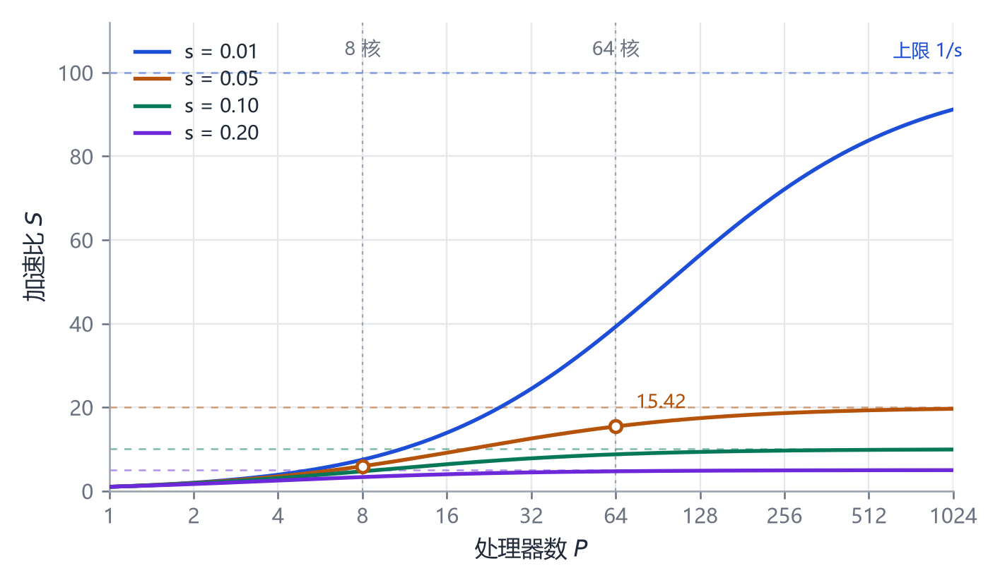
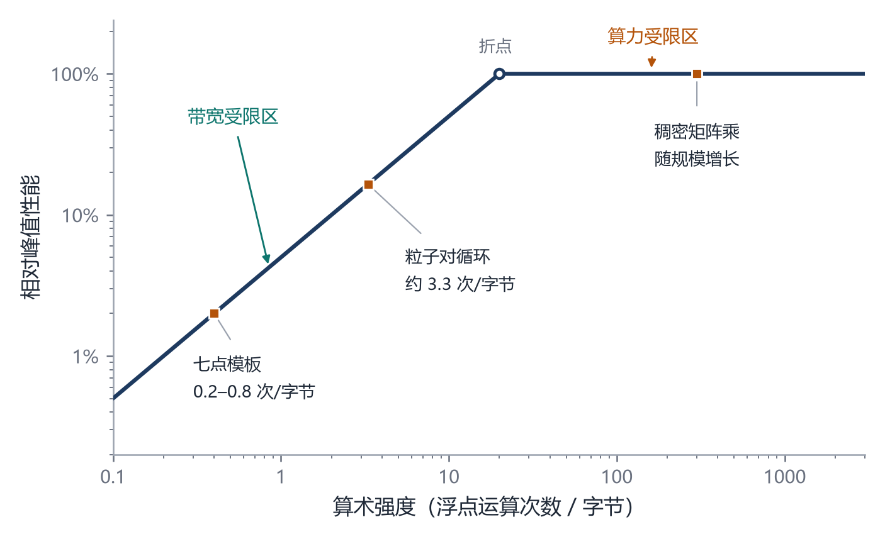

# 第 1 章 为什么物理模拟离不开并行

> 本章导读：一帧十六毫秒里物理只分到两三毫秒；速度场、粒子、稀疏矩阵、接触约束四种结构各有各的并行粒度；Amdahl 定律算出来的是天花板而不是希望；内存带宽比浮点吞吐更早见顶；指令级、线程级、集群级三层各管一段；以及一些本来就不该并行的场合。

## 1.1 一帧的预算

戴上头显，伸手去推桌上的一堆积木。手已经推到了，积木还没动；或者积木动了，画面里的手还停在半路。这种人自己的动作和看到的画面之间的错位，超过二十毫秒就会让人不适：前庭系统报告身体没动，视觉系统报告世界在动，两边打架，结果是想吐。所以实时模拟的每一个环节，最后都要落到一个很硬的数字上——你必须在某个时刻之前把结果交出去。

六十帧的帧长是 16.7 毫秒，九十帧是 11.1，一百二十帧是 8.3，二百四十帧只剩 4.2。这十几毫秒里要装下的东西并不只有物理：读输入、更新动画状态、更新场景图、做视锥剔除、提交绘制命令、驱动、GPU 上跑完这一帧的着色。把大头留给渲染之后，物理通常能分到两三毫秒，一百二十帧的场合下往往不到一毫秒半。

这个分配不是拍脑袋来的，它由流水线的结构决定。物理的结果是渲染的输入：物体的位置、姿态、形变后的顶点缓冲，都要在提交绘制命令之前准备好。中间还隔着一次或两次数据同步。于是物理的时间不是"整帧减去渲染"，而是"从这一帧开始到必须交出顶点数据"这一段，中间还要留出上传和缓冲的时间。工程上常见的做法是让物理晚一帧：这一帧显示上一帧算出的状态，物理就有了完整的帧长可用，代价是多一帧延迟，在格斗和节奏游戏里已经不能接受，所以很多引擎只在低帧率时才打开它。

预算还有一个性质容易被忽略：它不是一个可以被超出的软限制。物理超过预算时不会"算得慢一点"，它会算错。引擎的应对方式是一整套降级手段——把一帧的子步数从八减到四，把接触求解的迭代次数从二十减到八，让远处的物体提前休眠，或者干脆用上一帧的速度外推位置。这些手段都能把时间压回预算内，代价是穿透、抖动、物体突然定住。玩家看到的现象是"东西有点飘"，而根源是一次超时。性能在这个领域不是优化项，它是正确性的一部分。

离线渲染的账完全不同。一帧给几个小时，规模可以大十倍，同一个镜头重跑二十遍调参数。但并行的问题不会因此消失：规模大到单机装不下时要分到集群，通信、负载均衡、检查点又是另一套账，而且离线通常要求可重跑，这一条对并行归约的求和顺序提出了硬要求。

## 1.2 物理计算的结构

要谈并行，先得看清被并行的东西长什么样。物理模拟的计算结构并不多，翻来覆去就四种，每种有自己的并行粒度和自己的瓶颈。

第一种是规则网格。欧拉视角的流体、热传导、距离场、高度场都落在这一种上。一个 $64^3$ 的速度场有 262144 个格子，每格存三个速度分量和一个压力。每个格子的更新只读自己和上下左右前后六个邻居，写回自己。这就是七点差分模板：读七个值、做十几次浮点运算、写一个值。并行粒度是"一个格子一个线程"，邻居的位置在编译期就确定了，每个格子的工作量完全相同，没有分支、没有分歧、没有负载不均。这类计算是并行的理想形态，唯一的问题是太爱读内存。

第二种是粒子。光滑粒子流体、物质点法、离散元都落在这一种上。一百万个粒子，每个粒子要和半径内的三十来个邻居逐一作用，一帧就是三千万个粒子对，每个粒子对几十次浮点运算。并行粒度仍然是"一个粒子一个线程"，但每个粒子的邻居数不一样：稠密区可能上百，稀疏区只有几个。线程之间的工作量差出十倍，分派的时候要么按粒子数均分（快的线程早早空转），要么先统计活跃数再按前缀和分派。更要紧的是邻居的地址要从邻域表里查出来，这一步是间接访问，地址在运行时才知道，缓存和预取都帮不上忙。

第三种是稀疏矩阵。隐式积分的每一步都要解一个方程组，未知数就是自由度，每个未知数只和几个邻居相连。矩阵的一行里只有五到十几个非零元。矩阵–向量乘是这一步的核心，每个非零元两次浮点运算、读三个数（矩阵值、列号、向量分量）。并行粒度是"一行一个线程"，可行的长度差别很大，规则的网格还好，不规则的四面体网格一行可能有三个非零元也可能有三十个。负载均衡和访存模式在这里同时出问题。

第四种是约束与接触。刚体的接触约束、布料的距离约束、关节的限位，数量从几千到几十万。求解方式通常是逐点投影：一条约束一条约束地修正，后面的修正看得见前面的结果。这种写法收敛快，但天然是顺序的。要并行就得把互不冲突的约束分到同一轮（第 7 章的图着色），轮次由约束图的最大度数决定。

这四种结构有一个共同点：每一帧的计算图是一样的，但拓扑会变。网格的活跃格子会变，粒子的邻居会变，接触对会变，稀疏矩阵的非零元位置会变。所以真正的开销有一半不在"算"，而在"重建结构"：排序、统计、前缀和、分配。这部分工作往往比力计算本身更不规则，也更容易被忽略。

还有一个共同点：每一种结构里，"算"相对"读"都少得可怜。七点模板每格十三次浮点运算，读七个值；矩阵–向量乘每个非零元两次运算，读三个数；粒子对稍微好一些，四十次运算读十二个字节。这个比例决定了后面几乎所有结论——物理模拟的并行优化，大半时间是在跟内存打交道，而不是跟浮点单元。

## 1.3 Amdahl 定律与强扩展弱扩展

假设一份代码里有一部分必须串行，比例是 $s$，剩下的部分可以完美地分给 $P$ 个处理器。加速比是

$$S(P)=\frac{1}{s+\dfrac{1-s}{P}}$$

$s$ 是串行部分占总时间的比例，$P$ 是处理器个数。这个式子有个不好看的地方：$P$ 趋于无穷时 $S$ 只趋于 $1/s$。串行部分占百分之五，无论堆多少核，加速比不超过二十；占百分之十，上限是十；占百分之一，上限是一百。

图 1-1 把这个关系画了出来。四条曲线对应 $s=0.01$、$0.05$、$0.1$、$0.2$，横轴是从 1 到 1024 个处理器。串行比例百分之五那条，八核的加速比是 5.93，六十四核是 15.42，一千零二十四个核也只有 19.64——也就是说从六十四核到一千零二十四核，核数翻了十六倍，加速比只多了百分之二十七。

<figure class="fig">

<figcaption><b>图 1-1</b>　Amdahl 定律（按公式计算）。横轴为处理器数 $P$（对数刻度），纵轴为加速比 $S=1/(s+(1-s)/P)$，四条实线分别对应串行比例 $s=0.01$、$0.05$、$0.1$、$0.2$，同色虚线是各自的天花板 $1/s$。两个圆点标在 $s=0.05$ 曲线上：$P=8$ 时为 5.93，$P=64$ 时为 15.42，到 $P=1024$ 也只到 19.64。</figcaption>
</figure>

串行部分是从哪来的？在物理模拟里，它几乎从来不是"一段忘了加并行的循环"，而是几件很具体的事。每一帧开头重建邻域结构、每一帧结束把结果拷给渲染器、每次迭代末尾的一次全局归约（求最大残差、求总动能）、接触求解里的顺序依赖、驱动和图形 API 的单线程调用、脚本层的场景更新。这些东西有的占比很小，有的能吃掉一半时间，区别在于问题规模。

这就引出强扩展和弱扩展的区分。强扩展固定问题规模，增加处理器，看同一个问题算得多快；弱扩展固定每个处理器上的负载，增加处理器，看能算多大的问题。Amdahl 定律描述的是强扩展，而 Gustafson 的观察是：实际问题里人们总是把规模调大，于是并行带来的收益体现在"同样的时间能算更大的场景"，而不是"同样场景算得更快"。流体模拟是典型例子——分辨率从 $128^3$ 提到 $256^3$，格子数翻八倍，没人会用 $128^3$ 的分辨率去跑一台大型机。

这两个视角对物理模拟的含义不一样。强扩展的天花板由串行部分决定，所以网格越小，加速比越难看：$32^3$ 的网格只有三万格子，一帧的计算量小到启动开销和归约占了主导，八核能快三倍就算不错；$256^3$ 有一千六百万格子，同样一份代码在八核上能接近七倍。同一个人写的同一个求解器，"在 GPU 上快二十倍"和"在 GPU 上慢三倍"可以同时成立，区别只在问题多大、参考的基线是什么、有没有把数据传输算进去。

弱扩展的天花板由最慢的那个环节决定：分区的表面积、通信量、负载不均。区域分解之后，每个子域要交换边界上一层的数据，通信量正比于表面积，计算量正比于体积，体积与表面积之比随子域变大而变好——所以弱扩展在少量节点上效率很高，节点越多效率越低，这条曲线在第 10 章会算。

还有一条路既不改并行度也不改规模，而是改步长。把小步长当默认，一帧切八步甚至三十步，每一步涉及的数据量小到能装进缓存，同步的次数虽然变多，但每次同步之前的工作也变少了，整体的缓存命中率和收敛性反而更好，这就是所谓的小步长策略 [@macklin2019]。它的代价是每步都要重建接触和邻域，所以只有在重建足够便宜、或者重建本身也能并行的前提下才成立。这个思路在 GPU 上尤其合算，因为 GPU 的一次全局同步比 CPU 的一次线程同步贵得多，而小步长恰好让每次同步之间的工作仍然填满整张卡。

## 1.4 内存墙

写一个七点差分模板，跑一遍，看性能计数器。计算部分只用掉峰值浮点吞吐的百分之几，内存带宽却已经跑到八成。把格子数从 $10^6$ 加到 $10^7$，性能掉一截，因为工作集从缓存里溢出去了。这种现象在物理模拟里几乎是常态，原因可以用一个数说清楚：算术强度，也就是每从内存搬一个字节能做多少次浮点运算。

七点模板每个格子读七个值、写一个值，按双精度算是六十四个字节，做十三次运算，算术强度是 $13/64\approx0.2$。假设不用缓存、每读一个值都从内存来。就算做了完美的纵向复用（沿一个方向扫，上下面复用），每个格子摊到的流量降到两个双精度数即十六字节，算术强度也只有 $13/16\approx0.8$。一个当前的主流桌面处理器，峰值浮点吞吐和内存带宽的比值在每字节十次运算上下；一张数据中心 GPU 的这个比值是三四十。也就是说，要喂饱浮点单元，每搬一个字节得做十到四十次运算，而模板只能做零点二到零点八次。

这个差距就是内存墙。它不是一个比喻：处理器的浮点吞吐每十八个月翻一倍，内存带宽要四五年才翻一倍，两者的比值二十年里拉开了一个数量级以上。于是同一份代码在旧机器上是计算受限，在新机器上就变成带宽受限，而且越新的机器越受限。

<figure class="fig">

<figcaption><b>图 1-2</b>　带宽受限与算力受限（示意图，非实测数据）。横轴为算术强度，即每搬一个字节做了多少次浮点运算；纵轴为相对峰值性能。屋顶由一段斜率等于内存带宽的斜面与一段水平线拼成，折点画在算术强度 20 处（示意值，不同硬件在 5 到 50 之间）。三个方块标出物理模拟里常见的三种计算：七点模板 0.2–0.8、粒子对循环约 3.3、稠密矩阵乘随规模增长到数百。斜面之内加算力没用，平顶之内减字节没用。</figcaption>
</figure>

图 1-2 把这个关系画成几何。斜线是带宽屋顶，斜率就是带宽；水平线是算力屋顶。一个计算的算术强度决定它落在斜面上还是平顶上：落在斜面上，加算力没有用，只能减字节或提复用；落在平顶上，减字节没有用，要减运算或者换精度。物理模拟的工作点大多挤在左边，斜线的最左端。

带宽之外还有延迟。一次内存访问要等七八十纳秒，这期间一个线程什么也做不了。要让带宽跑满，必须同时有足够多的请求在路上，需要的同时请求数等于带宽乘延迟：每纳秒一百字节的带宽乘八十纳秒，就是八千字节，按六十四字节一条缓存行算，一百二十多个请求同时在飞。单核的乱序窗口撑不住这个数，所以必须靠多线程；GPU 用上千个线程和巨大的寄存器文件来达到同样的目的。粒子邻域这类不规则访问尤其依赖这一点——地址是随机的，预取器猜不到，只能靠线程数硬顶。

摆脱带宽限制只有三条路，每一条都有代价。提高复用：把数据切块，块内反复使用，这是分块和多重网格的基础（第 4、5 章）。降低字节数：用单精度代替双精度，用半精度存位置，用压缩格式存稀疏结构，代价是精度和数值稳定性。换算法：把需要迭代几十次的求解换成迭代几次的，或者接受更大的时间步——但大步长通常意味着更难的方程，收敛性未必更好。这三条路在不同的章里反复出现，共同点是它们都不是"把循环改成并行"能解决的。

## 1.5 三种并行层次

一台机器上的并行有三层：指令级、线程级、集群级。三层的硬件基础不同，对数据的要求也不同，物理模拟同时吃到这三层。

指令级并行在一条指令里同时处理多个数据，也就是 SIMD。一条 AVX2 指令加法一次处理八个单精度数，AVX-512 是十六个。要吃到这个宽度，循环体里八个连续元素的运算必须完全一样，而且数据要连续地摆在内存里。如果数据是交错的（每个粒子的位置和速度挨在一起），编译器要么放弃向量化，要么生成一串收集指令，把八个分散的数一个一个搬进寄存器，速度回到标量水平。这一层不改变线程数，只改变每个线程一个周期里做多少事，上限是八倍或十六倍。

线程级并行在核之间，八核到六十四核，共享最后一级缓存，在双路机器上还要处理 NUMA：内存条挂在不同处理器旁边，跨插槽访问的延迟是本地的一点五到两倍。这一层要求任务之间相互独立，而且工作集最好能共享缓存——一帧几十兆字节的场数据塞不进缓存，跨核共享的收益就只剩下带宽的合并。

集群级并行在机器之间，通过 InfiniBand 或以太网连接。跨节点的延迟是微秒级，比内存延迟高三个数量级；带宽是每节点几十到几百吉比特每秒，比单机内存带宽低一到两个数量级。这一层只适合粗粒度的划分：区域分解、每帧交换一次边界、通信与计算重叠。把细粒度的同步放到集群上，通信时间会完全吃掉计算时间。

把三层的延迟摆在一起看，尺度是这样的：寄存器和一级缓存几个周期，二级缓存十几个周期，三级缓存四十个周期，内存两百个周期，跨节点网络几万个周期。每一层比上一层慢一个数量级左右，能容忍的并行粒度也差一个数量级。所以优化的顺序是从最内层往外：先让内层循环的数据连续、能被向量化，再让线程之间的工作划分得均匀，最后才考虑跨节点。反过来做——先买机器、先写 MPI——通常得到一个通信占一半时间、单核效率还很低的系统。

## 1.6 什么时候不该并行

并行不是免费的，这一点在物理模拟里格外明显，因为很多物理场景的规模小到并行开销比计算还大。

一千个粒子的 SPH，每个粒子三十个邻居，每对四十次运算，一帧的浮点运算是 $1.2\times10^{6}$ 次。单核按每秒三十亿次算，零点四毫秒。丢给线程池，唤醒和分发要几十微秒，加上指针间接访问带来的缓存失效，实际可能只快两倍。再往上加核，收益很快归零。一百个刚体的接触求解更极端：约束几百条，每条几次运算，总量几十微秒，而一次核间同步就要几微秒。这种规模下正确的选择是单线程把数据摆好、把分支消掉，而不是并行。

强耦合是第二个不该并行的理由。逐点投影的 Gauss-Seidel 之所以收敛快，正是因为它顺序地使用最新值：修完第一条约束，第二条就能看到它的效果，误差沿着约束图传播得很快。把这一步并行化，等于把所有约束改成同时更新（Jacobi），收敛速度会明显下降，迭代次数可能翻倍，把并行带来的收益吃回去。要保住收敛速度又并行，只能把互不冲突的约束分到同一轮，也就是图着色，轮次由最大度数决定。一个球堆里每个球同时接触十几个邻居，颜色数就是十几，每一轮只有十几分之一的核在干活。

第三个理由是确定性。并行归约的求和顺序取决于线程数、调度、甚至同一台机器上的两次运行，浮点加法不满足结合律，不同的顺序给出不同的最低位。对于单机渲染，这点差别看不出来；对于需要回滚的网络同步，一个最低位的差别会让两端的世界在几百帧后彻底分开。做法要么是固定归约树（并行度因而受限），要么改用整数或定点运算，两条路都有代价。

MuJoCo 是一个现成的例子。它面向的是基于模型的控制：优化器在每个控制周期里要调用几百次动力学，模型只有几十个自由度，每一次调用的时间在几十微秒量级 [@todorov2012]。这个场景里，单线程、缓存友好、避免动态分配的引擎比并行引擎更合适——并行的开销比计算本身还大，而且控制回路要求结果可重复。选择不并行是一个经过计算的决定，不是保守。

最后一个理由是工程成本。把一份单线程的物理代码改成多线程，除了写并行循环，还要处理数据竞争、内存序、负载均衡、调试工具、不同平台的线程模型；改成 GPU 版本还要处理主机与设备之间的拷贝、精度差异、驱动版本。如果优化把两毫秒变成一点二毫秒，而机器上还有别的任务要跑、团队只有一个人、这段代码三个月后要交给别人维护，这笔账要重新算。

这些理由合起来指向同一件事：并行放大的是决定，不是弥补决定。数据摆得乱，并行之后访存更乱；算法有顺序依赖，并行之后要么变慢要么变错；规模太小，并行之后开销吞掉收益。所以第一件要放大的决定不是"用几个核"，而是"数据在内存里怎么摆"。
