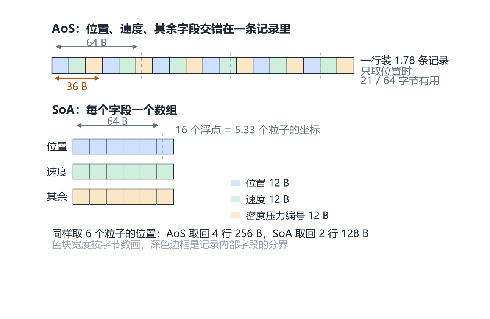
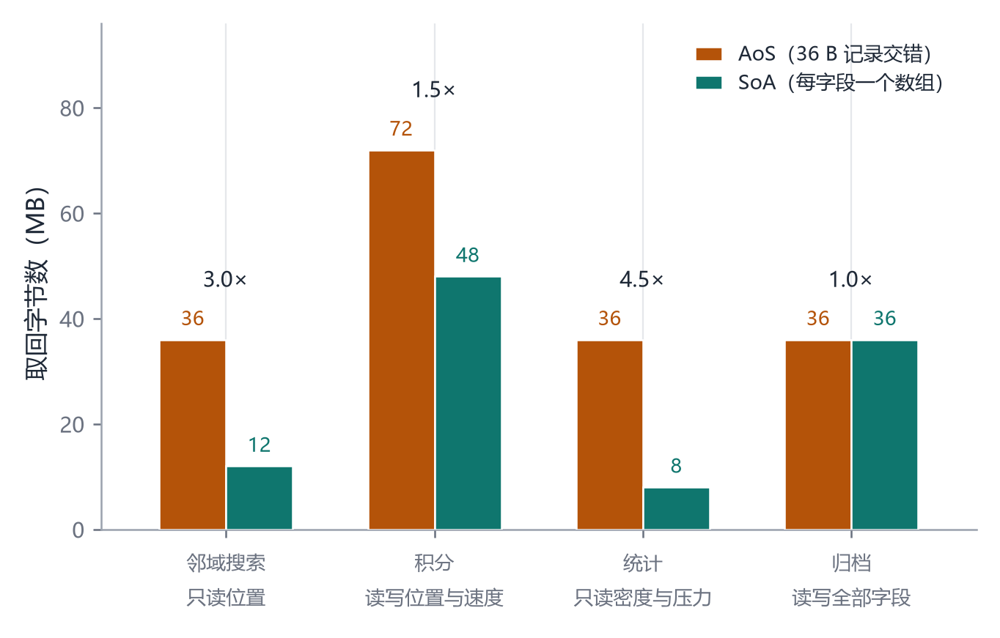

# 第 2 章 数据布局：从 AoS 到 SoA

> 本章导读：同一份积分循环，把结构体拆成几个数组，帧时间能差出一倍，而指令数几乎没变；一条缓存行装得下几个粒子；假共享为什么让八个线程互相等；粒子用交错存还是分开存；网格为什么该切块；间接寻址的每一层都要付一次延迟；以及改布局这件事真正的成本在哪里。

## 2.1 结构体数组与数组结构体

一段最普通的位置积分，两个版本。第一个版本里，粒子被定义成一个结构体，位置、速度、密度、压力、编号依次排在里面，所有粒子组成一个大数组。循环遍历这个数组，读位置和速度，算出新位置写回去。第二个版本把同一个结构体拆成五个数组：位置一个、速度一个、密度一个、压力一个、编号一个，循环里按下标同时访问五个数组。两份代码的浮点运算次数一模一样，汇编里的指令条数也差不多，跑起来却能差出一倍。

差的地方在缓存。第一个版本里，一个粒子的五个字段紧挨着，一条 64 字节的缓存行装不到两个粒子。循环只用到位置和速度，密度、压力、编号这些字节被一起搬进缓存，占着位置却没人读。第二个版本里，位置数组是连续的，一条缓存行装五个多粒子的位置，搬进来的字节几乎全有用。

把这件事换算成比例。假设一个粒子的记录是 36 字节：位置三个单精度 12 字节，速度 12 字节，密度、压力、编号各 4 字节。一条缓存行 64 字节，平均装 1.78 个粒子。循环读位置和速度、写位置，每个粒子需要 24 字节的有用数据，一条行摊到 42.7 字节有用，利用率六成七。如果循环只读位置——比如邻域搜索的第一步，只需要坐标——利用率掉到三成三，三分之二的带宽在搬用不上的字节。换成数组结构体，位置数组一条行装 16 个浮点，也就是 5.33 个粒子的坐标，利用率百分之百。

前一种排布叫结构体数组（AoS），后一种叫数组结构体（SoA）。图 2-1 把两种排布画在一起，色块宽度按字节数画，虚线是缓存行边界。名字来自 C 的写法：一个是 struct P { vec3 x, v; float rho, p; int id; } p[N]，一个是 float px[N], py[N], pz[N]。两者的区别不在语法，而在"一次访存拿回多少有用字节"。这一个比例决定了后面几乎所有结论：带宽、缓存容量、预取效率、向量化宽度，都是它的下游。

<figure class="fig">

<figcaption><b>图 2-1</b>　两种布局的访存（示意图，字节数按 36 字节记录与 64 字节缓存行算出）。上：AoS，六个粒子首尾相接，每条记录是位置 12、速度 12、密度压力编号 12 字节，共 36 字节，一条缓存行平均装 1.78 条记录；只取位置时，一条行里 21 字节有用，剩下的 43 字节白搬。下：SoA，位置、速度、其余字段各成一个数组，位置数组一条行装 16 个浮点，即 5.33 个粒子的坐标，全部有用。虚线是缓存行边界，可以看出 AoS 的记录会被行边界切开。图中只画到 6 个粒子，所以两种布局各占 216 字节和 72 字节。</figcaption>
</figure>

SoA 也不是免费的。它把一份连续的数据拆成五份，循环里就有五个指针在跑。硬件预取器能同时跟踪的流是有限的，桌面处理器一般在十几条以内，一个粒子系统有十几个数组时，预取就开始互相挤。每个数组还要单独占页表项，工作集大到几百兆时，地址翻译的开销会浮出来。写回也一样：AoS 里改一个粒子只碰一条缓存行，SoA 里改位置和速度要碰两条，如果这两条都不在缓存里，就是两次写缺失，而每次写缺失在多数处理器上要先读回整行。

更麻烦的是"整条记录一起走"的场合。要存档、要发给网络对端、要一次性拷到显存、要交给一个只接受结构体指针的第三方库，AoS 才是对的：一次连续的块拷贝，比五次分散的拷贝快得多。所以成熟引擎里两种布局共存：计算用 SoA，接口和存档用 AoS，中间有转换函数。

还有第三种写法，介于两者之间，通常叫分块交错。把粒子按四个或八个一组，组内仍然是 AoS 的排法，组间是 SoA。一条缓存行正好装八组里的同一字段，向量化时一次读八个，而一个粒子的所有字段仍然在附近，写回和调试都还算方便。代价是索引算术多了一次除法和取模，而除法在热循环里是要认真对待的开销。

这几种布局的差别可以算成一笔账。一百万个粒子，记录 36 字节，缓存行 64 字节，四个常见操作各算一遍取回字节数：邻域搜索只读位置，AoS 要搬 36 MB，SoA 只要 12 MB，差三倍；位置积分读位置速度、写回位置速度，AoS 要 72 MB，SoA 48 MB，只差一点五倍；统计只读密度和压力，差距又拉大到四点五倍；而归档要把所有字段都过一遍，两种布局都是 36 MB，没有区别。同一个布局在不同操作下能差出一个数量级的收益，这就是为什么不能问"哪种布局好"，只能问"哪个数组、被谁、读多少"。

<figure class="fig">

<figcaption><b>图 2-2</b>　同一组操作在两种布局下的访存量（真实计算，按缓存行取整计数）。一百万个粒子，记录 36 字节（位置 12、速度 12、密度 4、压力 4、编号 4），缓存行 64 字节，只计一次遍历的强制流量，不计写分配时的回读。四组柱分别对应只读位置、读写位置与速度、只读密度与压力、读写全部字段，柱上是取回的兆字节数，上方是 AoS 与 SoA 的比值：3.0、1.5、4.5、1.0。最后一个比值是 1，因为整条记录都用到时，拆成五个数组并不能减少总字节，只是把它们分成五段。</figcaption>
</figure>

## 2.2 缓存行、对齐与假共享

缓存和内存之间搬东西的单位不是字节，是行。x86 上是 64 字节，部分 ARM 服务器是 128 字节，还有一些处理器按 32 字节的扇区做填充和替换。这个单位决定了三件事。

第一，访问要按行算账。读一个 4 字节的浮点，代价是 64 字节的流量。所以"每次访问有用字节"是比"访问次数"更有意义的指标：随机抓一个粒子的位置，只用 12 字节，却搬了 64 字节，放大五点三倍。这也是为什么按空间排序的粒子系统会快——邻居大多落在相近的下标上，一次搬进来的行能被用好几次。

第二，对齐会影响事务数。一条 32 字节的向量读，如果起始地址是 32 的倍数，一次事务就够；如果没有对齐，跨在两条行上，就要两次。编译器为了拿到对齐，会在结构体里插入填充，或者在数组分配时按 64 字节对齐。一个 vec3 是 12 字节，三个 vec3 组成的结构体是 36 字节，编译器往往把它补到 40 或 48，好让内部的向量成员对齐。这个填充不写在源码里，却实实在在地占带宽。想知道自己的结构体多大，打印 sizeof 比猜可靠。

第三，两个线程写同一条行里的不同变量，会互相拖。这叫假共享。变量本身没有共享，共享的是缓存行；一个核写了行里的一个字节，整行在别的核上就作废，那个核要用就得重新取。两个线程各自每帧写几万次，行就在两个核之间来回弹，每次迁移几十到上百个周期。八个线程的计数器挤在一条行里，弹的成本能把这段代码变成串行。

物理模拟里假共享出现的地方很具体：每个线程统计的接触对数、每个块边界上的力累加、每个刚体的冲量累加、粒子分桶时每个桶的计数。这些量的共同点是"每个线程一小份、写得很频繁"。修法有两种：一是让每份数据独占一行，把 4 字节的计数器补成 64 字节（浪费六十四分之六十，但只浪费在计数上）；二是先在寄存器里累加，循环结束再做一次归约，把写的次数从几万次压到一次。

还有一种不太像假共享、机理相同的问题：二维数组的行跨度正好是 2 的幂。一个 $1024\times1024$ 的单精度场，一行 4096 字节，正好是 64 条缓存行。一级缓存 32 KB、八路组相联，一共 64 组，跨度为 4096 字节的访问全部落在同一组上，同时只能驻留八行。沿列方向遍历，每读一个元素就换出一行，命中率接近零。加四个浮点的填充，让行跨度变成 4112 字节，冲突就散了。这类问题在三维场里更常见，因为三个方向的跨度都可能是 2 的幂。

和缓存同一个位置的还有地址翻译。一个 192 MB 的场按 4 KB 页算要四万七千个页表项，而二级地址翻译缓存只装得下其中一两千条，每换一页就要多做一次页表走查。开启 2 MB 的大页之后，页表项降到一百条以内，整个场的翻译常驻，这条开销就消失了。大页不是万能药：它会造成内存碎片，分配也可能失败，但在"几个大数组、每个几百兆"的物理模拟里，回报常常比改代码大。

## 2.3 粒子的 SoA 布局与网格的块状布局

粒子系统用 SoA 几乎已经是共识，但具体怎么排还有讲究。

位置用三个单精度存，一个粒子 12 字节，一条缓存行装 5.33 个。这个"三分之一"很讨厌：向量化要读八个粒子的坐标，就会跨两条行，而且每次循环的起始对齐都在变。很多实现因此把位置补成四个分量，一个粒子 16 字节，一条行正好装四个。多出来的 12 字节不是浪费，只要它装的是有用的东西：质量、邻居数、材质编号、上一次的密度，随便哪个都行。把第四分量用起来之后，一个粒子 16 字节的布局既能保证对齐，又不损失带宽。

速度同理。密度和压力这类每帧都要读写一遍的标量可以合在一起，编号和材质这类很少变的可以单独放，甚至放到冷存储里按需查。判断标准是访问频率：每帧都要读的字段放热数组，只在初始化或输出时用的放冷数组。一个粒子记录从 36 字节涨到 48 字节不是问题，问题是那 12 字节是不是每次循环都真的用得上。

网格是另一套。一个 $256^3$ 的单精度速度场是 192 MB，远超任何缓存；一个七点模板每更新一个格子要读七个值，其中六个是邻居的。按行优先的顺序扫，沿扫描方向的邻居在缓存里，另外四个方向的不在——一层 $256\times256$ 的切片是 256 KB，装得进二级缓存但不装进一级，所以每读一个格子就有四次访问要去二级缓存拿。这就是普通模板的带宽下限。

块状布局把三维空间切成 $8^3$ 的小块，块内连续存放，块之间按块坐标索引。处理一个块时，把块和它周围一圈幽灵层一起装进缓存：$10^3$ 个单精度是 4 KB，一级缓存装得下，甚至能装好几个块。于是块内的 512 个输出格子只从内存拿一次数据，之后全在缓存里复用。代价是边界上的重复读取：512 个输出要读 1000 个输入，复用比 1.95，也就是说每个格子的流量从 4 字节涨到 7.8 字节，但换来的是"这 1000 个值只从内存搬一次"。

块的边长是需要试的。太小，幽灵层的比例高（边长 4 时，$6^3/4^3=3.4$ 倍重复）；太大，装不进缓存（边长 16 时，$18^3$ 个单精度是 23 KB，勉强，边长 32 就溢出了）。8 到 16 之间通常是好区间，具体取决于缓存放得下几个块、每个块要同时处理几个场。

还有一种排布叫莫顿序，把三维坐标的二进制位交错起来做一维索引，让空间上接近的块在一维上也接近。它的局部性比块状更平滑，递归细分时不用换层，稀疏结构（第 4 章）里很好用。代价是算索引要做位交错，三维六个位一轮，十几条位运算；而且索引不直观，调试时看不出坐标。规则网格上的模板用块状更划算，自适应结构上莫顿序的优势才显出来。

## 2.4 索引与间接寻址的代价

有一类开销不在数据本身，而在"找到数据"。

最典型的是邻居表。每个粒子存一份邻居下标，力计算时按下标去取邻居的位置。第一次访问读下标，第二次访问用下标读位置，两次访存有依赖关系，第二次的地址要等第一次的数据回来才知道。这种依赖链在乱序执行的处理器上也能被别的线程填上，但单个线程的延迟就是两次内存访问叠加。

量化一下。一次随机访存七十到九十纳秒，两次串起来就是一百六十纳秒，一个线程每秒做六百万次这样的取数。要把一条二十五吉字节每秒的带宽喂满，需要每秒四亿条缓存行，也就是六十多个线程同时在飞。这个数字解释了为什么邻域循环在 GPU 上还好、在单核 CPU 上很差：不是算不动，是请求排不满。

第二个代价是索引本身占的字节。邻居表用 32 位整数，每个邻居 4 字节，三十二个邻居就是 128 字节，比一个粒子的位置数组还大。如果邻域是分块组织的，块内偏移可以用 8 位或 16 位存，索引流量立刻降到四分之一。稀疏网格的树结构同理：一层指针 8 字节，四层就是 32 字节，而一个体素的数据可能只有 4 字节——索引比数据还贵，这时候该换成扁平的块表。

第三个代价是放大。一次随机访问只用一个粒子的位置，却搬回 64 字节。如果邻居在空间上排过序，三十二个邻居里有一大半落在相邻的几条行里，放大就小；如果粒子完全随机，三十二个邻居就是三十二次独立的行取回，有效带宽掉到五分之一。

这些代价有一个共同的应对方式：让"间接"变成"局部"。排序、分块、分桶，都是把随机访问改成局部访问的手段，代价是每次拓扑变化（粒子移动越界、接触对更新）之后要重建一次结构。重建本身也是访存密集的，所以要 amortize：粒子移动超过阈值才重排，而不是每帧都做。

## 2.5 数据布局对向量化的影响

一条 AVX2 指令一次加八个单精度数，一条 AVX-512 加十六个。要用上这个宽度，八个操作数的地址必须连续，运算是同一个。

SoA 天然满足这一条：位置数组里八个连续的浮点就是八个粒子的同一种分量，一次加载、一次加法、一次写回，编译器不用费什么劲就能向量化。AoS 不满足：八个粒子的 x 分量之间隔着 36 字节，编译器只能生成收集指令，把八个分散的值一个一个搬进寄存器再打包。收集指令在有些处理器上是一条指令，在另一些上是一条慢指令，共同点是延迟高、吞吐低，八个元素可能花掉比八次标量加载还多的时间。手写的替代方案是"装载四条行、做四次转置、得到四个向量"，代码复杂，收益取决于循环体多长。

麻烦在于最热的那个循环——邻居遍历——既不是纯 SoA 也不是纯 AoS。外层的粒子是 SoA 的，内层的邻居是按下标取的，仍然是一次收集。这就是为什么排序和分块在粒子系统里那么重要：把邻居排到连续的下标上，内层循环的收集就退化成顺序读，向量化才真正生效。

即使数据排好了，编译器也常常不肯向量化。三个原因最常见：指针可能别名（写 pos 的时候编译器不敢保证它不影响 vel），循环次数在编译期未知，循环里有对顺序敏感的归约。前两个用 restrict 和块内定长能解决。第三个要小心：把求和向量化，等于把加法换成"八个部分和最后再合并"，加法顺序变了，浮点结果的末位就变了。对单机渲染无所谓，对需要逐位复现的回滚同步就是致命的，所以有些引擎在关键路径上刻意保留标量求和。

还有一个容易漏掉的地方：短循环。邻居数平均三十、方差很大，向量化时要有尾部和掩码处理；如果平均只有三五个，向量的开销比收益大。这类循环该做的是把多个粒子的邻居并到一起处理，而不是指望编译器把一个长度不定的内层循环向量化。

## 2.6 重构布局的迁移成本

把 AoS 改成 SoA，改动量常常被低估。除了那个热循环，还要改：初始化和销毁、序列化与存档、网络同步的状态打包、调试器的可视化、导出到 DCC 工具的接口、单元测试里的构造代码。一处漏改，编译器未必报错——如果两种布局都是 float*，它连警告都不会给。

工程上的做法是把改动限制在热路径上。先把最热的两个数组（位置、速度）拆出来，其余字段留在原来的结构体里；热循环用新数组，冷路径通过一个小函数从新数组拼出旧结构体。这样 IO、脚本绑定、外部库接口全都不用动。代价是内存里同时存在两份数据，以及一次转换的拷贝——只在初始化、存档、跨设备传递时发生，可以接受。

接口层的开销要实测，不能假设。一个返回 const vec3& 的访问器，理论上会被内联，实际上在跨编译单元、开了调试符号、或有虚函数的情况下不一定。如果重构之后性能没变，第一件要检查的是访问器有没有被内联，第二件是向量化有没有真的发生（看反汇编里有没有打包指令），而不是怀疑"布局理论不对"。

还有一类数据不该改成 SoA。刚体的惯性张量、四元数、4×4 变换矩阵，这些量本身就是一个不可分的整体，拆开没有意义；接触约束的成对数据（两个物体下标、法向、深度）也一样，它们总是被整体读写，改成 SoA 只是把一次行取回拆成三次。判断标准和前面一样：看一次操作要用到记录里的多少字节。用得多，AoS 好；用得少，SoA 好。

重构的收益也要和别的优化放在一起看。布局改动通常能带来百分之几十到一倍多的收益，前提是这个数组的每次访问有用字节确实低、缓存缺失确实高。如果 profile 显示这段代码的缺失率已经很低，说明数据本来就在缓存里，改布局不会有多少收益，该动的是算法——比如把小步长做到数据能装进缓存 [@macklin2019]，或者把整个求解流程按块重排，让每一块的数据从进缓存到算完只被碰一次。引擎设计上的这类取舍在物理引擎里很常见：MuJoCo 把数据按求解器访问的顺序紧凑摆放、避免动态分配，为的是让几十自由度的模型在单核上跑到几十微秒一次 [@todorov2012]。

布局定下来之后，下一个问题是"谁在什么时候读它"。在 CPU 上，缓存行 64 字节，硬件帮你合并相邻的访问；在 GPU 上，一个线程束的三十二个线程同时发出一条访存，硬件要求它们的地址落在尽量少的 128 字节段里，否则一次访存被拆成几十次事务。同一份 SoA 数据，在 CPU 上已经很好，在 GPU 上还要再检查一遍"同一个 warp 里相邻线程读的是不是相邻地址"。这就是下一章的内容。
