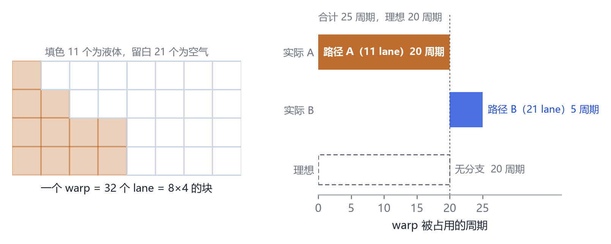
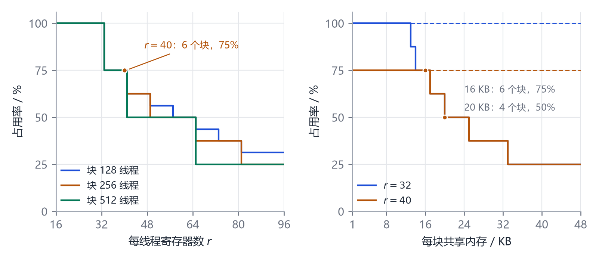

# 第 3 章 GPU 架构与编程模型

> 本章导读：一块显卡有几千个算术单元，一个写法不当的条件判断就能让它们一半闲着。这一章只讲三件事：线程怎样被成组调度、片上内存怎样被分配、全局内存怎样被搬运，因为同一份物理代码在显卡上差出的倍数，几乎都由这三件事解释。最后给出把物理域映到网格上的一套做法，以及几个反复出现的坑。

## 3.1 一块显卡不是很多个 CPU 核

一个 $256^{3}$ 的烟场有一千六百七十八万个格点。假设同一段半拉格朗日平流在八核 CPU 上写循环、开两个线程做预取，一帧两毫秒出头；搬到显卡上，一个线程管一个格点，每块 256 个线程，一共六万五千多个块，反而更慢。

如果按"核心数"理解这件事，结论只能是显卡虚标。真实原因有三个，都在调度方式上。

第一，显卡上的线程不是各自独立的执行流。硬件把它们按 32 个捆成一组，同组共享一个程序计数器，一条指令同时作用于 32 个操作数。这 32 个地址一起去访存，落在哪几条缓存行上由地址本身决定。于是"一个线程管一个格点"这种在 CPU 上最自然的写法，到了显卡上等于让硬件随机拼 32 个格点，地址散开，指令流还容易分叉。

这里先把两个词定下来。这 32 个线程组成的小组叫 warp，中文常译作线程束；组里的每一个线程叫 lane，译作通道。硬件执行指令的方式叫 SIMT，全称 single instruction multiple thread，单指令多线程。也就是说，你写的仍然是标量代码，每个 lane 有自己的寄存器和自己的地址，但硬件一条指令就作用在这 32 份数据上。一条指令的代价由 32 个 lane 里最慢的那条路决定，不由你写得最漂亮的那个线程决定。

第二，算力与带宽的比例不对。物理里的模板计算，每个格点读七个邻居做十几次乘加，算术强度低到必然受带宽限制。带宽要打满，前提是每次访存都搬回有用的字节，而这件事取决于 32 个 lane 的地址是否连续，跟单个线程写得多漂亮无关。

算术强度（arithmetic intensity）指的是"每从内存搬回一字节，做多少次浮点运算"。一个七点模板搬回 28 字节、做十几次乘加，强度大约是半个运算每字节；而显卡每搬一字节对应的算力有几十次运算。也就是说，这类 kernel 天生在等数据，算得再快也没用，唯一的出路是把每次搬运的字节都用上。

第三，片上资源按块分配。寄存器、共享内存、每块线程数都是预算，超一点就少驻留一批线程；而显卡靠"同时有很多线程在飞"来掩盖延迟。这个手段叫延迟隐藏（latency hiding）：某个 warp 发出访存后要等几百个周期，调度器立刻换一个 warp 发指令，等待的时间就被别人的工作填满了。某些情况下，一个线程多用八个寄存器，整块 SM 就少驻留四分之一的人。

这三条对应的就是 SIMT 与 warp、占用率、合并访问。后面每一节都落到一个能算的量上。

一个反复出现的场景值得提前说。很多人第一次移植，是在 CPU 代码外面套一层线程下标，改完在 $256^{3}$ 上测，发现比八核还慢。真正的原因通常不是某一行写错，而是三件事同时发生：粒子数据用结构体数组存，32 个 lane 每次只搬回四分之一的字节；块大小取 256 个一维线程，前 32 个编号落在一条不连续的行上；内层循环里有一个按材料类型分支的条件判断。这三处改完，程序并没有"多用了几千个核"，只是终于把本来就很宽的执行单元喂饱了。顺序也基本固定：先改布局，再改块形状，最后才动分支。

## 3.2 SIMT：一条指令，三十二个操作数

显卡的执行模型叫 SIMT，单指令多线程。它不是 SIMD，因为程序员写的还是标量代码，每个线程有自己的寄存器和自己的地址；它也不是多核 CPU，因为 32 个线程被绑在一起，同一时刻只能执行同一条指令。硬件把这个 32 线程的小组叫 warp，这是所有性能讨论的基本单位。

一个 SM（流多处理器，streaming multiprocessor）里通常有 4 个 warp 调度器，每个调度器每个周期从自己负责的若干个常驻 warp 里挑一个，发出一条指令。被挑中的 warp 如果指令是算术，32 个 lane 同时算；如果是访存，32 个地址同时发。所以单个 SM 的峰值是每周期 4 条指令 × 32 lane。

把这个数换成具体数字。假设一块卡有 100 个 SM，时钟 1.5 GHz，那么每秒钟每个 SM 能发 $4\times32\times1.5\times10^{9}\approx1.9\times10^{11}$ 条 lane-指令，整块卡是 $1.9\times10^{13}$。这些数字是假设值，只为说明量级：一块卡的算术峰值是"十万亿"这个级别。靠什么填满这个峰值？不是让一个线程跑得更快，而是让足够多的 warp 同时驻留，某一个 warp 在等内存的时候调度器去发别的 warp 的指令。这就是延迟隐藏，也是后面占用率一节的动机。

32 这个数不是随便定的。一个 warp 访存 32 个连续的 4 字节浮点数，正好 128 字节，是一条缓存行、或者四个 32 字节的扇区。取 16 会让一次事务只用到半条缓存行，取 64 会让地址跨到两条行上，32 是访存粒度与指令宽度之间的折中。它同时决定了三件事：分支发散以 warp 为单位，共享内存冲突以 warp 为单位，占用率也是按 warp 数算的。写代码时只要有一个维度不是 32 的倍数，这层对应关系就会被打断。

块大小不是 32 的倍数会浪费多少，可以当场算。假设一个块只开 100 个线程，硬件仍然要给它 4 个 warp，也就是 128 个 lane 的位置，最后一个 warp 只有 4 个 lane 有效，另外 28 个位置永久空着。也就是说，这个块的实际算力只有标称的 $100/128\approx78\%$，而且这 22% 是被结构吃掉的，改任何一行代码都补不回来。块大小取 32 的整数倍，是几乎不需要思考就能拿到的收益。

还有一个反例，关于块开多大。有人把块开到 1024 个线程，觉得"一块人越多越好调度"。占用率上这不算错：每 SM 两个块、正好 2048 个线程、六十四个 warp，是满的。但它的容错空间很小——每线程 32 个寄存器时，一块就吃掉 32768 个寄存器，两块刚好用满 65536；只要编译器多用 8 个寄存器把 $r$ 抬到 40，一块就要 40960 个，两块放不下，占用率直接掉到 50%。同理，1024 个线程的块里一次同步要等 32 个 warp 全部到齐，尾巴拖得更长。这也是为什么多数 kernel 选 128 或 256：占用率一样能打满，资源变化时的余量大得多。

还有一个容易误解的地方。较新的架构允许 warp 内的 lane 各自推进，叫独立线程调度（independent thread scheduling），看起来分歧不再有代价。实际上编译器仍然要在分歧点给每条路径保存各自的活跃掩码（active mask，记录哪些 lane 此刻还有效）和各自的执行栈，硬件把路径一条一条地走完，只是允许不同路径交错。性能模型还是"一次一条路径"更接近真相，只是切换的缝隙变小了。

## 3.3 分支发散：一个条件判断的两种代价

平流 kernel 里常见这样一行：如果格点在域的边界上，就用零梯度外推，否则用正常模板。在一维 CPU 代码里这行几乎免费，分支预测器会把它吃掉。在显卡上，它可能让 kernel 慢一倍。

原因是 warp 只有一个程序计数器。32 个 lane 走到这个判断，假设 10 个走"边界"分支、22 个走"正常"分支，硬件先把边界分支执行一遍，此时那 22 个 lane 被掩掉、什么也不做；再回来执行正常分支，那 10 个 lane 被掩掉。两条路径的时间相加，而不是取最大值。这个现象叫分支发散（branch divergence）。

把一个 warp 的代价写成式子。设共有 $n$ 条互斥路径，第 $i$ 条路径的执行代价是 $c_{i}$ 个周期，走这条路径的 lane 数是 $k_{i}$，则

$$
T_{\text{warp}}=\sum_{i=1}^{n}c_{i}\quad(k_{i}\gt 0),
\qquad
\eta=\frac{\sum_{i=1}^{n}k_{i}c_{i}}{32\sum_{i=1}^{n}c_{i}} .
$$

$T_{\text{warp}}$ 是这个 warp 实际占用的周期数，$\eta$ 是 lane-周期利用率，分子是真正干了活的 lane-周期，分母是硬件提供的容量。两条路径代价相同、各有 $k$ 与 $32-k$ 个 lane 时，$\eta$ 恒等于 $1/2$，与 $k$ 是多少无关：只要有分歧，就赔掉一半。如果一条路径贵、一条便宜，比例会好一些但方向不变。

图 3-1 是一个具体的例子。8 乘 4 的块正好 32 个格点，正好一个 warp；11 个格点在液体里，21 个在空气里。液体分支要做完整的外推，空气分支只是写回，代价比 4 比 1。按上式算，warp 花 25 个周期，理想情况只要 20 个，lane 利用率 41%。损失不是因为边界格子多，而是因为这 21 个空气格子和 11 个液体格子被硬塞进了同一个 warp。

<figure class="fig">

<figcaption><b>图 3-1</b>　一个 warp 里的分支发散（示意图）。左：一个 $8\times4$ 的块，正好 32 个格点，填色的是液体格点、留白的是空气格点；右：这个 warp 的执行时间轴，两条路径串行执行，代价分别为 20 与 5 个周期，合计 25；若两种情况能用同一个无分支公式表达，只需 20 个周期。图中周期数为按路径代价设定的示意值，不是实测。</figcaption>
</figure>

再看一个代价更悬殊的例子，来自粒子碰撞。一个 warp 的 32 个粒子，只有 5 个找到了接触点，其余 27 个什么都不做。假设走"有接触"那条路的代价是 60 个周期（算接触法向、算冲量、写回速度），走"没接触"那条只要 6 个周期（直接返回）。按公式，warp 一共花 66 个周期，而真正有用的 lane-周期只有 $5\times60+27\times6=462$，利用率 $462/(32\times66)\approx22\%$。这里的分歧比图 3-1 更糟，因为两条路径的代价差得远，折扣叠在一起。

反过来的情况也要说清：并不是所有 if 都要付钱。如果条件在整个 warp 里取值相同，比如"这个块是否位于域的边界"，32 个 lane 全走同一条路，硬件不会掩掉任何人，代价为零。也就是说，判断发散代价看的是"warp 内部是否一致"，不是"代码里有没有 if"。这也是为什么边界处理应该尽量往上提：把逐格点判断改成逐块判断，只有真正骑在边界上的那几个块才发散。

发散的总损失有一个上限，值得记住。$512^{3}$ 的域按 $8^{3}$ 切，一共 $64^{3}=262144$ 个块；把最外一层去掉，内部的块是 $62^{3}=238328$ 个，两者相差两万三千多个，约占 9%。哪怕这一圈块每个都赔掉一半，总损失也不超过 4.5%，而且真实情况下只有一部分 warp 骑在交界上。这条估算说明一件事：边界发散的量级由面积决定，不是由体积决定。所以域越大，边界判断就越不值得优化；真正要小心的是"每个格点都在变"的条件，比如材料编号、活跃标记、接触状态。

三条应对办法，代价依次升高。

最便宜的是让分支与 warp 边界对齐。发散只发生在区域交界处的那几个 warp 上，如果把 8×4 的块按"大部分格子同类"的方式切给 warp，交界处涉及的 warp 数大约是边界面积的量级，而不是体积的量级。这也是为什么块的形状要跟物理域的走向匹配：一块竖直的薄板，用 $32\times1$ 的块比用 $8\times4$ 的块少一半的发散 warp。

第二条是把条件变成算术。把越界格点的邻居索引钳到域内（clamp），再乘一个掩码系数，两条路径合成一个公式，代价从 $a+b$ 降到 $\max(a,b)$。这一招在边界处理上很有效，因为外推与正常模板的算术结构本来就一样，只是系数不同。但它会增加寄存器用量和指令数，如果因此把占用率压下去，可能得不偿失。举个具体的反例：掩码版本让每线程寄存器从 40 增到 41，向上取整成 48，占用率从 75% 掉到 62.5%。对延迟受限的 kernel，这个损失比省下的分歧更大。

第三条是压实（compaction）。先用前缀和把活跃格点排成一个紧凑列表，再对这个列表启动线程，warp 里每个 lane 都活着，只是线程总数变少。多了一次前缀和和一次重排，但换回来的是没有掩码的执行。设想一百万个粒子、其中只有三万个找到接触对：按原来的布局发线程，97% 的 lane 在空转；压实之后发三万个线程，每个 lane 都有活干。前缀和要扫一百万项，但那是纯带宽操作，比三万个 warp 各自赔一半便宜得多。稀疏网格、粒子邻域、碰撞对，但凡"少数格点有活干"的场合，最后都会走到这条路上。

## 3.4 寄存器、共享内存与占用率

性能分析器里有一个数字最容易被误读：占用率。它指的是实际驻留的 warp 数除以硬件上限。一个 SM 最多驻留 64 个 warp，也就是 2048 个线程；如果某个 kernel 因为资源不够只能驻留 32 个 warp，占用率就是 50%。

限制来自三处预算，取最小的那个。寄存器：每个 SM 有 65536 个 32 位寄存器，合计 256 KB，按 warp 整块分配，每线程的寄存器数向上取整到 8 的倍数，单线程上限 255 个。共享内存：每个 SM 有 48 到两百多 KB，视型号而定，按块分配。块数：每个 SM 最多 32 个块。写成式子，每块 $B$ 个线程、每线程 $r$ 个寄存器、每块 $S_{\text{blk}}$ 字节共享内存时，

$$
\text{blocks}=\min\left(\left\lfloor\frac{65536}{rB}\right\rfloor,\ \left\lfloor\frac{S_{\text{SM}}}{S_{\text{blk}}}\right\rfloor,\ 32\right),
\qquad
O=\frac{\text{blocks}\cdot B}{2048}.
$$

$S_{\text{SM}}$ 是每个 SM 可用的共享内存字节数，$O$ 是占用率。注意第一个分式里 $rB$ 是一个块的寄存器总量——一个 256 线程、每线程 40 个寄存器的块要吃掉 10240 个寄存器，65536 除以它得 6，所以这种块每 SM 只能放 6 个，1536 个线程，占用率 75%。这就是图 3-2 左半边那条阶梯的来源。

把四组数并排算一遍，阶梯的形状就清楚了。$B=256$、$r=32$：$rB=8192$，$65536/8192=8$ 个块，2048 个线程，占用率 100%。$r=40$：$rB=10240$，得 6 个块，1536 个线程，75%。$r=48$：$rB=12288$，得 5 个块，1280 个线程，62.5%。$r=64$：$rB=16384$，得 4 个块，1024 个线程，50%。也就是说，寄存器从 32 增到 64，占用率正好减半，而中间只隔了 32 个寄存器——大约六七个临时变量。

<figure class="fig">

<figcaption><b>图 3-2</b>　占用率随寄存器与共享内存的变化（按公式计算，非实测）。左：每 SM 65536 个寄存器、2048 线程、32 个块的上限下，不同块大小下占用率随每线程寄存器数的阶梯；右：块大小 256 线程、每 SM 共享内存 96 KB 时，占用率随每块共享内存字节数的阶梯，水平虚线是寄存器给出的上限（$r=32$ 为 100%，$r=40$ 为 75%）。阶梯来自寄存器按 8 的倍数整块分配、共享内存按整块分配。</figcaption>
</figure>

阶梯形状本身就是结论。寄存器数从 32 增到 33，向上取整成 40，占用率就从 100% 掉到 75%；再增到 41，取整成 48，掉到 62.5%。多存了一个中间量，代价是四分之一的驻留线程。反过来，一个 kernel 从 41 个寄存器压到 40 个，什么也不会变；压到 39 以下才会多驻留一个块。这类"差一个就掉一档"的现象，靠读代码是看不出来的，必须看编译器的资源报告。

共享内存的台阶更陡。图 3-2 右边那块，每块用 16 KB 时还能放 6 个块，用到 20 KB 就只剩 4 个，占用率从 75% 掉到 50%。所以共享内存的用法要按"够用就好"来设计：一个 $8^{3}$ 的 tile 加一圈 halo，每块需要的字节数是 $10^{3}\times4=4000$，留出余量按 4.5 KB 报，六块刚好 27 KB，占用率不受影响。

那占用率到底该多高？这里可以借一个排队论的估算。要让内存带宽跑满，在飞的请求字节数得约等于"带宽乘延迟"。假设一块卡的总带宽 900 GB/s、分给 100 个 SM 就是每 SM 9 GB/s，访存延迟按 500 纳秒算，则每个 SM 需要 $9\times10^{9}\times5\times10^{-7}=4500$ 字节同时在飞。一个 warp 发一次合并读是 128 字节，所以需要 $4500/128\approx35$ 个 warp 同时挂着等内存。35 除以 64 是 55%。也就是说，带宽受限的 kernel 做到五六成占用率就够喂饱带宽，剩下的 warp 只是在排队。这些数字都是假设值，换成别的硬件，比例会变但结论不变：需要的 warp 数由带宽和延迟决定，不由"越高越好"决定。

共享内存本身为什么值得用，看的是它省下的全局流量。一个七点模板，一个线程要读七个邻居；$8^{3}$ 的 tile 先协作地把 $10^{3}$ 个值读到共享内存，再从片上读七次邻居。全局读从 $512\times7=3584$ 次降到 1000 次，流量降到 28%。共享内存的延迟是二三十个周期，全局是几百个，收益不只是流量。

它也有自己的坑：bank 冲突（bank conflict）。共享内存被切成 32 个 bank，每个 bank 4 字节宽，一个 warp 访问时如果两个 lane 落到同一个 bank 的不同地址，就要排队。访问 $\mathbf{M}[i][j]$ 时如果内层维度正好是 32，同一列的 32 个元素全部落在同一个 bank 上，32 路冲突，速度掉到三十二分之一。标准修法是把内层维度补到 33，让每一行的起点错开一个 bank：$33\times4=132$ 字节，正好比 128 字节多出 4 字节，也就是多错开一个 bank。

回到占用率。它高就好吗？不一定。占用率的作用是提供并行度来掩盖延迟：一个 warp 发出访存后要等几百个周期，这期间调度器得有事可做。如果 kernel 是带宽受限的，每条指令都在搬运大量数据，那么 40% 到 50% 的占用率通常已经能把带宽打满，再多的 warp 只是在排队。反过来，指针追逐型的代码（哈希查找、树的遍历）每次访存都依赖上一次的结果，没有指令级并行可用，就只能靠 warp 数硬撑，这时占用率必须高。

再看一个假设的例子。一个 SPH 的邻居搜索 kernel 用掉 46 个寄存器，占用率 62.5%。它在做的是按哈希格子随机取粒子，每次访存的地址都靠上一次的结果决定，属于典型的延迟受限。这种 kernel 提高占用率有直接收益：先把每线程的临时量收紧、或者把邻域表按格子排序让地址连续，都能换来实打实的加速。而同一条流水线上的密度求和 kernel 是纯模板式的顺序扫描，占用率 62.5% 时带宽已经满了，再压寄存器只会带来溢出，白忙。

所以正确的顺序是先判断瓶颈在带宽还是在延迟，再决定要不要为占用率牺牲寄存器。为了把占用率从 75% 推到 100% 而把寄存器压到溢出，是新手最常犯的错：溢出（spill）到局部内存意味着每次读写都走全局，一条 spill 指令换来的可能是几倍的访存。编译器在资源报告里会把 spill 的字节数写出来，那个数字只要不是零，就应该先解决它，而不是继续盯着占用率。

## 3.5 合并访问：32 个地址落在几条线上

一个粒子系统，位置存成结构体数组，每个粒子 32 字节：位置三个浮点、速度三个浮点、质量、编号。一个 warp 的 32 个 lane 读第 0 到 31 个粒子的位置 x。地址是 0、32、64……间隔 32 字节。

显卡的访存以 32 字节扇区（sector）为单位，一条缓存行 128 字节包含四个扇区。这 32 个地址覆盖了 1024 字节、32 个扇区，每个扇区里只用到 4 个字节。搬运 1024 字节，有用 128 字节，效率 12.5%。如果布局改成三个独立的数组（常说的数组结构体，structure of arrays），同样的 32 个 x 连续存放，正好 128 字节、四个扇区，效率 100%。同一段算术，八倍的有效带宽差。

把这件事写成式子。一个 warp 的一次访存触及 $s$ 个扇区，有用字节数是 $4\times32=128$ 字节（每个 lane 一个 float），则

$$
\eta_{\text{mem}}=\frac{128}{32s}=\frac{4}{s},
$$

$\eta_{\text{mem}}$ 是有效带宽占比，$s$ 是扇区数。连续访问时 $s=4$，$\eta_{\text{mem}}=1$；步长为 2 时 $s=8$，减半；结构体跨度 32 字节时 $s=32$，掉到八分之一。

步长为 2 的情形值得单独说，因为它看起来"很规律"。假设每个 lane 之间隔 8 字节，32 个 lane 就跨过 256 字节，也就是 8 个扇区；但每个扇区里只有 4 个字节被用到，另外 4 个字节是给另一个分量留的。这在"位置与速度交错存成一个 8 字节向量"的布局里天天发生。也就是说，只要相邻 lane 之间有空隙，空隙就要按整扇区付费，不管这个空隙有多小。

这里有一条容易忽略的细节：判定合并看的是"是否落在同一个扇区"，不是"是否连续"。一个 warp 的 32 个地址如果都落在同一个 32 字节扇区里（比如 32 个 lane 读同一个格点，或者读同一块共享内存），那也是一次事务，效率甚至更高。反过来，完全随机但恰好密集的地址可能合并得很好，而"每个 lane 隔一个"这种看起来很有规律的地址反而最差。判断时不要凭直觉，要按扇区算。

还有一层区别：扇区数决定搬多少字节，事务数决定要排几次队。一个 warp 的 32 个 float 如果从 96 字节处开始，覆盖的是第 3 到第 6 号扇区，字节数还是四个扇区，但它跨过了 128 字节的缓存行边界，硬件要开两次事务。所以对齐到 128 字节的整数倍不只是"好看"：它让一次访问只产生一次请求。结构体的首地址、每帧分配的缓冲起始地址，都值得按 128 字节对齐。

对三维网格，合并访问的要求翻译成一句话：warp 沿着最内层维度连续。用 $8\times8\times4$ 的块，块内线性编号 $i+j\cdot8+k\cdot64$，前 32 个编号是 $k=0$ 层的 32 个格点，也就是 8 行、每行 4 个——不是一条连续的线。要么把块改成 $16\times2\times8$ 让前 32 个编号落在两行连续的 16 个格点上，要么干脆按 $32\times1\times1$ 切。块的形状不是审美问题，它直接决定了每个 warp 触及几个扇区。

如果改完布局却发现毫无改善，先怀疑映射。常见的情形是：结构体数组确实改成了三个独立数组，但线程编号是按 y 走、x 固定，每个 warp 访问的是同一列、间隔一整行。布局和映射必须一起改：数据连续还不够，得让同一个 warp 的 lane 恰好落在连续的位置上。这两件事中任何一件没做，另一件都白做。

写也一样。写回时的合并规则与读相同，但多一层考虑：如果一次写覆盖整个扇区，硬件可以跳过"先把旧数据读进来"这一步；如果只写其中几个字节，就要先读再改。粒子数据里只更新速度的三个分量而结构体是 32 字节，每次写都在改半个扇区，白白多出一倍的读流量。换成"位置数组、速度数组、质量数组"分开存，不仅写是满扇区，粒子的重排也变得简单——按质量排序时只需要搬一个数组，而不是搬整个结构体。这也是把数据拆成数组结构体的另一个理由。

最后一个坑是间接寻址。粒子系统的邻域访问、稀疏矩阵的列号、哈希表查出来的块号，这些地址本来就是算出来的，怎么改布局都合并不了。这类访问只能减少次数，不能指望它变快：把要用的数据先聚到共享内存、按格子给粒子排序让邻居落在相邻的槽位、或者干脆用压实把活跃的那一小部分挑出来。第 6 章会专门处理这些情况。

## 3.6 把物理域映到网格上

映射方案决定上面三节的所有结论能不能兑现。有三种常见做法，各有适用的规模。

最直接的是一个线程一个格点，块大小取 $8\times8\times4=256$，网格覆盖整个域。写起来最快，边界处理最麻烦：每个 block 都要判断自己是不是在域的边上，每个线程都要判断邻居是否越界。适合一次性、规模不大、或者域尺寸恰好是块尺寸整数倍的场合。

第二种是一个块一个 tile，配共享内存 halo。块负责 $8^{3}$ 的格点，先协作读入 $10^{3}$ 的值，同步一次，然后每个线程从片上取七个邻居算模板，再同步一次写回。全局流量降到 28%，代价是两次同步和 4 KB 共享内存。这是模板类计算的标准做法，投影、扩散、水平集重初始化都适用。

第三种是固定大小的网格配循环，也就是常说的网格步进（grid-stride）。网格大小取"SM 数 × 每 SM 常驻块数"，启动的块数是常数，每个块用循环吃掉剩余的所有 tile。好处有三：不受网格维度上限的限制（老接口一个维度最多六万多个块，$512^{3}$ 的域按 $8^{3}$ 切要 26 万个块，得拆成三维网格）；尾部效应被摊平，不会出现最后一个波次只有几个块在跑、其余 SM 空转的情况；同一个块处理相邻的 tile，缓存复用更好。

"波次"这个词需要解释。硬件一次只能容纳"SM 数 × 每 SM 常驻块数"个块，这一批叫一个波次（wave）。假设 100 个 SM、每个驻留 6 个块，一个波次就是 600 个块。$512^{3}$ 的域要 262144 个块，除以 600 得 437 个波次，最后一批不满的占比可以忽略。但换成 $128^{3}$ 的域，只有 4096 个块，也就是 6.8 个波次，硬件得开 7 批，最后一批只有 496 个块、占 83%，整体效率约 97%。也就是说，域越小、块越少，"最后一批没站满"的浪费占比越大；只有当块总数跌到几百个、与一个波次同量级时，尾巴才会变成主要浪费，而这种规模下 kernel 启动的开销本身就已经不可忽略了。

选哪种，先算一笔启动开销的账。一次 kernel 启动的固定成本是几微秒，看起来不多，但一帧里有平流、外力、扩散、投影、外推、重初始化，每个又可能分好几个 kernel，三十次启动就是上百微秒。一帧 16 毫秒的预算里，这是百分之几，而且它不随问题规模缩小——小场景里它是主要开销。一个 $64^{3}$ 的域做一次平流可能只要几十微秒，那么三十次启动的固定成本就成了主角。

同步次数也是同一个账。一个算法在纸面上的步骤数，乘以每一步的固定成本，才是它在硬件上的真实代价。这一条能解释一件看起来反常的事：把时间步缩小十倍、每步只做少量迭代，在 CPU 上是公认的坏主意，因为每步的固定开销和串行部分都不小；但在显卡上，如果每步的计算量足够大、kernel 边界足够少，小步长的总代价可以低于大步长 [@macklin2019]。换句话说，哪个算法划算取决于硬件的同步代价，而不是算法的数学优美程度。

物理域映射还有一个具体的坑：域尺寸不是块尺寸的整数倍。$N=250$ 的域按 8 切，最后一圈块有一半线程越界。两种处理，一种是分配时就向上取整到 256，把多出来的六个格点当作边界条件填上，kernel 里没有任何判断；另一种是在 kernel 里判断，让越界的线程直接返回。前者多用一点内存，换来没有分支、没有掩码；后者省内存，代价是每个 warp 都要付一次分歧。绝大多数情况下前者更快。

还有一个更隐蔽的映射错误：块的三个维度顺序与数组的最内层维度不一致。数组按 x 最内层存，块却按 $4\times8\times8$ 切，那么每个 warp 都沿 y 走，每次访存都跨行。这类错误不会报错，只会让带宽掉到几分之一，而且它藏在"块大小明明是 256"的表象后面。

## 3.7 反复出现的坑

把上面几节压成一张清单，按踩到的频率排序。

非合并访问排第一。它很少以"我用了结构体数组"的形式出现，更多是藏在间接寻址里：哈希表查出来的块指针、排序后的粒子重排索引、稀疏矩阵的列号数组。这些访问没法合并，只能减少次数——把要用的数据先聚到共享内存，或者改变数据结构让索引本身连续。

第二是 bank 冲突。二维 tile 用 32 做内层维度、三维 tile 用 32 或 64 做内层维度，必然冲突。补一位就好，代价是一点内存和一次乘法。

第三是同步过多。每做一件小事就同步一次，或者每做一件小事就发一个 kernel，都会让显卡在等栅栏而不是在算。合并 kernel、把两次同步之间的工作量做大，通常比优化指令更有效。

第四是迷信占用率。前面说过，带宽受限的 kernel 不需要满占用率；为了满占用率牺牲寄存器导致溢出，是净亏损。

第五是分支发散。边界判断、材料类型判断、活跃与非活跃判断，都是它的来源。要么对齐 warp，要么改成算术，要么压实。先用面积估算法判断它值不值得管：只在表面出现的条件，上限是百分之几。

第六是原子操作的争用。多个线程往同一个计数器上累加，硬件会把它们串行化，热点上一旦有几十个线程抢同一个地址，性能就掉到串行的水平。

第七是主机与设备之间的往返。一次数据传输要走 PCIe，延迟是微秒量级，而且同步版本会把整条流水线拦住。把每帧要传的量压到最小、用异步拷贝重叠起来，比优化 kernel 更值钱。

第八是精度与顺序。并行的归约没有固定的加法顺序，浮点结果因此不确定；单精度累加几十万项会丢有效位。这两件事在第 9 章和第 7 章还会遇到，这里只需要记住：显卡给你的是吞吐，不是可重复性。

还有一条不算"坑"但常被忽略：块大小的三个维度里，硬件对维度上限有要求，而真正影响性能的只有线程总数与最内层是否连续。一个 $1\times1\times256$ 的块和一个 $8\times8\times4$ 的块，线程数一样，访存模式可能完全不同。选块形状时先问"warp 沿哪个维度走"，再问"这个维度在数组里是不是最内层"，两个答案一致才动手。

排查的顺序建议固定下来：先看访存效率（每个 warp 触及几个扇区），再看占用率与寄存器报告，再看同步与 kernel 数量，最后才看指令级的优化。反过来做，通常是在一个本来就被带宽卡死的 kernel 上，把算术优化了百分之二十，然后测不出差别。判断带宽还是延迟，有一个简单的办法，做两次实验：把计算量减半而访存不变，如果时间几乎不变，就是带宽受限；把访存量减半而计算不变，如果时间几乎不变，那就是计算受限。两次结论一致的时候，再去看占用率。
