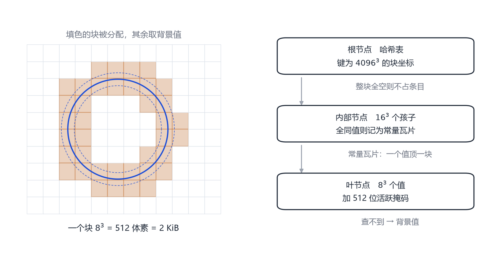
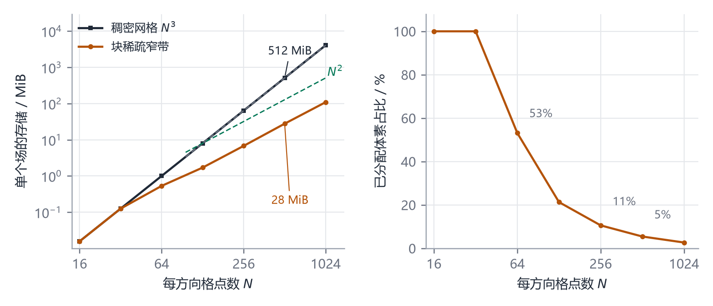

# 第 4 章 稀疏网格与 VDB

> 本章导读：分辨率是被界面需要的，不是被体积需要的。这句话听起来像口号，落到显存上就是五十倍的差距。这一章讲怎样让网格只为"有东西的地方"付费：块稀疏把稀疏性推到 8 的立方这一级，哈希表负责把坐标换成槽位，VDB 用树和背景值把整片空域压成一个数。然后算清两笔账：省下的内存，和为此多付的间接寻址。

## 4.1 一团烟要多少格子

有人想把一段水花做到 $1024^{3}$。算一下就知道不行：十亿七千万个格点，一个单精度场四 GB。速度三个分量、压力、水平集、密度、温度、两份临时缓冲，加起来九个场，三十六 GB 打底。二十四 GB 的卡连一个都不能完整放下，更别提双缓冲。

退到 $512^{3}$，九个场四点五 GB，能跑。但每个方向的格点数减半，飞溅的水滴变成一团糊，薄水膜直接消失。

这就是欧拉网格的困境：分辨率是全局的。要么所有地方都舍得给，要么所有地方都跟着变粗糙。而实际上，一段水花里真正需要细格的地方很少：水体内部的速度场是光滑的，几格之外的变化微乎其微；密度从 0 跳到 1 的那层界面，才是需要分辨率的地方。一个 $512^{3}$ 的域里，水占体积的百分之五，其中真正需要细格的只有界面那一层，内部可以用粗格甚至一个常数瓦片打发，外部则什么都没有。

先把这个"没有东西"量化。一个 $512^{3}$ 的域，取一团半径为零点三五倍边长的球形水体，界面两侧各留三个格点作为窄带。窄带里的体素数近似是表面积乘以厚度再除以单格体积：

$$
N_{\text{band}}\approx 4\pi R^{2}\cdot\frac{6h}{h^{3}}=24\pi\left(\frac{R}{h}\right)^{2}=24\pi\,(0.35N)^{2}\approx 9.2\,N^{2},
$$

$R$ 是球半径，$h$ 是格距，$N$ 是每个方向的格点数。$N=512$ 时这个数是二百四十二万，占全部格点的百分之一点八。一个场九点七 MB，九个场八十七 MB，与四点五 GB 差五十倍。

这个五十倍是理想值。按 $8^{3}$ 的块分配，一个块只要被窄带切到一点就要整块给，实际分配量是这个理想值的三倍上下：图 4-2 逐块算出来，$N=512$ 时每个场二十八 MiB，九个场二百五十 MB，与稠密相比仍有十八倍。块粒度是一层必须交的税，4.2 节会讲清这笔税买到了什么。

$9.2N^{2}$ 这个式子比数字本身重要：它说明活跃格点随表面积的平方增长，而稠密网格随体积的立方增长。分辨率翻倍，稠密的账翻八倍，稀疏的账翻四倍。分辨率越高，稀疏越划算。这句话是本章所有结构的动机。

## 4.2 块稀疏：把稀疏性推到块这一级

最直觉的稀疏化是"每个活跃体素单独分配"。这个方案行不通，原因是管理成本。每个体素要一个四字节的索引指到它的数据，索引与数据一比一，省下的内存一半被索引吃掉；更糟的是每次访问都要先查一次索引，一次间接访存，延迟翻倍，合并访问全废。

所以颗粒度要粗。取 $8^{3}$ 的块作为分配单位：一个块 512 个体素，2048 字节数据，配一个索引，压缩比 512 比 1。块内仍然是一张稠密的规则网格，模板计算、合并访问、共享内存 halo 这些手段全部照旧可用——这一点是关键，稀疏化只发生在块与块之间，块内的一切优化都保留。

块坐标到块号的换算是一次移位：$(i,j,k)$ 属于块 $\left(\lfloor i/8\rfloor,\lfloor j/8\rfloor,\lfloor k/8\rfloor\right)$。于是 $512^{3}$ 的域有 $64^{3}$ 个块槽位，二十六万两千个，每个槽位存一个四字节的块编号，块表正好一 MiB。

一 MiB 是个能接受的数字，这意味着块表可以直接开成一张稠密数组，按下标 $O(1)$ 访问，不需要哈希。这条推论值得强调：把稀疏性推到块这一级之后，索引本身变得足够小，小到可以稠密存储。$1024^{3}$ 的域是 $128^{3}$ 个槽位，八 MiB，还是能接受；$2048^{3}$ 是六十七 MiB，开始勉强。再往上就必须换结构了。

图 4-1 左边画的是这件事的二维截面。整片网格按块的格子铺开，只有与界面相交的那些块被填色，也就是被分配；界面内部和外部的大片区域都是空的，不占数据。一个块 2 KiB 的数据配一个 4 字节的槽位，索引开销是数据的五百分之一。

<figure class="fig">

<figcaption><b>图 4-1</b>　块稀疏网格的分配方式（示意图）。左：域的二维截面按块的格子铺开，每格是一个 $8^{3}$ 的块，只有被界面切到的块才被分配（填色），块内仍是稠密的规则网格；右：三层索引结构，根节点是一张哈希表，往下是内部节点与存 $8^{3}$ 个值的叶节点，查不到就取背景值。图中块数与颜色分布为示意，不代表具体的活跃比例。</figcaption>
</figure>

块表有三种状态：未分配、已分配、以及"整个块是常量"。第三种是后面 VDB 的压缩手段，一个常量块可以只存一个值，不存五百一十二个。对一个刚初始化、水体还没动起来的场，绝大部分内部块都是常量。

分配本身要小心。一帧里活跃块的集合会变：水面推进，新块要分配；水面退去，旧块要回收。分配器不能每帧重新 malloc，那会把内存碎片和同步开销带进来。工程做法是预先开一块大缓冲当内存池，用一个空闲链表管理未用的块，块号就是缓冲里的偏移。回收时把块号推回链表。链表操作在多线程下要原子，但相邻帧之间同一条链表被争用的概率不高，这一点比哈希插入温和得多。

## 4.3 哈希表：把块坐标换成槽位

块表的规模到了六十七 MiB 以上，稠密存储就不划算了，而且大部分槽位是空的——$2048^{3}$ 的域里活跃块可能只有几万个，稠密表利用率千分之一。这时要哈希。

图形学里的老配方是三个大素数异或：

$$
h(i,j,k)=\left((i\cdot 73856093)\ \oplus\ (j\cdot 19349663)\ \oplus\ (k\cdot 83492791)\right)\bmod M,
$$

$\oplus$ 是按位异或，$M$ 是表的槽位数，通常取活跃块峰值的 1.5 到 2 倍。三个素数把三个方向的坐标散到互不相关的位上，相邻的块坐标不会挤到相邻的槽位，这是为了避免"界面扫过一片区域时所有新块都撞在同一个槽上"。

冲突处理用开放寻址加线性探测。不用链式，因为链式要指针追逐，在显卡上每次追逐都是一次无法合并的访存。开放寻址的槽位是连续数组，探测时读的是同一段内存，硬件能合并。

装载因子 $\alpha$ 决定探测次数。成功查找的平均探测次数是

$$
\bar{p}_{\text{hit}}=\frac{1}{2}\left(1+\frac{1}{1-\alpha}\right),
\qquad
\bar{p}_{\text{miss}}=\frac{1}{2}\left(1+\frac{1}{(1-\alpha)^{2}}\right),
$$

$\bar{p}_{\text{hit}}$ 是找到已有块的平均探测数，$\bar{p}_{\text{miss}}$ 是确认"这个块不存在"的平均探测数。$\alpha=0.5$ 时前者 1.5，后者 2.5。请注意后者更贵，而在稀疏结构上，大多数查询是未命中的：界面附近的采样点周围有一半的块是空的。所以哈希表的实际平均代价更接近 2.5 而不是 1.5，装载因子要压在 0.5 左右，别贪那点内存。

进一步的办法是先用位图做否定判断。每个块对应一位，$2048^{3}$ 的域有 $256^{3}$ 个块，位图两 MB，可以接受；还想再省就按 $32^{3}$ 体素的大块先分一层，大块里没东西就整片跳过，位图缩到三十二 KB，先粗筛后细查。

并行插入是另一个麻烦。两个线程同时算出同一个空槽，都往里写，一个块就丢了。两种做法：一是原子比较交换占位，抢输的线程重新探测；二是两阶段，先并行标记所有需要的块坐标，排序去重，再按顺序分配块号。前者快但结果依赖调度顺序，后者慢一点但完全确定。需要位级可复现的场合（联机、回放、与 CPU 对照测试），只能选后者。

扩容是更大的麻烦。装载因子超过 0.7，探测链开始变长，必须重建一张更大的表。重建意味着把所有块重新散列一遍，这期间不能有任何线程在查表，等于整条流水线停一次。工程上的办法是按帧峰值预留，宁可浪费三成内存，也不要在帧中间扩容。

## 4.4 VDB：树、背景值与窄带

块哈希解决的是"怎样找到活跃块"。VDB 解决的是另一个问题：怎样让"空"这件事本身有明确的值，从而整片空域可以被一个数代表。

结构上是三层。根节点是一张哈希表，键是 $4096^{3}$ 体素的大块坐标——也就是说，一整块 $4096^{3}$ 的区域如果全空，在根表里连一个条目都不占。根节点下面是内部节点，每个管 $16^{3}$ 个孩子，每个孩子覆盖 $128^{3}$ 个体素。最下面是叶节点，存 $8^{3}=512$ 个体素的值，外加一个 512 位的掩码，标记哪些体素是活跃的。

三层之后总面积是 $4096^{3}$，比任何实际用得上的域都大。深度的意义在于压缩：如果一个内部节点的某个孩子覆盖的 $128^{3}$ 区域里全是同一个值，这个孩子就被记成一个常量瓦片，一个值代替二百零九万个体素。水体内部就是这种情况。这就是为什么 VDB 描述"一团水"只需要存表面那一层。

背景值（background）是这套结构的概念核心。场被定义成"有限个活跃体素的值，加上背景值"。对水平集，背景值是正的大数，表示"离界面很远"；对密度，背景值是零；对速度，背景值是零。于是"这个格点没有分配"不再是一个特例，而是函数定义的一部分：取背景值。所有采样代码因此可以写得没有分支——查不到就返回背景值，算术照常进行。

窄带是背景值的直接推论。水平集只需要在界面附近有精确值，远处用 $\pm d_{\text{bg}}$ 就够了，因为远处的符号决定内外，大小没人关心。取 $\left|\phi\right|\lt 3h$ 作为活跃区域，存储量就是 4.1 节算过的 $O(N^{2})$。

三种结构的代价对比可以这样记。稠密网格：$O(1)$ 访问，$O(N^{3})$ 内存，合并完美。块表：$O(1)$ 访问，$O(\text{活跃块})$ 内存，块内合并完美，块间靠查表。VDB：$O(\text{深度})$ 次指针跳转访问，内存最省，树上每一层都是一次依赖访存。

在显卡上，这个 $O(\text{深度})$ 是实打实的代价。一次三线性采样要访问八个角点，八个角点各走三层树，就是二十四次相关访存，延迟串起来是上千个周期。补救办法是把"这个块的叶子指针"先缓存起来：处理一个 $8^{3}$ 块时，把这一个块和它二十六个邻居的叶子指针读进共享内存（二十七个指针，一百零八字节），之后所有采样都在共享内存里做块内寻址。这一步能把采样代价压回接近稠密网格的水平，是 GPU 上跑 VDB 的关键实现细节。

## 4.5 自适应分辨率与八叉树

比块稀疏更激进的是自适应：不但在空间上稀疏，还在不同区域用不同的格距。八叉树是标准结构，每个节点八个孩子，只在界面附近细分，内部和外部停在粗层 [@losasso2004]。$512^{3}$ 的等效分辨率下，内存占用只有均匀网格的百分之几量级，因为内部的大片区域只存粗格。

它的代价有四条，都值得知道。

第一条，时间步受最小格点限制。显式平流的稳定条件是 $\Delta t\lt h_{\min}/\left|\mathbf{u}\right|$，$h_{\min}$ 是最细那层的格距。细分界面提高了精度，没有放宽步长，所以总计算量里"每步更贵"的部分并不会因为内部用了粗格而省下来——省的是内存和访存。

第二条，粗细交界的插值必须特别处理。相邻叶子的尺寸最多差一倍（这条叫 2:1 平衡），否则一个细格子的插值模板会跨越一层不存在的邻居。维持平衡意味着每次细分都要检查邻居并连带细分，这是一个传播过程，在并行代码里很难写好。

第三条，守恒性。粗细界面上的通量如果不做特殊处理，会漏质量或者反射波。八叉树上的投影需要把粗格的散度与细格的面通量对齐，这不是几行代码能解决的。

第四条，显卡不友好。树遍历是指针追逐，不同子树的工作量差很多，同一批线程里有的在细层算、有的在粗层算，warp 发散严重。批量遍历可以缓解（把同层的节点收集起来一起处理），但复杂度上去了。

所以近几年 GPU 上的生产代码，更常见的选择是"均匀细网格 + 窄带 + 块稀疏"，不做真正的自适应。用多花的内存换掉树遍历和平衡维护的复杂度。折中方案是两层：主体用均匀网格，只在水面附近的一个包围盒里开第二层更细的网格，两者交界处做一次插值。这种"补丁式"加密比完整八叉树简单得多，能覆盖大部分实际需求。

## 4.6 稀疏结构上的平流与投影

半拉格朗日平流在稀疏结构上碰到的第一个问题是回溯点落在空块里。速度场在空区域的定义是背景值零，于是从界面附近回溯出去的粒子会被拉向零速度。这不是物理，是数值粘性：水面上本来该飞出去的飞沫，被一层看不见的"胶水"粘住了。

修法是让速度的窄带比水平集的窄带更宽。水平集用 $\pm 3h$，速度用 $\pm 6h$，多出来的三格专门给回溯用。多花的存储是 $O(N^{2})$ 前面的系数变大，账还算得过来。更讲究的做法是把速度外推到整个窄带之外若干层（外推就是沿法向把界面上的值一层层搬出去），让空区域的速度不再是零而是"最近界面的速度"。

第二个问题是跨块插值。三线性插值的八个角点可能落在两到四个不同的块里。做法是先算出八个角点各自的块坐标，查表得到块号，再在块内用局部索引取数。一次插值最多八次查表，实际通常是一到两次，因为 $8^{3}$ 的块相对插值尺度不算小。前面说的"二十七个邻居指针进共享内存"就是为这一步准备的。

投影是稀疏结构上最值得算的一笔账。要求解 $\nabla^{2}p=\nabla\cdot\mathbf{u}$，只在水体内部的活跃体素上定义压力。未知数的个数等于活跃体素数：$N=512$ 时理想窄带二百四十二万，按块分配后七百三十万，而稠密网格是一亿三千四百万，差十八到五十五倍。迭代法的单次迭代是带宽受限的，未知数少十几倍，每次迭代就快十几倍——这是稀疏化最大的一笔收益，比省内存更值钱。

代价在邻接关系的组织上。稠密网格里，邻居就是下标加减一，一次加法。稀疏结构里，必须给每个活跃体素一个连续的编号，然后知道它的六个邻居编号。做法分两层：块内用局部索引直接算（$8^{3}$ 的块内，$i\pm1$ 就是在同一块里偏移 1），只有跨越块边界的那部分邻居才需要查表。一个 $8^{3}$ 的块有 384 个面格点需要跨块查找，占总数的四分之三——比例不低，但这 384 次查找可以用二十七个邻居指针在共享内存里完成，代价可控。

边界条件要单独处理。活跃体素在界面上的邻居是非活跃的，它的压力由 ghost fluid 方法外推得到：把界面另一侧的压力延拓过来，使得界面上的压力满足 $p=p_{\text{atm}}$ 且法向梯度为零（对自由面）。写进矩阵就是那一行的对角元加一、右端项加对应的外推值。这一步不能用"邻居为零"糊弄，否则自由面会像一堵软墙。

多重网格在稀疏结构上会退化成"粗层几乎稠密"。粗化一次，格距翻倍，界面两侧的活跃块数按面积算只减少一半，而总块数减少八倍，所以粗层的活跃比例上升。到最粗的几层，几乎每个格子都活跃，稀疏的收益消失。这不要紧，因为粗层本来就只有几千个未知数，稠密解它也很快。真正要注意的是层级要跟着界面的移动重建：块集合每帧都变，粗层的块集合也跟着变。省事的办法是固定拓扑几帧、只更新数值，隔若干帧重建一次。

## 4.7 内存与遍历：账要一起算

图 4-2 算的是第一笔账。同一个球形水体，稠密网格的存储随 $N^{3}$ 增长，窄带块稀疏随 $N^{2}$ 增长，两条线在双对数坐标下的斜率差一半。

<figure class="fig">

<figcaption><b>图 4-2</b>　稠密网格与块稀疏的存储随分辨率的变化（按几何模型计算）。左：单个单精度场，球形水体半径 $0.35L$，窄带为界面两侧各 $3h$，逐块判定是否与窄带相交后累加，块大小 $8^{3}$；下方参考虚线的斜率为 2。右：已分配体素占全域的比例，$N=64$ 时百分之五十三，$N=256$ 时百分之十一，$N=512$ 时百分之五，$N=32$ 及以下整域都被分配。$N=512$ 处稠密为 512 MiB，稀疏为 28 MiB，相差十八倍。</figcaption>
</figure>

但内存只是账的一半。稀疏结构换来的每一分内存，都要用间接寻址去付利息。

第一笔利息是有效带宽。稠密网格的模板计算，邻居地址是一个加法；块稀疏要先取块号、再算块内偏移，多一次依赖访存和一次整数乘加。如果块号在共享内存里，这次访存是片上操作，代价可以忽略；如果每次都去全局内存查块表，有效带宽能掉到六成。

第二笔是遍历效率。这里的做法决定成败：按活跃块列表发线程，每个块 512 个线程全部干活，利用率接近满；按稠密网格发线程再判断块是否活跃，空块的 512 个线程全部空转，利用率就是活跃比例。前者需要一个维护"活跃块列表"的机制——每帧用前缀和把块表里的非零项压实成一个数组，这一步本身要遍历块表，但块表只有一 MiB，比遍历整个域便宜两个数量级。

第三笔是负载不均。界面附近的块要做完整的插值、外推、边界处理，内部块只是拷贝，前者的工作量是后者的几倍。按块号平均分配线程，结果是一部分 SM 在等另一部分。要么用工作量估计做前缀和来切分，要么用动态任务队列让空闲的 SM 自己取活。后者的调度开销小，而且天然适应每帧都在变的活跃块集合，是更常用的选择。

最后是"什么时候不值得"。活跃比例高到一定程度，间接寻址的利息就超过省下的内存。判断式可以写得很粗糙但够用：设访问一个活跃体素的代价是稠密的 $\gamma$ 倍（$\gamma$ 在 1.2 到 1.6 之间），活跃比例是 $f$，则稀疏的收益条件是

$$
\gamma f\lt 1\quad\Longrightarrow\quad f\lt\frac{1}{\gamma},
$$

也就是活跃比例低于六到八成时稀疏才划算。按图 4-2 右边那条曲线，球形水体的界面窄带在 $N=64$ 时已分配体素就占了一半以上，$N=32$ 及以下整域都被分配——低分辨率下反而不该用稀疏结构，一个稠密网格加上掩码更简单也更快。稀疏是为高分辨率准备的工具，用在 $64^{3}$ 的域上只会给自己找麻烦。

同样一笔账也可以用在工作量的形状上。如果场是"薄薄一层界面 + 大片空域"，$f$ 随 $N$ 按 $1/N$ 掉，稀疏的收益随分辨率线性增长；如果场是"实心的、只有外壳是界面"，内部块也得存速度，$f$ 会趋近一个常数，稀疏只省下外壳那一圈的索引开销，收益有限。判断该不该上稀疏，先看自己的场属于哪一种。
