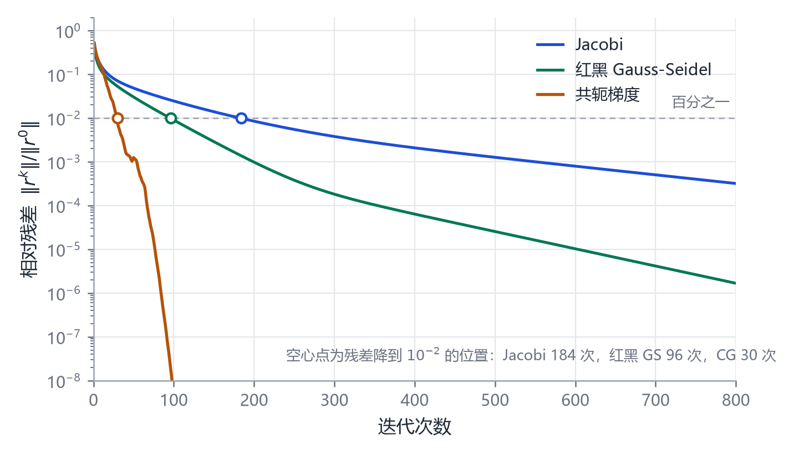
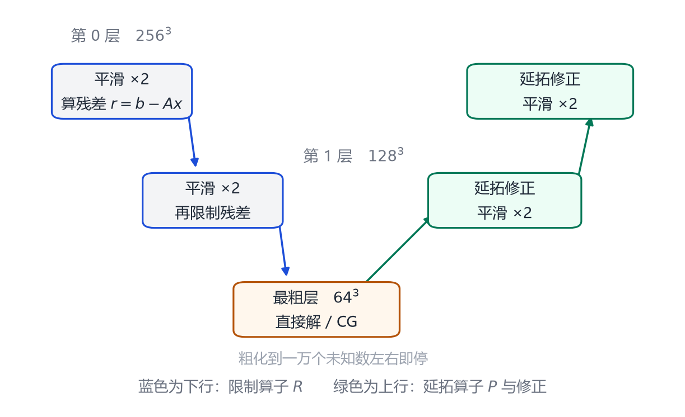

# 第 5 章 并行线性求解器

> 本章导读：隐式积分把一帧的力计算变成解一个方程。这个方程有几百万个未知数，每个未知数只和几个邻居相连，看起来稀疏得可爱，实际却是整条流水线上最贵的一步。这一章按“迭代一次要读多少字节、能不能同时算、多久要同步一次”三把尺子，量一量 Jacobi、红黑 Gauss-Seidel、共轭梯度这三种最常用的解法，再讲稀疏矩阵向量乘为什么一定是带宽受限、多重网格怎样把低频误差赶去粗网格、预条件为什么总是拿迭代数换并行度。

## 5.1 一帧里最贵的那一步

一条布挂在四根钉子上，从画面上看只是一块慢慢垂下去的织物，帧率却卡在四十。抓一次性能计数器，力的计算只占一点五毫秒，碰撞检测两毫秒，剩下的七毫秒全花在一行看起来毫无内容的代码上：解一个线性方程组。把这一行注释掉，布立刻穿模；不注释，帧率就上不去。很多实时模拟的性能问题都长这个样子——不是力算得慢，是把所有力一起算清楚这件事慢。

方程是从隐式积分来的。显式积分每一步只看当前状态，力算完直接乘步长，简单，但刚度一高就炸。隐式积分假设力在步末的状态上取值，把未知量 $\mathbf{x}$ 留在方程里：

$$
\left(\mathbf{M}-\Delta t^{2}\mathbf{K}\right)\mathbf{x}=\mathbf{b},
$$

$\mathbf{M}$ 是质量矩阵，$\mathbf{K}$ 是刚度矩阵，$\Delta t$ 是步长，$\mathbf{b}$ 收集了惯性项、外力与上一帧的状态。左边这个矩阵是对称正定的（只要约束处理得当），这在数值上是大好事：有稳定的迭代法可用，不需要选主元，也不用担心解不存在。麻烦在另外两处。它很大，一个十万顶点的布料，未知数就是三十万。条件数随分辨率变差，网格加密一倍，条件数涨四倍，迭代法的收敛速度跟着打折。

稀疏性看着是救命稻草。每个顶点只和它的几个邻居通过弹簧相连，矩阵一行里只有五到十几个非零元，其余全是零。存储上确实如此，算起来却未必省：零元不用乘，但非零元的列号要读，$\mathbf{x}$ 里对应的分量要从内存的远处抓过来，抓一次可能只用到其中四个字节，而整条缓存行都被拖进了缓存。于是判断一个求解器能不能上 GPU，落到三件具体的事上：迭代一次要搬运多少字节，这些字节的访问能不能合并，以及一帧里要停下来同步多少次。后面每一节都在用这三把尺子量不同的解法。

同一个方程组，不同解法的总代价能差出十倍，而代价是单次迭代开销与迭代次数的乘积。前者由访存结构和并行性决定，后者由矩阵的谱性质决定，只看一半就会得出荒唐结论：Jacobi 单次最便宜，迭代次数却随网格线性增长；共轭梯度迭代少，每次却要停两轮做全局内积。

## 5.2 Jacobi：只读旧值的方法

最朴素的迭代是逐点修正。把方程拆成对角部分和非对角部分，对角部分直接求逆，非对角部分挪到右边：

$$
\mathbf{x}^{k+1}=\mathbf{x}^{k}+\mathbf{D}^{-1}\left(\mathbf{b}-\mathbf{A}\mathbf{x}^{k}\right),
$$

$\mathbf{D}$ 是 $\mathbf{A}$ 的对角块，$\mathbf{x}^{k}$ 是第 $k$ 次迭代的解。括号里那一项是残差 $\mathbf{r}^{k}=\mathbf{b}-\mathbf{A}\mathbf{x}^{k}$，衡量当前解离方程还差多远。整个更新只用到上一轮的值，所以所有未知数可以同时算，谁也不用等谁。这一条性质让 Jacobi 成为并行度最高的迭代法：把网格直接映到线程上，一个线程管一个顶点，读邻居的旧值、写自己的新值，没有任何写冲突。

代价藏在收敛速度里。误差可以按空间频率拆开，每一种频率的误差在 Jacobi 迭代下按各自的因子衰减，衰减最快的是波长两个格距的高频，因子约三分之一；衰减最慢的是整个区域一个波长的低频，因子约等于

$$
\rho\approx 1-\frac{\pi^{2}}{2n^{2}},
$$

$n$ 是一个方向上的格点数。这个式子说明了两件事：低频误差几乎不动，而且格子越密衰减越慢。$n=32$ 时 $\rho\approx0.9955$，看上去还行；$n=256$ 时 $\rho\approx0.99993$，要一万次迭代才能把误差压掉一半。实测也很直接：$32\times32$ 的二维 Poisson 问题、随机右端项，Jacobi 要把残差压到初值的百分之一需要 184 次迭代，压到万分之一则 800 次还没做到，残差停在 $3.2\times10^{-4}$ 附近慢慢磨。

访存账同样不好看。每更新一个未知数，要读自己的旧值、读右端项、读六个邻居的值，写回自己的新值，七个真实存储访问摊到十几次浮点运算上，算术强度不到零点三浮点操作每字节。这条比例意味着不管 GPU 的浮点吞吐有多高，速度都由内存带宽定死。Jacobi 还必须用两份数组轮流读写，否则同一轮里有的线程已经写到新值、有的还在读旧值，结果就依赖执行顺序。两份数组各占一份带宽，有效带宽还要再打折扣。

Jacobi 在工程上还是有位置，只是位置不在主求解器上。它对高频误差的衰减极快，做平滑器正好；加权形式

$$
\mathbf{x}^{k+1}=\mathbf{x}^{k}+\omega\mathbf{D}^{-1}\mathbf{r}^{k}
$$

取 $\omega=2/3$ 时能把高低频的衰减因子拉得比较均匀，多重网格的每一层都用它。另一个用途是当预条件子的零件，或者只要求近似解的场合：布料只要求看起来软，不要求每帧收敛到机器精度，迭代三五次交差就够。

## 5.3 红黑 Gauss-Seidel：把顺序拆成两半

Gauss-Seidel 只改了一个字：用刚算出来的新值。按行扫描，算第 $i$ 个未知数时，它左边邻居已经更新过了，于是信息在扫描方向上快速传播，收敛因子大约减半。$32\times32$ 那个例子里，压到百分之一只要 96 次迭代，是 Jacobi 的一半；压到万分之一要 354 次，Jacobi 八百次都到不了。同样的算术量，效果翻倍，这就是用新值值钱的地方。

问题在于用新值本身就是一条依赖链。第 $i$ 个未知数的更新要等第 $i-1$ 个完成，一千个未知数就是一千个串行的步骤，GPU 上万个核心全在等，并行度退化成一。所以把顺序 GS 直接照搬到 GPU 上没有意义，它会把一块显卡用成一个核。

救命的观察是依赖其实是局部的。第 $i$ 个未知数只依赖它的邻居，邻居里与它距离为奇数步的那些这一轮还没更新过，所以只要把颜色分成两组，同色之间互不相邻，就可以整组并行。二维五点差分只需要两种颜色，棋盘格一样交替；三维七点差分也只有最近邻，同样是两色。更新时先遍历所有红点，读的邻居全是黑点、全是上一轮的值；写完再遍历黑点，此时读到的红点已经是新值。每一轮两遍扫描，每一遍内部完全无冲突。

$$
\mathbf{x}_{i}\leftarrow\frac{1}{A_{ii}}\left(b_{i}-\sum_{j\in\mathcal{N}(i)}A_{ij}x_{j}\right),\qquad i\in\text{红},\ \text{再}\ i\in\text{黑}.
$$

实现上有两个细节值得说。一个是数据结构：两遍扫描处理同一份数组，交替读写，第一遍写回的红点值必须在第二遍开始前真正落进内存，硬件会插入一次隐式栅栏；这次栅栏叠加上两遍扫描本身的显存往返，使红黑 GS 的带宽利用率通常低于 Jacobi，尽管它的迭代次数更少。另一个是负载：两色点数相差最多一个，几乎平衡；不规则边界会让两组差出一截，按顶点数均匀切分线程就一边闲一边忙，需要按活跃顶点数做前缀和来分派。

颜色不止两种。更高阶的格式或者不规则的稀疏结构，可以把冲突的写分到更多轮次，颜色数取决于顶点的最大度数；颜色越多，每轮能并行的顶点越少，但每一轮的访存越干净。

同一个方程、三种解法，残差曲线的形状很不一样。图 5-1 是 $32\times32$ 网格上的真实计算结果：Jacobi 是一条缓慢下行的直线，红黑 GS 的斜率大约翻倍，CG 在八十几次迭代后已经探到机器精度的地板。

<figure class="fig">

<figcaption><b>图 5-1</b>　三种迭代法在同一个方程上的残差。二维 Poisson 方程，$32\times32$ 内部格点，$h=1/33$，右端项为固定种子生成的零均值随机向量，零初值，纵轴为 $\|\mathbf{r}^{k}\|/\|\mathbf{r}^{0}\|$。Jacobi 到百分之一用 184 次，800 次时残差仍为 $3.2\times10^{-4}$；红黑 Gauss-Seidel 分别为 96 次与 354 次；共轭梯度为 30 次与 85 次，后者指压到 $10^{-6}$。三者的单次迭代代价并不相同，横轴只比次数，不比时间。</figcaption>
</figure>

## 5.4 共轭梯度：把误差投影到 Krylov 子空间

Jacobi 和 GS 都在做同一件笨事：每一步只沿坐标轴的方向修正一个未知数，方向之间互不相干，于是同一个方向上的错误被反复修正。共轭梯度换了个思路，每一步找一个与前几步都共轭的搜索方向，一次把误差在已经探索过的子空间上的投影清零，所以理论上 $N$ 步能精确解出 $N$ 个未知数的方程。实践上它在远少于 $N$ 步时就收敛到可用的精度，前提是矩阵对称正定。

算法本身只有五行：

$$
\begin{aligned}
\alpha_{k}&=\frac{\mathbf{r}^{k}\cdot\mathbf{r}^{k}}{\mathbf{p}^{k}\cdot\mathbf{A}\mathbf{p}^{k}}, &
\mathbf{x}^{k+1}&=\mathbf{x}^{k}+\alpha_{k}\mathbf{p}^{k},\\
\mathbf{r}^{k+1}&=\mathbf{r}^{k}-\alpha_{k}\mathbf{A}\mathbf{p}^{k}, &
\beta_{k}&=\frac{\mathbf{r}^{k+1}\cdot\mathbf{r}^{k+1}}{\mathbf{r}^{k}\cdot\mathbf{r}^{k}},\\
\mathbf{p}^{k+1}&=\mathbf{r}^{k+1}+\beta_{k}\mathbf{p}^{k}. &&
\end{aligned}
$$

$\mathbf{r}$ 是残差，$\mathbf{p}$ 是搜索方向，$\alpha$ 是沿方向的步长，$\beta$ 是把新残差接进旧方向的权重。每一轮的开销是一次数值上的矩阵向量乘 $\mathbf{A}\mathbf{p}$、两次内积、三次向量的线性组合。迭代次数大致正比于条件数的平方根 $\sqrt{\kappa(\mathbf{A})}$。$32\times32$ 那个例子里条件数是 441，开方得 21，实际收敛到 $10^{-6}$ 用了 85 步，多出来的因子来自收敛判据里的对数项。

它对并行是友好的，友好得并不彻底。矩阵向量乘和向量更新都是逐元素的，一个线程分一段，带宽吃满；两次内积却是全局的，必须把分布在所有线程上的部分和归约成一个标量，再广播回去。这一步是一个栅栏：所有线程停下来，写共享内存，树形归约，等到最后一个加法做完才能继续。栅栏本身不长，几微秒，但要乘以迭代次数。85 次迭代、每次两三轮归约，就是两百多次停顿，光等待就吃掉半毫秒。在这个尺度上，算法是否优雅已经不重要了，重要的是怎么少停几次。

几个常用的减法。把两次内积合成一次遍历：$\mathbf{p}\cdot\mathbf{A}\mathbf{p}$ 和 $\mathbf{r}\cdot\mathbf{r}$ 可以在同一个核函数里边乘边累加，一次归约拿回两个标量，虽然下一轮的 $\beta$ 还要等更新后的残差，但至少省掉一半的栅栏。再进一步是流水线形式的 CG，重排递推关系，让内积与向量更新重叠，代价是数值上稍微不那么稳，收敛判据要放宽。

真正决定 CG 能不能用的，还是矩阵向量乘。它占了每次迭代九成的字节数，而它一定是带宽受限的。

## 5.5 稀疏矩阵向量乘：格式决定带宽

一次 $\mathbf{y}=\mathbf{A}\mathbf{x}$，说是乘加，实际是搬运。以三维七点差分、单精度为例，一行七个非零元，最直接的 CSR 存法要读七个浮点值（28 字节）和六个列索引（24 字节），总共 52 字节，换来十几次浮点运算，算术强度约零点二五浮点操作每字节。任何一块现代 GPU 的浮点吞吐都是这个比例的百倍以上，所以性能完全由内存带宽说了算，这一点没有任何优化能改变。

CSR 用三个数组存一个矩阵：行偏移、列索引、数值。它在 CPU 上很好，因为行长不一时遍历是连续的；在 GPU 上就露出两个毛病。同一 warp 的 32 个线程分配到的行长度不同，循环次数取最长的那一行，短行的线程空转，这就是发散。行偏移本身是一串串行读取的地址，线程得先读偏移才知道去哪里取值，多了一次间接寻址。行长度差别越大浪费越多，有限元网格上顶点的度数能差十倍。

ELL 把行长拍平：所有行都补到最大长度 $K$，列索引和数值存成两个 $N\times K$ 的矩形数组，第 $k$ 列的所有行在内存里连续排列。线程按行号取第 $k$ 个元素时自然合并访问，一次事务取回一整条缓存行，发散消失。代价是补齐的空位要乘零，行长度分布越偏，零越多。长尾还能折中：前 $K$ 列走 ELL，超长行用 COO 追加在后面，绝大多数行留在快路径。

对于从规则网格来的矩阵，更好的答案是根本不存。七点差分的七个邻居偏移是编译期常量，不需要列索引；把七个偏移拆成七个独立的数组，每个数组按同一顺序排列，读的时候就是七条干净的流。每行只剩 28 字节，索引流整个消失，算术强度翻倍。这种做法叫无格式（matrix-free）实现，它把稀疏矩阵这个抽象退回到差分模板，换来的是接近纯流式拷贝的带宽利用率。代价是失去通用性：换一种网格、换一种离散，核函数就得重写。

围绕 $\mathbf{x}$ 的读取还有一层优化。三维七点差分要读 $z$ 上相邻的三层，线程若按 $z$ 连续分派，三个邻居落在三段相隔很远的地址上，同一份数据被反复取。把线程组织成 $xy$ 瓦片、让相邻三层留在共享内存里，每个数据只从显存取一次，被九个线程复用，有效读取量从七份压到一份多一点。这是结构网格上最实惠的改动。

算一笔账：一百万个未知数、每行 52 字节，一次乘向量要搬 52 MB；按 500 GB/s 的有效带宽，约 0.10 毫秒。换成无格式的 28 字节，是 0.056 毫秒；再加上 $z$ 层复用，能压到 0.03 毫秒量级。CG 迭代 85 次，三种实现分别是 8.5、4.8、2.6 毫秒，这就是为什么在同一个算法下，格式的选择能决定一个功能是能做还是不能做。

## 5.6 多重网格：让粗网格管低频

回到那个让所有定常迭代法都难堪的事实：低频误差衰减得极慢。它在相邻格点之间的差很小，逐点修正看到的总是局部已经很平，于是几乎不动；网格越密，一个波长跨的格点越多，衰减越慢。

多重网格把这件事翻过来用。低频误差在细网格上难消，换到粗网格上就成了高频：波长还是那么长，但格距变大了一倍，一个波长只跨一半的格点。所以策略是分而治之，细网格只负责消高频，剩下的低频交给粗网格，粗网格消不完的再交给更粗的。

一个 V 循环由四步组成。先在细网格上做几次平滑（Jacobi 或红黑 GS），高频误差被压掉，误差场变得光滑。然后算残差 $\mathbf{r}=\mathbf{b}-\mathbf{A}\mathbf{x}$，把它限制到粗网格上：三维用三线性加权，八个细格点的残差按 $1/8$ 平均成一个粗格点的右端项。再在粗网格上递归地解这个残差方程，得到的不是解本身而是解的修正量。最后把修正量延拓回细网格，用三线性插值铺开，加到细网格解上，再做几次平滑，把插值引入的高频毛刺磨掉。

$$
\mathbf{x}\leftarrow\mathbf{x}+\mathbf{P}\,\mathcal{S}_{H}^{-1}\mathbf{R}\left(\mathbf{b}-\mathbf{A}\mathbf{x}\right),
$$

$\mathbf{R}$ 是限制算子，$\mathbf{P}$ 是延拓算子，$\mathcal{S}_{H}^{-1}$ 表示在粗网格上递归求解。图 5-2 把这几步画成了一条往返路径：往下三层是限制，最底下那层解掉，往回三层是延拓与修正。一个 V 循环能把残差压到原来的十分之一到五分之一，而且这个比例几乎不随网格加密而变，这是它和 Jacobi 最本质的差别。

<figure class="fig">

<figcaption><b>图 5-2</b>　多重网格 V 循环的结构（示意图，未按真实规模绘制）。三层网格从细到粗，蓝色下行是限制残差，绿色上行是延拓修正，每层前后各画两格平滑。粗层未知数按八分之一递减，到最粗一层并行度已经很低，实际实现通常在这里切换到 CG 或直接解法。</figcaption>
</figure>

总代价也好算。每一层平滑的工作量正比于该层的未知数，三维下每粗一层少八倍，等比级数求和是细网格的 $8/7$。一次 V 循环四遍平滑（前后各两遍），约等于细网格上 4.6 次扫描的工作量，而 Jacobi 要做到同样精度需要成百上千次扫描。差距不是几倍，是数量级。

并行实现上有两个坑。第一个是粗层的并行度：$256^{3}$ 的网格粗到第四层只剩 $32^{3}$，三万多个点，还能喂饱显卡；粗到第六层只剩 512 个点，一整个 GPU 只用上几个线程，栅栏的代价反而占了大头。常规做法是粗化到一万个未知数左右就停下，最粗的那层用 CG 或者直接分解，不再继续递归。第二个是算子从哪来：规则网格上限制与延拓可以写死；非结构网格要走代数多重网格，粗化关系和插值权重得从矩阵本身构造，这项工作在并行时很难做快，通常矩阵不变就只做一次并缓存层级。

## 5.7 预条件：用并行度换迭代数

预条件子的想法很直接：与其解 $\mathbf{A}\mathbf{x}=\mathbf{b}$，不如解 $\mathbf{M}^{-1}\mathbf{A}\mathbf{x}=\mathbf{M}^{-1}\mathbf{b}$，其中 $\mathbf{M}$ 近似 $\mathbf{A}$ 但容易求逆。好的预条件子让 $\mathbf{M}^{-1}\mathbf{A}$ 的特征值挤在一小段区间里，CG 的迭代数随 $\sqrt{\kappa}$ 下降。问题在于容易求逆和能并行求逆是两件不同的事，串行的预条件子再有效，在 GPU 上也没有意义。

块 Jacobi 是最容易并行的选择。把未知数按顶点或者按连通分量切成小块，每块取 $\mathbf{A}$ 对应的对角块，预先求逆存下来，应用时每个线程读自己那块逆矩阵乘一下，没有通信、没有栅栏。布料这类问题上一块就是 $3\times3$ 的顶点块，预分解在初始化时做一次，之后每帧只是矩阵乘法 [@liu2013]。它的问题也很显然：块与块之间的联系被完全切断，预条件后的系统条件数只改善了一点，迭代数下不来。省了每次迭代的时间，赔上了迭代次数。

不完全 Cholesky 站在另一头。它按 Cholesky 分解的形式做，但只保留与原矩阵稀疏结构重合的位置，丢弃产生的填充，得到一个近似因子 $\mathbf{M}=\mathbf{L}\mathbf{L}^{\mathsf{T}}$。这个近似好得多，串行 CPU 上经常是首选。麻烦在于应用它要解两个三角方程，前代和回代都是严格的串行依赖。可以按依赖层级把它拆成波前并行：第 $k$ 层的未知数只依赖前几层，同层之间互不相干。但三维问题的矩阵带宽是 $\mathrm{O}(n)$，层数就有 $n$ 那么多，每一层的并行宽度只占 $\mathrm{O}(n^{2})$ 的一点零头。层数多、每层窄，这种形状在 GPU 上是最坏的。

第三条路只用矩阵向量乘：Chebyshev 多项式预条件把 $\mathbf{M}^{-1}$ 写成 $\mathbf{A}$ 的多项式，应用就是几次乘向量，纯并行但改善中等，还要估计特征值区间；稀疏近似逆用最小二乘拟合 $\mathbf{M}^{-1}\mathbf{A}\approx\mathbf{I}$，构造贵、应用便宜。

还有一条把层次结构当预条件子的路：用一次 V 循环当预条件子，等于让多重网格负责低频、CG 负责收敛判据的稳健。带接触的骨骼与肌肉有限元模拟里，这种组合是当时能做到交互速率的少数方案之一 [@mcadams2011]。

值得单独提的是两种绕过求解器的做法。一种是局部与全局交替：把能量拆成每个顶点周围的一小块，局部步在每块上独立求极小，完全并行；全局步解一个系数矩阵固定的线性系统，因为矩阵固定，可以预分解、每帧复用，迭代几次就够 [@bouaziz2014]。另一种是干脆不追求每帧解准：把步长缩小，每步只做少量迭代，用更多步数换每次更少的收敛要求，稳定性由小步长保证而不是由精确求解保证 [@macklin2019]。这两种思路的共同点是承认迭代数与单次代价两个因子都可以动，不必死守其中一个。

所以选求解器的顺序不是比较算法优劣，而是问三个问题。矩阵在整个模拟过程中变不变？不变就可以预分解、可以缓存多重网格的层级、可以承担昂贵的预条件子构造。问题的并行粒度有多细？规则网格能给出百万级的独立任务，非结构的接触约束可能只有几千个，后者更适合块 Jacobi 这类不需要全局通信的方法。最后才是收敛速度：实时场景里残差降到 $10^{-3}$ 与降到 $10^{-8}$ 在画面上没有区别，把判据定在视觉能接受的位置，往往比换一个更聪明的算法省得更多。
