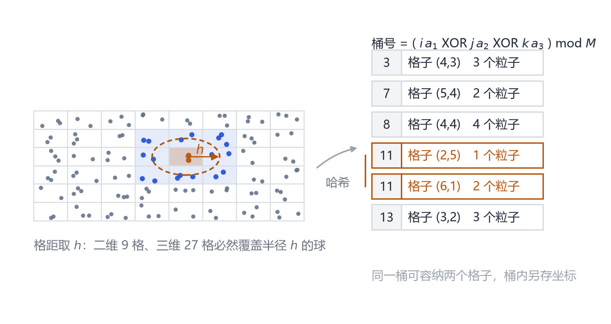
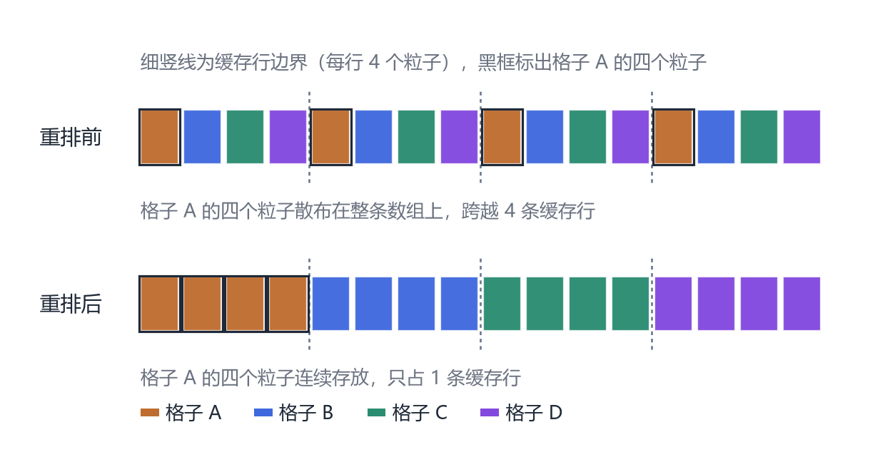

# 第 6 章 粒子系统的排序、哈希与邻域

> 本章导读：粒子模拟的每一步都要回答同一个问题——谁在我旁边。朴素地两两比对，五万个粒子就是十二亿五千万次距离计算，一帧算不完。这一章讲怎么把这个问题变成一个查表动作：用均匀网格或空间哈希把空间切开，用计数排序把粒子按格子重排，用半排序省掉不需要的那部分排序，把邻域查询压到每个粒子几十次距离测试；最后看动态增删的粒子怎样管理，以及一个粗糙的性能模型能告诉你什么。

## 6.1 一个粒子要找它的邻居

一池水被一块石头砸中，水花溅起来，浪头砸回水面时溅出的粒子在很小的体积里挤成一团。帧时间在这几帧突然翻倍，然后恢复。抓一份逐核函数的计时，力计算不是瓶颈，邻域搜索占了六成；而邻域搜索的耗时曲线与最密区域的粒子数同步跳动，稀的地方快得可以忽略。

邻域搜索的定义很简单：给每个粒子找出距离小于截断半径 $h$ 的所有其他粒子。$h$ 是核函数的作用半径，SPH、位置动力学、离散元都用它。两两比对的代价是

$$
\frac{N\left(N-1\right)}{2}
$$

次距离测试，$N$ 是粒子数。五万个粒子是十二亿五千万次，每次要读两个位置、算三分量差、平方求和、比较，摊到一张显卡上也不是一帧能做完的事；粒子数翻倍，代价翻四倍。稀疏的地方和密的地方付一样的钱，这是两两比对最浪费的地方——远处粒子的距离算得再准也毫无用处，判据只有"小于 $h$"和"不小于 $h$"两个结果。

把判据放宽一点看，问题就好办了：既然只关心 $h$ 以内，空间上就可以切块，一个粒子只可能和它所在块及相邻块里的粒子成为邻居。这一步把"所有粒子"换成"周围一小撮"，剩下的问题是怎样在常数时间里找到"周围一小撮"是谁。答案落在两件东西上：一个能按空间坐标直接定位的数据结构，和一个让同一格的粒子在内存里挨着的排列。前者是网格或哈希，后者是排序。这两件事合起来，把 $N^{2}$ 的代价压成 $N$ 乘一个与密度无关的常数。

## 6.2 均匀网格与空间哈希

最直接的切法是均匀网格。取格距等于截断半径 $h$，一个粒子所在格的整数坐标就是三个方向的向下取整：

$$
i_{x}=\left\lfloor\frac{x_{p}}{h}\right\rfloor,\quad
i_{y}=\left\lfloor\frac{y_{p}}{h}\right\rfloor,\quad
i_{z}=\left\lfloor\frac{z_{p}}{h}\right\rfloor .
$$

$x_{p},y_{p},z_{p}$ 是粒子坐标。格距取 $h$ 有一个好处：一个粒子的所有可能邻居只落在它所在格和周围 26 个格子里，查 27 个格子必然覆盖整个半径为 $h$ 的球，代价是多查了一些与球无交的格子。格距取小于 $h$ 也不会漏，只是要查更多格子；取大于 $h$ 就会漏，除非查得更远。

网格有两种存法。模拟域有界且密度均匀时，直接开一个三维数组，一格一项，项里存该格第一个粒子的下标，粒子之间用 next 数组串成链表。这种做法定位是 $O(1)$ 的整数索引，没有哈希冲突，缺点是内存按体积走：$256^{3}$ 的网格就是一千六百万格，每格四个字节要 67 MB，而粒子可能只有五十万个，绝大多数格子是空的。空网格也要占地方，这在稀疏场景里是纯浪费。

模拟域无界、或者密度极不均匀时用哈希表。把三个整数坐标乘上三个大奇数再异或、最后对表长取模，得到一个桶号：

$$
\text{slot}=\left(\left(i_{x}\,a_{1}\right)\oplus\left(i_{y}\,a_{2}\right)\oplus\left(i_{z}\,a_{3}\right)\right)\bmod M ,
$$

$a_{1},a_{2},a_{3}$ 是三个互不相干的大奇数，$\oplus$ 是按位异或，$M$ 是桶数。表长取成 2 的幂，取模就可以写成按位与，比整数除法快得多。$M$ 一般取粒子数的两倍左右：装载因子 0.5 时平均冲突不多，表也不算大。乘大奇数再异或的目的是把三个坐标的规律性打散，否则相邻的格子容易落到相邻的桶里，冲突会成串出现。

哈希的代价是有冲突。不同坐标的格子可能落进同一个桶，桶里混着几何上毫无关系的粒子。处理办法有两种：一是容忍，桶里同时存格子坐标，遍历时只处理坐标相同的那些，冲突只是让扫描长一点，正确性不受影响；二是链式，桶里挂一个链表，节点是（格子坐标，粒子下标）。前一种更常见，因为桶里的条目本来就少，多扫几个几乎不花钱。

两种结构都要解决一个共同的麻烦：怎样把粒子放进桶里。最直接的做法是用原子操作对桶计数器加一，把粒子写到桶的对应位置。原子操作在冲突少的时候很便宜，可粒子分布不均时，热门格子上的计数器会被几十个线程反复争抢，串行化得厉害。更好的做法是根本不用原子：先数一遍每个桶有多少粒子，算出每个桶的起始偏移，再数第二遍把粒子写进去。这就是下一节的计数排序，也是把"分桶"和"排序"合成一件事的关键。

图 6-1 把这两层结构画在一起：左边是空间里的格子与半径 $h$ 的球，右边是这些格子落进桶后的样子，两个格子挤在同一个桶的情形也标了出来。

<figure class="fig">

<figcaption><b>图 6-1</b>　二维下的均匀网格、空间哈希与邻域查询（示意图）。格距取截断半径，深色格是粒子所在格，周围一圈格子必须全查（三维是 26 格）；三个坐标经乘子异或后映射到桶数组，两个不同格可能落进同一个桶，桶里额外记格子坐标用来区分。查邻域时只对半个模板里的格子逐对测试，另一半在对方的循环里被覆盖，避免每对粒子算两次。</figcaption>
</figure>

## 6.3 计数排序：三遍扫描换掉原子操作

计数排序的思路很朴素：不知道每个东西该放哪，就先数清楚每一类有多少，再按前缀和算出每类的起始位置，最后把东西逐个放到自己的类里。对粒子分桶来说，"类"就是桶号。

第一遍扫过所有粒子，算出桶号，把对应计数器加一；第二遍对计数器做前缀和，$M$ 个桶的和是 $N$；第三遍再扫一遍粒子，按桶号取当前偏移、写入、偏移加一。三遍都是 $O(N)$ 的连续访存，加起来不到一次力计算的开销。

麻烦在并行化。第一遍的计数器加一如果不加约束，就是一堆写冲突；如果全用原子操作，又回到 6.2 的问题。常规解法是分层直方图：每个线程块在共享内存里开一份局部计数器，块内先原子加，全部粒子处理完之后再把局部计数器汇总到全局。局部计数器的桶数有限（共享内存装不下几万个桶），所以只对"桶号对块内桶数取模"的低位计数，高位另外处理；或者按块负责的空间区域划分，只统计自己区域内的桶。

第三遍的偏移更新同样有冲突。可以把它改成两段式：先算出每个桶的起始偏移并存下来，再用一个原子操作给每个桶发号，让写入的次序不确定但位置都不重叠。写入次序不确定意味着同一个桶内部粒子的顺序依赖调度，这一条在下一节会变成一个有用的性质。

基数排序用在需要按多位键排序的场合。把 32 位的键按 8 位一段分成四段，每段做一次计数排序（256 个桶），四次之后整个键有序。每一段都要稳定：相同键的元素保持之前的相对次序，否则前面几段的成果会被打乱。四遍扫描的代价是 $4\times$ 的读写，但在 256 个桶上做直方图，共享内存完全装得下，冲突比直接对 $N$ 个桶排序少得多，实际跑起来往往比"一遍 32 位桶"更快。

排序值不值？五万个粒子，两两比对是十二亿五千万次距离测试；计数排序是几十万次访存，加八千个桶的前缀和（域有界时），或者十万个桶的计数器更新（用哈希时）。两个量级差了三四个数量级，答案没有悬念。真正需要斟酌的不是要不要排，而是排到什么程度。

## 6.4 半排序：排到桶为止

把粒子按桶号排序，有两件事可以分开看：桶与桶之间的顺序，和桶内部粒子之间的顺序。前者决定了内存局部性——同一个格子的粒子在数组里挨着，邻域查询时一次缓存行能带回好几个邻居；后者什么也不决定，因为邻域查询要把候选格子里所有粒子都试一遍，谁先谁后不影响结果，力累加虽然依赖顺序，但那个顺序只要在同一个线程内固定就够。

所以只需要"半排序"：把粒子按桶号分好组，组内顺序随意。计数排序天然如此——第三遍写入时，同一个桶的粒子按它们被处理的次序进入，这个次序由调度决定，而我们根本不在乎。也就是说，6.3 里那个"写入次序不确定"的缺陷，在这里不是缺陷。

半排序还有更省的做法：如果只需要知道每个桶的边界而不需要重新排列，那就只算前缀和，得到每个桶的起止下标，粒子仍留在原位置，靠一个索引数组访问。代价是每次访问都要多一次间接寻址，好处是不用搬动数据，重排的开销降到 $O(M)$ 个桶。这个取舍在粒子属性多、单帧只查一两次邻域时划算；在属性少、每帧要查好几次时，重排把间接寻址换成连续访问更值。

反过来，什么时候必须做完整排序？当键是多段含义时。比如先按空间格排、再按材质排，让同材质的粒子在空间块内部连续，可以用基数排序的多段特性一次做完；或者当粒子数超过几百万、桶数也上百万时，桶边界本身就要按桶号排序，那就退化成对键排序，半排序省不掉那部分。

判断标准可以用一句话概括：排序的目的是让"一起被访问的东西"在内存里靠近，只要这一点达到，多排一位都是浪费。

## 6.5 邻域查询：27 个格子与半个模板

有了网格和按格重排的数组，查询就变成一个三重循环：遍历自己所在的格与周围 26 个格，每个格子里从起始偏移遍历到结束偏移，逐个测距。测距用平方比较，省掉开方：

$$
\left(x_{j}-x_{i}\right)^{2}+\left(y_{j}-y_{i}\right)^{2}+\left(z_{j}-z_{i}\right)^{2}\lt h^{2},
$$

$i$ 是查询粒子，$j$ 是候选粒子。开方是超越函数，几十个周期，而平方比较只要几次乘加，把判据改成平方形式是这类代码里最便宜的优化。

27 个格子听着不多，浪费不小。半径为 $h$ 的球体积是 $\frac{4}{3}\pi h^{3}\approx4.19h^{3}$，27 个边长 $h$ 的格子加起来是 $27h^{3}$，六倍多的体积做了无用功。功的大小可以直接数：粒子数五万、域是单位立方体、$h=0.05$，平均每个格子 $\frac{Nh^{3}}{V}=6.25$ 个粒子，27 格共 169 个候选，最后留下 26 个邻居，命中率一成五。

把格距缩到 $h/2$，覆盖半径要查 $5\times5\times5=125$ 个格子，总体积 $15.6h^{3}$，浪费降到三点七倍；每格平均不到一个粒子，候选九十八个。格子访问次数从 27 涨到 125，候选数从 169 降到 98。哪个更省取决于访存的形状：访问次数多但每次只碰一两个粒子，地址是散的；访问次数少但每次连续读六七个粒子，合并访问更容易成立。在 GPU 上通常从 $h$ 出发调，把每格平均四到八个粒子当成经验目标，这样一个 warp 正好覆盖四五个格子。

配对计算要避免算两次。粒子 $i$ 和 $j$ 的相互作用只该算一遍，做法是只遍历半个模板：自己所在的格只取 $j\gt i$ 的那些，26 个邻居格只取 13 个。13 是 26 的一半，方向取反的格子在对方的循环里会覆盖到，整个空间正好被切一遍。这半模板还有一个副产品，力累加不再需要把结果写成对称的两份，省掉一半的写。

截断半径与格距的关系还影响另一种结构：邻居表。把半径放宽到 $h+\delta$，$\delta$ 是一层"皮肤"，把这一圈邻居的下标缓存下来，力计算时只查表、不再查网格。粒子移动不超过 $\delta/2$ 之前表一直有效，于是建表可以隔几帧做一次。$\delta$ 取大了建表稀疏、查表变慢，取小了每帧都要重建；经验上让 $\delta$ 等于粒子每帧位移的两三倍，重建周期落在五到十帧之间。

## 6.6 重排与局部性

排序之后要真正把粒子搬到新位置。粒子属性通常按 SoA 存放：位置三个数组、速度三个数组、密度一个、压力一个，各自是长度为 $N$ 的连续数组。重排时按排好的置换依次拷过去，每条属性都要读写一遍。八个 float 属性、五万粒子，读加写是 $50\,000\times8\times4\times2\approx3.2$ MB，按 500 GB/s 的有效带宽是 6 微秒量级——和一次邻域查询的几十微秒相比可以忽略。

这六微秒买到的东西，要在后面每一个核函数里兑现。邻域查询的读取模式从"按粒子下标随机抓"变成"按格号顺序抓"，同一格子的几十个粒子在数组里连续排列，相邻格子的粒子也在附近。GPU 上的收益比 CPU 更明显：一个 warp 的 32 个线程如果处理的是同一格内连续的粒子，它们读到的邻居地址高度重合，几十次请求被合并成几次事务；如果 32 个线程处理的是空间上散开的粒子，每个线程各自去远处的九个格子读，事务数按线程数线性增长，带宽利用率掉一个量级。

图 6-2 画的就是这件事。排序前，粒子数组的顺序是它被创建的顺序，与空间位置无关，一个线程组的邻居分散在整块内存里，每次测试都要新开一条缓存行；排序后，同一个格子的粒子挤在一小段地址上，邻居查询的绝大多数访问落在已经取回的缓存行里。

<figure class="fig">

<figcaption><b>图 6-2</b>　粒子重排前后的访问局部性（示意图，连线只表示访问目标，不表示真实地址）。上：数组顺序与空间位置无关，格子 A 的四个粒子分散在整条数组上，要触碰 4 条缓存行；下：按格号重排后，同一格子的粒子落在连续地址，只需 1 条。竖虚线是缓存行边界，黑框标出格子 A 的位置；重排本身的代价是每帧一次 $O(N)$ 的拷贝。</figcaption>
</figure>

代价也不能不提。每个粒子的位置在下标里编码了它的身份，重排等于给所有粒子换了编号，凡是跨帧保存了"第 $k$ 个粒子的速度"这类引用的地方都会错位。约束、附着关系、外部脚本持有的句柄，都要跟着置换一起改，或者干脆改成按稳定 ID 索引。稳定的做法是留一份从稳定 ID 到当前位置的映射表，重排后重建一次，靠它把外部引用转成新下标。

## 6.7 动态粒子数与性能模型

粒子数很少是恒定的。流体在源源不断地流进来，碎片在碰撞中分裂，颗粒被吸走。数组按最大容量开，活跃粒子数每帧变化，中间会留下空洞。空洞会让排序失效——粒子按格排好序了，空洞散布在数组里，缓存行一半是空的。

处理办法是压实：把活跃粒子挤到数组前部，用前缀和算出每个粒子该去哪一位。这跟计数排序是同一套机械，只是"桶号"换成了"是否活跃"。压实可以和按格排序合成一次：先按活跃标志做一次扫描算前缀和，得到每个活跃粒子的目标下标，再按格号排序并写入压缩后的位置，两件事一遍做完。

满溢是另一个问题。哈希表按粒子数开桶，粒子的密度却不均匀，某个格子可能有几百个粒子而平均只有六个。按格重排后桶里的条目数没有上限，如果实现里给每格预留固定槽位，热门格子就会溢出。三种应对：给每格留一个可增长的子数组（要动态分配，实时场合尽量避免）；给每格一个固定的上限，超过的粒子丢弃或者推到邻近格（物理上会失真，但如果上限取平均值的二十倍，几乎不会触发）；或者根本不给槽位，只给起止偏移，让每格的粒子在同一个大数组里首尾相接，这样就没有上限，代价是前缀和之后不能再插入新粒子。

内存管理的原则是不要在稳态里分配。每帧需要的新数组在初始化时按容量开好，帧内只做读写，不做 malloc 和 free；需要交换两份缓冲区时用双缓冲轮换，避免读写重叠，也避免每帧新建。容量按场景峰值的一点五倍开，剩下的交给标量字段记录活跃数量。

现在算一个模型。设粒子数 $N$，平均邻居数 $\bar{k}$，每个粒子的位置占 $b_{	ext{pos}}$ 字节，有效带宽 $B$，那么一帧的邻域查询大致是

$$
T_{\text{query}}\approx\frac{N\left(27\,\bar{n}\,b_{\text{pos}}\right)}{B},
$$

$\bar{n}$ 是每格平均粒子数，$27\bar{n}$ 是候选数量。这个式子说清楚了两件事：代价正比于 $N$，不随 $N$ 平方增长；候选数里绝大部分是浪费，命中率只有一成多，所以常数因子很大，值得优化。粒子数五万、平均邻居 26、候选 169，一帧的距离测试是 $8.5\times10^{6}$ 次；同样的问题用两两比对是 $1.25\times10^{9}$ 次，差两个数量级。粒子数涨到五百万时，网格法的代价涨一百倍，两两比对涨一万倍，差距变成四个数量级。

模型也解释了为什么排序必须便宜。如果重排是完整排序、代价是 $O(N\log N)$ 且常数不小，那么在 $N$ 很大的时候它自己就会变成主要开销；半排序的计数排序是 $O(N)$ 加 $O(M)$ 个桶，$M$ 随 $N$ 线性增长，所以整体是线性的，不会在某个规模上突然翻脸。GPU 上的粒子引擎把空间哈希、按桶重排的粒子数组、半模板邻域查询这套组合做成了标配，正是因为它把每一部分的复杂度都压到了线性，而唯一非线性的一步——两两比对——被彻底去掉了 [@macklin2014]。大规模水花的 GPU 实现同样如此：瓶口不在力计算，而在邻域数据的组织方式 [@gerszewski2009]。

模型没算进去的是密度不均。均匀密度下 $\bar{n}$ 是常数，前面的推导都成立；一旦出现局部聚集，$\bar{n}$ 在热门格子里涨几十倍，而 GPU 的一个线程块里，只要有一个格子特别满，整个块的耗时就由那个格子决定。这就是 6.1 那个现象的来源：帧时间跟着最密的那一团跳动。想让帧时间平稳，要么在数据组织上做负载均衡（把格子和它们的粒子数一起排队，按累计粒子数切分线程块），要么在物理上限制压缩——两种办法都比单纯加线程有效。
