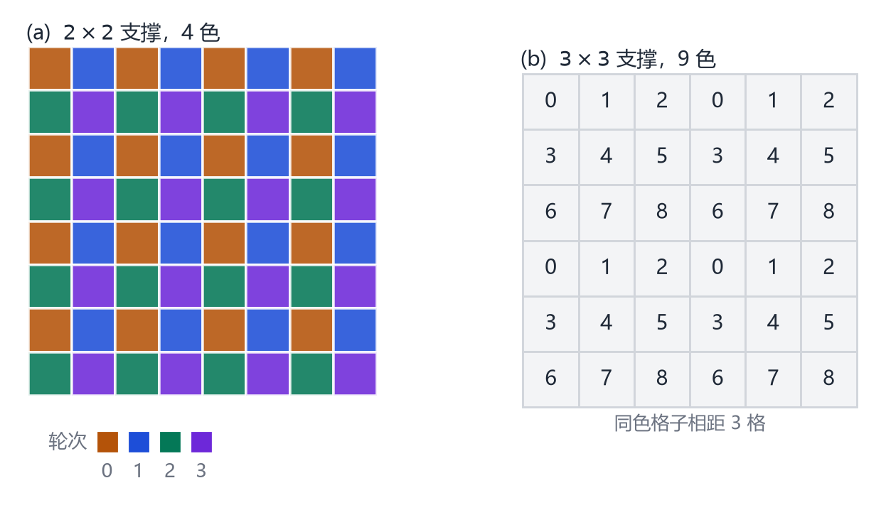
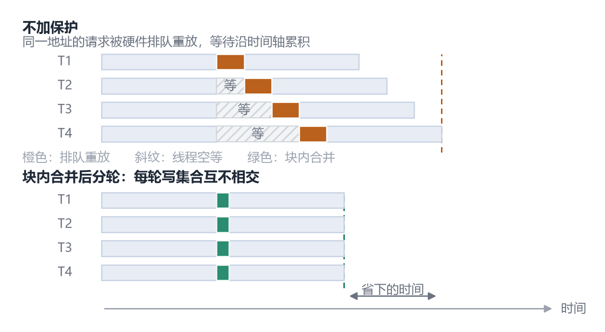

# 第 7 章 图着色、原子操作与无锁结构

> 本章导读：两个线程同时往同一个格子里加数，为什么会少一截；原子操作本身并不慢，慢的是什么；把网格染成几种颜色为什么就能消掉冲突；以及什么时候最该做的是换掉算法，而不是多敲一个原子。

## 7.1 加不进去的那部分密度

一把沙子撒进水里，沉底。模拟里通常不直接解沙粒之间的接触，而是先把沙粒的质量按双线性权重散布到一张网格上，让网格去解密度和压力，再插值回粒子。这套流程在单线程上跑得很顺：把所有粒子的质量加起来，和网格上所有格子的质量加起来，两个数对得上，小数点后几位之差只是浮点加法本身的舍入。

换成八个线程跑同一份数据，事情就变了。网格上的总质量和单线程的结果对不上，差多少每次都不一样，跑十次能跑出十个值。密度场靠近边界的地方还会出现一道道细条纹，好像某些格子被加了两次，某些一次也没加上。把同一帧重复算两遍，画面会轻微抖动——不是物理在抖，是两次加法顺序不同。

原因只有一句话：`d[i] = d[i] + w` 不是一步，是三步。先把 `d[i]` 读进寄存器，加上 `w`，再写回去。两个线程如果同时读同一个格子，各自加完再各自写回，后写的那个把先写的覆盖掉了，一次更新就此蒸发。三个线程同时来，可能蒸发两次。这种错误有个名字叫丢失更新，它是写冲突最朴素的形式，也是最难查的一种，因为它不崩溃、不报错，只是让结果偏一点。

写冲突的来源可以归成三类，写法不同，本质一样。

第一类是散射：粒子、三角形、碰撞点把自己的量加到它覆盖的那些格子上。目标格子由粒子的位置决定，粒子在哪是数据，不是线程编号，所以无法预测谁会和谁撞上。

第二类是直方图和计数：统计每个空间桶里有多少粒子、每张纹理有多少覆盖。桶的数目远小于元素数目，平均一个桶要被访问很多次。

第三类是接触和约束：多条接触约束同时修改同一个刚体的速度。这类冲突甚至不在内存层面，而在逻辑层面——两个接触都认为自己的冲量应该独占那个物体的速度。

三类的共同点是：写哪个地址由数组里的值决定，而不是由线程编号决定。反过来，如果写哪个地址完全由线程编号决定，比如 `out[i] = f(in[i])`，那么无论开多少线程都不会冲突。这条界线值得记牢：看到索引来自另一个数组的内容，就要想到冲突。

查这类错误有一个便宜的办法：在核函数末尾把所有格子的量加起来，和粒子侧的总量比一比。单线程时两个数应当只差舍入；多线程时如果差得超出几个量级，就是丢了更新。这个校验的代价是一次归约，比逐帧盯着画面找条纹划算得多，而且它可以用在单元测试里——同一份数据跑两遍，比较两次的校验和，不相等就说明存在与调度相关的加法顺序。

## 7.2 原子操作本身并不慢

把读-改-写换成一条不可分割的指令，冲突就没了。硬件保证同一地址上的原子操作按某个顺序逐个完成，谁先谁后不重要（对整数而言），重要的是没有谁被覆盖。

代价在于串行。一次没有竞争的原子加，吞吐和一次普通全局读写是同一量级，多出来的延迟以几十个时钟周期计——这个数字不值得记，值得记的是它的量级：它不会让一个本来十毫秒的核函数变成二十毫秒。真正让性能掉下去的是竞争：同一地址上排了 n 个请求，硬件要么重放，要么排队，最坏情况下这一段的时间是单次的 n 倍。

竞争有多严重，可以用一个经典的模型估出来。把 n 个球随机扔进 m 个桶，平均负载是 $\lambda=n/m$，而最热的那个桶的负载大约在

$$\lambda+\sqrt{2\lambda\ln m}$$

附近。代入一组具体数字：$n=10^{6}$ 个粒子、$m=256\times256=65536$ 个格子，$\lambda\approx15.3$，$\sqrt{2\lambda\ln m}\approx18.4$，最热的格子要承接三十多次访问。平均十五次、最热三十四次，整张网格的完成时间被最热的那一格拖住，其余格子的并行度白白浪费。这个估计假设粒子在空间上均匀；真实的粒子会成团，成团处的负载远超这个数，所以它只能当作下限来看。

知道成本在尾部，优化方向就清楚了：不是减少原子操作的次数，而是压低最热那一格的次数。有三个常用做法。

其一，缩小竞争范围。全局原子要经过 L2 缓存的一个分区，同一地址的所有请求都落在同一个分区里排队；共享内存原子只在单个 SM 内部串行，不经过 L2 往返。把全局原子换成"先在每块的共享内存里原子累加，再由每块发一次全局原子"，全局原子次数就从元素数降到块数。

其二，在线程组内部先合并。同一个 warp 里如果有若干线程落在同一地址，可以让它们先在寄存器层面互相加完，再由一个线程发一次原子。这一步把 32 路竞争压成 1 路，代价是一次组内通信。

其三，改变数据的位置，让热点分散。这条最有效，也最麻烦，7.6 节展开。

## 7.3 把冲突的写排到不同轮次

既然同一时刻不能有两次写落在同一个格子上，那就把它们排开：第一轮只让一部分线程写，第二轮换另一部分，各轮的写互不相交。问题是，"一部分"该怎么挑。

把这个问题形式化：给每个写操作一个顶点，如果两个写操作可能写到同一个地址，就在它们之间连一条边，得到一张冲突图。给这张图着色，同色的顶点之间没有边，可以放心地同时执行；颜色数就是轮数。这就是图着色在并行计算里的全部含义，它不神秘，只是把"谁和谁能同时干"翻译成了一张图。

对双线性散射，冲突图的结构特别干净。每个粒子写它所在格子和右、上、右上共四个格子，也就是一个 $2\times2$ 的块。两个粒子冲突，当且仅当它们的 $2\times2$ 块有交集。如果把格子按 $(i\bmod 2,\ j\bmod 2)$ 染成四种颜色，那么任意一个 $2\times2$ 块里恰好四种颜色各一个。于是同色的两个格子至少隔开两格，它们的 $2\times2$ 块不可能重叠。四轮，每轮无冲突，一个原子也不需要。

这个结论可以直接推广。设冲突半径 $r$ 表示"两个写操作之间在任一方向上隔了不超过 $r$ 格就会撞上"，那么按 $(i\bmod (r+1),\ j\bmod (r+1))$ 染色，同色格子之间至少隔 $r+1$ 格，一定不冲突，色数是 $(r+1)^{2}$。双线性权重的支撑是 $2\times2$，$r=1$，四色；三次 B 样条权重每维覆盖三格，$r=2$，九色。

这里有一个容易混淆的地方：Gauss-Seidel 的冲突半径和散射的冲突半径来源不同。GS 更新一个格子要读它周围一圈，所以两个格子只要相邻就冲突，半径是 1；散射的半径取决于权重的支撑宽度。按这个口径，九点 stencil 的 GS 只需要四色——按 $(i\bmod 2,\ j\bmod 2)$ 染色，同色格子隔两格，谁也读不到谁。而常用的红黑着色只有两色，它靠的是"同色格子隔两格、且只依赖正交邻居"这两条同时成立；遇到对角依赖就不行了：$(i,j)$ 与 $(i+1,j+1)$ 在红黑染色下同色，却互为邻居，同一轮里互相读到了对方正在写的值。

图 7-1 左边是 $2\times2$ 散射的四色排布，右边是 $3\times3$ 散射的九色排布。图里的颜色是按上述规则算出来的贪心着色结果，脚本在着色之后逐个检查了同色格子的写入集合，确认两两不相交，才把它画出来。

<figure class="fig">

<figcaption><b>图 7-1</b>　二维网格的冲突着色。左：双线性散射的 $2\times2$ 影响域，按 $(i\bmod 2,\ j\bmod 2)$ 染四色，同色格子相距至少两格，四轮写完无冲突。右：三次 B 样条散射的 $3\times3$ 影响域，按 $(i\bmod 3,\ j\bmod 3)$ 分九类，格内数字为轮次。两种着色都由脚本对冲突图做贪心着色后验证：同色顶点的写入集合两两不相交。</figcaption>
</figure>

分轮不是免费的。要把粒子按颜色分到不同的桶里，这是一次计数排序，本身要用前缀和；然后每一轮只有四分之一的线程是活跃的，另外四分之三在等。总工作量没变，墙钟时间取决于冲突和空转哪个更贵。

这笔账可以粗算。设每格平均有 $\lambda$ 个粒子，总访问量是 $4\lambda m$（$m$ 是格子数，四倍来自 $2\times2$ 块）。不分轮时，墙钟时间大致正比于最热那一格的访问次数，也就是前面估出来的量级 $\lambda+\sqrt{2\lambda\ln m}$ 乘以一个串行单价；分四轮时，墙钟时间正比于四倍的每轮工作量除以四分之一的并行度，换算下来差不多是 $16\lambda$ 乘以并行单价。两个单价是同一个量级的常数，于是分界点落在 $\lambda$ 大约等于十几的地方：超过它，最长的那一格撑起整段时间；低于它，四轮的空转更亏。这个估算很粗，单价里塞着很多没算的东西，但它把道理说清了——冲突的代价和空转的代价都是 $\lambda$ 的函数，两者朝相反方向走，中间必然有一个交点。工程上不必解出那个交点，测出来就行。

图 7-2 把两种情形叠在一起对比。上半是一次不分轮、不加任何保护的执行：四个线程往同一批地址上写，落在同一地址的请求被硬件排成队，时间轴上出现一长串首尾相接的小段，其余线程只能空等；下半是改成两级归约或者按本节的办法分轮之后的执行，每一段内部不再有排队，整条时间线被压短。两边的总工作量一样，差的是时间轴上那些等待的缝隙。缝隙的多少由最热那一格决定，这就是为什么前面反复强调“看尾部而不是看平均”。

<figure class="fig">

<figcaption><b>图 7-2</b>　原子冲突与轮次（示意图）。每一行是一个线程，横轴为时间。上：不加处理时，四个线程在热点地址上的请求被串行重放（橙色小段），中间是排队等待，整段耗时由最长的那条链决定。下：先把请求在块内合并、再分轮发出，每轮的写互不相交，总工作量不变而墙钟时间缩短。</figcaption>
</figure>

## 7.4 前缀和：先把位置算好再写

有一类冲突可以用算术彻底消掉，办法是让每个元素在写之前就知道自己的位置，而且这个位置是唯一的。

前缀和就是这个工具。给定数组 $a$，算出 $s_{i}=\sum_{k\le i}a_{k}$。串行一遍就完了，但它在并行机器上有一套漂亮的写法：上扫阶段两两相加，把数组折叠成一棵求和树；下扫阶段从根往下分发部分和。两趟，每趟 $\log n$ 层，总工作量仍是 $O(n)$，只是常数比串行大一点。它的意义在于：前缀和把一个"必须从头串起来"的操作，变成了一个深度只有 $\log n$ 的并行操作。

一旦有了前缀和，桶的起始偏移就能提前算出来：先数每个桶有多少元素，对这串计数做前缀和，第 $b$ 个桶的起始位置就是 $s_{b-1}$。之后每个元素写到哪里，完全由它自己决定，不需要和任何人商量，也就不需要原子。

不过这里有个容易被跳过的细节。桶间的位置由前缀和定了，桶内的序号还没定：同一个桶里的十个元素，谁写第一个位置？如果直接用一个每桶递增的计数器，那又回到了原子。GPU 上的标准解法是分块：把输入切成若干块，每块先统计自己给每个桶贡献多少，得到一张块与桶的计数表；对这张表沿桶方向做前缀和，每块就拿到了自己在这一桶里的起始偏移；块内再按顺序分配。这是基数排序的标准结构，桶间靠 scan，桶内靠块内串行，两级都不需要全局原子。

前缀和的另一个用处是流压缩：把满足条件的元素紧凑地写到数组前面。判断条件还是并行的，位置由前缀和给出，写的时候每个元素的目标互不相同。稀疏结构的顶点偏移、幽灵层的索引表、碰撞对的分组，都是同一个套路。

一个常见的误解是前缀和很慢。它的工作量按加法次数算确实是串行的两倍多，但它把 $n$ 层依赖压成 $\log n$ 层，在几万个元素以上的规模上几乎总是划算的。真正容易出错的地方不在算，而在边界：空数组、只有一个元素、全是零，这三种情形在串行代码里自然就对了，在并行写法里需要单独的判断，而它们恰好是测试时最容易漏掉的。

无锁数据结构的另一半是内存管理：显式的空闲链表、按块预分配的内存池、用比较交换实现的栈。这些结构在物理模拟里用得不多——绝大多数冲突都能靠排序和分轮绕过去——但它们有一个绕不开的坑：一个线程刚读到指针，另一个线程就把那块内存回收再分配出去，指针指向的已经是别的东西了。这个问题叫 ABA，靠版本号或者延迟回收（等到一个全局同步点再释放）解决。

## 7.5 同样的输入，两次不同的结果

一个刚体堆，跑两遍，前三百帧一模一样，之后开始分叉，到第五百帧两个堆的塔尖差了三四厘米。这不是 bug，是浮点。

浮点加法不满足结合律：$(a+b)+c$ 和 $a+(b+c)$ 的结果可以不同。float32 只有 24 位有效位，把 $10^{-8}$ 加到 $1$ 上，结果还是 $1$，那一位直接被截掉了。求和顺序一变，被截掉的量就变，误差就变。原子加的顺序由硬件调度决定，每次跑都不一样，于是每次的结果都不一样。

在一个百万量级的归约里，不同顺序造成的相对误差可以到 $10^{-4}$ 量级。这个量级在单帧里无所谓，但物理系统是混沌的，误差会被指数放大。需要逐帧回放、需要网络同步、需要"同样的输入给同样的输出"的场合，这就致命了。

有三种解法，代价各不相同。

按固定顺序做树形归约。不让线程各自原子加，而是按索引配对：第 $i$ 个和第 $i+n/2$ 个相加，结果放回前一半，重复 $\log n$ 次。每一层内部可以任意并行，层与层之间同步。顺序完全由索引决定，与调度无关。代价是并行度逐层收缩，最后几层只有几个线程在干活。

用整数累加。把浮点量乘上 $2^{k}$ 转成整数，整数加法满足结合律，顺序无所谓，原子加的顺序无关紧要。这个办法在实践中最省事：质量、动量、覆盖计数这类有明确上界的量，都能选一个够用的定标因子。代价是量程和精度要事先定好，超了会溢出或者丢精度，而且每次转换都要几条指令。

选 $k$ 的办法是从两头夹。精度一侧：一个粒子的质量可能只有总体质量的 $10^{-7}$，定点数要能表示它，就需要 $k$ 大约等于 $24$。量程一侧：总量乘上 $2^{24}$ 之后要能装进 int64，也就是总量不能超过 $2^{39}$，对无量纲化的模拟来说完全够。两边一夹，$k=20$ 到 $24$ 通常合适。要注意定点加法在溢出时不会报警，开一个调试模式下的范围检查很值得。

排序之后再归约。把贡献按目标索引排一次序，然后相邻的合并。代价是一次排序，好处是顺便改善了访存局部性。

把 float 换成 double 不解决问题，它只是把误差从 $10^{-4}$ 压到 $10^{-13}$，顺序依赖仍然存在，只是发作得晚一些。

还有一层更隐蔽的不确定性来源：数学库。`sin`、`cos`、`exp` 在不同编译器、不同架构、不同版本上的实现不同，最后一位可能不一样；编译器把 $a\times b+c$ 融合成一条 FMA 指令，舍入次数从两次变一次，结果也不同。要跨平台逐位一致，这些都得锁死：禁用 FMA、自己写多项式近似、把常数写成十六进制浮点。这是一件很枯燥但必须有人做的事。

## 7.6 该换算法的时候

前面几节都在冲突发生之后想办法。更划算的做法是让冲突不发生。有三个已经成型的替换，覆盖了物理模拟里大部分散射场景。

散射改成收集。粒子的量要加到网格上，可以反过来做：每个格子去读它 $2\times2$ 邻域里的粒子，自己把加权和算出来。读不冲突，因为读者之间没有先后。代价有两项：粒子必须先按格子排好序（第 6 章），否则"这个格子的邻域里有哪些粒子"根本查不到；以及每个粒子会被四个格子各读一次，读放大四倍。但读放大比写冲突便宜得多：读可以走缓存，可以合并成一次宽访问，可以在共享内存里预取一整块，而写冲突只能靠硬件排队。在多数实现里，改成收集之后核函数反而更快，因为它变成了一次规整的邻域遍历，访存模式是可预测的。

直方图改成排序。需要"每个桶里到底有哪些元素"时，不要用原子计数加原子追加，先按桶键做一次稳定排序，之后每个桶就是一段连续区间，遍历这段区间没有任何冲突。排序是 $O(n\log n)$，原子计数是 $O(n)$，但前者的访存有规律、并行度高、结果确定，后者在桶数少的时候被热点拖死。元素在百万量级、桶数在几千量级时，排序通常赢，而且赢得稳定。

接触改成整体求解。逐约束更新本质是 Gauss-Seidel，同一个物体的不同接触必须排队改速度，并行就有冲突。图着色能把它们分批，但批与批之间有依赖，收敛会变慢。另一条路是干脆不迭代约束，把整个接触问题写成一个带障碍的优化问题，用 Newton 法一次解掉：IPC 用增量势能加对数障碍，保证迭代过程中不穿透、不翻转，每一步解一个大的线性系统 [@li2020]。单次迭代比投影法贵得多，但它的步长可以取得很大，接触密集的场景里总账更便宜，而且结果与约束顺序无关——顺带解决了确定性问题。

判断该走哪条路，看三个量：冲突率、数据能否重排、结果是否需要逐位可重复。冲突率高就先想重排，重排不了再想分批；需要确定性就直接排除原子；三者都不满足，才回到原子加两级归约这套基本功。

## 7.7 动手之前的几个问题

真正写代码时，问题出现的顺序大概是这样的。

规模够小吗？几千个元素的散射，单线程跑完可能比启动一次多线程还快。并行的固定开销在微秒量级，规模不到这个量级就别折腾。

能不能改成读？散射改成收集，几乎总是第一选择。它不需要原子，不需要分轮，还顺手改善了访存。

能不能靠重排消掉冲突？排序加前缀和，把随机写变成有规律的写。这一步的代价是一次排序，收益是后续所有操作都变干净。

冲突是不是局部的？如果热点集中在少数几个格子，共享内存加两级归约就够，不值得为它重构整个数据布局。

最后才是在图着色和原子之间选。粒子的空间密度决定这个选择：稀疏用原子，密集用分轮，两者之间有一个可以被测量的过渡带，测的办法是把两种实现都写出来，在目标场景上各跑一遍。

还有一条不在性能范畴里的判断：这套模拟要不要可回放。要，就一条原子都不许用。
