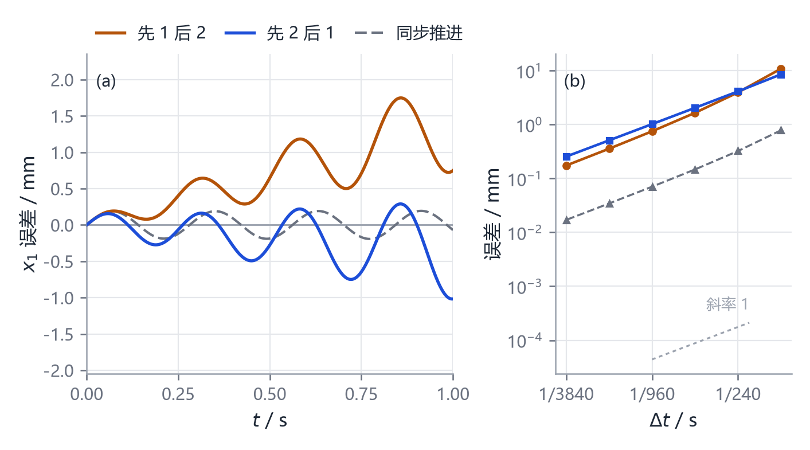
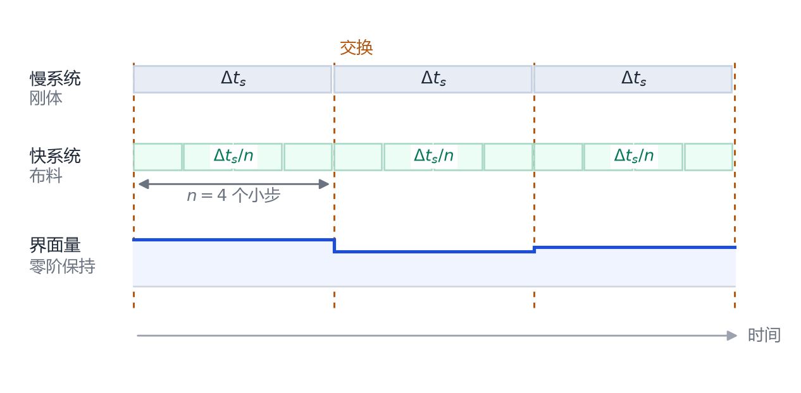

# 第 8 章 多物理场耦合与异步

> 本章导读：同一件湿衣服贴在同一个角色身上，只把求解顺序换一下，最后停在的位置就差几厘米；布料的步长为什么必须比刚体小几十倍；CPU 算刚体、GPU 算流体时，那一帧的滞后到底买到了什么、又付出了什么。

## 8.1 同一场景，两种顺序

一个角色跑动，身上挂着一件湿的布料。刚体负责身体，粒子加约束负责布料，两套求解器各跑各的，每帧在中间交换一次：刚体把表面速度给布料，布料把反作用力还给刚体。

把交换的顺序改一下——原来是先算布料再算刚体，改成先算刚体再算布料——同一段动画，布片最终停下来的位置会差上几厘米。密度越接近，差得越多；密度差得远（比如布料对着空气），差别就小到看不出来。除了位置，还有一层更细微的差别：有时候布片悬在身体表面上方一点点，有时候陷进去一点点。这不是穿模，两个解都满足约束，只是它们解的方程不完全一样。

原因是分区耦合的固有结构。整个耦合系统是一组方程，分区法把它拆成两块，各自用自己的求解器。中间那一次交换，在数值上相当于对方程组做了一次 Gauss-Seidel 迭代——只做一次，没有迭代到收敛就往下走了。于是每一步都留下一块没解干净的部分，这部分正比于步长，两种顺序留下的符号相反：先算的那一块用的是旧的界面量，等于慢了半步；后算的那一块用的是刚算出来的新值，等于快了半步。

这件事可以用一个最小模型看清楚。两个质量块由一根弹簧连着，$m_{1}=1\ \mathrm{kg}$、$m_{2}=4\ \mathrm{kg}$、$k=400\ \mathrm{N/m}$，初始给一个反向的位移，然后放手。三种推进方式：两块同时算（真正的耦合）、先算 1 再算 2、先算 2 再算 1。后两种就是分区耦合在最小规模上的样子。

结果是可算的，图 8-1 就是算出来的。$\Delta t=1/960\ \mathrm{s}$ 时，先 1 后 2 的位移误差在一秒后是 $+0.75\times10^{-3}\ \mathrm{m}$，先 2 后 1 是 $-1.02\times10^{-3}\ \mathrm{m}$；再往前看，两条曲线的峰值分别到 1.7 mm 和 1.0 mm，而同样步长下同步推进的峰值不到 0.2 mm。初始振幅只有一厘米，也就是说分裂误差占了振幅的一成到两成。把步长减半，两条误差曲线都跟着减半——这是典型的一阶行为，图上双对数坐标的斜率就是 1。

<figure class="fig">

<figcaption><b>图 8-1</b>　耦合顺序对位移误差的影响。一维双质量块模型，$m_{1}=1\ \mathrm{kg}$、$m_{2}=4\ \mathrm{kg}$、$k=400\ \mathrm{N/m}$，初始位移 $\pm0.01\ \mathrm{m}$。左：$\Delta t=1/960\ \mathrm{s}$ 时两种顺序的位移误差随时间，参考解为解析解，同步推进作对照；两条曲线朝相反方向张开，包络随时间缓慢增长。右：$t=1\ \mathrm{s}$ 时的误差绝对值随 $\Delta t$ 的变化（双对数），两族点列的拟合斜率都约为 1，虚线为斜率 1 的参考线。</figcaption>
</figure>

有一点值得强调：两种顺序都不是真解。真解是两块同时推进的那条线，也就是图上贴着零的那条虚线。分区耦合做的是在两条偏离的曲线之间挑一条，所以"哪种顺序更对"没有答案，能问的只是"这种顺序的偏差有多大、方向可不可控"。实际项目里量这个偏差有一个便宜的做法：用两倍的子步数再跑一遍同一段，把两次结果相减，差值的量级就是分裂误差的量级。这个方法不需要解析解，也不需要对任何一侧的求解器做改动，适合在调参时随手用。

一阶误差有个难受的性质：它不会自己消失，只会随步长缩小。想把它压下去有三条路。一是每步内多做几轮交换，让 Gauss-Seidel 迭代两三次，误差按迭代次数下降，代价是按倍数增加。二是把顺序对称化：半步 A、整步 B、半步 A，两个半步的滞后在时间上互相抵消，误差降到二阶，代价是多一次半步求解和一套更复杂的调度。三是干脆不分块，把两个子系统放进一个系统一次解完，8.6 节再说。

## 8.2 子循环：快慢分开走

同一块布，把弯曲刚度调硬一档，$1/60\ \mathrm{s}$ 的步长会直接炸开，降到 $1/2400\ \mathrm{s}$ 就稳。同一时刻，场景里那个刚体在 $1/2400\ \mathrm{s}$ 下毫无必要——它在 $1/120\ \mathrm{s}$ 就已经足够准了。如果统一取小步长，刚体那部分白算了二十倍。

子循环就是为这种情况准备的：慢的子系统走大步，快的子系统在大步内部走若干个小步，界面量在大步内保持不变或者线性插值。图 8-2 是这条时间线的样子，横轴是时间，两条轨道分别是慢系统与快系统，竖直虚线标出交换发生的时刻。

<figure class="fig">

<figcaption><b>图 8-2</b>　子循环的时间线（示意图）。慢系统按 $\Delta t_{s}$ 推进，快系统在每个大步内推进 $n$ 个小步 $\Delta t_{f}=\Delta t_{s}/n$；竖直虚线是界面数据交换时刻。浅蓝色带表示界面量在大步内被零阶保持，快系统看到的耦合力是阶梯状的。</figcaption>
</figure>

阶梯状的界面量是一个真实的问题。快系统每个小步都读同一个界面力，等于每隔 $\Delta t_{s}$ 被踢一脚，踹出来的响应在快系统的频带里，看上去像一层细密的高频抖动。改用线性插值可以把这个抖动压下去，但插值出来的力不等于任何一个时刻真实的力，动量不再严格守恒，长时间的漂移会累积。两种做法都不完美，实际工程里通常选零阶保持，再靠快系统自身的阻尼把抖动吃掉。

子步数不能凭感觉定。快系统的稳定条件给出一个临界步长，$\Delta t_{f}$ 必须小于它，于是 $n=\lceil \Delta t_{s}/\Delta t_{f,\mathrm{crit}}\rceil$。取整到 2 的幂便于对齐和回滚。如果算出来 $n$ 是三十几，那说明要么快系统的刚度不合理，要么该考虑隐式积分——用子循环硬扛三十倍的计算量，通常不如把刚度的处理改成隐式。

还有一个容易被忽略的麻烦：两个子系统的时间网格不再对齐。渲染要的是帧边界上的状态，慢系统恰好落在帧边界上，快系统在大步结束时的状态也是对齐的，所以看起来没问题；但只要帧率与物理步长不是整数倍，就会有一层插值。状态插值本身不难，难的是插值之后还要满足约束——把布料顶点的位置线性插值，边长会变短，约束被破坏一点点，下一帧的求解器要花额外的迭代把它拉回去。回滚更麻烦：要回到某个时刻，慢系统存一份状态就够，快系统得把大步内所有小步的状态都存下来，或者接受重算。

小步长本身是有价值的。步长变小，接触的处理变简单，穿透和抖动都少，冲量法的收敛也更稳；在并行硬件上，小步长的额外计算并不像看上去那么贵，因为每一步的内部并行度足够填满机器 [@macklin2019]。这是子循环在实时引擎里流行的真正原因：它不是省计算，它是用便宜的计算换稳定。

## 8.3 异步流水与一步滞后

刚体在 CPU 上算，流体在 GPU 上算，中间每帧拷一次界面数据。如果每帧都等 GPU 算完再把结果拷回来，CPU 有大半时间在等；如果不等，GPU 用的是上一帧的界面位置，CPU 用的是上上帧的力。

这叫一步滞后。帧率上去了，耦合却变了性质：两个子系统之间插入了一段延迟，物理上相当于给界面加了一根软的、带延迟的弹簧。延迟在反馈回路里是相位滞后，回路增益接近 1 的时候就会振荡。用最小模型可以看清：把弹簧力滞后一步再积分，稳定域会明显收缩，原本在 $\omega\Delta t\lt 2$ 内稳定的显式格式，滞后之后能承受的 $\omega\Delta t$ 更小，超了就发散。

这里要分清楚两个量。带宽是每秒能搬多少字节，延迟是一次往返要多久。跨界面的数据量通常很小——一张表面网格、几千个接触点、一层界面上的压力，加起来往往不到一兆字节；而一次同步的往返延迟在几十微秒的量级，换算成带宽是几十兆字节每秒的等效值，反而成了瓶颈。所以优化方向不是压缩数据，而是减少同步次数，以及把内存分配成可以直接被设备读写的形式，省掉一次中间拷贝。

工程上的做法是把等待变成重叠：双缓冲，一边算这一帧，一边把上一帧的界面数据传出去；用 fence 或者事件对象保证"读到的是完整的一帧"；只在界面数据上同步，不要为了省事把整个状态同步一遍。这样延迟仍然存在，但只有一步，而且这一步是可控的。

代价在别处。异步之后，结果依赖线程调度和传输时序，同一份输入跑两遍可能不一样；回放、确定性测试、跨机器对比全部失效。要逐位复现，就必须在每个交换点插入同步，异步带来的那点重叠收益也就没了。这是一个必须提前决定的选择，不能等到需要回放的时候才发现。

## 8.4 界面上的力怎么传

两个子系统之间传的到底是什么？对流体与固体，通常传力和速度；对粒子与网格，传质量和动量。无论传什么，两个方向的算子必须互为转置。

以粒子和网格为例。粒子把质量散布到网格上，每个粒子按双线性权重 $w_{p}$ 分给四个格子，格子的质量是 $m_{i}=\sum_{p}w_{p}m_{p}$。网格解完之后，要把速度收集回粒子，用的是同一个权重：$v_{p}=\sum_{i}w_{p}v_{i}/\sum_{i}w_{p}$。这两步看起来是两件事，实际上是一个算子 $\mathbf{S}$ 和它的转置 $\mathbf{S}^{\mathsf{T}}$。写成矩阵就是：散射是 $m=\mathbf{S}\mathbf{m}_{p}$，收集是 $v_{p}=\mathbf{S}^{\mathsf{T}}v$。散和收用同一组权重，正是转置关系的具体形态 [@macklin2014]。

这个对应关系一旦破坏，动量就守恒不了。假设散射用双线性（每个粒子分给四格），收集却图省事用最近邻（只读一格），那么粒子散布出去的动量是四个格子的加权和，收回来只是其中一个。差额留在网格上，下一帧又被别的粒子捡走，表现为物体在没有外力的情况下缓慢地自己推动自己——这种漂移在几分钟的模拟里能积累到肉眼可见。

守恒是可以检查的，而且应该每帧检查：把所有粒子的动量加起来，加上网格上的动量，得到总动量；这一步的变化量应该等于外力冲量。差得超过舍入量级，就是转置关系错了，或者界面上有量被重复计算、漏算。

力的方向和权重也要成对。粒子把力施加给流体，流体必须把等大反向的力还给粒子，而且两个方向要按同一组权重分配。如果散射时一个粒子把力摊给四格，收集时只从一格读回反作用，那么界面两侧受到的力就不相等，系统的总动量每帧都会漏一点，漏的方向固定，表现为整体朝某个方向缓慢加速。这类错误在短测试里看不出来，跑上几千帧才明显，排查时要先做动量账。

插值的阶数决定了界面的"软硬"。双线性权重把粒子的影响摊到两格宽，等于给界面加了一个宽度约为两格的空间滤波器。接触在这种界面里会显得软，穿透的深度和网格尺寸同量级；想让接触变硬，要么提高权重阶数，要么在界面处引入鬼流体，用镜像的方式补出另一侧的场。前者便宜但不彻底，后者彻底但要在界面附近加一层特殊的处理逻辑。

## 8.5 密度比：显式耦合的死穴

一个气泡从水底升起来。气泡的质量几乎可以忽略，但它排开的水有实打实的质量。如果用显式耦合——这一帧用旧的压力更新气泡速度，水下一帧才响应——气泡会被推得过了头，下一帧水给出一个更大的反向力，再下一帧更大，几十帧内就发散。这不是参数没调好，是格式本身在密度比趋于极端时不稳定。

把它写成增益就清楚了。固体质量 $m_{s}$，排开的流体质量记作 $m_{f}$（也就是附加质量的量级）。一帧之内，固体收到界面力后速度改变约 $F\Delta t/m_{s}$；流体在下一帧看到这个新速度，按自己的惯性给出反作用，量级是 $m_{f}$ 乘上速度改变。于是这一轮交换的放大因子大致是 $m_{f}/m_{s}$ 的函数：当 $m_{f}\lt m_{s}$，反馈是衰减的；当 $m_{f}$ 接近 $m_{s}$，反馈接近等幅，误差不衰减也不放大，但会一直累积；当 $m_{f}\gt m_{s}$，反馈放大，交错迭代发散。

附加质量有一个经典的量可以对照。势流里一个球做加速运动，周围流体被带着一起动，等效于球的质量增加了排开流体质量的一半。也就是说对球来说 $m_{f}\approx 0.5\,m_{\mathrm{disp}}$，其中 $m_{\mathrm{disp}}$ 是排开流体的质量。于是显式耦合的临界点落在固液密度比大约 0.5 附近，而不是 1：密度比 1 的物体已经处在放大区里了。

这条线解释了很多经验。钢球落水（密度比约 7.8）、石块落水（约 2.7），显式耦合完全够用，因为固体的惯性远大于附加质量。木头（约 0.6）、塑料浮球（约 0.2）、气泡（约 $10^{-3}$），显式耦合必炸，必须换做法。同一套代码，石头跑得好好的，木头就飞了，问题往往出在这里而不是接触参数。

三条出路。把界面力放进隐式求解里，让固体在更新速度时就知道流体这一帧会给多大反力；或者在每一步内多交换几轮，把误差按轮数压下去；或者给固体一个"有效质量"，用 $m_{s}+m_{f}$ 代替 $m_{s}$ 做近似，相当于给交错迭代加了一个预条件。三者的代价依次降低，效果也依次降低，浮球这类极端情况通常只有第一条路走得通。

## 8.6 迭代耦合与整体求解

分区耦合往上走一步就是迭代耦合：每步内交换 $k$ 轮，直到界面量收敛。收敛是线性的，收敛率与密度比有关——密度比越接近 1，收缩因子越接近 1，需要的轮数越多。当 $k$ 大到接近整体求解的成本，却还是只有线性收敛，就该考虑换方法了。

整体求解把所有子系统的未知量放进同一个系统，一次 Newton 解掉。它没有分裂误差，步长可以取得大，而且如果势能构造得对，可以证明迭代过程中不穿透、不翻转。接触密集的场景里这条路很有吸引力：IPC 用增量势能加对数障碍，把接触、摩擦、弹性放进同一个优化问题，每一步解一个大线性系统 [@li2020]。单次迭代的成本远高于投影法，但它把"接触顺序"这个问题彻底消掉了——没有约束的先后，也就没有顺序依赖。

迭代耦合的收敛判据要按相对量写。界面的位移残差除以界面上的特征位移，力的残差除以特征力，两者都降三个量级才算收敛；用绝对量做判据，场景尺度一变就得重新调。另一个细节是松弛：直接把新算出的界面量拿去用，迭代常常振荡，取新旧值的加权平均（松弛因子小于 1）能稳住，代价是收敛更慢。这个松弛因子和密度比是绑在一起的，密度比越接近 1，需要的松弛越重。

代价在实现和并行上。整体求解要一个能解大规模稀疏系统的线性求解器，要处理条件数，要在大变形下保证 Newton 收敛；而且全局求解的并行度天然不如逐元素的核函数，GPU 上能拿到的加速比往往低于分区法。所以它不是无条件的更优解，而是当耦合足够强、步长足够大时，总账才会翻过来。

判断的依据是耦合强度。密度比接近 1、接触数量远大于自由度、需要大步长——这三条里中了两条，整体求解通常划算。气固两相、稀疏接触、弱耦合，分区法更快也更省事。

## 8.7 工程取舍

真正做决定时，问题会以很具体的形式出现，可以按顺序过一遍。

时间尺度差多少？差十倍以内，统一步长最省事；差几十倍，子循环；差上百倍，说明快的那个子系统该换成隐式，或者该把它平均掉。

密度比是多少？大于 2 可以放心用显式分区；1 到 2 之间要加迭代；小于 1 必须隐式或者整体求解。这个判据比任何调参经验都可靠。

要不要可回放？要，就不能有异步，也不能有依赖调度的原子加。这一点会直接排除掉流水线重叠和异步传输，性能预算要相应放宽。

每帧能给耦合留多少时间？耦合本身的成本常常不是大头，大头是同步点和数据搬运。把交换次数从每帧一次降到每几步一次，往往比优化求解器更有效——前提是 8.1 节的分裂误差还在可接受范围内。

还有一件常被忽略的事：耦合的接口要定得窄。两个子系统之间只交换界面上的量，不要让一侧直接读另一侧的内部状态。窄接口的代价是偶尔要多一次转换（比如把刚体表面重采样成粒子），好处是任何一侧换实现时另一侧不用动，也能在调试时把一侧换成记录好的数据回放，把问题锁在一侧内部。

最后一条不在数值范畴里：这套耦合要调试多久。分区法的好处是两个子系统可以分别验证，出错时能定位到哪一侧；整体求解一旦不收敛，面对的是一个几千维的非线性系统，排查成本高一个量级。工程上很多选择不是为了更快，而是为了在出问题时还能查得动。
