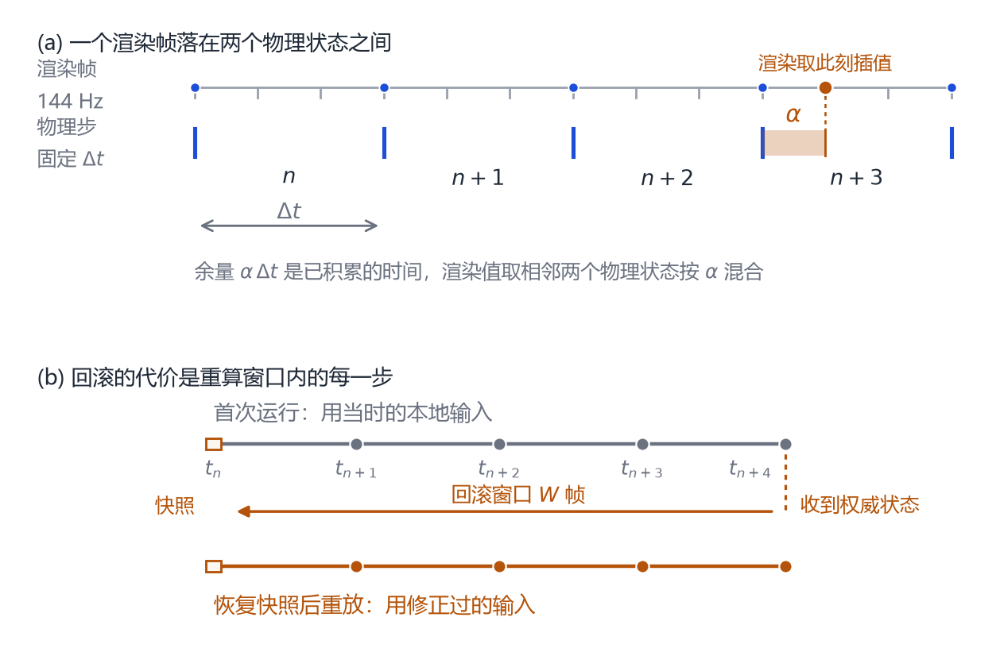
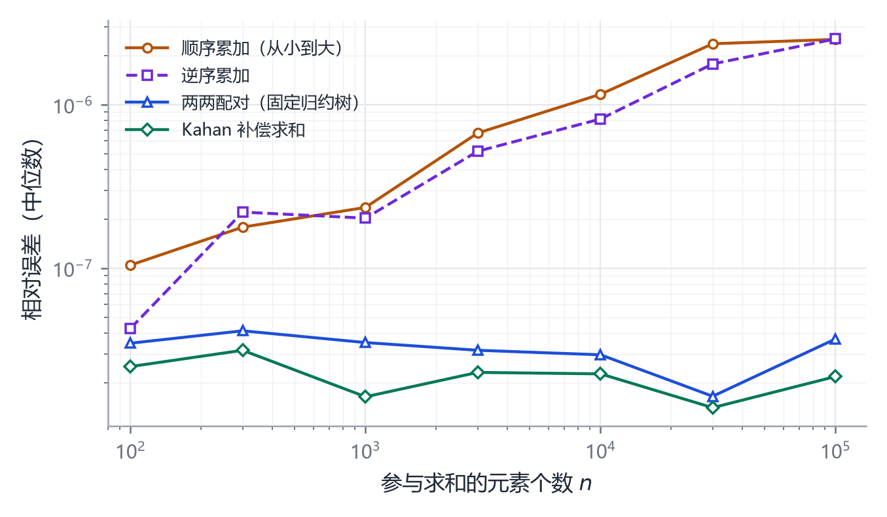

# 第 9 章 实时引擎：固定步长、确定性与回滚

摄像机跟着一只箱子沿地面匀速滑动。屏幕刷新 144 Hz，物理每 16.7 ms 走一步。把这段录下来逐帧看，箱子不是滑过去的，是一跳一跳地走：跳一次，停一两帧，再跳。量一下每跳的间距，正好是速度乘以六十分之一秒。显示器越快、分辨率越高，这个跳越刺眼。

另一个场景。两台机器跑同一款游戏，录下同一段操作，前三十秒一模一样，第四十秒开始分叉，球撞墙后的反弹角差了半度，一分钟后位形完全不同。玩家甲说自己先开的枪，玩家乙说服务器判他赢，两边的截图都不是伪造的。

这两个症状看着无关，根子是同一个：模拟吐出来的不是一条连续曲线，是一串离散状态。这串状态什么时候产生、由谁计算、能不能在另一台机器上用同样的输入重算出一模一样的结果，这三件事决定了实时引擎能不能用。这一章讲这串状态的管理。

## 9.1 画面在抖，物理没抖

先把抖动量算清楚。物体以速度 $v$ 匀速平移，物理步长 $\Delta t$，渲染时刻落在两个物理状态之间。如果渲染直接用最近的那个状态，屏幕上看到的位置就在两个采样点之间来回跳，最大偏差是

$$
e_{\max} \le \frac{v\,\Delta t}{2}
$$

$v$ 是米每秒，$\Delta t$ 是秒，$e_{\max}$ 是米。取 $v = 8$ m/s、$\Delta t = 1/60$ s，偏差上限 6.7 cm；画面上 1 米对应 100 像素，就是近 7 个像素的往复。人眼对静止背景上的这种往复极其敏感，比同等幅度的随机噪声刺眼得多。

这不是渲染的问题，是采样的混叠。用 30 帧每秒拍一只摆动的钟摆，回放时摆锤会跳动甚至倒转；物理状态被渲染器“拍摄”的频率不够，同一个道理。区别在于摄像机拍的是真实世界，只能接受；物理状态是我们自己产的，可以选择什么时候取样。

三条路摆在面前。

第一条是提高物理频率。60 Hz 提到 240 Hz，抖动幅度降到四分之一。代价直接：每帧四倍的力计算、四倍的碰撞检测、四倍的求解器迭代，而迭代次数通常不会因为步长变小而减少。对某些系统还会更糟，库仑摩擦在极小步长下的静摩擦判定容易被数值噪声主导，物体开始自己哆嗦。

第二条是插值，把相邻两个物理状态按时间比例混合。代价是一个步长的延迟，画面比真相晚 16.7 ms。这条是绝大多数引擎的选择。

第三条是外推，用速度把状态往前推。理论上零延迟，实际上遇到碰撞就穿模——外推不知道墙在哪里。

## 9.2 固定步长、累加器与插值

为什么不能直接拿渲染帧间隔当步长，三个理由。

稳定性排第一。显式积分的稳定条件由系统里最快的模态决定，$\Delta t \lt 2/\omega_{\max}$，$\omega_{\max}$ 是最高的角频率，来自最硬的弹簧或最小的质量。帧间隔一抖，某些帧就越界，越界的那一帧往系统里注入一大笔能量，观察到的现象是“平时好好的，一切场景就炸”。

一致性排第二。隐式求解里的阻尼量、接触的穿透修正系数、约束的软化刚度，全是按 $\Delta t$ 标定的。步长变了，同一组参数给出不同的软硬：30 Hz 下软绵绵的布料，144 Hz 下硬得像塑料板。

可复现排第三。如果这一步的 $\Delta t$ 由当时机器忙不忙决定，$\Delta t$ 就成了状态的一部分，轨迹依赖帧率，回放和联机都不可能对上。

固定步长的落地方式是累加器。每帧把真实经过的时间加进一个计数器 $a$，只要 $a \ge \Delta t$ 就执行一步并把 $a$ 减去 $\Delta t$；剩下的 $a$ 除以 $\Delta t$ 得到混合系数 $\alpha$，落在零到一之间。渲染时取

$$
\mathbf{x}_{r} = (1-\alpha)\,\mathbf{x}_{\text{prev}} + \alpha\,\mathbf{x}_{\text{cur}}
$$

$\mathbf{x}_{\text{prev}}$ 与 $\mathbf{x}_{\text{cur}}$ 是最近两步的状态，$\mathbf{x}_{r}$ 交给渲染。这一行就是消除第一节那个台阶的全部。

累加器有一个必须加的保险。如果一步的耗时超过了 $\Delta t$，累加器只会越积越多，帧率持续下滑，每帧要跑的子步更多，耗时更长——这个正反馈叫死亡螺旋，一旦进去出不来。做法是设上限 $n_{\max}$，比如 5 步，超出的部分直接丢掉。丢掉时间让模拟变慢，游戏里表现成慢动作，但画面还在动，玩家能操作。现实里时间是要欠账的，欠了就得抹掉。

插值的账要算清。渲染的时刻其实在过去：平均滞后半步，最坏滞后一整步。对高速物体这不小，一辆 36 km/h 的车，16.7 ms 走 0.17 m，差不多是一个车身位。所以常见的折中是分层：相机和玩家角色用外推或带阻尼的预测，背景物体用插值，反正它们慢。

姿态不能照搬这个公式。两个四元数 $\mathbf{q}_0$ 与 $\mathbf{q}_1$ 做线性插值再归一化，叫 nlerp，路径是对的但角速度不匀，中间转得快，两端慢。要匀速得用 slerp，代价是一次反三角和一次除法。移动端常折中成 nlerp 加两段细分，误差足够小。

还有一个细节容易漏：插值之后的位置和速度对不上。$(\mathbf{x}_{r} - \mathbf{x}_{\text{prev}})/\Delta t$ 不等于任何一步算出来的速度。相机如果直接跟随插值位置，观感上会有轻微的速度断续，压掉的办法是给相机加一阶低通。

图 9-1 把这条时间线画了出来，下半部分是回滚时发生的事，第 9.6 节再解释。

<figure class="fig">

<figcaption><b>图 9-1</b>　固定步长与回滚的时间线（示意图）。(a) 渲染帧与固定步长的物理步不在同一节拍上，落在两步之间的渲染时刻按余量 $\alpha$ 插值；(b) 本地先跑到 $t_{n+4}$，收到权威状态后恢复 $t_n$ 的快照，再用修正过的输入重放这一段。图中步长比例不代表真实耗时。</figcaption>
</figure>

## 9.3 确定性的三个前提

位级确定性指同一份二进制、同一串输入，两次运行中每个浮点数的每一位相同。统计确定性弱一些，只要求宏观量一致，允许末位漂移。

三个前提，缺一不可。

相同初状态。不只是位置和速度，还包括姿态、上一帧的力累加器、休眠计时、接触缓存、约束求解的热启动冲量，以及随机数发生器的完整内部状态。初状态漏一项，第二次运行的每一步都在另一条轨道上。

相同输入序列，并且施加顺序相同。一次按键落在第 37 帧还是第 38 帧，轨迹就不同；同一帧内两个输入谁先谁后，也要固定。多数引擎把输入收集成按固定次序排列的队列，就是为了这一条。

相同运算顺序。这一条最容易被忽略，因为它不在源码里，而在编译产物、库函数和线程调度里。9.4 节展开。

位级确定性不等于物理正确。一个用半隐式 Euler、步长偏大、能量持续注入的引擎，可以完全确定——它会稳定地重复同一个错误。反过来，一个用误差估计自适应调步长的高精度求解器，通常不确定，因为步长序列依赖舍入。确定性是一个关于“可重复”的性质，不是关于“准确”的性质。

用途比想象中广。录像回放只存输入不存状态：一段十分钟的对局，输入几 MB，逐帧状态几百 MB，差两个数量级；网络同步只传输入，带宽降下来；自动回归测试比对状态哈希而不是画面截图的像素，几秒钟跑完；训练里同一套超参跑两遍，要能拿到同一条曲线。

[@todorov2012] 的引擎面向模型基控制，接触用凸优化的软约束处理。它给出的不是“正确的接触序列”，而是一组一致、可预测的行为，因为控制策略对动作的可重复性的要求高于对物理真实的要求。这类引擎的确定性目标是“同一个模型跑一千次，学到的东西不变”，比位级弱，比统计强。

[@makoviychuk2021] 走的是另一条路：把上万个独立的小环境塞进一张 GPU。环境之间不通信，确定性因此收缩到单个环境内部——只要环境到块的映射固定，每个环境自己的轨迹就固定；环境之间谁先跑完、谁后跑完，不影响任何结果。这是确定性最省事的一种形态：把并行切开在互不干扰的地方。

## 9.4 谁弄丢了确定性

浮点加法不满足结合律：

$$
(a+b)+c \ne a+(b+c)
$$

单精度有 24 位有效位。$10^{8}$ 附近的间隔（ulp）是 8，所以 $10^{8}+1$ 会舍回 $10^{8}$。拿三个数 $10^{8}$、$-10^{8}$、$1$ 做实验：从前往后加，前两个先抵消得零，再加 1，答案是一；从后往前加，$-10^{8}+1$ 先被舍成 $-10^{8}$，再加上 $10^{8}$，答案变成零。同一组数，只换了结合顺序，一个得一一个得零。

并行归约把这个差别放大成灾难。八线程各加一段再合并，与单线程从头加到尾，分组不同，结果不同；合并的次序还依赖线程完成顺序，同一个程序两次运行都可能不同。压住它的办法是固定归约树：切成固定大小的块，比如每块 1024 个元素，块内顺序相加，块间按二叉树合并。树的形状只由元素个数决定，与线程数、块映射、调度都无关。

库函数是第二类来源。IEEE 754 强制精确舍入的只有加、减、乘、除、开方和比较，$\sin$、$\cos$、$\exp$、$\log$ 不在其列。不同版本的 libm、不同的向量化实现，最后一位可以不同。这不是实现者偷懒，而是超越函数没有唯一的正确舍入结果可供对齐，各家在速度与精度之间各选一点。

第三类是编译器。$a \times b + c$ 可以收缩为一条融合乘加指令，中间结果不落内存，少一次舍入，指令数也少一条——省了时间，改了结果。开启快速数学选项后，编译器被允许重排表达式、假设不存在 NaN、用倒数近似代替除法，每一项都在动末位。x87 时代的 80 位中间结果属于同一族问题：寄存器里比内存多 16 位，什么时候溢出，取决于编译器把值留在寄存器多久。

这些来源的分布很不均匀。一个只做刚体碰撞的场景，可能跑十万帧都不分叉；一旦加了流体求解器（归约多）、加了布料（迭代次数依赖收敛判据）、加了噪声驱动的粒子（超越函数多），几十帧就能看出来。

处理办法按代价从低到高排。把归约改成固定树，几乎免费。编译选项里禁掉收缩与快速数学，牺牲百分之几的速度。自带一套超越函数实现，只依赖四则运算与开方，跨平台一致但慢，而且写起来需要多项式系数。全程双精度，带宽翻倍，在 GPU 上通常不可行——这也是为什么跨平台的位级确定性最后往往落到定点数上。

## 9.5 定点数

把实数映射成整数：$x = k/2^{Q}$，$k$ 是整数，$Q$ 是小数位数，存储时只存 $k$。Q32.32 这类写法表示整数部分（含符号）32 位、小数 32 位。

范围和精度互相挤压，两者之和是总位宽。用 64 位有符号整数、$Q = 32$，可表示的范围是 $\pm 2^{31}$，约正负二十一点五亿，精度是 $2^{-32}$，约 $2.3\times10^{-10}$。把 $Q$ 提到 44，精度到 $5.7\times10^{-14}$，范围只剩 $\pm 5.2\times10^{5}$。选 $Q$ 就是选你要多大的世界、多细的刻度。

乘法要移位。两个定点数相乘，真实值是 $k_a k_b / 2^{2Q}$，所以结果取 $(k_a k_b + 2^{Q-1})/2^{Q}$，加那一项是四舍五入。中间乘积的位宽是 $2Q$ 再加整数部分的位，$Q = 32$ 时接近 96 位，64 位装不下，得用 128 位整数；GPU 上 128 位乘法要拆成三条 64 位乘法再进位拼装，代价不低。

除法先左移 $Q$ 位再整除，左移可能溢出，要提前判断量级。开方用整数牛顿迭代，初值取位长的一半，迭代到收敛；迭代次数固定，所以结果可复现，这一点比浮点的 sqrt 还干净。

负数右移是一个隐蔽的坑。对负数的算术右移在 C++20 之前是实现定义行为，编译器可以选向零取整或向负无穷取整，同一个表达式在两家编译器上差一。用除法、或者先加偏移再移位，可以绕开，但得想起来。

什么时候值得用。需要跨平台位级一致时，比如老式即时战略的锁步同步：所有玩家的机器只交换操作指令，必须算出完全相同的战场。需要在不同编译器、不同架构、不同年代的机器之间重放录像时。还有本来就该用整数的场合，比如空间哈希的格坐标、碰撞对的打包键——那里用浮点反而要先转成整数索引。

什么时候不值得。GPU 上大规模并行是典型：整数乘法吞吐一般低于单精度浮点，128 位乘要拆，寄存器压力大，而单张卡上同内核、同块映射的浮点顺序本来就是可复现的，跨设备才出问题。多数引擎因此混用：离散量（格坐标、哈希键、排序键、帧号）用整数，连续量（位置、速度、应力）用浮点，跨平台同步靠传状态快照，不靠重算。

## 9.6 快照与回滚

快照是把整个模拟状态按字节拷出来。麻烦在“整个”这两个字。

一个刚体的状态不只是位置和姿态，还有线速度、角速度、上一帧的力累加器、休眠计时、接触缓存、约束求解的热启动冲量。热启动量尤其容易被漏掉：它不影响物理正确性，只影响迭代的起点，漏了它，回滚后的轨迹和第一次跑的不一样。漏字段是回滚缺陷的第一大来源，症状还特别隐蔽——回滚后大部分物体正确，只有一两个在几十帧后偏了一点，看起来像是“偶发”。

查的办法是把状态缓冲区当一整块连续内存做哈希。两个版本的哈希一对，就知道哪几个字节不同；再按字段切分比对，几分钟能定位到具体成员。

环形缓冲是标准结构。保留最近 $W$ 帧的快照，写满覆盖最旧的一帧。$W$ 由最坏网络延迟除以步长决定：往返 100 ms、步长 16.7 ms，需要 6 帧，留余量取 8。

两头的成本要一起算。拷贝一侧：十万个刚体，每个 52 字节（位置 3、四元数 4、线速度 3、角速度 3，共 13 个单精度），一帧 5.2 MB，按 20 GB/s 的内存带宽约 0.26 ms，比一步物理便宜，可以每帧都存。重算一侧：最坏要重跑 $W$ 帧，每步 2 ms 的话就是 16 ms 的尖峰，正好吃掉一帧的预算。所以窗口不能给太大，且要能监测到尖峰后临时降频。

优化沿着三个方向。数据量方向：只存脏页，大多数物体在大多数帧里没动；位置用增量编码。延迟方向：把快照留在显存里，避免主机与设备之间的往返。结构方向：把状态按“每帧都会变的”和“很少变的”分成两段，前者每帧存，后者按需存。

还有一类东西快照管不住：外部副作用。粒子生成器消耗的随机数、音效触发、统计计数、已经提交给渲染的顶点缓冲。回滚世界状态不会回滚这些，表现出来是“回滚之后音效多响了一次”“粒子比上次多了一批”。要么把它们纳入状态一起回滚，要么让它们只依赖能从状态推导出来的量。

## 9.7 预测、校正与怎么测

服务器是权威，客户端不能等。往返 100 ms 意味着一按键到看见反应要 100 ms，手感立刻垮掉。做法是客户端先按本地输入把世界往前推，同时把输入发给服务器；服务器算完回一个带帧号的状态，客户端拿来比对。

比对出误差就回滚：恢复到服务器给出那一帧的快照，把本地缓存的后续输入重放一遍。重放如果还是对不上，说明两边规则不同，通常就是 9.4 里那几类原因；这时只能接受服务器的结果，并把误差摊到几帧里慢慢挪。瞬移会让人以为网络卡了，连续几帧各挪一点，观感好得多，代价是位置收敛慢一点。

另一类回滚是给对手用的。射击游戏里，你按下开火的那一刻，屏幕上敌人还在掩体外，那是因为你的画面滞后了 50 ms；服务器要把其他玩家回滚到你按下开火的那一帧再判定命中。这叫延迟补偿，它让“看到什么就能打中什么”成立，代价是被打的一方觉得莫名中弹。

测试确定性分三层。

第一层是状态哈希。每帧算一个 64 位哈希写进日志，两台机器跑同一段输入，哈希序列逐帧对比，第一个不同的帧号就是分叉点。这一招把“四十秒后不一样”变成“第 1043 帧不一样”，剩下的工作立刻具体。

第二层是缩小范围。在分叉那一帧停下，把状态逐字段导出，看哪几个字节不同；再往前一步，看是哪一步运算产生的。常见结论是某个归约的分组变了，或者某个库函数换了实现。这里的能力来自缓冲区布局：字段连续、有名字、有偏移表，比对才有意义。

第三层是配置矩阵。同一份输入跑一遍：单线程与多线程、单精度与双精度、开与关快速数学、本机与另一台机器。每一项都跑到位级一致，才算真的确定。更实际的做法是守住“所有人在同一份构建上比对”，把跨平台一致性当成一个单独的功能来验收，而不是默认它成立。

图 9-2 用一个具体例子说明第一层为什么必要：同一个数组，四种求和顺序，误差差两个数量级，而且“从前往后顺序加”这种最自然的写法，结果并不比别的顺序更接近真值。

<figure class="fig">

<figcaption><b>图 9-2</b>　不同求和顺序的舍入误差（真实计算）。数组元素在 $[0,1]$ 上均匀抽取，单精度累加，以双精度结果为参考。顺序累加、逆序累加、两两配对（固定二叉归约树）、Kahan 补偿求和四条曲线，纵轴是相对误差，横轴是元素个数。每点为 32 组随机样本的中位数，元素个数从 $10^{2}$ 到 $10^{5}$，七组。n 到 $10^{5}$ 时顺序累加的相对误差约 $2.5\times10^{-6}$，两两配对与 Kahan 都停在 $10^{-8}$ 附近。</figcaption>
</figure>

这里的教训不是“Kahan 最好所以都用它”。补偿求和要多一次减法，吞吐降一截；真正的结论是顺序决定结果，所以顺序必须是规格的一部分，写进设计文档，而不是交给调度器临时决定。
